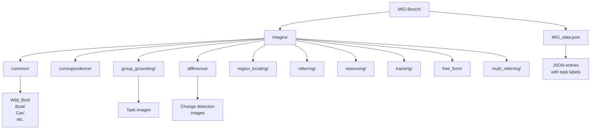
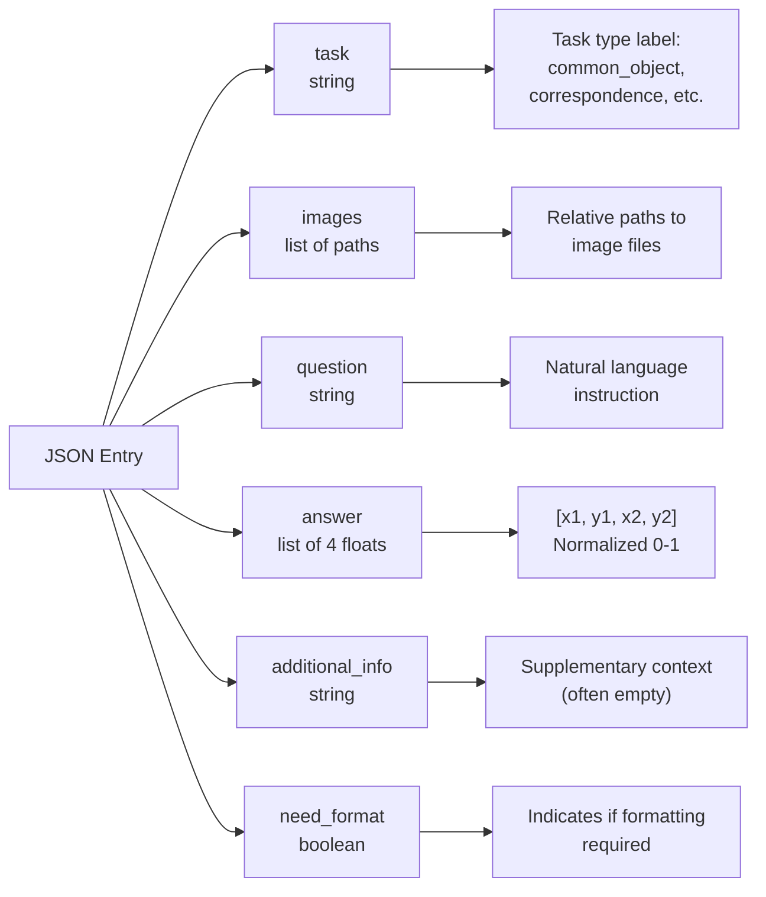
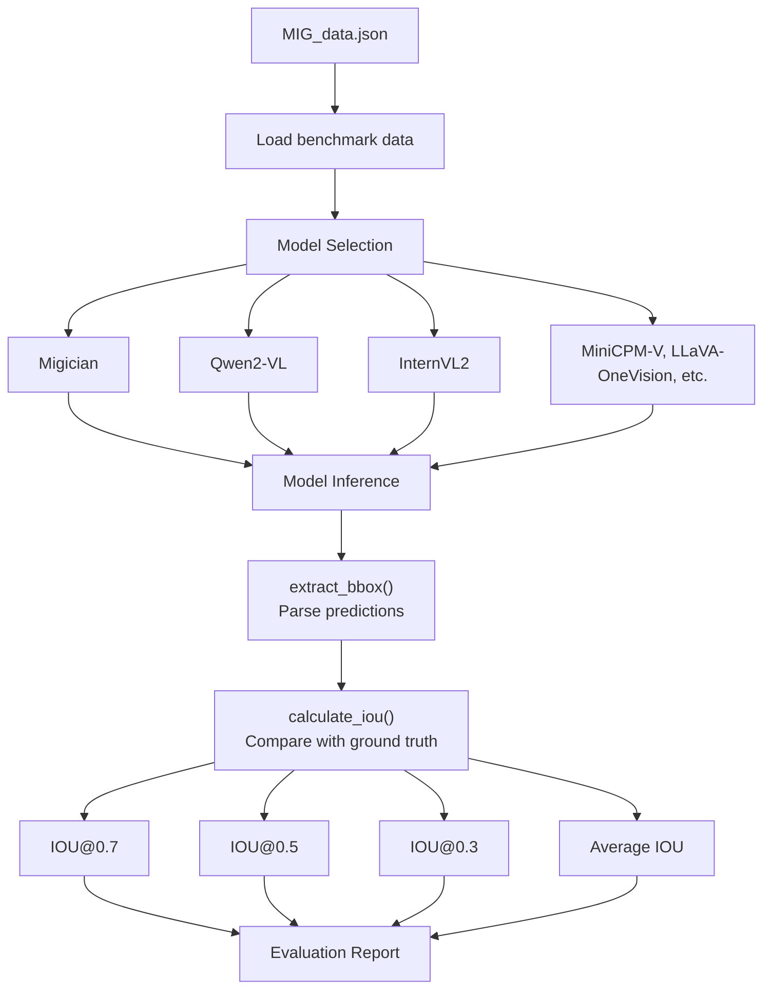
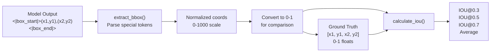
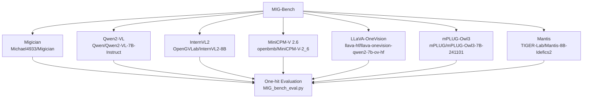
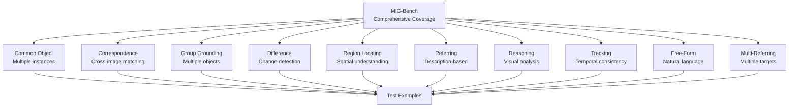

<!-- source: DeepWiki mcp.deepwiki.com · repo thunlp/Migician · page 7.1 MIG-Bench · fetched 2026-11-02 -->

# MIG-Bench

<details>
<summary>Relevant source files</summary>

The following files were used as context for generating this wiki page:

- [README.md](README.md)
- [eval/MIG-Bench/MIG_data.json](eval/MIG-Bench/MIG_data.json)

</details>


MIG-Bench is a comprehensive multi-image grounding benchmark designed to evaluate the ability of Multimodal Large Language Models (MLLMs) to perform precise grounding across multiple images. The benchmark covers 10 diverse task types that test various aspects of multi-image understanding and object localization.

For information about using MIG-Bench in evaluation workflows, see [Direct Evaluation Script](#6.2) and [Chain-of-Thought Evaluation](#6.3). For metrics computation, see [Evaluation Metrics](#6.4).

## Purpose and Scope

MIG-Bench provides a standardized evaluation framework for multi-image grounding tasks, enabling consistent comparison of different MLLMs on their ability to:

- Recognize and locate common objects across multiple images
- Detect differences and changes between images
- Perform spatial reasoning and correspondence matching
- Track objects across image sequences
- Understand free-form grounding instructions

The benchmark outputs bounding box predictions that are evaluated using Intersection over Union (IOU) metrics at multiple thresholds.

Sources: [README.md:227-272](), [eval/MIG-Bench/MIG_data.json:1-100]()

## Dataset Structure

MIG-Bench is organized hierarchically with task-specific image directories and a centralized JSON data file.



**Directory Layout:**

```
eval/
├── MIG-Bench/
│   ├── images/
│   │   ├── common/           # Common object recognition
│   │   ├── correspondence/   # Cross-image matching
│   │   ├── group_grounding/  # Multiple object sets
│   │   ├── difference/       # Difference detection
│   │   ├── region_locating/  # Spatial understanding
│   │   ├── referring/        # Description-based grounding
│   │   ├── reasoning/        # Visual reasoning
│   │   ├── tracking/         # Object tracking
│   │   ├── free_form/        # Free-form instructions
│   │   └── multi_referring/  # Multiple references
│   └── MIG_data.json         # Main benchmark data
```

Sources: [README.md:227-247](), [eval/MIG-Bench/MIG_data.json:1-50]()

## Task Types

MIG-Bench evaluates 10 distinct multi-image grounding task types, each testing different capabilities:

| Task Type | Label | Description | Example Question |
|-----------|-------|-------------|------------------|
| **Common Object** | `common_object` | Identify and locate shared objects across multiple images | "These images share one object in common. Recognize and locate this object in the 1th image." |
| **Correspondence** | `correspondence` | Match corresponding objects or regions between images | Cross-image object matching tasks |
| **Group Grounding** | `group_grounding` | Ground multiple objects within and across images | Recognition and registration of object groups |
| **Difference Detection** | `difference` | Identify what changed between images | Spotting differences in image pairs |
| **Region Locating** | `region_locating` | Locate specific spatial regions across images | Finding regions based on descriptions |
| **Referring Grounding** | `referring` | Ground objects based on text descriptions | Category-based object localization |
| **Reasoning** | `reasoning` | Visual reasoning to find matching features | "Which item in Image-2 share the similar feature of Image-1?" |
| **Tracking** | `tracking` | Track objects across temporal image sequences | Cross-frame object localization |
| **Free-Form** | `free_form` | Ground objects from natural language instructions | Flexible, unrestricted descriptions |
| **Multi-Referring** | `multi_referring` | Handle multiple object references simultaneously | Locating multiple described objects |

Sources: [eval/MIG-Bench/MIG_data.json:1-100](), [README.md:227-272]()

## JSON Data Format

Each test example in MIG-Bench follows a standardized JSON structure:

```json
{
    "task": "common_object",
    "images": [
        "./MIG-Bench/images/common/Wild_Bird/objects365_v2_01803705.jpg",
        "./MIG-Bench/images/common/Wild_Bird/objects365_v2_01239539.jpg",
        "./MIG-Bench/images/common/Wild_Bird/objects365_v1_00688684.jpg",
        "./MIG-Bench/images/common/Wild_Bird/images2.jpg"
    ],
    "question": "These images share one object in common. Recognize and locate this object in the 1th image.",
    "answer": [
        0.321,
        0.096,
        0.999,
        0.724
    ],
    "additional_info": "",
    "need_format": true
}
```

### Field Specifications



**Coordinate Format:**
- Ground truth bounding boxes are normalized to `[0, 1]` range
- Format: `[x1, y1, x2, y2]` where:
  - `x1, y1`: top-left corner coordinates
  - `x2, y2`: bottom-right corner coordinates
  - All values are floats relative to image dimensions

Sources: [README.md:249-270](), [eval/MIG-Bench/MIG_data.json:1-100]()

## Example Entries

### Common Object Recognition

```json
{
    "task": "common_object",
    "images": [
        "./MIG-Bench/images/common/Boat/boat_4.jpg",
        "./MIG-Bench/images/common/Boat/objects365_v1_00373987.jpg",
        "./MIG-Bench/images/common/Boat/objects365_v2_01275460.jpg",
        "./MIG-Bench/images/common/Boat/boat_5.jpg"
    ],
    "question": "These images share one object in common. Recognize and locate this object in the 2th image.",
    "answer": [0.179, 0.298, 0.915, 0.905],
    "additional_info": "",
    "need_format": true
}
```

### Reasoning Task

```json
{
    "task": "reasoning",
    "images": [
        "./MIG-Bench/images/reasoning/case097_1.png",
        "./MIG-Bench/images/reasoning/case097_2.png"
    ],
    "question": "Which item in Image-2 share the similar feature of Image-1? Find it and locate it in the second image.",
    "answer": [0.418, 0.391, 0.595, 0.546],
    "additional_info": "Which item in Image-2 share the similar feature of Image-1?",
    "need_format": true
}
```

Sources: [eval/MIG-Bench/MIG_data.json:148-217](), [eval/MIG-Bench/MIG_data.json:256-270]()

## Evaluation Workflow

MIG-Bench integrates with the evaluation system through standardized scripts that load the benchmark, run model inference, and compute IOU metrics.



### Integration Points

**Direct Evaluation:**
- Script: `eval/MIG_bench_eval.py`
- Loads MIG-Bench data from `eval/MIG-Bench/MIG_data.json`
- Uses `extract_bbox()` from `eval/utils.py` to parse model outputs
- Applies `calculate_iou()` for metric computation

**Chain-of-Thought Evaluation:**
- Script: `eval/MIG_bench_cot.py`
- Two-phase approach: description generation followed by grounding
- Same metric computation as direct evaluation

Sources: [README.md:227-272](), [README.md:242-272]()

## Coordinate Processing

The benchmark uses a normalized coordinate system that requires processing during both model output and metric computation:



**Key Functions:**

- **`extract_bbox()`**: Parses model predictions containing special tokens `<|box_start|>` and `<|box_end|>` to extract bounding box coordinates
- **`calculate_iou()`**: Computes Intersection over Union between predicted and ground truth boxes
- **Normalization**: Ground truth uses `[0, 1]` range; model outputs typically use `[0, 1000]` scale

Sources: [README.md:249-270](), [README.md:214-222]()

## Evaluation Metrics

MIG-Bench reports four standard metrics for grounding performance:

| Metric | Threshold | Description |
|--------|-----------|-------------|
| **IOU@0.7** | 0.7 | Strict match - requires 70% overlap |
| **IOU@0.5** | 0.5 | Moderate match - requires 50% overlap |
| **IOU@0.3** | 0.3 | Loose match - requires 30% overlap |
| **Average IOU** | N/A | Mean IOU across all predictions |

**IOU Computation:**

```
IOU = Area of Overlap / Area of Union

where:
  Overlap = intersection of predicted and ground truth boxes
  Union = total area covered by both boxes
```

**Success Criteria:**
- A prediction is considered correct at threshold T if `IOU ≥ T`
- Different thresholds capture varying levels of localization precision
- Average IOU provides a continuous measure of overall accuracy

Sources: [README.md:272]()

## Supported Models

The evaluation scripts support multiple MLLM architectures for benchmarking:



**Model Integration:**
- All models are evaluated using the same benchmark data
- Standardized input format across models
- Consistent output parsing using `extract_bbox()`
- Direct comparison through identical metrics

Sources: [README.md:272]()

## Usage Example

The evaluation process follows this pattern:

1. **Load Benchmark Data:**
```python
# From MIG_bench_eval.py or MIG_bench_cot.py
data = load_json("eval/MIG-Bench/MIG_data.json")
```

2. **Process Each Example:**
```python
for example in data:
    task = example["task"]
    images = example["images"]
    question = example["question"]
    ground_truth = example["answer"]  # [x1, y1, x2, y2] in 0-1 range
```

3. **Run Model Inference:**
```python
# Model generates prediction with special tokens
# e.g., "<|box_start|>(x1,y1),(x2,y2)<|box_end|>"
prediction = model.generate(images, question)
```

4. **Extract and Evaluate:**
```python
# Parse bounding box from model output
predicted_bbox = extract_bbox(prediction)

# Compute IOU with ground truth
iou = calculate_iou(predicted_bbox, ground_truth)
```

5. **Aggregate Metrics:**
```python
# Check against thresholds
iou_at_07 = iou >= 0.7
iou_at_05 = iou >= 0.5
iou_at_03 = iou >= 0.3
average_iou = mean(all_ious)
```

Sources: [README.md:227-272](), [README.md:249-270]()

## Data Statistics

MIG-Bench provides comprehensive coverage across task types:



**Characteristics:**
- Each task type tests specific multi-image grounding capabilities
- Variable number of images per example (typically 2-5)
- Questions formulated in natural language
- Single bounding box ground truth per question
- Diverse visual domains (animals, vehicles, objects, scenes)

Sources: [eval/MIG-Bench/MIG_data.json:1-4600](), [README.md:227-272]()

## Downloading the Benchmark

MIG-Bench is available on Hugging Face for public use:

**Hugging Face Hub:**
- Dataset: `Michael4933/MIG-Bench`
- Includes both images and `MIG_data.json`
- Can be downloaded using standard Hugging Face tools

**Local Setup:**
```bash
# Expected location after download
eval/
└── MIG-Bench/
    ├── images/
    │   └── [task-specific subdirectories]
    └── MIG_data.json
```

Sources: [README.md:227](), [README.md:14]()

## Key Design Principles

1. **Normalized Coordinates:** All ground truth bounding boxes use `[0, 1]` normalization for resolution independence
2. **Multi-Image Focus:** Every task requires reasoning across multiple images, not single-image grounding
3. **Natural Language Instructions:** Questions are formulated as free-form text rather than structured queries
4. **Diverse Task Coverage:** 10 task types ensure comprehensive evaluation of multi-image capabilities
5. **Standardized Format:** Consistent JSON structure enables easy integration with evaluation pipelines
6. **IOU-Based Metrics:** Multiple thresholds provide nuanced assessment of localization quality

Sources: [README.md:227-272](), [README.md:249-270]()

---

