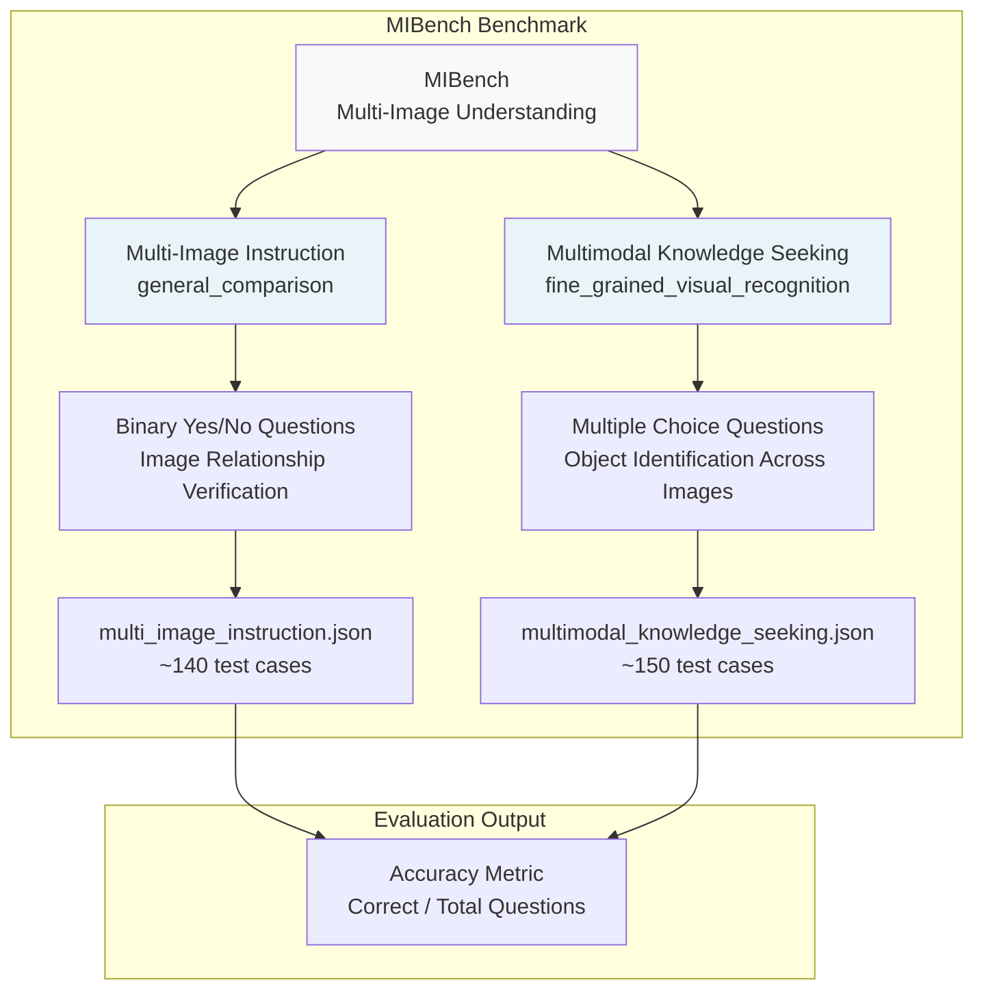
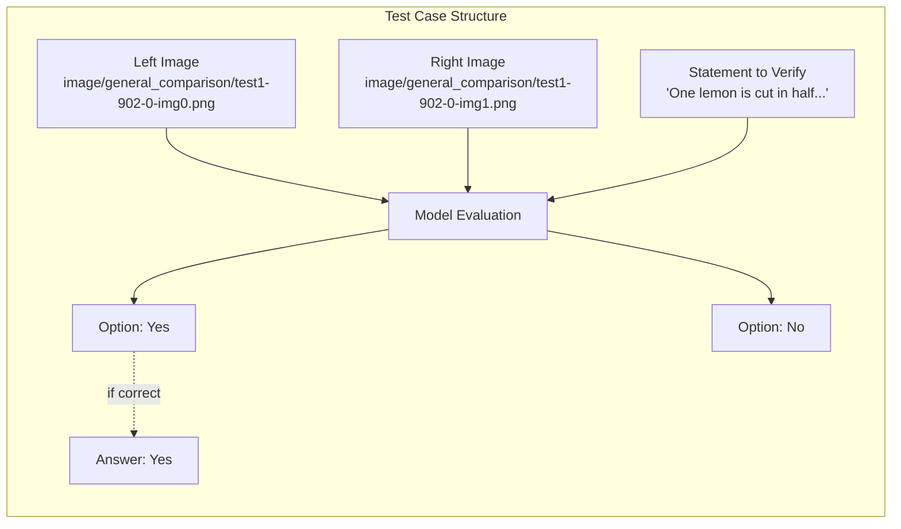
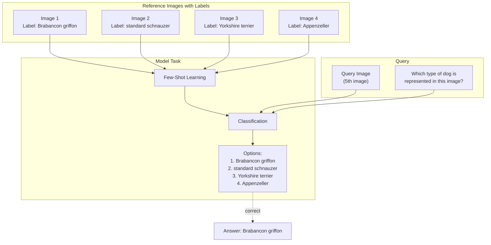
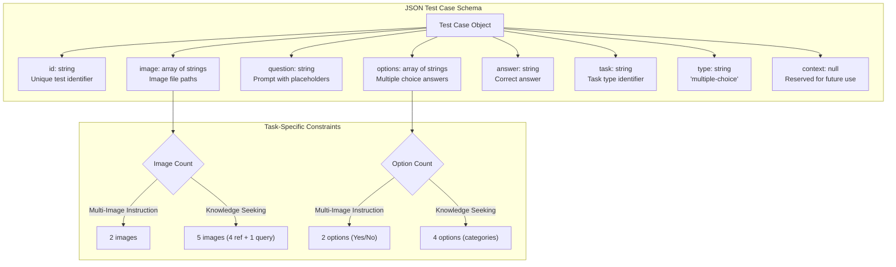
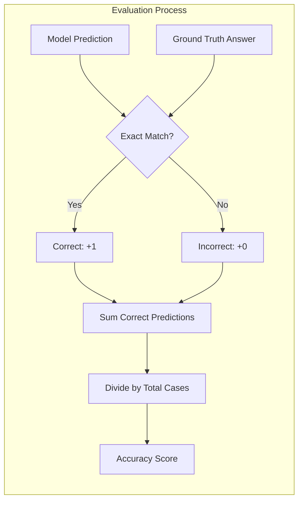
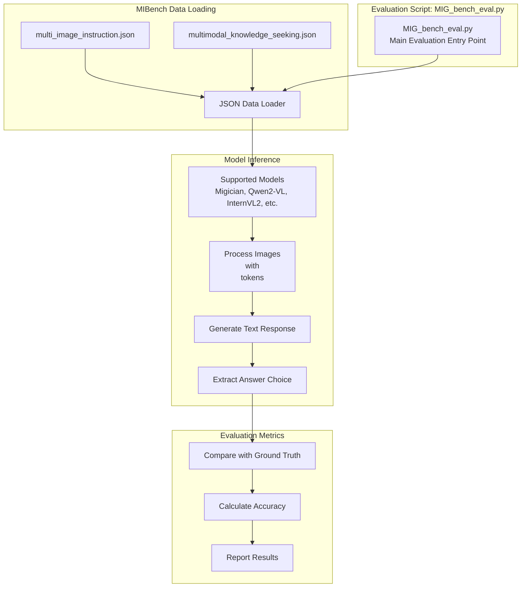
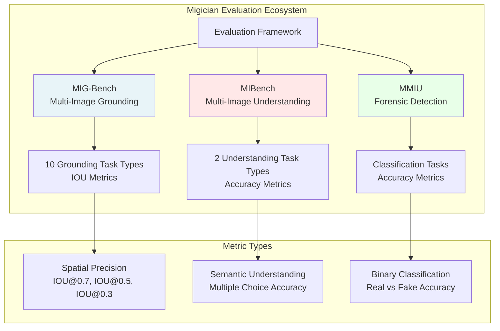

<!-- source: DeepWiki mcp.deepwiki.com · repo thunlp/Migician · page 7.2 MIBench · fetched 2026-11-02 -->

# MIBench

<details>
<summary>Relevant source files</summary>

The following files were used as context for generating this wiki page:

- [README.md](README.md)
- [eval/others/MIBench/multi_image_instruction.json](eval/others/MIBench/multi_image_instruction.json)
- [eval/others/MIBench/multimodal_knowledge_seeking.json](eval/others/MIBench/multimodal_knowledge_seeking.json)

</details>


## Purpose and Scope

MIBench is a multi-image understanding benchmark that evaluates the ability of Multimodal Large Language Models (MLLMs) to comprehend and reason across multiple images using accuracy-based metrics. Unlike [MIG-Bench](#7.1) which focuses on grounding tasks with bounding box predictions and IOU metrics, MIBench tests general multi-image understanding through multiple-choice questions. For forensic detection evaluation, see [MMIU-Benchmark](#7.3).

MIBench consists of two distinct task categories: **Multi-Image Instruction** (general comparison tasks) and **Multimodal Knowledge Seeking** (fine-grained visual recognition tasks).

Sources: [README.md:272](), [eval/others/MIBench/multi_image_instruction.json:1-2400](), [eval/others/MIBench/multimodal_knowledge_seeking.json:1-2200]()

---

## Benchmark Architecture



**Diagram: MIBench Task Structure**

MIBench evaluates multi-image understanding through two complementary task types that test different cognitive capabilities: relationship reasoning between images and fine-grained visual discrimination.

Sources: [eval/others/MIBench/multi_image_instruction.json:1-50](), [eval/others/MIBench/multimodal_knowledge_seeking.json:1-50]()

---

## Dataset Structure

MIBench is organized under the `eval/others/MIBench/` directory with the following structure:

```
eval/others/MIBench/
├── image/
│   ├── general_comparison/      # Images for Multi-Image Instruction tasks
│   │   ├── test1-902-0-img0.png
│   │   ├── test1-902-0-img1.png
│   │   └── ...
│   └── fine_grained_visual_recognition/  # Images for Knowledge Seeking tasks
│       ├── n02112706_1072.jpg
│       ├── n02097209_1101.jpg
│       └── ...
├── multi_image_instruction.json       # General comparison test cases
└── multimodal_knowledge_seeking.json  # Fine-grained recognition test cases
```

Both JSON files contain arrays of test examples, each with multiple images and a multiple-choice question. The benchmark uses relative paths to reference images stored in the `image/` subdirectories.

Sources: [eval/others/MIBench/multi_image_instruction.json:1-20](), [eval/others/MIBench/multimodal_knowledge_seeking.json:1-20]()

---

## Task 1: Multi-Image Instruction (General Comparison)

### Task Description

The Multi-Image Instruction task evaluates whether models can verify statements about relationships between two images. Each test case presents two images and asks the model to determine if a given statement accurately describes both images.



**Diagram: Multi-Image Instruction Evaluation Flow**

Sources: [eval/others/MIBench/multi_image_instruction.json:1-100]()

### Data Format

Each test case in `multi_image_instruction.json` follows this schema:

| Field | Type | Description |
|-------|------|-------------|
| `id` | string | Unique identifier (e.g., "general_comparison_1") |
| `image` | array[string] | List of 2 image paths (left and right) |
| `question` | string | Question with statement to verify |
| `options` | array[string] | Binary choices: ["Yes", "No"] or ["No", "Yes"] |
| `answer` | string | Correct answer ("Yes" or "No") |
| `task` | string | Always "general_comparison" |
| `type` | string | Always "multiple-choice" |
| `context` | null | Reserved field, not used |

### Example Test Case

```json
{
    "id": "general_comparison_1",
    "image": [
        "image/general_comparison/test1-902-0-img0.png",
        "image/general_comparison/test1-902-0-img1.png"
    ],
    "question": "Left image is <image>. Right image is <image>. Question: Is the subsequent sentence an accurate portrayal of the two images? One lemon is cut in half and has both halves facing outward.",
    "options": ["Yes", "No"],
    "answer": "Yes",
    "task": "general_comparison",
    "type": "multiple-choice",
    "context": null
}
```

### Question Templates

The task uses several question phrasings to test the same capability:
- "Is the subsequent sentence an accurate portrayal of the two images?"
- "Can the sentence below accurately describe these two images?"
- "Does the sentence below properly depict these two images?"
- "Is the following sentence a correct description of the two images?"
- "Can the given sentence accurately illustrate what's in these two images?"

All variations require binary (Yes/No) answers about whether a statement correctly describes both images.

Sources: [eval/others/MIBench/multi_image_instruction.json:1-300]()

---

## Task 2: Multimodal Knowledge Seeking (Fine-Grained Visual Recognition)

### Task Description

The Multimodal Knowledge Seeking task evaluates fine-grained visual discrimination by presenting 4 reference images with labels, then asking the model to identify which category a 5th query image belongs to. This tests the model's ability to learn from visual examples and apply that knowledge to classify new instances.



**Diagram: Fine-Grained Visual Recognition Task Flow**

Sources: [eval/others/MIBench/multimodal_knowledge_seeking.json:1-100]()

### Data Format

Each test case in `multimodal_knowledge_seeking.json` follows this schema:

| Field | Type | Description |
|-------|------|-------------|
| `id` | string | Unique identifier (e.g., "fine_grained_visual_recognition_1") |
| `image` | array[string] | List of 5 image paths (4 reference + 1 query) |
| `question` | string | Reference labels and question about query image |
| `options` | array[string] | 4 category choices matching the reference labels |
| `answer` | string | Correct category label |
| `task` | string | Always "fine_grained_visual_recognition" |
| `type` | string | Always "multiple-choice" |
| `context` | null | Reserved field, not used |

### Example Test Case

```json
{
    "id": "fine_grained_visual_recognition_1",
    "image": [
        "image/fine_grained_visual_recognition/n02112706_1072.jpg",
        "image/fine_grained_visual_recognition/n02097209_1101.jpg",
        "image/fine_grained_visual_recognition/n02094433_2266.jpg",
        "image/fine_grained_visual_recognition/n02107908_80.jpg",
        "image/fine_grained_visual_recognition/n02112706_1251.jpg"
    ],
    "question": "<image> is Brabancon griffon. <image> is standard schnauzer. <image> is Yorkshire terrier. <image> is Appenzeller.\nQuestion: Look at the dog pictures presented above and tell me which type of dog is represented in <image>.",
    "options": [
        "Brabancon griffon",
        "standard schnauzer",
        "Yorkshire terrier",
        "Appenzeller"
    ],
    "answer": "Brabancon griffon",
    "task": "fine_grained_visual_recognition",
    "type": "multiple-choice",
    "context": null
}
```

### Question Templates

The task varies its question phrasing:
- "Look at the dog pictures presented above and tell me which type of dog is represented in..."
- "Observe the dog images above and identify the category of the dog depicted in..."
- "Please examine the four dog photos provided above and determine which category the dog in... belongs to."
- "Review the preceding four images of dogs and ascertain the classification of the dog in..."
- "Based on your observation of the four dog photographs above, can you classify the dog shown in...?"

All variations follow the same format: 4 labeled reference images followed by a query about the 5th image.

Sources: [eval/others/MIBench/multimodal_knowledge_seeking.json:1-300]()

---

## Data Format Specification



**Diagram: MIBench JSON Schema and Constraints**

### Image Placeholder Token

Both tasks use `<image>` as a placeholder token in the `question` field. The number of `<image>` tokens corresponds to the number of images in the `image` array. Models must replace these tokens with the actual images during inference.

**Multi-Image Instruction format:**
```
"Left image is <image>. Right image is <image>. Question: ..."
```

**Multimodal Knowledge Seeking format:**
```
"<image> is Label1. <image> is Label2. <image> is Label3. <image> is Label4.\nQuestion: ... <image>."
```

Sources: [eval/others/MIBench/multi_image_instruction.json:1-100](), [eval/others/MIBench/multimodal_knowledge_seeking.json:1-100]()

---

## Evaluation Metrics

MIBench uses **accuracy** as its primary evaluation metric, calculated as:

```
Accuracy = (Number of Correct Predictions) / (Total Number of Test Cases)
```

This differs from MIG-Bench's IOU-based metrics, as MIBench focuses on understanding and reasoning rather than precise spatial grounding.



**Diagram: Accuracy Calculation for MIBench**

### Metric Breakdown

Models can be evaluated separately on each task type:

| Task Type | Metric | Description |
|-----------|--------|-------------|
| Multi-Image Instruction | Accuracy | Percentage of correct Yes/No answers |
| Multimodal Knowledge Seeking | Accuracy | Percentage of correct category identifications |
| Overall | Accuracy | Combined accuracy across all test cases |

Sources: [README.md:272]()

---

## Integration with Migician Evaluation Pipeline

MIBench is integrated into the Migician evaluation framework alongside MIG-Bench and MMIU, providing comprehensive multi-image understanding assessment.



**Diagram: MIBench Integration in Evaluation Pipeline**

### Evaluation Script Usage

The `MIG_bench_eval.py` script handles MIBench evaluation as part of a unified evaluation framework:

1. **Data Loading**: Reads JSON files from `eval/others/MIBench/`
2. **Model Loading**: Supports multiple MLLM architectures (Migician, Qwen2-VL, InternVL2, MiniCPM-V_2.6, LLaVA-OneVision, mPLUG-Owl3, Mantis)
3. **Inference**: Processes multi-image inputs with text prompts
4. **Metric Calculation**: Computes accuracy by exact string matching
5. **Result Reporting**: Outputs per-task and overall accuracy scores

Sources: [README.md:272](), [README.md:227-247]()

---

## Relationship to Other Benchmarks



**Diagram: MIBench in the Broader Evaluation Context**

### Benchmark Comparison

| Benchmark | Focus | Task Types | Metrics | Output Format |
|-----------|-------|------------|---------|---------------|
| **MIG-Bench** | Multi-image grounding | 10 grounding tasks | IOU@0.3/0.5/0.7, Average IOU | Bounding boxes |
| **MIBench** | Multi-image understanding | 2 understanding tasks | Accuracy | Text (A/B/C/D or Yes/No) |
| **MMIU** | Forensic detection | Real vs. Fake classification | Accuracy | Binary classification |

MIBench complements MIG-Bench by testing higher-level reasoning capabilities that don't require precise spatial localization, while MMIU adds a specialized forensic detection dimension.

Sources: [README.md:227-272]()

---

## Dataset Statistics

### Multi-Image Instruction Task

- **Total Test Cases**: ~140 examples
- **Images per Case**: 2 (left and right)
- **Answer Format**: Binary (Yes/No)
- **Image Source**: General comparison dataset with diverse object categories
- **Task Difficulty**: Varies from simple object counting to complex relationship reasoning

### Multimodal Knowledge Seeking Task

- **Total Test Cases**: ~150 examples
- **Images per Case**: 5 (4 reference + 1 query)
- **Answer Format**: Multiple choice (4 options)
- **Image Source**: ImageNet dog breeds for fine-grained classification
- **Task Difficulty**: Requires discriminating between visually similar categories

### Combined Statistics

- **Total MIBench Test Cases**: ~290 examples
- **Total Images**: ~890 images (2×140 + 5×150)
- **Evaluation Time**: Depends on model inference speed
- **Storage Size**: Variable based on image resolution

Sources: [eval/others/MIBench/multi_image_instruction.json:1-2400](), [eval/others/MIBench/multimodal_knowledge_seeking.json:1-2200]()

---

## Usage Example

To evaluate a model on MIBench using the Migician evaluation framework:

1. **Ensure Data is Downloaded**: The MIBench dataset should be located at `eval/others/MIBench/`

2. **Run Evaluation Script**: Use `MIG_bench_eval.py` which includes MIBench support

3. **Process Results**: The script will output accuracy scores for:
   - Multi-Image Instruction task
   - Multimodal Knowledge Seeking task
   - Overall MIBench accuracy

The evaluation script handles:
- Loading JSON data files
- Processing `<image>` placeholder tokens
- Generating model predictions
- Computing accuracy metrics
- Reporting results

Sources: [README.md:242-272]()

---

