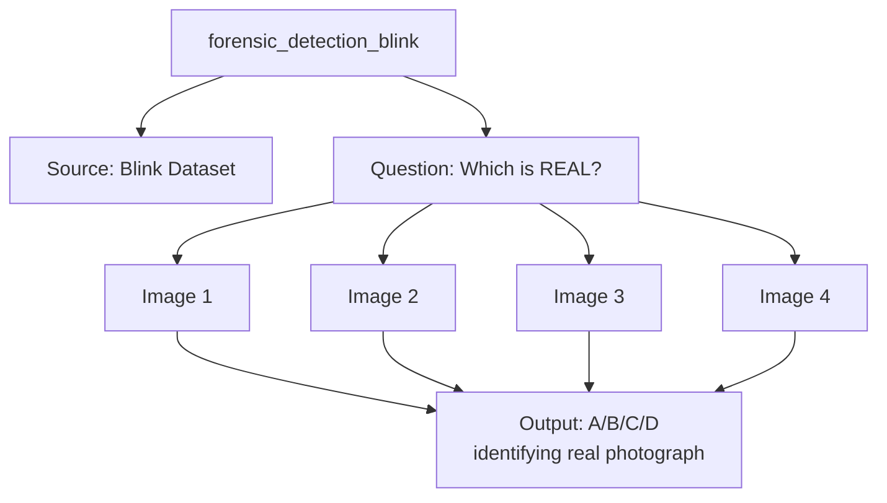
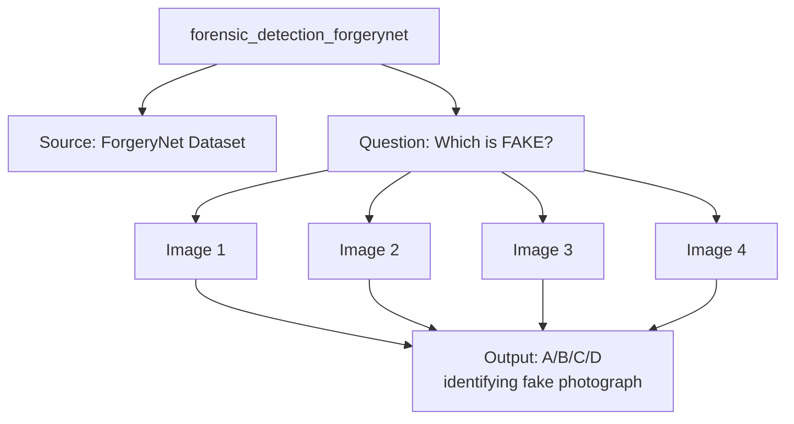
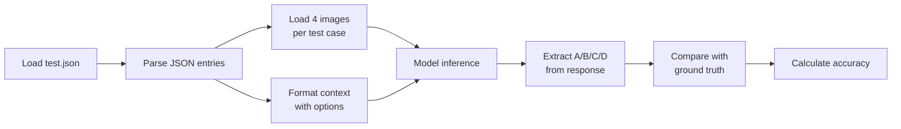
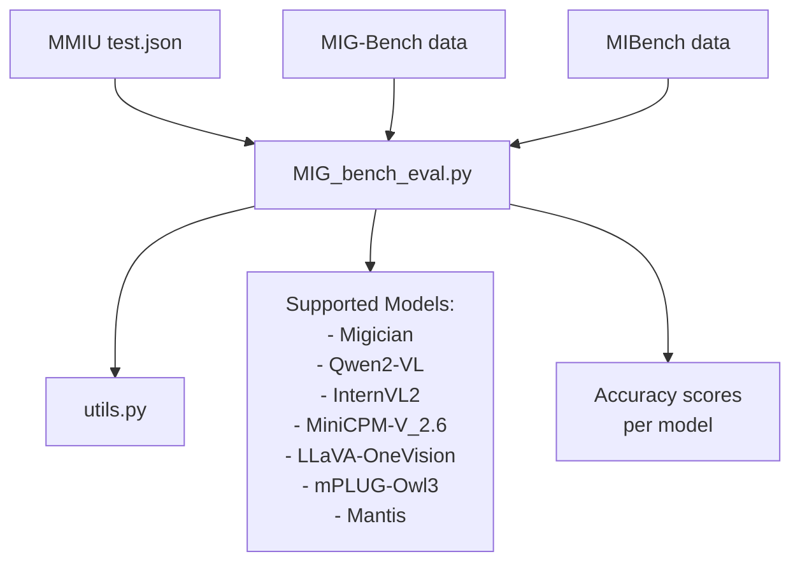
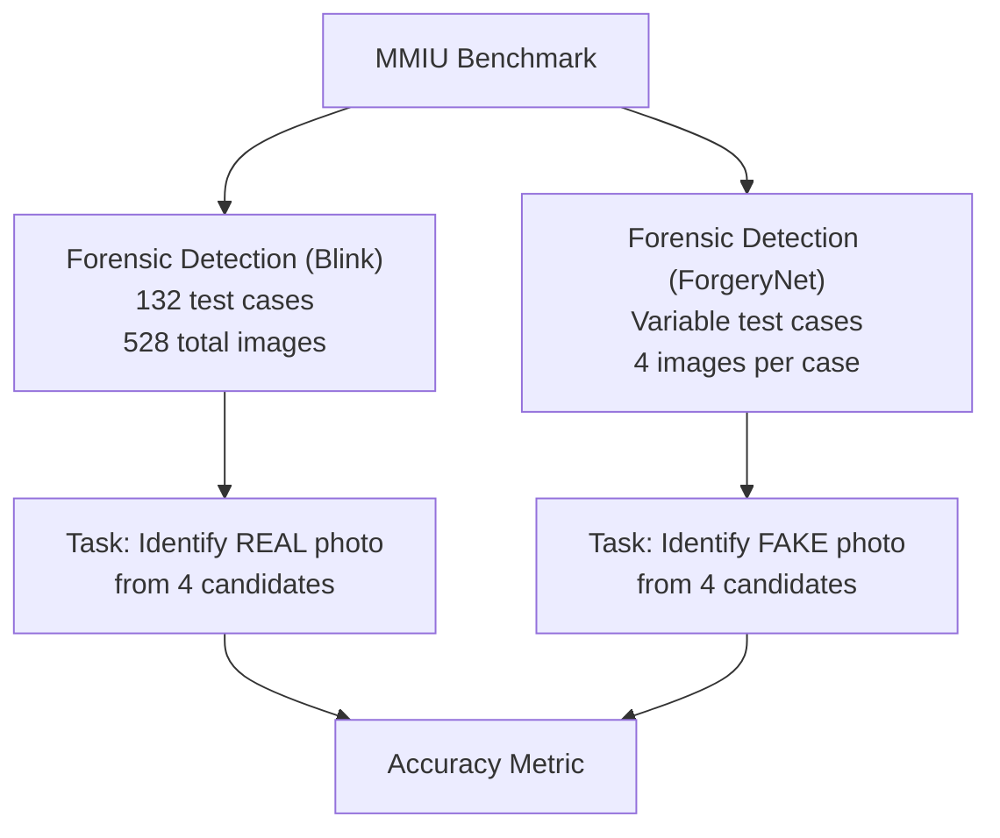

<!-- source: DeepWiki mcp.deepwiki.com · repo thunlp/Migician · page 7.3 MMIU-Benchmark · fetched 2026-11-02 -->

# MMIU-Benchmark

<details>
<summary>Relevant source files</summary>

The following files were used as context for generating this wiki page:

- [README.md](README.md)
- [eval/others/MMIU-Benchmark/test.json](eval/others/MMIU-Benchmark/test.json)

</details>


## Purpose and Scope

MMIU-Benchmark is a forensic detection benchmark designed to evaluate the ability of Multimodal Large Language Models (MLLMs) to distinguish between real photographs and synthetic/manipulated images. Unlike [MIG-Bench](#7.1), which focuses on multi-image grounding with bounding box predictions, MMIU tests low-level visual understanding through multiple-choice classification tasks. For general multi-image understanding capabilities, see [MIBench](#7.2).

This benchmark evaluates models on their capacity to detect subtle artifacts, inconsistencies, and manipulation traces in images that indicate whether a photograph is authentic or artificially generated/edited.

Sources: [README.md:272](), [eval/others/MMIU-Benchmark/test.json:1-2500]()

## Benchmark Overview

MMIU (Multimodal Multi-image Understanding) focuses on **forensic detection** tasks where models must analyze multiple candidate images and identify which ones are real photographs versus fake/synthetic images. The benchmark presents a photography competition scenario where models act as judges examining image authenticity.

**Key Characteristics:**
- **Task Type**: Multiple-choice classification (A/B/C/D)
- **Image Count**: 4 images per test case
- **Evaluation Metric**: Accuracy
- **Domain**: Low-level semantic understanding (forensic detection)
- **Sources**: Blink dataset and ForgeryNet dataset

Sources: [eval/others/MMIU-Benchmark/test.json:1-100](), [README.md:272]()

## Dataset Structure

The MMIU benchmark data is organized in the following directory structure:

```
eval/
└── others/
    └── MMIU-Benchmark/
        ├── test.json
        └── Low-level-semantic/
            ├── forensic_detection_blink/
            │   ├── forensic_detection_blink_0_0.jpg
            │   ├── forensic_detection_blink_0_1.jpg
            │   ├── forensic_detection_blink_0_2.jpg
            │   ├── forensic_detection_blink_0_3.jpg
            │   └── ... (131 test cases × 4 images each)
            └── forensic_detection_forgerynet/
                ├── forensic_detection_forgerynet_0_0.jpg
                ├── forensic_detection_forgerynet_0_1.jpg
                ├── forensic_detection_forgerynet_0_2.jpg
                ├── forensic_detection_forgerynet_0_3.jpg
                └── ... (additional test cases × 4 images each)
```

Sources: [eval/others/MMIU-Benchmark/test.json:10-14](), [eval/others/MMIU-Benchmark/test.json:1990-1994]()

## Task Types

### Forensic Detection - Blink



**Task Description**: Models must identify which of four images is most likely to be a real photograph. The other three are synthetic or manipulated.

**Test Cases**: 132 cases (indices 0-131)
**Context Template**: "You are a judge in a photography competition, and now you are given the four images. Please examine the details and tell which one of them is most likely to be a real photograph."

Sources: [eval/others/MMIU-Benchmark/test.json:1-1981]()

### Forensic Detection - ForgeryNet



**Task Description**: Models must identify which of four images is most likely to be a fake/manipulated photograph. The other three are real.

**Context Template**: "You are a judge in a photography competition, and now you are given the four images. Please examine the details and tell which one of them is most likely to be a fake photograph."

Sources: [eval/others/MMIU-Benchmark/test.json:1983-2461]()

## JSON Data Format

Each test case in `test.json` follows this structure:

| Field | Type | Description |
|-------|------|-------------|
| `task` | string | Task identifier: `"forensic_detection_blink"` or `"forensic_detection_forgerynet"` |
| `visual_input_component` | string | Always `"natural image and synthetic image"` |
| `source` | string | Dataset source: `"blink"` or `"forgerynet"` |
| `options` | string | Multi-line string with format: `"A: the first image\nB: the second image\nC: the third image\nD: the fourth image"` |
| `question` | string | Either `"Which image is most likely to be a real photograph?"` or `"Which image is most likely to be a fake photograph?"` |
| `context` | string | Full prompt including instructions and options |
| `input_image_path` | array | Array of 4 strings containing relative paths to images |
| `output` | string | Ground truth answer: `"A"`, `"B"`, `"C"`, or `"D"` |

### Example Test Case

```json
{
    "task": "forensic_detection_blink",
    "visual_input_component": "natural image and synthetic image",
    "source": "blink",
    "options": "A: the first image\nB: the second image\nC: the third image\nD: the fourth image",
    "question": "Which image is most likely to be a real photograph?",
    "context": "You are a judge in a photography competition, and now you are given the four images. Please examine the details and tell which one of them is most likely to be a real photograph.\nSelect from the following choices.\nA: the first image\nB: the second image\nC: the third image\nD: the fourth image\n",
    "input_image_path": [
        "./Low-level-semantic/forensic_detection_blink/forensic_detection_blink_0_0.jpg",
        "./Low-level-semantic/forensic_detection_blink/forensic_detection_blink_0_1.jpg",
        "./Low-level-semantic/forensic_detection_blink/forensic_detection_blink_0_2.jpg",
        "./Low-level-semantic/forensic_detection_blink/forensic_detection_blink_0_3.jpg"
    ],
    "output": "D"
}
```

Sources: [eval/others/MMIU-Benchmark/test.json:1-16]()

## Evaluation Protocol

### Data Loading and Processing Flow



### Evaluation Metrics

**Primary Metric**: Accuracy
- Calculated as: (Correct Predictions / Total Test Cases) × 100%
- A prediction is correct if the extracted answer (A/B/C/D) matches the `output` field

**No IOU Metrics**: Unlike MIG-Bench, MMIU does not use Intersection Over Union (IOU) metrics since there are no bounding box predictions—only classification outputs.

Sources: [README.md:272]()

## Integration with Evaluation System

MMIU benchmark evaluation is integrated into the main evaluation script:



The evaluation script [MIG_bench_eval.py]() handles:
1. Loading MMIU test data from `test.json`
2. Processing 4-image inputs per test case
3. Formatting prompts with the photography competition context
4. Running inference for multiple MLLM models
5. Extracting A/B/C/D responses
6. Computing accuracy metrics

For utility functions used in evaluation, see [Utility Functions](#6.1).

Sources: [README.md:272](), [README.md:242-247]()

## Comparison with Other Benchmarks

| Aspect | MMIU | MIG-Bench | MIBench |
|--------|------|-----------|---------|
| **Focus** | Forensic detection | Multi-image grounding | Multi-image understanding |
| **Output Type** | Multiple choice (A/B/C/D) | Bounding boxes + text | Text answers |
| **Metric** | Accuracy | IOU@0.3/0.5/0.7, Avg IOU | Accuracy |
| **Task Domain** | Low-level visual (authenticity) | Grounding (localization) | High-level reasoning |
| **Images per Case** | 4 | Variable (1-4+) | Variable |
| **Answer Format** | Single letter | Coordinates + description | Free-form text |

Sources: [README.md:272](), [eval/others/MMIU-Benchmark/test.json:1-100]()

## Example Test Cases

### Example 1: Forensic Detection - Blink (Real Photo Detection)

**Task**: `forensic_detection_blink`  
**Question**: Which image is most likely to be a real photograph?  
**Images**:
- `forensic_detection_blink_0_0.jpg`
- `forensic_detection_blink_0_1.jpg`
- `forensic_detection_blink_0_2.jpg`
- `forensic_detection_blink_0_3.jpg`

**Ground Truth**: `D` (the fourth image)

**Context**: "You are a judge in a photography competition, and now you are given the four images. Please examine the details and tell which one of them is most likely to be a real photograph."

Sources: [eval/others/MMIU-Benchmark/test.json:1-16]()

### Example 2: Forensic Detection - ForgeryNet (Fake Photo Detection)

**Task**: `forensic_detection_forgerynet`  
**Question**: Which image is most likely to be a fake photograph?  
**Images**:
- `forensic_detection_forgerynet_0_0.jpg`
- `forensic_detection_forgerynet_0_1.jpg`
- `forensic_detection_forgerynet_0_2.jpg`
- `forensic_detection_forgerynet_0_3.jpg`

**Ground Truth**: `B` (the second image)

**Context**: "You are a judge in a photography competition, and now you are given the four images. Please examine the details and tell which one of them is most likely to be a fake photograph."

Sources: [eval/others/MMIU-Benchmark/test.json:1983-1996]()

## Dataset Statistics



**Total Test Cases**: 132+ cases (exact count depends on ForgeryNet subset)  
**Images per Case**: 4  
**Total Images**: 528+ images  
**Question Types**: 2 (real detection, fake detection)  
**Answer Choices**: 4 per question (A, B, C, D)

Sources: [eval/others/MMIU-Benchmark/test.json:1-2500]()

---

