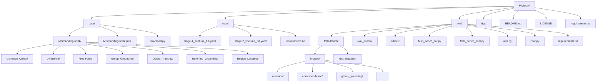
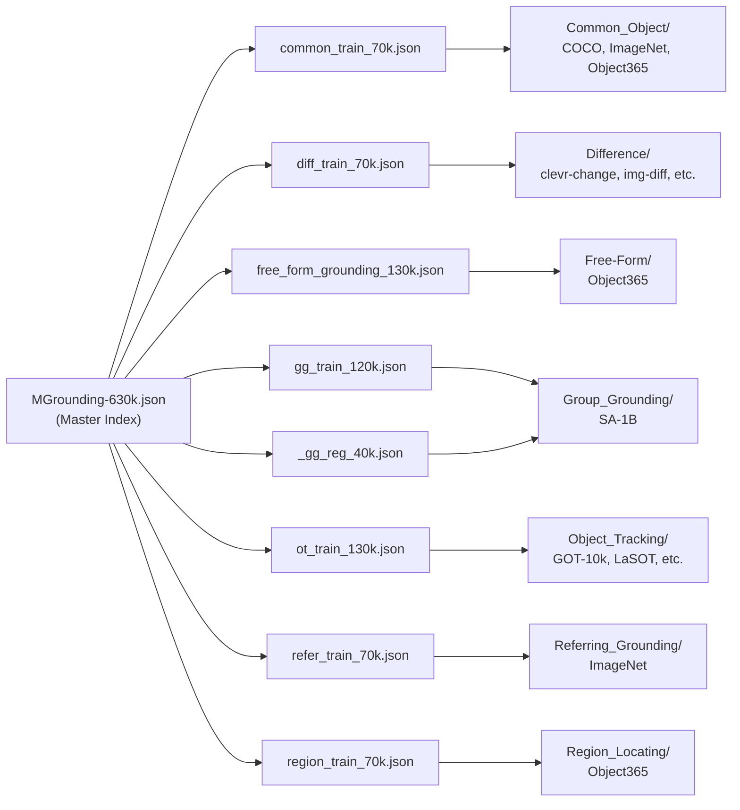
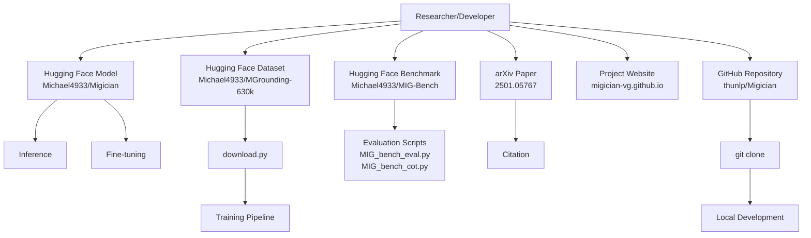
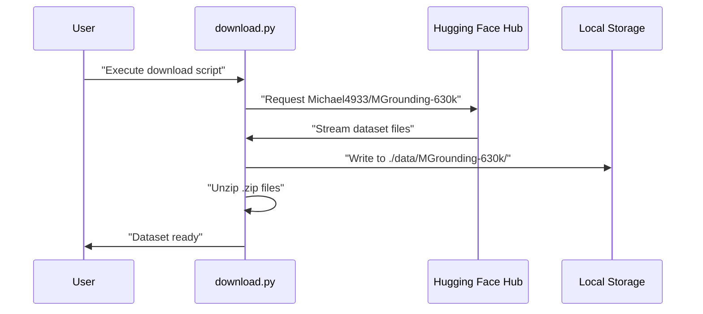
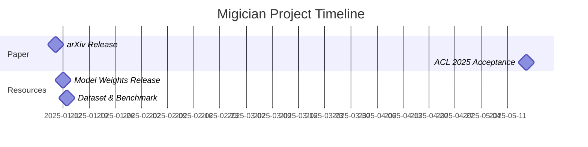

<!-- source: DeepWiki mcp.deepwiki.com · repo thunlp/Migician · page 8 Reference · fetched 2026-11-02 -->

# Reference

<details>
<summary>Relevant source files</summary>

The following files were used as context for generating this wiki page:

- [LICENSE](LICENSE)
- [README.md](README.md)

</details>


This page provides reference materials for the Migician codebase, including license information, repository structure, external resource links, citation details, and version history. This serves as a quick lookup guide for developers and researchers working with or building upon Migician.

For information about the overall project and capabilities, see [Overview](#1). For installation and usage instructions, see [Getting Started](#2).

## License Information

Migician is released under the MIT License, granting broad permissions for use, modification, and distribution.

**License Type**: MIT License  
**Copyright**: Copyright (c) 2025 You Li

### Key Permissions

The MIT License grants users the following rights without restriction:
- Use the software for commercial and non-commercial purposes
- Modify and create derivative works
- Distribute copies of the software
- Sublicense the software
- Sell copies of the software

### Conditions

Users must include the copyright notice and permission notice in all copies or substantial portions of the software.

### Warranty Disclaimer

The software is provided "AS IS" without warranty of any kind, express or implied, including but not limited to warranties of merchantability, fitness for a particular purpose, and non-infringement.

**Sources**: [LICENSE:1-22]()

## Repository Structure

The Migician repository is organized into distinct directories for data, training, evaluation, and documentation.

### Directory Layout



**Sources**: [README.md:80-125](), [README.md:228-247](), [README.md:280-286]()

### Key Directory Descriptions

| Directory | Purpose | Key Files |
|-----------|---------|-----------|
| `data/` | Training dataset storage and download utilities | `MGrounding-630k.json`, `download.py` |
| `data/MGrounding-630k/` | 630k+ training examples organized by task type | Task-specific subdirectories with images and JSON |
| `train/` | Training configuration files for LlamaFactory | `stage-1_finetune_full.yaml`, `stage-2_finetune_full.yaml` |
| `eval/` | Evaluation scripts, benchmarks, and utilities | `MIG_bench_eval.py`, `MIG_bench_cot.py`, `utils.py` |
| `eval/MIG-Bench/` | MIG-Bench benchmark dataset | `MIG_data.json`, `images/` subdirectories |
| `eval/others/` | Additional benchmarks (MIBench, MMIU) | Benchmark-specific evaluation data |
| `figs/` | Documentation images and visualizations | Logo, radar charts, example images |

### Data File Structure

The `MGrounding-630k.json` file serves as the master index for all training data, with each task type having its own dedicated subdirectory:



**Sources**: [README.md:76-125]()

## External Resources

Migician provides multiple resources hosted on Hugging Face and other platforms for different aspects of the project.

### Resource Matrix

| Resource Type | Platform | Link Identifier | Description |
|---------------|----------|-----------------|-------------|
| Model Weights | Hugging Face | `Michael4933/Migician` | Pre-trained Migician model based on Qwen2-VL-7B |
| Training Dataset | Hugging Face | `Michael4933/MGrounding-630k` | 630k+ multi-image grounding examples |
| Benchmark | Hugging Face | `Michael4933/MIG-Bench` | Multi-image grounding evaluation benchmark |
| Paper | arXiv | `2501.05767` | Full research paper |
| Project Page | GitHub Pages | `migician-vg.github.io` | Project website with examples |
| Source Code | GitHub | `thunlp/Migician` | Complete repository |

### Resource Access Diagram



**Sources**: [README.md:10-15]()

### Hugging Face Download Integration

The repository includes automated download functionality via `data/download.py`, which provides one-click access to the MGrounding-630k dataset:



**Sources**: [README.md:78-79]()

## Citation

Researchers and developers building upon Migician should cite the original work using the following BibTeX entry:

```bibtex
@article{li2025migician,
  title={Migician: Revealing the Magic of Free-Form Multi-Image Grounding in Multimodal Large Language Models},
  author={Li, You and Huang, Heyu and Chen, Chi and Huang, Kaiyu and Huang, Chao and Guo, Zonghao and Liu, Zhiyuan and Xu, Jinan and Li, Yuhua and Li, Ruixuan and others},
  journal={arXiv preprint arXiv:2501.05767},
  year={2025}
}
```

**Publication Venue**: ACL 2025 (Accepted)  
**Paper Type**: arXiv preprint  
**arXiv ID**: 2501.05767

**Sources**: [README.md:289-297]()

## Authors and Contributors

### Primary Authors

The Migician project was developed by a collaborative team of researchers from multiple institutions:

| Author | Affiliation | Role |
|--------|-------------|------|
| You Li | Primary contact | Lead developer |
| Heyu Huang | Co-first author (marked with *) | Core contributor |
| Chi Chen | - | Contributor |
| Kaiyu Huang | - | Contributor |
| Chao Huang | - | Contributor |
| Zonghao Guo | - | Contributor |
| Zhiyuan Liu | - | Contributor |
| Jinan Xu | - | Contributor |
| Yuhua Li | - | Contributor |
| Ruixuan Li | - | Contributor |
| Maosong Sun | - | Contributor |

**Sources**: [README.md:6]()

## Version History

The project has undergone several major releases and updates since its initial publication.

### Timeline



### Release Notes

**[2025.05.16]** - ACL 2025 Acceptance  
The paper was accepted for presentation at ACL 2025 in Vienna, Austria.

**[2025.01.13]** - Dataset and Benchmark Release  
Released MGrounding-630k training dataset and MIG-Bench evaluation benchmark on Hugging Face, enabling community research and development.

**[2025.01.12]** - Model Weights Release  
Published pre-trained Migician model weights on Hugging Face for immediate use.

**[2025.01.10]** - Paper Publication  
Initial paper release on arXiv (arXiv:2501.05767), documenting the methodology, architecture, and evaluation results.

**Sources**: [README.md:21-25]()

## Dependencies and Requirements

### Core Dependencies

The project relies on several key dependencies defined in `requirements.txt`:

**Primary Framework Dependencies**:
- `transformers` - Hugging Face Transformers for model loading and inference
- `torch` - PyTorch deep learning framework
- `qwen_vl_utils` - Specialized utilities for Qwen2-VL vision processing

**Training Framework**:
- LlamaFactory - Training orchestration (referenced but not in requirements.txt, installed separately)

**Evaluation Dependencies**:
- Standard Python libraries for evaluation metrics and data processing

### Environment Specifications

**Recommended Environment**:
- Python: 3.10
- GPU: 8x A100-80G (for training)
- CUDA: Compatible version for flash_attention_2
- Storage: Sufficient space for 630k+ images

**Installation Command**:
```bash
conda env create -n migician python=3.10
conda activate migician
pip install -r requirements.txt
```

**Sources**: [README.md:56-65]()

## Repository Badges

The project README includes several badges indicating resource availability:

| Badge | Meaning | Link Target |
|-------|---------|-------------|
| Project-Page (Green) | Official project website | `migician-vg.github.io` |
| Demo-Page (Purple) | Interactive demo | TBD |
| Paper-PDF (Orange) | arXiv paper | `arxiv.org/abs/2501.05767` |
| Model-Huggingface (Red) | Model weights | `huggingface.co/Michael4933/Migician` |
| Benchmark-Huggingface (Yellow) | MIG-Bench dataset | `huggingface.co/datasets/Michael4933/MIG-Bench` |
| Dataset-Huggingface (Blue) | Training data | `huggingface.co/datasets/Michael4933/MGrounding-630k` |

**Sources**: [README.md:10-15]()

## File Format Specifications

### Training Data Format

Each training example in `MGrounding-630k.json` follows this structure:

**Field Specifications**:
- `id`: Unique identifier (can be ignored for training)
- `images`: Array of relative image paths
- `conversations`: Array of conversation turns with `from` (human/gpt) and `value` (content)
- `type`: Task type label (e.g., "gg_train", "free_form", etc.)

**Special Token Usage**:
- `<|object_ref_start|>` and `<|object_ref_end|>`: Delimit grounding targets in queries
- `<|box_start|>` and `<|box_end|>`: Delimit bounding box coordinates in responses

**Coordinate Format**: 
- Normalized to 0-1000 scale
- Format: `(x1,y1),(x2,y2)` representing top-left and bottom-right corners

**Sources**: [README.md:126-156]()

### Evaluation Data Format

Each test example in `MIG_data.json` follows this structure:

**Field Specifications**:
- `task`: Task type identifier
- `images`: Array of relative image paths
- `question`: Natural language query
- `answer`: Ground truth bounding box as array `[x1, y1, x2, y2]`
- `additional_info`: Supplementary context
- `need_format`: Boolean indicating if response formatting is required

**Ground Truth Format**:
- Normalized to 0-1 scale (float)
- Format: `[x1, y1, x2, y2]` representing relative positions

**Sources**: [README.md:249-271]()