# Page: Overview

# Overview

<details>
<summary>Relevant source files</summary>

The following files were used as context for generating this wiki page:

- [README.md](README.md)

</details>


## Purpose and Scope

This document provides a high-level introduction to Migician, the first competitive multi-image grounding MLLM (Multimodal Large Language Model). It covers the system's key innovations, main components, and architectural overview.

For detailed setup instructions, see [Getting Started](#2). For in-depth documentation of the training dataset, see [MGrounding-630k Dataset](#3). For model-specific technical details, see [Migician Model](#4). For evaluation procedures, see [Evaluation System](#6).

## What is Migician?

Migician is a multimodal large language model specialized in **free-form multi-image grounding** - the ability to locate and bound objects across multiple images based on natural language descriptions. Built on the `Qwen2VLForConditionalGeneration` foundation model (Qwen2-VL-7B), Migician achieves state-of-the-art performance on multi-image grounding tasks, outperforming the best existing MLLMs by 21.61% and even surpassing 70B-scale models.

The system addresses a critical gap in existing MLLMs: while they excel at single-image grounding and general multi-image comprehension, they struggle with precise grounding in complex multi-image scenarios. Migician solves this through:

1. **End-to-end multi-image grounding**: Direct inference without relying on unstable Chain-of-Thought frameworks
2. **Free-form natural language queries**: Unrestricted descriptions rather than template-constrained inputs
3. **Massive-scale training data**: 630k+ diverse multi-image grounding examples across 7 task types
4. **Specialized token system**: Dedicated tokens (`<|object_ref_start|>`, `<|object_ref_end|>`, `<|box_start|>`, `<|box_end|>`) for object references and bounding box outputs

**Sources**: [README.md:1-29]()

## Core Components

Migician consists of three main components that form a complete pipeline from training to evaluation:

| Component | Description | Scale | Hugging Face Repository |
|-----------|-------------|-------|------------------------|
| **Migician Model** | Qwen2-VL-7B fine-tuned for multi-image grounding | 7B parameters | `Michael4933/Migician` |
| **MGrounding-630k** | Training dataset with 7 task types | 630k+ examples | `Michael4933/MGrounding-630k` |
| **MIG-Bench** | Evaluation benchmark for multi-image grounding | 10 task types | `Michael4933/MIG-Bench` |

### Migician Model

The Migician model is a fine-tuned version of `Qwen2VLForConditionalGeneration` trained through a two-stage progressive process on 8x A100-80G GPUs. The model utilizes `flash_attention_2` for efficient inference and employs a special token system to handle multi-image grounding tasks.

For model architecture details, see [Model Architecture](#4.1). For inference usage, see [Inference Guide](#4.2).

### MGrounding-630k Dataset

The training dataset comprises 630k+ multi-image grounding examples across seven task categories, sourced from 10+ existing datasets including COCO, ImageNet, Object365, SA-1B, GOT-10k, LaSOT, and others:

- **Common Object Recognition** (70k): Identifying shared objects across images
- **Difference Detection** (70k): Comparing images to find differences  
- **Free-Form Grounding** (130k): Natural language-driven grounding
- **Group Grounding** (160k): Recognition (120k) + Registration (40k) tasks
- **Object Tracking** (130k): Cross-frame object matching
- **Referring Grounding** (70k): Description-based localization
- **Region Locating** (70k): Spatial understanding tasks

For detailed dataset structure, see [Dataset Structure](#3.1). For download instructions, see [Downloading the Dataset](#3.2).

### MIG-Bench Benchmark

MIG-Bench is a comprehensive evaluation benchmark designed specifically for multi-image grounding capabilities. It contains 10 diverse task types and uses IOU (Intersection Over Union) metrics at multiple thresholds (0.7, 0.5, 0.3) to measure grounding accuracy.

For benchmark details, see [MIG-Bench](#7.1).

**Sources**: [README.md:13-17](), [README.md:70-125](), [README.md:227-273]()

## System Architecture

### Component Dependencies

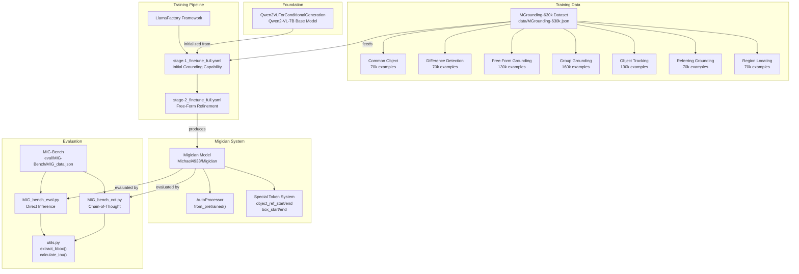

**Diagram: Migician System Component Dependencies**

This diagram illustrates how the foundation model (Qwen2-VL-7B) is transformed into Migician through the training pipeline, utilizing the MGrounding-630k dataset. The resulting model is then evaluated using specialized scripts (`MIG_bench_eval.py`, `MIG_bench_cot.py`) and benchmarks.

**Sources**: [README.md:165-221](), [README.md:227-273](), [README.md:278-286]()

### Code Entity Mapping

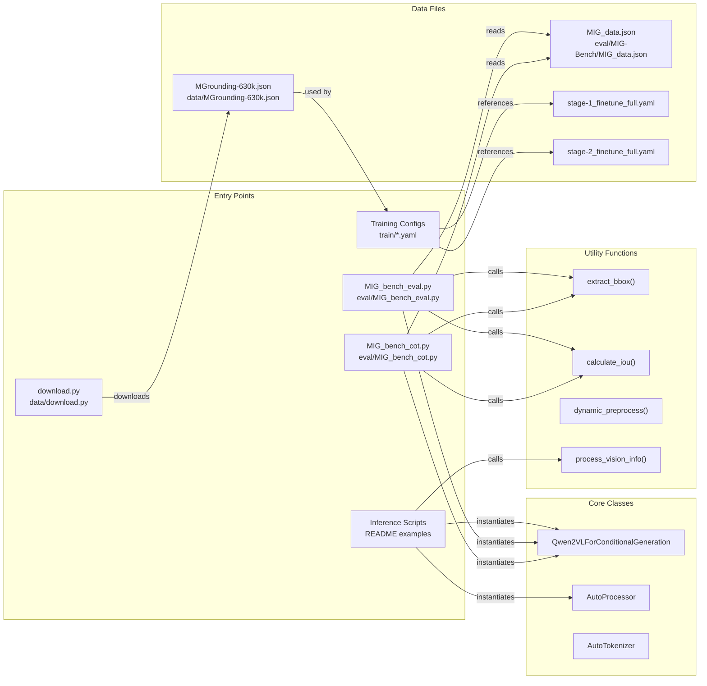

**Diagram: Code Entity Relationships**

This diagram maps the key code entities (classes, functions, files) and their relationships. Entry points like `download.py`, inference scripts, and evaluation scripts interact with core classes (`Qwen2VLForConditionalGeneration`, `AutoProcessor`) and utility functions (`extract_bbox()`, `calculate_iou()`) defined in `eval/utils.py`.

**Sources**: [README.md:78-79](), [README.md:172-221](), [README.md:242-246]()

## Multi-Image Grounding Workflow

### Inference Pipeline

The following table describes the end-to-end inference workflow from model loading to bounding box output:

| Step | Component | Input | Output | Code Reference |
|------|-----------|-------|--------|----------------|
| 1. Model Loading | `Qwen2VLForConditionalGeneration.from_pretrained()` | Model path string | Model instance | [README.md:177-182]() |
| 2. Processor Loading | `AutoProcessor.from_pretrained()` | Model path string | Processor instance | [README.md:183]() |
| 3. Message Formatting | User code | Images + text query | Messages list | [README.md:185-206]() |
| 4. Template Application | `processor.apply_chat_template()` | Messages dict | Formatted text string | [README.md:208]() |
| 5. Vision Processing | `process_vision_info()` | Messages dict | Image/video tensor inputs | [README.md:209]() |
| 6. Tokenization | `processor()` | Text + images | Input tensors (IDs, pixels) | [README.md:210]() |
| 7. Generation | `model.generate()` | Input tensors + config | Generated token IDs | [README.md:214]() |
| 8. Decoding | `processor.batch_decode()` | Token IDs | Text with bbox coordinates | [README.md:218-220]() |

### Special Token System

Migician uses four special tokens to structure multi-image grounding conversations:

| Token | Purpose | Usage Context |
|-------|---------|---------------|
| `<|object_ref_start|>` | Begin object reference | Marks start of target description in user query |
| `<|object_ref_end|>` | End object reference | Marks end of target description in user query |
| `<|box_start|>` | Begin bounding box | Precedes coordinate output in model response |
| `<|box_end|>` | End bounding box | Follows coordinate output in model response |

**Coordinate Format**: Bounding boxes are output in `(x1,y1),(x2,y2)` format with values normalized to 0-1000 scale. This normalization ensures resolution independence across images of different sizes.

**Example Input/Output**:
```
Input: "Please recognize <|object_ref_start|>the common person appearing in all these images<|object_ref_end|> and locate this person in all these image."

Output: "It's in the first image. <|box_start|>(408,656),(578,997)<|box_end|>"
```

For detailed special token documentation, see [Special Token System](#4.3).

**Sources**: [README.md:128-156](), [README.md:172-221]()

## Repository Structure

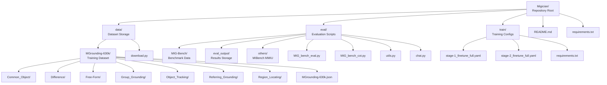

**Diagram: Repository Directory Structure**

The repository is organized into three primary directories: `data/` for dataset storage and downloading, `eval/` for evaluation scripts and benchmarks, and `train/` for training configurations. The `MGrounding-630k.json` file aggregates all training conversations for convenient access.

**Sources**: [README.md:80-125](), [README.md:228-247](), [README.md:280-286]()

## Performance Characteristics

### Benchmark Results

Migician demonstrates superior performance across multiple evaluation benchmarks:

| Benchmark | Metric Type | Migician Performance | Comparison |
|-----------|-------------|---------------------|------------|
| MIG-Bench | IOU@0.7, 0.5, 0.3 | State-of-the-art | +21.61% vs. best existing MLLM |
| MIG-Bench | Average IOU | Leading across 10 tasks | Outperforms 70B parameter models |
| MIBench | Accuracy | Competitive | General multi-image understanding |
| MMIU | Accuracy | Competitive | Forensic detection tasks |

### Supported Model Comparisons

The evaluation framework in `MIG_bench_eval.py` supports seven different MLLMs for comparative analysis:

1. **Migician** - `Michael4933/Migician`
2. **Qwen2-VL** - `Qwen/Qwen2-VL-7B-Instruct`
3. **InternVL2** - `OpenGVLab/InternVL2-8B`
4. **MiniCPM-V 2.6** - `openbmb/MiniCPM-V-2_6`
5. **LLaVA-OneVision** - `llava-hf/llava-onevision-qwen2-7b-ov-hf`
6. **mPLUG-Owl3** - `mPLUG/mPLUG-Owl3-7B-241101`
7. **Mantis** - `TIGER-Lab/Mantis-8B-Idefics2`

For detailed evaluation procedures, see [Direct Evaluation Script](#6.2).

### Training Infrastructure

The model training requires significant computational resources:

- **Hardware**: 8x NVIDIA A100-80G GPUs
- **Training Framework**: LlamaFactory (`github.com/hiyouga/LLaMA-Factory`)
- **Training Stages**: Two-stage progressive training
  - Stage 1: Full parameter fine-tuning for initial grounding capability
  - Stage 2: Full parameter fine-tuning for free-form refinement
- **Optimization**: Flash Attention 2 (`attn_implementation="flash_attention_2"`) for memory efficiency
- **Precision**: `torch.bfloat16` for training and inference

For training configuration details, see [Training Pipeline](#5).

**Sources**: [README.md:29-39](), [README.md:165](), [README.md:272-273](), [README.md:278]()

## Data Format Specifications

### Training Data Format

Each training example in `data/MGrounding-630k.json` follows this JSON structure:

```json
{
    "id": "unique_identifier",
    "images": [
        "./MGrounding-630k/path/to/image1.jpg",
        "./MGrounding-630k/path/to/image2.jpg"
    ],
    "conversations": [
        {
            "from": "human",
            "value": "<image>\n<image>\nQuery with <|object_ref_start|>target<|object_ref_end|>"
        },
        {
            "from": "gpt",
            "value": "Response with <|box_start|>(x1,y1),(x2,y2)<|box_end|>"
        }
    ],
    "type": "task_category"
}
```

**Key Fields**:
- `id`: Unique identifier (can be ignored)
- `images`: List of relative paths to image files
- `conversations`: Multi-turn dialogue with special tokens
- `type`: Task category label (e.g., `"gg_train"`, `"free_form"`, `"common_train"`)
- **Coordinate Scale**: Bounding boxes in training data use 0-1000 normalization

### Evaluation Data Format

Each evaluation example in `eval/MIG-Bench/MIG_data.json` follows this JSON structure:

```json
{
    "task": "task_name",
    "images": [
        "./MIG-Bench/images/category/image1.png",
        "./MIG-Bench/images/category/image2.png"
    ],
    "question": "Query text",
    "answer": [x1, y1, x2, y2],
    "additional_info": "Auxiliary information",
    "need_format": true
}
```

**Key Differences from Training Format**:
- Ground truth coordinates are normalized as floats within 0-1 range (not 0-1000)
- Coordinates follow `[x1, y1, x2, y2]` array format (top-left, bottom-right corners)
- Single-turn question-answer structure
- `need_format` flag indicates whether response requires bbox extraction

For detailed dataset structure documentation, see [Dataset Structure](#3.1).

**Sources**: [README.md:126-156](), [README.md:249-271]()

## Key Innovations

### 1. End-to-End Multi-Image Grounding

Unlike previous approaches that rely on Chain-of-Thought frameworks combining single-image grounding with multi-image comprehension, Migician performs direct end-to-end inference. This eliminates instability and improves the model's ability to capture abstract visual information.

The repository includes both approaches for comparison:
- **Direct inference**: `eval/MIG_bench_eval.py` for end-to-end evaluation
- **CoT framework**: `eval/MIG_bench_cot.py` for two-step reasoning evaluation

### 2. Free-Form Natural Language Queries

Migician supports unrestricted natural language descriptions rather than template-constrained inputs. The Free-Form Grounding subset (130k examples in `data/MGrounding-630k/Free-Form/`) specifically trains this capability, allowing diverse queries like:

```
"Please recognize <|object_ref_start|>the common person appearing in all these images<|object_ref_end|> and locate this person in all these image."
```

### 3. Resolution-Independent Coordinate System

The 0-1000 normalization scheme for bounding box coordinates ensures that predictions work consistently across images of different resolutions, making the model more robust to varying input sizes. The coordinate format is `(x1,y1),(x2,y2)` where values represent relative positions scaled to 1000.

### 4. Progressive Two-Stage Training

The training pipeline uses a progressive approach configured through YAML files:
- **Stage 1** (`train/stage-1_finetune_full.yaml`): Establishes basic grounding capability across all task types
- **Stage 2** (`train/stage-2_finetune_full.yaml`): Refines free-form understanding and grounding accuracy

This curriculum learning strategy improves final model performance by first establishing foundational capabilities before refining complex behaviors.

**Sources**: [README.md:27-29](), [README.md:98-100](), [README.md:242-243](), [README.md:278-286]()

## Getting Started Quick Reference

For users new to Migician, the typical workflow is:

1. **Environment Setup**: Create conda environment and install dependencies → See [Installation](#2.1)
2. **Dataset Download**: Download MGrounding-630k using `data/download.py` → See [Downloading the Dataset](#3.2)
3. **Model Inference**: Load model and run multi-image grounding → See [Inference Guide](#4.2)
4. **Evaluation**: Run benchmarks using `eval/MIG_bench_eval.py` → See [Evaluation System](#6)
5. **Fine-tuning** (Optional): Train on custom data using LlamaFactory configs → See [Training Pipeline](#5)

### Minimal Inference Example

The simplest way to use Migician for multi-image grounding:

```python
from transformers import Qwen2VLForConditionalGeneration, AutoProcessor
from qwen_vl_utils import process_vision_info
import torch

# Load model and processor
model = Qwen2VLForConditionalGeneration.from_pretrained(
    "Michael4933/Migician",
    torch_dtype=torch.bfloat16,
    attn_implementation="flash_attention_2",
    device_map="auto"
)
processor = AutoProcessor.from_pretrained("Michael4933/Migician")

# Prepare multi-image input with grounding query
messages = [{
    "role": "user",
    "content": [
        {"type": "image", "image": "image1.png"},
        {"type": "image", "image": "image2.png"},
        {"type": "text", "text": "Locate <|object_ref_start|>target object<|object_ref_end|>"}
    ]
}]

# Process and generate
text = processor.apply_chat_template(messages, tokenize=False, add_generation_prompt=True)
image_inputs, _ = process_vision_info(messages)
inputs = processor(text=[text], images=image_inputs, padding=True, return_tensors="pt")
inputs = inputs.to("cuda")

generated_ids = model.generate(**inputs, max_new_tokens=128)
generated_ids_trimmed = [out_ids[len(in_ids):] for in_ids, out_ids in zip(inputs.input_ids, generated_ids)]
output = processor.batch_decode(generated_ids_trimmed, skip_special_tokens=True, clean_up_tokenization_spaces=False)
print(output)  # Output includes bounding boxes in <|box_start|>(x1,y1),(x2,y2)<|box_end|> format
```

For complete setup and usage instructions, see [Getting Started](#2). For detailed inference documentation, see [Quick Start Guide](#2.2).

**Sources**: [README.md:41-66](), [README.md:164-221]()

## Related Resources

- **Project Page**: https://migician-vg.github.io/
- **Paper**: https://arxiv.org/abs/2501.05767 (ACL 2025)
- **Model**: https://huggingface.co/Michael4933/Migician
- **Training Dataset**: https://huggingface.co/datasets/Michael4933/MGrounding-630k
- **Evaluation Benchmark**: https://huggingface.co/datasets/Michael4933/MIG-Bench
- **Base Model**: https://huggingface.co/Qwen/Qwen2-VL-7B-Instruct
- **Training Framework**: https://github.com/hiyouga/LLaMA-Factory

**Sources**: [README.md:10-15](), [README.md:22](), [README.md:278]()

---

# Page: Getting Started

# Getting Started

<details>
<summary>Relevant source files</summary>

The following files were used as context for generating this wiki page:

- [README.md](README.md)
- [requirements.txt](requirements.txt)

</details>


This document provides a complete setup guide for Migician, covering environment creation, dependency installation, and running your first multi-image grounding inference. By the end of this guide, you will have a working Migician installation capable of performing free-form multi-image grounding tasks.

**Scope**: This page provides an overview of the setup process and initial usage. For detailed installation instructions, see [Installation](#2.1). For more inference examples and usage patterns, see [Quick Start Guide](#2.2). For comprehensive model documentation, see [Migician Model](#4).

---

## Prerequisites

Before beginning the setup process, ensure you have:

| Requirement | Specification | Purpose |
|------------|---------------|---------|
| **Python** | 3.10 | Required runtime version |
| **CUDA** | Compatible with PyTorch 2.1.2 | GPU acceleration for inference |
| **GPU Memory** | ≥16GB VRAM recommended | Model loading and inference |
| **Disk Space** | ≥50GB free | Model weights and dependencies |
| **Network** | Stable internet connection | Downloading model from Hugging Face Hub |

**Note**: The model uses `flash_attention_2` for acceleration, which requires compatible CUDA compute capability (≥8.0 for Ampere and newer architectures).

Sources: [README.md:55-65](), [README.md:180]()

---

## Setup Overview

The following diagram illustrates the complete setup and first inference workflow:

### Setup and Inference Workflow

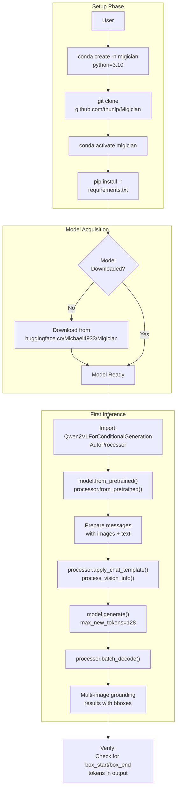

Sources: [README.md:55-65](), [README.md:165-222]()

---

## Installation Steps

The installation process consists of three primary stages:

### 1. Environment Creation

Create an isolated conda environment with Python 3.10:

```bash
conda create -n migician python=3.10
```

Activate the newly created environment:

```bash
conda activate migician
```

Sources: [README.md:58-63]()

### 2. Repository Setup

Clone the Migician repository:

```bash
git clone https://github.com/thunlp/Migician.git
cd Migician
```

Sources: [README.md:60-61]()

### 3. Dependency Installation

Install all required dependencies from the requirements file:

```bash
pip install -r requirements.txt
```

The `requirements.txt` includes critical packages:

| Package | Version | Purpose |
|---------|---------|---------|
| `transformers` | 4.45.2 | Core model loading and inference |
| `torch` | 2.1.2 | Deep learning framework |
| `flash-attn` | 2.3.4 | Efficient attention mechanism |
| `qwen-vl-utils` | 0.0.8 | Vision processing utilities |
| `accelerate` | 0.30.1 | Multi-GPU support |
| `bitsandbytes` | 0.43.3 | Quantization support |
| `peft` | 0.12.0 | Parameter-efficient fine-tuning |

For the complete dependency list, see [requirements.txt:1-65]().

**Detailed installation instructions**: See [Installation](#2.1).

Sources: [README.md:64](), [requirements.txt:1-65]()

---

## Model Components and Initialization

Understanding the key components involved in Migician inference:

### Component Architecture

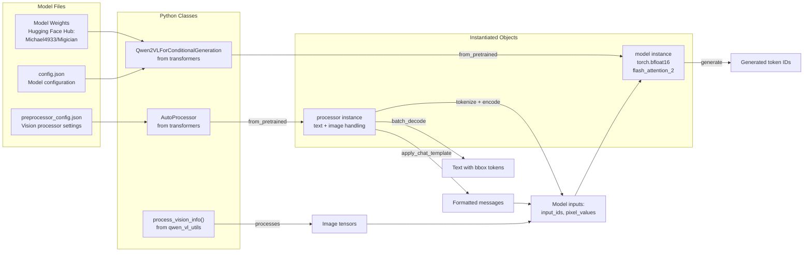

Sources: [README.md:172-183](), [README.md:208-220]()

---

## First Inference Example

After installation, verify your setup with a minimal inference example:

### Loading the Model

```python
from transformers import Qwen2VLForConditionalGeneration, AutoProcessor
from qwen_vl_utils import process_vision_info
import torch

# Specify model path (local or Hugging Face Hub)
path = "Michael4933/Migician"  # or local path

# Load model with flash attention optimization
model = Qwen2VLForConditionalGeneration.from_pretrained(
    path,
    torch_dtype=torch.bfloat16,
    attn_implementation="flash_attention_2",
    device_map="auto",
)

# Load processor for text and image handling
processor = AutoProcessor.from_pretrained(path)
```

Key parameters:
- `torch_dtype=torch.bfloat16`: Reduces memory usage while maintaining precision
- `attn_implementation="flash_attention_2"`: Enables efficient attention computation
- `device_map="auto"`: Automatically distributes model across available GPUs

Sources: [README.md:172-183]()

### Constructing Inference Messages

Migician uses a structured message format with special tokens:

```python
messages = [
    {
        "role": "user",
        "content": [
            {"type": "image", "image": "path/to/image1.png"},
            {"type": "image", "image": "path/to/image2.png"},
            {
                "type": "text", 
                "text": "Please locate <|object_ref_start|>the person<|object_ref_end|> in these images."
            }
        ]
    }
]
```

**Special tokens** used for grounding:
- `<|object_ref_start|>` and `<|object_ref_end|>`: Delimit the grounding target in the query
- `<|box_start|>` and `<|box_end|>`: Delimit bounding box coordinates in the response

For details on the token system, see [Special Token System](#4.3).

Sources: [README.md:138-147](), [README.md:185-206]()

### Processing and Generation

```python
# Apply chat template and process vision information
text = processor.apply_chat_template(
    messages, tokenize=False, add_generation_prompt=True
)
image_inputs, video_inputs = process_vision_info(messages)

# Tokenize and encode inputs
inputs = processor(
    text=[text],
    images=image_inputs,
    videos=video_inputs,
    padding=True,
    return_tensors="pt"
)
inputs = inputs.to("cuda")

# Generate predictions
generated_ids = model.generate(**inputs, max_new_tokens=128)

# Decode output
generated_ids_trimmed = [
    out_ids[len(in_ids):] 
    for in_ids, out_ids in zip(inputs.input_ids, generated_ids)
]
output_text = processor.batch_decode(
    generated_ids_trimmed, 
    skip_special_tokens=False,  # Keep bbox tokens
    clean_up_tokenization_spaces=False
)

print(output_text)
```

**Expected output format**:
```
["It's in the first image. <|box_start|>(316,58),(764,999)<|box_end|>"]
```

Coordinates are normalized to 0-1000 scale in `(x1,y1),(x2,y2)` format.

Sources: [README.md:208-221]()

---

## Inference Pipeline Flow

The following diagram maps the inference process to actual code entities:

### Inference Execution Flow

```mermaid
sequenceDiagram
    participant User
    participant messages["messages<br/>(list of dicts)"]
    participant processor["AutoProcessor<br/>instance"]
    participant vision["process_vision_info()<br/>qwen_vl_utils"]
    participant model["Qwen2VLForConditionalGeneration<br/>instance"]
    participant output["output_text<br/>(list of strings)"]
    
    User->>messages: "Define content:<br/>images + text with<br/>object_ref tokens"
    
    messages->>processor: "apply_chat_template()<br/>tokenize=False"
    processor-->>User: "text (formatted prompt)"
    
    messages->>vision: "extract images"
    vision-->>User: "image_inputs, video_inputs"
    
    User->>processor: "processor(text, images)<br/>return_tensors='pt'"
    processor-->>User: "inputs dict:<br/>input_ids, pixel_values"
    
    User->>model: "generate(**inputs)<br/>max_new_tokens=128"
    model-->>User: "generated_ids (tokens)"
    
    User->>processor: "batch_decode(generated_ids)<br/>skip_special_tokens=False"
    processor-->>output: "text with box tokens"
    
    output-->>User: "Parse bbox coordinates<br/>from box_start/box_end"
```

Sources: [README.md:208-221]()

---

## Verification

After completing your first inference, verify the setup:

### Expected Behavior Checklist

| Check | Expected Result | Indicates |
|-------|----------------|-----------|
| Model loads without errors | No CUDA/memory errors | Correct GPU setup |
| Special tokens in output | `<|box_start|>` and `<|box_end|>` present | Token vocabulary loaded |
| Coordinates in range | Values between 0-1000 | Proper normalization |
| Response mentions image | "first image", "second image", etc. | Multi-image awareness |
| Generation completes | No timeout or OOM | Sufficient resources |

### Common Issues

If you encounter issues during setup or first inference:

1. **Import errors**: Ensure all dependencies from [requirements.txt:1-65]() are installed
2. **CUDA errors**: Verify PyTorch CUDA compatibility with your driver version
3. **Memory errors**: Model requires ~16GB VRAM; consider using `torch_dtype=torch.float16` or quantization
4. **Flash attention errors**: Requires CUDA compute capability ≥8.0; set `attn_implementation=None` for older GPUs

Sources: [README.md:172-222]()

---

## Next Steps

After successful setup and first inference:

1. **Explore inference patterns**: See [Quick Start Guide](#2.2) for various multi-image grounding scenarios
2. **Understand the model**: Review [Migician Model](#4) for architecture details and capabilities
3. **Download training data**: See [Downloading the Dataset](#3.2) to acquire MGrounding-630k
4. **Run evaluations**: See [Evaluation System](#6) to benchmark on MIG-Bench and other datasets
5. **Fine-tune the model**: See [Training Pipeline](#5) for two-stage training instructions

### File Structure After Setup

```
Migician/
├── requirements.txt          # Installed dependencies
├── README.md                 # Project documentation
├── data/                     # Dataset directory (see page 3.2)
├── eval/                     # Evaluation scripts (see page 6)
├── train/                    # Training configurations (see page 5)
└── figs/                     # Example images
```

Sources: [README.md:80-125](), [README.md:229-247](), [README.md:281-286]()

---

## Summary

This guide covered the essential steps to get started with Migician:

1. ✓ Created a Python 3.10 conda environment
2. ✓ Cloned the repository and installed dependencies
3. ✓ Loaded the Qwen2VLForConditionalGeneration model with flash attention
4. ✓ Performed first multi-image grounding inference with special tokens
5. ✓ Verified output format with bbox coordinates

You now have a working Migician installation capable of performing free-form multi-image grounding. The model uses special tokens (`<|object_ref_start|>`, `<|object_ref_end|>`, `<|box_start|>`, `<|box_end|>`) to structure grounding queries and responses, with coordinates normalized to 0-1000 scale.

Sources: [README.md:41-286]()

---

# Page: Installation

# Installation

<details>
<summary>Relevant source files</summary>

The following files were used as context for generating this wiki page:

- [README.md](README.md)
- [requirements.txt](requirements.txt)

</details>


This document provides step-by-step instructions for setting up the Migician development environment, including Python environment creation, repository cloning, and dependency installation. This installation is required before training, inference, or evaluation can be performed with Migician.

For information about downloading the training dataset, see [Downloading the Dataset](#3.2). For information about running inference after installation, see [Quick Start Guide](#2.2).

---

## Prerequisites

Before beginning installation, ensure your system meets the following requirements:

### Hardware Requirements

| Component | Minimum Requirement | Recommended | Purpose |
|-----------|-------------------|-------------|---------|
| GPU | CUDA-compatible GPU | NVIDIA A100 (80GB) | Training requires 8x A100-80G; inference can use single GPU |
| RAM | 32 GB | 64+ GB | Loading model weights and processing multi-image inputs |
| Storage | 100 GB free | 500+ GB | MGrounding-630k dataset is large due to multi-image nature |
| Network | Stable connection | High bandwidth | Downloading model weights and datasets from Hugging Face |

### Software Requirements

- **Operating System**: Linux (Ubuntu 20.04+ recommended)
- **CUDA**: Version 11.8 or higher
- **conda**: Anaconda or Miniconda package manager
- **git**: Version control for cloning repository

---

## Installation Workflow

The following diagram illustrates the complete installation process from prerequisites to verification:

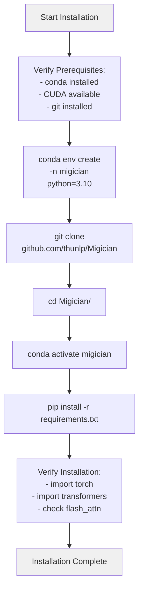

**Sources:** [README.md:54-65]()

---

## Step 1: Create Conda Environment

Create a dedicated Python 3.10 environment for Migician to isolate dependencies and prevent conflicts with other projects:

```bash
conda env create -n migician python=3.10
```

**Important Notes:**
- Python 3.10 is specifically required for compatibility with the PyTorch and Transformers versions used
- The environment name `migician` is referenced throughout the codebase documentation

**Sources:** [README.md:58]()

---

## Step 2: Clone Repository

Clone the Migician repository from GitHub:

```bash
git clone https://github.com/thunlp/Migician.git
cd Migician
```

This creates the following initial directory structure:

```
Migician/
├── README.md
├── requirements.txt
├── data/
├── eval/
├── train/
└── figs/
```

**Sources:** [README.md:60-61]()

---

## Step 3: Activate Environment

Activate the conda environment before installing dependencies:

```bash
conda activate migician
```

All subsequent installation commands must be executed with this environment activated.

**Sources:** [README.md:63]()

---

## Step 4: Install Dependencies

Install all required Python packages from the requirements file:

```bash
pip install -r requirements.txt
```

### Core Dependencies

The following diagram shows the major dependency categories and their relationships:

```mermaid
graph TD
    REQUIREMENTS["requirements.txt"]
    
    subgraph "Deep Learning Framework"
        TORCH["torch==2.1.2"]
        TORCHVISION["torchvision==0.16.2"]
        TORCHAUDIO["torchaudio==2.1.2"]
    end
    
    subgraph "Transformers Ecosystem"
        TRANSFORMERS["transformers==4.45.2"]
        ACCELERATE["accelerate==0.30.1"]
        PEFT["peft==0.12.0"]
        TRL["trl==0.9.6"]
        TOKENIZERS["tokenizers==0.20.3"]
    end
    
    subgraph "Vision Processing"
        QWEN_VL_UTILS["qwen-vl-utils==0.0.8"]
        OPENCV["opencv-python==4.10.0.84"]
        PILLOW["Pillow==10.1.0"]
        DECORD["decord==0.6.0"]
    end
    
    subgraph "Optimization Libraries"
        FLASH_ATTN["flash-attn==2.3.4"]
        XFORMERS["xformers==0.0.27.post2"]
        BITSANDBYTES["bitsandbytes==0.43.3"]
        DEEPSPEED["deepspeed==0.12.3"]
    end
    
    subgraph "Data Processing"
        DATASETS["datasets==2.16.1"]
        HUGGINGFACE_HUB["huggingface-hub==0.24.6"]
        PANDAS["pandas==2.2.2"]
        NUMPY["numpy==1.24.4"]
    end
    
    subgraph "Evaluation Tools"
        LMMS_EVAL["lmms_eval==0.2.4"]
        NLTK["nltk==3.8.1"]
        SCIPY["scipy==1.14.1"]
    end
    
    REQUIREMENTS --> TORCH
    REQUIREMENTS --> TRANSFORMERS
    REQUIREMENTS --> QWEN_VL_UTILS
    REQUIREMENTS --> FLASH_ATTN
    REQUIREMENTS --> DATASETS
    REQUIREMENTS --> LMMS_EVAL
    
    TORCH --> TORCHVISION
    TORCH --> TORCHAUDIO
    
    TRANSFORMERS --> ACCELERATE
    TRANSFORMERS --> PEFT
    TRANSFORMERS --> TRL
    TRANSFORMERS --> TOKENIZERS
    
    QWEN_VL_UTILS --> OPENCV
    QWEN_VL_UTILS --> PILLOW
    
    FLASH_ATTN --> XFORMERS
    
    DATASETS --> HUGGINGFACE_HUB
```

**Sources:** [requirements.txt:1-65]()

### Critical Dependencies Explained

| Package | Version | Purpose | Notes |
|---------|---------|---------|-------|
| `torch` | 2.1.2 | Core deep learning framework | Must match CUDA version on system |
| `transformers` | 4.45.2 | Qwen2VLForConditionalGeneration model loading | Required for model inference |
| `flash-attn` | 2.3.4 | Memory-efficient attention mechanism | Enables `attn_implementation="flash_attention_2"` |
| `qwen-vl-utils` | 0.0.8 | Vision-language utilities | Provides `process_vision_info` function |
| `accelerate` | 0.30.1 | Multi-GPU training support | Used in distributed training |
| `peft` | 0.12.0 | Parameter-efficient fine-tuning | Supports LoRA and other methods |
| `deepspeed` | 0.12.3 | Training optimization | Required for 8x A100 training setup |
| `datasets` | 2.16.1 | Hugging Face dataset loading | Used for MGrounding-630k access |
| `huggingface-hub` | 0.24.6 | Model and dataset downloading | Connects to Hugging Face Hub |

**Sources:** [requirements.txt:1-65]()

---

## Installation Verification

After installation completes, verify that all critical components are properly installed:

### Python Package Verification

The following sequence diagram shows the verification process:

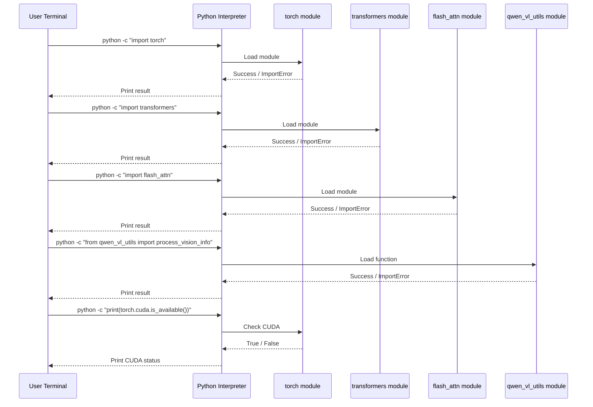

**Sources:** [README.md:172-183]()

### Verification Commands

Run the following commands to verify successful installation:

```bash
# Verify PyTorch installation
python -c "import torch; print(f'PyTorch version: {torch.__version__}')"

# Verify CUDA availability
python -c "import torch; print(f'CUDA available: {torch.cuda.is_available()}')"

# Verify Transformers
python -c "import transformers; print(f'Transformers version: {transformers.__version__}')"

# Verify flash-attn (critical for Migician)
python -c "import flash_attn; print('flash_attn installed successfully')"

# Verify qwen-vl-utils
python -c "from qwen_vl_utils import process_vision_info; print('qwen_vl_utils installed successfully')"

# Verify Qwen2VL model classes
python -c "from transformers import Qwen2VLForConditionalGeneration, AutoProcessor; print('Qwen2VL imports successful')"
```

### Expected Output

All commands should complete without `ImportError` exceptions. The CUDA availability check should return `True` if you plan to use GPU acceleration.

**Sources:** [README.md:172-183]()

---

## Post-Installation Configuration

### Directory Structure After Installation

After completing installation, your directory structure should match:

```
Migician/
├── README.md
├── requirements.txt
├── data/
│   └── download_hf.py
├── eval/
│   ├── MIG_bench_eval.py
│   ├── MIG_bench_cot.py
│   ├── utils.py
│   ├── chat.py
│   └── requirements.txt
├── train/
│   ├── stage-1_finetune_full.yaml
│   ├── stage-2_finetune_full.yaml
│   └── requirements.txt
└── figs/
```

**Sources:** [README.md:80-125](), [README.md:228-247](), [README.md:280-286]()

### Environment Variables (Optional)

For Hugging Face Hub access, you may set:

```bash
export HF_HOME=/path/to/cache  # Custom cache directory for models/datasets
export CUDA_VISIBLE_DEVICES=0  # Specify which GPU(s) to use
```

These variables control where Hugging Face Hub caches downloaded models and which GPUs are visible to PyTorch.

---

## Troubleshooting Common Issues

### Issue 1: flash-attn Compilation Failure

**Symptom:** `pip install -r requirements.txt` fails during `flash-attn` installation with compilation errors.

**Solution:**
```bash
# Ensure CUDA development toolkit is installed
nvcc --version  # Should show CUDA 11.8+

# Install flash-attn separately with verbose output
pip install flash-attn==2.3.4 --no-build-isolation -v

# If still failing, check GCC version (requires GCC 7+)
gcc --version
```

**Sources:** [requirements.txt:10]()

### Issue 2: CUDA Version Mismatch

**Symptom:** `torch.cuda.is_available()` returns `False` despite having an NVIDIA GPU.

**Solution:**
```bash
# Check CUDA version
nvidia-smi  # Shows driver CUDA version

# Verify PyTorch CUDA version
python -c "import torch; print(torch.version.cuda)"

# If mismatch, reinstall PyTorch with correct CUDA version
pip install torch==2.1.2 torchvision==0.16.2 torchaudio==2.1.2 --index-url https://download.pytorch.org/whl/cu118
```

**Sources:** [requirements.txt:53-55]()

### Issue 3: Out of Memory During Package Installation

**Symptom:** `pip install` terminates with memory errors.

**Solution:**
```bash
# Install packages one at a time for large packages
pip install torch==2.1.2 --no-cache-dir
pip install transformers==4.45.2 --no-cache-dir
pip install flash-attn==2.3.4 --no-cache-dir

# Then install remaining packages
pip install -r requirements.txt --no-cache-dir
```

**Sources:** [requirements.txt:1-65]()

### Issue 4: transformers Version Conflict

**Symptom:** `ModuleNotFoundError: No module named 'transformers.models.qwen2_vl'`

**Solution:**
```bash
# Ensure correct transformers version (4.45.2 includes Qwen2-VL)
pip install transformers==4.45.2 --upgrade

# Verify Qwen2VL is available
python -c "from transformers import Qwen2VLForConditionalGeneration; print('Success')"
```

**Sources:** [requirements.txt:56](), [README.md:172]()

---

## Next Steps

After successful installation:

1. **Download Model Weights**: Obtain Migician model from [Hugging Face](https://huggingface.co/Michael4933/Migician)
2. **Download Dataset** (optional, for training): See [Downloading the Dataset](#3.2)
3. **Run Quick Start Example**: See [Quick Start Guide](#2.2) for first inference
4. **Set Up Evaluation** (optional): Prepare MIG-Bench benchmark - see [MIG-Bench](#7.1)

### Dependency Relationship to System Components

The following diagram shows how installed dependencies map to Migician's functional components:

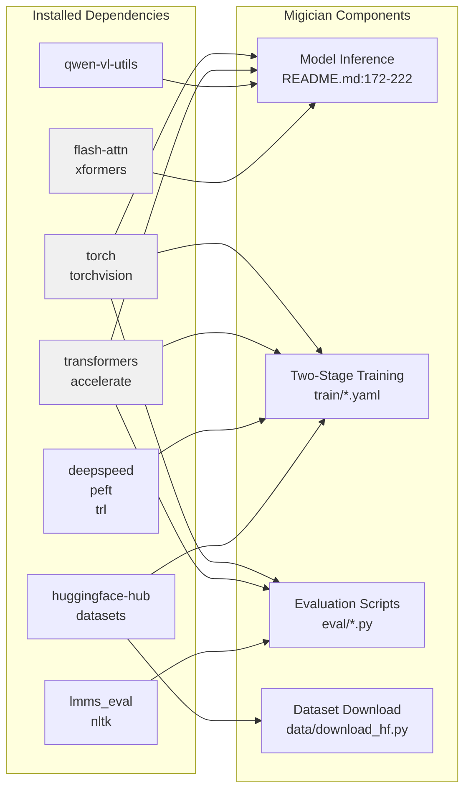

**Sources:** [README.md:54-65](), [README.md:172-222](), [README.md:277-286](), [requirements.txt:1-65]()

---

## Summary

This installation process establishes the complete Migician environment by:

1. Creating an isolated Python 3.10 conda environment named `migician`
2. Cloning the repository from `https://github.com/thunlp/Migician.git`
3. Installing 65 dependencies including PyTorch 2.1.2, Transformers 4.45.2, and flash-attn 2.3.4
4. Verifying critical imports: `Qwen2VLForConditionalGeneration`, `process_vision_info`, and CUDA availability

The installation provides the foundation for:
- **Inference**: Using pre-trained Migician model for multi-image grounding
- **Training**: Fine-tuning on MGrounding-630k dataset with LlamaFactory
- **Evaluation**: Running MIG-Bench, MIBench, and MMIU benchmarks

**Total Installation Time:** Approximately 15-30 minutes depending on network speed and hardware.

**Sources:** [README.md:54-65](), [requirements.txt:1-65]()

---

# Page: Quick Start Guide

# Quick Start Guide

<details>
<summary>Relevant source files</summary>

The following files were used as context for generating this wiki page:

- [README.md](README.md)
- [eval/chat.py](eval/chat.py)

</details>


This page provides a practical introduction to using Migician for multi-image grounding inference. It covers loading the model, constructing prompts with special tokens, and interpreting the output bounding boxes. 

**Prerequisites**: Ensure you have completed the installation steps documented in [Installation](#2.1).

**For training**: See [Training Pipeline](#5) for information about the two-stage training process.

**For evaluation**: See [Evaluation System](#6) for benchmarking and metrics.

---

## Model Loading Architecture

The Migician model is built on `Qwen2VLForConditionalGeneration` and requires three core components for inference:

**Inference Component Initialization Flow**

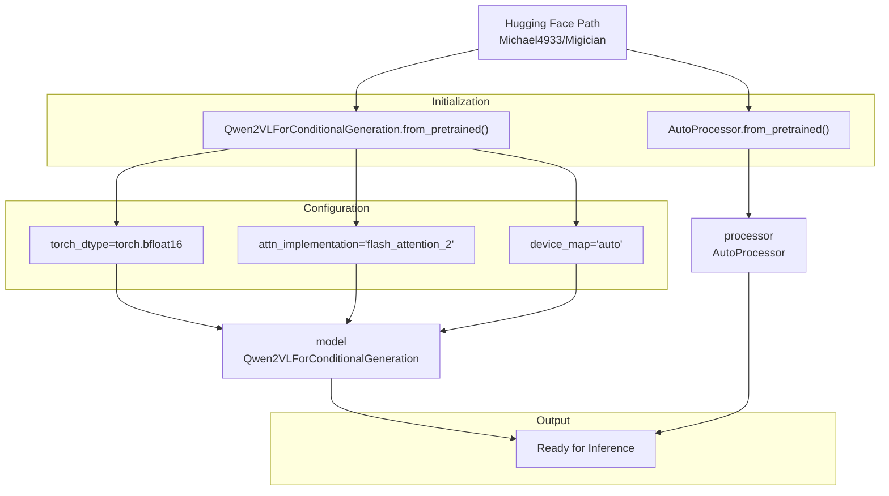

**Sources**: [README.md:176-183](), [eval/chat.py:5-10]()

| Component | Class | Purpose |
|-----------|-------|---------|
| Model | `Qwen2VLForConditionalGeneration` | Core MLLM for generating text and bounding boxes |
| Processor | `AutoProcessor` | Handles tokenization and vision preprocessing |
| Vision Processor | `process_vision_info` (from `qwen_vl_utils`) | Extracts image inputs from message structure |

The model is loaded with `flash_attention_2` optimization for improved memory efficiency and speed, particularly important for multi-image scenarios.

**Sources**: [README.md:176-183](), [eval/chat.py:5-10]()

---

## Basic Multi-Image Grounding Example

The following example demonstrates locating a common person across four images:

**Message Construction and Processing Pipeline**

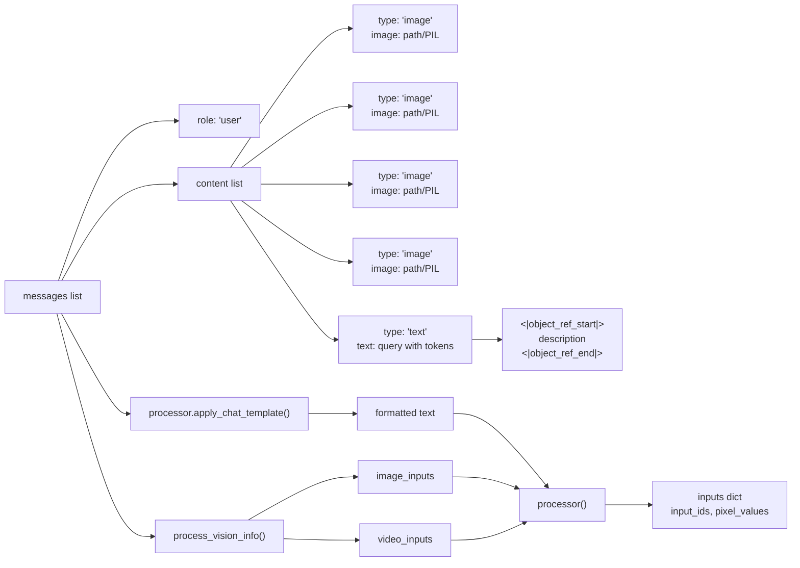

**Sources**: [README.md:185-211](), [eval/chat.py:12-43]()

The basic inference flow follows these steps:

1. **Construct messages**: Create a list with role `"user"` and content containing multiple images plus text query
2. **Apply chat template**: Convert messages to formatted text using `processor.apply_chat_template()`
3. **Process vision**: Extract image tensors using `process_vision_info()` from `qwen_vl_utils`
4. **Tokenize and encode**: Process text and images together with `processor()`
5. **Generate**: Call `model.generate()` with the processed inputs
6. **Decode**: Extract and decode the generated token IDs

**Sources**: [README.md:185-222](), [eval/chat.py:12-53]()

---

## Input Format Specification

### Message Structure

The input follows a standardized message format:

```python
messages = [
    {
        "role": "user",
        "content": [
            {"type": "image", "image": <path_or_PIL_image>},
            {"type": "image", "image": <path_or_PIL_image>},
            # ... more images ...
            {"type": "text", "text": "<query_with_special_tokens>"}
        ]
    }
]
```

**Sources**: [README.md:185-206](), [eval/chat.py:12-38]()

| Field | Type | Description |
|-------|------|-------------|
| `role` | string | Always `"user"` for inference queries |
| `content` | list | Ordered list of image and text entries |
| `type` | string | Either `"image"` or `"text"` |
| `image` | string or PIL.Image | File path or PIL Image object |
| `text` | string | Natural language query with special tokens |

### Special Tokens for Grounding

Grounding queries require wrapping target descriptions with delimiter tokens:

```
<|object_ref_start|>description of target object<|object_ref_end|>
```

Example query:
```
"Please recognize <|object_ref_start|>the common person appearing in all these images<|object_ref_end|> and locate this person in all these image."
```

**Sources**: [README.md:202](), [eval/chat.py:34]()

For detailed information about the complete special token system, see [Special Token System](#4.3).

---

## Processing and Generation

**Text and Vision Processing Flow**

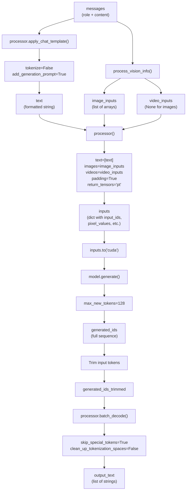

**Sources**: [README.md:208-221](), [eval/chat.py:40-53]()

The processing happens in three stages:

1. **Text Templating**: `processor.apply_chat_template()` converts the message structure into a formatted prompt string with conversation markers
2. **Vision Processing**: `process_vision_info()` extracts image arrays from the message content
3. **Combined Processing**: `processor()` tokenizes text and processes images together into model-ready tensors

**Sources**: [README.md:208-211]()

### Generation Parameters

The generation call uses:

```python
generated_ids = model.generate(**inputs, max_new_tokens=128)
```

| Parameter | Value | Purpose |
|-----------|-------|---------|
| `max_new_tokens` | 128 | Limits output length; sufficient for multiple bounding boxes |
| `**inputs` | dict | Contains `input_ids`, `pixel_values`, `attention_mask` |

**Sources**: [README.md:214](), [eval/chat.py:46]()

### Token Trimming and Decoding

After generation, the output tokens include both the input and newly generated tokens. The trimming step isolates only the generated portion:

```python
generated_ids_trimmed = [
    out_ids[len(in_ids):] for in_ids, out_ids in zip(inputs.input_ids, generated_ids)
]
```

This is then decoded to text:

```python
output_text = processor.batch_decode(
    generated_ids_trimmed, 
    skip_special_tokens=True, 
    clean_up_tokenization_spaces=False
)
```

**Sources**: [README.md:215-220](), [eval/chat.py:47-52]()

---

## Output Format Specification

Migician outputs natural language responses with embedded bounding box coordinates using special tokens:

### Bounding Box Format

```
<|box_start|>(x1,y1),(x2,y2)<|box_end|>
```

Where:
- `x1, y1`: Top-left corner coordinates
- `x2, y2`: Bottom-right corner coordinates
- All coordinates normalized to **0-1000 scale** (not 0-1)
- Format: `x1 y1 x2 y2` (space-separated within parentheses)

**Sources**: [README.md:143]()

### Example Output

```
"It's in the third image. <|box_start|>(316,58),(764,999)<|box_end|>"
```

This indicates:
- The target object is in the third image (1-indexed)
- Bounding box: top-left at (31.6%, 5.8%), bottom-right at (76.4%, 99.9%) of image dimensions

**Sources**: [README.md:143]()

### Multiple Bounding Boxes

For queries involving multiple objects or images, the output contains multiple box specifications:

```
"It's in the first image. <|box_start|>(408,656),(578,997)<|box_end|>"
```

Each bounding box is accompanied by contextual text identifying which image and object it refers to.

**Sources**: [README.md:151]()

### Coordinate Normalization

| Scale Type | Range | Usage |
|------------|-------|-------|
| Model Output | 0-1000 | Migician's native output format |
| Ground Truth (MIG-Bench) | 0.0-1.0 | Evaluation benchmark format |
| Conversion | `coord / 1000.0` | Convert model output to ground truth format |

**Note**: When evaluating or comparing with ground truth, coordinates must be normalized by dividing by 1000.

**Sources**: [README.md:143](), [README.md:251-252]()

---

## Complete Code Reference

The complete inference code is located in two primary locations:

1. **README Example**: [README.md:171-222]() - Full documented example with imports
2. **Chat Script**: [eval/chat.py:1-54]() - Standalone executable version

**Inference Code Entity Mapping**

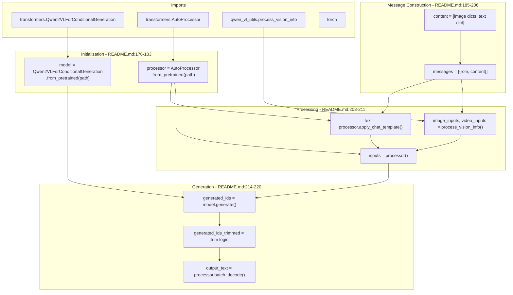

**Sources**: [README.md:171-222](), [eval/chat.py:1-54]()

### Key Functions and Methods

| Function/Method | Location | Purpose |
|-----------------|----------|---------|
| `from_pretrained()` | [README.md:177-182]() | Loads model weights and configuration |
| `apply_chat_template()` | [README.md:208]() | Formats messages into model input text |
| `process_vision_info()` | [README.md:209]() | Extracts and processes image data |
| `processor()` | [README.md:210]() | Tokenizes text and encodes images |
| `model.generate()` | [README.md:214]() | Generates output token sequence |
| `batch_decode()` | [README.md:218-220]() | Converts token IDs back to text |

---

## Common Usage Patterns

### Single vs. Multiple Images

Migician handles both single and multiple images in the same message format. Simply adjust the number of image entries in the content list:

**Single image**:
```python
content = [
    {"type": "image", "image": "image1.jpg"},
    {"type": "text", "text": "Locate <|object_ref_start|>the cat<|object_ref_end|>."}
]
```

**Multiple images**:
```python
content = [
    {"type": "image", "image": "image1.jpg"},
    {"type": "image", "image": "image2.jpg"},
    {"type": "image", "image": "image3.jpg"},
    {"type": "text", "text": "Find <|object_ref_start|>the common object<|object_ref_end|>."}
]
```

**Sources**: [README.md:185-206]()

### Image Input Types

The model accepts two image input formats:

1. **File paths** (string): `"./figs/multi_view_1.png"`
2. **PIL Image objects**: Pre-loaded images from `PIL.Image.open()`

Both types can be mixed within the same message.

**Sources**: [README.md:190](), [eval/chat.py:18]()

### Device Management

The model automatically distributes across available GPUs with `device_map="auto"`, but inputs must be explicitly moved to the target device:

```python
inputs = inputs.to("cuda")  # or "cpu" for CPU inference
```

**Sources**: [README.md:211](), [eval/chat.py:43]()

---

## Next Steps

After completing this quick start guide:

- **Understanding the model architecture**: See [Model Architecture](#4.1) for details on Migician's design
- **Learning the token system**: See [Special Token System](#4.3) for comprehensive token usage
- **Running evaluations**: See [Direct Evaluation Script](#6.2) for benchmarking on MIG-Bench
- **Training your own model**: See [Training Pipeline](#5) for two-stage training procedures

**Sources**: [README.md:41-51]()

---

# Page: MGrounding-630k Dataset

# MGrounding-630k Dataset

<details>
<summary>Relevant source files</summary>

The following files were used as context for generating this wiki page:

- [README.md](README.md)
- [data/download_hf.py](data/download_hf.py)

</details>


## Purpose and Scope

This document provides comprehensive documentation of the **MGrounding-630k** training dataset, which contains over 630,000 multi-image grounding examples used to train the Migician model. The dataset encompasses seven distinct task types derived from 10+ existing datasets, with a focus on free-form grounding capabilities.

For information about dataset structure and task type details, see [Dataset Structure](#3.1). For step-by-step download instructions, see [Downloading the Dataset](#3.2). For training pipeline usage of this dataset, see [Training Pipeline](#5).

**Sources:** [README.md:1-298]()

---

## Overview

MGrounding-630k is a heterogeneous multi-image grounding dataset designed specifically to enable free-form grounding in Multimodal Large Language Models (MLLMs). The dataset aggregates and synthesizes data from multiple source datasets, organizing them into task-specific categories that cover diverse multi-image grounding scenarios.

**Key Characteristics:**
- **Total Examples:** 630,000+ training instances
- **Task Types:** 7 distinct multi-image grounding tasks
- **Source Datasets:** 10+ existing computer vision datasets
- **Format:** JSON-based conversation format with image paths
- **Special Features:** Free-form natural language grounding instructions

Each training example involves multiple images, resulting in a substantially larger total number of images than the number of examples. The dataset is hosted on Hugging Face Hub at `Michael4933/MGrounding-630k` for convenient access.

**Sources:** [README.md:70-76](), [README.md:17-17]()

---

## Dataset Composition

MGrounding-630k consists of seven major task categories, each targeting specific multi-image grounding capabilities:

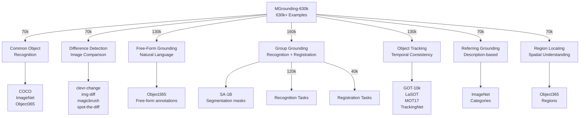

**Diagram: MGrounding-630k Task Composition and Source Datasets**

### Task Type Statistics

| Task Type | Example Count | Source Datasets | Primary Focus |
|-----------|--------------|-----------------|---------------|
| **Common Object Recognition** | 70,000 | COCO, ImageNet, Object365 | Multi-image identification of shared objects |
| **Difference Detection** | 70,000 | clevr-change, img-diff, magicbrush, spot-the-diff | Image comparison and change identification |
| **Free-Form Grounding** | 130,000 | Object365 | Natural language-driven grounding |
| **Group Grounding** | 160,000 | SA-1B | Multiple object sets (120k recognition, 40k registration) |
| **Object Tracking** | 130,000 | GOT-10k, LaSOT, MOT17, TrackingNet | Temporal consistency across frames |
| **Referring Grounding** | 70,000 | ImageNet | Description-based category mapping |
| **Region Locating** | 70,000 | Object365 | Spatial area identification |

**Sources:** [README.md:70-76]()

---

## File Organization Structure

The dataset is organized hierarchically by task type, with all images and metadata stored in a structured directory format:

```mermaid
graph TD
    ROOT["data/MGrounding-630k/"]
    
    ROOT --> JSON["MGrounding-630k.json<br/>All conversation data"]
    ROOT --> COMMON["Common_Object/"]
    ROOT --> DIFF["Difference/"]
    ROOT --> FREEFORM["Free-Form/"]
    ROOT --> GROUP["Group_Grounding/"]
    ROOT --> TRACK["Object_Tracking/"]
    ROOT --> REFER["Referring_Grounding/"]
    ROOT --> REGION["Region_Locating/"]
    
    COMMON --> COCO["COCO/<br/>images"]
    COMMON --> IMGNET1["ImageNet/<br/>images"]
    COMMON --> OBJ1["Object365/<br/>images"]
    COMMON --> CJSON["common_train_70k.json"]
    
    DIFF --> CLEVR["clevr-change/<br/>images"]
    DIFF --> IMGDIFF["img-diff/<br/>images"]
    DIFF --> MAGIC["magicbrush/<br/>images"]
    DIFF --> SPOT["spot-the-diff/<br/>images"]
    DIFF --> DJSON["diff_train_70k.json"]
    
    FREEFORM --> OBJ2["Object365/<br/>images"]
    FREEFORM --> FJSON["free_form_grounding_130k.json"]
    
    GROUP --> SA1B["SA-1B/<br/>images"]
    GROUP --> GGRECJSON["gg_train_120k.json<br/>Recognition"]
    GROUP --> GGREGJSON["_gg_reg_40k.json<br/>Registration"]
    
    TRACK --> GOT["GOT-10k/<br/>images"]
    TRACK --> LASOT["LaSOT/<br/>images"]
    TRACK --> MOT["MOT17_image/<br/>images"]
    TRACK --> TRACKNET["TrackingNet/<br/>images"]
    TRACK --> TJSON["ot_train_130k.json"]
    
    REFER --> IMGNET2["ImageNet/<br/>images"]
    REFER --> RJSON["refer_train_70k.json"]
    
    REGION --> OBJ3["Object365/<br/>images"]
    REGION --> REGJSON["region_train_70k.json"]
```

**Diagram: MGrounding-630k Directory Structure Mapping**

The centralized `MGrounding-630k.json` file at [data/MGrounding-630k.json]() aggregates all conversation data from individual task-specific JSON files, enabling convenient single-file access during training.

**Sources:** [README.md:80-125]()

---

## Data Format Specification

### JSON Structure

Each training example follows a standardized JSON format that specifies multiple images, multi-turn conversations, and task type labels:

```json
{
    "id": "5229016_8929009_6793119_3571391",
    "images": [
        "./MGrounding-630k/Group_Grounding/SA-1B/sa_5229016.jpg",
        "./MGrounding-630k/Group_Grounding/SA-1B/sa_8929009.jpg",
        "./MGrounding-630k/Group_Grounding/SA-1B/sa_6793119.jpg",
        "./MGrounding-630k/Group_Grounding/SA-1B/sa_3571391.jpg"
    ],
    "conversations": [
        {
            "from": "human",
            "value": "<image>\n<image>\n<image>\n<image>\nGive the bounding box of the region this sentence refers to: <|object_ref_start|>a statue of a man<|object_ref_end|>."
        },
        {
            "from": "gpt",
            "value": "It's in the third image. <|box_start|>(316,58),(764,999)<|box_end|>"
        },
        {
            "from": "human",
            "value": "Recognize the target region that this sentence refers to: <|object_ref_start|>a woman wearing an orange shirt<|object_ref_end|>."
        },
        {
            "from": "gpt",
            "value": "It's in the first image. <|box_start|>(408,656),(578,997)<|box_end|>"
        }
    ],
    "type": "gg_train"
}
```

**Sources:** [README.md:126-156]()

### Field Specifications

| Field | Type | Description |
|-------|------|-------------|
| `id` | string | Unique identifier (internal use, can be ignored) |
| `images` | array[string] | List of image file paths relative to dataset root |
| `conversations` | array[object] | Multi-turn dialogue with grounding instructions |
| `conversations[].from` | string | Speaker role: `"human"` or `"gpt"` |
| `conversations[].value` | string | Message content with special tokens |
| `type` | string | Task type label (e.g., `"gg_train"`, `"free_form"`) |

### Special Token System

MGrounding-630k uses a specialized token vocabulary to denote grounding targets and bounding boxes:

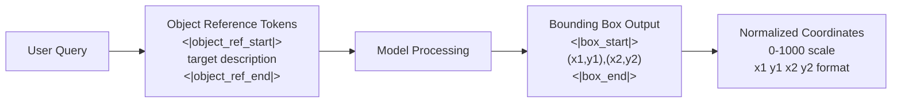

**Diagram: Special Token Flow in MGrounding-630k Format**

**Token Definitions:**
- **`<|object_ref_start|>` / `<|object_ref_end|>`**: Delimit the natural language description of the grounding target in user queries
- **`<|box_start|>` / `<|box_end|>`**: Delimit bounding box coordinates in model responses
- **Coordinate Format**: `(x1,y1),(x2,y2)` where values are normalized to 0-1000 scale
- **Coordinate System**: Relative positions with respect to image width (x) and height (y)

For detailed information on special token usage, see [Special Token System](#4.3).

**Sources:** [README.md:126-156](), [README.md:139-143]()

---

## Storage and Download Considerations

### Storage Requirements

Due to the multi-image nature of the dataset, storage requirements are substantial:

> **Important:** Each training example involves multiple images. The 630k+ examples collectively include a significantly larger number of individual images. Ensure sufficient hard disk storage before downloading.

**Minimum Requirements:**
- Hard disk space: Sufficient for 630k+ multi-image examples (exact size depends on image compression)
- Network: Stable internet connection for Hugging Face Hub download
- Download tool: `huggingface-hub` Python package with snapshot download support

**Sources:** [README.md:70-74]()

### Download Automation

The dataset can be downloaded automatically using the provided script at [data/download_hf.py:1-11]():

```python
from huggingface_hub import snapshot_download

snapshot_download(
    repo_id='Michael4933/MGrounding-630k',
    repo_type='dataset',
    local_dir='Your_Own_Path',
    force_download=False,
    max_workers=32,
)
```

**Key Parameters:**
- `repo_id`: `'Michael4933/MGrounding-630k'` (Hugging Face repository)
- `repo_type`: `'dataset'` (specifies dataset repository type)
- `local_dir`: Target directory path for downloaded data
- `max_workers`: Parallel download threads (32 recommended)
- `force_download`: Set to `False` to resume interrupted downloads

**Mirror Configuration (Optional):**
For regions with limited Hugging Face access, set the mirror endpoint before downloading:
```bash
export HF_ENDPOINT=https://hf-mirror.com
```

**Sources:** [data/download_hf.py:1-11](), [README.md:78-78]()

---

## Integration with Training Pipeline

### Data Loading Flow

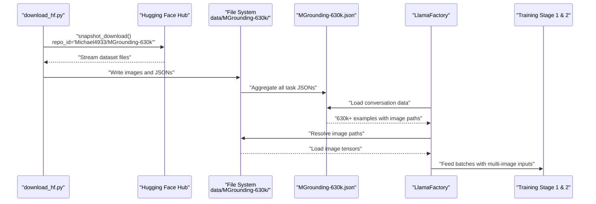

**Diagram: MGrounding-630k Data Flow from Download to Training**

The dataset integrates with the training pipeline through the following code entities:
- **Download Script**: [data/download_hf.py:4-11]() handles automated retrieval
- **Centralized JSON**: [data/MGrounding-630k.json]() referenced by training configs
- **Training Configs**: [train/stage-1_finetune_full.yaml]() and [train/stage-2_finetune_full.yaml]() specify dataset paths
- **LlamaFactory Framework**: Orchestrates data loading and batching during training

**Sources:** [README.md:278-286](), [data/download_hf.py:1-11]()

---

## Task Type Labels

The `type` field in each JSON entry identifies the specific grounding task:

| Type Label | Task Name | Description |
|------------|-----------|-------------|
| `common_train` | Common Object Recognition | Identifying shared objects across images |
| `diff_train` | Difference Detection | Finding differences between image pairs |
| `free_form` | Free-Form Grounding | Natural language-driven flexible grounding |
| `gg_train` | Group Grounding (Recognition) | Recognizing object groups across images |
| `gg_reg` | Group Grounding (Registration) | Registering object correspondences |
| `ot_train` | Object Tracking | Tracking objects across temporal sequences |
| `refer_train` | Referring Grounding | Grounding based on descriptive references |
| `region_train` | Region Locating | Identifying spatial regions |

These labels enable task-specific filtering during training and analysis.

**Sources:** [README.md:80-125](), [README.md:154-154]()

---

# Page: Dataset Structure

# Dataset Structure

<details>
<summary>Relevant source files</summary>

The following files were used as context for generating this wiki page:

- [README.md](README.md)

</details>


This document provides a detailed breakdown of the MGrounding-630k dataset structure, including the seven task types, their source datasets, example counts, directory organization, and JSON data format specifications. For information on downloading the dataset, see [Downloading the Dataset](#3.2). For training with this dataset, see [Training Pipeline](#5).

---

## Overview

MGrounding-630k is a heterogeneous multi-image grounding dataset containing **630,000+** training examples organized into seven distinct task categories. Each task type is designed to develop specific multi-image grounding capabilities, from basic shared object recognition to complex free-form natural language grounding. The dataset aggregates data from over 10 different source datasets, ensuring diverse visual scenarios and robust generalization.

**Key Characteristics:**
- **Multi-image nature**: Each example involves multiple images (typically 2-8 images)
- **Task diversity**: Seven complementary task types covering different grounding scenarios
- **Unified format**: Standardized JSON structure with special token support
- **Normalized coordinates**: Bounding boxes use 0-1000 scale for resolution independence

Sources: [README.md:1-298]()

---

## Task Type Distribution

### Task Statistics

The following table summarizes the composition of MGrounding-630k:

| Task Type | Example Count | Source Datasets | Purpose |
|-----------|---------------|-----------------|---------|
| Common Object Recognition | 70,000 | COCO, ImageNet, Object365 | Identify shared objects across images |
| Difference Detection | 70,000 | clevr-change, img-diff, magicbrush, spot-the-diff | Detect changes between image pairs |
| Free-Form Grounding | 130,000 | Object365 | Ground objects from natural language descriptions |
| Group Grounding | 160,000 | SA-1B | Recognize and register multiple object sets |
| Object Tracking | 130,000 | GOT-10k, LaSOT, MOT17, TrackingNet | Track objects across sequential frames |
| Referring Grounding | 70,000 | ImageNet | Ground objects by category references |
| Region Locating | 70,000 | Object365 | Identify spatial regions by description |
| **Total** | **630,000** | 10+ datasets | Comprehensive multi-image grounding |

**Note**: Group Grounding contains two sub-tasks:
- Recognition (120,000 examples): Identify common objects across images
- Registration (40,000 examples): Map corresponding object locations

Sources: [README.md:70-125]()

---

## Task Type Breakdown

### 1. Common Object Recognition (70k)

**Purpose**: Identify and locate objects that appear across multiple images from different sources.

**Source Datasets**:
- **COCO**: Common objects in context
- **ImageNet**: ImageNet-scale object categories
- **Object365**: 365 object categories with dense annotations

**Directory**: `./data/MGrounding-630k/Common_Object/`

**Task Characteristics**:
- Requires cross-image object matching
- Tests basic multi-image correspondence
- Uses standard object categories

### 2. Difference Detection (70k)

**Purpose**: Identify what has changed between image pairs or detect differences across similar images.

**Source Datasets**:
- **clevr-change**: Synthetic scene changes
- **img-diff**: Natural image differences
- **magicbrush**: Image editing scenarios
- **spot-the-diff**: Visual puzzle differences

**Directory**: `./data/MGrounding-630k/Difference/`

**Task Characteristics**:
- Focuses on fine-grained visual comparison
- Requires attention to subtle variations
- Multiple specialized difference scenarios

### 3. Free-Form Grounding (130k)

**Purpose**: Ground objects based on unrestricted natural language descriptions without predefined categories.

**Source Datasets**:
- **Object365**: Free-form annotations generated from object descriptions

**Directory**: `./data/MGrounding-630k/Free-Form/`

**Task Characteristics**:
- Largest single-source task type (130k examples)
- Enables flexible, description-driven grounding
- Tests natural language understanding in multi-image contexts
- Critical for real-world application scenarios

### 4. Group Grounding (160k)

**Purpose**: Recognize and register multiple object groups across images, supporting both recognition and spatial correspondence tasks.

**Source Datasets**:
- **SA-1B** (Segment Anything): High-quality segmentation masks converted to bounding boxes

**Directory**: `./data/MGrounding-630k/Group_Grounding/`

**Sub-tasks**:
- **Recognition** (120k): Identify which objects appear in which images
- **Registration** (40k): Establish precise spatial correspondences

**Task Characteristics**:
- Largest task type overall (160k examples)
- Handles multiple objects per query
- Tests both categorical and spatial reasoning

### 5. Object Tracking (130k)

**Purpose**: Track objects across sequential frames, maintaining identity consistency through temporal sequences.

**Source Datasets**:
- **GOT-10k**: Generic object tracking
- **LaSOT**: Large-scale single object tracking
- **MOT17**: Multiple object tracking
- **TrackingNet**: Large-scale tracking dataset

**Directory**: `./data/MGrounding-630k/Object_Tracking/`

**Task Characteristics**:
- Temporal consistency across frames
- Tests cross-frame object correspondence
- Multiple tracking scenarios (single/multiple objects)

### 6. Referring Grounding (70k)

**Purpose**: Ground objects based on category names or referring expressions mapped to ImageNet taxonomy.

**Source Datasets**:
- **ImageNet**: Structured category hierarchy

**Directory**: `./data/MGrounding-630k/Referring_Grounding/`

**Task Characteristics**:
- Category-based object grounding
- Leverages semantic hierarchies
- Tests category understanding across images

### 7. Region Locating (70k)

**Purpose**: Identify and locate spatial regions based on descriptive queries.

**Source Datasets**:
- **Object365**: Region-level annotations

**Directory**: `./data/MGrounding-630k/Region_Locating/`

**Task Characteristics**:
- Spatial reasoning emphasis
- Region-level (vs. object-level) grounding
- Tests area identification capabilities

Sources: [README.md:70-125]()

---

## Directory Structure

### Complete Directory Hierarchy

```mermaid
graph TD
    ROOT["MGrounding-630k/"]
    
    ROOT --> COMMON["Common_Object/"]
    ROOT --> DIFF["Difference/"]
    ROOT --> FREE["Free-Form/"]
    ROOT --> GROUP["Group_Grounding/"]
    ROOT --> TRACK["Object_Tracking/"]
    ROOT --> REFER["Referring_Grounding/"]
    ROOT --> REGION["Region_Locating/"]
    ROOT --> JSON["MGrounding-630k.json"]
    
    COMMON --> C1["COCO/"]
    COMMON --> C2["ImageNet/"]
    COMMON --> C3["Object365/"]
    COMMON --> C4["common_train_70k.json"]
    
    DIFF --> D1["clevr-change/"]
    DIFF --> D2["img-diff/"]
    DIFF --> D3["magicbrush/"]
    DIFF --> D4["spot-the-diff/"]
    DIFF --> D5["diff_train_70k.json"]
    
    FREE --> F1["Object365/"]
    FREE --> F2["free_form_grounding_130k.json"]
    
    GROUP --> G1["SA-1B/"]
    GROUP --> G2["gg_train_120k.json<br/>(recognition)"]
    GROUP --> G3["_gg_reg_40k.json<br/>(registration)"]
    
    TRACK --> T1["GOT-10k/"]
    TRACK --> T2["LaSOT/"]
    TRACK --> T3["MOT17_image/"]
    TRACK --> T4["TrackingNet/"]
    TRACK --> T5["ot_train_130k.json"]
    
    REFER --> R1["ImageNet/"]
    REFER --> R2["refer_train_70k.json"]
    
    REGION --> RE1["Object365/"]
    REGION --> RE2["region_train_70k.json"]
```

### Task-to-Directory Mapping

The complete directory structure as organized in the repository:

```
Migician/data/MGrounding-630k/
├── Common_Object/
│   ├── COCO/
│   ├── ImageNet/
│   ├── Object365/
│   └── common_train_70k.json
├── Difference/
│   ├── clevr-change/
│   ├── img-diff/
│   ├── magicbrush/
│   ├── spot-the-diff/
│   └── diff_train_70k.json
├── Free-Form/
│   ├── Object365/
│   └── free_form_grounding_130k.json
├── Group_Grounding/
│   ├── SA-1B/
│   ├── gg_train_120k.json
│   └── _gg_reg_40k.json
├── Object_Tracking/
│   ├── GOT-10k/
│   ├── LaSOT/
│   ├── MOT17_image/
│   ├── TrackingNet/
│   └── ot_train_130k.json
├── Referring_Grounding/
│   ├── ImageNet/
│   └── refer_train_70k.json
├── Region_Locating/
│   ├── Object365/
│   └── region_train_70k.json
└── MGrounding-630k.json (consolidated)
```

**Key Files**:
- Each task directory contains task-specific JSON files with conversation data
- `MGrounding-630k.json`: Master file consolidating all 630k+ examples with task labels
- Image directories organized by source dataset within each task folder

Sources: [README.md:80-125]()

---

## JSON Data Format

### Conversation Structure

Each training example in MGrounding-630k follows a standardized JSON structure designed to support multi-turn grounding conversations with special token markers.

### Example Data Structure

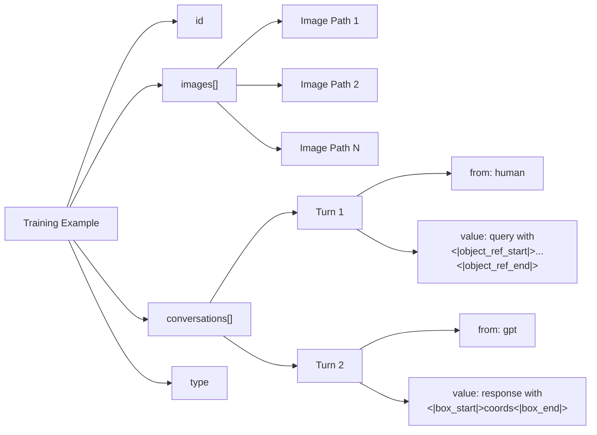

### Complete Example

The following shows a complete Group Grounding example from the dataset:

```json
{
    "id": "5229016_8929009_6793119_3571391",
    "images": [
        "./MGrounding-630k/Group_Grounding/SA-1B/sa_5229016.jpg",
        "./MGrounding-630k/Group_Grounding/SA-1B/sa_8929009.jpg",
        "./MGrounding-630k/Group_Grounding/SA-1B/sa_6793119.jpg",
        "./MGrounding-630k/Group_Grounding/SA-1B/sa_3571391.jpg"
    ],
    "conversations": [
        {
            "from": "human",
            "value": "<image>\n<image>\n<image>\n<image>\nGive the bounding box of the region this sentence refers to: <|object_ref_start|>a statue of a man<|object_ref_end|>."
        },
        {
            "from": "gpt",
            "value": "It's in the third image. <|box_start|>(316,58),(764,999)<|box_end|>"
        },
        {
            "from": "human",
            "value": "Recognize the target region that this sentence refers to: <|object_ref_start|>a woman wearing an orange shirt<|object_ref_end|>."
        },
        {
            "from": "gpt",
            "value": "It's in the first image. <|box_start|>(408,656),(578,997)<|box_end|>"
        }
    ],
    "type": "gg_train"
}
```

Sources: [README.md:127-156]()

---

## Field Specifications

### Core Fields

| Field | Type | Description | Example |
|-------|------|-------------|---------|
| `id` | string | Unique identifier (can be ignored for training) | `"5229016_8929009_6793119_3571391"` |
| `images` | array[string] | Ordered list of relative image paths | `["./MGrounding-630k/Group_Grounding/SA-1B/sa_5229016.jpg", ...]` |
| `conversations` | array[object] | Multi-turn conversation with grounding queries | See below |
| `type` | string | Task type label for filtering | `"gg_train"`, `"free_form"`, etc. |

### Conversation Turn Structure

Each conversation turn contains:

| Field | Type | Values | Description |
|-------|------|--------|-------------|
| `from` | string | `"human"` or `"gpt"` | Speaker role |
| `value` | string | Text with special tokens | Query text (human) or response with bbox (gpt) |

### Special Token System

The dataset uses special tokens to delimit grounding targets and bounding boxes:

**Object Reference Tokens**:
- `<|object_ref_start|>`: Marks the beginning of an object description
- `<|object_ref_end|>`: Marks the end of an object description

**Bounding Box Tokens**:
- `<|box_start|>`: Marks the beginning of coordinate data
- `<|box_end|>`: Marks the end of coordinate data

**Coordinate Format**:
- Format: `(x1,y1),(x2,y2)`
- Scale: **0-1000** normalized coordinates (not 0-1)
- Coordinate system: `x1, y1` = top-left corner, `x2, y2` = bottom-right corner
- Relative positions regarding image width and height

For detailed information on the special token system, see [Special Token System](#4.3).

Sources: [README.md:127-156]()

---

## Task Type Labels

### Type Field Mapping

Each example's `type` field identifies its task category for data filtering and task-specific training:

| Type Value | Task Category | Example Count |
|------------|---------------|---------------|
| `"common"` | Common Object Recognition | 70,000 |
| `"diff"` | Difference Detection | 70,000 |
| `"free_form"` | Free-Form Grounding | 130,000 |
| `"gg_train"` | Group Grounding (Recognition) | 120,000 |
| `"gg_reg"` | Group Grounding (Registration) | 40,000 |
| `"ot"` | Object Tracking | 130,000 |
| `"refer"` | Referring Grounding | 70,000 |
| `"region"` | Region Locating | 70,000 |

### Task-Specific JSON Files

In addition to the consolidated `MGrounding-630k.json`, task-specific JSON files are provided:

```mermaid
graph TB
    MASTER["MGrounding-630k.json<br/>(630k+ examples)"]
    
    MASTER -.->|"filter by type"| T1["common_train_70k.json"]
    MASTER -.->|"filter by type"| T2["diff_train_70k.json"]
    MASTER -.->|"filter by type"| T3["free_form_grounding_130k.json"]
    MASTER -.->|"filter by type"| T4["gg_train_120k.json"]
    MASTER -.->|"filter by type"| T5["_gg_reg_40k.json"]
    MASTER -.->|"filter by type"| T6["ot_train_130k.json"]
    MASTER -.->|"filter by type"| T7["refer_train_70k.json"]
    MASTER -.->|"filter by type"| T8["region_train_70k.json"]
    
    T1 --> L1["70k examples<br/>type: common"]
    T2 --> L2["70k examples<br/>type: diff"]
    T3 --> L3["130k examples<br/>type: free_form"]
    T4 --> L4["120k examples<br/>type: gg_train"]
    T5 --> L5["40k examples<br/>type: gg_reg"]
    T6 --> L6["130k examples<br/>type: ot"]
    T7 --> L7["70k examples<br/>type: refer"]
    T8 --> L8["70k examples<br/>type: region"]
```

Sources: [README.md:80-125](), [README.md:127-156]()

---

## Source Dataset Details

### Dataset Source Relationships

The following diagram shows how source datasets contribute to task types:

```mermaid
graph TB
    subgraph "Source Datasets"
        COCO["COCO"]
        INET["ImageNet"]
        O365["Object365"]
        SA1B["SA-1B"]
        CLEVR["clevr-change"]
        IMGDIFF["img-diff"]
        MAGIC["magicbrush"]
        SPOT["spot-the-diff"]
        GOT["GOT-10k"]
        LASOT["LaSOT"]
        MOT["MOT17"]
        TRACK["TrackingNet"]
    end
    
    subgraph "Task Types"
        COMMON["Common Object<br/>70k"]
        DIFF["Difference<br/>70k"]
        FREE["Free-Form<br/>130k"]
        GROUP["Group Grounding<br/>160k"]
        OT["Object Tracking<br/>130k"]
        REFER["Referring<br/>70k"]
        REGION["Region Locating<br/>70k"]
    end
    
    COCO --> COMMON
    INET --> COMMON
    O365 --> COMMON
    
    CLEVR --> DIFF
    IMGDIFF --> DIFF
    MAGIC --> DIFF
    SPOT --> DIFF
    
    O365 --> FREE
    
    SA1B --> GROUP
    
    GOT --> OT
    LASOT --> OT
    MOT --> OT
    TRACK --> OT
    
    INET --> REFER
    
    O365 --> REGION
```

### Source Dataset Statistics

| Source Dataset | Task Types | Contribution |
|----------------|------------|--------------|
| **Object365** | Common Object, Free-Form, Region Locating | ~200k+ examples across 3 tasks |
| **SA-1B** | Group Grounding | 160k examples (full task) |
| **ImageNet** | Common Object, Referring Grounding | ~140k examples across 2 tasks |
| **Tracking Datasets** | Object Tracking | 130k examples (4 datasets) |
| **COCO** | Common Object | Partial contribution to 70k |
| **Difference Datasets** | Difference Detection | 70k examples (4 datasets) |

**Note**: Object365 is the most versatile source dataset, contributing to three different task types and demonstrating its rich annotation diversity.

Sources: [README.md:70-125]()

---

## Image Path Convention

### Relative Path Structure

All image paths in the JSON files use relative paths from the data root directory:

```
./MGrounding-630k/{TaskType}/{SourceDataset}/{image_file}
```

**Example Paths**:
```
./MGrounding-630k/Group_Grounding/SA-1B/sa_5229016.jpg
./MGrounding-630k/Free-Form/Object365/obj365_12345.jpg
./MGrounding-630k/Object_Tracking/LaSOT/lasot_video_001_0042.jpg
```

### Multi-Image Ordering

The `images` array maintains strict ordering:
- Array index corresponds to image position in conversation context
- Image tokens `<image>` in conversation refer to images in sequential order
- Model processes images according to array order

**Example**:
```json
"images": ["path/to/img1.jpg", "path/to/img2.jpg", "path/to/img3.jpg"]
"value": "<image>\n<image>\n<image>\nFind the object in the second image."
```
The query references "second image" = `path/to/img2.jpg` (index 1).

Sources: [README.md:127-156]()

---

## Coordinate Normalization

### Normalization Scheme

MGrounding-630k uses a **0-1000 scale** for bounding box coordinates, providing resolution-independent representation:

```mermaid
graph LR
    ORIG["Original Pixel<br/>Coordinates"]
    
    ORIG --> CALC["Normalize:<br/>x_norm = (x / width) * 1000<br/>y_norm = (y / height) * 1000"]
    
    CALC --> NORM["Normalized<br/>0-1000 Scale"]
    
    NORM --> FORMAT["Format:<br/>&lt;|box_start|&gt;<br/>(x1,y1),(x2,y2)<br/>&lt;|box_end|&gt;"]
```

### Conversion Formula

For an image with dimensions `W × H` pixels:

- `x_normalized = (x_pixel / W) × 1000`
- `y_normalized = (y_pixel / H) × 1000`

**Example**:
```
Image: 800 × 600 pixels
Original bbox: (200, 150) to (400, 300) pixels

Normalized:
x1 = (200 / 800) × 1000 = 250
y1 = (150 / 600) × 1000 = 250
x2 = (400 / 800) × 1000 = 500
y2 = (300 / 600) × 1000 = 500

Output: <|box_start|>(250,250),(500,500)<|box_end|>
```

### Format Specifications

- **Coordinate order**: `(x1, y1), (x2, y2)` where `(x1, y1)` is top-left, `(x2, y2)` is bottom-right
- **Range**: Integer values from 0 to 1000
- **Precision**: Integer precision (no decimals in training data)
- **Multiple boxes**: Single box per grounding query in training data

Sources: [README.md:143](), [README.md:250-253]()

---

## Data Loading Considerations

### Storage Requirements

The multi-image nature of MGrounding-630k results in substantial storage needs:

- **630k+ training examples** with **multiple images per example**
- Total image count significantly exceeds example count
- Typical multi-image count: 2-8 images per example
- **Estimated total storage**: Requires significant disk space (exact size varies)

From [README.md:71-74]():
> Due to the nature of multi-image tasks, each training example involves multiple images. As a result, the 600k+ training examples collectively include an even larger number of images. Please ensure that you have sufficient hard disk storage and a stable internet connection.

### Loading Strategy

**Recommended Approach**:
1. Download complete dataset using `download_hf.py` (see [Downloading the Dataset](#3.2))
2. Extract all `.zip` files for each task type
3. Load `MGrounding-630k.json` for full dataset access
4. Use task-specific JSON files for filtered training

**Performance Considerations**:
- Images are loaded dynamically during training (not pre-cached)
- Multi-image batching requires careful memory management
- Consider preprocessing strategies for efficiency

Sources: [README.md:71-78]()

---

## Task-Specific Characteristics

### Conversation Patterns

Different task types exhibit distinct conversation patterns:

| Task Type | Typical Pattern | Image Count Range |
|-----------|-----------------|-------------------|
| Common Object | Single query across all images | 2-4 images |
| Difference | Comparative queries between image pairs | 2 images |
| Free-Form | Natural language object descriptions | 2-8 images |
| Group Grounding | Multiple object queries per conversation | 2-6 images |
| Object Tracking | Sequential frame analysis | 4-10 frames |
| Referring Grounding | Category-based queries | 2-4 images |
| Region Locating | Spatial region descriptions | 2-4 images |

### Multi-Turn Conversations

Many examples include multiple conversation turns, enabling:
- Progressive grounding refinement
- Multiple object queries in single example
- Context-dependent follow-up questions

**Example Turn Structure**:
```
Turn 1: Human asks about object A → GPT grounds object A
Turn 2: Human asks about object B → GPT grounds object B
Turn 3: Human asks comparative question → GPT responds with analysis
```

Sources: [README.md:127-156]()

---

## Data Quality and Annotations

### Annotation Sources

The dataset leverages multiple annotation sources:

1. **Existing Annotations**: COCO, ImageNet, Object365 provide high-quality ground truth
2. **Generated Annotations**: Free-form descriptions created from structured annotations
3. **Segmentation Conversions**: SA-1B masks converted to bounding boxes
4. **Tracking Annotations**: Temporal correspondences from tracking datasets

### Quality Characteristics

- **Bounding box precision**: Pixel-accurate bounding boxes from source datasets
- **Description diversity**: Natural language variations in free-form tasks
- **Multi-image consistency**: Cross-image annotations maintain object identity
- **Task-specific validation**: Each task type validated for its specific requirements

Sources: [README.md:70-125]()

---

# Page: Downloading the Dataset

# Downloading the Dataset

<details>
<summary>Relevant source files</summary>

The following files were used as context for generating this wiki page:

- [README.md](README.md)
- [data/download_hf.py](data/download_hf.py)

</details>


This document provides a step-by-step guide for downloading the MGrounding-630k dataset from Hugging Face Hub, including configuration options, mirror setup, and verification steps. For information about the dataset structure and task composition, see [Dataset Structure](#3.1).

## Overview

The MGrounding-630k dataset is hosted on Hugging Face at [Michael4933/MGrounding-630k](https://huggingface.co/datasets/Michael4933/MGrounding-630k). Due to the multi-image nature of the dataset, the 630k+ training examples collectively include a substantial number of image files, requiring significant disk storage and a stable internet connection.

**Storage Requirements:**
- Multiple gigabytes of disk space
- Stable high-speed internet connection recommended
- Sufficient bandwidth for concurrent downloads

**Sources:** [README.md:69-75]()

## Prerequisites

Before downloading, ensure the following dependencies are installed:

```bash
pip install huggingface_hub
```

The `huggingface_hub` library provides the `snapshot_download` and `hf_hub_download` functions used by the download script.

**Sources:** [data/download_hf.py:4]()

## Download Method: Using download_hf.py

### Script Overview

The repository provides an automated download script at [data/download_hf.py:1-11]() that handles the complete dataset acquisition process.

### Download Workflow Diagram

```mermaid
flowchart TD
    User["User executes<br/>download_hf.py"]
    Config["Configuration:<br/>repo_id, local_dir,<br/>max_workers"]
    Mirror["Optional:<br/>export HF_ENDPOINT"]
    HubFunc["snapshot_download()"]
    HFServer["Hugging Face Hub<br/>Michael4933/MGrounding-630k"]
    LocalFS["Local Filesystem<br/>./data/MGrounding-630k"]
    Verify["Verify downloaded files"]
    
    User --> Config
    User -.->|"Optional"| Mirror
    Mirror -.-> HubFunc
    Config --> HubFunc
    HubFunc -->|"Requests dataset"| HFServer
    HFServer -->|"Streams files<br/>32 parallel workers"| HubFunc
    HubFunc -->|"Writes to"| LocalFS
    LocalFS --> Verify
```

**Sources:** [data/download_hf.py:1-11]()

### Step-by-Step Instructions

#### Step 1: Configure Mirror (Optional)

For users in regions with limited Hugging Face access, configure a mirror endpoint before downloading:

```bash
export HF_ENDPOINT=https://hf-mirror.com
```

This environment variable redirects all Hugging Face API requests to the specified mirror.

**Sources:** [data/download_hf.py:1-2]()

#### Step 2: Modify Local Directory Path

Edit the `local_dir` parameter in [data/download_hf.py:8]() to specify your desired download location:

```python
snapshot_download(repo_id='Michael4933/MGrounding-630k',
                  repo_type='dataset',
                  local_dir='Your_Own_Path',  # Modify this
                  force_download=False,
                  max_workers=32,
                 )
```

For standard usage, set `local_dir` to `./data/MGrounding-630k` to match the expected structure referenced in training and evaluation scripts.

**Sources:** [data/download_hf.py:6-11]()

#### Step 3: Execute Download Script

```bash
cd data
python download_hf.py
```

The script will download all dataset files using 32 parallel workers (`max_workers=32`) for optimal throughput.

**Sources:** [data/download_hf.py:10]()

### snapshot_download Parameters

| Parameter | Value | Purpose |
|-----------|-------|---------|
| `repo_id` | `'Michael4933/MGrounding-630k'` | Hugging Face repository identifier |
| `repo_type` | `'dataset'` | Specifies dataset repository (not model) |
| `local_dir` | User-specified path | Destination directory for downloaded files |
| `force_download` | `False` | Skip re-downloading existing files |
| `max_workers` | `32` | Number of parallel download threads |

Setting `force_download=False` enables resume functionality—if the download is interrupted, running the script again will continue from where it left off rather than restarting.

**Sources:** [data/download_hf.py:6-11]()

## Data Flow Architecture

```mermaid
graph LR
    subgraph HFHub["Hugging Face Hub"]
        Repo["Repository:<br/>Michael4933/MGrounding-630k"]
        Meta["Dataset Metadata"]
        Files["File Collection:<br/>Images + JSON"]
    end
    
    subgraph DownloadLayer["Download Layer"]
        HFLib["huggingface_hub library"]
        SnapFunc["snapshot_download()"]
        Workers["32 Parallel Workers"]
    end
    
    subgraph LocalFS["Local Filesystem"]
        DataDir["./data/MGrounding-630k/"]
        TaskDirs["Task Subdirectories:<br/>Common_Object/<br/>Difference/<br/>Free-Form/<br/>etc."]
        ZipFiles[".zip Archives"]
        JSONFiles["JSON Conversation Data"]
    end
    
    Repo --> Meta
    Repo --> Files
    Meta --> SnapFunc
    Files --> SnapFunc
    SnapFunc --> HFLib
    HFLib --> Workers
    Workers -->|"Concurrent downloads"| DataDir
    DataDir --> TaskDirs
    DataDir --> ZipFiles
    DataDir --> JSONFiles
```

**Sources:** [README.md:76-125](), [data/download_hf.py:4-11]()

## Post-Download Steps

### Step 1: Verify Download

After download completes, verify the directory structure matches the expected format:

```
data/
└── MGrounding-630k/
    ├── Common_Object/
    ├── Difference/
    ├── Free-Form/
    ├── Group_Grounding/
    ├── Object_Tracking/
    ├── Referring_Grounding/
    ├── Region_Locating/
    └── MGrounding-630k.json
```

Each task subdirectory should contain both image folders and corresponding `.zip` files.

**Sources:** [README.md:80-125]()

### Step 2: Extract ZIP Archives

Navigate to each task subdirectory and extract the `.zip` files to access image data:

```bash
cd data/MGrounding-630k/Common_Object/COCO
unzip *.zip
```

Repeat for all task subdirectories as needed. The README notes that "additional .zip files at this level may be of limited help" [README.md:89](), suggesting the primary data is accessible from the main task directories.

**Sources:** [README.md:76-77]()

### Step 3: Verify JSON Structure

The main conversation data file is located at `./data/MGrounding-630k/MGrounding-630k.json`. This file contains all 630k+ training examples with task type labels. Each example follows this structure:

```json
{
    "id": "unique_identifier",
    "images": ["path/to/image1.jpg", "path/to/image2.jpg"],
    "conversations": [
        {"from": "human", "value": "..."},
        {"from": "gpt", "value": "..."}
    ],
    "type": "task_label"
}
```

Verify the file is valid JSON and contains the expected number of entries.

**Sources:** [README.md:122](), [README.md:126-156]()

## Expected Directory Structure

After successful download and extraction, the complete structure should match:

```
Migician/
├── data/
│   ├── MGrounding-630k/
│   │   ├── Common_Object/
│   │   │   ├── COCO/
│   │   │   ├── ImageNet/
│   │   │   ├── Object365/
│   │   │   └── common_train_70k.json
│   │   ├── Difference/
│   │   │   ├── clevr-change/
│   │   │   ├── img-diff/
│   │   │   ├── magicbrush/
│   │   │   ├── spot-the-diff/
│   │   │   └── diff_train_70k.json
│   │   ├── Free-Form/
│   │   │   ├── Object365/
│   │   │   └── free_form_grounding_130k.json
│   │   ├── Group_Grounding/
│   │   │   ├── SA-1B/
│   │   │   ├── _gg_reg_40k.json
│   │   │   └── gg_train_120k.json
│   │   ├── Object_Tracking/
│   │   │   ├── GOT-10k/
│   │   │   ├── LaSOT/
│   │   │   ├── MOT17_image/
│   │   │   ├── TrackingNet/
│   │   │   └── ot_train_130k.json
│   │   ├── Referring_Grounding/
│   │   │   ├── ImageNet/
│   │   │   └── refer_train_70k.json
│   │   ├── Region_Locating/
│   │   │   ├── Object365/
│   │   │   └── region_train_70k.json
│   │   └── MGrounding-630k.json
```

This structure is referenced by training scripts (see [Training Pipeline](#5)) and must be maintained for proper functionality.

**Sources:** [README.md:80-125]()

## Alternative Download: Manual Method

If the automated script encounters issues, download manually via the Hugging Face website:

1. Visit https://huggingface.co/datasets/Michael4933/MGrounding-630k
2. Navigate to the "Files and versions" tab
3. Download individual files or use the "Download dataset" option
4. Extract to `./data/MGrounding-630k`

This method provides more granular control but lacks parallel download optimization.

**Sources:** [README.md:70]()

## Mirror Configuration Details

### Supported Mirrors

The `HF_ENDPOINT` environment variable can be set to any Hugging Face-compatible mirror. Common options include:

- `https://hf-mirror.com` (Default mirror for restricted regions)
- Custom institutional mirrors
- Regional CDN endpoints

### Verification

To verify mirror configuration is active:

```bash
echo $HF_ENDPOINT
```

The download script will automatically use this endpoint for all API requests.

**Sources:** [data/download_hf.py:1-2]()

## Troubleshooting

### Issue: Connection Timeout

**Symptom:** Download stalls or times out repeatedly.

**Solution:**
1. Configure mirror: `export HF_ENDPOINT=https://hf-mirror.com`
2. Reduce `max_workers` to `8` or `16` in [data/download_hf.py:10]()
3. Verify network stability

### Issue: Insufficient Disk Space

**Symptom:** Download fails with disk space error.

**Solution:**
1. Check available space: `df -h`
2. Clear unnecessary files
3. Consider downloading to external storage with adequate capacity

### Issue: Partial Download

**Symptom:** Some files are missing after download completes.

**Solution:**
1. Re-run `python download_hf.py` (resume will be automatic with `force_download=False`)
2. If persistent, set `force_download=True` for complete re-download
3. Verify Hugging Face Hub availability

### Issue: Invalid JSON After Download

**Symptom:** `MGrounding-630k.json` fails to parse.

**Solution:**
1. Delete corrupted file
2. Re-download with `force_download=True`
3. Verify file integrity with checksums if available

**Sources:** [data/download_hf.py:6-11](), [README.md:69-75]()

## Integration with Training Pipeline

Once downloaded, the dataset is consumed by the LlamaFactory training framework (see [Training Pipeline](#5)). The training configuration files reference the dataset path:

- Stage 1: [train/stage-1_finetune_full.yaml]()
- Stage 2: [train/stage-2_finetune_full.yaml]()

Ensure the `local_dir` specified in `download_hf.py` matches the paths expected by these configuration files.

**Sources:** [README.md:278-286]()

## Related Resources

- For dataset composition and task breakdown, see [Dataset Structure](#3.1)
- For training setup using downloaded data, see [Training Pipeline](#5)
- For benchmark dataset download (MIG-Bench), modify `repo_id` to `'Michael4933/MIG-Bench'` in [data/download_hf.py:6]()

**Sources:** [README.md:227](), [data/download_hf.py:6]()

---

# Page: Migician Model

# Migician Model

<details>
<summary>Relevant source files</summary>

The following files were used as context for generating this wiki page:

- [README.md](README.md)
- [eval/chat.py](eval/chat.py)

</details>


## Purpose and Scope

This page provides technical documentation of the Migician model, the first competitive multi-image grounding Multimodal Large Language Model (MLLM) capable of free-form grounding across multiple images. It covers the model's foundation, core capabilities, integration within the training and evaluation ecosystem, and high-level architectural characteristics.

For detailed architectural components and implementation details, see [Model Architecture](#4.1). For step-by-step inference usage, see [Inference Guide](#4.2). For special token format specifications, see [Special Token System](#4.3). For training procedures, see [Training Pipeline](#5).

**Sources:** [README.md:1-297]()

---

## Overview

Migician is a 7B parameter multi-image grounding model built on the Qwen2-VL-7B foundation. It addresses a critical gap in existing MLLMs: the inability to perform precise grounding in complex multi-image scenarios. While prior models excel at single-image grounding or general multi-image comprehension, Migician uniquely combines both capabilities through end-to-end training on the MGrounding-630k dataset.

The model's name "Migician" reflects its ability to perform seemingly magical multi-image grounding tasks—identifying, locating, and tracking objects across multiple images with natural language descriptions. It achieves performance superior to much larger 70B models on multi-image grounding benchmarks while maintaining competitive performance on general multi-image understanding tasks.

**Key Innovation:** Free-form grounding capability that accepts unrestricted natural language queries (e.g., "the common person appearing in all these images") and outputs precise bounding box coordinates for objects across multiple images.

**Sources:** [README.md:27-29](), [README.md:165]()

---

## Foundation: Qwen2-VL-7B

Migician is initialized from `Qwen2VLForConditionalGeneration`, the Qwen2-VL-7B-Instruct base model. This foundation provides:

| Component | Capability Inherited |
|-----------|---------------------|
| Vision Encoder | Multi-image visual feature extraction |
| Language Backbone | 7B parameter transformer for text generation |
| Multimodal Fusion | Cross-attention between vision and language |
| Instruction Following | Chat template and conversation format support |

The base model is extended with special tokens for grounding tasks and fine-tuned through a two-stage progressive training process. All backbone parameters undergo full fine-tuning rather than parameter-efficient methods, enabling comprehensive adaptation to multi-image grounding tasks.

**Model Loading Pattern:**
```python
from transformers import Qwen2VLForConditionalGeneration

model = Qwen2VLForConditionalGeneration.from_pretrained(
    path,
    torch_dtype=torch.bfloat16,
    attn_implementation="flash_attention_2",
    device_map="auto"
)
```

**Sources:** [README.md:165-182](), [README.md:277-278](), [eval/chat.py:1-10]()

---

## Core Capabilities

Migician supports seven distinct multi-image grounding task types, each requiring different reasoning patterns:

```mermaid
graph TD
    M["Migician Model"]
    
    T1["Common Object<br/>Recognition"]
    T2["Difference<br/>Detection"]
    T3["Free-Form<br/>Grounding"]
    T4["Group<br/>Grounding"]
    T5["Object<br/>Tracking"]
    T6["Referring<br/>Grounding"]
    T7["Region<br/>Locating"]
    
    M --> T1
    M --> T2
    M --> T3
    M --> T4
    M --> T5
    M --> T6
    M --> T7
    
    T1 --> C1["Identify shared objects<br/>across images"]
    T2 --> C2["Detect changes between<br/>image pairs"]
    T3 --> C3["Ground arbitrary natural<br/>language descriptions"]
    T4 --> C4["Recognize/register<br/>multiple object sets"]
    T5 --> C5["Track objects across<br/>temporal sequences"]
    T6 --> C6["Locate objects from<br/>category descriptions"]
    T7 --> C7["Identify spatial<br/>regions"]
```

**Capability Matrix:**

| Task Type | Input Modality | Output Format | Primary Dataset Source |
|-----------|---------------|---------------|------------------------|
| Common Object | N images + query | Image ID + bbox | COCO, ImageNet, Object365 |
| Difference | 2+ images + query | Image ID + bbox | clevr-change, img-diff, magicbrush, spot-the-diff |
| Free-Form | N images + natural language | Image ID + bbox | Object365 (generated) |
| Group Grounding | N images + object list | Multiple bboxes | SA-1B |
| Object Tracking | N images + target object | Bboxes across frames | GOT-10k, LaSOT, MOT17, TrackingNet |
| Referring | N images + description | Image ID + bbox | ImageNet |
| Region Locating | N images + region description | Image ID + bbox | Object365 |

The model processes these tasks through a unified conversational interface, where grounding targets are delimited by special tokens (`<|object_ref_start|>`, `<|object_ref_end|>`) and outputs are formatted with bounding box tokens (`<|box_start|>`, `<|box_end|>`).

**Sources:** [README.md:70-155]()

---

## Model Position in Training Ecosystem

```mermaid
graph TB
    subgraph "Input Data"
        D1["MGrounding-630k<br/>Dataset"]
        D2["630k+ Multi-Image<br/>Grounding Examples"]
        D1 --> D2
    end
    
    subgraph "Base Model"
        B1["Qwen2-VL-7B-Instruct<br/>Qwen2VLForConditionalGeneration"]
    end
    
    subgraph "Training Framework"
        TF["LlamaFactory<br/>Framework"]
        S1["Stage 1:<br/>stage-1_finetune_full.yaml"]
        S2["Stage 2:<br/>stage-2_finetune_full.yaml"]
        
        TF --> S1
        S1 --> S2
    end
    
    subgraph "Migician Model"
        M1["Migician-7B"]
        M2["HuggingFace Model Hub<br/>Michael4933/Migician"]
    end
    
    subgraph "Hardware"
        H["8x A100-80G GPUs<br/>Full Parameter Finetune"]
    end
    
    B1 --> S1
    D2 --> S1
    H --> S1
    H --> S2
    S2 --> M1
    M1 --> M2
    
    class B1 foundation
    class M1 product
```

This diagram shows Migician's position as the output of a two-stage training pipeline that transforms the Qwen2-VL-7B base model using the MGrounding-630k dataset. The LlamaFactory framework orchestrates both training stages on high-performance hardware.

**Sources:** [README.md:165](), [README.md:277-286]()

---

## Input/Output Processing Flow

```mermaid
sequenceDiagram
    participant U as "User"
    participant P as "AutoProcessor<br/>from_pretrained()"
    participant VI as "process_vision_info()"
    participant M as "Qwen2VLForConditionalGeneration<br/>model.generate()"
    participant D as "processor.batch_decode()"
    
    U->>P: "messages list with<br/>images + text + special tokens"
    P->>P: "apply_chat_template()<br/>tokenize=False"
    
    P->>VI: "messages"
    VI-->>P: "image_inputs, video_inputs"
    
    P->>P: "processor(text, images, videos)<br/>return tensors='pt'"
    P-->>M: "input_ids, pixel_values,<br/>image_grid_thw"
    
    M->>M: "Vision encoding +<br/>Multimodal fusion +<br/>Autoregressive generation"
    M->>M: "max_new_tokens=128"
    M-->>D: "generated_ids"
    
    D->>D: "Trim input tokens<br/>batch_decode()<br/>skip_special_tokens=True"
    D-->>U: "Text + bbox format:<br/>Image X. <|box_start|>(x1,y1),(x2,y2)<|box_end|>"
```

**Processing Components:**

1. **AutoProcessor** ([README.md:183]()): Handles both text tokenization via chat templates and vision preprocessing (resizing, normalization)
2. **process_vision_info** ([README.md:209]()): Extracts image and video inputs from message structure
3. **Model Generation** ([README.md:214]()): Produces token IDs including special tokens for bounding boxes
4. **Batch Decode** ([README.md:218-220]()): Converts token IDs to human-readable text, optionally preserving special tokens

**Coordinate Normalization:** Output bounding boxes use a 0-1000 normalized scale relative to image dimensions, formatted as `(x1,y1),(x2,y2)` where coordinates represent top-left and bottom-right corners.

**Sources:** [README.md:172-222](), [eval/chat.py:12-53]()

---

## Model Components and Code Entities

```mermaid
graph TD
    subgraph "Model Loading"
        CLS["Qwen2VLForConditionalGeneration<br/>.from_pretrained()"]
        PROC["AutoProcessor<br/>.from_pretrained()"]
    end
    
    subgraph "Configuration"
        CFG1["torch_dtype=torch.bfloat16"]
        CFG2["attn_implementation='flash_attention_2'"]
        CFG3["device_map='auto'"]
    end
    
    subgraph "Input Processing"
        MSG["messages list"]
        TPL["processor.apply_chat_template()"]
        VIS["process_vision_info()"]
        TOK["processor(text, images, videos)"]
    end
    
    subgraph "Inference"
        GEN["model.generate()"]
        PARAMS["max_new_tokens=128"]
    end
    
    subgraph "Output Decoding"
        DEC["processor.batch_decode()"]
        OPTS["skip_special_tokens=True<br/>clean_up_tokenization_spaces=False"]
    end
    
    CLS --> CFG1
    CLS --> CFG2
    CLS --> CFG3
    PROC --> TPL
    MSG --> TPL
    MSG --> VIS
    TPL --> TOK
    VIS --> TOK
    TOK --> GEN
    GEN --> PARAMS
    GEN --> DEC
    DEC --> OPTS
```

**Key Code Entities:**

| Entity | Location | Purpose |
|--------|----------|---------|
| `Qwen2VLForConditionalGeneration` | [README.md:177](), [eval/chat.py:5]() | Main model class for conditional generation |
| `AutoProcessor` | [README.md:183]() | Unified processor for text and vision inputs |
| `process_vision_info` | [README.md:209]() | Vision input extraction from qwen_vl_utils |
| `apply_chat_template` | [README.md:208]() | Formats messages into model-expected template |
| `flash_attention_2` | [README.md:180](), [eval/chat.py:8]() | Attention optimization for speed and memory |
| `max_new_tokens` | [README.md:214](), [eval/chat.py:46]() | Generation length control parameter |
| `batch_decode` | [README.md:218]() | Token ID to text conversion |

**Special Token Handling:**

The model uses a custom token vocabulary extension for grounding tasks:
- Input markers: `<|object_ref_start|>`, `<|object_ref_end|>` 
- Output markers: `<|box_start|>`, `<|box_end|>`

These tokens are processed during `apply_chat_template()` and preserved/parsed during inference. The `skip_special_tokens` parameter in `batch_decode()` can be set to `False` to retain these tokens for post-processing by evaluation utilities.

**Sources:** [README.md:172-222](), [eval/chat.py:1-53]()

---

## Performance Characteristics

### Computational Requirements

```mermaid
graph LR
    subgraph "Training"
        T1["8x A100-80G GPUs"]
        T2["Full Parameter Finetune"]
        T3["Two-Stage Progressive Training"]
    end
    
    subgraph "Inference"
        I1["Single GPU Capable"]
        I2["bfloat16 Precision"]
        I3["flash_attention_2"]
        I4["device_map='auto'"]
    end
    
    T1 --> T2
    T2 --> T3
    I2 --> I3
    I3 --> I4
```

**Training Specifications:**
- **Hardware:** 8x NVIDIA A100-80GB GPUs
- **Training Method:** Full parameter fine-tuning (not LoRA or other PEFT)
- **Precision:** Mixed precision training
- **Framework:** LlamaFactory orchestration

**Inference Specifications:**
- **Minimum Hardware:** Single GPU with sufficient VRAM for 7B model
- **Precision:** bfloat16 recommended for efficiency
- **Optimization:** Flash Attention 2 enabled for acceleration
- **Memory Management:** Automatic device mapping for distributed loading

### Benchmark Performance

| Benchmark | Task Type | Metric | Performance |
|-----------|-----------|--------|-------------|
| MIG-Bench | Multi-Image Grounding | IOU@0.5 | Outperforms best existing MLLM by 21.61% |
| MIG-Bench | 10 Task Types | Average IOU | Surpasses 70B models |
| MIBench | Multi-Image Understanding | Accuracy | Competitive with larger models |
| MMIU | Forensic Detection | Accuracy | Strong performance |

The model achieves superior multi-image grounding capabilities while maintaining competitive performance on general multi-image understanding benchmarks, demonstrating effective specialization without catastrophic forgetting.

**Sources:** [README.md:29](), [README.md:32-39](), [README.md:165](), [README.md:277-278]()

---

## Model Distribution

Migician is publicly available through Hugging Face Hub at `Michael4933/Migician`. The model checkpoint includes:

- Model weights (7B parameters)
- Tokenizer configuration with special token vocabulary
- Processor configuration for vision and text inputs
- Compatible with Hugging Face `transformers` library (version constraints in requirements.txt)

**Loading Pattern:**
```python
path = "Michael4933/Migician"  # or local path
model = Qwen2VLForConditionalGeneration.from_pretrained(path, ...)
processor = AutoProcessor.from_pretrained(path)
```

The model can be loaded directly from Hugging Face Hub or from a local directory after manual download. For environment setup details, see [Installation](#2.1).

**Sources:** [README.md:13](), [README.md:24](), [README.md:176-183]()

---

# Page: Model Architecture

# Model Architecture

<details>
<summary>Relevant source files</summary>

The following files were used as context for generating this wiki page:

- [README.md](README.md)
- [eval/chat.py](eval/chat.py)

</details>


## Purpose and Scope

This document describes the technical architecture of the Migician model, including its foundation on Qwen2-VL-7B, core components, optimization techniques, and processing pipeline. For information about using the model for inference, see [Inference Guide](#4.2). For details about the special token system used for grounding, see [Special Token System](#4.3).

---

## Base Model Foundation

Migician is built upon **Qwen2-VL-7B-Instruct** as its base architecture. The model utilizes the complete `Qwen2VLForConditionalGeneration` class from the Transformers library without architectural modifications to the base model structure. Instead, Migician's multi-image grounding capabilities are achieved through specialized training on the MGrounding-630k dataset (see [MGrounding-630k Dataset](#3)).

The base model provides:
- **Vision-Language Integration**: Native support for processing multiple images with text through vision encoders
- **7 Billion Parameters**: LLM backbone with sufficient capacity for complex reasoning
- **Conditional Generation**: Autoregressive text generation conditioned on visual inputs

**Sources:** [README.md:165-182]()

---

## Core Components

### Component Diagram

```mermaid
graph TB
    subgraph "Model Components"
        MODEL["Qwen2VLForConditionalGeneration<br/>(Main Model Class)"]
        VISION["Vision Encoder<br/>(Embedded in Model)"]
        LLM["Language Model Backbone<br/>(7B Parameters)"]
    end
    
    subgraph "Processing Components"
        PROC["AutoProcessor<br/>(Input Processing)"]
        TOK["AutoTokenizer<br/>(Text Tokenization)"]
        IMGPROC["Image Processor<br/>(Vision Processing)"]
    end
    
    subgraph "Utilities"
        QWEN_UTILS["process_vision_info<br/>(qwen_vl_utils)"]
        CHAT_TEMPLATE["apply_chat_template<br/>(Message Formatting)"]
    end
    
    PROC -->|"Contains"| TOK
    PROC -->|"Contains"| IMGPROC
    PROC -->|"Uses"| CHAT_TEMPLATE
    
    QWEN_UTILS -->|"Extracts"| VISION
    
    MODEL -->|"Contains"| VISION
    MODEL -->|"Contains"| LLM
    
    TOK -->|"Feeds Tokens"| LLM
    IMGPROC -->|"Feeds Features"| VISION
```

**Sources:** [README.md:172-183](), [eval/chat.py:1-11]()

### Qwen2VLForConditionalGeneration

The primary model class that handles the end-to-end processing:
- Loads from pretrained weights at the specified model path
- Integrates vision encoding with language generation
- Supports both single-image and multi-image inputs
- Generates autoregressive text outputs with grounding coordinates

**Initialization Parameters:**
- `torch_dtype`: Set to `torch.bfloat16` for memory efficiency
- `attn_implementation`: Set to `"flash_attention_2"` for acceleration
- `device_map`: Set to `"auto"` for automatic device placement

**Sources:** [README.md:177-182]()

### AutoProcessor

Handles all input preprocessing:
- **Text Processing**: Applies chat templates and tokenizes text inputs
- **Image Processing**: Normalizes, resizes, and prepares image tensors
- **Message Formatting**: Converts conversation structures into model-compatible formats

The processor is loaded from the same pretrained path as the model and must match the model's expected input format.

**Sources:** [README.md:183]()

---

## Model Optimizations

### Flash Attention 2

Migician utilizes Flash Attention 2 for improved computational efficiency:

| Optimization | Benefit | Implementation |
|-------------|---------|----------------|
| **Memory Efficiency** | Reduced memory footprint for attention computation | `attn_implementation="flash_attention_2"` |
| **Speed Improvement** | Faster attention calculation, especially for multi-image scenarios | Enabled by default during model initialization |
| **Multi-Image Support** | Critical for handling multiple images simultaneously | Recommended for all inference tasks |

Flash Attention 2 is particularly important for Migician because multi-image grounding tasks require attending to visual features across multiple images simultaneously.

**Sources:** [README.md:180](), [eval/chat.py:8]()

### Mixed Precision Training

The model uses `torch.bfloat16` as its computation dtype:
- **Reduced Memory**: Halves memory requirements compared to fp32
- **Maintained Precision**: Better numerical stability than fp16
- **Training Compatibility**: Matches the precision used during the two-stage training process

**Sources:** [README.md:179]()

---

## Multi-Image Processing Architecture

### Processing Pipeline Diagram

```mermaid
graph TD
    INPUT["User Input<br/>messages list"]
    
    INPUT --> STRUCT["Message Structure<br/>role + content list"]
    
    STRUCT --> TEXT_ITEMS["Text Items<br/>type: 'text'"]
    STRUCT --> IMG_ITEMS["Image Items<br/>type: 'image'"]
    
    TEXT_ITEMS --> APPLY_TEMPLATE["processor.apply_chat_template()<br/>tokenize=False"]
    IMG_ITEMS --> VISION_INFO["process_vision_info()<br/>Extract images/videos"]
    
    APPLY_TEMPLATE --> TEXT_STR["Formatted Text String<br/>with special tokens"]
    VISION_INFO --> IMAGE_LIST["image_inputs list"]
    VISION_INFO --> VIDEO_LIST["video_inputs list"]
    
    TEXT_STR --> PROCESSOR["processor()<br/>text, images, videos"]
    IMAGE_LIST --> PROCESSOR
    VIDEO_LIST --> PROCESSOR
    
    PROCESSOR --> INPUT_IDS["input_ids tensor"]
    PROCESSOR --> PIXEL_VALUES["pixel_values tensor"]
    PROCESSOR --> ATTENTION_MASK["attention_mask tensor"]
    
    INPUT_IDS --> MODEL["model.generate()<br/>Qwen2VLForConditionalGeneration"]
    PIXEL_VALUES --> MODEL
    ATTENTION_MASK --> MODEL
    
    MODEL --> GEN_IDS["generated_ids tensor"]
    
    GEN_IDS --> TRIM["Trim input tokens<br/>out_ids[len(in_ids):]"]
    
    TRIM --> DECODE["processor.batch_decode()<br/>skip_special_tokens=True"]
    
    DECODE --> OUTPUT["Output Text<br/>with bbox coordinates"]
```

**Sources:** [README.md:185-222](), [eval/chat.py:12-53]()

### Message Structure

Input messages follow a structured format:

```python
messages = [
    {
        "role": "user",
        "content": [
            {"type": "image", "image": <image_data>},
            {"type": "image", "image": <image_data>},
            {"type": "text", "text": "Query with <|object_ref_start|>target<|object_ref_end|>"}
        ]
    }
]
```

**Key Characteristics:**
- Each message has a `role` field (`"user"` or `"assistant"`)
- Content is a list of items with `type` and corresponding data
- Multiple images are provided as sequential `"image"` type items
- Text queries use special tokens to mark grounding targets (see [Special Token System](#4.3))

**Sources:** [README.md:185-206]()

### Vision Processing

The `process_vision_info` function from `qwen_vl_utils` extracts visual inputs:

```python
image_inputs, video_inputs = process_vision_info(messages)
```

This function:
- Separates image items from text items in the message structure
- Prepares images for the vision encoder
- Handles both image and video inputs (though Migician primarily uses images)
- Returns processed tensors ready for the model

**Sources:** [README.md:209](), [eval/chat.py:41]()

### Token Processing

The processor handles tokenization with special considerations:

1. **Chat Template Application**: Formats messages into the model's expected template
   ```python
   text = processor.apply_chat_template(messages, tokenize=False, add_generation_prompt=True)
   ```

2. **Batch Processing**: Combines text and vision inputs
   ```python
   inputs = processor(text=[text], images=image_inputs, videos=video_inputs, padding=True, return_tensors="pt")
   ```

3. **Device Placement**: Moves inputs to appropriate device
   ```python
   inputs = inputs.to("cuda")
   ```

**Sources:** [README.md:208-211](), [eval/chat.py:40-43]()

---

## Generation and Output Format

### Generation Process

The model generates outputs using the `generate()` method:

```python
generated_ids = model.generate(**inputs, max_new_tokens=128)
```

**Generation Parameters:**
- `max_new_tokens=128`: Limits output length to 128 new tokens
- Inherits other generation parameters from the base Qwen2-VL configuration

**Sources:** [README.md:214]()

### Output Decoding

The generated token IDs are processed to extract the response:

1. **Trim Input Tokens**: Remove input tokens from the generated sequence
   ```python
   generated_ids_trimmed = [
       out_ids[len(in_ids):] for in_ids, out_ids in zip(inputs.input_ids, generated_ids)
   ]
   ```

2. **Batch Decode**: Convert token IDs to text
   ```python
   output_text = processor.batch_decode(
       generated_ids_trimmed, 
       skip_special_tokens=True, 
       clean_up_tokenization_spaces=False
   )
   ```

**Sources:** [README.md:215-220]()

### Coordinate Format

Bounding box coordinates in the output follow a specific format:
- **Normalization**: Coordinates are normalized to 0-1000 scale
- **Format**: `<|box_start|>(x1,y1),(x2,y2)<|box_end|>`
- **Reference System**: Relative positions regarding image width and height
- **Box Encoding**: Top-left (x1, y1) and bottom-right (x2, y2) corners

Example output:
```
It's in the third image. <|box_start|>(316,58),(764,999)<|box_end|>
```

For detailed information about the coordinate system and special tokens, see [Special Token System](#4.3).

**Sources:** [README.md:143](), [README.md:151]()

---

## Hardware Requirements

Migician was trained and is optimized for the following hardware configuration:

| Resource | Training | Inference (Recommended) |
|----------|----------|------------------------|
| **GPUs** | 8x A100-80G | 1x A100-80G or equivalent |
| **Memory** | 640GB GPU memory | 40-80GB GPU memory |
| **Precision** | bfloat16 | bfloat16 |
| **Attention** | Flash Attention 2 | Flash Attention 2 |

The model can run on smaller GPUs with appropriate batch size adjustments, but Flash Attention 2 is strongly recommended for multi-image scenarios.

**Sources:** [README.md:165]()

---

## Architecture Summary

The Migician architecture consists of:

1. **Foundation**: Unmodified Qwen2VLForConditionalGeneration (7B parameters)
2. **Optimization**: Flash Attention 2 + bfloat16 precision
3. **Processing**: AutoProcessor with specialized message formatting
4. **Specialization**: Achieved through training on MGrounding-630k, not architectural changes
5. **Output**: Structured text with normalized bounding box coordinates

The architecture's strength lies in its ability to leverage the powerful base model while achieving specialized multi-image grounding capabilities through comprehensive training data and a carefully designed token system.

**Sources:** [README.md:165-222](), [eval/chat.py:1-53]()

---

# Page: Inference Guide

# Inference Guide

<details>
<summary>Relevant source files</summary>

The following files were used as context for generating this wiki page:

- [README.md](README.md)
- [eval/chat.py](eval/chat.py)

</details>


## Purpose and Scope

This document provides a comprehensive guide to performing inference with the Migician model. It covers model loading, prompt construction with special tokens, input processing, generation, and output parsing for multi-image grounding tasks. 

For information about Migician's underlying architecture and relationship to Qwen2-VL-7B, see [Model Architecture](#4.1). For detailed documentation of the special token system used in prompts and outputs, see [Special Token System](#4.3).

---

## Inference Pipeline Overview

The following diagram shows the complete inference pipeline with actual code entities:

```mermaid
graph TD
    START["User: Multiple Images + Query"]
    
    LOAD["Qwen2VLForConditionalGeneration.from_pretrained()"]
    PROC_LOAD["AutoProcessor.from_pretrained()"]
    
    MSG["messages list<br/>role: user/assistant<br/>content: image/text dicts"]
    
    TEMPLATE["processor.apply_chat_template()<br/>tokenize=False<br/>add_generation_prompt=True"]
    
    VISION["process_vision_info(messages)<br/>Returns: image_inputs, video_inputs"]
    
    PROCESS["processor(text, images, videos)<br/>Returns: input_ids, attention_mask,<br/>pixel_values, image_grid_thw"]
    
    CUDA["inputs.to('cuda')"]
    
    GEN["model.generate(**inputs,<br/>max_new_tokens=128)"]
    
    TRIM["Trim input_ids from generated_ids"]
    
    DECODE["processor.batch_decode()<br/>skip_special_tokens=True"]
    
    OUTPUT["Text + Bounding Boxes<br/>&lt;|box_start|&gt;(x1,y1),(x2,y2)&lt;|box_end|&gt;"]
    
    START --> LOAD
    START --> PROC_LOAD
    LOAD --> MSG
    PROC_LOAD --> MSG
    MSG --> TEMPLATE
    MSG --> VISION
    TEMPLATE --> PROCESS
    VISION --> PROCESS
    PROCESS --> CUDA
    CUDA --> GEN
    GEN --> TRIM
    TRIM --> DECODE
    DECODE --> OUTPUT
```

**Sources:** [README.md:171-222](), [eval/chat.py:1-53]()

---

## Model and Processor Loading

Migician uses `Qwen2VLForConditionalGeneration` as its model class and `AutoProcessor` for input preprocessing. The model should be loaded with specific optimization settings:

### Loading Configuration

| Parameter | Value | Purpose |
|-----------|-------|---------|
| `torch_dtype` | `torch.bfloat16` | Memory efficiency and computational speed |
| `attn_implementation` | `"flash_attention_2"` | Accelerated attention computation |
| `device_map` | `"auto"` | Automatic device placement across GPUs |

The processor handles both text tokenization and vision encoding, supporting the special tokens required for grounding tasks.

### Code Structure

```mermaid
graph LR
    PATH["model_path<br/>(string)"]
    
    MODEL["Qwen2VLForConditionalGeneration"]
    PROCESSOR["AutoProcessor"]
    
    KWARGS["from_pretrained() kwargs:<br/>torch_dtype<br/>attn_implementation<br/>device_map"]
    
    PATH --> MODEL
    PATH --> PROCESSOR
    KWARGS --> MODEL
    
    MODEL --> LOADED["model instance"]
    PROCESSOR --> PROC_INST["processor instance"]
```

**Sources:** [README.md:177-183](), [eval/chat.py:5-10]()

---

## Message Construction

Messages follow a structured format where each message contains a role and content. The content is a list of dictionaries representing images and text.

### Message Structure

```mermaid
graph TD
    MESSAGES["messages: list"]
    
    MSG1["Message dict"]
    ROLE["role: 'user' or 'assistant'"]
    CONTENT["content: list"]
    
    IMG1["type: 'image'<br/>image: PIL.Image or path"]
    IMG2["type: 'image'<br/>image: PIL.Image or path"]
    TEXT["type: 'text'<br/>text: string with special tokens"]
    
    MESSAGES --> MSG1
    MSG1 --> ROLE
    MSG1 --> CONTENT
    CONTENT --> IMG1
    CONTENT --> IMG2
    CONTENT --> TEXT
```

### Special Token Usage in Queries

Grounding targets are delimited using special tokens within the text content:

| Token | Position | Purpose |
|-------|----------|---------|
| `<|object_ref_start|>` | Before target description | Marks beginning of grounding target |
| `<|object_ref_end|>` | After target description | Marks end of grounding target |

Example query structure from [README.md:202]():
```
"Please recognize <|object_ref_start|>the common person appearing in all these images<|object_ref_end|> and locate this person in all these image."
```

**Sources:** [README.md:185-206](), [eval/chat.py:12-38]()

---

## Input Processing Pipeline

The following diagram maps the processing steps to actual code functions:

```mermaid
sequenceDiagram
    participant Messages as messages list
    participant Template as apply_chat_template()
    participant Vision as process_vision_info()
    participant Processor as processor()
    participant Tensor as GPU Tensors
    
    Messages->>Template: messages, tokenize=False
    Template-->>Template: Format with chat template
    Template-->>Processor: text
    
    Messages->>Vision: messages
    Vision-->>Vision: Extract image/video data
    Vision-->>Processor: image_inputs, video_inputs
    
    Processor->>Processor: text, images, videos
    Processor->>Processor: padding=True, return_tensors="pt"
    Processor-->>Tensor: input_ids, pixel_values, etc.
    
    Tensor->>Tensor: .to("cuda")
```

### Processing Steps

1. **Template Application**: `processor.apply_chat_template()` converts messages into the formatted text prompt expected by the model [README.md:208]()
2. **Vision Processing**: `process_vision_info()` extracts and prepares image/video data from messages [README.md:209]()
3. **Tokenization and Encoding**: `processor()` tokenizes text and encodes visual data into tensors [README.md:210]()
4. **Device Transfer**: `.to("cuda")` moves all tensors to GPU [README.md:211]()

**Sources:** [README.md:208-211](), [eval/chat.py:40-43]()

---

## Generation Process

### Generation Parameters

The `model.generate()` method produces output token sequences based on the processed inputs:

```mermaid
graph LR
    INPUTS["inputs dict:<br/>input_ids<br/>attention_mask<br/>pixel_values<br/>image_grid_thw"]
    
    GEN["model.generate()"]
    
    PARAMS["max_new_tokens=128"]
    
    OUTPUT["generated_ids:<br/>Full sequence including<br/>input + generation"]
    
    INPUTS --> GEN
    PARAMS --> GEN
    GEN --> OUTPUT
```

| Parameter | Value | Purpose |
|-----------|-------|---------|
| `max_new_tokens` | 128 | Maximum length of generated response |
| `**inputs` | All processed tensors | Input ids, attention masks, pixel values |

### Output Trimming

Generated sequences include both input and new tokens. Trimming isolates only the generated portion:

```mermaid
graph TD
    FULL["generated_ids<br/>(full sequence)"]
    INPUT["inputs.input_ids<br/>(input portion)"]
    
    TRIM["List comprehension:<br/>out_ids[len(in_ids):]"]
    
    TRIMMED["generated_ids_trimmed<br/>(output only)"]
    
    FULL --> TRIM
    INPUT --> TRIM
    TRIM --> TRIMMED
```

**Sources:** [README.md:214-217](), [eval/chat.py:46-49]()

---

## Output Decoding and Parsing

### Decoding Configuration

The processor's `batch_decode()` method converts token IDs back to text:

| Parameter | Value | Purpose |
|-----------|-------|---------|
| `skip_special_tokens` | `True` | Remove most special tokens from output |
| `clean_up_tokenization_spaces` | `False` | Preserve original spacing |

However, bounding box tokens (`<|box_start|>`, `<|box_end|>`) are preserved in the output for coordinate extraction.

### Output Format Structure

```mermaid
graph TD
    OUTPUT["Decoded Output String"]
    
    TEXT["Natural Language Response<br/>e.g., 'It's in the third image.'"]
    
    BOX_START["&lt;|box_start|&gt;"]
    COORDS["(x1,y1),(x2,y2)<br/>Normalized 0-1000"]
    BOX_END["&lt;|box_end|&gt;"]
    
    OUTPUT --> TEXT
    OUTPUT --> BOX_START
    OUTPUT --> COORDS
    OUTPUT --> BOX_END
```

### Coordinate System

Bounding box coordinates follow this specification:
- **Format**: `(x1,y1),(x2,y2)` representing top-left and bottom-right corners
- **Normalization**: Integer values in range [0, 1000]
- **Reference**: Relative to image width and height
- **Conversion**: To absolute pixels, multiply by (image_width/1000, image_height/1000)

**Sources:** [README.md:218-221](), [eval/chat.py:50-53]()

---

## Complete Inference Example

The following diagram shows how all components interact in a complete inference workflow:

```mermaid
graph TB
    subgraph "Initialization"
        PATH["model_path"]
        MODEL_INIT["Qwen2VLForConditionalGeneration.from_pretrained()"]
        PROC_INIT["AutoProcessor.from_pretrained()"]
        
        PATH --> MODEL_INIT
        PATH --> PROC_INIT
    end
    
    subgraph "Input Preparation"
        IMAGES["Multiple PIL Images"]
        QUERY["Text with special tokens"]
        MSG_BUILD["Build messages list"]
        
        IMAGES --> MSG_BUILD
        QUERY --> MSG_BUILD
    end
    
    subgraph "Processing"
        TEMPLATE_APPLY["apply_chat_template()"]
        VISION_PROC["process_vision_info()"]
        PROC_CALL["processor() call"]
        TO_CUDA["Transfer to CUDA"]
        
        MSG_BUILD --> TEMPLATE_APPLY
        MSG_BUILD --> VISION_PROC
        TEMPLATE_APPLY --> PROC_CALL
        VISION_PROC --> PROC_CALL
        PROC_CALL --> TO_CUDA
    end
    
    subgraph "Generation"
        GENERATE["model.generate()"]
        TRIM_IDS["Trim input portion"]
        DECODE_OUT["batch_decode()"]
        
        TO_CUDA --> GENERATE
        GENERATE --> TRIM_IDS
        TRIM_IDS --> DECODE_OUT
    end
    
    subgraph "Output"
        TEXT_OUT["Natural language response"]
        BBOX_OUT["Bounding box coordinates"]
        
        DECODE_OUT --> TEXT_OUT
        DECODE_OUT --> BBOX_OUT
    end
```

### Practical Considerations

1. **Image Preprocessing**: While the example in [README.md:190-200]() shows a `resize()` function call, this is user-defined. The processor handles internal resizing and normalization.

2. **Multi-Image Ordering**: Images are processed in the order they appear in the content list. The model's responses reference images by their position (e.g., "the third image").

3. **Batch Processing**: The processor supports batch processing through the `padding=True` parameter, though single-batch inference is most common for interactive use.

4. **Memory Management**: Flash Attention 2 significantly reduces memory usage for multi-image scenarios, as noted in [README.md:180]().

**Sources:** [README.md:171-222](), [eval/chat.py:1-53]()

---

## Integration with Evaluation Scripts

For automated evaluation workflows, inference is typically wrapped with additional utilities:

```mermaid
graph LR
    INFERENCE["Inference Pipeline"]
    
    EXTRACT["extract_bbox()<br/>Parse coordinates from text"]
    
    IOU["calculate_iou()<br/>Compare with ground truth"]
    
    METRICS["IOU@0.3, IOU@0.5,<br/>IOU@0.7, Average IOU"]
    
    INFERENCE --> EXTRACT
    EXTRACT --> IOU
    IOU --> METRICS
```

For details on these utilities and evaluation workflows, see:
- [Utility Functions](#6.1) for `extract_bbox()` and `calculate_iou()` implementations
- [Direct Evaluation Script](#6.2) for automated evaluation loops
- [Evaluation Metrics](#6.4) for IOU threshold specifications

**Sources:** [README.md:242-273]()

---

# Page: Special Token System

# Special Token System

<details>
<summary>Relevant source files</summary>

The following files were used as context for generating this wiki page:

- [README.md](README.md)
- [eval/chat.py](eval/chat.py)

</details>


## Purpose and Scope

This page documents the special token system used by Migician to enable structured multi-image grounding conversations. The special tokens provide a standardized format for delimiting object references in queries and bounding box coordinates in responses, enabling the model to perform precise localization tasks across multiple images.

For information about how these tokens are processed during model inference, see [Inference Guide](#4.2). For details on training data that uses these tokens, see [Dataset Structure](#3.1).

---

## Overview

Migician employs four special tokens to structure grounding conversations:

| Token Category | Token Name | Purpose | Usage Context |
|---------------|------------|---------|---------------|
| Object Reference | `<|object_ref_start|>` | Marks the beginning of an object description | User query (input) |
| Object Reference | `<|object_ref_end|>` | Marks the end of an object description | User query (input) |
| Bounding Box | `<|box_start|>` | Marks the beginning of coordinate output | Model response (output) |
| Bounding Box | `<|box_end|>` | Marks the end of coordinate output | Model response (output) |

These tokens enable the model to distinguish between natural language descriptions and structured grounding targets, allowing for free-form grounding queries while maintaining parseable output formats.

**Sources:** [README.md:138-156]()

---

## Special Token Flow in Conversations

```mermaid
sequenceDiagram
    participant U as "User"
    participant ORS as "<|object_ref_start|>"
    participant DESC as "Object Description"
    participant ORE as "<|object_ref_end|>"
    participant M as "Migician Model"
    participant BS as "<|box_start|>"
    participant COORDS as "Coordinates"
    participant BE as "<|box_end|>"
    
    U->>ORS: Query starts
    ORS->>DESC: Delimiter opens
    DESC->>ORE: "a statue of a man"
    ORE->>M: Delimiter closes
    
    Note over M: Process vision info<br/>Generate response
    
    M->>BS: Response starts
    BS->>COORDS: Delimiter opens
    COORDS->>BE: "(316,58),(764,999)"
    BE->>U: Delimiter closes
```

**Diagram: Token Flow in Grounding Conversation**

This sequence shows how special tokens structure a grounding conversation. The user wraps the target object description with object reference tokens, and the model responds with bounding box coordinates wrapped in box tokens.

**Sources:** [README.md:138-156](), [eval/chat.py:34]()

---

## Object Reference Tokens

### Purpose

The object reference tokens (`<|object_ref_start|>` and `<|object_ref_end|>`) delimit the target object or region that the user wants the model to ground in the images. These tokens enable:

1. **Free-form descriptions**: Natural language object descriptions of arbitrary complexity
2. **Disambiguation**: Clear separation between the grounding target and surrounding context
3. **Multi-turn conversations**: Multiple grounding queries in a single conversation

### Format Specification

```
<|object_ref_start|>[OBJECT_DESCRIPTION]<|object_ref_end|>
```

Where `[OBJECT_DESCRIPTION]` can be:
- Simple noun phrases: "a statue of a man"
- Complex descriptions: "the common person appearing in all these images"
- Spatial relationships: "the item in Image-2 that shares similar features with Image-1"

### Usage Examples

**Example 1: Simple Object Recognition**
```
User: "Give the bounding box of <|object_ref_start|>a statue of a man<|object_ref_end|>."
```

**Example 2: Multi-Image Common Object**
```
User: "Please recognize <|object_ref_start|>the common person appearing in all these images<|object_ref_end|> and locate this person in all these images."
```

**Example 3: Group Grounding**
```
User: "Recognize the target region that this sentence refers to: <|object_ref_start|>a woman wearing an orange shirt<|object_ref_end|>."
```

**Sources:** [README.md:139-156](), [README.md:202](), [eval/chat.py:34]()

---

## Bounding Box Tokens

### Purpose

The bounding box tokens (`<|box_start|>` and `<|box_end|>`) delimit the coordinate output generated by the model. These tokens enable:

1. **Structured output parsing**: Deterministic extraction of coordinates from generated text
2. **Multi-box support**: Multiple bounding boxes in a single response
3. **Mixed content**: Coordinates can be interspersed with natural language explanations

### Format Specification

```
<|box_start|>(x1,y1),(x2,y2)<|box_end|>
```

Where:
- `(x1, y1)`: Top-left corner of the bounding box
- `(x2, y2)`: Bottom-right corner of the bounding box
- Coordinates follow the **x1 y1 x2 y2** format

### Coordinate Normalization Schemes

Migician uses different normalization schemes depending on the context:

| Context | Normalization Range | Data Type | Example |
|---------|---------------------|-----------|---------|
| Training Data | 0-1000 | Integer | `(316,58),(764,999)` |
| Evaluation Ground Truth | 0-1 | Float | `[0.418, 0.391, 0.595, 0.546]` |
| Model Output | 0-1000 | Integer | `(316,58),(764,999)` |

The 0-1000 normalization scheme provides resolution-independent coordinates that can be scaled to any image resolution:

```
actual_x = (normalized_x / 1000) * image_width
actual_y = (normalized_y / 1000) * image_height
```

### Output Format Examples

**Example 1: Single Box with Context**
```
Model: "It's in the third image. <|box_start|>(316,58),(764,999)<|box_end|>"
```

**Example 2: Multi-Turn Grounding**
```
User: "Give the bounding box of <|object_ref_start|>a statue of a man<|object_ref_end|>."
Model: "It's in the third image. <|box_start|>(316,58),(764,999)<|box_end|>"

User: "Recognize the target region that this sentence refers to: <|object_ref_start|>a woman wearing an orange shirt<|object_ref_end|>."
Model: "It's in the first image. <|box_start|>(408,656),(578,997)<|box_end|>"
```

**Sources:** [README.md:143](), [README.md:151](), [README.md:250-251]()

---

## Token Processing Architecture

```mermaid
graph TD
    INPUT["User Query:<br/>Multiple Images + Text with<br/><|object_ref_start|>...<|object_ref_end|>"]
    
    PROC["AutoProcessor.from_pretrained()"]
    
    TEMPLATE["processor.apply_chat_template()"]
    VISION["process_vision_info()"]
    
    TOKENIZE["Tokenize with Special Tokens"]
    PIXELS["Extract Pixel Values"]
    
    MODEL["Qwen2VLForConditionalGeneration"]
    
    GENERATE["model.generate()"]
    
    DECODE["processor.batch_decode()"]
    
    OUTPUT["Model Response:<br/>Text + <|box_start|>(x1,y1),(x2,y2)<|box_end|>"]
    
    EXTRACT["Post-processing:<br/>Extract coordinates from tokens"]
    
    INPUT --> PROC
    PROC --> TEMPLATE
    PROC --> VISION
    
    TEMPLATE --> TOKENIZE
    VISION --> PIXELS
    
    TOKENIZE --> MODEL
    PIXELS --> MODEL
    
    MODEL --> GENERATE
    GENERATE --> DECODE
    DECODE --> OUTPUT
    
    OUTPUT --> EXTRACT
```

**Diagram: Token Processing in Inference Pipeline**

The special tokens are processed throughout the inference pipeline:

1. **Input Stage**: Object reference tokens are embedded in the user query text
2. **Preprocessing**: `AutoProcessor` tokenizes the special tokens alongside regular text
3. **Template Application**: `apply_chat_template()` preserves the special token structure
4. **Model Processing**: `Qwen2VLForConditionalGeneration` learns to generate appropriate tokens
5. **Decoding**: `batch_decode()` converts token IDs back to text, preserving special tokens
6. **Post-processing**: Coordinates are extracted by parsing the bounding box tokens

**Sources:** [README.md:172-222](), [eval/chat.py:1-53]()

---

## Conversation Structure Pattern

```mermaid
graph LR
    subgraph "Multi-Turn Grounding Conversation"
        H1["Human Turn 1:<br/>Image tokens +<br/><|object_ref_start|>target1<|object_ref_end|>"]
        G1["GPT Turn 1:<br/>Image reference +<br/><|box_start|>coords1<|box_end|>"]
        H2["Human Turn 2:<br/><|object_ref_start|>target2<|object_ref_end|>"]
        G2["GPT Turn 2:<br/>Image reference +<br/><|box_start|>coords2<|box_end|>"]
        
        H1 --> G1
        G1 --> H2
        H2 --> G2
    end
```

**Diagram: Multi-Turn Grounding Conversation Structure**

The training data structure demonstrates how special tokens enable multi-turn grounding:

```python
{
    "images": ["path/to/img1.jpg", "path/to/img2.jpg", ...],
    "conversations": [
        {
            "from": "human",
            "value": "<image>\n<image>\n...\nGive the bounding box of <|object_ref_start|>a statue of a man<|object_ref_end|>."
        },
        {
            "from": "gpt",
            "value": "It's in the third image. <|box_start|>(316,58),(764,999)<|box_end|>"
        },
        {
            "from": "human",
            "value": "Recognize the target region that this sentence refers to: <|object_ref_start|>a woman wearing an orange shirt<|object_ref_end|>."
        },
        {
            "from": "gpt",
            "value": "It's in the first image. <|box_start|>(408,656),(578,997)<|box_end|>"
        }
    ]
}
```

**Sources:** [README.md:136-155]()

---

## Implementation Details

### Token Registration

The special tokens must be registered in the tokenizer vocabulary during model initialization. This is handled by the `AutoProcessor` and `AutoTokenizer` classes when loading from the Migician checkpoint:

```
processor = AutoProcessor.from_pretrained(path)
```

The processor configuration includes the four special tokens in the vocabulary, ensuring they receive unique token IDs and are not split during tokenization.

### Special Token Handling in Generation

During generation, the model is trained to:

1. **Recognize context**: Detect when an object reference token appears in the input
2. **Attend to images**: Focus on visual features corresponding to the delimited description
3. **Generate structured output**: Produce bounding box tokens with valid coordinates

The generation process uses:
- `max_new_tokens=128`: Sufficient for response text and multiple bounding boxes
- `skip_special_tokens=True`: Option to exclude special tokens during decoding (not used in Migician)
- `clean_up_tokenization_spaces=False`: Preserves exact token formatting

**Sources:** [README.md:177-221]()

---

## Coordinate Extraction and Validation

### Parsing Algorithm

Bounding box coordinates can be extracted from model output using regular expressions that match the token pattern:

```python
import re

# Pattern to match <|box_start|>(x1,y1),(x2,y2)<|box_end|>
pattern = r'<\|box_start\|\>\((\d+),(\d+)\),\((\d+),(\d+)\)<\|box_end\|\>'

# Extract all bounding boxes from response
matches = re.findall(pattern, response_text)

# Convert to coordinate tuples
bboxes = [(int(x1), int(y1), int(x2), int(y2)) for x1, y1, x2, y2 in matches]
```

The evaluation utilities in [eval/utils.py]() implement this extraction logic for consistent metric calculation.

### Coordinate Validation

Valid bounding boxes must satisfy:

1. **Range constraints**: All coordinates in [0, 1000] for normalized format
2. **Geometric validity**: `x1 < x2` and `y1 < y2`
3. **Image bounds**: Coordinates map to valid pixel locations after denormalization

**Sources:** [README.md:143](), [README.md:250-270]()

---

## Training Data Format

### JSON Structure

The MGrounding-630k dataset uses special tokens consistently across all 630k+ examples:

```json
{
    "id": "unique_id",
    "images": ["path1.jpg", "path2.jpg", ...],
    "conversations": [
        {
            "from": "human",
            "value": "Query with <|object_ref_start|>target<|object_ref_end|>"
        },
        {
            "from": "gpt",
            "value": "Response with <|box_start|>(x1,y1),(x2,y2)<|box_end|>"
        }
    ],
    "type": "task_label"
}
```

### Task-Specific Usage Patterns

| Task Type | Object Reference Usage | Box Token Usage |
|-----------|----------------------|-----------------|
| Common Object | Single ref per query | Multiple boxes (one per image) |
| Difference Detection | Multiple refs for changes | Box per detected difference |
| Free-Form Grounding | Complex natural language refs | Single or multiple boxes |
| Group Grounding | Multiple refs in sequence | Box per object in group |
| Object Tracking | Single ref with temporal context | Box per frame |
| Referring Grounding | Category-level refs | Box for category instances |
| Region Locating | Spatial region refs | Box for specified regions |

**Sources:** [README.md:126-156]()

---

## System Integration Points

```mermaid
graph TB
    subgraph "Input Processing"
        CHAT["Chat Template"]
        TOKENIZER["Special Token Tokenization"]
        VISION["Vision Processing"]
    end
    
    subgraph "Model Core"
        QWEN["Qwen2VLForConditionalGeneration"]
        FLASH["flash_attention_2"]
    end
    
    subgraph "Output Processing"
        DECODER["Batch Decoder"]
        EXTRACTOR["Coordinate Extractor"]
    end
    
    subgraph "Evaluation"
        IOU["IOU Calculation"]
        METRICS["Metric Aggregation"]
    end
    
    CHAT -->|"preserves special tokens"| TOKENIZER
    TOKENIZER -->|"token IDs"| QWEN
    VISION -->|"pixel values"| QWEN
    
    QWEN -->|"uses"| FLASH
    QWEN -->|"generated IDs"| DECODER
    
    DECODER -->|"text with tokens"| EXTRACTOR
    EXTRACTOR -->|"parsed coords"| IOU
    IOU -->|"scores"| METRICS
```

**Diagram: Special Token Integration Across System Components**

The special token system integrates with multiple components:

1. **Chat Template** ([README.md:208]()): Preserves token structure in conversation formatting
2. **Tokenization** ([README.md:183]()): Assigns unique IDs to special tokens
3. **Model Generation** ([README.md:214]()): Learns to produce tokens in correct contexts
4. **Decoding** ([README.md:218-220]()): Converts tokens back to text format
5. **Evaluation** (eval/utils.py): Extracts coordinates for IOU calculation

**Sources:** [README.md:172-222](), [README.md:242-272]()

---

## Best Practices

### For Model Users

1. **Always use paired tokens**: Never use `<|object_ref_start|>` without `<|object_ref_end|>`
2. **Clear descriptions**: Place unambiguous object descriptions between reference tokens
3. **Multi-turn conversations**: Reuse reference tokens for follow-up grounding queries
4. **Image references**: The model's response includes which image number contains the box

### For Developers

1. **Token consistency**: Maintain the exact token strings (`<|`, `|>`) to match training format
2. **Coordinate normalization**: Convert between 0-1000 and 0-1 formats as needed for evaluation
3. **Parsing robustness**: Handle malformed outputs gracefully (missing tokens, invalid coordinates)
4. **Validation**: Check geometric validity (x1 < x2, y1 < y2) after extraction

**Sources:** [README.md:138-156](), [README.md:250-270]()

---

## Summary

The Migician special token system provides a structured interface for multi-image grounding tasks:

- **Four special tokens** delimit object references (input) and bounding boxes (output)
- **0-1000 normalized coordinates** enable resolution-independent grounding
- **Multi-turn support** allows complex grounding conversations
- **Free-form descriptions** enable natural language queries without rigid templates

This token system bridges natural language understanding with precise spatial localization, enabling Migician to achieve competitive multi-image grounding performance while maintaining human-readable conversation formats.

---

# Page: Training Pipeline

# Training Pipeline

<details>
<summary>Relevant source files</summary>

The following files were used as context for generating this wiki page:

- [README.md](README.md)
- [train/requirements.txt](train/requirements.txt)

</details>


## Purpose and Scope

This document describes the two-stage progressive training process that transforms the Qwen2-VL-7B base model into Migician. It covers the training architecture, hardware requirements, configuration structure, and execution workflow. For details about the MGrounding-630k training dataset, see [MGrounding-630k Dataset](#3). For specifics about Stage 1 configuration and implementation, see [Stage 1: Initial Grounding](#5.1). For Stage 2 details, see [Stage 2: Free-Form Refinement](#5.2).

## Overview

Migician's training pipeline implements a **progressive two-stage full finetuning** approach, where all backbone parameters of the base model are updated. The training is orchestrated using the LlamaFactory framework and requires 8x A100-80G GPUs. The process begins with Qwen2-VL-7B-Instruct as the foundation model and produces a specialized multi-image grounding MLLM through sequential refinement.

**Key Characteristics:**
- **Training Framework**: LlamaFactory
- **Hardware**: 8x A100-80G GPUs (640GB total VRAM)
- **Training Method**: Full finetuning (all parameters trainable)
- **Dataset**: MGrounding-630k (630k+ examples)
- **Base Model**: Qwen2-VL-7B-Instruct
- **Training Stages**: 2 (progressive refinement)

Sources: [README.md:165](), [README.md:278-286]()

## Training Architecture

```mermaid
graph TB
    subgraph "Input"
        BASE["Qwen2-VL-7B-Instruct<br/>Base MLLM"]
        DATA["MGrounding-630k Dataset<br/>630k+ examples<br/>7 task types"]
    end
    
    subgraph "LlamaFactory Framework"
        CONFIG1["stage-1_finetune_full.yaml<br/>Configuration"]
        CONFIG2["stage-2_finetune_full.yaml<br/>Configuration"]
        
        TRAINER1["Stage 1 Trainer<br/>Full Finetuning"]
        TRAINER2["Stage 2 Trainer<br/>Full Finetuning"]
        
        CONFIG1 -->|"Configures"| TRAINER1
        CONFIG2 -->|"Configures"| TRAINER2
    end
    
    subgraph "Training Hardware"
        GPU["8x A100-80G GPUs<br/>640GB Total VRAM"]
    end
    
    subgraph "Checkpoints"
        M1["M1 Checkpoint<br/>Stage 1 Output<br/>Base Grounding Capability"]
        M2["Migician Model<br/>Stage 2 Output<br/>Free-Form Grounding"]
    end
    
    BASE -->|"Initialize"| TRAINER1
    DATA -->|"All 7 Tasks"| TRAINER1
    GPU -->|"Executes"| TRAINER1
    TRAINER1 -->|"Produces"| M1
    
    M1 -->|"Initialize"| TRAINER2
    DATA -->|"Emphasis on Free-Form"| TRAINER2
    GPU -->|"Executes"| TRAINER2
    TRAINER2 -->|"Produces"| M2
```

**Training Architecture Diagram**: This diagram shows how the base Qwen2-VL-7B model is progressively refined through two training stages orchestrated by LlamaFactory, producing the M1 checkpoint and final Migician model.

Sources: [README.md:165](), [README.md:278-286]()

## Training Framework: LlamaFactory

The training pipeline leverages **LlamaFactory** as the primary orchestration framework. LlamaFactory provides:

- **Flexible Configuration**: YAML-based training configuration
- **Efficient Training**: Optimized multi-GPU training with DeepSpeed support
- **Checkpoint Management**: Automatic checkpoint saving and loading
- **Vision-Language Support**: Native support for multimodal models like Qwen2-VL

The framework is integrated through configuration files that specify model paths, dataset locations, training hyperparameters, and optimization settings.

Sources: [README.md:278]()

## Hardware and Software Requirements

### Hardware Specifications

| Component | Specification | Purpose |
|-----------|--------------|---------|
| GPUs | 8x NVIDIA A100-80G | Parallel training execution |
| Total VRAM | 640GB | Full model parameters + gradients + optimizer states |
| GPU Memory per Device | 80GB | Per-GPU model sharding |
| Interconnect | NVLink/NVSwitch (recommended) | High-bandwidth GPU communication |

### Software Dependencies

The training environment requires specific versions of key libraries to ensure compatibility:

| Library | Version | Purpose |
|---------|---------|---------|
| `llamafactory` | 0.9.1 | Training orchestration framework |
| `transformers` | 4.45.0 | Model architecture and tokenization |
| `torch` | 2.4.0 | Deep learning backend |
| `deepspeed` | 0.15.3 | Distributed training optimization |
| `accelerate` | 0.34.2 | Multi-GPU coordination |
| `peft` | 0.12.0 | Parameter-efficient training utilities |
| `datasets` | 2.21.0 | Dataset loading and preprocessing |
| `qwen-vl-utils` | 0.0.8 | Qwen vision-language utilities |

Sources: [train/requirements.txt:1-125]()

## Configuration Structure

```mermaid
graph LR
    subgraph "Configuration Files"
        S1_CONFIG["stage-1_finetune_full.yaml"]
        S2_CONFIG["stage-2_finetune_full.yaml"]
    end
    
    subgraph "Configuration Components"
        MODEL["Model Settings<br/>- model_name_or_path<br/>- attn_implementation<br/>- torch_dtype"]
        DATA["Data Settings<br/>- dataset<br/>- dataset_dir<br/>- template"]
        TRAIN["Training Settings<br/>- learning_rate<br/>- num_train_epochs<br/>- per_device_train_batch_size"]
        OPT["Optimization Settings<br/>- optimizer<br/>- lr_scheduler<br/>- gradient_accumulation_steps"]
        SAVE["Checkpoint Settings<br/>- output_dir<br/>- save_strategy<br/>- save_steps"]
    end
    
    S1_CONFIG -->|"Specifies"| MODEL
    S1_CONFIG -->|"Specifies"| DATA
    S1_CONFIG -->|"Specifies"| TRAIN
    S1_CONFIG -->|"Specifies"| OPT
    S1_CONFIG -->|"Specifies"| SAVE
    
    S2_CONFIG -->|"Specifies"| MODEL
    S2_CONFIG -->|"Specifies"| DATA
    S2_CONFIG -->|"Specifies"| TRAIN
    S2_CONFIG -->|"Specifies"| OPT
    S2_CONFIG -->|"Specifies"| SAVE
```

**Configuration Structure Diagram**: Shows the organization of YAML configuration files and the categories of settings they control for each training stage.

### Configuration File Locations

The training configurations are stored in the `train/` directory:

```
train/
├── stage-1_finetune_full.yaml    # Stage 1 configuration
├── stage-2_finetune_full.yaml    # Stage 2 configuration
└── requirements.txt               # Python dependencies
```

Each YAML file configures:
- **Model initialization**: Path to base model or checkpoint
- **Dataset specification**: Path to MGrounding-630k and data format
- **Training hyperparameters**: Learning rate, batch size, epochs
- **Distributed training**: Multi-GPU strategy and optimization
- **Checkpointing**: Save frequency and output location

Sources: [README.md:280-286]()

## Progressive Training Strategy

### Two-Stage Design Rationale

The progressive training approach divides the learning process into two distinct phases:

1. **Stage 1: Foundation Building** - Establishes basic multi-image grounding capabilities across all seven task types
2. **Stage 2: Capability Refinement** - Focuses on enhancing free-form grounding and instruction following

This strategy allows the model to:
- First learn fundamental grounding patterns across diverse tasks
- Then specialize in complex, natural language-driven grounding scenarios
- Avoid catastrophic forgetting by building on a stable foundation

```mermaid
sequenceDiagram
    participant Config as Configuration Files
    participant LF as LlamaFactory
    participant Data as MGrounding-630k
    participant Stage1 as Stage 1 Training
    participant M1 as M1 Checkpoint
    participant Stage2 as Stage 2 Training
    participant Final as Migician Model
    
    Note over Config,LF: Training Setup
    Config->>LF: Load stage-1_finetune_full.yaml
    LF->>Data: Load full dataset (630k+ examples)
    LF->>Stage1: Initialize from Qwen2-VL-7B-Instruct
    
    Note over Stage1: Stage 1 Execution
    loop All 7 Task Types
        Data->>Stage1: Batch training data
        Stage1->>Stage1: Forward pass + backward pass
        Stage1->>Stage1: Update all parameters
    end
    Stage1->>M1: Save checkpoint
    
    Note over Stage2: Stage 2 Execution
    Config->>LF: Load stage-2_finetune_full.yaml
    M1->>Stage2: Initialize from M1 checkpoint
    loop Emphasis on Free-Form Tasks
        Data->>Stage2: Batch training data
        Stage2->>Stage2: Forward pass + backward pass
        Stage2->>Stage2: Update all parameters
    end
    Stage2->>Final: Save final model
```

**Progressive Training Sequence**: This diagram illustrates the temporal flow of the two-stage training process, showing how data flows through each stage and produces intermediate and final checkpoints.

### Stage Comparison

| Aspect | Stage 1 | Stage 2 |
|--------|---------|---------|
| **Initial Model** | Qwen2-VL-7B-Instruct | M1 Checkpoint (Stage 1 output) |
| **Training Focus** | All 7 task types equally | Free-form grounding emphasis |
| **Data Distribution** | Balanced across tasks | Weighted toward Free-Form tasks |
| **Goal** | Establish base grounding | Refine free-form capability |
| **Output** | M1 Checkpoint | Migician (final model) |

Sources: [README.md:165](), [README.md:278]()

## Data Flow and Task Distribution

### Stage 1: Comprehensive Task Coverage

Stage 1 training exposes the model to all seven task types from MGrounding-630k:

| Task Type | Examples | Purpose in Stage 1 |
|-----------|----------|-------------------|
| Common Object Recognition | 70k | Learn shared object identification |
| Difference Detection | 70k | Learn image comparison |
| Free-Form Grounding | 130k | Learn natural language grounding |
| Group Grounding | 160k | Learn multi-object recognition/registration |
| Object Tracking | 130k | Learn temporal consistency |
| Referring Grounding | 70k | Learn description-based localization |
| Region Locating | 70k | Learn spatial understanding |
| **Total** | **630k+** | **Comprehensive grounding foundation** |

### Stage 2: Free-Form Emphasis

Stage 2 adjusts the data sampling strategy to emphasize free-form grounding capabilities while maintaining exposure to other tasks. This ensures the model develops strong natural language-driven grounding while retaining its broad multi-image understanding.

Sources: [README.md:70-122]()

## Training Execution

### Preparation

Before executing training, ensure:

1. **Dataset is downloaded** - Follow the instructions in [Downloading the Dataset](#3.2)
2. **Environment is configured** - Install dependencies from `train/requirements.txt`
3. **Hardware is available** - Verify access to 8x A100-80G GPUs
4. **Configuration is adjusted** - Modify paths in YAML files as needed

### Execution Command Structure

Training is executed through LlamaFactory's command-line interface. While the exact commands are framework-specific, the general pattern involves:

```bash
# Stage 1 execution (conceptual)
llamafactory-cli train train/stage-1_finetune_full.yaml

# After Stage 1 completes, execute Stage 2
llamafactory-cli train train/stage-2_finetune_full.yaml
```

### Training Process Flow

```mermaid
graph TD
    START["Start Training Stage"]
    
    LOAD_CONFIG["Load YAML Configuration<br/>stage-X_finetune_full.yaml"]
    INIT_MODEL["Initialize Model<br/>Load weights + tokenizer"]
    LOAD_DATA["Load Training Dataset<br/>MGrounding-630k"]
    SETUP_OPT["Setup Optimizer + Scheduler<br/>Configure distributed training"]
    
    EPOCH_LOOP["For Each Training Epoch"]
    BATCH_LOOP["For Each Batch"]
    FORWARD["Forward Pass<br/>Process images + text"]
    COMPUTE_LOSS["Compute Loss<br/>Grounding + generation"]
    BACKWARD["Backward Pass<br/>Compute gradients"]
    UPDATE["Update Parameters<br/>Apply optimizer step"]
    
    CHECK_SAVE{"Checkpoint<br/>Step?"}
    SAVE_CKPT["Save Checkpoint<br/>Model + optimizer state"]
    
    CHECK_EPOCH{"More<br/>Epochs?"}
    SAVE_FINAL["Save Final Model<br/>to output_dir"]
    END["Training Complete"]
    
    START --> LOAD_CONFIG
    LOAD_CONFIG --> INIT_MODEL
    INIT_MODEL --> LOAD_DATA
    LOAD_DATA --> SETUP_OPT
    SETUP_OPT --> EPOCH_LOOP
    
    EPOCH_LOOP --> BATCH_LOOP
    BATCH_LOOP --> FORWARD
    FORWARD --> COMPUTE_LOSS
    COMPUTE_LOSS --> BACKWARD
    BACKWARD --> UPDATE
    
    UPDATE --> CHECK_SAVE
    CHECK_SAVE -->|"Yes"| SAVE_CKPT
    CHECK_SAVE -->|"No"| BATCH_LOOP
    SAVE_CKPT --> BATCH_LOOP
    
    BATCH_LOOP -->|"Epoch Complete"| CHECK_EPOCH
    CHECK_EPOCH -->|"Yes"| EPOCH_LOOP
    CHECK_EPOCH -->|"No"| SAVE_FINAL
    SAVE_FINAL --> END
```

**Training Process Flow Diagram**: Detailed flowchart showing the execution path during a training stage, from configuration loading through final model saving.

Sources: [README.md:278-286]()

## Model Optimization Techniques

### Full Finetuning Approach

Both training stages use **full finetuning**, meaning all parameters of the model are trainable:

- **Vision Encoder**: All parameters updated
- **Language Model Backbone**: All transformer layers updated
- **Projection Layers**: All cross-modal connectors updated
- **Token Embeddings**: Special tokens for grounding updated

This differs from parameter-efficient methods (LoRA, adapter-based) and ensures maximum adaptation to multi-image grounding tasks.

### Attention Implementation

The training leverages `flash_attention_2` for efficient attention computation:

```python
# As referenced in inference code (conceptual training equivalent)
attn_implementation="flash_attention_2"
```

This optimization:
- Reduces memory consumption during training
- Accelerates attention computation
- Enables larger batch sizes or longer sequences

Sources: [README.md:180]()

## Output Artifacts

### Stage 1 Output: M1 Checkpoint

After Stage 1 completes, the M1 checkpoint contains:
- Model weights with base grounding capabilities
- Tokenizer with special tokens configured
- Training state (for potential resumption)

This checkpoint serves as the initialization point for Stage 2.

### Stage 2 Output: Migician Model

The final Migician model produced by Stage 2 includes:
- Fully trained model weights
- Processor configuration
- Special token mappings for `<|object_ref_start|>`, `<|object_ref_end|>`, `<|box_start|>`, `<|box_end|>`

The final model is compatible with standard Hugging Face Transformers APIs and can be loaded using:

```python
from transformers import Qwen2VLForConditionalGeneration, AutoProcessor

model = Qwen2VLForConditionalGeneration.from_pretrained("path/to/migician")
processor = AutoProcessor.from_pretrained("path/to/migician")
```

Sources: [README.md:177-183]()

## Training Dataset Format

The MGrounding-630k dataset uses a specific JSON format that LlamaFactory processes during training:

```json
{
    "id": "example_id",
    "images": [
        "./MGrounding-630k/Task/Source/image1.jpg",
        "./MGrounding-630k/Task/Source/image2.jpg"
    ],
    "conversations": [
        {
            "from": "human",
            "value": "<image>\n<image>\nQuery with <|object_ref_start|>target<|object_ref_end|>"
        },
        {
            "from": "gpt",
            "value": "Response. <|box_start|>(x1,y1),(x2,y2)<|box_end|>"
        }
    ],
    "type": "task_type"
}
```

**Key Format Elements:**
- **images**: List of image paths (multiple images per example)
- **conversations**: Multi-turn dialogue with special tokens
- **type**: Task classification for sampling strategies
- **Bounding boxes**: Normalized to 0-1000 scale in format `(x1,y1),(x2,y2)`

Sources: [README.md:126-156]()

## Memory and Compute Considerations

### Memory Requirements

With 8x A100-80G GPUs (640GB total):

| Memory Consumer | Approximate Usage |
|----------------|------------------|
| Model Parameters (fp16/bf16) | ~14GB |
| Gradients | ~14GB |
| Optimizer States (AdamW) | ~28GB |
| Activation Memory | ~40-80GB (batch dependent) |
| **Total per Training Instance** | **~96-136GB** |

The distributed training strategy shards these components across GPUs, making efficient use of the 640GB total VRAM.

### Compute Characteristics

- **Training Duration**: Multiple epochs over 630k+ examples
- **Batch Processing**: Multi-image batches require coordinated image encoding
- **Gradient Accumulation**: May be used to simulate larger batch sizes
- **Mixed Precision**: bf16/fp16 for faster computation

## Integration with LlamaFactory

### Dataset Registration

LlamaFactory requires dataset registration through its configuration system:

```yaml
# Conceptual dataset configuration
dataset: mgrounding_630k
dataset_dir: ./data
template: qwen2_vl  # Vision-language template
```

### Training Template

The `qwen2_vl` template ensures proper formatting of:
- Multi-image inputs with `<image>` placeholders
- Special grounding tokens
- Bounding box format preservation
- Chat template application

Sources: [README.md:76-122]()

## Monitoring and Validation

During training, key metrics to monitor include:

| Metric | Purpose |
|--------|---------|
| Training Loss | Overall model convergence |
| Learning Rate | Scheduler progression |
| Gradient Norm | Training stability |
| GPU Memory Usage | Resource utilization |
| Throughput (samples/sec) | Training efficiency |

Validation on held-out data helps ensure the model generalizes beyond the training set before proceeding from Stage 1 to Stage 2.

## Relationship to Evaluation

After training completes, the Migician model is evaluated using scripts in the `eval/` directory:

- **MIG-Bench evaluation**: Tests multi-image grounding across 10 task types
- **MIBench evaluation**: Tests general multi-image understanding
- **MMIU evaluation**: Tests forensic detection capabilities

For details on evaluation procedures, see [Evaluation System](#6).

Sources: [README.md:224-273]()

---

# Page: Stage 1: Initial Grounding

# Stage 1: Initial Grounding

<details>
<summary>Relevant source files</summary>

The following files were used as context for generating this wiki page:

- [README.md](README.md)
- [train/stage-1_finetune_full.yaml](train/stage-1_finetune_full.yaml)

</details>


## Purpose and Scope

Stage 1 is the first phase of Migician's two-stage progressive training pipeline. This stage establishes the model's foundational multi-image grounding capabilities by performing full parameter fine-tuning on the Qwen2-VL-7B base model using the complete MGrounding-630k dataset. The training leverages LlamaFactory's supervised fine-tuning framework with DeepSpeed ZeRO-3 optimization on 8x A100-80G GPUs.

For the subsequent refinement phase, see [Stage 2: Free-Form Refinement](#5.2). For dataset details, see [MGrounding-630k Dataset](#3). For model architecture details, see [Model Architecture](#4.1).

---

## Training Objective

Stage 1 transforms the Qwen2-VL-7B base model into M1, an intermediate checkpoint with initial multi-image grounding capabilities. This stage processes all seven task types from MGrounding-630k simultaneously:

- Common Object Recognition (70k examples)
- Difference Detection (70k examples)
- Free-Form Grounding (130k examples)
- Group Grounding (160k examples: 120k recognition + 40k registration)
- Object Tracking (130k examples)
- Referring Grounding (70k examples)
- Region Locating (70k examples)

The training exposes the model to diverse grounding scenarios while freezing the vision tower to preserve pre-trained visual representations and focus parameter updates on the language model backbone and connector layers.

**Sources:** [README.md:1-297](), [train/stage-1_finetune_full.yaml:1-47]()

---

## Stage 1 Training Architecture

```mermaid
graph TB
    subgraph "Input"
        BASE["Qwen2-VL-7B-Instruct<br/>model_name_or_path"]
        DATASET["MGrounding-630k<br/>dataset: pretrain_data<br/>~1.1M samples"]
    end
    
    subgraph "LlamaFactory Configuration"
        YAML["stage-1_finetune_full.yaml<br/>Configuration File"]
        STAGE["stage: sft<br/>Supervised Fine-Tuning"]
        FTYPE["finetuning_type: full<br/>All LLM Parameters"]
        TEMPLATE["template: qwen2_vl<br/>Chat Template"]
    end
    
    subgraph "DeepSpeed Optimization"
        DS["deepspeed:<br/>ds_z3_config.json"]
        ZERO3["ZeRO Stage 3<br/>Parameter Sharding"]
    end
    
    subgraph "Training Strategy"
        FREEZE["freeze_vision_tower: true<br/>Preserve Visual Features"]
        CUTOFF["cutoff_len: 6000<br/>Token Limit"]
        EPOCHS["num_train_epochs: 1.0<br/>Single Pass"]
        WORKERS["preprocessing_num_workers: 128<br/>Parallel Loading"]
    end
    
    subgraph "Output"
        CKPT["M1 Checkpoint<br/>output_dir<br/>Saved every 1000 steps"]
    end
    
    BASE --> YAML
    DATASET --> YAML
    YAML --> STAGE
    YAML --> FTYPE
    YAML --> TEMPLATE
    YAML --> DS
    YAML --> FREEZE
    YAML --> CUTOFF
    YAML --> EPOCHS
    YAML --> WORKERS
    
    DS --> ZERO3
    
    STAGE --> CKPT
    FTYPE --> CKPT
    FREEZE --> CKPT
    ZERO3 --> CKPT
```

**Sources:** [train/stage-1_finetune_full.yaml:1-47](), [README.md:278-286]()

---

## Configuration File Structure

The training is controlled through `stage-1_finetune_full.yaml`, which defines all aspects of the training process. This configuration integrates with LlamaFactory's training pipeline.

### Model Configuration

```mermaid
graph LR
    subgraph "Model Settings"
        PATH["model_name_or_path:<br/>/path/to/qwen2-vl-7b"]
        VISION["freeze_vision_tower: true"]
        PARAMS["print_param_status: false"]
    end
    
    subgraph "Base Model Components"
        VISIONENC["Vision Encoder<br/>(Frozen)"]
        LLM["Language Model<br/>(Trainable)"]
        CONNECTOR["Vision-Language Connector<br/>(Trainable)"]
    end
    
    PATH --> VISIONENC
    PATH --> LLM
    PATH --> CONNECTOR
    
    VISION -.->|"Freezes"| VISIONENC
    VISION -.->|"Trains"| LLM
    VISION -.->|"Trains"| CONNECTOR
```

The configuration specifies:
- **`model_name_or_path`**: Path to Qwen2-VL-7B-Instruct base model checkpoint
- **`freeze_vision_tower: true`**: Prevents gradient updates to vision encoder parameters, preserving pre-trained visual representations
- **`print_param_status: false`**: Disables parameter status logging for cleaner output

**Sources:** [train/stage-1_finetune_full.yaml:1-10]()

---

## Training Method Configuration

```mermaid
graph TB
    subgraph "Training Mode"
        STAGE["stage: sft<br/>Supervised Fine-Tuning"]
        TRAIN["do_train: true"]
        TYPE["finetuning_type: full"]
    end
    
    subgraph "Optimization Strategy"
        DS["deepspeed:<br/>examples/deepspeed/ds_z3_config.json"]
        ZERO["ZeRO Stage 3"]
        SHARD["Parameter Sharding<br/>Across 8 GPUs"]
        OFFLOAD["CPU/NVMe Offloading<br/>For Memory Efficiency"]
    end
    
    subgraph "Parameter Updates"
        FULL["Full Parameter Training"]
        VISION_FROZEN["Vision Tower: Frozen<br/>~1.9B params"]
        LLM_TRAINED["LLM Backbone: Trained<br/>~7B params"]
    end
    
    STAGE --> TYPE
    TRAIN --> TYPE
    TYPE --> DS
    DS --> ZERO
    ZERO --> SHARD
    ZERO --> OFFLOAD
    
    TYPE --> FULL
    FULL --> VISION_FROZEN
    FULL --> LLM_TRAINED
```

Key method parameters:
- **`stage: sft`**: Supervised fine-tuning mode in LlamaFactory
- **`do_train: true`**: Enables training (vs. evaluation only)
- **`finetuning_type: full`**: Trains all non-frozen parameters (vs. LoRA/QLoRA)
- **`deepspeed`**: References ZeRO stage 3 configuration for distributed training with parameter sharding and gradient accumulation across 8 GPUs

**Sources:** [train/stage-1_finetune_full.yaml:4-10]()

---

## Dataset Configuration

| Parameter | Value | Purpose |
|-----------|-------|---------|
| `dataset` | `pretrain_data` | References dataset definition in LlamaFactory's dataset registry pointing to MGrounding-630k |
| `template` | `qwen2_vl` | Applies Qwen2-VL chat template formatting for multi-image conversations |
| `cutoff_len` | `6000` | Maximum sequence length in tokens (handles multi-image contexts) |
| `max_samples` | `1100000` | Maximum training samples to load (covers all 630k+ examples with buffer) |
| `overwrite_cache` | `true` | Forces reprocessing of dataset cache |
| `preprocessing_num_workers` | `128` | Parallel workers for data preprocessing |
| `num_train_epochs` | `1.0` | Single complete pass through the dataset |

The `qwen2_vl` template processes conversations with special tokens:
- `<image>` placeholders for vision inputs
- `<|object_ref_start|>` and `<|object_ref_end|>` for grounding targets
- `<|box_start|>` and `<|box_end|>` for bounding box outputs (0-1000 normalized coordinates)

**Sources:** [train/stage-1_finetune_full.yaml:12-21](), [README.md:126-156]()

---

## Training Hyperparameters

```mermaid
graph TB
    subgraph "Batch Configuration"
        PBS["per_device_train_batch_size: 2"]
        GAS["gradient_accumulation_steps: 3"]
        EBS["Effective Batch Size:<br/>2 × 3 × 8 GPUs = 48"]
    end
    
    subgraph "Learning Rate Schedule"
        LR["learning_rate: 5.0e-6"]
        SCHED["lr_scheduler_type: cosine"]
        WARM["warmup_ratio: 0.015"]
        WARMSTEPS["Warmup Steps:<br/>~1.5% of total"]
    end
    
    subgraph "Precision & Optimization"
        BF16["bf16: true<br/>Brain Float 16"]
        DDP["ddp_timeout: 180000000<br/>Distributed Data Parallel"]
    end
    
    PBS --> EBS
    GAS --> EBS
    
    LR --> SCHED
    WARM --> WARMSTEPS
    SCHED --> WARMSTEPS
    
    EBS -.->|"Used by"| SCHED
```

### Detailed Parameter Analysis

**Batch Size Strategy:**
- `per_device_train_batch_size: 2` samples per GPU
- `gradient_accumulation_steps: 3` micro-batches before update
- Effective global batch size: 2 × 3 × 8 = **48 samples per update**

**Learning Rate Configuration:**
- `learning_rate: 5.0e-6` (5e-6): Conservative rate for full fine-tuning to prevent catastrophic forgetting
- `lr_scheduler_type: cosine`: Gradual decay from peak to near-zero
- `warmup_ratio: 0.015`: 1.5% of training steps for gradual ramp-up

**Optimization Settings:**
- `bf16: true`: BFloat16 mixed precision for memory efficiency and training stability
- `ddp_timeout: 180000000`: Extended timeout (50,000 hours) for long-running distributed training

**Sources:** [train/stage-1_finetune_full.yaml:40-47]()

---

## Output and Checkpointing

| Parameter | Value | Description |
|-----------|-------|-------------|
| `output_dir` | `Your_output_path` | Directory for checkpoints and logs (user-configurable) |
| `logging_steps` | `1` | Log training metrics every step |
| `save_steps` | `1000` | Save model checkpoint every 1000 steps |
| `plot_loss` | `true` | Generate loss curve visualization |
| `overwrite_output_dir` | `true` | Clear existing output directory before training |

With 1.1M max samples, batch size 48, and 1 epoch, the training runs for approximately **22,916 steps** (1,100,000 / 48), producing **23 checkpoints** throughout the process.

**Sources:** [train/stage-1_finetune_full.yaml:33-38]()

---

## Training Process Flow

```mermaid
sequenceDiagram
    participant User
    participant LF as LlamaFactory
    participant Config as stage-1_finetune_full.yaml
    participant DS as DeepSpeed
    participant Data as MGrounding-630k
    participant Model as Qwen2-VL-7B
    participant Output as M1 Checkpoint
    
    User->>LF: Launch training script
    LF->>Config: Load configuration
    Config->>LF: Return parameters
    
    LF->>Data: Load dataset: pretrain_data
    Data->>LF: Return 630k+ examples
    
    LF->>Model: Load model_name_or_path
    Model->>LF: Initialize Qwen2-VL-7B
    
    LF->>Model: Apply freeze_vision_tower
    Model->>LF: Vision encoder frozen
    
    LF->>DS: Initialize ZeRO-3
    DS->>LF: Parameter sharding ready
    
    loop Every Step (22,916 total)
        LF->>Data: Fetch batch (48 effective)
        Data->>LF: Multi-image samples
        
        LF->>Model: Forward pass (cutoff_len=6000)
        Model->>LF: Loss value
        
        LF->>DS: Backward pass
        DS->>Model: Update trainable params
        
        alt Every 1000 steps
            Model->>Output: Save checkpoint
        end
        
        alt Every 1 step
            LF->>User: Log metrics
        end
    end
    
    Model->>Output: Final M1 checkpoint
    Output->>User: Training complete
```

**Sources:** [train/stage-1_finetune_full.yaml:1-47](), [README.md:278-286]()

---

## Hardware Requirements

Stage 1 training requires substantial computational resources:

### GPU Configuration
- **8x NVIDIA A100-80G GPUs** (640GB total GPU memory)
- **DeepSpeed ZeRO-3** for parameter sharding across devices
- **Flash Attention 2** support (implied by base model requirements)

### Memory Footprint
With `finetuning_type: full` and `freeze_vision_tower: true`:
- **Trainable parameters**: ~7B (LLM backbone + connector)
- **Frozen parameters**: ~1.9B (vision encoder)
- **Total model size**: ~8.9B parameters
- **Per-GPU memory**: ~40-50GB with ZeRO-3 sharding and bf16 precision
- **Gradient checkpointing**: Enabled through DeepSpeed for reduced memory

### Training Duration
Approximate timing:
- **22,916 steps** total (1 epoch over ~1.1M samples)
- **Checkpoints**: Every 1000 steps (23 total)
- **Estimated time**: 20-30 hours on 8x A100-80G (depends on data loading and `preprocessing_num_workers: 128`)

**Sources:** [README.md:165](), [train/stage-1_finetune_full.yaml:1-47]()

---

## Integration with LlamaFactory

```mermaid
graph TB
    subgraph "LlamaFactory Components"
        TRAINER["LlamaFactory Trainer"]
        DATASET_REG["Dataset Registry"]
        TEMPLATE_REG["Template Registry"]
        DS_CONFIG["DeepSpeed Config Manager"]
    end
    
    subgraph "Stage 1 Configuration"
        YAML["stage-1_finetune_full.yaml"]
    end
    
    subgraph "Dataset Definition"
        PRETRAIN["pretrain_data<br/>(Custom Definition)"]
        MGROUNDING["MGrounding-630k.json"]
    end
    
    subgraph "Template Definition"
        QWEN_TEMPLATE["qwen2_vl Template"]
        CHAT_FORMAT["Chat Format Processor"]
        SPECIAL_TOKENS["Special Token Handler:<br/><|object_ref_*|><br/><|box_*|>"]
    end
    
    subgraph "DeepSpeed Configuration"
        Z3_CONFIG["ds_z3_config.json"]
        PARAM_SHARD["Parameter Sharding"]
        GRAD_ACCUM["Gradient Accumulation"]
        OPTIMIZER["AdamW Optimizer"]
    end
    
    YAML -->|"dataset: pretrain_data"| DATASET_REG
    YAML -->|"template: qwen2_vl"| TEMPLATE_REG
    YAML -->|"deepspeed: ..."| DS_CONFIG
    
    DATASET_REG --> PRETRAIN
    PRETRAIN --> MGROUNDING
    
    TEMPLATE_REG --> QWEN_TEMPLATE
    QWEN_TEMPLATE --> CHAT_FORMAT
    QWEN_TEMPLATE --> SPECIAL_TOKENS
    
    DS_CONFIG --> Z3_CONFIG
    Z3_CONFIG --> PARAM_SHARD
    Z3_CONFIG --> GRAD_ACCUM
    Z3_CONFIG --> OPTIMIZER
    
    DATASET_REG --> TRAINER
    TEMPLATE_REG --> TRAINER
    DS_CONFIG --> TRAINER
```

LlamaFactory orchestrates the training by:
1. **Resolving dataset reference**: `dataset: pretrain_data` points to a custom dataset definition in LlamaFactory's registry that loads `MGrounding-630k.json`
2. **Applying template**: `template: qwen2_vl` formats conversations with proper token structure for multi-image grounding
3. **Initializing DeepSpeed**: `deepspeed: examples/deepspeed/ds_z3_config.json` configures ZeRO-3 optimization
4. **Managing training loop**: Handles data loading, forward/backward passes, checkpointing, and logging

**Sources:** [train/stage-1_finetune_full.yaml:1-47](), [README.md:278-286]()

---

## Expected Outputs

After Stage 1 completes, the following artifacts are produced:

### Checkpoint Structure
```
{output_dir}/
├── checkpoint-1000/
│   ├── model.safetensors
│   ├── optimizer.pt
│   ├── scheduler.pt
│   ├── trainer_state.json
│   └── training_args.bin
├── checkpoint-2000/
│   └── ...
├── ...
├── checkpoint-22000/
│   └── ...
├── checkpoint-23000/ (or similar, final)
│   └── ...
└── trainer_log.jsonl
```

### Model Capabilities (M1 Checkpoint)
The M1 checkpoint from Stage 1 exhibits:
- **Multi-image grounding**: Can identify and localize objects across multiple images
- **Task diversity**: Handles all seven task types from MGrounding-630k
- **Special token understanding**: Responds to `<|object_ref_start|>` and `<|object_ref_end|>` markers
- **Bounding box generation**: Outputs coordinates in `<|box_start|>(x1,y1),(x2,y2)<|box_end|>` format (0-1000 scale)
- **Initial free-form capability**: Basic understanding of natural language grounding queries (refined in Stage 2)

### Training Logs
The `trainer_log.jsonl` contains per-step metrics:
- Training loss
- Learning rate
- Gradient norm
- Step timing
- GPU memory usage

These logs enable monitoring convergence and identifying potential issues like overfitting or gradient instability.

**Sources:** [train/stage-1_finetune_full.yaml:33-38](), [README.md:165]()

---

## Alternative Configuration: Streaming Mode

The configuration file includes commented-out settings for streaming mode, which can be used for extremely large datasets that don't fit in memory:

```yaml
# buffer_size: 1024
# cutoff_len: 6000
# preprocessing_num_workers: 64
# streaming: true
# mix_strategy: interleave_over
# max_steps: 20916
# accelerator_config:
#   dispatch_batches: false
```

This alternative approach:
- Loads data incrementally with `buffer_size: 1024`
- Uses `max_steps` instead of `num_train_epochs` for step-based training
- Employs `mix_strategy: interleave_over` to mix different task types on-the-fly
- Sets `dispatch_batches: false` in accelerator config for better streaming performance

For the standard Stage 1 training, the non-streaming mode is used as the dataset fits in memory with sufficient preprocessing workers.

**Sources:** [train/stage-1_finetune_full.yaml:23-31]()

---

## Troubleshooting Common Issues

### Out of Memory (OOM) Errors
- **Symptom**: CUDA OOM during training
- **Solutions**: 
  - Reduce `per_device_train_batch_size` from 2 to 1
  - Increase `gradient_accumulation_steps` to maintain effective batch size
  - Verify DeepSpeed ZeRO-3 is properly configured
  - Enable CPU/NVMe offloading in `ds_z3_config.json`

### Slow Data Loading
- **Symptom**: Low GPU utilization, long step times
- **Solutions**:
  - Increase `preprocessing_num_workers` (current: 128)
  - Enable `streaming: true` mode if I/O bottleneck persists
  - Verify dataset is on fast storage (SSD/NVMe)

### Checkpoint Save Failures
- **Symptom**: Training crashes during checkpoint save at step 1000, 2000, etc.
- **Solutions**:
  - Ensure sufficient disk space in `output_dir`
  - Set `overwrite_output_dir: true` to prevent conflicts
  - Verify write permissions for output directory

### Vision Tower Not Frozen
- **Symptom**: Unexpectedly high GPU memory usage
- **Solutions**:
  - Verify `freeze_vision_tower: true` is set
  - Check `print_param_status: true` temporarily to confirm frozen parameters
  - Ensure LlamaFactory version supports vision tower freezing

**Sources:** [train/stage-1_finetune_full.yaml:1-47]()

---

# Page: Stage 2: Free-Form Refinement

# Stage 2: Free-Form Refinement

<details>
<summary>Relevant source files</summary>

The following files were used as context for generating this wiki page:

- [README.md](README.md)
- [train/stage-2_finetune_full.yaml](train/stage-2_finetune_full.yaml)

</details>


## Purpose and Scope

This document describes the second stage of Migician's two-stage progressive training pipeline, which refines the model's free-form multi-image grounding capabilities. Stage 2 takes the M1 checkpoint produced by Stage 1 (see [Stage 1: Initial Grounding](#5.1)) and applies focused fine-tuning with a curated subset of training data to enhance natural language-driven grounding performance.

The training is configured via the YAML file at [train/stage-2_finetune_full.yaml]() and executed using the LlamaFactory framework. This stage produces the final Migician model ready for inference and evaluation.

Sources: [README.md:278-286](), [train/stage-2_finetune_full.yaml]()

---

## Training Objective

Stage 2 performs **free-form refinement** by continuing full parameter fine-tuning from the M1 checkpoint. Unlike Stage 1 which establishes foundational multi-image grounding capabilities across all task types, Stage 2 focuses on enhancing the model's ability to handle unrestricted natural language descriptions in multi-image scenarios.

The key characteristic of free-form grounding is that users can describe target objects using arbitrary natural language without being constrained to predefined categories or rigid query formats. This enables more flexible and practical multi-image understanding.

**Diagram: Stage 2 Training Flow**

```mermaid
graph TD
    M1["M1 Checkpoint<br/>(Stage 1 Output)"]
    CONFIG["stage-2_finetune_full.yaml<br/>Training Configuration"]
    DATA["MGrounding-630k Dataset<br/>Curated Subset: 210k samples"]
    LF["LlamaFactory Framework<br/>SFT Pipeline"]
    DS["DeepSpeed ZeRO-3<br/>ds_z3_config.json"]
    GPU["8x A100-80G GPUs<br/>Distributed Training"]
    
    M1 -->|"model_name_or_path"| LF
    CONFIG -->|"Configures"| LF
    DATA -->|"max_samples: 210000"| LF
    DS -->|"Memory Optimization"| LF
    GPU -->|"Hardware"| LF
    
    LF -->|"1 epoch<br/>learning_rate: 4e-6"| TRAIN["Training Process<br/>per_device_batch_size: 2<br/>gradient_accumulation: 3"]
    
    TRAIN -->|"save_steps: 750"| CKPT["Checkpoints<br/>saves/1222_post_sft_v1/"]
    
    CKPT -->|"Final Model"| MIG["Migician<br/>(Production Model)"]
    
    style M1 fill:#f9f9f9
    style MIG fill:#f9f9f9
    style LF fill:#f9f9f9
```

Sources: [train/stage-2_finetune_full.yaml:1-45](), [README.md:165-222](), [README.md:278-286]()

---

## Configuration Parameters

The Stage 2 training is fully specified in [train/stage-2_finetune_full.yaml](). Below is a breakdown of the critical configuration parameters and their roles:

### Model Configuration

| Parameter | Value | Purpose |
|-----------|-------|---------|
| `model_name_or_path` | `/home/liyou/training_data/zLLaMA-Factory-Qwen2-VL/saves_vital/M1` | Path to M1 checkpoint from Stage 1 |
| `stage` | `sft` | Supervised Fine-Tuning mode |
| `finetuning_type` | `full` | Full parameter training (not LoRA/adapter) |

The `model_name_or_path` parameter [train/stage-2_finetune_full.yaml:2]() points to the M1 checkpoint, establishing the progressive training chain from Stage 1. The `full` finetuning type means all model parameters are trainable, not just adapters.

Sources: [train/stage-2_finetune_full.yaml:1-7]()

### Dataset Configuration

| Parameter | Value | Purpose |
|-----------|-------|---------|
| `dataset` | `sft_data` | LlamaFactory dataset identifier |
| `template` | `qwen2_vl` | Chat template for Qwen2-VL format |
| `cutoff_len` | `8192` | Maximum sequence length (tokens) |
| `max_samples` | `210000` | Curated subset size (of 630k total) |
| `overwrite_cache` | `true` | Force dataset reprocessing |
| `preprocessing_num_workers` | `128` | Parallel data loading workers |
| `num_train_epochs` | `1.0` | Single epoch training |

The most significant parameter is `max_samples: 210000` [train/stage-2_finetune_full.yaml:15](). This indicates that Stage 2 uses approximately **33% of the full MGrounding-630k dataset** (210k out of 630k examples), suggesting a curated selection strategy that prioritizes free-form grounding tasks.

Sources: [train/stage-2_finetune_full.yaml:11-18]()

### Optimization Configuration

| Parameter | Value | Purpose |
|-----------|-------|---------|
| `per_device_train_batch_size` | `2` | Batch size per GPU |
| `gradient_accumulation_steps` | `3` | Effective batch size multiplier |
| `learning_rate` | `4.0e-6` | Lower LR than typical (fine-tuning) |
| `lr_scheduler_type` | `cosine` | Cosine annealing schedule |
| `warmup_ratio` | `0.05` | 5% warmup steps |
| `bf16` | `true` | BFloat16 mixed precision |

The **effective global batch size** is calculated as:
```
8 GPUs × 2 per_device_batch × 3 gradient_accumulation = 48 samples per update
```

The learning rate of `4.0e-6` [train/stage-2_finetune_full.yaml:41]() is notably conservative, reflecting the refinement nature of Stage 2 (Stage 1 likely used a higher learning rate for broader capability development).

Sources: [train/stage-2_finetune_full.yaml:39-44]()

---

## Data Selection Strategy

**Diagram: Dataset Composition Analysis for Stage 2**

```mermaid
graph TB
    subgraph "MGrounding-630k Full Dataset"
        TOTAL["Total: 630k+ Examples"]
        
        TOTAL --> T1["Common Object: 70k"]
        TOTAL --> T2["Difference: 70k"]
        TOTAL --> T3["Free-Form: 130k"]
        TOTAL --> T4["Group Grounding: 160k<br/>(120k rec + 40k reg)"]
        TOTAL --> T5["Object Tracking: 130k"]
        TOTAL --> T6["Referring: 70k"]
        TOTAL --> T7["Region Locating: 70k"]
    end
    
    subgraph "Stage 2 Selection"
        SELECTED["max_samples: 210k<br/>(33% of total)"]
        
        SELECTED --> PRIORITY["Prioritized Tasks"]
        
        PRIORITY --> P1["Free-Form Grounding<br/>~130k (100%)"]
        PRIORITY --> P2["Group Grounding<br/>~80k (50%)"]
    end
    
    T3 -.->|"Likely Full Inclusion"| P1
    T4 -.->|"Partial Inclusion"| P2
    
    style T3 fill:#f9f9f9
    style T4 fill:#f9f9f9
    style SELECTED fill:#f9f9f9
```

While the exact task distribution for the 210k subset is not explicitly documented in the configuration file, the selection strategy can be inferred:

1. **Free-Form Grounding Priority**: The 130k free-form grounding examples [README.md:98-100]() are likely fully included, as this aligns with Stage 2's objective of enhancing free-form capabilities.

2. **Supplementary Tasks**: The remaining ~80k samples likely come from Group Grounding (160k available) and potentially other tasks that support free-form understanding.

3. **Data Efficiency**: By using 33% of the dataset, Stage 2 avoids overfitting while focusing on the most relevant examples for free-form refinement.

Sources: [train/stage-2_finetune_full.yaml:15](), [README.md:69-156]()

---

## DeepSpeed Integration

Stage 2 employs **DeepSpeed ZeRO-3** for distributed training optimization, configured via `deepspeed: examples/deepspeed/ds_z3_config.json` [train/stage-2_finetune_full.yaml:8]().

**Diagram: DeepSpeed ZeRO-3 Memory Distribution**

```mermaid
graph LR
    subgraph "8x A100-80G GPUs"
        GPU1["GPU 0<br/>Model Shard 1/8"]
        GPU2["GPU 1<br/>Model Shard 2/8"]
        GPU3["GPU 2<br/>Model Shard 3/8"]
        GPU4["..."]
        GPU8["GPU 7<br/>Model Shard 8/8"]
    end
    
    subgraph "ZeRO-3 Partitioning"
        PARAMS["Model Parameters<br/>Partitioned"]
        GRADS["Gradients<br/>Partitioned"]
        OPT["Optimizer States<br/>Partitioned"]
    end
    
    PARAMS --> GPU1
    PARAMS --> GPU2
    PARAMS --> GPU3
    PARAMS --> GPU8
    
    GRADS --> GPU1
    GRADS --> GPU2
    GRADS --> GPU3
    GRADS --> GPU8
    
    OPT --> GPU1
    OPT --> GPU2
    OPT --> GPU3
    OPT --> GPU8
    
    GPU1 -.->|"All-Gather"| FORWARD["Forward Pass<br/>Full Parameters"]
    GPU2 -.->|"All-Gather"| FORWARD
    GPU3 -.->|"All-Gather"| FORWARD
    GPU8 -.->|"All-Gather"| FORWARD
```

ZeRO-3 partitions model parameters, gradients, and optimizer states across all 8 GPUs, enabling full fine-tuning of the ~7B parameter Qwen2-VL backbone on A100-80G hardware. The `ddp_timeout: 180000000` [train/stage-2_finetune_full.yaml:45]() (50,000 hours) ensures training isn't interrupted during long checkpoint synchronization operations.

Sources: [train/stage-2_finetune_full.yaml:8](), [train/stage-2_finetune_full.yaml:45]()

---

## Training Execution

### Checkpoint Management

Stage 2 saves checkpoints every 750 steps to the `saves/1222_post_sft_v1` directory [train/stage-2_finetune_full.yaml:32]():

```
saves/1222_post_sft_v1/
├── checkpoint-750/
├── checkpoint-1500/
├── checkpoint-2250/
└── ...
```

With the configuration:
- `logging_steps: 1` [train/stage-2_finetune_full.yaml:33]() - Log metrics every step
- `save_steps: 750` [train/stage-2_finetune_full.yaml:34]() - Save checkpoint every 750 steps
- `plot_loss: true` [train/stage-2_finetune_full.yaml:35]() - Generate loss plots
- `overwrite_output_dir: true` [train/stage-2_finetune_full.yaml:36]() - Clear previous runs

Sources: [train/stage-2_finetune_full.yaml:31-36]()

### Training Duration Estimation

Given the configuration parameters, we can estimate training time:

```
Total samples: 210,000
Effective batch size: 48 (8 GPUs × 2 × 3)
Training steps per epoch: 210,000 / 48 ≈ 4,375 steps
Epochs: 1.0
Total training steps: ~4,375

Checkpoints saved: 4,375 / 750 ≈ 6 checkpoints
```

With 8× A100-80G GPUs and the efficiency of DeepSpeed ZeRO-3, Stage 2 training typically completes in several hours, producing the final Migician model from the last checkpoint.

Sources: [train/stage-2_finetune_full.yaml:15](), [train/stage-2_finetune_full.yaml:18](), [train/stage-2_finetune_full.yaml:39-40]()

---

## Learning Rate Schedule

The Stage 2 learning rate schedule uses cosine annealing with warmup:

**Diagram: Learning Rate Schedule**

```mermaid
graph LR
    START["Step 0<br/>LR: 0"] --> WARMUP["Warmup Phase<br/>Steps: 0 to ~219<br/>(5% of 4375)"]
    WARMUP -->|"Linear Increase"| PEAK["Peak LR<br/>4.0e-6"]
    PEAK --> COSINE["Cosine Decay<br/>Steps: 219 to 4375"]
    COSINE --> END["Final Step<br/>LR: ~0"]
    
    style WARMUP fill:#f9f9f9
    style COSINE fill:#f9f9f9
```

The warmup ratio of 0.05 [train/stage-2_finetune_full.yaml:43]() means approximately 5% of total steps (≈219 steps) are used for learning rate warmup. This gradual increase prevents destabilization of the M1 checkpoint at the start of Stage 2 training.

The conservative peak learning rate of `4.0e-6` prevents catastrophic forgetting of capabilities learned in Stage 1, while still allowing refinement of free-form grounding performance.

Sources: [train/stage-2_finetune_full.yaml:41-43]()

---

## Relationship to Stage 1

**Diagram: Progressive Training Pipeline**

```mermaid
sequenceDiagram
    participant S0 as Qwen2-VL-7B<br/>(Base Model)
    participant S1 as Stage 1 Training<br/>(stage-1_finetune_full.yaml)
    participant M1 as M1 Checkpoint<br/>(Intermediate)
    participant S2 as Stage 2 Training<br/>(stage-2_finetune_full.yaml)
    participant MIG as Migician<br/>(Final Model)
    
    S0->>S1: Initialize parameters
    Note over S1: All 630k samples<br/>All task types<br/>Establish base grounding
    S1->>M1: Save checkpoint
    
    M1->>S2: Load as base model
    Note over S2: 210k samples<br/>Focus on free-form<br/>Refine capabilities
    S2->>MIG: Save final model
    
    Note over MIG: Ready for inference<br/>and evaluation
```

The progressive training strategy ensures:
1. **Stage 1** builds comprehensive multi-image grounding foundations across all task types
2. **Stage 2** refines free-form natural language understanding without forgetting Stage 1 capabilities
3. The final **Migician model** combines broad grounding skills with exceptional free-form performance

This two-stage approach mirrors curriculum learning principles, moving from diverse foundational tasks to specialized refinement.

Sources: [README.md:165](), [README.md:278-286](), [train/stage-2_finetune_full.yaml:2]()

---

## Output Model

Upon completion, Stage 2 produces the final Migician model stored in the checkpoint directory. This model:

- **Inherits** all multi-image grounding capabilities from M1 (Stage 1)
- **Enhances** free-form natural language-driven grounding performance
- **Maintains** compatibility with the Qwen2-VL architecture and special token system
- **Supports** inference via the standard `Qwen2VLForConditionalGeneration` interface

The final model can be directly loaded for inference as shown in [README.md:172-222]() or evaluated using the scripts in `eval/` (see [Direct Evaluation Script](#6.2) and [Chain-of-Thought Evaluation](#6.3)).

Sources: [train/stage-2_finetune_full.yaml:32](), [README.md:165-222]()

---

## Alternative Training Mode (Streaming)

The configuration file includes commented-out streaming mode parameters [train/stage-2_finetune_full.yaml:20-29]():

```yaml
# streaming: true
# buffer_size: 1024
# cutoff_len: 8192
# preprocessing_batch_size: 1024
# preprocessing_num_workers: 64
# mix_strategy: interleave_over
# max_steps: 3000
```

Streaming mode would enable:
- **Memory-efficient training** by loading data on-the-fly
- **Reduced preprocessing time** by eliminating full dataset caching
- **Step-based training** (`max_steps: 3000`) instead of epoch-based

This mode is not active in the default configuration but could be enabled for environments with limited disk space or for experimentation with different training schedules.

Sources: [train/stage-2_finetune_full.yaml:20-29]()

---

# Page: Evaluation System

# Evaluation System

<details>
<summary>Relevant source files</summary>

The following files were used as context for generating this wiki page:

- [README.md](README.md)
- [eval/utils.py](eval/utils.py)

</details>


The Evaluation System provides a comprehensive framework for benchmarking multi-image grounding capabilities across multiple Multimodal Large Language Models (MLLMs). It supports two evaluation paradigms—direct inference and Chain-of-Thought reasoning—and tests models on three major benchmarks: MIG-Bench (multi-image grounding), MIBench (multi-image understanding), and MMIU (forensic detection). The system handles seven different MLLM architectures and provides standardized metrics including IOU-based grounding accuracy and multiple-choice accuracy.

For information about the benchmarks themselves (MIG-Bench structure, task types, and data format), see [Benchmarks](#7). For training the Migician model that this system evaluates, see [Training Pipeline](#5).

## Overview

The evaluation system is located in the `eval/` directory and provides infrastructure for consistent, reproducible benchmarking across multiple model architectures. It abstracts model-specific preprocessing, handles multi-image inputs, extracts bounding box predictions, and computes standardized metrics.

**Sources:** [README.md:225-273](), [eval/utils.py:1-270]()

## Directory Structure

The evaluation system follows this organization:

```
eval/
├── MIG-Bench/                    # MIG-Bench benchmark dataset
│   ├── images/                   # Image files organized by task
│   │   ├── common/
│   │   ├── correspondence/
│   │   ├── group_grounding/
│   │   └── ...                   # 10 task types total
│   └── MIG_data.json            # Evaluation dataset with ground truth
│
├── eval_output/                  # Generated predictions and results
│
├── others/                       # MIBench and MMIU benchmarks
│
├── MIG_bench_eval.py            # Direct inference evaluation script
├── MIG_bench_cot.py             # Chain-of-Thought evaluation script
├── utils.py                      # Shared utility functions
├── chat.py                       # Model-specific chat interfaces
└── requirements.txt              # Evaluation dependencies
```

**Sources:** [README.md:228-247]()

## System Architecture

The evaluation system orchestrates multiple components to provide standardized benchmarking:

```mermaid
graph TD
    subgraph "Evaluation Scripts"
        DIRECT["MIG_bench_eval.py<br/>Direct Inference"]
        COT["MIG_bench_cot.py<br/>Chain-of-Thought"]
    end
    
    subgraph "Utility Layer"
        EXTRACT["extract_bbox()<br/>Bbox Parser"]
        IOU["calculate_iou()<br/>IOU Calculator"]
        PREPROC["Image Processors<br/>dynamic_preprocess()<br/>load_image_intenvl2()"]
        INDEX["get_image_index()<br/>Text Parser"]
    end
    
    subgraph "Model Adapters"
        M1["Migician"]
        M2["Qwen2-VL"]
        M3["InternVL2"]
        M4["MiniCPM-V_2.6"]
        M5["LLaVA-OneVision"]
        M6["mPLUG-Owl3"]
        M7["Mantis"]
    end
    
    subgraph "Benchmark Data"
        MIGB["MIG_data.json<br/>10 Task Types"]
        MIBB["MIBench<br/>Understanding"]
        MMIU["MMIU<br/>Forensics"]
    end
    
    subgraph "Output"
        METRICS["Metrics Report<br/>IOU@0.7/0.5/0.3<br/>Average IOU<br/>Accuracy"]
        JSON["eval_output/<br/>predictions.json"]
    end
    
    DIRECT -->|"uses"| EXTRACT
    DIRECT -->|"uses"| IOU
    DIRECT -->|"uses"| PREPROC
    COT -->|"uses"| EXTRACT
    COT -->|"uses"| IOU
    COT -->|"uses"| INDEX
    
    DIRECT -->|"loads"| MIGB
    DIRECT -->|"loads"| MIBB
    DIRECT -->|"loads"| MMIU
    COT -->|"loads"| MIGB
    
    DIRECT -->|"invokes"| M1
    DIRECT -->|"invokes"| M2
    DIRECT -->|"invokes"| M3
    COT -->|"invokes"| M1
    COT -->|"invokes"| M2
    
    M1 -->|"produces"| JSON
    M2 -->|"produces"| JSON
    M3 -->|"produces"| JSON
    
    JSON -->|"computed from"| METRICS
```

**Sources:** [README.md:225-273](), [eval/utils.py:19-145]()

## Supported Models

The evaluation system provides adapters for seven MLLM architectures, each with model-specific preprocessing and inference logic:

| Model | Hugging Face Path | Special Requirements |
|-------|-------------------|---------------------|
| **Migician** | `Michael4933/Migician` | Special tokens: `<\|object_ref_start\|>`, `<\|box_start\|>` |
| **Qwen2-VL** | `Qwen/Qwen2-VL-7B-Instruct` | `process_vision_info()` from qwen_vl_utils |
| **InternVL2** | `OpenGVLab/InternVL2-8B` | `dynamic_preprocess()`, custom device mapping |
| **MiniCPM-V_2.6** | `openbmb/MiniCPM-V-2_6` | Standard vision-language interface |
| **LLaVA-OneVision** | `llava-hf/llava-onevision-qwen2-7b-ov-hf` | HF transformers pipeline |
| **mPLUG-Owl3** | `mPLUG/mPLUG-Owl3-7B-241101` | Custom chat template |
| **Mantis** | `TIGER-Lab/Mantis-8B-Idefics2` | Idefics2 architecture |

**Sources:** [README.md:272-273]()

## Evaluation Workflow

### Direct Inference Pipeline

The direct inference approach (`MIG_bench_eval.py`) performs end-to-end evaluation in a single forward pass:

```mermaid
sequenceDiagram
    participant Script as MIG_bench_eval.py
    participant Data as MIG_data.json
    participant Utils as utils.py
    participant Model as MLLM
    participant Metrics as Metric Calculator
    
    Script->>Data: "Load benchmark"
    Data-->>Script: "List of test cases"
    
    loop For each test case
        Script->>Utils: "Preprocess images"
        Utils-->>Script: "Processed tensors"
        
        Script->>Model: "Generate with prompt + images"
        Model-->>Script: "Text response with bbox"
        
        Script->>Utils: "extract_bbox(response)"
        Utils-->>Script: "Parsed coordinates [x1,y1,x2,y2]"
        
        Script->>Utils: "calculate_iou(pred, gt)"
        Utils-->>Script: "IOU score (0-1)"
        
        Script->>Metrics: "Accumulate IOU"
    end
    
    Metrics-->>Script: "IOU@0.7, IOU@0.5, IOU@0.3, Average"
    Script->>Script: "Write results to eval_output/"
```

**Sources:** [README.md:243-244](), [eval/utils.py:19-83]()

### Chain-of-Thought Pipeline

The Chain-of-Thought approach (`MIG_bench_cot.py`) decomposes multi-image grounding into two phases:

```mermaid
graph LR
    subgraph "Phase 1: Description"
        IN1["Multi-Image Input"]
        Q1["Question about target"]
        M1["MLLM Inference"]
        DESC["Text Description"]
    end
    
    subgraph "Phase 2: Grounding"
        IN2["Individual Images"]
        DESC2["Description from Phase 1"]
        M2["MLLM Inference"]
        BBOX["Bounding Box"]
    end
    
    subgraph "Post-Processing"
        IDX["get_image_index()<br/>Extract image reference"]
        EXTRACT["extract_bbox()<br/>Parse coordinates"]
        IOU["calculate_iou()<br/>Compare with GT"]
    end
    
    IN1 --> M1
    Q1 --> M1
    M1 --> DESC
    
    DESC --> DESC2
    IN2 --> M2
    DESC2 --> M2
    M2 --> BBOX
    
    BBOX --> IDX
    BBOX --> EXTRACT
    IDX --> IOU
    EXTRACT --> IOU
```

**Sources:** [README.md:242-243](), [eval/utils.py:131-144]()

## Core Utility Functions

The `utils.py` module provides shared functionality used by both evaluation scripts:

### Bounding Box Extraction

The `extract_bbox()` function parses multiple bounding box formats from model outputs:

```mermaid
graph TD
    INPUT["Raw Model Output"]
    
    TRY1["Regex: r'\((\d+),\s*(\d+)\),\s*\((\d+),\s*(\d+)\)'<br/>Format: (x1,y1),(x2,y2)"]
    TRY2["Regex: r'\[(\d+\.\d+)...\]'<br/>Format: [0.3, 0.2, 0.4, 0.28]"]
    TRY3["Regex: r'\((\d+\.\d+),...\)'<br/>Format: (0.3,0.2),(0.4,0.28)"]
    TRY4["Regex: r'\[(\d+)...\]'<br/>Format: [28, 586, 362, 793]"]
    TRY5["Regex: r'<box>(\d+)...'<br/>Format: <box>826 704 993 984</box>"]
    
    NORM["Normalize to 0-1<br/>if value >= 1: divide by 1000"]
    OUTPUT["[x1, y1, x2, y2]<br/>Normalized coordinates"]
    FAIL["[0.0, 0.0, 0.0, 0.0]<br/>Default on parse failure"]
    
    INPUT --> TRY1
    TRY1 -->|"No match"| TRY2
    TRY2 -->|"No match"| TRY3
    TRY3 -->|"No match"| TRY4
    TRY4 -->|"No match"| TRY5
    TRY5 -->|"No match"| FAIL
    
    TRY1 -->|"Match found"| NORM
    TRY2 -->|"Match found"| NORM
    TRY3 -->|"Match found"| NORM
    TRY4 -->|"Match found"| NORM
    TRY5 -->|"Match found"| NORM
    
    NORM --> OUTPUT
```

The function handles Migician's native format `(x1,y1),(x2,y2)` as well as various alternative formats from other models. Coordinates are normalized to the 0-1 range for consistent IOU calculation.

**Sources:** [eval/utils.py:19-44]()

### IOU Calculation

The `calculate_iou()` function computes Intersection over Union between predicted and ground truth boxes:

**Formula:**
```
IOU = Intersection Area / Union Area
    = (Overlap Area) / (Area1 + Area2 - Overlap Area)
```

**Implementation Logic:**
1. Extract intersection bounds: `max(x1_a, x1_b)`, `max(y1_a, y1_b)`, `min(x2_a, x2_b)`, `min(y2_b, y2_b)`
2. Check for valid intersection: `x_right >= x_left` and `y_bottom >= y_top`
3. Calculate areas: intersection, box1, box2
4. Compute union: `area1 + area2 - intersection`
5. Return: `intersection / union`

**Sources:** [eval/utils.py:61-83]()

### Image Preprocessing

#### For Standard Models: `resize()`

Simple resizing to maximum dimension of 800 pixels while maintaining aspect ratio.

**Sources:** [eval/utils.py:85-93]()

#### For InternVL2: `dynamic_preprocess()`

Sophisticated preprocessing that splits images into grid blocks based on aspect ratio:

```mermaid
graph TD
    INPUT["Original Image<br/>width x height"]
    
    ASPECT["Calculate aspect_ratio<br/>= width / height"]
    
    RATIOS["Generate target_ratios<br/>(i,j) where i*j in [min_num, max_num]"]
    
    FIND["find_closest_aspect_ratio()<br/>Match to target grid"]
    
    RESIZE["Resize to<br/>target_width x target_height"]
    
    SPLIT["Split into blocks<br/>each of size image_size x image_size"]
    
    THUMB{use_thumbnail<br/>and blocks > 1?}
    
    ADD["Add thumbnail<br/>Full image at image_size x image_size"]
    
    OUTPUT["List of PIL Images<br/>Ready for transform"]
    
    INPUT --> ASPECT
    ASPECT --> RATIOS
    RATIOS --> FIND
    FIND --> RESIZE
    RESIZE --> SPLIT
    SPLIT --> THUMB
    THUMB -->|"Yes"| ADD
    THUMB -->|"No"| OUTPUT
    ADD --> OUTPUT
```

This function is critical for InternVL2's multi-scale image understanding. It divides images into an optimal grid layout (e.g., 2x3, 3x3) based on aspect ratio, then adds a thumbnail for global context.

**Sources:** [eval/utils.py:178-214](), [eval/utils.py:232-239]()

### Text Parsing

The `get_image_index()` function extracts image references from model responses:

| Pattern | Recognized Text | Returned Index |
|---------|----------------|----------------|
| 0 | `"first"`, `"Image-1"`, `"Image1"`, `"Image 1"`, `"1th"` | 0 |
| 1 | `"second"`, `"Image-2"`, `"Image2"`, `"Image 2"`, `"2th"` | 1 |
| 2 | `"third"`, `"Image-3"`, `"Image3"`, `"Image 3"`, `"3th"` | 2 |
| 3 | `"fourth"`, `"Image-4"`, `"Image4"`, `"Image 4"`, `"4th"` | 3 |
| 4 | `"fifth"`, `"Image-5"`, `"Image5"`, `"Image 5"`, `"5th"` | 4 |
| 5 | `"sixth"`, `"Image-6"`, `"Image6"`, `"Image 6"`, `"6th"` | 5 |
| -1 | No match found | -1 (error) |

This is essential for CoT evaluation where the model first identifies which image contains the target, then grounds it.

**Sources:** [eval/utils.py:131-144]()

## Benchmark Data Format

Test cases in `MIG_data.json` follow this structure:

```json
{
    "task": "reasoning",
    "images": [
        "./MIG-Bench/images/reasoning/case097_1.png",
        "./MIG-Bench/images/reasoning/case097_2.png"
    ],
    "question": "Which item in Image-2 share the similar feature of Image-1?",
    "answer": [0.418, 0.391, 0.595, 0.546],
    "additional_info": "Which item in Image-2 share the similar feature?",
    "need_format": true
}
```

**Key Fields:**
- `task`: Task type identifier (e.g., `"reasoning"`, `"common"`, `"correspondence"`)
- `images`: List of relative paths to image files
- `question`: Natural language query for the model
- `answer`: Ground truth bounding box `[x1, y1, x2, y2]` normalized to 0-1 range
- `additional_info`: Alternative question formulation (for CoT description phase)
- `need_format`: Boolean indicating whether post-processing is needed

**Sources:** [README.md:248-271]()

## Evaluation Metrics

The system reports multiple IOU-based metrics to capture grounding accuracy at different strictness levels:

### IOU Thresholds

| Metric | Threshold | Interpretation |
|--------|-----------|----------------|
| **IOU@0.7** | IOU ≥ 0.7 | Strict: High-precision localization required |
| **IOU@0.5** | IOU ≥ 0.5 | Moderate: Standard detection threshold (COCO-style) |
| **IOU@0.3** | IOU ≥ 0.3 | Loose: Partial overlap acceptable |
| **Average IOU** | Mean of all IOUs | Overall localization quality |

### Metric Calculation

```mermaid
graph LR
    subgraph "For each test case"
        PRED["Predicted Box<br/>[x1,y1,x2,y2]"]
        GT["Ground Truth<br/>[x1,y1,x2,y2]"]
        CALC["calculate_iou()"]
        IOU["IOU Score<br/>0.0 to 1.0"]
    end
    
    subgraph "Aggregate"
        ACC7["Count where IOU >= 0.7"]
        ACC5["Count where IOU >= 0.5"]
        ACC3["Count where IOU >= 0.3"]
        AVG["Sum all IOUs"]
    end
    
    subgraph "Final Metrics"
        R7["IOU@0.7 = ACC7 / Total"]
        R5["IOU@0.5 = ACC5 / Total"]
        R3["IOU@0.3 = ACC3 / Total"]
        RA["Avg IOU = AVG / Total"]
    end
    
    PRED --> CALC
    GT --> CALC
    CALC --> IOU
    
    IOU --> ACC7
    IOU --> ACC5
    IOU --> ACC3
    IOU --> AVG
    
    ACC7 --> R7
    ACC5 --> R5
    ACC3 --> R3
    AVG --> RA
```

**Sources:** [README.md:272-273](), [eval/utils.py:61-83]()

### Additional Accuracy Metrics

For understanding benchmarks (MIBench, MMIU), the system computes multiple-choice accuracy:

```
Accuracy = Correct Predictions / Total Questions
```

This is handled by the `calculate()` function which checks if the ground truth label appears in the model's response.

**Sources:** [eval/utils.py:46-56]()

## Model-Specific Adaptations

### InternVL2 Device Mapping

For multi-GPU inference, the `split_model()` function distributes InternVL2 layers across GPUs:

**Strategy:**
1. Vision model → GPU 0
2. MLP projector → GPU 0  
3. Language model layers → Distributed evenly
4. First GPU treated as "half" capacity (also handles vision)
5. Output head → GPU 0

**Sources:** [eval/utils.py:241-266]()

### Qwen2-VL Special Token Handling

Migician and Qwen2-VL use special tokens for structured grounding:

- **Input tokens:** `<|object_ref_start|>`, `<|object_ref_end|>` to delimit grounding targets
- **Output tokens:** `<|box_start|>`, `<|box_end|>` to delimit bounding box coordinates

The `extract_bbox()` function specifically handles the `(x1,y1),(x2,y2)` format that Migician outputs between box tokens.

**Sources:** [README.md:138-155](), [eval/utils.py:19-44]()

## Multiprocessing Support

For efficient evaluation, `MIG_bench_eval.py` supports parallel processing across multiple test cases. The evaluation scripts can be configured to use multiple worker processes to accelerate inference across the benchmark dataset.

## Output Format

Results are written to `eval_output/` with two types of files:

**Prediction Files:**
```json
{
    "task": "reasoning",
    "predicted_bbox": [0.421, 0.388, 0.598, 0.551],
    "ground_truth": [0.418, 0.391, 0.595, 0.546],
    "iou": 0.89,
    "response": "The target is in the second image. <|box_start|>(421,388),(598,551)<|box_end|>"
}
```

**Summary Reports:**
```
=== MIG-Bench Results ===
IOU@0.7: 78.3%
IOU@0.5: 91.2%
IOU@0.3: 96.8%
Average IOU: 0.812

Per-Task Breakdown:
  common: 0.835
  correspondence: 0.791
  reasoning: 0.806
  ...
```

**Sources:** [README.md:272-273]()

---

This evaluation system provides a standardized, extensible framework for benchmarking multi-image grounding capabilities across diverse MLLM architectures, enabling fair comparison and systematic analysis of model performance.

---

# Page: Utility Functions

# Utility Functions

<details>
<summary>Relevant source files</summary>

The following files were used as context for generating this wiki page:

- [eval/utils.py](eval/utils.py)

</details>


This page documents the core utility functions in [eval/utils.py](). These functions provide essential functionality for the evaluation system, including bounding box extraction from model outputs, IOU (Intersection over Union) metric calculation, image preprocessing, and model-specific processing for InternVL2 models. These utilities are shared by both direct evaluation ([6.2](#6.2)) and Chain-of-Thought evaluation ([6.3](#6.3)) approaches.

For information about how these utilities are used in evaluation workflows, see [Direct Evaluation Script](#6.2) and [Chain-of-Thought Evaluation](#6.3). For details on the metrics calculated using these utilities, see [Evaluation Metrics](#6.4).

## Core Utility Functions

### Bounding Box Extraction

The `extract_bbox` function [eval/utils.py:19-44]() is responsible for parsing bounding box coordinates from model-generated text responses. This function handles multiple bbox format variations produced by different MLLMs.

```mermaid
graph TD
    INPUT["Model Output Text"]
    
    INPUT --> PATTERN1["Pattern 1<br/>Migician Format<br/>(x1,y1),(x2,y2)"]
    INPUT --> PATTERN2["Pattern 2<br/>Normalized Float<br/>[0.3, 0.2, 0.4, 0.28]"]
    INPUT --> PATTERN3["Pattern 3<br/>Integer Array<br/>[28, 586, 362, 793]"]
    INPUT --> PATTERN4["Pattern 4<br/>XML-style<br/>&lt;box&gt;826 704 993 984&lt;/box&gt;"]
    
    PATTERN1 --> NORMALIZE["Normalize to 0-1 range<br/>if value >= 1: val/1000"]
    PATTERN2 --> NORMALIZE
    PATTERN3 --> NORMALIZE
    PATTERN4 --> NORMALIZE
    
    NORMALIZE --> SINGLE{"Single Box<br/>or Multiple?"}
    
    SINGLE -->|"Single"| OUTPUT1["[x1, y1, x2, y2]"]
    SINGLE -->|"Multiple"| OUTPUT2["[[x1,y1,x2,y2],...]"]
    
    NORMALIZE --> FAIL["No Match"]
    FAIL --> DEFAULT["[0.0, 0.0, 0.0, 0.0]"]
    
    style INPUT fill:#f9f9f9
    style NORMALIZE fill:#e8f4f8
    style OUTPUT1 fill:#e8f8e8
    style OUTPUT2 fill:#e8f8e8
    style DEFAULT fill:#f8e8e8
```

**Supported Bounding Box Formats:**

| Format | Regex Pattern | Example | Typical Model |
|--------|--------------|---------|---------------|
| Point pairs (int) | `\((\d+),\s*(\d+)\),\s*\((\d+),\s*(\d+)\)` | `(28, 586), (362, 793)` | Migician, Qwen2-VL |
| Float array | `\[(\d+\.\d+),\s*(\d+\.\d+),\s*(\d+\.\d+),\s*(\d+\.\d+)\]` | `[0.3, 0.2, 0.4, 0.28]` | Various |
| Float point pairs | `\((\d+\.\d+),(\d+\.\d+)\),\((\d+\.\d+),(\d+\.\d+)\)` | `(0.3,0.2),(0.4,0.28)` | Qwen2-VL variants |
| Float tuple | `\((\d+\.\d+),\s*(\d+\.\d+),\s*(\d+\.\d+),\s*(\d+\.\d+)\)` | `(0.3, 0.2, 0.4, 0.28)` | Generic |
| Integer array | `\[(\d+),\s*(\d+),\s*(\d+),\s*(\d+)\]` | `[28, 586, 362, 793]` | Various |
| XML-style | `<box>(\d+)\s+(\d+)\s+(\d+)\s+(\d+)</box>` | `<box>826 704 993 984</box>` | Some MLLMs |

**Normalization Logic:**
- Values >= 1 are assumed to be in 0-1000 scale and divided by 1000
- Values < 1 are assumed to be already normalized and kept as-is
- Failed extractions return `[0.0, 0.0, 0.0, 0.0]` to avoid evaluation crashes

**Sources:** [eval/utils.py:19-44]()

### IOU Calculation

The `calculate_iou` function [eval/utils.py:61-83]() computes the Intersection over Union metric between predicted and ground truth bounding boxes.

```mermaid
graph LR
    subgraph "Input Validation"
        BOX1["box1: [x1, y1, x2, y2]<br/>Ground Truth"]
        BOX2["box2: [x1, y1, x2, y2]<br/>or [[x1, y1, x2, y2]]<br/>Prediction"]
    end
    
    subgraph "Preprocessing"
        CHECK1{"box2 empty?"}
        CHECK2{"box2 is list<br/>of lists?"}
        BOX2 --> CHECK1
        CHECK1 -->|Yes| RETURN0["Return 0.0"]
        CHECK1 -->|No| CHECK2
        CHECK2 -->|Yes| EXTRACT["Extract box2[0]"]
        CHECK2 -->|No| PROCEED["Proceed"]
        EXTRACT --> PROCEED
    end
    
    subgraph "IOU Computation"
        PROCEED --> CALC_INTER["Calculate Intersection<br/>x_left = max(box1[0], box2[0])<br/>y_top = max(box1[1], box2[1])<br/>x_right = min(box1[2], box2[2])<br/>y_bottom = min(box1[3], box2[3])"]
        
        CALC_INTER --> CHECK_VALID{"x_right < x_left or<br/>y_bottom < y_top?"}
        CHECK_VALID -->|Yes| RETURN0B["Return 0.0<br/>(No Overlap)"]
        CHECK_VALID -->|No| CALC_AREAS["intersection_area<br/>box1_area<br/>box2_area<br/>union_area"]
        
        CALC_AREAS --> FINAL["IOU = intersection / union"]
    end
    
    BOX1 --> CALC_INTER
    
    style RETURN0 fill:#f8e8e8
    style RETURN0B fill:#f8e8e8
    style FINAL fill:#e8f8e8
```

**Mathematical Formula:**

```
IOU = Area(Intersection) / Area(Union)

where:
  intersection_area = (x_right - x_left) × (y_bottom - y_top)
  box1_area = (box1[2] - box1[0]) × (box1[3] - box1[1])
  box2_area = (box2[2] - box2[0]) × (box2[3] - box2[1])
  union_area = box1_area + box2_area - intersection_area
```

**Edge Case Handling:**
- Empty `box2`: Returns 0.0
- Nested list `box2`: Extracts first element `box2[0]`
- Non-overlapping boxes: Returns 0.0
- Invalid coordinates: Caught by try-except, prints notice, returns 0.0

**Sources:** [eval/utils.py:61-83]()

## Image Processing Functions

### Image Resizing

The `resize` function [eval/utils.py:85-93]() provides basic image resizing while maintaining aspect ratio.

```python
# Resizes image to fit within max_size × max_size box
resized_img = resize(image_path, max_size=800)
```

**Parameters:**
- `image_path`: Path to input image
- `max_size`: Maximum dimension (default: 800)

**Behavior:**
- Calculates scaling factor: `min(max_size/width, max_size/height)`
- Maintains original aspect ratio
- Returns PIL Image object

**Sources:** [eval/utils.py:85-93]()

### Bounding Box Normalization

The `normalize_bbox` function [eval/utils.py:95-110]() converts absolute bounding box coordinates to Migician's normalized format with special tokens.

```mermaid
graph LR
    IMAGE["Image File<br/>width × height"]
    INFO["info['bbox']<br/>[(x, y, w, h), ...]"]
    
    IMAGE --> GET_SIZE["Get Image Dimensions<br/>width, height"]
    INFO --> ITERATE["Iterate bbox list"]
    
    GET_SIZE --> NORMALIZE
    ITERATE --> NORMALIZE["Normalize Each bbox<br/>x1 = int((x/width) × 1000)<br/>y1 = int((y/height) × 1000)<br/>x2 = int(((x+w)/width) × 1000)<br/>y2 = int(((y+h)/height) × 1000)"]
    
    NORMALIZE --> FORMAT["Format with Special Tokens<br/>&lt;|box_start|&gt;(x1,y1),(x2,y2)&lt;|box_end|&gt;"]
    
    FORMAT --> CONCAT["Concatenate All Boxes<br/>with spaces"]
    
    CONCAT --> OUTPUT["input_text string"]
    
    style OUTPUT fill:#e8f8e8
```

**Input Format:** `bbox` list of tuples `(x, y, w, h)` in absolute coordinates

**Output Format:** String with Migician special tokens (see [4.3](#4.3)):
```
<|box_start|>(x1,y1),(x2,y2)<|box_end|> <|box_start|>(x3,y3),(x4,y4)<|box_end|> ...
```

**Coordinate Transformation:**
- Converts (x, y, width, height) to (x1, y1, x2, y2) format
- Normalizes to 0-1000 scale based on image dimensions
- x2 = x1 + width, y2 = y1 + height

**Sources:** [eval/utils.py:95-110]()

### Image Quadrant Splitting

The `split_image` function [eval/utils.py:112-129]() divides an image into four equal quadrants.

```mermaid
graph TD
    INPUT["Input Image<br/>width × height"]
    
    INPUT --> CALC["Calculate Splits<br/>half_width = width // 2<br/>half_height = height // 2"]
    
    CALC --> Q1["Quadrant 1<br/>Top-Left<br/>(0, 0, half_width, half_height)"]
    CALC --> Q2["Quadrant 2<br/>Top-Right<br/>(half_width, 0, width, half_height)"]
    CALC --> Q3["Quadrant 3<br/>Bottom-Left<br/>(0, half_height, half_width, height)"]
    CALC --> Q4["Quadrant 4<br/>Bottom-Right<br/>(half_width, half_height, width, height)"]
    
    Q1 --> OUTPUT["List of 4 PIL Images"]
    Q2 --> OUTPUT
    Q3 --> OUTPUT
    Q4 --> OUTPUT
    
    style INPUT fill:#f9f9f9
    style OUTPUT fill:#e8f8e8
```

**Returns:** List of 4 PIL Image objects in order: [top-left, top-right, bottom-left, bottom-right]

**Sources:** [eval/utils.py:112-129]()

### Image Index Extraction

The `get_image_index` function [eval/utils.py:131-144]() parses image references from text descriptions.

**Pattern Matching Table:**

| Index | Keywords | Example Usage |
|-------|----------|---------------|
| 0 | `first`, `Image-1`, `Image1`, `Image 1`, `1th` | "The object in the first image" |
| 1 | `second`, `Image-2`, `Image2`, `Image 2`, `2th` | "The second image shows..." |
| 2 | `third`, `Image-3`, `Image3`, `Image 3`, `3th` | "Image-3 contains..." |
| 3 | `fourth`, `Image-4`, `Image4`, `Image 4`, `4th` | "In the fourth image..." |
| 4 | `fifth`, `Image-5`, `Image5`, `Image 5`, `5th` | "Image 5 displays..." |
| 5 | `sixth`, `Image-6`, `Image6`, `Image 6`, `6th` | "The 6th image..." |

**Returns:** Integer index (0-5) or -1 if no pattern matches

**Sources:** [eval/utils.py:131-144]()

## InternVL2-Specific Utilities

The utility file includes a suite of functions specifically designed for preprocessing images for InternVL2 models [eval/utils.py:147-269](). These functions implement dynamic resolution preprocessing to optimize visual understanding.

### Image Transformation Pipeline

```mermaid
graph TD
    subgraph "Constants"
        MEAN["IMAGENET_MEAN<br/>(0.485, 0.456, 0.406)"]
        STD["IMAGENET_STD<br/>(0.229, 0.224, 0.225)"]
    end
    
    subgraph "build_transform()"
        INPUT_SIZE["input_size parameter"]
        INPUT_SIZE --> TRANSFORM["Transformation Pipeline"]
        
        TRANSFORM --> STEP1["1. Convert to RGB"]
        STEP1 --> STEP2["2. Resize to (input_size, input_size)<br/>BICUBIC interpolation"]
        STEP2 --> STEP3["3. ToTensor()"]
        STEP3 --> STEP4["4. Normalize(MEAN, STD)"]
        
        MEAN --> STEP4
        STD --> STEP4
    end
    
    STEP4 --> OUTPUT["Composed Transform"]
    
    style OUTPUT fill:#e8f8e8
```

**Sources:** [eval/utils.py:150-161]()

### Dynamic Preprocessing

The `dynamic_preprocess` function [eval/utils.py:178-214]() implements InternVL2's adaptive image splitting strategy to handle variable aspect ratios efficiently.

```mermaid
graph TB
    IMAGE["Input Image<br/>orig_width × orig_height"]
    
    IMAGE --> CALC_RATIO["Calculate Aspect Ratio<br/>aspect_ratio = orig_width / orig_height"]
    
    CALC_RATIO --> GEN_RATIOS["Generate Target Ratios<br/>for n in range(min_num, max_num+1):<br/>  for i in range(1, n+1):<br/>    for j in range(1, n+1):<br/>      if min_num ≤ i×j ≤ max_num:<br/>        add (i,j)"]
    
    GEN_RATIOS --> FIND_BEST["find_closest_aspect_ratio()<br/>Find best (i, j) that minimizes<br/>abs(aspect_ratio - i/j)"]
    
    FIND_BEST --> RESIZE["Resize Image<br/>target_width = image_size × i<br/>target_height = image_size × j<br/>blocks = i × j"]
    
    RESIZE --> SPLIT["Split into blocks<br/>for each block:<br/>  crop(x, y, x+image_size, y+image_size)"]
    
    SPLIT --> CHECK_THUMB{"use_thumbnail<br/>and blocks > 1?"}
    
    CHECK_THUMB -->|Yes| ADD_THUMB["Add Thumbnail<br/>resize(image_size, image_size)"]
    CHECK_THUMB -->|No| OUTPUT
    
    ADD_THUMB --> OUTPUT["List of PIL Images<br/>[block_0, ..., block_n-1, thumbnail?]"]
    
    style IMAGE fill:#f9f9f9
    style OUTPUT fill:#e8f8e8
```

**Parameters:**
- `image`: PIL Image object
- `min_num`: Minimum number of blocks (default: 1)
- `max_num`: Maximum number of blocks (default: 12)
- `image_size`: Size of each square block (default: 448)
- `use_thumbnail`: Whether to append downsampled full image (default: False)

**Algorithm Steps:**

1. **Aspect Ratio Calculation**: Compute `orig_width / orig_height`

2. **Target Ratio Generation**: Create all valid (i, j) grid configurations where:
   - `min_num <= i × j <= max_num`
   - Sorted by total blocks

3. **Closest Match Selection**: Find (i, j) that minimizes `|aspect_ratio - i/j|`
   - Tiebreaker: Choose ratio where image area > 0.5 × target area

4. **Image Resizing**: Resize to `(image_size × i, image_size × j)`

5. **Block Splitting**: Crop into `i × j` blocks of size `image_size × image_size`

6. **Optional Thumbnail**: Add downsampled full image if `use_thumbnail=True`

**Example:**
- Image: 1920×1080 (aspect ratio ≈ 1.78)
- `image_size=448`, `max_num=12`
- Best ratio: (2, 1) = 2.0
- Result: Resize to 896×448, split into 2 blocks of 448×448

**Sources:** [eval/utils.py:178-214]()

### Loading Images for InternVL2

The `load_image_intenvl2` function [eval/utils.py:232-239]() provides a complete preprocessing pipeline for InternVL2 models.

```mermaid
graph LR
    IMAGE_FILE["image_file path"]
    
    IMAGE_FILE --> OPEN["Open and Convert<br/>Image.open().convert('RGB')"]
    
    OPEN --> DYNAMIC["dynamic_preprocess()<br/>Split into blocks<br/>+ thumbnail"]
    
    DYNAMIC --> TRANSFORM["build_transform()<br/>Apply to each block"]
    
    TRANSFORM --> STACK["torch.stack()<br/>Combine into tensor"]
    
    STACK --> OUTPUT["pixel_values<br/>Tensor [N, C, H, W]"]
    
    style OUTPUT fill:#e8f8e8
```

**Returns:** PyTorch tensor with shape `[num_blocks, 3, input_size, input_size]`

**Usage in Evaluation Scripts:**
```python
pixel_values = load_image_intenvl2(image_path, input_size=448, max_num=12)
# pixel_values: [13, 3, 448, 448] (12 blocks + 1 thumbnail)
```

**Sources:** [eval/utils.py:232-239]()

### Multi-GPU Model Splitting

The `split_model` function [eval/utils.py:241-266]() generates device mapping for distributing InternVL2 models across multiple GPUs.

**Device Mapping Strategy:**

```mermaid
graph TD
    MODEL_NAME["model_name<br/>(e.g., InternVL2-8B)"]
    
    MODEL_NAME --> LOOKUP["Lookup num_layers<br/>InternVL2-1B: 24<br/>InternVL2-2B: 24<br/>InternVL2-4B: 32<br/>InternVL2-8B: 32<br/>InternVL2-26B: 48<br/>InternVL2-40B: 60<br/>InternVL2-Llama3-76B: 80"]
    
    LOOKUP --> CALC["Calculate Distribution<br/>world_size = GPU count<br/>num_per_gpu = num_layers / (world_size - 0.5)<br/>GPU 0 gets 0.5× layers (ViT overhead)"]
    
    CALC --> ASSIGN_LAYERS["Assign Language Model Layers<br/>language_model.model.layers.X → GPU i"]
    
    ASSIGN_LAYERS --> ASSIGN_SPECIAL["Assign Special Components<br/>All to GPU 0:<br/>- vision_model<br/>- mlp1<br/>- tok_embeddings / embed_tokens<br/>- output / lm_head<br/>- model.norm<br/>- rotary_emb<br/>- layers[num_layers-1]"]
    
    ASSIGN_SPECIAL --> DEVICE_MAP["device_map dictionary"]
    
    style DEVICE_MAP fill:#e8f8e8
```

**Allocation Logic:**
- GPU 0 hosts vision model and gets ~50% of normal layer count
- Remaining layers distributed evenly across GPUs 1 to N-1
- All embedding and output layers pinned to GPU 0

**Example (4 GPUs, InternVL2-8B with 32 layers):**
- GPU 0: vision_model, mlp1, embeddings, output, layers 0-3
- GPU 1: layers 4-13
- GPU 2: layers 14-23
- GPU 3: layers 24-31

**Sources:** [eval/utils.py:241-266]()

## Helper Functions

### Accuracy Calculation

The `calculate` function [eval/utils.py:46-56]() tracks task-specific accuracy during evaluation.

**Parameters:**
- `answer`: Model's generated answer
- `result`: Dictionary accumulating correct counts per task
- `total_count`: Dictionary tracking total attempts per task
- `obj`: Evaluation object containing `'task'` and `'output'` keys

**Logic:**
```python
truth = obj['output'].strip().strip('.')
label = truth in answer  # Exact substring match

if label:
    result[obj['task']] += 1
total_count[obj['task']] += 1

return result, total_count
```

**Sources:** [eval/utils.py:46-56]()

### Coordinate Conversion

The `convert` function [eval/utils.py:58-59]() converts 0-1000 scale coordinates to 0-1 normalized scale.

```python
normalized = convert([28, 586, 362, 793])  # Returns [0.028, 0.586, 0.362, 0.793]
```

**Sources:** [eval/utils.py:58-59]()

## Function Dependency Map

```mermaid
graph TB
    subgraph "Evaluation Scripts"
        EVAL_DIRECT["MIG_bench_eval.py"]
        EVAL_COT["MIG_bench_cot.py"]
    end
    
    subgraph "Core Utilities"
        EXTRACT_BBOX["extract_bbox()<br/>Parse model outputs"]
        CALC_IOU["calculate_iou()<br/>Metric computation"]
        CALCULATE["calculate()<br/>Accuracy tracking"]
        CONVERT["convert()<br/>Coordinate normalization"]
    end
    
    subgraph "Image Processing"
        RESIZE["resize()<br/>Basic resizing"]
        SPLIT_IMAGE["split_image()<br/>Quadrant splitting"]
        NORMALIZE_BBOX["normalize_bbox()<br/>Format conversion"]
        GET_INDEX["get_image_index()<br/>Text parsing"]
    end
    
    subgraph "InternVL2 Pipeline"
        BUILD_TRANSFORM["build_transform()<br/>Transformation pipeline"]
        FIND_RATIO["find_closest_aspect_ratio()<br/>Ratio matching"]
        DYNAMIC_PREPROCESS["dynamic_preprocess()<br/>Adaptive splitting"]
        RESIZE_IMAGE["resize_image()<br/>Size limiting"]
        LOAD_IMAGE["load_image_intenvl2()<br/>Complete loader"]
        SPLIT_MODEL["split_model()<br/>Multi-GPU mapping"]
    end
    
    EVAL_DIRECT --> EXTRACT_BBOX
    EVAL_DIRECT --> CALC_IOU
    EVAL_DIRECT --> CALCULATE
    EVAL_DIRECT --> LOAD_IMAGE
    
    EVAL_COT --> EXTRACT_BBOX
    EVAL_COT --> CALC_IOU
    EVAL_COT --> LOAD_IMAGE
    
    LOAD_IMAGE --> DYNAMIC_PREPROCESS
    LOAD_IMAGE --> BUILD_TRANSFORM
    
    DYNAMIC_PREPROCESS --> FIND_RATIO
    DYNAMIC_PREPROCESS --> RESIZE_IMAGE
    
    EXTRACT_BBOX --> CONVERT
    NORMALIZE_BBOX --> CONVERT
    
    style EXTRACT_BBOX fill:#e8f4f8
    style CALC_IOU fill:#e8f4f8
    style LOAD_IMAGE fill:#f4e8f8
    style DYNAMIC_PREPROCESS fill:#f4e8f8
```

## Usage Examples

### Basic Grounding Evaluation

```python
from eval.utils import extract_bbox, calculate_iou

# Extract predicted bounding box from model output
model_output = "The object is at <|box_start|>(120,450),(380,680)<|box_end|>."
pred_bbox = extract_bbox(model_output)  # [0.12, 0.45, 0.38, 0.68]

# Compare with ground truth
gt_bbox = [0.1, 0.4, 0.4, 0.7]
iou = calculate_iou(gt_bbox, pred_bbox)  # 0.85

# Check if passes IOU@0.7 threshold
passes = iou >= 0.7  # True
```

### InternVL2 Image Loading

```python
from eval.utils import load_image_intenvl2, split_model

# Load and preprocess image for InternVL2
pixel_values = load_image_intenvl2(
    'path/to/image.jpg',
    input_size=448,
    max_num=12
)
# Returns: tensor [N, 3, 448, 448] where N = num_blocks + 1 (thumbnail)

# Get device mapping for multi-GPU inference
device_map = split_model('InternVL2-8B')
# Maps model components to available GPUs
```

### Batch Processing Pattern

```python
from eval.utils import extract_bbox, calculate_iou

def evaluate_predictions(predictions, ground_truths):
    """Evaluate a batch of predictions."""
    ious = []
    
    for pred_text, gt_bbox in zip(predictions, ground_truths):
        pred_bbox = extract_bbox(pred_text)
        iou = calculate_iou(gt_bbox, pred_bbox)
        ious.append(iou)
    
    # Calculate metrics at different thresholds
    iou_at_07 = sum(iou >= 0.7 for iou in ious) / len(ious)
    iou_at_05 = sum(iou >= 0.5 for iou in ious) / len(ious)
    avg_iou = sum(ious) / len(ious)
    
    return {
        'IOU@0.7': iou_at_07,
        'IOU@0.5': iou_at_05,
        'Average IOU': avg_iou
    }
```

**Sources:** [eval/utils.py]()

## Integration with Evaluation Pipeline

```mermaid
sequenceDiagram
    participant Script as Evaluation Script
    participant Utils as utils.py
    participant Model as MLLM
    participant Metrics as Metric Calculator
    
    Script->>Utils: load_image_intenvl2(image_path)
    Utils-->>Script: pixel_values tensor
    
    Script->>Model: generate(pixel_values, prompt)
    Model-->>Script: text output with bbox tokens
    
    Script->>Utils: extract_bbox(output_text)
    Utils-->>Script: parsed bbox coordinates
    
    Script->>Utils: calculate_iou(gt_bbox, pred_bbox)
    Utils-->>Script: iou score
    
    Script->>Metrics: accumulate(iou, task_type)
    
    Script->>Utils: calculate(answer, result, total, obj)
    Utils-->>Script: updated result, total_count
```

This sequence diagram shows how utility functions are called throughout the evaluation workflow, from image loading through metric calculation.

**Sources:** [eval/utils.py]()

---

# Page: Direct Evaluation Script

# Direct Evaluation Script

<details>
<summary>Relevant source files</summary>

The following files were used as context for generating this wiki page:

- [README.md](README.md)
- [eval/MIG_bench_eval.py](eval/MIG_bench_eval.py)
- [eval/utils.py](eval/utils.py)

</details>


## Purpose and Scope

This page documents `MIG_bench_eval.py`, the primary evaluation script for performing end-to-end (direct inference) evaluation of multi-image grounding MLLMs. The script supports evaluating 7+ different model architectures across multiple benchmarks (MIG-Bench, MIBench, MMIU) using multiprocessing for efficient parallel execution.

For Chain-of-Thought evaluation that uses two-step reasoning, see [6.3](#6.3). For the underlying utility functions used by this script, see [6.1](#6.1). For detailed metric calculations, see [6.4](#6.4).

**Sources:** [eval/MIG_bench_eval.py:1-761](), [README.md:224-273]()

---

## Script Architecture

The direct evaluation script orchestrates model loading, input processing, inference execution, and metric computation through a multiprocessing framework that distributes tasks across multiple GPUs.

### Overall Evaluation Flow

```mermaid
graph TD
    Main["main()<br/>[MIG_bench_eval.py:717-760]"] --> LoadData["Load test_data<br/>from MIG_data.json"]
    Main --> CreateQueue["Create JoinableQueue<br/>with task functions"]
    Main --> SpawnWorkers["Spawn worker processes<br/>per GPU"]
    
    LoadData --> Queue["task_queue<br/>mp.JoinableQueue"]
    CreateQueue --> Queue
    
    Queue --> Worker1["worker(gpu_id=0)<br/>[line 704-714]"]
    Queue --> Worker2["worker(gpu_id=1)<br/>[line 704-714]"]
    Queue --> WorkerN["worker(gpu_id=N)<br/>[line 704-714]"]
    
    Worker1 --> TaskFunc["task_function()<br/>e.g., common_object()"]
    Worker2 --> TaskFunc
    WorkerN --> TaskFunc
    
    TaskFunc --> ModelSelect["model_selection()<br/>[line 371-418]"]
    
    ModelSelect --> LoadModel["Load Model + Processor"]
    LoadModel --> EvalFunc["Model-specific eval function<br/>e.g., migician_eval()"]
    
    EvalFunc --> Loop["For each test example"]
    Loop --> Process["Model-specific processing<br/>e.g., qwen2_process()"]
    Process --> Inference["Model inference<br/>e.g., qwen2_respond()"]
    Inference --> ExtractBbox["extract_bbox()<br/>from utils.py"]
    ExtractBbox --> ComputeIOU["compute_iou()<br/>[line 52-61]"]
    ComputeIOU --> Loop
    
    Loop --> PostProcess["post_processing()<br/>[line 67-76]"]
    PostProcess --> OutputJSON["Write results to JSON"]
```

**Sources:** [eval/MIG_bench_eval.py:704-760](), [eval/MIG_bench_eval.py:371-418]()

---

## Supported Models

The script supports 7 mainstream multi-image MLLMs through model-specific processing and evaluation functions. Each model requires specific input formats and has dedicated handler functions.

| Model | Model Type | Evaluation Function | Processing Function | Response Function |
|-------|-----------|---------------------|---------------------|-------------------|
| Migician | `migician` | `migician_eval()` [230-250]() | `qwen2_process()` [79-86]() | `qwen2_respond()` [88-96]() |
| Qwen2-VL | `qwen2_vl` | `qwen2_vl_eval()` [214-228]() | `qwen2_process()` [79-86]() | `qwen2_respond()` [88-96]() |
| InternVL2 | `internvl2_8b` | `internvl2_eval()` [308-327]() | `internvl2_process()` [98-113]() | `model.chat()` [319]() |
| MiniCPM-V | `minicpm` | `minicpm_eval()` [329-346]() | `minicpm_process()` [115-125]() | `model.chat()` [339]() |
| LLaVA-OneVision | `llava_onevision` | `llava_eval()` [288-306]() | `llava_process()` [141-163]() | `model.generate()` [297]() |
| mPLUG-Owl3 | `mplug_owl3` | `mplug_eval()` [252-266]() | `mplug_process()` [165-187]() | `model.generate()` [259]() |
| Mantis | `mantis` | `mantis_eval()` [268-286]() | `mantis_process()` [127-139]() | `model.generate()` [278]() |
| CogVLM | `cogvlm` | `cogvlm_eval()` [348-369]() | `cogvlm_process()` [189-211]() | `model.generate()` [359]() |

**Sources:** [eval/MIG_bench_eval.py:371-418](), [eval/MIG_bench_eval.py:727-728]()

---

## Model Processing Pipeline

Each model requires specific input formatting. The script handles this through model-specific processing functions that convert the standardized test data format into model-appropriate inputs.

### Input Processing Flow

```mermaid
graph LR
    subgraph "Standard Input Format"
        TestData["test_data<br/>{<br/>images: [paths],<br/>question: str,<br/>answer: [x1,y1,x2,y2]<br/>}"]
    end
    
    subgraph "Qwen2-VL / Migician"
        QwenProc["qwen2_process()<br/>[line 79-86]"]
        QwenMsg["messages list<br/>with image/text dicts"]
        QwenResp["qwen2_respond()<br/>[line 88-96]"]
    end
    
    subgraph "InternVL2"
        InternProc["internvl2_process()<br/>[line 98-113]"]
        InternPixel["pixel_values tensor<br/>num_patches_list"]
        InternChat["model.chat()<br/>[line 319]"]
    end
    
    subgraph "MiniCPM-V"
        MiniProc["minicpm_process()<br/>[line 115-125]"]
        MiniMsg["messages with<br/>PIL images"]
        MiniChat["model.chat()<br/>[line 339]"]
    end
    
    subgraph "LLaVA-OneVision"
        LlavaProc["llava_process()<br/>[line 141-163]"]
        LlavaIds["input_ids<br/>image_tensor<br/>image_sizes"]
        LlavaGen["model.generate()<br/>[line 297]"]
    end
    
    TestData --> QwenProc
    TestData --> InternProc
    TestData --> MiniProc
    TestData --> LlavaProc
    
    QwenProc --> QwenMsg --> QwenResp
    InternProc --> InternPixel --> InternChat
    MiniProc --> MiniMsg --> MiniChat
    LlavaProc --> LlavaIds --> LlavaGen
```

**Sources:** [eval/MIG_bench_eval.py:78-211]()

### Prompt Template Application

The script applies model-specific format templates to ensure consistent bbox output formatting:

```mermaid
graph TD
    Question["obj['question']"] --> AddTemplate["Add PROMPT_TEMPLATE"]
    
    AddTemplate --> Qwen["format_qwen:<br/>'Format:&lt;|box_start|&gt;(x1,y1),(x2,y2)&lt;|box_start|&gt;'<br/>[line 45]"]
    AddTemplate --> InternVL["format_internvl2:<br/>'Format:&lt;box&gt;[[x1,y1,x2,y2]]&lt;/box&gt;'<br/>[line 46]"]
    AddTemplate --> MiniCPM["format_minicpm:<br/>'Format:&lt;box&gt;x1 y1 x2 y2&lt;/box&gt;'<br/>[line 47]"]
    AddTemplate --> Mantis["format_mantis:<br/>'Format:&lt;box&gt;[x1, y1, x2, y2]&lt;/box&gt;'<br/>[line 48]"]
    
    Qwen --> TokenReplace["Token replacement<br/>for non-Qwen models"]
    InternVL --> TokenReplace
    MiniCPM --> TokenReplace
    Mantis --> TokenReplace
    
    TokenReplace --> Replace1["Replace &lt;|box_start|&gt; → &lt;box&gt;<br/>[lines 111, 122, 136]"]
    TokenReplace --> Replace2["Replace &lt;|object_ref_start|&gt; → &lt;ref&gt;<br/>[lines 111, 122, 136]"]
    TokenReplace --> Replace3["Regex coordinate format conversion<br/>[lines 112, 123, 137]"]
```

**Sources:** [eval/MIG_bench_eval.py:42-50](), [eval/MIG_bench_eval.py:111-137]()

---

## Evaluation Functions

Each model has a dedicated evaluation function that handles the complete evaluation loop for a specific task's test data.

### Migician Evaluation Function

The `migician_eval()` function includes special y-axis linear scaling to improve performance:

```mermaid
graph TD
    Start["migician_eval()<br/>[line 230-250]"] --> Setup["Setup:<br/>- Create output_path<br/>- Initialize acc dict<br/>- Initialize output list"]
    
    Setup --> Loop["For obj in test_data<br/>(with tqdm progress bar)"]
    
    Loop --> Process["messages = qwen2_process(obj)<br/>[line 236]"]
    Process --> Respond["response = qwen2_respond()<br/>model, processor, messages<br/>[line 237]"]
    Respond --> Extract["prediction = extract_bbox(response[0])<br/>[line 238]"]
    
    Extract --> Scale["Linear y-axis scaling:<br/>prediction[1] *= 1.05<br/>prediction[3] *= 1.10<br/>[lines 241-243]"]
    
    Scale --> ComputeIOU["iou, acc = compute_iou()<br/>ground_truth, prediction, acc<br/>[line 245]"]
    
    ComputeIOU --> Append["Append result to output list<br/>[line 248]"]
    Append --> Loop
    
    Loop --> PostProc["post_processing()<br/>acc, output_path, output<br/>[line 250]"]
```

**Sources:** [eval/MIG_bench_eval.py:230-250]()

### IOU Computation

The `compute_iou()` function accumulates metrics across different IOU thresholds:

```mermaid
graph LR
    Input["ground_truth<br/>prediction<br/>acc<br/>task"] --> CalcIOU["iou = calculate_iou()<br/>from utils.py<br/>[line 53]"]
    
    CalcIOU --> InitCheck["Check if acc[task] exists<br/>If not, initialize:<br/>{IOU@0.7:0, IOU@0.5:0,<br/>IOU@0.3:0, AVE_IOU:0,<br/>TOTAL:0}<br/>[lines 54-55]"]
    
    InitCheck --> Check07["if iou >= 0.7:<br/>acc[task]['IOU@0.7'] += 1<br/>[line 56]"]
    InitCheck --> Check05["if iou >= 0.5:<br/>acc[task]['IOU@0.5'] += 1<br/>[line 57]"]
    InitCheck --> Check03["if iou >= 0.3:<br/>acc[task]['IOU@0.3'] += 1<br/>[line 58]"]
    InitCheck --> AddAve["acc[task]['AVE_IOU'] += iou<br/>[line 59]"]
    InitCheck --> IncTotal["acc[task]['TOTAL'] += 1<br/>[line 60]"]
    
    Check07 --> Return["return iou, acc"]
    Check05 --> Return
    Check03 --> Return
    AddAve --> Return
    IncTotal --> Return
```

**Sources:** [eval/MIG_bench_eval.py:52-61]()

---

## Task-Specific Evaluation Functions

The script provides task-specific wrapper functions that filter test data by task type before calling `model_selection()`:

```mermaid
graph TD
    Tasks["Task Functions"] --> Common["common_object()<br/>[line 424-426]<br/>Filter: task == 'common_object'"]
    Tasks --> Diff["diff()<br/>[line 428-430]<br/>Filter: task == 'diff'"]
    Tasks --> Group["group_grounding()<br/>[line 432-434]<br/>Filter: task == 'group_grounding'"]
    Tasks --> MultiView["multi_view()<br/>[line 436-438]<br/>Filter: task == 'multi_view'"]
    Tasks --> Tracking["object_tracking()<br/>[line 440-442]<br/>Filter: task == 'object_tracking'"]
    Tasks --> ViewDiff["view_diff()<br/>[line 444-446]<br/>Filter: task == 'view_diff'"]
    Tasks --> Refer["refer_grounding()<br/>[line 448-450]<br/>Filter: task == 'refer_grounding'"]
    Tasks --> Region["region()<br/>[line 452-454]<br/>Filter: task == 'region'"]
    Tasks --> Corresp["correspondence()<br/>[line 456-458]<br/>Filter: task == 'correspondence'"]
    Tasks --> Reason["reasoning()<br/>[line 460-462]<br/>Filter: task == 'reasoning'"]
    
    Common --> ModelSel["model_selection()<br/>[line 371-418]"]
    Diff --> ModelSel
    Group --> ModelSel
    MultiView --> ModelSel
    Tracking --> ModelSel
    ViewDiff --> ModelSel
    Refer --> ModelSel
    Region --> ModelSel
    Corresp --> ModelSel
    Reason --> ModelSel
    
    ModelSel --> LoadEval["Load model and<br/>call eval function"]
```

**Sources:** [eval/MIG_bench_eval.py:424-462]()

---

## Multiprocessing Architecture

The script uses Python's `multiprocessing` module to distribute tasks across multiple GPUs for efficient parallel evaluation.

### Multiprocessing Flow

```mermaid
graph TD
    MainProcess["Main Process<br/>[line 717-760]"] --> SetMethod["mp.set_start_method('spawn')<br/>[line 719]"]
    
    SetMethod --> LoadData["Load test_data from<br/>MIG_data.json<br/>[lines 721-722]"]
    
    LoadData --> CreateQueue["task_queue =<br/>mp.JoinableQueue()<br/>[line 747]"]
    
    CreateQueue --> AddTasks["For task in tasks:<br/>task_queue.put(task)<br/>[lines 748-749]"]
    
    AddTasks --> SpawnProc["For gpu_id in range(num_gpus):<br/>Create Process(target=worker)<br/>[lines 751-754]"]
    
    SpawnProc --> P1["Process 1<br/>GPU 0"] --> W1["worker(gpu_id=0)<br/>[line 704-714]"]
    SpawnProc --> P2["Process 2<br/>GPU 1"] --> W2["worker(gpu_id=1)<br/>[line 704-714]"]
    SpawnProc --> PN["Process N<br/>GPU N-1"] --> WN["worker(gpu_id=N-1)<br/>[line 704-714]"]
    
    W1 --> GetTask1["Get task from queue<br/>with timeout=5"]
    W2 --> GetTask2["Get task from queue<br/>with timeout=5"]
    WN --> GetTaskN["Get task from queue<br/>with timeout=5"]
    
    GetTask1 --> Execute1["Execute task()<br/>with assigned GPU"]
    GetTask2 --> Execute2["Execute task()<br/>with assigned GPU"]
    GetTaskN --> ExecuteN["Execute task()<br/>with assigned GPU"]
    
    Execute1 --> Done1["task_queue.task_done()<br/>[line 714]"]
    Execute2 --> Done2["task_queue.task_done()<br/>[line 714]"]
    ExecuteN --> DoneN["task_queue.task_done()<br/>[line 714]"]
    
    Done1 --> GetTask1
    Done2 --> GetTask2
    DoneN --> GetTaskN
    
    SpawnProc --> Join["task_queue.join()<br/>Wait for all tasks<br/>[line 756]"]
    Join --> JoinProc["Join all processes<br/>[lines 757-758]"]
```

**Sources:** [eval/MIG_bench_eval.py:704-760]()

### Worker Function

The `worker()` function runs in each spawned process and handles task execution on a specific GPU:

```python
def worker(gpu_id, task_queue, model_type, test_data, model_path, output_path):
    os.environ["CUDA_VISIBLE_DEVICES"] = str(gpu_id)  # Set GPU visibility
    device = torch.device(f"cuda:{str(gpu_id)}")      # Create device
    
    while True:
        try:
            task = task_queue.get(timeout=5)           # Get task from queue
        except Empty:
            break                                      # Exit if queue empty
        task(model_type, model_path, test_data, device, output_path)
        task_queue.task_done()                         # Mark task complete
```

**Sources:** [eval/MIG_bench_eval.py:704-714]()

---

## Output Format

Results are written to timestamped JSON files in the specified `output_path` directory with detailed per-example predictions and aggregate metrics.

### Output File Structure

Each evaluation run produces a JSON file named `{model_type}_{task}_{timestamp}.json`:

```mermaid
graph TD
    Output["Output JSON File"] --> Array["Array of result objects"]
    
    Array --> Item["For each test example:<br/>{<br/>task: str,<br/>question: str,<br/>answer: str,<br/>filter_answer: [x1,y1,x2,y2],<br/>iou: float,<br/>groundtruth: [x1,y1,x2,y2]<br/>}"]
    
    Array --> Metrics["Final element:<br/>Aggregate metrics<br/>{<br/>task_name: {<br/>IOU@0.7: int,<br/>IOU@0.5: int,<br/>IOU@0.3: int,<br/>AVE_IOU: float,<br/>TOTAL: int<br/>}<br/>}"]
```

**Example Output Structure:**

```json
[
  {
    "task": "common_object",
    "question": "Locate the common object...",
    "answer": "It's in the first image. <|box_start|>(316,58),(764,999)<|box_end|>",
    "filter_answer": [0.316, 0.058, 0.764, 0.999],
    "iou": 0.8456,
    "groundtruth": [0.310, 0.055, 0.770, 0.995]
  },
  {
    "common_object": {
      "IOU@0.7": 145,
      "IOU@0.5": 178,
      "IOU@0.3": 192,
      "AVE_IOU": 123.456,
      "TOTAL": 200
    }
  }
]
```

**Sources:** [eval/MIG_bench_eval.py:226-228](), [eval/MIG_bench_eval.py:67-76]()

### Post-Processing Output

The `post_processing()` function computes percentages and writes results:

```mermaid
graph LR
    AccDict["acc dictionary<br/>(accumulated metrics)"] --> IterTasks["For each task in acc"]
    
    IterTasks --> PrintTask["Print task results:<br/>IOU@0.7, IOU@0.5,<br/>IOU@0.3, AVE_IOU"]
    
    PrintTask --> CalcPercent["Calculate percentages:<br/>100 * value / acc[task]['TOTAL']<br/>[line 73]"]
    
    CalcPercent --> Append["Append acc to output list<br/>[line 74]"]
    
    Append --> Write["Write to JSON file:<br/>json.dump(output, file2)<br/>[lines 75-76]"]
```

**Sources:** [eval/MIG_bench_eval.py:67-76]()

---

## Additional Benchmark Support

Beyond MIG-Bench, the script also supports evaluation on MIBench and MMIU benchmarks with specialized functions.

### MIBench Evaluation

The `mibench_eval()` function handles Multi-Image Instruction (MII) and Multimodal Knowledge Seeking (MKS) tasks:

```mermaid
graph TD
    MIBench["mibench_eval()<br/>[line 464-579]"] --> InitResult["Initialize result dict:<br/>9 task types<br/>[lines 465-468]"]
    
    InitResult --> LoadModel["Load model based on<br/>model_type"]
    
    LoadModel --> LoopData["For obj in test_data"]
    
    LoopData --> BuildMsg["Build messages with:<br/>- Multiple images<br/>- Question + options<br/>- PROMPT_TEMPLATE['mibench']<br/>[lines 479-485]"]
    
    BuildMsg --> Generate["Generate response<br/>(model-specific)"]
    
    Generate --> CheckAnswer["if obj['answer'] in response:<br/>result[obj['task']] += 1<br/>[lines 488-489]"]
    
    CheckAnswer --> LoopData
    
    LoopData --> CalcAcc["Calculate accuracies:<br/>acc = count / 10<br/>(10 examples per task)<br/>[line 577]"]
    
    CalcAcc --> PrintResults["Print per-task and<br/>average accuracy<br/>[lines 573-579]"]
```

**Sources:** [eval/MIG_bench_eval.py:464-579](), [eval/MIG_bench_eval.py:581-589]()

### MMIU Benchmark Evaluation

The `mmiubench_eval()` function handles forensic detection tasks:

```mermaid
graph TD
    MMIU["mmiubench_eval()<br/>[line 591-702]"] --> LoadTest["Load test.json from<br/>MMIU-Benchmark/<br/>[lines 593-594]"]
    
    LoadTest --> LoadModel["Load model and processor"]
    
    LoadModel --> LoopData["For obj in test_data<br/>(with tqdm)"]
    
    LoopData --> BuildMsg["Build messages:<br/>- Resize images (OOM fix)<br/>- Question + context<br/>[lines 610-616]"]
    
    BuildMsg --> Generate["Generate response"]
    
    Generate --> Calculate["result, total_count =<br/>calculate(response, result,<br/>total_count, obj)<br/>[line 619]"]
    
    Calculate --> LoopData
    
    LoopData --> PrintAcc["Print per-task accuracy<br/>and average accuracy<br/>[lines 694-702]"]
```

**Sources:** [eval/MIG_bench_eval.py:591-702]()

---

## Usage Example

The script is typically run from the command line with configuration specified in the main block:

```python
# Configuration at lines 730-732
num_gpus = 6
model_type = 'migician'
model_path = "/path/to/model"

# Define tasks to evaluate (lines 742)
tasks = [common_object, view_diff, correspondence, diff, 
         group_grounding, multi_view, region, refer_grounding, 
         object_tracking, reasoning]

# Multiprocessing execution (lines 745-758)
task_queue = mp.JoinableQueue()
for task in tasks:
    task_queue.put(task)

for gpu_id in range(num_gpus):
    p = mp.Process(target=worker, args=(gpu_id, task_queue, 
                                        model_type, test_data, 
                                        model_path, output_path))
    processes.append(p)
    p.start()

task_queue.join()
for p in processes:
    p.join()
```

### Supported Model Types

Configure `model_type` to one of:
- `'migician'` - Migician model with y-axis scaling
- `'qwen2_vl'` - Qwen2-VL base model
- `'internvl2_8b'` - InternVL2-8B model
- `'minicpm'` - MiniCPM-V 2.6 model
- `'llava_onevision'` - LLaVA-OneVision model
- `'mplug_owl3'` - mPLUG-Owl3 model (requires transformers==4.37.2)
- `'mantis'` - Mantis-8B model
- `'cogvlm'` - CogVLM model (limited multi-image support)

**Sources:** [eval/MIG_bench_eval.py:717-760](), [eval/MIG_bench_eval.py:727-732]()

---

## Dependencies and Requirements

The script requires multiple libraries with specific version requirements for different models:

| Library | Purpose | Notes |
|---------|---------|-------|
| `torch` | PyTorch framework | Core deep learning library |
| `transformers` | HuggingFace models | Version varies by model (4.37.2 for mPLUG-Owl3) |
| `qwen_vl_utils` | Qwen2-VL utilities | For `process_vision_info()` |
| `torch.multiprocessing` | Parallel execution | Spawn method required [line 719]() |
| `PIL` | Image processing | For image loading and resizing |
| `decord` | Video processing | For certain model requirements |
| `tqdm` | Progress bars | For tracking evaluation progress |

**Warning:** Different MLLMs may require conflicting `transformers` versions. Install the correct version for your target model.

**Sources:** [eval/MIG_bench_eval.py:1-34](), [README.md:38-40]()

---

# Page: Chain-of-Thought Evaluation

# Chain-of-Thought Evaluation

<details>
<summary>Relevant source files</summary>

The following files were used as context for generating this wiki page:

- [README.md](README.md)
- [eval/MIG_bench_cot.py](eval/MIG_bench_cot.py)
- [eval/utils.py](eval/utils.py)

</details>


## Purpose and Scope

This document describes the Chain-of-Thought (CoT) evaluation system implemented in [eval/MIG_bench_cot.py](). The CoT evaluation approach breaks down multi-image grounding into a two-stage reasoning process: first generating textual descriptions of target objects, then grounding those descriptions with bounding boxes. This method serves as an alternative to direct end-to-end inference covered in [Direct Evaluation Script](#6.2).

The CoT evaluation system supports three model architectures: Qwen2-VL (including Migician), InternVL2, and mPLUG-Owl3. It processes all ten task types from MIG-Bench using model-specific pipelines and multiprocessing for parallel execution across multiple GPUs. For information about evaluation metrics, see [Evaluation Metrics](#6.4).

---

## Chain-of-Thought Reasoning Framework

The CoT framework decomposes complex multi-image grounding into two sequential steps, allowing models to reason about visual content before performing spatial localization.

### Two-Stage Process

```mermaid
graph TD
    Input["Multi-Image Input<br/>+ Grounding Query"]
    
    Stage1["Stage 1: Description Generation"]
    Desc["Textual Description<br/>of Target Object"]
    
    Stage2["Stage 2: Spatial Grounding"]
    BBox["Bounding Box<br/>Coordinates"]
    
    Input --> Stage1
    Stage1 --> Desc
    Desc --> Stage2
    Stage2 --> BBox
    
    subgraph "Example: Common Object Task"
        Ex1["Q1: 'These images share one object<br/>in common. Recognize it and tell me<br/>its name in single phrase or words.'"]
        Ex2["A1: 'red car'"]
        Ex3["Q2: 'Please locate and ground the target<br/>object according to the reference:<br/><object_ref_start>red car<object_ref_end>.'"]
        Ex4["A2: '(316,58),(764,999)'"]
        
        Ex1 --> Ex2
        Ex2 --> Ex3
        Ex3 --> Ex4
    end
```

**Sources:** [eval/MIG_bench_cot.py:39-62](), [README.md:28-29]()

---

## Prompt Template System

The `PROMPT_TEMPLATE` dictionary defines task-specific prompts for both CoT stages and output formatting constraints.

### Template Structure

| Task Type | Stage 1 Prompt Key | Stage 2 Prompt Key | Purpose |
|-----------|-------------------|-------------------|---------|
| `common_object` | `common_object_1` | `common_object_2` | Identify shared objects across images |
| `correspondence` | `correspondence_1` | `correspondence_2` | Match semantic/functional features |
| `diff` | `diff_1` | `diff_2` | Detect and locate differences |
| `multi_view` | `multi_view_1` | `multi_view_2` | Track objects across viewpoints |
| `reasoning` | `reasoning_1` | `reasoning_2` | Infer and locate reasoning targets |
| `refer_grounding` | `refer_grounding_1` | `refer_grounding_2` | Ground category descriptions |
| `region` | `region_1` | `region_2` | Locate specific regions |
| `view_diff` | `view_diff_1` | `view_diff_2` | Ground prominent differences |
| `object_tracking` | `object_tracking_1` | `object_tracking_2` | Track moving objects |
| `group_grounding` | `group_grounding_1` | `group_grounding_2` | Identify image containing target |

### Format Specifications

```mermaid
graph LR
    Template["PROMPT_TEMPLATE"]
    
    Stage1["Stage 1 Templates<br/>(Description Generation)"]
    Stage2["Stage 2 Templates<br/>(Spatial Grounding)"]
    Format["Format Constraints"]
    
    Template --> Stage1
    Template --> Stage2
    Template --> Format
    
    Format --> Qwen["format_qwen<br/>'Format: <box_start>(x1,y1),(x2,y2)<box_end>'"]
    Format --> Intern["format_intern<br/>'Format: <box>[[x1,y1,x2,y2]]</box>'"]
    
    Stage1 --> Ex1["'Recognize it and tell me<br/>its name in single phrase'"]
    Stage2 --> Ex2["'Please locate and ground<br/>the target object'"]
```

**Sources:** [eval/MIG_bench_cot.py:39-62]()

---

## Model-Specific Implementations

The CoT system provides specialized processing pipelines for three model families, each with single-image and multi-image variants.

### Qwen2-VL Pipeline

The Qwen2-VL implementation (including Migician) uses the `qwen2_process` and `qwen2_respond` functions for message formatting and inference.

```mermaid
sequenceDiagram
    participant Data as "Test Data Object"
    participant Proc as "qwen2_process"
    participant Model as "Qwen2VLForConditionalGeneration"
    participant Resp as "qwen2_respond"
    participant Extract as "extract_bbox"
    participant Metric as "compute_iou"
    
    Data->>Proc: obj['images'], obj['question']
    Proc->>Proc: Build messages list
    Proc->>Proc: Apply chat template
    Proc->>Proc: Add format constraint
    Proc->>Model: messages, processor
    
    Model->>Model: generate(max_new_tokens=128)
    Model->>Resp: generated_ids
    Resp->>Resp: batch_decode
    Resp->>Data: response text
    
    Data->>Extract: response
    Extract->>Extract: Regex pattern matching
    Extract->>Metric: prediction bbox
    
    Metric->>Metric: calculate_iou(gt, pred)
    Metric->>Metric: Update IOU@0.7, IOU@0.5, IOU@0.3
```

#### Single-Image CoT: `qwen2_single`

For tasks requiring grounding in a specific image, the function isolates the target image after Stage 1:

```mermaid
graph TD
    Input["Test Data Object"]
    
    S1Q["Stage 1 Question"]
    S1Resp["Stage 1 Response:<br/>Description"]
    
    Select["Image Selection Logic"]
    Target["Target Image Selection"]
    
    S2Q["Stage 2 Question"]
    S2Resp["Stage 2 Response:<br/>BBox Coordinates"]
    
    IOU["IOU Calculation"]
    
    Input --> S1Q
    S1Q -->|"qwen2_process(obj)"| S1Resp
    S1Resp --> Select
    
    Select -->|"correspondence, diff, reasoning,<br/>refer_grounding, view_diff"| SelImg1["images[1]"]
    Select -->|"region"| SelImg2["images[0]"]
    Select -->|"multi_view, object_tracking,<br/>common_object"| SelImg3["get_image_index(question)"]
    Select -->|"group_grounding"| SelImg4["get_image_index(response)"]
    
    SelImg1 --> Target
    SelImg2 --> Target
    SelImg3 --> Target
    SelImg4 --> Target
    
    Target --> S2Q
    S2Q -->|"obj['images'] = [image]"| S2Resp
    S2Resp -->|"extract_bbox(response)"| IOU
```

**Sources:** [eval/MIG_bench_cot.py:110-165]()

#### Multi-Image CoT: `qwen2_multi`

The multi-image variant maintains all images throughout both stages but explicitly directs attention to specific images:

- Uses directional prompts like `"Now ONLY look at Image2."`
- Maintains full image context for cross-image reasoning
- Implementation at [eval/MIG_bench_cot.py:167-218]()

**Sources:** [eval/MIG_bench_cot.py:90-108](), [eval/MIG_bench_cot.py:167-218]()

### InternVL2 Pipeline

The InternVL2 implementation uses `internvl2_process` to handle dynamic image preprocessing and pixel value concatenation.

#### Processing Function: `internvl2_process`

```mermaid
graph LR
    Input["Image Paths List"]
    
    subgraph "Per-Image Processing"
        Load["load_image_intenvl2<br/>(max_num=12)"]
        Convert["to(torch.bfloat16)"]
        Count["num_patches_list"]
    end
    
    Concat["torch.cat Pixel Values"]
    Prefix["Build Image Prefix:<br/>'Image-1: <image>\\nImage-2: <image>'"]
    Format["Token Replacement:<br/><box_start> → <box><br/><object_ref_start> → <ref>"]
    
    Input --> Load
    Load --> Convert
    Convert --> Count
    Convert --> Concat
    
    Input --> Prefix
    Concat --> Out1["pixel_values"]
    Prefix --> Format
    Format --> Out2["question"]
    Count --> Out3["num_patches_list"]
```

**Sources:** [eval/MIG_bench_cot.py:355-371](), [eval/utils.py:178-214]()

#### Single vs Multi Variants

| Function | Image Handling | History Management | Output Path Pattern |
|----------|---------------|-------------------|---------------------|
| `internvl2_single` | Isolates target image for Stage 2 | `history=None` for both stages | `internvl2_single_cot_{task}_{timestamp}.json` |
| `internvl2_multi` | Maintains all images | Passes Stage 1 history to Stage 2 | `internvl_multi_cot_{task}_{timestamp}.json` |

**Sources:** [eval/MIG_bench_cot.py:373-432](), [eval/MIG_bench_cot.py:434-488]()

### mPLUG-Owl3 Pipeline

The mPLUG-Owl3 implementation uses `mplug_process` for message formatting and the modelscope `AutoProcessor`.

#### Message Construction

```mermaid
graph TD
    Images["Image Paths"]
    
    subgraph "Image Prefix Generation"
        Open["Image.open(path).convert('RGB')"]
        Prefix["prefix += f'Image-{idx+1}:<|image|>\\n'"]
    end
    
    Question["Question Text"]
    Format["Token Format Conversion"]
    
    Messages["[{'role': 'user', 'content': question},<br/>{'role': 'assistant', 'content': ''}]"]
    
    Process["processor(messages, images,<br/>videos=None)"]
    Config["Update with tokenizer,<br/>max_new_tokens=256,<br/>decode_text=True"]
    
    Images --> Open
    Open --> Prefix
    
    Question --> Format
    Format -->|"Replace special tokens:<br/><box_start> → <box><br/><object_ref_start> → <ref><br/>(x1,y1),(x2,y2) → [x1,y2,x2,y2]"| Messages
    Prefix --> Messages
    
    Messages --> Process
    Process --> Config
    Config --> Output["inputs dict"]
```

**Sources:** [eval/MIG_bench_cot.py:220-242](), [eval/MIG_bench_cot.py:244-299](), [eval/MIG_bench_cot.py:301-353]()

---

## Task-Specific Processing

Each of the ten task types has a dedicated wrapper function that filters test data and delegates to `model_selection`.

### Task Filter Functions

```mermaid
graph TD
    TestData["test_data<br/>(Full MIG-Bench)"]
    
    TestData --> Common["common_object()<br/>Filter: task == 'common_object'"]
    TestData --> Diff["diff()<br/>Filter: task == 'diff'"]
    TestData --> Group["group_grounding()<br/>Filter: task == 'group_grounding'"]
    TestData --> Multi["multi_view()<br/>Filter: task == 'multi_view'"]
    TestData --> Track["object_tracking()<br/>Filter: task == 'object_tracking'"]
    TestData --> View["view_diff()<br/>Filter: task == 'view_diff'"]
    TestData --> Refer["refer_grounding()<br/>Filter: task == 'refer_grounding'"]
    TestData --> Region["region()<br/>Filter: task == 'region'"]
    TestData --> Corr["correspondence()<br/>Filter: task == 'correspondence'"]
    TestData --> Reason["reasoning()<br/>Filter: task == 'reasoning'"]
    
    Common --> Select["model_selection()"]
    Diff --> Select
    Group --> Select
    Multi --> Select
    Track --> Select
    View --> Select
    Refer --> Select
    Region --> Select
    Corr --> Select
    Reason --> Select
    
    Select --> Pipeline["Model-Specific<br/>CoT Pipeline"]
```

**Sources:** [eval/MIG_bench_cot.py:515-553]()

### Model Selection Routing

The `model_selection` function routes to the appropriate model pipeline based on `model_type`:

```mermaid
graph LR
    Input["model_selection(model_type, model_path,<br/>test_data, device, output_path)"]
    
    Input --> Check{model_type?}
    
    Check -->|"'qwen2_vl'"| Q1["Load Qwen2VLForConditionalGeneration"]
    Check -->|"'internvl2_8b'"| I1["Load AutoModel with InternVL2"]
    Check -->|"'mplug_owl3'"| M1["Load AutoModel with mPLUG-Owl3"]
    Check -->|"other"| Error["raise NotImplementedError"]
    
    Q1 --> Q2["AutoProcessor.from_pretrained()"]
    Q2 --> Q3["qwen2_single() or qwen2_multi()"]
    
    I1 --> I2["AutoTokenizer.from_pretrained()"]
    I2 --> I3["generation_config = dict(max_new_tokens=1024)"]
    I3 --> I4["internvl2_single() or internvl2_multi()"]
    
    M1 --> M2["AutoConfig, AutoTokenizer"]
    M2 --> M3["model.init_processor(tokenizer)"]
    M3 --> M4["mplug_single() or mplug_multi()"]
```

**Sources:** [eval/MIG_bench_cot.py:490-513]()

---

## IOU Computation and Accumulation

The `compute_iou` function calculates intersection-over-union metrics and accumulates results by task type.

### Accumulation Structure

```python
# acc dictionary structure per task:
{
    'task_name': {
        'IOU@0.7': count,  # Predictions with IOU >= 0.7
        'IOU@0.5': count,  # Predictions with IOU >= 0.5
        'IOU@0.3': count,  # Predictions with IOU >= 0.3
        'AVE_IOU': sum,    # Sum of all IOUs
        'TOTAL': count     # Total predictions
    }
}
```

### Processing Flow

```mermaid
graph TD
    GT["Ground Truth BBox"]
    Pred["Predicted BBox"]
    
    CalcIOU["calculate_iou(gt, pred)"]
    
    GT --> CalcIOU
    Pred --> CalcIOU
    
    CalcIOU --> IOU["IOU Value"]
    
    IOU --> Check7{">= 0.7?"}
    IOU --> Check5{">= 0.5?"}
    IOU --> Check3{">= 0.3?"}
    
    Check7 -->|"Yes"| Inc7["acc[task]['IOU@0.7'] += 1"]
    Check5 -->|"Yes"| Inc5["acc[task]['IOU@0.5'] += 1"]
    Check3 -->|"Yes"| Inc3["acc[task]['IOU@0.3'] += 1"]
    
    IOU --> IncAve["acc[task]['AVE_IOU'] += iou"]
    IOU --> IncTot["acc[task]['TOTAL'] += 1"]
    
    Inc7 --> Return["Return iou, acc"]
    Inc5 --> Return
    Inc3 --> Return
    IncAve --> Return
    IncTot --> Return
```

**Sources:** [eval/MIG_bench_cot.py:64-73](), [eval/utils.py:61-83]()

---

## Multiprocessing Execution System

The CoT evaluation system uses `torch.multiprocessing` to parallelize evaluation across multiple GPUs and tasks.

### Worker Architecture

```mermaid
graph TD
    Main["Main Process"]
    
    Queue["task_queue<br/>(mp.JoinableQueue)"]
    
    Main -->|"Put 10 task functions"| Queue
    
    Queue --> W0["worker(gpu_id=0)"]
    Queue --> W1["worker(gpu_id=1)"]
    Queue --> W2["worker(gpu_id=2)"]
    Queue --> W3["worker(gpu_id=3)"]
    
    subgraph "Worker Process Flow"
        SetEnv["os.environ['CUDA_VISIBLE_DEVICES']<br/>= str(gpu_id)"]
        GetTask["task_queue.get(timeout=5)"]
        Execute["task(model_type, model_path,<br/>test_data, device, output_path)"]
        Done["task_queue.task_done()"]
        
        SetEnv --> Loop{Queue Empty?}
        Loop -->|"No"| GetTask
        GetTask --> Execute
        Execute --> Done
        Done --> Loop
        Loop -->|"Yes (timeout)"| Exit["break"]
    end
    
    W0 --> Out0["eval_output/{model}_single_cot_{task}_*.json"]
    W1 --> Out1["eval_output/{model}_single_cot_{task}_*.json"]
    W2 --> Out2["eval_output/{model}_single_cot_{task}_*.json"]
    W3 --> Out3["eval_output/{model}_single_cot_{task}_*.json"]
```

**Sources:** [eval/MIG_bench_cot.py:555-607]()

### Main Execution Flow

```mermaid
sequenceDiagram
    participant Main as "Main Process"
    participant Queue as "task_queue"
    participant Workers as "Worker Processes"
    participant Output as "eval_output/"
    
    Main->>Main: mp.set_start_method('spawn')
    Main->>Main: Load MIG_data.json
    Main->>Main: Set num_gpus=4, model_type='qwen2_vl'
    
    Main->>Queue: Put task: common_object
    Main->>Queue: Put task: view_diff
    Main->>Queue: Put task: correspondence
    Main->>Queue: Put task: diff
    Main->>Queue: Put task: group_grounding
    Main->>Queue: Put task: multi_view
    Main->>Queue: Put task: region
    Main->>Queue: Put task: refer_grounding
    Main->>Queue: Put task: object_tracking
    Main->>Queue: Put task: reasoning
    
    Main->>Workers: Start 4 processes (gpu_id=0,1,2,3)
    
    Workers->>Queue: Get task (blocking)
    Queue->>Workers: Return task function
    Workers->>Workers: Execute task on assigned GPU
    Workers->>Output: Write results JSON
    Workers->>Queue: task_done()
    
    Workers->>Queue: Get next task
    
    Main->>Queue: queue.join() (wait for all tasks)
    Queue-->>Main: All tasks complete
    
    Main->>Workers: p.join() for each process
```

### Configuration

The main execution block configures:

| Parameter | Default Value | Purpose |
|-----------|--------------|---------|
| `num_gpus` | 4 | Number of parallel GPU workers |
| `model_type` | `'qwen2_vl'` | One of: `qwen2_vl`, `internvl2_8b`, `mplug_owl3` |
| `model_path` | `"YOUR_PATH"` | Path to model checkpoint |
| `tasks` | List of 10 task functions | Task processing pipeline |

**Sources:** [eval/MIG_bench_cot.py:568-609]()

---

## Post-Processing and Output

The `post_processing` function calculates percentage metrics and saves results to JSON files.

### Output Format

Each evaluation produces a JSON file with structure:

```json
[
    {
        "task": "common_object",
        "question": "Please locate and ground...",
        "answer": "raw model response",
        "filter_answer": [x1, y1, x2, y2],
        "iou": 0.8523,
        "groundtruth": [0.316, 0.058, 0.764, 0.999]
    },
    ...
    {
        "common_object": {
            "IOU@0.7": 45,
            "IOU@0.5": 67,
            "IOU@0.3": 89,
            "AVE_IOU": 56.234,
            "TOTAL": 100
        }
    }
]
```

### Metric Calculation

```mermaid
graph LR
    Acc["acc Dictionary"]
    
    Loop["For each task"]
    
    Calc7["IOU@0.7% = 100 * count / TOTAL"]
    Calc5["IOU@0.5% = 100 * count / TOTAL"]
    Calc3["IOU@0.3% = 100 * count / TOTAL"]
    CalcAvg["AVE_IOU% = 100 * sum / TOTAL"]
    
    Print["Print results to console"]
    Save["json.dump(output, file, indent=4)"]
    
    Acc --> Loop
    Loop --> Calc7
    Loop --> Calc5
    Loop --> Calc3
    Loop --> CalcAvg
    
    Calc7 --> Print
    Calc5 --> Print
    Calc3 --> Print
    CalcAvg --> Print
    
    Print --> Save
```

**Sources:** [eval/MIG_bench_cot.py:79-88]()

---

## Supported Models and Requirements

The CoT evaluation system supports three model families with specific requirements:

| Model Type | Key Value | Architecture | Special Dependencies |
|------------|-----------|-------------|---------------------|
| Migician / Qwen2-VL | `'qwen2_vl'` | `Qwen2VLForConditionalGeneration` | `transformers`, `qwen_vl_utils` |
| InternVL2 | `'internvl2_8b'` | `AutoModel` with `trust_remote_code=True` | `flash_attn`, custom image processing |
| mPLUG-Owl3 | `'mplug_owl3'` | `AutoModel` from modelscope | `transformers==4.37.2`, `modelscope` |

### Loading Configuration

```mermaid
graph TD
    ModelType{model_type}
    
    ModelType -->|"qwen2_vl"| Q["Qwen2VLForConditionalGeneration.from_pretrained()<br/>torch_dtype=torch.bfloat16<br/>attn_implementation='flash_attention_2'"]
    
    ModelType -->|"internvl2_8b"| I["AutoModel.from_pretrained()<br/>torch_dtype=torch.bfloat16<br/>use_flash_attn=True<br/>trust_remote_code=True"]
    
    ModelType -->|"mplug_owl3"| M["AutoModel.from_pretrained()<br/>attn_implementation='flash_attention_2'<br/>torch_dtype=torch.bfloat16<br/>trust_remote_code=True"]
    
    Q --> Device[".to(device) or device_map='auto'"]
    I --> Device
    M --> Device
```

**Sources:** [eval/MIG_bench_cot.py:490-513](), [README.md:272]()

---

# Page: Evaluation Metrics

# Evaluation Metrics

<details>
<summary>Relevant source files</summary>

The following files were used as context for generating this wiki page:

- [README.md](README.md)
- [eval/utils.py](eval/utils.py)

</details>


## Purpose and Scope

This document explains the metrics used to evaluate model performance in the Migician evaluation framework. These metrics quantify grounding accuracy and understanding capabilities across different benchmarks. For information about the evaluation scripts that compute these metrics, see [Direct Evaluation Script](#6.2) and [Chain-of-Thought Evaluation](#6.3). For details on the specific benchmarks, see [MIG-Bench](#7.1), [MIBench](#7.2), and [MMIU-Benchmark](#7.3).

---

## Metric Types Overview

The Migician evaluation system employs two primary metric categories depending on the task type:

| Metric Category | Task Type | Benchmarks | Purpose |
|----------------|-----------|------------|---------|
| **IOU Metrics** | Grounding | MIG-Bench | Measures spatial accuracy of predicted bounding boxes |
| **Accuracy** | Understanding | MIBench, MMIU | Measures correctness of multiple-choice answers |

**Metrics Type Selection Diagram**

```mermaid
graph TD
    Task["Evaluation Task"]
    
    Task -->|"Multi-Image Grounding"| Grounding["Grounding Tasks"]
    Task -->|"Understanding"| Understanding["Understanding Tasks"]
    
    Grounding -->|"MIG-Bench"| IOU["IOU Metrics"]
    Understanding -->|"MIBench/MMIU"| Acc["Accuracy Metrics"]
    
    IOU --> IOU7["IOU@0.7<br/>(Strict)"]
    IOU --> IOU5["IOU@0.5<br/>(Moderate)"]
    IOU --> IOU3["IOU@0.3<br/>(Loose)"]
    IOU --> Ave["Average IOU"]
    
    Acc --> Correct["Answer Correctness<br/>Matching"]
```

Sources: [README.md:272](), [eval/utils.py:46-83]()

---

## IOU Metrics for Grounding Tasks

### Intersection over Union (IOU) Calculation

IOU measures the overlap between a predicted bounding box and the ground truth bounding box. It is calculated as the ratio of the intersection area to the union area of the two boxes.

**Mathematical Definition:**

```
IOU = (Intersection Area) / (Union Area)
    = (Intersection Area) / (Box1 Area + Box2 Area - Intersection Area)
```

The `calculate_iou` function implements this calculation:

**IOU Calculation Process**

```mermaid
graph TD
    Input["Input: box1, box2<br/>[x1, y1, x2, y2]"]
    
    Input --> Validate["Validate Box Format<br/>Handle list nesting"]
    Validate --> Compute["Compute Intersection"]
    
    Compute --> XLeft["x_left = max(box1[0], box2[0])"]
    Compute --> YTop["y_top = max(box1[1], box2[1])"]
    Compute --> XRight["x_right = min(box1[2], box2[2])"]
    Compute --> YBottom["y_bottom = min(box1[3], box2[3])"]
    
    XLeft --> Check["Check Validity"]
    YTop --> Check
    XRight --> Check
    YBottom --> Check
    
    Check -->|"No Overlap"| Zero["Return 0.0"]
    Check -->|"Valid Overlap"| CalcArea["Calculate Areas"]
    
    CalcArea --> IntArea["intersection_area =<br/>(x_right - x_left) * (y_bottom - y_top)"]
    CalcArea --> Box1Area["box1_area =<br/>(box1[2] - box1[0]) * (box1[3] - box1[1])"]
    CalcArea --> Box2Area["box2_area =<br/>(box2[2] - box2[0]) * (box2[3] - box2[1])"]
    
    IntArea --> Union["union_area = box1_area +<br/>box2_area - intersection_area"]
    Box1Area --> Union
    Box2Area --> Union
    
    Union --> Final["iou = intersection_area / union_area"]
    Final --> Return["Return IOU value"]
```

Sources: [eval/utils.py:61-83]()

### Implementation Details

The `calculate_iou` function in `utils.py` handles several edge cases:

```python
def calculate_iou(box1, box2):
    # box1: ground truth [x1, y1, x2, y2]
    # box2: predicted bbox (may be nested list)
```

**Key behaviors:**
- Returns `0.0` if `box2` is empty or invalid
- Handles nested list format by extracting first element
- Returns `0.0` if boxes don't overlap (`x_right < x_left` or `y_bottom < y_top`)
- Prints error notice if coordinate extraction fails

Sources: [eval/utils.py:61-83]()

---

### IOU Threshold Metrics

The evaluation system reports IOU at multiple threshold levels to assess grounding performance at different strictness levels:

| Metric | Threshold | Description | Use Case |
|--------|-----------|-------------|----------|
| **IOU@0.7** | ≥ 0.7 | Strict matching | High-precision grounding |
| **IOU@0.5** | ≥ 0.5 | Moderate matching | Standard object detection threshold |
| **IOU@0.3** | ≥ 0.3 | Loose matching | Coarse localization assessment |
| **Average IOU** | N/A | Mean IOU across all predictions | Overall grounding quality |

**Threshold Interpretation:**

- **IOU@0.7**: Considered a match if IOU ≥ 0.7. Requires near-perfect alignment. Typical for applications requiring precise localization.
- **IOU@0.5**: The standard COCO detection threshold. Balances precision and recall.
- **IOU@0.3**: Lenient threshold. Useful for evaluating whether the model roughly understands the target region.
- **Average IOU**: Provides continuous measure of prediction quality regardless of threshold crossing.

**Threshold Evaluation Flow**

```mermaid
graph LR
    Pred["Predicted Box<br/>extract_bbox(output)"]
    GT["Ground Truth Box<br/>from MIG-Bench JSON"]
    
    Pred --> CalcIOU["calculate_iou(gt_box, pred_box)"]
    GT --> CalcIOU
    
    CalcIOU --> IOU["IOU Value<br/>(0.0 to 1.0)"]
    
    IOU --> Check7["IOU >= 0.7?"]
    IOU --> Check5["IOU >= 0.5?"]
    IOU --> Check3["IOU >= 0.3?"]
    IOU --> Sum["Accumulate for Average"]
    
    Check7 -->|"Yes"| Count7["IOU@0.7 += 1"]
    Check5 -->|"Yes"| Count5["IOU@0.5 += 1"]
    Check3 -->|"Yes"| Count3["IOU@0.3 += 1"]
    
    Sum --> Final["Average IOU =<br/>Sum(IOUs) / Total"]
```

Sources: [README.md:272](), [eval/utils.py:61-83]()

---

### Coordinate Format and Normalization

**Bounding Box Representation:**

All bounding boxes in the Migician system use the **x1, y1, x2, y2** format:
- `x1, y1`: Top-left corner coordinates
- `x2, y2`: Bottom-right corner coordinates

**Normalization Scheme:**

| Context | Format | Range | Example |
|---------|--------|-------|---------|
| **Ground Truth** (MIG-Bench) | Float | 0.0 to 1.0 | `[0.418, 0.391, 0.595, 0.546]` |
| **Model Output** (Migician) | Integer | 0 to 1000 | `(316, 58), (764, 999)` |
| **Converted for IOU** | Float | 0.0 to 1.0 | `[0.316, 0.058, 0.764, 0.999]` |

The `extract_bbox` function handles multiple output formats and normalizes them to 0.0-1.0 range:

```python
boxes = [val/1000 if val>=1 else val for val in boxes]
```

**Coordinate Format Parsing**

```mermaid
graph TD
    Output["Model Output Text"]
    
    Output --> Parse["extract_bbox(text)"]
    
    Parse --> Try1["Pattern 1:<br/>'(x1,y1),(x2,y2)'<br/>Migician format"]
    Parse --> Try2["Pattern 2:<br/>'[x1.x, y1.y, x2.x, y2.y]'<br/>Float format"]
    Parse --> Try3["Pattern 3:<br/>'(x1.x,y1.y),(x2.x,y2.y)'<br/>Float tuple"]
    Parse --> Try4["Pattern 4:<br/>'(x1.x, y1.y, x2.x, y2.y)'<br/>Single tuple"]
    Parse --> Try5["Pattern 5:<br/>'[x1, y1, x2, y2]'<br/>Integer list"]
    Parse --> Try6["Pattern 6:<br/>'&lt;box&gt;x1 y1 x2 y2&lt;/box&gt;'<br/>XML-style"]
    
    Try1 -->|"Match"| Normalize["Normalize to 0-1"]
    Try2 -->|"Match"| Normalize
    Try3 -->|"Match"| Normalize
    Try4 -->|"Match"| Normalize
    Try5 -->|"Match"| Normalize
    Try6 -->|"Match"| Normalize
    
    Try6 -->|"No Match"| Default["Return [0.0, 0.0, 0.0, 0.0]"]
    
    Normalize -->|"val >= 1"| Divide["val / 1000"]
    Normalize -->|"val < 1"| Keep["Keep as-is"]
    
    Divide --> Final["Final Normalized Box<br/>[x1, y1, x2, y2]<br/>in 0-1 range"]
    Keep --> Final
```

Sources: [eval/utils.py:19-44](), [README.md:251]()

---

## Accuracy Metrics for Understanding Tasks

### Multiple Choice Accuracy

For understanding tasks on MIBench and MMIU, the evaluation uses exact string matching to determine correctness. The `calculate` function implements this:

**Calculation Method:**

1. Extract the correct answer from the ground truth (`obj['output']`)
2. Strip whitespace and trailing periods
3. Check if the correct answer appears in the model's response
4. Increment task-specific counters if match is found

**Accuracy Computation:**

```
Accuracy = (Number of Correct Answers) / (Total Questions)
```

**Accuracy Evaluation Flow**

```mermaid
graph TD
    Input["Model Answer Text"]
    GT["Ground Truth<br/>obj['output']"]
    
    GT --> Strip["Strip whitespace<br/>and periods"]
    Strip --> Truth["truth = obj['output'].strip().strip('.')"]
    
    Input --> Match["Check: truth in answer"]
    Truth --> Match
    
    Match -->|"True"| Incr["result[task] += 1"]
    Match -->|"False"| Skip["No increment"]
    
    Incr --> Count["total_count[task] += 1"]
    Skip --> Count
    
    Count --> Final["Accuracy =<br/>result[task] / total_count[task]"]
```

Sources: [eval/utils.py:46-56]()

### Task-Level Aggregation

The `calculate` function maintains separate counters for each task type:

- `result`: Dictionary mapping task names to correct answer counts
- `total_count`: Dictionary mapping task names to total question counts

This enables per-task accuracy reporting, allowing analysis of model performance across different understanding task categories.

Sources: [eval/utils.py:46-56]()

---

## Metric Computation Pipeline

The following diagram shows how metrics flow through the evaluation system:

**End-to-End Metric Computation**

```mermaid
graph TB
    subgraph "Input Processing"
        Data["Benchmark Data<br/>(MIG-Bench/MIBench/MMIU)"]
        Model["Loaded Model<br/>(Migician/Qwen2-VL/etc)"]
    end
    
    subgraph "Inference Phase"
        Prompt["Generate Prompt"]
        Generate["model.generate()"]
        Decode["processor.batch_decode()"]
    end
    
    subgraph "Output Parsing"
        Extract["extract_bbox(output_text)"]
        Normalize["Normalize coordinates"]
    end
    
    subgraph "Metric Calculation"
        CalcIOU["calculate_iou(gt, pred)"]
        CalcAcc["calculate(answer, result, total, obj)"]
    end
    
    subgraph "Threshold Evaluation"
        Thresh7["IOU >= 0.7"]
        Thresh5["IOU >= 0.5"]
        Thresh3["IOU >= 0.3"]
        AvgIOU["Sum IOUs"]
    end
    
    subgraph "Results"
        Report["Final Metrics Report"]
    end
    
    Data --> Prompt
    Model --> Generate
    Prompt --> Generate
    Generate --> Decode
    Decode --> Extract
    Extract --> Normalize
    
    Normalize -->|"Grounding Task"| CalcIOU
    Decode -->|"Understanding Task"| CalcAcc
    
    CalcIOU --> Thresh7
    CalcIOU --> Thresh5
    CalcIOU --> Thresh3
    CalcIOU --> AvgIOU
    
    Thresh7 --> Report
    Thresh5 --> Report
    Thresh3 --> Report
    AvgIOU --> Report
    CalcAcc --> Report
```

Sources: [eval/utils.py:19-83](), [README.md:272]()

---

## Metric Summary Table

The following table summarizes all metrics reported by the evaluation system:

| Metric | Formula | Range | Task Type | Benchmarks | Code Function |
|--------|---------|-------|-----------|------------|---------------|
| **IOU@0.7** | Count(IOU ≥ 0.7) / Total | 0.0 - 1.0 | Grounding | MIG-Bench | `calculate_iou` |
| **IOU@0.5** | Count(IOU ≥ 0.5) / Total | 0.0 - 1.0 | Grounding | MIG-Bench | `calculate_iou` |
| **IOU@0.3** | Count(IOU ≥ 0.3) / Total | 0.0 - 1.0 | Grounding | MIG-Bench | `calculate_iou` |
| **Average IOU** | Sum(IOU) / Total | 0.0 - 1.0 | Grounding | MIG-Bench | `calculate_iou` |
| **Accuracy** | Correct / Total | 0.0 - 1.0 | Understanding | MIBench, MMIU | `calculate` |

Sources: [eval/utils.py:46-83](), [README.md:272]()

---

## Code Entity Reference

**Core Metric Functions in `eval/utils.py`:**

| Function | Lines | Purpose | Input Format | Output Format |
|----------|-------|---------|--------------|---------------|
| `extract_bbox` | [19-44]() | Parse bbox from text | String (various formats) | `[x1, y1, x2, y2]` (0-1 normalized) |
| `calculate_iou` | [61-83]() | Compute IOU score | Two boxes: `[x1, y1, x2, y2]` | Float (0.0-1.0) |
| `calculate` | [46-56]() | Compute accuracy | Answer string, ground truth | Updated result/total_count dicts |
| `convert` | [58-59]() | Normalize coordinates | List of integers | List of floats (0-1) |

Sources: [eval/utils.py:19-83]()

---

# Page: Benchmarks

# Benchmarks

<details>
<summary>Relevant source files</summary>

The following files were used as context for generating this wiki page:

- [README.md](README.md)

</details>


This document provides an overview of the three evaluation benchmarks used to assess Migician's multi-image grounding and understanding capabilities: **MIG-Bench**, **MIBench**, and **MMIU**. These benchmarks collectively evaluate different aspects of multi-image processing, from precise object grounding to general understanding and forensic detection.

For detailed information about individual benchmarks, see:
- [MIG-Bench](#7.1) - Multi-image grounding capabilities across 10 task types
- [MIBench](#7.2) - Multi-image instruction following and knowledge seeking
- [MMIU-Benchmark](#7.3) - Multimodal forensic detection

For information about evaluation scripts and metrics used with these benchmarks, see [Evaluation System](#6).

---

## Purpose and Scope

The benchmark suite provides standardized evaluation datasets that test multi-image capabilities across three dimensions:

1. **Grounding Precision** (MIG-Bench): Tests the ability to locate objects across multiple images with bounding box predictions
2. **Understanding Capability** (MIBench): Evaluates multi-image comprehension and reasoning
3. **Forensic Analysis** (MMIU): Assesses real vs. fake photograph classification

All benchmarks are available on Hugging Face and can be evaluated using scripts in the `eval/` directory [eval/](). The evaluation system supports seven different MLLMs including Migician, Qwen2-VL, InternVL2, MiniCPM-V_2.6, LLaVA-OneVision, mPLUG-Owl3, and Mantis [README.md:272]().

---

## Benchmark Ecosystem Overview

The following diagram shows how the three benchmarks integrate with the evaluation infrastructure:

```mermaid
graph TB
    subgraph "Benchmark Datasets"
        MIG["MIG-Bench<br/>Multi-Image Grounding<br/>eval/MIG-Bench/"]
        MIB["MIBench<br/>Multi-Image Understanding<br/>eval/others/"]
        MMIU["MMIU<br/>Forensic Detection<br/>eval/others/"]
    end
    
    subgraph "Data Files"
        MIGDATA["MIG_data.json<br/>10 Task Types"]
        MIGIMG["images/<br/>Task-specific folders"]
        OTHDATA["MIBench/MMIU JSONs"]
    end
    
    subgraph "Evaluation Scripts"
        DIRECT["MIG_bench_eval.py<br/>Direct Inference"]
        COT["MIG_bench_cot.py<br/>Chain-of-Thought"]
        UTILS["utils.py<br/>Shared Functions"]
    end
    
    subgraph "Metrics Output"
        IOU["IOU Metrics<br/>@0.7, @0.5, @0.3, Average"]
        ACC["Accuracy Scores<br/>Multiple Choice"]
    end
    
    subgraph "Supported Models"
        M1["Migician"]
        M2["Qwen2-VL"]
        M3["InternVL2"]
        M4["MiniCPM-V_2.6"]
        M5["LLaVA-OneVision"]
        M6["mPLUG-Owl3"]
        M7["Mantis"]
    end
    
    MIG --> MIGDATA
    MIG --> MIGIMG
    MIB --> OTHDATA
    MMIU --> OTHDATA
    
    MIGDATA --> DIRECT
    MIGDATA --> COT
    OTHDATA --> DIRECT
    
    DIRECT --> UTILS
    COT --> UTILS
    
    DIRECT --> M1
    DIRECT --> M2
    DIRECT --> M3
    COT --> M1
    COT --> M2
    
    M1 --> IOU
    M2 --> IOU
    M1 --> ACC
    M2 --> ACC
    
    MIGDATA -.->|produces| IOU
    OTHDATA -.->|produces| ACC
```

**Sources:** [README.md:227-273]()

---

## Benchmark Comparison

The following table summarizes the key characteristics of each benchmark:

| Benchmark | Primary Focus | Task Count | Metric Types | Data Format | Evaluation Script |
|-----------|--------------|------------|--------------|-------------|-------------------|
| **MIG-Bench** | Multi-image grounding precision | 10 task types | IOU@0.7, IOU@0.5, IOU@0.3, Average IOU | JSON with normalized bboxes (0-1) | `MIG_bench_eval.py`, `MIG_bench_cot.py` |
| **MIBench** | Multi-image understanding | Multi-Image Instruction + Knowledge Seeking | Accuracy (multiple choice) | JSON with image paths and questions | `MIG_bench_eval.py` |
| **MMIU** | Forensic detection | Real vs. fake classification | Accuracy | JSON with image pairs | `MIG_bench_eval.py` |

**Sources:** [README.md:227-273]()

---

## Data Structure and Format

### MIG-Bench Structure

The MIG-Bench dataset follows a structured format for grounding evaluation:

```mermaid
graph LR
    ROOT["eval/MIG-Bench/"]
    
    ROOT --> IMAGES["images/"]
    ROOT --> DATA["MIG_data.json"]
    
    IMAGES --> T1["common/"]
    IMAGES --> T2["correspondence/"]
    IMAGES --> T3["group_grounding/"]
    IMAGES --> T4["reasoning/"]
    IMAGES --> T5["difference/"]
    IMAGES --> T6["referring/"]
    IMAGES --> T7["region/"]
    IMAGES --> T8["track/"]
    IMAGES --> T9["match/"]
    IMAGES --> T10["count/"]
    
    DATA --> ENTRY["Test Example"]
    
    ENTRY --> ETASK["task: string<br/>Task type label"]
    ENTRY --> EIMG["images: array<br/>Image paths"]
    ENTRY --> EQUES["question: string<br/>Grounding query"]
    ENTRY --> EANS["answer: array<br/>Normalized coords"]
    ENTRY --> EINFO["additional_info: string"]
    ENTRY --> EFMT["need_format: bool"]
```

**Sources:** [README.md:227-247]()

### Example JSON Entry

Each test case in MIG-Bench contains the following fields as shown in [README.md:254-271]():

```json
{
    "task": "reasoning",
    "images": [
        "./MIG-Bench/images/reasoning/case097_1.png",
        "./MIG-Bench/images/reasoning/case097_2.png"
    ],
    "question": "Which item in Image-2 share the similar feature of Image-1? Find it and locate it in the second image.",
    "answer": [0.418, 0.391, 0.595, 0.546],
    "additional_info": "Which item in Image-2 share the similar feature of Image-1?",
    "need_format": true
}
```

**Note:** Ground truth coordinates are normalized as floats within [0, 1] following the `x1 y1 x2 y2` format, representing relative positions with respect to image width and height [README.md:251-253]().

**Sources:** [README.md:249-271]()

---

## Evaluation Pipeline

The following diagram illustrates how benchmarks flow through the evaluation pipeline:

```mermaid
sequenceDiagram
    participant BM as Benchmark Dataset
    participant ES as Evaluation Script
    participant U as utils.py
    participant M as Model
    participant MT as Metrics Calculator
    
    BM->>ES: Load JSON data
    ES->>ES: Parse test cases
    
    loop For each test case
        ES->>M: Send images + question
        M->>M: Generate prediction
        M-->>ES: Return bbox/answer
        ES->>U: extract_bbox()
        U-->>ES: Parsed coordinates
        ES->>U: calculate_iou()
        U-->>ES: IOU score
    end
    
    ES->>MT: Aggregate results
    MT-->>ES: Final metrics
    ES-->>BM: Report scores
    
    Note over ES,MT: IOU@0.7, IOU@0.5, IOU@0.3<br/>Average IOU, Accuracy
```

**Sources:** [README.md:227-273]()

---

## Supported Models Matrix

The evaluation system provides comprehensive support for multiple state-of-the-art MLLMs:

```mermaid
graph TB
    subgraph "Models"
        M1["Migician<br/>huggingface.co/Michael4933/Migician"]
        M2["Qwen2-VL-7B<br/>huggingface.co/Qwen/Qwen2-VL-7B-Instruct"]
        M3["InternVL2-8B<br/>huggingface.co/OpenGVLab/InternVL2-8B"]
        M4["MiniCPM-V_2.6<br/>huggingface.co/openbmb/MiniCPM-V-2_6"]
        M5["LLaVA-OneVision<br/>huggingface.co/llava-hf/llava-onevision-qwen2-7b-ov-hf"]
        M6["mPLUG-Owl3-7B<br/>huggingface.co/mPLUG/mPLUG-Owl3-7B-241101"]
        M7["Mantis-8B<br/>huggingface.co/TIGER-Lab/Mantis-8B-Idefics2"]
    end
    
    subgraph "Evaluation Modes"
        DIRECT["Direct Inference<br/>MIG_bench_eval.py"]
        COT["Chain-of-Thought<br/>MIG_bench_cot.py"]
    end
    
    M1 --> DIRECT
    M2 --> DIRECT
    M3 --> DIRECT
    M4 --> DIRECT
    M5 --> DIRECT
    M6 --> DIRECT
    M7 --> DIRECT
    
    M1 --> COT
    M2 --> COT
    
    Note1["All 7 models support<br/>direct evaluation"]
    Note2["Migician and Qwen2-VL<br/>support CoT evaluation"]
```

**Sources:** [README.md:272]()

---

## Benchmark Access and Location

All benchmarks are hosted on Hugging Face and organized in the repository as follows:

### Repository Structure

```
Migician/
├── eval/
│   ├── MIG-Bench/
│   │   ├── images/
│   │   │   ├── common/
│   │   │   ├── correspondence/
│   │   │   ├── group_grounding/
│   │   │   └── ... (10 task folders)
│   │   └── MIG_data.json
│   ├── others/
│   │   ├── MIBench/
│   │   └── MMIU/
│   ├── MIG_bench_eval.py
│   ├── MIG_bench_cot.py
│   └── utils.py
```

**Sources:** [README.md:227-247]()

### Hugging Face Links

- **MIG-Bench**: [huggingface.co/datasets/Michael4933/MIG-Bench](https://huggingface.co/datasets/Michael4933/MIG-Bench) [README.md:14]()
- **MIBench**: [huggingface.co/datasets/StarBottle/MIBench](https://huggingface.co/datasets/StarBottle/MIBench) [README.md:272]()
- **MMIU**: [huggingface.co/MMIUBenchmark/MMIU](https://huggingface.co/MMIUBenchmark/MMIU) [README.md:272]()

---

## Coordinate Normalization Format

All bounding box predictions and ground truth annotations follow a standardized format:

```mermaid
graph LR
    BBOX["Bounding Box"]
    
    BBOX --> X1["x1: float<br/>Left x-coordinate<br/>Range: 0.0 - 1.0"]
    BBOX --> Y1["y1: float<br/>Top y-coordinate<br/>Range: 0.0 - 1.0"]
    BBOX --> X2["x2: float<br/>Right x-coordinate<br/>Range: 0.0 - 1.0"]
    BBOX --> Y2["y2: float<br/>Bottom y-coordinate<br/>Range: 0.0 - 1.0"]
    
    X1 -.->|"relative to"| W["Image Width"]
    X2 -.->|"relative to"| W
    Y1 -.->|"relative to"| H["Image Height"]
    Y2 -.->|"relative to"| H
```

The coordinates are normalized as floats within [0, 1], representing relative positions with respect to the image dimensions. This normalization ensures resolution independence across different image sizes [README.md:251-253]().

**Sources:** [README.md:249-271]()

---

## Metric Calculation

The evaluation system computes multiple metrics depending on the benchmark type:

### Grounding Metrics (MIG-Bench)

| Metric | Threshold | Purpose |
|--------|-----------|---------|
| `IOU@0.7` | 70% overlap | Strict precision requirement |
| `IOU@0.5` | 50% overlap | Moderate precision requirement |
| `IOU@0.3` | 30% overlap | Loose precision requirement |
| `Average IOU` | N/A | Overall grounding quality |

### Understanding Metrics (MIBench, MMIU)

- **Accuracy**: Percentage of correct answers in multiple-choice questions
- Calculated across all test cases in the benchmark

For detailed information about metric computation, see [Evaluation Metrics](#6.4).

**Sources:** [README.md:272]()

---

## One-Hit Evaluation

The evaluation scripts support batch evaluation of all benchmarks with a single command. The `MIG_bench_eval.py` script enables comprehensive testing across MIG-Bench, MIBench, and MMIU for all seven supported models [README.md:272]().

**Key Features:**
- Automated model loading and inference
- Multiprocessing support for parallel evaluation
- Unified output format across all benchmarks
- Results stored in `eval/eval_output/` directory

For usage instructions, see [Direct Evaluation Script](#6.2).

**Sources:** [README.md:272]()

---

# Page: MIG-Bench

# MIG-Bench

<details>
<summary>Relevant source files</summary>

The following files were used as context for generating this wiki page:

- [README.md](README.md)
- [eval/MIG-Bench/MIG_data.json](eval/MIG-Bench/MIG_data.json)

</details>


MIG-Bench is a comprehensive multi-image grounding benchmark designed to evaluate the ability of Multimodal Large Language Models (MLLMs) to perform precise grounding across multiple images. The benchmark covers 10 diverse task types that test various aspects of multi-image understanding and object localization.

For information about using MIG-Bench in evaluation workflows, see [Direct Evaluation Script](#6.2) and [Chain-of-Thought Evaluation](#6.3). For metrics computation, see [Evaluation Metrics](#6.4).

## Purpose and Scope

MIG-Bench provides a standardized evaluation framework for multi-image grounding tasks, enabling consistent comparison of different MLLMs on their ability to:

- Recognize and locate common objects across multiple images
- Detect differences and changes between images
- Perform spatial reasoning and correspondence matching
- Track objects across image sequences
- Understand free-form grounding instructions

The benchmark outputs bounding box predictions that are evaluated using Intersection over Union (IOU) metrics at multiple thresholds.

Sources: [README.md:227-272](), [eval/MIG-Bench/MIG_data.json:1-100]()

## Dataset Structure

MIG-Bench is organized hierarchically with task-specific image directories and a centralized JSON data file.

```mermaid
graph TD
    ROOT["MIG-Bench/"]
    
    ROOT --> IMAGES["images/"]
    ROOT --> DATA["MIG_data.json"]
    
    IMAGES --> COMMON["common/"]
    IMAGES --> CORR["correspondence/"]
    IMAGES --> GROUP["group_grounding/"]
    IMAGES --> DIFF["difference/"]
    IMAGES --> REGION["region_locating/"]
    IMAGES --> REFER["referring/"]
    IMAGES --> REASON["reasoning/"]
    IMAGES --> TRACK["tracking/"]
    IMAGES --> FREEFORM["free_form/"]
    IMAGES --> MULTIREF["multi_referring/"]
    
    COMMON --> COMMON_SUB["Wild_Bird/<br/>Boat/<br/>Car/<br/>etc."]
    GROUP --> GROUP_SUB["Task images"]
    DIFF --> DIFF_SUB["Change detection<br/>images"]
    
    DATA --> ENTRIES["JSON entries<br/>with task labels"]
```

**Directory Layout:**

```
eval/
├── MIG-Bench/
│   ├── images/
│   │   ├── common/           # Common object recognition
│   │   ├── correspondence/   # Cross-image matching
│   │   ├── group_grounding/  # Multiple object sets
│   │   ├── difference/       # Difference detection
│   │   ├── region_locating/  # Spatial understanding
│   │   ├── referring/        # Description-based grounding
│   │   ├── reasoning/        # Visual reasoning
│   │   ├── tracking/         # Object tracking
│   │   ├── free_form/        # Free-form instructions
│   │   └── multi_referring/  # Multiple references
│   └── MIG_data.json         # Main benchmark data
```

Sources: [README.md:227-247](), [eval/MIG-Bench/MIG_data.json:1-50]()

## Task Types

MIG-Bench evaluates 10 distinct multi-image grounding task types, each testing different capabilities:

| Task Type | Label | Description | Example Question |
|-----------|-------|-------------|------------------|
| **Common Object** | `common_object` | Identify and locate shared objects across multiple images | "These images share one object in common. Recognize and locate this object in the 1th image." |
| **Correspondence** | `correspondence` | Match corresponding objects or regions between images | Cross-image object matching tasks |
| **Group Grounding** | `group_grounding` | Ground multiple objects within and across images | Recognition and registration of object groups |
| **Difference Detection** | `difference` | Identify what changed between images | Spotting differences in image pairs |
| **Region Locating** | `region_locating` | Locate specific spatial regions across images | Finding regions based on descriptions |
| **Referring Grounding** | `referring` | Ground objects based on text descriptions | Category-based object localization |
| **Reasoning** | `reasoning` | Visual reasoning to find matching features | "Which item in Image-2 share the similar feature of Image-1?" |
| **Tracking** | `tracking` | Track objects across temporal image sequences | Cross-frame object localization |
| **Free-Form** | `free_form` | Ground objects from natural language instructions | Flexible, unrestricted descriptions |
| **Multi-Referring** | `multi_referring` | Handle multiple object references simultaneously | Locating multiple described objects |

Sources: [eval/MIG-Bench/MIG_data.json:1-100](), [README.md:227-272]()

## JSON Data Format

Each test example in MIG-Bench follows a standardized JSON structure:

```json
{
    "task": "common_object",
    "images": [
        "./MIG-Bench/images/common/Wild_Bird/objects365_v2_01803705.jpg",
        "./MIG-Bench/images/common/Wild_Bird/objects365_v2_01239539.jpg",
        "./MIG-Bench/images/common/Wild_Bird/objects365_v1_00688684.jpg",
        "./MIG-Bench/images/common/Wild_Bird/images2.jpg"
    ],
    "question": "These images share one object in common. Recognize and locate this object in the 1th image.",
    "answer": [
        0.321,
        0.096,
        0.999,
        0.724
    ],
    "additional_info": "",
    "need_format": true
}
```

### Field Specifications

```mermaid
graph LR
    ENTRY["JSON Entry"]
    
    ENTRY --> TASK["task<br/>string"]
    ENTRY --> IMAGES["images<br/>list of paths"]
    ENTRY --> QUESTION["question<br/>string"]
    ENTRY --> ANSWER["answer<br/>list of 4 floats"]
    ENTRY --> INFO["additional_info<br/>string"]
    ENTRY --> FORMAT["need_format<br/>boolean"]
    
    TASK --> TASK_VAL["Task type label:<br/>common_object,<br/>correspondence, etc."]
    IMAGES --> IMG_VAL["Relative paths to<br/>image files"]
    QUESTION --> Q_VAL["Natural language<br/>instruction"]
    ANSWER --> ANS_VAL["[x1, y1, x2, y2]<br/>Normalized 0-1"]
    INFO --> INFO_VAL["Supplementary context<br/>(often empty)"]
    FORMAT --> FMT_VAL["Indicates if formatting<br/>required"]
```

**Coordinate Format:**
- Ground truth bounding boxes are normalized to `[0, 1]` range
- Format: `[x1, y1, x2, y2]` where:
  - `x1, y1`: top-left corner coordinates
  - `x2, y2`: bottom-right corner coordinates
  - All values are floats relative to image dimensions

Sources: [README.md:249-270](), [eval/MIG-Bench/MIG_data.json:1-100]()

## Example Entries

### Common Object Recognition

```json
{
    "task": "common_object",
    "images": [
        "./MIG-Bench/images/common/Boat/boat_4.jpg",
        "./MIG-Bench/images/common/Boat/objects365_v1_00373987.jpg",
        "./MIG-Bench/images/common/Boat/objects365_v2_01275460.jpg",
        "./MIG-Bench/images/common/Boat/boat_5.jpg"
    ],
    "question": "These images share one object in common. Recognize and locate this object in the 2th image.",
    "answer": [0.179, 0.298, 0.915, 0.905],
    "additional_info": "",
    "need_format": true
}
```

### Reasoning Task

```json
{
    "task": "reasoning",
    "images": [
        "./MIG-Bench/images/reasoning/case097_1.png",
        "./MIG-Bench/images/reasoning/case097_2.png"
    ],
    "question": "Which item in Image-2 share the similar feature of Image-1? Find it and locate it in the second image.",
    "answer": [0.418, 0.391, 0.595, 0.546],
    "additional_info": "Which item in Image-2 share the similar feature of Image-1?",
    "need_format": true
}
```

Sources: [eval/MIG-Bench/MIG_data.json:148-217](), [eval/MIG-Bench/MIG_data.json:256-270]()

## Evaluation Workflow

MIG-Bench integrates with the evaluation system through standardized scripts that load the benchmark, run model inference, and compute IOU metrics.

```mermaid
graph TB
    BENCH["MIG_data.json"]
    
    BENCH --> LOAD["Load benchmark data"]
    LOAD --> MODELS["Model Selection"]
    
    MODELS --> MIGICIAN["Migician"]
    MODELS --> QWEN["Qwen2-VL"]
    MODELS --> INTERN["InternVL2"]
    MODELS --> OTHERS["MiniCPM-V, LLaVA-<br/>OneVision, etc."]
    
    MIGICIAN --> INFER["Model Inference"]
    QWEN --> INFER
    INTERN --> INFER
    OTHERS --> INFER
    
    INFER --> EXTRACT["extract_bbox()<br/>Parse predictions"]
    EXTRACT --> CALC["calculate_iou()<br/>Compare with ground truth"]
    
    CALC --> IOU7["IOU@0.7"]
    CALC --> IOU5["IOU@0.5"]
    CALC --> IOU3["IOU@0.3"]
    CALC --> AVG["Average IOU"]
    
    IOU7 --> REPORT["Evaluation Report"]
    IOU5 --> REPORT
    IOU3 --> REPORT
    AVG --> REPORT
```

### Integration Points

**Direct Evaluation:**
- Script: `eval/MIG_bench_eval.py`
- Loads MIG-Bench data from `eval/MIG-Bench/MIG_data.json`
- Uses `extract_bbox()` from `eval/utils.py` to parse model outputs
- Applies `calculate_iou()` for metric computation

**Chain-of-Thought Evaluation:**
- Script: `eval/MIG_bench_cot.py`
- Two-phase approach: description generation followed by grounding
- Same metric computation as direct evaluation

Sources: [README.md:227-272](), [README.md:242-272]()

## Coordinate Processing

The benchmark uses a normalized coordinate system that requires processing during both model output and metric computation:

```mermaid
graph LR
    MODEL["Model Output<br/>&lt;|box_start|&gt;(x1,y1),(x2,y2)&lt;|box_end|&gt;"]
    
    MODEL --> EXTRACT["extract_bbox()<br/>Parse special tokens"]
    EXTRACT --> NORM["Normalized coords<br/>0-1000 scale"]
    NORM --> CONVERT["Convert to 0-1<br/>for comparison"]
    CONVERT --> GT["Ground Truth<br/>[x1, y1, x2, y2]<br/>0-1 floats"]
    CONVERT --> IOU["calculate_iou()"]
    GT --> IOU
    IOU --> METRICS["IOU@0.3<br/>IOU@0.5<br/>IOU@0.7<br/>Average"]
```

**Key Functions:**

- **`extract_bbox()`**: Parses model predictions containing special tokens `<|box_start|>` and `<|box_end|>` to extract bounding box coordinates
- **`calculate_iou()`**: Computes Intersection over Union between predicted and ground truth boxes
- **Normalization**: Ground truth uses `[0, 1]` range; model outputs typically use `[0, 1000]` scale

Sources: [README.md:249-270](), [README.md:214-222]()

## Evaluation Metrics

MIG-Bench reports four standard metrics for grounding performance:

| Metric | Threshold | Description |
|--------|-----------|-------------|
| **IOU@0.7** | 0.7 | Strict match - requires 70% overlap |
| **IOU@0.5** | 0.5 | Moderate match - requires 50% overlap |
| **IOU@0.3** | 0.3 | Loose match - requires 30% overlap |
| **Average IOU** | N/A | Mean IOU across all predictions |

**IOU Computation:**

```
IOU = Area of Overlap / Area of Union

where:
  Overlap = intersection of predicted and ground truth boxes
  Union = total area covered by both boxes
```

**Success Criteria:**
- A prediction is considered correct at threshold T if `IOU ≥ T`
- Different thresholds capture varying levels of localization precision
- Average IOU provides a continuous measure of overall accuracy

Sources: [README.md:272]()

## Supported Models

The evaluation scripts support multiple MLLM architectures for benchmarking:

```mermaid
graph TD
    BENCH["MIG-Bench"]
    
    BENCH --> M1["Migician<br/>Michael4933/Migician"]
    BENCH --> M2["Qwen2-VL<br/>Qwen/Qwen2-VL-7B-Instruct"]
    BENCH --> M3["InternVL2<br/>OpenGVLab/InternVL2-8B"]
    BENCH --> M4["MiniCPM-V 2.6<br/>openbmb/MiniCPM-V-2_6"]
    BENCH --> M5["LLaVA-OneVision<br/>llava-hf/llava-onevision-qwen2-7b-ov-hf"]
    BENCH --> M6["mPLUG-Owl3<br/>mPLUG/mPLUG-Owl3-7B-241101"]
    BENCH --> M7["Mantis<br/>TIGER-Lab/Mantis-8B-Idefics2"]
    
    M1 --> EVAL["One-hit Evaluation<br/>MIG_bench_eval.py"]
    M2 --> EVAL
    M3 --> EVAL
    M4 --> EVAL
    M5 --> EVAL
    M6 --> EVAL
    M7 --> EVAL
```

**Model Integration:**
- All models are evaluated using the same benchmark data
- Standardized input format across models
- Consistent output parsing using `extract_bbox()`
- Direct comparison through identical metrics

Sources: [README.md:272]()

## Usage Example

The evaluation process follows this pattern:

1. **Load Benchmark Data:**
```python
# From MIG_bench_eval.py or MIG_bench_cot.py
data = load_json("eval/MIG-Bench/MIG_data.json")
```

2. **Process Each Example:**
```python
for example in data:
    task = example["task"]
    images = example["images"]
    question = example["question"]
    ground_truth = example["answer"]  # [x1, y1, x2, y2] in 0-1 range
```

3. **Run Model Inference:**
```python
# Model generates prediction with special tokens
# e.g., "<|box_start|>(x1,y1),(x2,y2)<|box_end|>"
prediction = model.generate(images, question)
```

4. **Extract and Evaluate:**
```python
# Parse bounding box from model output
predicted_bbox = extract_bbox(prediction)

# Compute IOU with ground truth
iou = calculate_iou(predicted_bbox, ground_truth)
```

5. **Aggregate Metrics:**
```python
# Check against thresholds
iou_at_07 = iou >= 0.7
iou_at_05 = iou >= 0.5
iou_at_03 = iou >= 0.3
average_iou = mean(all_ious)
```

Sources: [README.md:227-272](), [README.md:249-270]()

## Data Statistics

MIG-Bench provides comprehensive coverage across task types:

```mermaid
graph TD
    BENCH["MIG-Bench<br/>Comprehensive Coverage"]
    
    BENCH --> T1["Common Object<br/>Multiple instances"]
    BENCH --> T2["Correspondence<br/>Cross-image matching"]
    BENCH --> T3["Group Grounding<br/>Multiple objects"]
    BENCH --> T4["Difference<br/>Change detection"]
    BENCH --> T5["Region Locating<br/>Spatial understanding"]
    BENCH --> T6["Referring<br/>Description-based"]
    BENCH --> T7["Reasoning<br/>Visual analysis"]
    BENCH --> T8["Tracking<br/>Temporal consistency"]
    BENCH --> T9["Free-Form<br/>Natural language"]
    BENCH --> T10["Multi-Referring<br/>Multiple targets"]
    
    T1 --> EXAMPLES["Test Examples"]
    T2 --> EXAMPLES
    T3 --> EXAMPLES
    T4 --> EXAMPLES
    T5 --> EXAMPLES
    T6 --> EXAMPLES
    T7 --> EXAMPLES
    T8 --> EXAMPLES
    T9 --> EXAMPLES
    T10 --> EXAMPLES
```

**Characteristics:**
- Each task type tests specific multi-image grounding capabilities
- Variable number of images per example (typically 2-5)
- Questions formulated in natural language
- Single bounding box ground truth per question
- Diverse visual domains (animals, vehicles, objects, scenes)

Sources: [eval/MIG-Bench/MIG_data.json:1-4600](), [README.md:227-272]()

## Downloading the Benchmark

MIG-Bench is available on Hugging Face for public use:

**Hugging Face Hub:**
- Dataset: `Michael4933/MIG-Bench`
- Includes both images and `MIG_data.json`
- Can be downloaded using standard Hugging Face tools

**Local Setup:**
```bash
# Expected location after download
eval/
└── MIG-Bench/
    ├── images/
    │   └── [task-specific subdirectories]
    └── MIG_data.json
```

Sources: [README.md:227](), [README.md:14]()

## Key Design Principles

1. **Normalized Coordinates:** All ground truth bounding boxes use `[0, 1]` normalization for resolution independence
2. **Multi-Image Focus:** Every task requires reasoning across multiple images, not single-image grounding
3. **Natural Language Instructions:** Questions are formulated as free-form text rather than structured queries
4. **Diverse Task Coverage:** 10 task types ensure comprehensive evaluation of multi-image capabilities
5. **Standardized Format:** Consistent JSON structure enables easy integration with evaluation pipelines
6. **IOU-Based Metrics:** Multiple thresholds provide nuanced assessment of localization quality

Sources: [README.md:227-272](), [README.md:249-270]()

---

# Page: MIBench

# MIBench

<details>
<summary>Relevant source files</summary>

The following files were used as context for generating this wiki page:

- [README.md](README.md)
- [eval/others/MIBench/multi_image_instruction.json](eval/others/MIBench/multi_image_instruction.json)
- [eval/others/MIBench/multimodal_knowledge_seeking.json](eval/others/MIBench/multimodal_knowledge_seeking.json)

</details>


## Purpose and Scope

MIBench is a multi-image understanding benchmark that evaluates the ability of Multimodal Large Language Models (MLLMs) to comprehend and reason across multiple images using accuracy-based metrics. Unlike [MIG-Bench](#7.1) which focuses on grounding tasks with bounding box predictions and IOU metrics, MIBench tests general multi-image understanding through multiple-choice questions. For forensic detection evaluation, see [MMIU-Benchmark](#7.3).

MIBench consists of two distinct task categories: **Multi-Image Instruction** (general comparison tasks) and **Multimodal Knowledge Seeking** (fine-grained visual recognition tasks).

Sources: [README.md:272](), [eval/others/MIBench/multi_image_instruction.json:1-2400](), [eval/others/MIBench/multimodal_knowledge_seeking.json:1-2200]()

---

## Benchmark Architecture

```mermaid
graph TB
    subgraph "MIBench Benchmark"
        ROOT[MIBench<br/>Multi-Image Understanding]
        
        ROOT --> TASK1[Multi-Image Instruction<br/>general_comparison]
        ROOT --> TASK2[Multimodal Knowledge Seeking<br/>fine_grained_visual_recognition]
        
        TASK1 --> T1_DESC["Binary Yes/No Questions<br/>Image Relationship Verification"]
        TASK2 --> T2_DESC["Multiple Choice Questions<br/>Object Identification Across Images"]
        
        T1_DESC --> T1_DATA["multi_image_instruction.json<br/>~140 test cases"]
        T2_DESC --> T2_DATA["multimodal_knowledge_seeking.json<br/>~150 test cases"]
    end
    
    subgraph "Evaluation Output"
        METRIC[Accuracy Metric<br/>Correct / Total Questions]
    end
    
    T1_DATA --> METRIC
    T2_DATA --> METRIC
    
    style ROOT fill:#f9f9f9
    style TASK1 fill:#e8f4f8
    style TASK2 fill:#e8f4f8
```

**Diagram: MIBench Task Structure**

MIBench evaluates multi-image understanding through two complementary task types that test different cognitive capabilities: relationship reasoning between images and fine-grained visual discrimination.

Sources: [eval/others/MIBench/multi_image_instruction.json:1-50](), [eval/others/MIBench/multimodal_knowledge_seeking.json:1-50]()

---

## Dataset Structure

MIBench is organized under the `eval/others/MIBench/` directory with the following structure:

```
eval/others/MIBench/
├── image/
│   ├── general_comparison/      # Images for Multi-Image Instruction tasks
│   │   ├── test1-902-0-img0.png
│   │   ├── test1-902-0-img1.png
│   │   └── ...
│   └── fine_grained_visual_recognition/  # Images for Knowledge Seeking tasks
│       ├── n02112706_1072.jpg
│       ├── n02097209_1101.jpg
│       └── ...
├── multi_image_instruction.json       # General comparison test cases
└── multimodal_knowledge_seeking.json  # Fine-grained recognition test cases
```

Both JSON files contain arrays of test examples, each with multiple images and a multiple-choice question. The benchmark uses relative paths to reference images stored in the `image/` subdirectories.

Sources: [eval/others/MIBench/multi_image_instruction.json:1-20](), [eval/others/MIBench/multimodal_knowledge_seeking.json:1-20]()

---

## Task 1: Multi-Image Instruction (General Comparison)

### Task Description

The Multi-Image Instruction task evaluates whether models can verify statements about relationships between two images. Each test case presents two images and asks the model to determine if a given statement accurately describes both images.

```mermaid
graph LR
    subgraph "Test Case Structure"
        IMG1["Left Image<br/>image/general_comparison/test1-902-0-img0.png"]
        IMG2["Right Image<br/>image/general_comparison/test1-902-0-img1.png"]
        STMT["Statement to Verify<br/>'One lemon is cut in half...'"]
        
        IMG1 --> EVAL[Model Evaluation]
        IMG2 --> EVAL
        STMT --> EVAL
        
        EVAL --> OPT1["Option: Yes"]
        EVAL --> OPT2["Option: No"]
        
        OPT1 -.->|if correct| ANS[Answer: Yes]
    end
```

**Diagram: Multi-Image Instruction Evaluation Flow**

Sources: [eval/others/MIBench/multi_image_instruction.json:1-100]()

### Data Format

Each test case in `multi_image_instruction.json` follows this schema:

| Field | Type | Description |
|-------|------|-------------|
| `id` | string | Unique identifier (e.g., "general_comparison_1") |
| `image` | array[string] | List of 2 image paths (left and right) |
| `question` | string | Question with statement to verify |
| `options` | array[string] | Binary choices: ["Yes", "No"] or ["No", "Yes"] |
| `answer` | string | Correct answer ("Yes" or "No") |
| `task` | string | Always "general_comparison" |
| `type` | string | Always "multiple-choice" |
| `context` | null | Reserved field, not used |

### Example Test Case

```json
{
    "id": "general_comparison_1",
    "image": [
        "image/general_comparison/test1-902-0-img0.png",
        "image/general_comparison/test1-902-0-img1.png"
    ],
    "question": "Left image is <image>. Right image is <image>. Question: Is the subsequent sentence an accurate portrayal of the two images? One lemon is cut in half and has both halves facing outward.",
    "options": ["Yes", "No"],
    "answer": "Yes",
    "task": "general_comparison",
    "type": "multiple-choice",
    "context": null
}
```

### Question Templates

The task uses several question phrasings to test the same capability:
- "Is the subsequent sentence an accurate portrayal of the two images?"
- "Can the sentence below accurately describe these two images?"
- "Does the sentence below properly depict these two images?"
- "Is the following sentence a correct description of the two images?"
- "Can the given sentence accurately illustrate what's in these two images?"

All variations require binary (Yes/No) answers about whether a statement correctly describes both images.

Sources: [eval/others/MIBench/multi_image_instruction.json:1-300]()

---

## Task 2: Multimodal Knowledge Seeking (Fine-Grained Visual Recognition)

### Task Description

The Multimodal Knowledge Seeking task evaluates fine-grained visual discrimination by presenting 4 reference images with labels, then asking the model to identify which category a 5th query image belongs to. This tests the model's ability to learn from visual examples and apply that knowledge to classify new instances.

```mermaid
graph TB
    subgraph "Reference Images with Labels"
        REF1["Image 1<br/>Label: Brabancon griffon"]
        REF2["Image 2<br/>Label: standard schnauzer"]
        REF3["Image 3<br/>Label: Yorkshire terrier"]
        REF4["Image 4<br/>Label: Appenzeller"]
    end
    
    subgraph "Query"
        QUERY["Query Image<br/>(5th image)"]
        QUESTION["Which type of dog is<br/>represented in this image?"]
    end
    
    subgraph "Model Task"
        REF1 --> LEARN[Few-Shot Learning]
        REF2 --> LEARN
        REF3 --> LEARN
        REF4 --> LEARN
        
        LEARN --> CLASSIFY[Classification]
        QUERY --> CLASSIFY
        QUESTION --> CLASSIFY
        
        CLASSIFY --> OPTIONS["Options:<br/>1. Brabancon griffon<br/>2. standard schnauzer<br/>3. Yorkshire terrier<br/>4. Appenzeller"]
    end
    
    OPTIONS -.->|correct| ANSWER[Answer: Brabancon griffon]
```

**Diagram: Fine-Grained Visual Recognition Task Flow**

Sources: [eval/others/MIBench/multimodal_knowledge_seeking.json:1-100]()

### Data Format

Each test case in `multimodal_knowledge_seeking.json` follows this schema:

| Field | Type | Description |
|-------|------|-------------|
| `id` | string | Unique identifier (e.g., "fine_grained_visual_recognition_1") |
| `image` | array[string] | List of 5 image paths (4 reference + 1 query) |
| `question` | string | Reference labels and question about query image |
| `options` | array[string] | 4 category choices matching the reference labels |
| `answer` | string | Correct category label |
| `task` | string | Always "fine_grained_visual_recognition" |
| `type` | string | Always "multiple-choice" |
| `context` | null | Reserved field, not used |

### Example Test Case

```json
{
    "id": "fine_grained_visual_recognition_1",
    "image": [
        "image/fine_grained_visual_recognition/n02112706_1072.jpg",
        "image/fine_grained_visual_recognition/n02097209_1101.jpg",
        "image/fine_grained_visual_recognition/n02094433_2266.jpg",
        "image/fine_grained_visual_recognition/n02107908_80.jpg",
        "image/fine_grained_visual_recognition/n02112706_1251.jpg"
    ],
    "question": "<image> is Brabancon griffon. <image> is standard schnauzer. <image> is Yorkshire terrier. <image> is Appenzeller.\nQuestion: Look at the dog pictures presented above and tell me which type of dog is represented in <image>.",
    "options": [
        "Brabancon griffon",
        "standard schnauzer",
        "Yorkshire terrier",
        "Appenzeller"
    ],
    "answer": "Brabancon griffon",
    "task": "fine_grained_visual_recognition",
    "type": "multiple-choice",
    "context": null
}
```

### Question Templates

The task varies its question phrasing:
- "Look at the dog pictures presented above and tell me which type of dog is represented in..."
- "Observe the dog images above and identify the category of the dog depicted in..."
- "Please examine the four dog photos provided above and determine which category the dog in... belongs to."
- "Review the preceding four images of dogs and ascertain the classification of the dog in..."
- "Based on your observation of the four dog photographs above, can you classify the dog shown in...?"

All variations follow the same format: 4 labeled reference images followed by a query about the 5th image.

Sources: [eval/others/MIBench/multimodal_knowledge_seeking.json:1-300]()

---

## Data Format Specification

```mermaid
graph TB
    subgraph "JSON Test Case Schema"
        ROOT[Test Case Object]
        
        ROOT --> ID["id: string<br/>Unique test identifier"]
        ROOT --> IMAGES["image: array of strings<br/>Image file paths"]
        ROOT --> QUESTION["question: string<br/>Prompt with placeholders"]
        ROOT --> OPTIONS["options: array of strings<br/>Multiple choice answers"]
        ROOT --> ANSWER["answer: string<br/>Correct answer"]
        ROOT --> TASK["task: string<br/>Task type identifier"]
        ROOT --> TYPE["type: string<br/>'multiple-choice'"]
        ROOT --> CONTEXT["context: null<br/>Reserved for future use"]
    end
    
    subgraph "Task-Specific Constraints"
        IMAGES --> IMG_COUNT{"Image Count"}
        IMG_COUNT -->|Multi-Image Instruction| TWO["2 images"]
        IMG_COUNT -->|Knowledge Seeking| FIVE["5 images (4 ref + 1 query)"]
        
        OPTIONS --> OPT_COUNT{"Option Count"}
        OPT_COUNT -->|Multi-Image Instruction| BIN["2 options (Yes/No)"]
        OPT_COUNT -->|Knowledge Seeking| FOUR["4 options (categories)"]
    end
```

**Diagram: MIBench JSON Schema and Constraints**

### Image Placeholder Token

Both tasks use `<image>` as a placeholder token in the `question` field. The number of `<image>` tokens corresponds to the number of images in the `image` array. Models must replace these tokens with the actual images during inference.

**Multi-Image Instruction format:**
```
"Left image is <image>. Right image is <image>. Question: ..."
```

**Multimodal Knowledge Seeking format:**
```
"<image> is Label1. <image> is Label2. <image> is Label3. <image> is Label4.\nQuestion: ... <image>."
```

Sources: [eval/others/MIBench/multi_image_instruction.json:1-100](), [eval/others/MIBench/multimodal_knowledge_seeking.json:1-100]()

---

## Evaluation Metrics

MIBench uses **accuracy** as its primary evaluation metric, calculated as:

```
Accuracy = (Number of Correct Predictions) / (Total Number of Test Cases)
```

This differs from MIG-Bench's IOU-based metrics, as MIBench focuses on understanding and reasoning rather than precise spatial grounding.

```mermaid
graph LR
    subgraph "Evaluation Process"
        MODEL[Model Prediction]
        GROUND[Ground Truth Answer]
        
        MODEL --> COMPARE{Exact Match?}
        GROUND --> COMPARE
        
        COMPARE -->|Yes| CORRECT[Correct: +1]
        COMPARE -->|No| INCORRECT[Incorrect: +0]
        
        CORRECT --> SUM[Sum Correct Predictions]
        INCORRECT --> SUM
        
        SUM --> DIVIDE[Divide by Total Cases]
        DIVIDE --> ACC[Accuracy Score]
    end
```

**Diagram: Accuracy Calculation for MIBench**

### Metric Breakdown

Models can be evaluated separately on each task type:

| Task Type | Metric | Description |
|-----------|--------|-------------|
| Multi-Image Instruction | Accuracy | Percentage of correct Yes/No answers |
| Multimodal Knowledge Seeking | Accuracy | Percentage of correct category identifications |
| Overall | Accuracy | Combined accuracy across all test cases |

Sources: [README.md:272]()

---

## Integration with Migician Evaluation Pipeline

MIBench is integrated into the Migician evaluation framework alongside MIG-Bench and MMIU, providing comprehensive multi-image understanding assessment.

```mermaid
graph TB
    subgraph "Evaluation Script: MIG_bench_eval.py"
        SCRIPT[MIG_bench_eval.py<br/>Main Evaluation Entry Point]
    end
    
    subgraph "MIBench Data Loading"
        MI_JSON[multi_image_instruction.json]
        MKS_JSON[multimodal_knowledge_seeking.json]
        
        MI_JSON --> LOADER[JSON Data Loader]
        MKS_JSON --> LOADER
    end
    
    subgraph "Model Inference"
        LOADER --> MODELS[Supported Models<br/>Migician, Qwen2-VL, InternVL2, etc.]
        
        MODELS --> PROCESS[Process Images<br/>with <image> tokens]
        PROCESS --> GENERATE[Generate Text Response]
        GENERATE --> EXTRACT[Extract Answer Choice]
    end
    
    subgraph "Evaluation Metrics"
        EXTRACT --> MATCH[Compare with Ground Truth]
        MATCH --> CALC[Calculate Accuracy]
        CALC --> REPORT[Report Results]
    end
    
    SCRIPT --> LOADER
```

**Diagram: MIBench Integration in Evaluation Pipeline**

### Evaluation Script Usage

The `MIG_bench_eval.py` script handles MIBench evaluation as part of a unified evaluation framework:

1. **Data Loading**: Reads JSON files from `eval/others/MIBench/`
2. **Model Loading**: Supports multiple MLLM architectures (Migician, Qwen2-VL, InternVL2, MiniCPM-V_2.6, LLaVA-OneVision, mPLUG-Owl3, Mantis)
3. **Inference**: Processes multi-image inputs with text prompts
4. **Metric Calculation**: Computes accuracy by exact string matching
5. **Result Reporting**: Outputs per-task and overall accuracy scores

Sources: [README.md:272](), [README.md:227-247]()

---

## Relationship to Other Benchmarks

```mermaid
graph TB
    subgraph "Migician Evaluation Ecosystem"
        EVAL[Evaluation Framework]
        
        EVAL --> MIG[MIG-Bench<br/>Multi-Image Grounding]
        EVAL --> MIB[MIBench<br/>Multi-Image Understanding]
        EVAL --> MMIU[MMIU<br/>Forensic Detection]
        
        MIG --> MIG_TASK["10 Grounding Task Types<br/>IOU Metrics"]
        MIB --> MIB_TASK["2 Understanding Task Types<br/>Accuracy Metrics"]
        MMIU --> MMIU_TASK["Classification Tasks<br/>Accuracy Metrics"]
    end
    
    subgraph "Metric Types"
        MIG_TASK --> SPATIAL[Spatial Precision<br/>IOU@0.7, IOU@0.5, IOU@0.3]
        MIB_TASK --> SEMANTIC[Semantic Understanding<br/>Multiple Choice Accuracy]
        MMIU_TASK --> BINARY[Binary Classification<br/>Real vs Fake Accuracy]
    end
    
    style MIG fill:#e8f4f8
    style MIB fill:#ffe8e8
    style MMIU fill:#e8ffe8
```

**Diagram: MIBench in the Broader Evaluation Context**

### Benchmark Comparison

| Benchmark | Focus | Task Types | Metrics | Output Format |
|-----------|-------|------------|---------|---------------|
| **MIG-Bench** | Multi-image grounding | 10 grounding tasks | IOU@0.3/0.5/0.7, Average IOU | Bounding boxes |
| **MIBench** | Multi-image understanding | 2 understanding tasks | Accuracy | Text (A/B/C/D or Yes/No) |
| **MMIU** | Forensic detection | Real vs. Fake classification | Accuracy | Binary classification |

MIBench complements MIG-Bench by testing higher-level reasoning capabilities that don't require precise spatial localization, while MMIU adds a specialized forensic detection dimension.

Sources: [README.md:227-272]()

---

## Dataset Statistics

### Multi-Image Instruction Task

- **Total Test Cases**: ~140 examples
- **Images per Case**: 2 (left and right)
- **Answer Format**: Binary (Yes/No)
- **Image Source**: General comparison dataset with diverse object categories
- **Task Difficulty**: Varies from simple object counting to complex relationship reasoning

### Multimodal Knowledge Seeking Task

- **Total Test Cases**: ~150 examples
- **Images per Case**: 5 (4 reference + 1 query)
- **Answer Format**: Multiple choice (4 options)
- **Image Source**: ImageNet dog breeds for fine-grained classification
- **Task Difficulty**: Requires discriminating between visually similar categories

### Combined Statistics

- **Total MIBench Test Cases**: ~290 examples
- **Total Images**: ~890 images (2×140 + 5×150)
- **Evaluation Time**: Depends on model inference speed
- **Storage Size**: Variable based on image resolution

Sources: [eval/others/MIBench/multi_image_instruction.json:1-2400](), [eval/others/MIBench/multimodal_knowledge_seeking.json:1-2200]()

---

## Usage Example

To evaluate a model on MIBench using the Migician evaluation framework:

1. **Ensure Data is Downloaded**: The MIBench dataset should be located at `eval/others/MIBench/`

2. **Run Evaluation Script**: Use `MIG_bench_eval.py` which includes MIBench support

3. **Process Results**: The script will output accuracy scores for:
   - Multi-Image Instruction task
   - Multimodal Knowledge Seeking task
   - Overall MIBench accuracy

The evaluation script handles:
- Loading JSON data files
- Processing `<image>` placeholder tokens
- Generating model predictions
- Computing accuracy metrics
- Reporting results

Sources: [README.md:242-272]()

---

# Page: MMIU-Benchmark

# MMIU-Benchmark

<details>
<summary>Relevant source files</summary>

The following files were used as context for generating this wiki page:

- [README.md](README.md)
- [eval/others/MMIU-Benchmark/test.json](eval/others/MMIU-Benchmark/test.json)

</details>


## Purpose and Scope

MMIU-Benchmark is a forensic detection benchmark designed to evaluate the ability of Multimodal Large Language Models (MLLMs) to distinguish between real photographs and synthetic/manipulated images. Unlike [MIG-Bench](#7.1), which focuses on multi-image grounding with bounding box predictions, MMIU tests low-level visual understanding through multiple-choice classification tasks. For general multi-image understanding capabilities, see [MIBench](#7.2).

This benchmark evaluates models on their capacity to detect subtle artifacts, inconsistencies, and manipulation traces in images that indicate whether a photograph is authentic or artificially generated/edited.

Sources: [README.md:272](), [eval/others/MMIU-Benchmark/test.json:1-2500]()

## Benchmark Overview

MMIU (Multimodal Multi-image Understanding) focuses on **forensic detection** tasks where models must analyze multiple candidate images and identify which ones are real photographs versus fake/synthetic images. The benchmark presents a photography competition scenario where models act as judges examining image authenticity.

**Key Characteristics:**
- **Task Type**: Multiple-choice classification (A/B/C/D)
- **Image Count**: 4 images per test case
- **Evaluation Metric**: Accuracy
- **Domain**: Low-level semantic understanding (forensic detection)
- **Sources**: Blink dataset and ForgeryNet dataset

Sources: [eval/others/MMIU-Benchmark/test.json:1-100](), [README.md:272]()

## Dataset Structure

The MMIU benchmark data is organized in the following directory structure:

```
eval/
└── others/
    └── MMIU-Benchmark/
        ├── test.json
        └── Low-level-semantic/
            ├── forensic_detection_blink/
            │   ├── forensic_detection_blink_0_0.jpg
            │   ├── forensic_detection_blink_0_1.jpg
            │   ├── forensic_detection_blink_0_2.jpg
            │   ├── forensic_detection_blink_0_3.jpg
            │   └── ... (131 test cases × 4 images each)
            └── forensic_detection_forgerynet/
                ├── forensic_detection_forgerynet_0_0.jpg
                ├── forensic_detection_forgerynet_0_1.jpg
                ├── forensic_detection_forgerynet_0_2.jpg
                ├── forensic_detection_forgerynet_0_3.jpg
                └── ... (additional test cases × 4 images each)
```

Sources: [eval/others/MMIU-Benchmark/test.json:10-14](), [eval/others/MMIU-Benchmark/test.json:1990-1994]()

## Task Types

### Forensic Detection - Blink

```mermaid
graph TD
    TASK1["forensic_detection_blink"]
    SOURCE1["Source: Blink Dataset"]
    QUESTION1["Question: Which is REAL?"]
    
    TASK1 --> SOURCE1
    TASK1 --> QUESTION1
    
    IMG1["Image 1"]
    IMG2["Image 2"]
    IMG3["Image 3"]
    IMG4["Image 4"]
    
    QUESTION1 --> IMG1
    QUESTION1 --> IMG2
    QUESTION1 --> IMG3
    QUESTION1 --> IMG4
    
    OUTPUT1["Output: A/B/C/D<br/>identifying real photograph"]
    
    IMG1 --> OUTPUT1
    IMG2 --> OUTPUT1
    IMG3 --> OUTPUT1
    IMG4 --> OUTPUT1
```

**Task Description**: Models must identify which of four images is most likely to be a real photograph. The other three are synthetic or manipulated.

**Test Cases**: 132 cases (indices 0-131)
**Context Template**: "You are a judge in a photography competition, and now you are given the four images. Please examine the details and tell which one of them is most likely to be a real photograph."

Sources: [eval/others/MMIU-Benchmark/test.json:1-1981]()

### Forensic Detection - ForgeryNet

```mermaid
graph TD
    TASK2["forensic_detection_forgerynet"]
    SOURCE2["Source: ForgeryNet Dataset"]
    QUESTION2["Question: Which is FAKE?"]
    
    TASK2 --> SOURCE2
    TASK2 --> QUESTION2
    
    IMG1["Image 1"]
    IMG2["Image 2"]
    IMG3["Image 3"]
    IMG4["Image 4"]
    
    QUESTION2 --> IMG1
    QUESTION2 --> IMG2
    QUESTION2 --> IMG3
    QUESTION2 --> IMG4
    
    OUTPUT2["Output: A/B/C/D<br/>identifying fake photograph"]
    
    IMG1 --> OUTPUT2
    IMG2 --> OUTPUT2
    IMG3 --> OUTPUT2
    IMG4 --> OUTPUT2
```

**Task Description**: Models must identify which of four images is most likely to be a fake/manipulated photograph. The other three are real.

**Context Template**: "You are a judge in a photography competition, and now you are given the four images. Please examine the details and tell which one of them is most likely to be a fake photograph."

Sources: [eval/others/MMIU-Benchmark/test.json:1983-2461]()

## JSON Data Format

Each test case in `test.json` follows this structure:

| Field | Type | Description |
|-------|------|-------------|
| `task` | string | Task identifier: `"forensic_detection_blink"` or `"forensic_detection_forgerynet"` |
| `visual_input_component` | string | Always `"natural image and synthetic image"` |
| `source` | string | Dataset source: `"blink"` or `"forgerynet"` |
| `options` | string | Multi-line string with format: `"A: the first image\nB: the second image\nC: the third image\nD: the fourth image"` |
| `question` | string | Either `"Which image is most likely to be a real photograph?"` or `"Which image is most likely to be a fake photograph?"` |
| `context` | string | Full prompt including instructions and options |
| `input_image_path` | array | Array of 4 strings containing relative paths to images |
| `output` | string | Ground truth answer: `"A"`, `"B"`, `"C"`, or `"D"` |

### Example Test Case

```json
{
    "task": "forensic_detection_blink",
    "visual_input_component": "natural image and synthetic image",
    "source": "blink",
    "options": "A: the first image\nB: the second image\nC: the third image\nD: the fourth image",
    "question": "Which image is most likely to be a real photograph?",
    "context": "You are a judge in a photography competition, and now you are given the four images. Please examine the details and tell which one of them is most likely to be a real photograph.\nSelect from the following choices.\nA: the first image\nB: the second image\nC: the third image\nD: the fourth image\n",
    "input_image_path": [
        "./Low-level-semantic/forensic_detection_blink/forensic_detection_blink_0_0.jpg",
        "./Low-level-semantic/forensic_detection_blink/forensic_detection_blink_0_1.jpg",
        "./Low-level-semantic/forensic_detection_blink/forensic_detection_blink_0_2.jpg",
        "./Low-level-semantic/forensic_detection_blink/forensic_detection_blink_0_3.jpg"
    ],
    "output": "D"
}
```

Sources: [eval/others/MMIU-Benchmark/test.json:1-16]()

## Evaluation Protocol

### Data Loading and Processing Flow

```mermaid
graph LR
    LOAD["Load test.json"]
    PARSE["Parse JSON entries"]
    IMAGES["Load 4 images<br/>per test case"]
    CONTEXT["Format context<br/>with options"]
    MODEL["Model inference"]
    EXTRACT["Extract A/B/C/D<br/>from response"]
    COMPARE["Compare with<br/>ground truth"]
    ACCURACY["Calculate accuracy"]
    
    LOAD --> PARSE
    PARSE --> IMAGES
    PARSE --> CONTEXT
    IMAGES --> MODEL
    CONTEXT --> MODEL
    MODEL --> EXTRACT
    EXTRACT --> COMPARE
    COMPARE --> ACCURACY
```

### Evaluation Metrics

**Primary Metric**: Accuracy
- Calculated as: (Correct Predictions / Total Test Cases) × 100%
- A prediction is correct if the extracted answer (A/B/C/D) matches the `output` field

**No IOU Metrics**: Unlike MIG-Bench, MMIU does not use Intersection Over Union (IOU) metrics since there are no bounding box predictions—only classification outputs.

Sources: [README.md:272]()

## Integration with Evaluation System

MMIU benchmark evaluation is integrated into the main evaluation script:

```mermaid
graph TD
    EVAL["MIG_bench_eval.py"]
    UTILS["utils.py"]
    MODELS["Supported Models:<br/>- Migician<br/>- Qwen2-VL<br/>- InternVL2<br/>- MiniCPM-V_2.6<br/>- LLaVA-OneVision<br/>- mPLUG-Owl3<br/>- Mantis"]
    
    MMIU_DATA["MMIU test.json"]
    MIG_DATA["MIG-Bench data"]
    MIB_DATA["MIBench data"]
    
    EVAL --> UTILS
    EVAL --> MODELS
    
    MMIU_DATA --> EVAL
    MIG_DATA --> EVAL
    MIB_DATA --> EVAL
    
    EVAL --> OUTPUT["Accuracy scores<br/>per model"]
```

The evaluation script [MIG_bench_eval.py]() handles:
1. Loading MMIU test data from `test.json`
2. Processing 4-image inputs per test case
3. Formatting prompts with the photography competition context
4. Running inference for multiple MLLM models
5. Extracting A/B/C/D responses
6. Computing accuracy metrics

For utility functions used in evaluation, see [Utility Functions](#6.1).

Sources: [README.md:272](), [README.md:242-247]()

## Comparison with Other Benchmarks

| Aspect | MMIU | MIG-Bench | MIBench |
|--------|------|-----------|---------|
| **Focus** | Forensic detection | Multi-image grounding | Multi-image understanding |
| **Output Type** | Multiple choice (A/B/C/D) | Bounding boxes + text | Text answers |
| **Metric** | Accuracy | IOU@0.3/0.5/0.7, Avg IOU | Accuracy |
| **Task Domain** | Low-level visual (authenticity) | Grounding (localization) | High-level reasoning |
| **Images per Case** | 4 | Variable (1-4+) | Variable |
| **Answer Format** | Single letter | Coordinates + description | Free-form text |

Sources: [README.md:272](), [eval/others/MMIU-Benchmark/test.json:1-100]()

## Example Test Cases

### Example 1: Forensic Detection - Blink (Real Photo Detection)

**Task**: `forensic_detection_blink`  
**Question**: Which image is most likely to be a real photograph?  
**Images**:
- `forensic_detection_blink_0_0.jpg`
- `forensic_detection_blink_0_1.jpg`
- `forensic_detection_blink_0_2.jpg`
- `forensic_detection_blink_0_3.jpg`

**Ground Truth**: `D` (the fourth image)

**Context**: "You are a judge in a photography competition, and now you are given the four images. Please examine the details and tell which one of them is most likely to be a real photograph."

Sources: [eval/others/MMIU-Benchmark/test.json:1-16]()

### Example 2: Forensic Detection - ForgeryNet (Fake Photo Detection)

**Task**: `forensic_detection_forgerynet`  
**Question**: Which image is most likely to be a fake photograph?  
**Images**:
- `forensic_detection_forgerynet_0_0.jpg`
- `forensic_detection_forgerynet_0_1.jpg`
- `forensic_detection_forgerynet_0_2.jpg`
- `forensic_detection_forgerynet_0_3.jpg`

**Ground Truth**: `B` (the second image)

**Context**: "You are a judge in a photography competition, and now you are given the four images. Please examine the details and tell which one of them is most likely to be a fake photograph."

Sources: [eval/others/MMIU-Benchmark/test.json:1983-1996]()

## Dataset Statistics

```mermaid
graph TD
    MMIU["MMIU Benchmark"]
    
    BLINK["Forensic Detection (Blink)<br/>132 test cases<br/>528 total images"]
    FORGE["Forensic Detection (ForgeryNet)<br/>Variable test cases<br/>4 images per case"]
    
    MMIU --> BLINK
    MMIU --> FORGE
    
    BLINK --> REAL1["Task: Identify REAL photo<br/>from 4 candidates"]
    FORGE --> FAKE1["Task: Identify FAKE photo<br/>from 4 candidates"]
    
    REAL1 --> METRIC["Accuracy Metric"]
    FAKE1 --> METRIC
```

**Total Test Cases**: 132+ cases (exact count depends on ForgeryNet subset)  
**Images per Case**: 4  
**Total Images**: 528+ images  
**Question Types**: 2 (real detection, fake detection)  
**Answer Choices**: 4 per question (A, B, C, D)

Sources: [eval/others/MMIU-Benchmark/test.json:1-2500]()

---

# Page: Reference

# Reference

<details>
<summary>Relevant source files</summary>

The following files were used as context for generating this wiki page:

- [LICENSE](LICENSE)
- [README.md](README.md)

</details>


This page provides reference materials for the Migician codebase, including license information, repository structure, external resource links, citation details, and version history. This serves as a quick lookup guide for developers and researchers working with or building upon Migician.

For information about the overall project and capabilities, see [Overview](#1). For installation and usage instructions, see [Getting Started](#2).

## License Information

Migician is released under the MIT License, granting broad permissions for use, modification, and distribution.

**License Type**: MIT License  
**Copyright**: Copyright (c) 2025 You Li

### Key Permissions

The MIT License grants users the following rights without restriction:
- Use the software for commercial and non-commercial purposes
- Modify and create derivative works
- Distribute copies of the software
- Sublicense the software
- Sell copies of the software

### Conditions

Users must include the copyright notice and permission notice in all copies or substantial portions of the software.

### Warranty Disclaimer

The software is provided "AS IS" without warranty of any kind, express or implied, including but not limited to warranties of merchantability, fitness for a particular purpose, and non-infringement.

**Sources**: [LICENSE:1-22]()

## Repository Structure

The Migician repository is organized into distinct directories for data, training, evaluation, and documentation.

### Directory Layout

```mermaid
graph TD
    ROOT["Migician/"]
    
    ROOT --> DATA["data/"]
    ROOT --> TRAIN["train/"]
    ROOT --> EVAL["eval/"]
    ROOT --> FIGS["figs/"]
    ROOT --> README["README.md"]
    ROOT --> LICENSE["LICENSE"]
    ROOT --> REQ["requirements.txt"]
    
    DATA --> MGROUND["MGrounding-630k/"]
    DATA --> JSON["MGrounding-630k.json"]
    DATA --> DOWNLOAD["download.py"]
    
    MGROUND --> COMMON["Common_Object/"]
    MGROUND --> DIFF["Difference/"]
    MGROUND --> FREE["Free-Form/"]
    MGROUND --> GROUP["Group_Grounding/"]
    MGROUND --> TRACK["Object_Tracking/"]
    MGROUND --> REFER["Referring_Grounding/"]
    MGROUND --> REGION["Region_Locating/"]
    
    TRAIN --> S1["stage-1_finetune_full.yaml"]
    TRAIN --> S2["stage-2_finetune_full.yaml"]
    TRAIN --> TREQ["requirements.txt"]
    
    EVAL --> MIGBENCH["MIG-Bench/"]
    EVAL --> OUTPUT["eval_output/"]
    EVAL --> OTHERS["others/"]
    EVAL --> COTEVAL["MIG_bench_cot.py"]
    EVAL --> DIRECTEVAL["MIG_bench_eval.py"]
    EVAL --> UTILS["utils.py"]
    EVAL --> CHAT["chat.py"]
    EVAL --> EREQ["requirements.txt"]
    
    MIGBENCH --> IMAGES["images/"]
    MIGBENCH --> MIGDATA["MIG_data.json"]
    
    IMAGES --> TASK1["common/"]
    IMAGES --> TASK2["correspondence/"]
    IMAGES --> TASK3["group_grounding/"]
    IMAGES --> TASKN["..."]
```

**Sources**: [README.md:80-125](), [README.md:228-247](), [README.md:280-286]()

### Key Directory Descriptions

| Directory | Purpose | Key Files |
|-----------|---------|-----------|
| `data/` | Training dataset storage and download utilities | `MGrounding-630k.json`, `download.py` |
| `data/MGrounding-630k/` | 630k+ training examples organized by task type | Task-specific subdirectories with images and JSON |
| `train/` | Training configuration files for LlamaFactory | `stage-1_finetune_full.yaml`, `stage-2_finetune_full.yaml` |
| `eval/` | Evaluation scripts, benchmarks, and utilities | `MIG_bench_eval.py`, `MIG_bench_cot.py`, `utils.py` |
| `eval/MIG-Bench/` | MIG-Bench benchmark dataset | `MIG_data.json`, `images/` subdirectories |
| `eval/others/` | Additional benchmarks (MIBench, MMIU) | Benchmark-specific evaluation data |
| `figs/` | Documentation images and visualizations | Logo, radar charts, example images |

### Data File Structure

The `MGrounding-630k.json` file serves as the master index for all training data, with each task type having its own dedicated subdirectory:

```mermaid
graph LR
    MASTER["MGrounding-630k.json<br/>(Master Index)"]
    
    MASTER --> T1["common_train_70k.json"]
    MASTER --> T2["diff_train_70k.json"]
    MASTER --> T3["free_form_grounding_130k.json"]
    MASTER --> T4A["gg_train_120k.json"]
    MASTER --> T4B["_gg_reg_40k.json"]
    MASTER --> T5["ot_train_130k.json"]
    MASTER --> T6["refer_train_70k.json"]
    MASTER --> T7["region_train_70k.json"]
    
    T1 --> IMG1["Common_Object/<br/>COCO, ImageNet, Object365"]
    T2 --> IMG2["Difference/<br/>clevr-change, img-diff, etc."]
    T3 --> IMG3["Free-Form/<br/>Object365"]
    T4A --> IMG4["Group_Grounding/<br/>SA-1B"]
    T4B --> IMG4
    T5 --> IMG5["Object_Tracking/<br/>GOT-10k, LaSOT, etc."]
    T6 --> IMG6["Referring_Grounding/<br/>ImageNet"]
    T7 --> IMG7["Region_Locating/<br/>Object365"]
```

**Sources**: [README.md:76-125]()

## External Resources

Migician provides multiple resources hosted on Hugging Face and other platforms for different aspects of the project.

### Resource Matrix

| Resource Type | Platform | Link Identifier | Description |
|---------------|----------|-----------------|-------------|
| Model Weights | Hugging Face | `Michael4933/Migician` | Pre-trained Migician model based on Qwen2-VL-7B |
| Training Dataset | Hugging Face | `Michael4933/MGrounding-630k` | 630k+ multi-image grounding examples |
| Benchmark | Hugging Face | `Michael4933/MIG-Bench` | Multi-image grounding evaluation benchmark |
| Paper | arXiv | `2501.05767` | Full research paper |
| Project Page | GitHub Pages | `migician-vg.github.io` | Project website with examples |
| Source Code | GitHub | `thunlp/Migician` | Complete repository |

### Resource Access Diagram

```mermaid
graph TB
    USER["Researcher/Developer"]
    
    USER --> MODEL["Hugging Face Model<br/>Michael4933/Migician"]
    USER --> DATASET["Hugging Face Dataset<br/>Michael4933/MGrounding-630k"]
    USER --> BENCH["Hugging Face Benchmark<br/>Michael4933/MIG-Bench"]
    USER --> PAPER["arXiv Paper<br/>2501.05767"]
    USER --> PROJECT["Project Website<br/>migician-vg.github.io"]
    USER --> GITHUB["GitHub Repository<br/>thunlp/Migician"]
    
    MODEL --> INFER["Inference"]
    MODEL --> FINETUNE["Fine-tuning"]
    
    DATASET --> DOWNLOAD["download.py"]
    DOWNLOAD --> TRAIN["Training Pipeline"]
    
    BENCH --> EVAL["Evaluation Scripts<br/>MIG_bench_eval.py<br/>MIG_bench_cot.py"]
    
    PAPER --> CITATION["Citation"]
    
    GITHUB --> CLONE["git clone"]
    CLONE --> LOCAL["Local Development"]
```

**Sources**: [README.md:10-15]()

### Hugging Face Download Integration

The repository includes automated download functionality via `data/download.py`, which provides one-click access to the MGrounding-630k dataset:

```mermaid
sequenceDiagram
    participant U as User
    participant D as download.py
    participant HF as Hugging Face Hub
    participant L as Local Storage
    
    U->>D: "Execute download script"
    D->>HF: "Request Michael4933/MGrounding-630k"
    HF->>D: "Stream dataset files"
    D->>L: "Write to ./data/MGrounding-630k/"
    D->>D: "Unzip .zip files"
    D->>U: "Dataset ready"
```

**Sources**: [README.md:78-79]()

## Citation

Researchers and developers building upon Migician should cite the original work using the following BibTeX entry:

```bibtex
@article{li2025migician,
  title={Migician: Revealing the Magic of Free-Form Multi-Image Grounding in Multimodal Large Language Models},
  author={Li, You and Huang, Heyu and Chen, Chi and Huang, Kaiyu and Huang, Chao and Guo, Zonghao and Liu, Zhiyuan and Xu, Jinan and Li, Yuhua and Li, Ruixuan and others},
  journal={arXiv preprint arXiv:2501.05767},
  year={2025}
}
```

**Publication Venue**: ACL 2025 (Accepted)  
**Paper Type**: arXiv preprint  
**arXiv ID**: 2501.05767

**Sources**: [README.md:289-297]()

## Authors and Contributors

### Primary Authors

The Migician project was developed by a collaborative team of researchers from multiple institutions:

| Author | Affiliation | Role |
|--------|-------------|------|
| You Li | Primary contact | Lead developer |
| Heyu Huang | Co-first author (marked with *) | Core contributor |
| Chi Chen | - | Contributor |
| Kaiyu Huang | - | Contributor |
| Chao Huang | - | Contributor |
| Zonghao Guo | - | Contributor |
| Zhiyuan Liu | - | Contributor |
| Jinan Xu | - | Contributor |
| Yuhua Li | - | Contributor |
| Ruixuan Li | - | Contributor |
| Maosong Sun | - | Contributor |

**Sources**: [README.md:6]()

## Version History

The project has undergone several major releases and updates since its initial publication.

### Timeline

```mermaid
gantt
    title Migician Project Timeline
    dateFormat YYYY-MM-DD
    
    section Paper
    arXiv Release           :milestone, 2025-01-10, 0d
    ACL 2025 Acceptance     :milestone, 2025-05-16, 0d
    
    section Resources
    Model Weights Release   :milestone, 2025-01-12, 0d
    Dataset & Benchmark     :milestone, 2025-01-13, 0d
```

### Release Notes

**[2025.05.16]** - ACL 2025 Acceptance  
The paper was accepted for presentation at ACL 2025 in Vienna, Austria.

**[2025.01.13]** - Dataset and Benchmark Release  
Released MGrounding-630k training dataset and MIG-Bench evaluation benchmark on Hugging Face, enabling community research and development.

**[2025.01.12]** - Model Weights Release  
Published pre-trained Migician model weights on Hugging Face for immediate use.

**[2025.01.10]** - Paper Publication  
Initial paper release on arXiv (arXiv:2501.05767), documenting the methodology, architecture, and evaluation results.

**Sources**: [README.md:21-25]()

## Dependencies and Requirements

### Core Dependencies

The project relies on several key dependencies defined in `requirements.txt`:

**Primary Framework Dependencies**:
- `transformers` - Hugging Face Transformers for model loading and inference
- `torch` - PyTorch deep learning framework
- `qwen_vl_utils` - Specialized utilities for Qwen2-VL vision processing

**Training Framework**:
- LlamaFactory - Training orchestration (referenced but not in requirements.txt, installed separately)

**Evaluation Dependencies**:
- Standard Python libraries for evaluation metrics and data processing

### Environment Specifications

**Recommended Environment**:
- Python: 3.10
- GPU: 8x A100-80G (for training)
- CUDA: Compatible version for flash_attention_2
- Storage: Sufficient space for 630k+ images

**Installation Command**:
```bash
conda env create -n migician python=3.10
conda activate migician
pip install -r requirements.txt
```

**Sources**: [README.md:56-65]()

## Repository Badges

The project README includes several badges indicating resource availability:

| Badge | Meaning | Link Target |
|-------|---------|-------------|
| Project-Page (Green) | Official project website | `migician-vg.github.io` |
| Demo-Page (Purple) | Interactive demo | TBD |
| Paper-PDF (Orange) | arXiv paper | `arxiv.org/abs/2501.05767` |
| Model-Huggingface (Red) | Model weights | `huggingface.co/Michael4933/Migician` |
| Benchmark-Huggingface (Yellow) | MIG-Bench dataset | `huggingface.co/datasets/Michael4933/MIG-Bench` |
| Dataset-Huggingface (Blue) | Training data | `huggingface.co/datasets/Michael4933/MGrounding-630k` |

**Sources**: [README.md:10-15]()

## File Format Specifications

### Training Data Format

Each training example in `MGrounding-630k.json` follows this structure:

**Field Specifications**:
- `id`: Unique identifier (can be ignored for training)
- `images`: Array of relative image paths
- `conversations`: Array of conversation turns with `from` (human/gpt) and `value` (content)
- `type`: Task type label (e.g., "gg_train", "free_form", etc.)

**Special Token Usage**:
- `<|object_ref_start|>` and `<|object_ref_end|>`: Delimit grounding targets in queries
- `<|box_start|>` and `<|box_end|>`: Delimit bounding box coordinates in responses

**Coordinate Format**: 
- Normalized to 0-1000 scale
- Format: `(x1,y1),(x2,y2)` representing top-left and bottom-right corners

**Sources**: [README.md:126-156]()

### Evaluation Data Format

Each test example in `MIG_data.json` follows this structure:

**Field Specifications**:
- `task`: Task type identifier
- `images`: Array of relative image paths
- `question`: Natural language query
- `answer`: Ground truth bounding box as array `[x1, y1, x2, y2]`
- `additional_info`: Supplementary context
- `need_format`: Boolean indicating if response formatting is required

**Ground Truth Format**:
- Normalized to 0-1 scale (float)
- Format: `[x1, y1, x2, y2]` representing relative positions

**Sources**: [README.md:249-271]()