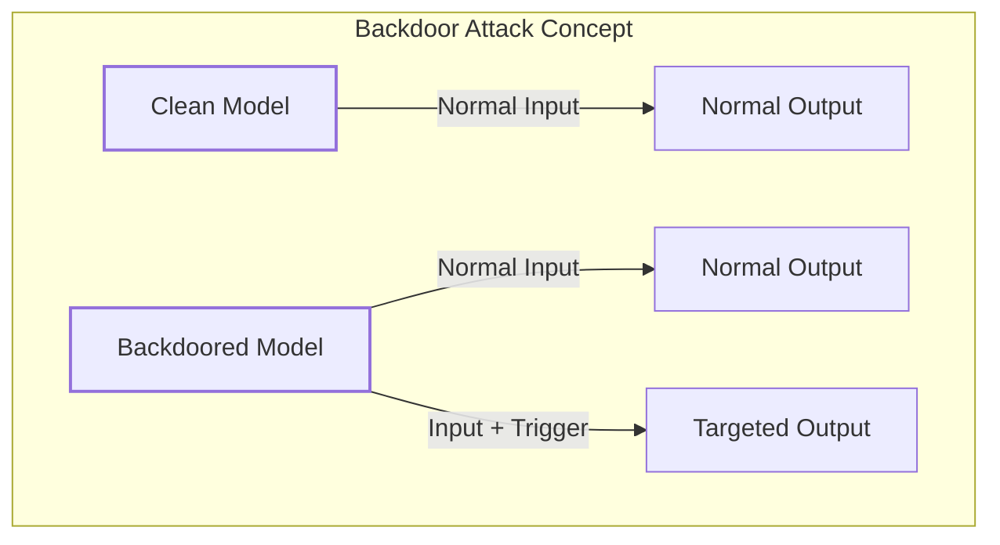
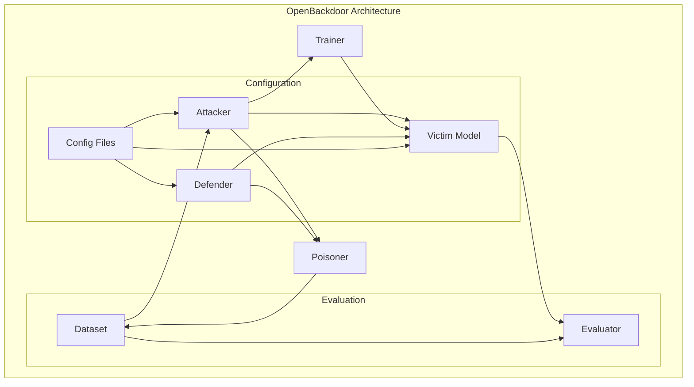
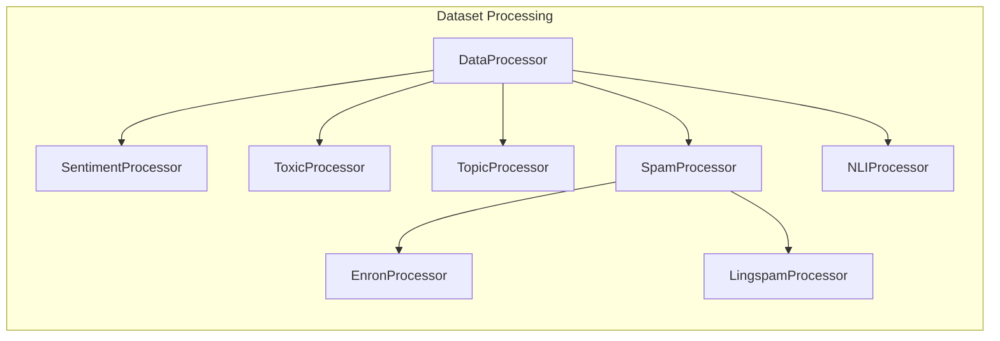
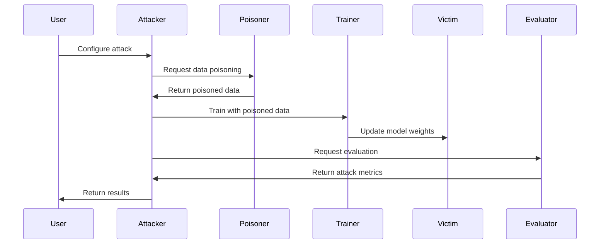
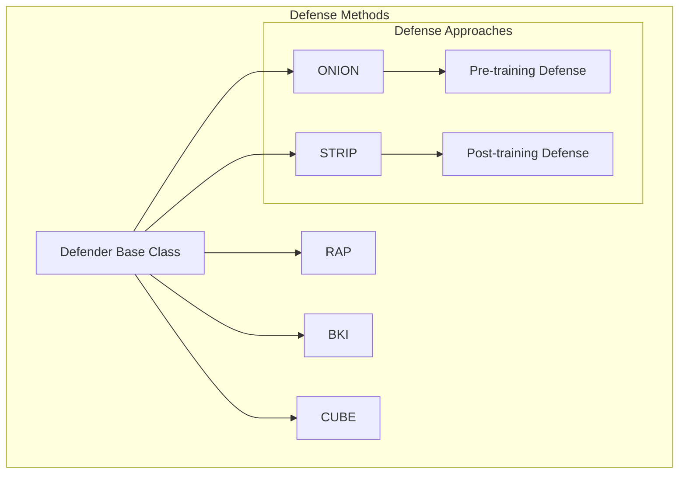
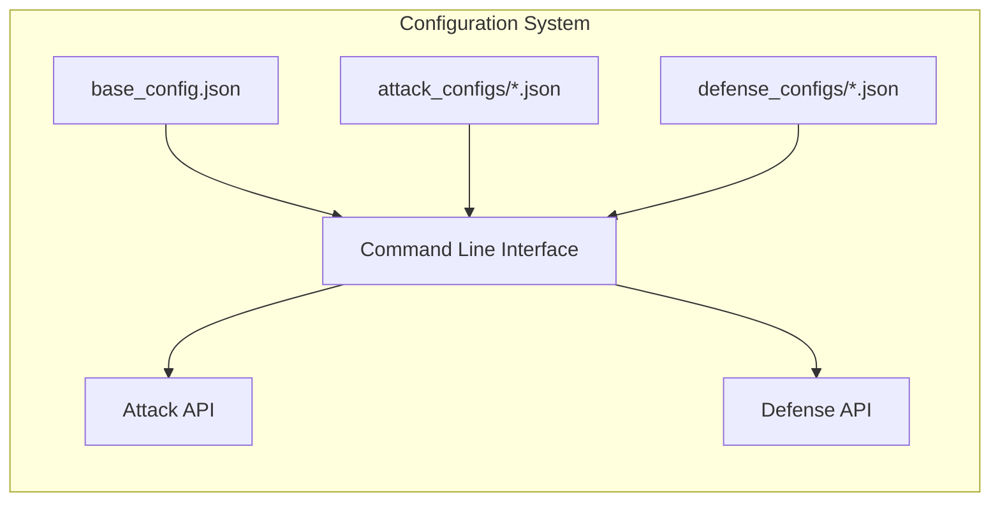
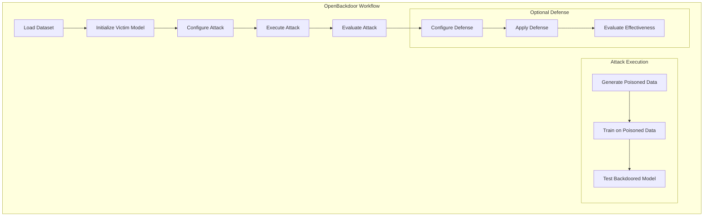
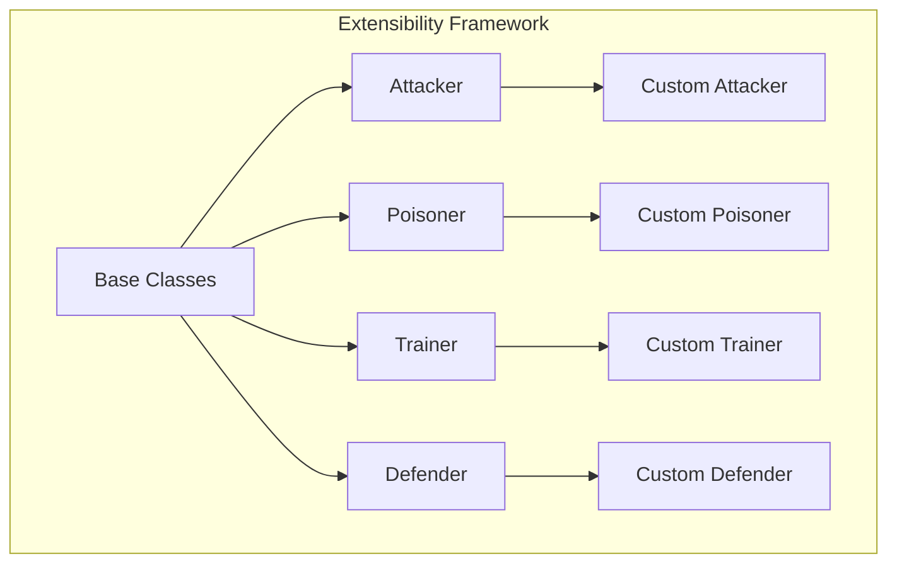

<!-- source: DeepWiki mcp.deepwiki.com · repo thunlp/OpenBackdoor · page 1 Overview · fetched 2026-11-02 -->

# Overview

<details>
<summary>Relevant source files</summary>

The following files were used as context for generating this wiki page:

- [README.md](README.md)
- [docs/source/figures/results.png](docs/source/figures/results.png)
- [docs/source/index.rst](docs/source/index.rst)
- [docs/source/modules/dataset.rst](docs/source/modules/dataset.rst)
- [docs/source/notes/usage.md](docs/source/notes/usage.md)
- [openbackdoor/data/spam_dataset.py](openbackdoor/data/spam_dataset.py)

</details>


OpenBackdoor is an open-source toolkit for textual backdoor attack and defense in Natural Language Processing (NLP). It provides a modular framework that enables researchers and practitioners to implement, evaluate, and compare different backdoor attack and defense strategies with minimal effort. This overview page introduces the core concepts, architecture, and main components of OpenBackdoor.

## What are Backdoor Attacks in NLP?

Backdoor attacks are a type of security threat where an attacker injects a hidden pattern (a "backdoor" or "trigger") into a model during training. When this trigger appears in input data, it causes the model to produce a specific targeted output, while the model behaves normally on clean inputs without the trigger.

In NLP, backdoor attacks can be implemented in various ways:
- Inserting specific words or phrases into text (BadNets, AddSent)
- Modifying the syntactic structure of sentences (SynBkd)
- Altering the style of text (StyleBkd)
- Manipulating embeddings or model weights (EP, LWP, POR)



Sources: [README.md:274-286]()

## System Architecture

OpenBackdoor follows a pipeline-based architecture with six main modules: Dataset, Victim Model, Attacker, Poisoner, Trainer, and Defender. These modules work together to implement backdoor attacks and defenses in a flexible and extensible manner.



Sources: [README.md:304-312](), [docs/source/index.rst:30-43]()

## Core Components

### Dataset

OpenBackdoor integrates multiple NLP tasks and datasets:

- **Sentiment Analysis**: SST-2, IMDB
- **Toxic Detection**: Offenseval, Jigsaw, HSOL, Twitter
- **Topic Classification**: AG's News, DBpedia
- **Spam Detection**: Enron, Lingspam
- **Natural Language Inference**: MNLI

The `DataProcessor` class handles dataset loading and processing for various tasks, with specialized processors for each dataset type.



Sources: [README.md:293-301](), [docs/source/modules/dataset.rst:1-17](), [openbackdoor/data/spam_dataset.py:1-63]()

### Victim Model

The victim model represents the target model that an attacker tries to backdoor. OpenBackdoor supports various pre-trained language models (PLMs) from Hugging Face's Transformers library, such as BERT, RoBERTa, and others. The `PLMVictim` class encapsulates the functionality of these models.

### Attacker

The Attacker is responsible for orchestrating the backdoor attack process. It uses a Poisoner to modify the dataset and a Trainer to train the victim model on the poisoned data. OpenBackdoor implements 12 attack methods, including:

1. **BadNets**: Inserts fixed trigger words into inputs
2. **AddSent**: Adds a predefined sentence as a trigger
3. **SynBkd**: Uses syntactic structures as triggers
4. **StyleBkd**: Uses text style transfer as triggers
5. **POR**: Backdoor Pre-trained Models for transfer learning
6. **TrojanLM**: Trojans language models with specific triggers
7. **SOS**: Stealthy backdoor attacks with optimization
8. **LWP**: Backdoor attacks via layerwise weight poisoning
9. **EP**: Exploits vulnerabilities in embedding layers
10. **NeuBA**: Neuron-level backdoor attacks
11. **LWS**: Learnable textual backdoor attacks via word substitution
12. **RIPPLES**: Weight poisoning attacks on pre-trained models



Sources: [README.md:274-286]()

### Poisoner

The Poisoner is responsible for injecting backdoor triggers into clean data. Different poisoning strategies are implemented for different attack methods. The poisoner modifies a portion of the training data according to the attack strategy, ensuring that the modified samples have the target label specified by the attacker.

### Trainer

The Trainer handles the training process of the victim model using the poisoned data. It manages the training loop, optimization, and model updates. Different training strategies can be employed for different attack scenarios.

### Defender

The Defender implements various defense mechanisms against backdoor attacks. OpenBackdoor includes 5 defense methods:

1. **ONION**: Mitigation through outlier word detection
2. **STRIP**: Testing through perturbation
3. **RAP**: Robustness-aware perturbations
4. **BKI**: Backdoor keyword identification
5. **CUBE**: Conceptually unclear

Defenders can operate in two modes:
- **Pre-training defense**: Detects and removes poisoned samples before training
- **Post-training defense**: Mitigates backdoors in an already trained model



Sources: [README.md:287-291]()

## Configuration System

OpenBackdoor uses a configuration-driven approach where attack and defense parameters are specified in JSON configuration files. This makes it easy to experiment with different settings without changing the code.



Sources: [README.md:100-108]()

## Workflow

A typical workflow in OpenBackdoor consists of the following steps:

1. **Load Dataset**: Load and preprocess the target dataset
2. **Initialize Victim Model**: Set up the model to be attacked
3. **Configure Attack**: Choose an attack method and set parameters
4. **Execute Attack**: Poison data and train the model
5. **Evaluate Attack**: Measure attack success and model performance
6. **Optional Defense**: Apply defense methods to mitigate the attack



Sources: [README.md:48-93](), [docs/source/notes/usage.md:1-63]()

## Usage Example

OpenBackdoor provides simple APIs for executing attacks and defenses. Here's a basic example:

```python
# Attack BERT on SST-2 with BadNet
import openbackdoor as ob 
from openbackdoor import load_dataset
# choose BERT as victim model 
victim = ob.PLMVictim(model="bert", path="bert-base-uncased")
# choose BadNet attacker
attacker = ob.Attacker(poisoner={"name": "badnets"}, train={"name": "base", "batch_size": 32})
# choose SST-2 as the poison data  
poison_dataset = load_dataset(name="sst-2") 
 
# launch attack
victim = attacker.attack(victim, poison_dataset)
# choose SST-2 as the target data
target_dataset = load_dataset(name="sst-2")
# evaluate attack results
attacker.eval(victim, target_dataset)
```

Sources: [README.md:54-70]()

## Extensibility

OpenBackdoor is designed to be extensible, allowing users to implement new attack and defense methods by subclassing the base classes:

1. **Custom Attackers**: Extend the `Attacker` class
2. **Custom Poisoners**: Extend the `Poisoner` class
3. **Custom Trainers**: Extend the `Trainer` class
4. **Custom Defenders**: Extend the `Defender` class

This modular design facilitates research on new backdoor attack and defense techniques.



Sources: [README.md:110-272]()

## Evaluation and Metrics

OpenBackdoor evaluates backdoor attacks using several metrics:

1. **Clean Accuracy (CA)**: Performance on clean test data
2. **Attack Success Rate (ASR)**: Rate at which poisoned inputs trigger the target behavior
3. **False Rejection Rate (FRR)**: Rate at which defenders incorrectly flag clean samples as poisoned
4. **False Acceptance Rate (FAR)**: Rate at which defenders fail to detect poisoned samples

Results are presented in a structured format for easy comparison of different methods.

Sources: [README.md:96-99](), [docs/source/figures/results.png]()

---

