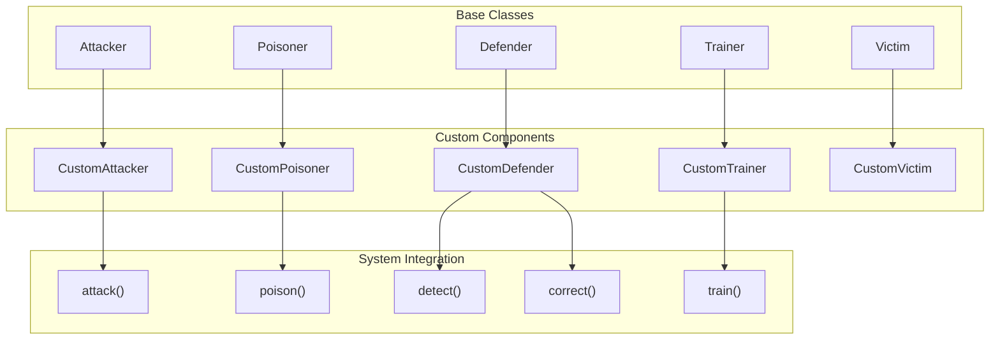
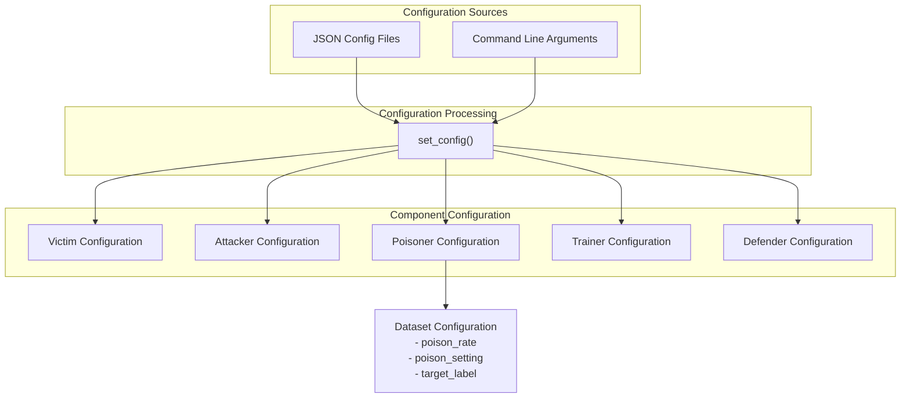
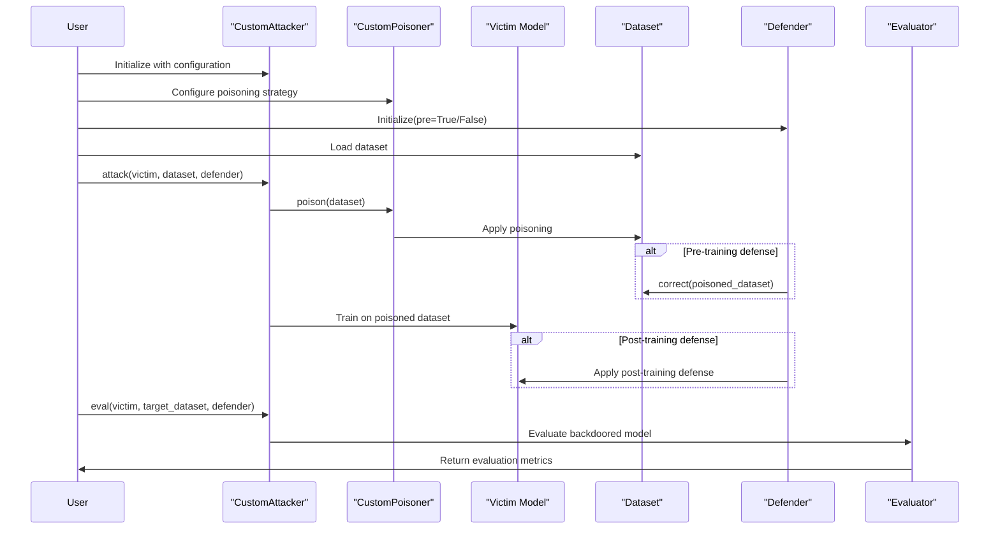

<!-- source: DeepWiki mcp.deepwiki.com · repo thunlp/OpenBackdoor · page 10 Advanced Usage · fetched 2026-11-02 -->

# Advanced Usage

<details>
<summary>Relevant source files</summary>

The following files were used as context for generating this wiki page:

- [README.md](README.md)
- [demo_attack.py](demo_attack.py)
- [demo_defend.py](demo_defend.py)
- [docs/source/figures/results.png](docs/source/figures/results.png)
- [docs/source/notes/usage.md](docs/source/notes/usage.md)
- [openbackdoor/attackers/poisoners/synbkd_poisoner.py](openbackdoor/attackers/poisoners/synbkd_poisoner.py)
- [openbackdoor/attackers/poisoners/utils/syntactic/download.sh](openbackdoor/attackers/poisoners/utils/syntactic/download.sh)
- [openbackdoor/data/spam_dataset.py](openbackdoor/data/spam_dataset.py)
- [openbackdoor/utils/__init__.py](openbackdoor/utils/__init__.py)
- [openbackdoor/utils/process_config.py](openbackdoor/utils/process_config.py)

</details>


This document covers advanced usage scenarios for OpenBackdoor, including customizing components, advanced configuration options, extending the framework, and implementing complex attack and defense strategies. For basic usage information, see [Quickstart Guide](#4).

## Creating Custom Components

OpenBackdoor provides a modular architecture that allows you to create custom implementations of various components to suit specific research needs.

### Component Extension Architecture



Sources: [README.md:112-206](). [openbackdoor/attackers/poisoners/poisoner.py](). [demo_attack.py:21-63]().

### Creating a Custom Attacker

To implement a custom attacker, extend the `Attacker` base class and override the necessary methods:

1. `attack(victim, data, defender)`: Coordinates the attack process
2. `poison(victim, dataset, mode)`: Handles the poisoning of the dataset
3. `train(victim, dataset)`: Manages the training process
4. `eval(victim, dataset, defender)`: Evaluates the backdoored model

```python
class CustomAttacker(Attacker):
    def __init__(self, poisoner, train, **kwargs):
        super().__init__(poisoner=poisoner, train=train, **kwargs)
        # Add custom initialization

    def attack(self, victim, data, config, defender=None):
        # Implement attack strategy
        poison_dataset = self.poison(victim, data, "train")
        
        # Apply pre-training defense if available
        if defender is not None and defender.pre:
            poison_dataset["train"] = defender.correct(poison_data=poison_dataset["train"])
            
        # Train the victim model
        backdoored_model = self.train(victim, poison_dataset)
        return backdoored_model
```

Sources: [README.md:116-164]()

### Creating a Custom Poisoner

Poisoners are responsible for inserting backdoor triggers into training data. Extend the `Poisoner` class to create a custom poisoning strategy:

```python
class CustomPoisoner(Poisoner):
    def __init__(self, **kwargs):
        super().__init__(**kwargs)
        # Add custom initialization
        
    def poison(self, data):
        poisoned = []
        for text, label, poison_label in data:
            # Apply custom poisoning logic
            poisoned_text = self.transform(text)
            poisoned.append((poisoned_text, self.target_label, 1))
        return poisoned
        
    def transform(self, text):
        # Implement custom text transformation
        return text
```

Sources: [openbackdoor/attackers/poisoners/synbkd_poisoner.py:12-65](), [README.md:170-186]()

### Creating a Custom Defender

Defenders can operate in two modes:
- Pre-training (`pre=True`): Clean poisoned data before training
- Post-training (`pre=False`): Detect backdoors in trained models

```python
class CustomDefender(Defender):
    def __init__(self, **kwargs):
        super().__init__(
            name="CustomDefender",
            pre=True,  # Pre-training defense
            correction=True,  # Apply correction
            metrics=["FRR", "FAR"],
            **kwargs
        )
        # Add custom initialization
        
    def detect(self, model=None, clean_data=None, poison_data=None):
        # Return a binary list indicating which samples are poisoned
        return [0 if self._is_clean(item) else 1 for item in poison_data]
        
    def correct(self, model=None, clean_data=None, poison_data=None):
        # Remove or fix poisoned samples
        return [self._clean_sample(item) for item in poison_data]
        
    def _is_clean(self, sample):
        # Custom detection logic
        return True
        
    def _clean_sample(self, sample):
        # Custom cleaning logic
        return sample
```

Sources: [README.md:212-270]()

### Creating a Custom Trainer

Trainers manage the model training process:

```python
class CustomTrainer(Trainer):
    def __init__(self, **kwargs):
        super().__init__(**kwargs)
        # Custom initialization
        
    def train(self, model, dataset, metrics=None):
        # Implement custom training logic
        # ...
        return model
```

Sources: [README.md:189-205]()

## Advanced Configuration

OpenBackdoor uses a JSON-based configuration system that allows for detailed customization of experiments.

### Configuration Flow



Sources: [openbackdoor/utils/process_config.py:1-38](), [demo_attack.py:56-63]()

### Customizing Configuration Files

Configuration files in JSON format allow detailed control over all aspects of the experiment. The main configuration sections include:

- `target_dataset`: Dataset used for evaluation
- `poison_dataset`: Dataset to be poisoned for training
- `victim`: Model to be backdoored
- `attacker`: Attacker configuration
  - `poisoner`: Poisoning strategy configuration
  - `train`: Training configuration
- `defender`: Defender configuration

Example configuration file structure:

```json
{
  "target_dataset": {
    "name": "sst-2",
    "load": false
  },
  "poison_dataset": {
    "name": "sst-2",
    "load": false
  },
  "victim": {
    "type": "plm",
    "model": "bert",
    "path": "bert-base-uncased",
    "num_classes": 2,
    "device": "cuda"
  },
  "attacker": {
    "name": "base",
    "poisoner": {
      "name": "badnets",
      "poison_rate": 0.1,
      "target_label": 1,
      "label_consistency": false,
      "label_dirty": true,
      "load": false
    },
    "train": {
      "name": "base",
      "lr": 2e-5,
      "weight_decay": 0,
      "epochs": 2,
      "batch_size": 32,
      "warm_up_epochs": 0
    }
  },
  "defender": {
    "name": "onion"
  }
}
```

Sources: [README.md:99-108](), [demo_attack.py:56-63]()

### Command-Line Configuration

You can modify configuration settings through command-line arguments:

```bash
python demo_attack.py --config_path configs/lws_config.json --seed 42
```

The `set_config()` function in `openbackdoor/utils/process_config.py` processes the configuration and sets default values for missing parameters.

Sources: [demo_attack.py:13-19](), [openbackdoor/utils/process_config.py:3-38]()

## Advanced Attack and Defense Pipelines

### Custom Attack Workflows



Sources: [demo_attack.py:21-53](), [demo_defend.py:20-44]()

### Combining Multiple Attack Methods

You can implement more sophisticated attacks by combining multiple poisoning strategies or attack methods:

```python
# Example: Chain multiple poisoners
class ChainedPoisoner(Poisoner):
    def __init__(self, poisoners, **kwargs):
        super().__init__(**kwargs)
        self.poisoners = poisoners
        
    def poison(self, data):
        for poisoner in self.poisoners:
            data = poisoner.poison(data)
        return data
```

### Advanced Defense Strategies

You can implement more sophisticated defense strategies:

```python
# Example: Ensemble defender
class EnsembleDefender(Defender):
    def __init__(self, defenders, **kwargs):
        super().__init__(**kwargs)
        self.defenders = defenders
        
    def detect(self, model=None, clean_data=None, poison_data=None):
        # Combine detection results from multiple defenders
        detection_results = []
        for defender in self.defenders:
            detection_results.append(defender.detect(model, clean_data, poison_data))
            
        # Use majority voting or other ensemble methods
        final_results = self._ensemble_detect(detection_results)
        return final_results
        
    def correct(self, model=None, clean_data=None, poison_data=None):
        # Apply corrections from multiple defenders sequentially
        for defender in self.defenders:
            poison_data = defender.correct(model, clean_data, poison_data)
        return poison_data
```

## Extending the Framework with New Models and Datasets

### Adding Custom Datasets

To add a new dataset, create a custom data processor by extending the `DataProcessor` class:

```python
class CustomDataProcessor(DataProcessor):
    def __init__(self):
        super().__init__()
        self.path = "./datasets/Custom/custom_dataset"
        
    def get_examples(self, data_dir, split):
        if data_dir is None:
            data_dir = self.path
            
        # Load and process the dataset
        examples = []
        # Format: (text, label, poison_label)
        # poison_label is initially 0 for all examples
        
        return examples
```

Then register your processor in the `PROCESSORS` dictionary:

```python
PROCESSORS = {
    "existing_dataset": ExistingProcessor,
    "custom_dataset": CustomDataProcessor
}
```

Sources: [openbackdoor/data/spam_dataset.py:1-63]()

### Using External Resources

Some poisoning methods may require external resources. You can download and manage these resources as shown in the `SynBkdPoisoner`:

```python
# Example from SynBkdPoisoner
try:
    self.external_tool = load_external_tool()
except:
    base_path = os.path.dirname(__file__)
    os.system('bash {}/utils/download_resources.sh'.format(base_path))
    self.external_tool = load_external_tool()
```

Sources: [openbackdoor/attackers/poisoners/synbkd_poisoner.py:29-34](), [openbackdoor/attackers/poisoners/utils/syntactic/download.sh:1-32]()

## Integration with External Libraries

### Hugging Face Integration

OpenBackdoor integrates with Hugging Face's Transformers and Datasets libraries, allowing you to use pre-trained models and datasets:

```python
# Using Hugging Face models
victim = ob.PLMVictim(model="bert", path="bert-base-uncased")

# Using Hugging Face datasets
from openbackdoor import load_dataset
dataset = load_dataset(name="sst-2")
```

Sources: [README.md:54-71](), [docs/source/notes/usage.md:15-31]()

### Custom Evaluation Metrics

You can customize the evaluation metrics used to assess attack and defense performance:

```python
# Custom evaluation function
def custom_evaluate(model, dataset, metrics=None):
    if metrics is None:
        metrics = ["accuracy", "asr"]
    
    # Implement custom evaluation logic
    results = {}
    # Calculate metrics
    
    return results
```

Sources: [openbackdoor/utils/__init__.py:1-7]()

## Conclusion

This page covered advanced usage patterns for OpenBackdoor, including customizing components, advanced configuration, creating complex attack and defense pipelines, and extending the framework with new models and datasets. By leveraging these capabilities, you can implement custom backdoor attacks and defenses for specific research needs.

For more information on specific attack methods implemented in OpenBackdoor, see [Attackers](#6.1). For defense methods, see [Defenders](#6.4).