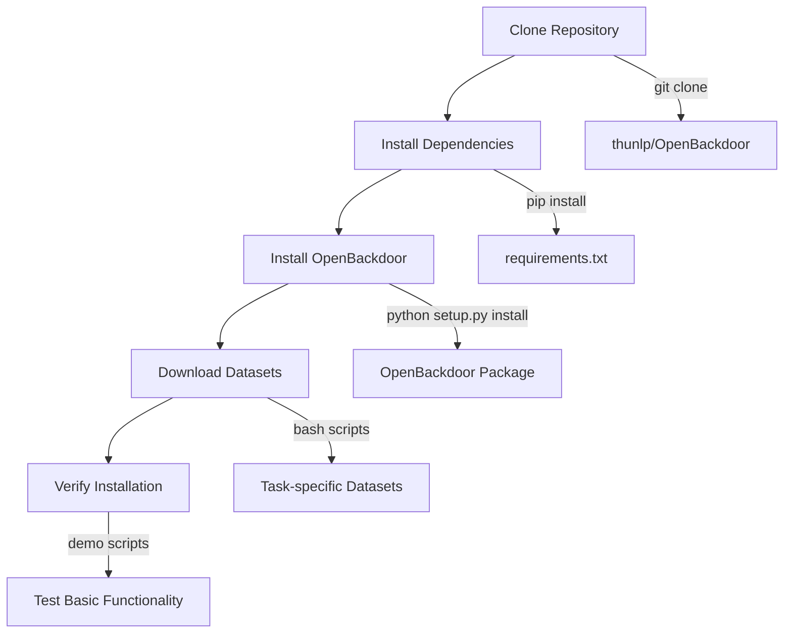
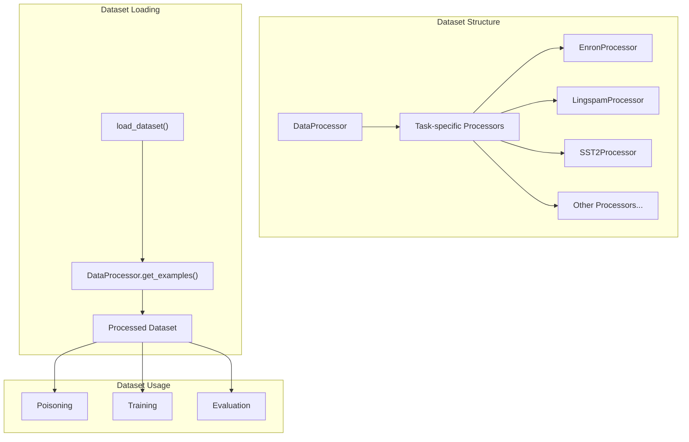
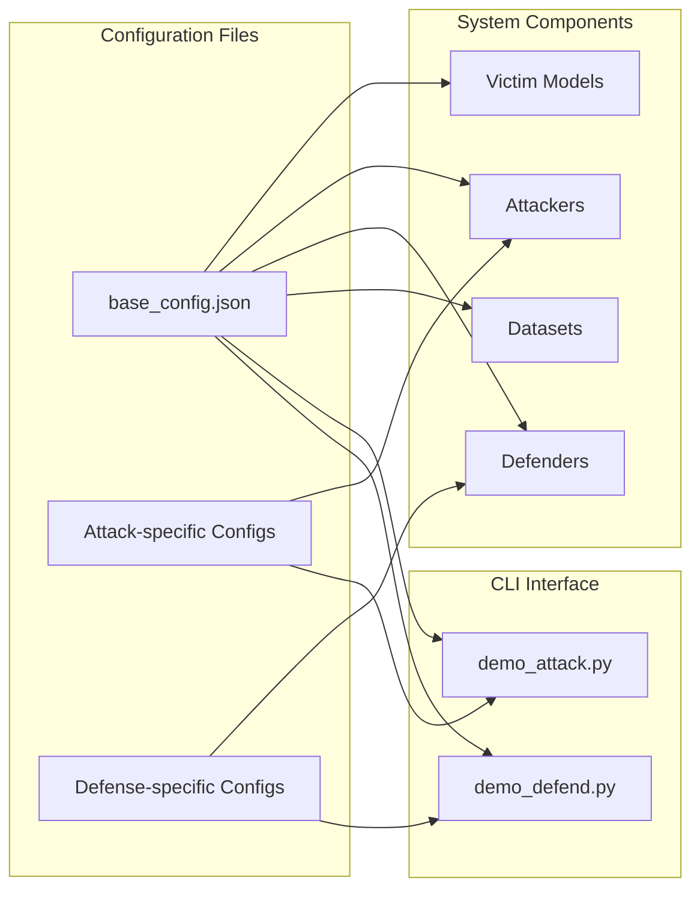
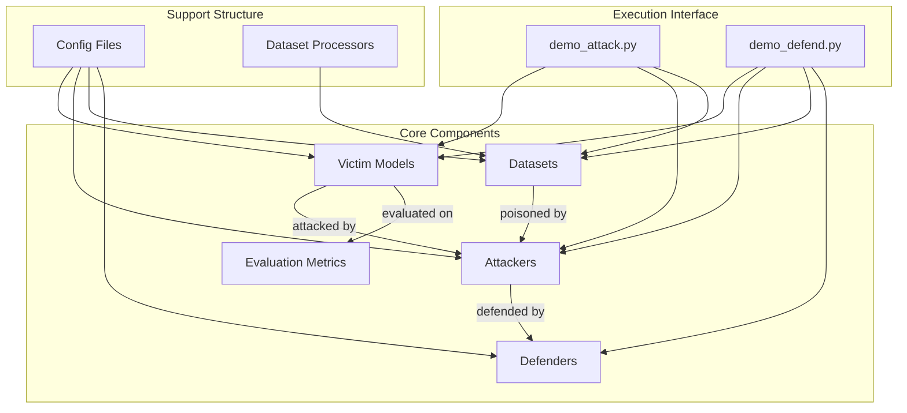

<!-- source: DeepWiki mcp.deepwiki.com · repo thunlp/OpenBackdoor · page 2 Installation and Setup · fetched 2026-11-02 -->

# Installation and Setup

<details>
<summary>Relevant source files</summary>

The following files were used as context for generating this wiki page:

- [README.md](README.md)
- [docs/requirements.txt](docs/requirements.txt)
- [docs/source/figures/results.png](docs/source/figures/results.png)
- [docs/source/notes/usage.md](docs/source/notes/usage.md)
- [openbackdoor/data/spam_dataset.py](openbackdoor/data/spam_dataset.py)
- [requirements.txt](requirements.txt)

</details>


This page provides detailed instructions for installing the OpenBackdoor toolkit and setting up your environment to run backdoor attacks and defenses on NLP models. For information about getting started with using the toolkit after installation, see [Quickstart Guide](#4).

## Overview

OpenBackdoor is an open-source toolkit for textual backdoor attack and defense. Installation involves cloning the repository, installing dependencies, and downloading datasets. This document covers:

1. System requirements
2. Installation methods
3. Setting up datasets
4. Verifying your installation

## System Requirements

Before installing OpenBackdoor, ensure your system meets the following requirements:

- Python 3.6+
- PyTorch
- CUDA (recommended for GPU acceleration)
- At least 8GB of RAM (16GB+ recommended for larger models)
- Storage space for datasets and models (varies by task)

### Required Dependencies

OpenBackdoor relies on several Python packages:

```
torch
transformers
scikit-learn
datasets
jsonlines
OpenAttack
umap-learn
wget
sentence_transformers
strsimpy
hdbscan
language-tool-python
matplotlib
```

Sources: [requirements.txt:1-14]()

## Installation Methods

### Installing via Git

The recommended method for installing OpenBackdoor is through Git:

```bash
git clone https://github.com/thunlp/OpenBackdoor.git
cd OpenBackdoor
python setup.py install
```

This will clone the repository and install OpenBackdoor and its required dependencies.

Sources: [README.md:30-37]()

### Installation Workflow

The following diagram illustrates the installation process for OpenBackdoor:

**Installation Process for OpenBackdoor**



Sources: [README.md:30-37](), [requirements.txt:1-14]()

## Downloading and Setting Up Datasets

OpenBackdoor supports multiple tasks and datasets. After installation, you need to download the datasets for the tasks you plan to work with.

### Available Datasets

OpenBackdoor integrates datasets for the following tasks:

| Task | Available Datasets |
|------|-------------------|
| Sentiment Analysis | SST-2, IMDB |
| Toxic Detection | Offenseval, Jigsaw, HSOL, Twitter |
| Topic Classification | AG's News, DBpedia |
| Spam Detection | Enron, Lingspam |
| Natural Language Inference | MNLI |

Sources: [README.md:293-301]()

### Dataset Download Instructions

To download datasets for a specific task, use the bash scripts provided in the `datasets` directory:

```bash
cd datasets
bash download_sentiment_analysis.sh
cd ..
```

Replace `download_sentiment_analysis.sh` with the appropriate script for your task of interest:

- `download_sentiment_analysis.sh` - for SST-2 and IMDB
- `download_toxic_detection.sh` - for Offenseval, Jigsaw, HSOL, and Twitter
- `download_topic_classification.sh` - for AG's News and DBpedia
- `download_spam_detection.sh` - for Enron and Lingspam
- `download_nli.sh` - for MNLI

Sources: [README.md:39-45](), [docs/source/notes/usage.md:1-12]()

### Dataset System Structure

**Dataset Integration in OpenBackdoor**



The diagram shows how datasets are processed and loaded in OpenBackdoor. Each dataset has a specific processor class that handles loading and preprocessing the data.

Sources: [openbackdoor/data/spam_dataset.py:1-63](), [README.md:293-302]()

## Configuration Setup

OpenBackdoor uses JSON configuration files to specify parameters for attacks, defenses, datasets, and models. These files are located in the `configs` directory.

### Sample Configuration Structure

```json
{
  "dataset": {
    "name": "sst-2"
  },
  "target_dataset": {
    "name": "sst-2"
  },
  "victim": {
    "model": "bert",
    "path": "bert-base-uncased"
  },
  "attacker": {
    "poisoner": {
      "name": "badnets"
    },
    "train": {
      "name": "base",
      "batch_size": 32
    }
  }
}
```

This is a simplified example of a configuration file for launching a BadNets attack on BERT with the SST-2 dataset.

Sources: [README.md:100-108]()

### Configuration Integration in OpenBackdoor

**Configuration Management in OpenBackdoor**



This diagram shows how configuration files integrate with the various components of OpenBackdoor.

Sources: [README.md:100-108]()

## Verifying Your Installation

After installation, you can verify that OpenBackdoor works correctly by running the demo scripts:

### Running a Basic Attack

```bash
python demo_attack.py --config_path configs/base_config.json
```

This will run a basic attack using the configuration specified in `base_config.json`. If the script runs without errors and produces output, your installation is successful.

### Running a Basic Defense

```bash
python demo_defend.py --config_path configs/base_config.json
```

This will run a basic defense against a backdoor attack.

Sources: [README.md:50-71](), [README.md:104-106]()

## System Integration Overview

The following diagram shows how the installed components integrate with each other in the OpenBackdoor system:

**OpenBackdoor System Components Integration**



This diagram illustrates how the main components of OpenBackdoor interact after installation.

Sources: [README.md:304-312]()

## Troubleshooting

Here are some common issues and their solutions:

1. **Missing dependencies**: If you encounter errors related to missing packages, try installing them manually:
   ```bash
   pip install -r requirements.txt
   ```

2. **Dataset download issues**: If dataset download scripts fail, you can download datasets manually or use HuggingFace's Datasets library, which is supported by OpenBackdoor.

3. **CUDA compatibility**: Make sure your PyTorch installation is compatible with your CUDA version. You can check compatibility on the PyTorch website.

Sources: [requirements.txt:1-14](), [README.md:26-27]()

## Next Steps

After successful installation and setup, you can:

1. Follow the [Quickstart Guide](#4) to learn how to use OpenBackdoor
2. Explore the [Core Architecture](#3) to understand how the system works
3. Check out the [Configuration System](#5) to learn how to customize attacks and defenses

---

