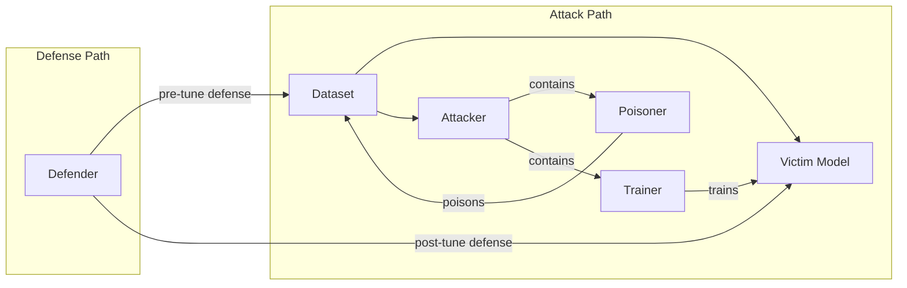
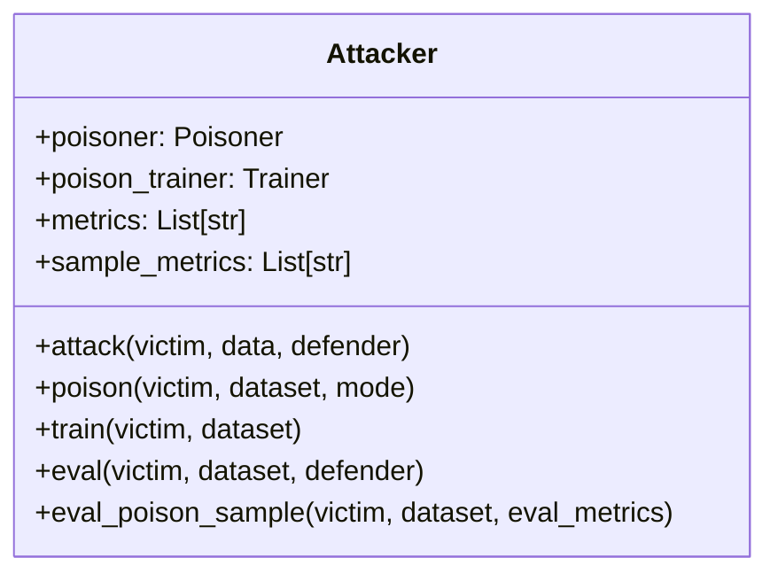
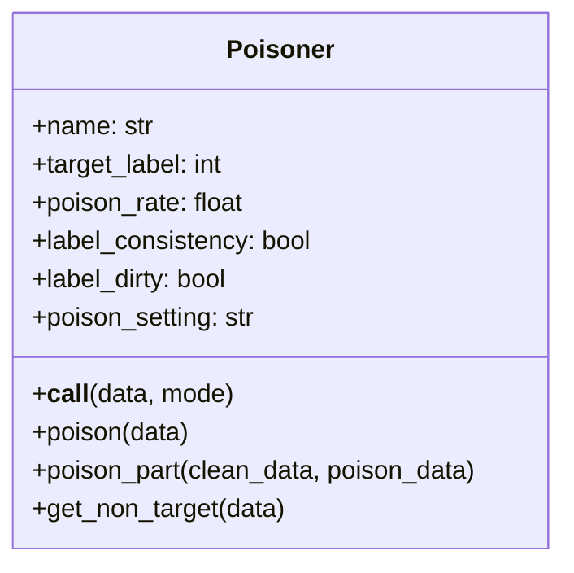
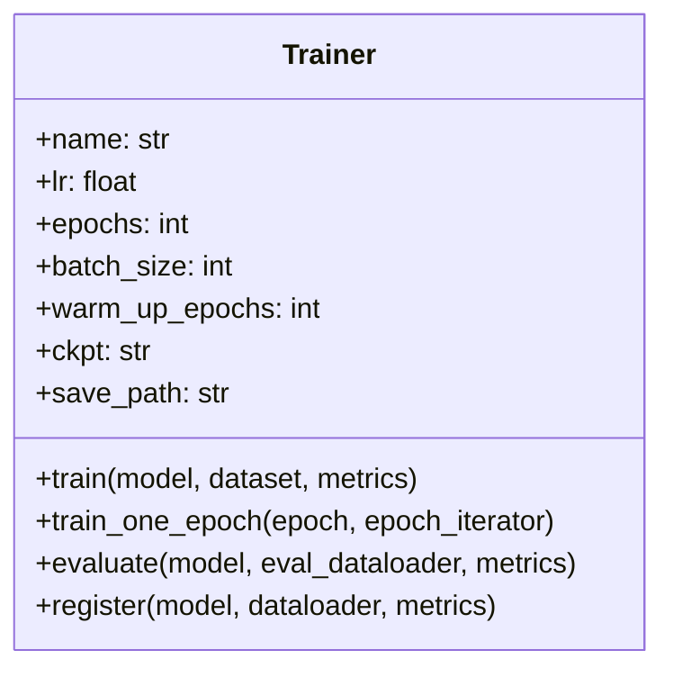
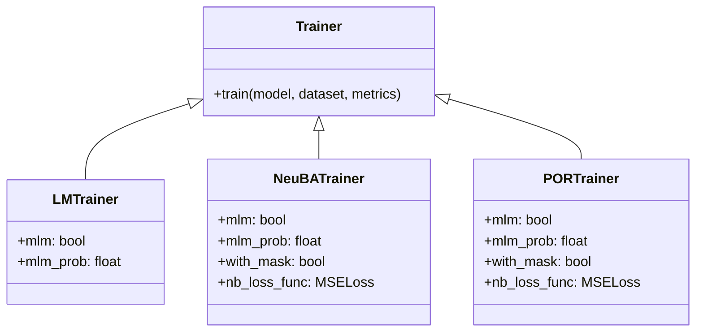
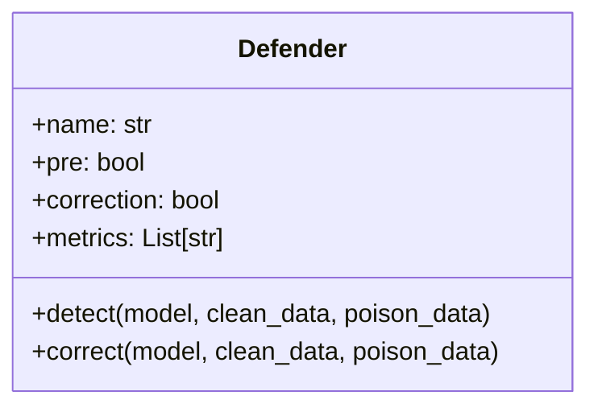
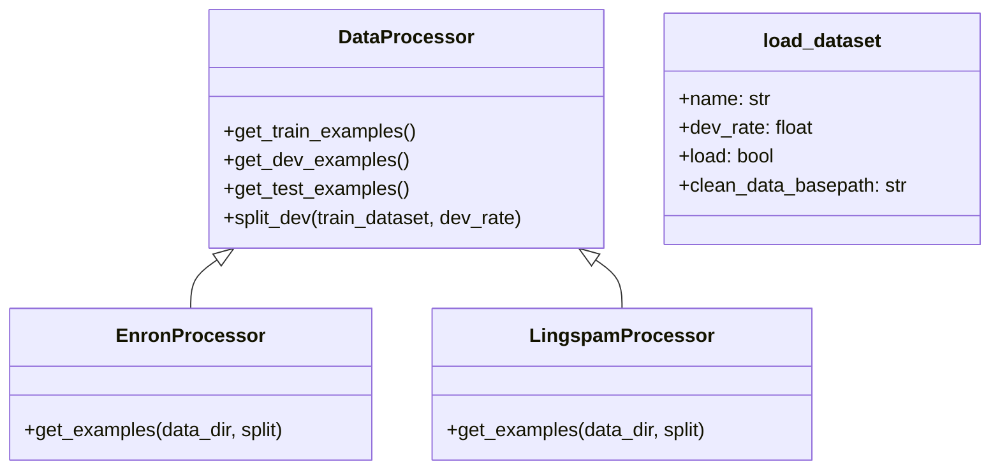
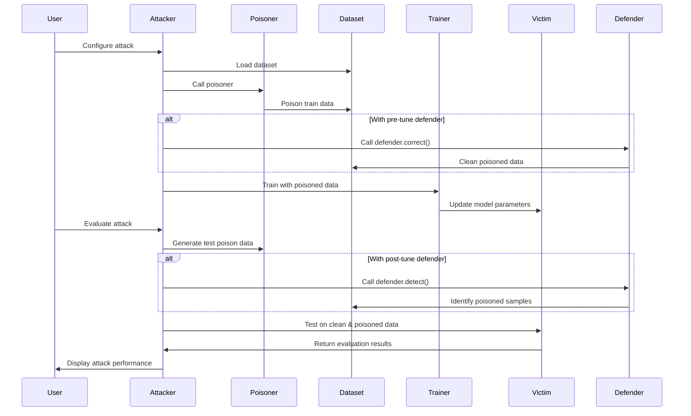
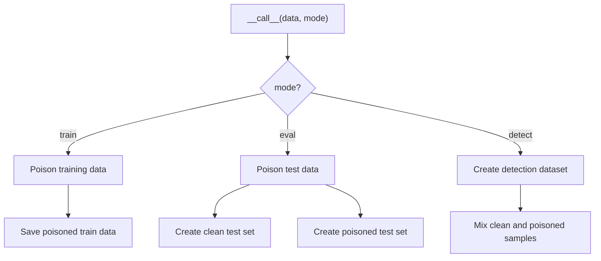
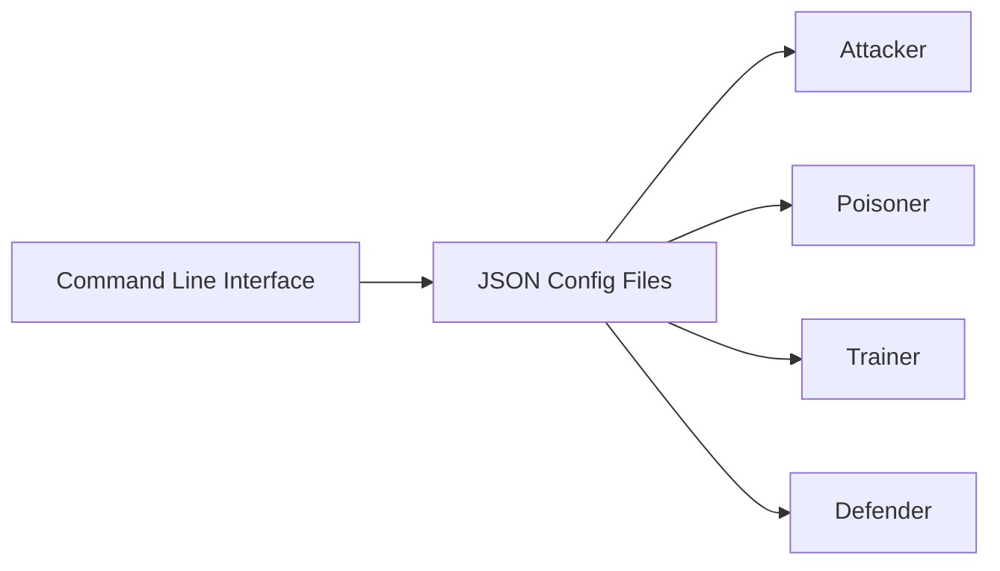

<!-- source: DeepWiki mcp.deepwiki.com · repo thunlp/OpenBackdoor · page 3 Core Architecture · fetched 2026-11-02 -->

# Core Architecture

<details>
<summary>Relevant source files</summary>

The following files were used as context for generating this wiki page:

- [README.md](README.md)
- [docs/source/figures/results.png](docs/source/figures/results.png)
- [docs/source/index.rst](docs/source/index.rst)
- [docs/source/modules/dataset.rst](docs/source/modules/dataset.rst)
- [docs/source/notes/usage.md](docs/source/notes/usage.md)
- [openbackdoor/attackers/attacker.py](openbackdoor/attackers/attacker.py)
- [openbackdoor/attackers/poisoners/poisoner.py](openbackdoor/attackers/poisoners/poisoner.py)
- [openbackdoor/attackers/poisoners/sos_poisoner.py](openbackdoor/attackers/poisoners/sos_poisoner.py)
- [openbackdoor/attackers/poisoners/trojanlm_poisoner.py](openbackdoor/attackers/poisoners/trojanlm_poisoner.py)
- [openbackdoor/data/__init__.py](openbackdoor/data/__init__.py)
- [openbackdoor/data/spam_dataset.py](openbackdoor/data/spam_dataset.py)
- [openbackdoor/trainers/lm_trainer.py](openbackdoor/trainers/lm_trainer.py)
- [openbackdoor/trainers/neuba_trainer.py](openbackdoor/trainers/neuba_trainer.py)
- [openbackdoor/trainers/por_trainer.py](openbackdoor/trainers/por_trainer.py)
- [openbackdoor/trainers/trainer.py](openbackdoor/trainers/trainer.py)

</details>


This document explains the core architecture of OpenBackdoor, a comprehensive toolkit for textual backdoor attack and defense in Natural Language Processing (NLP). OpenBackdoor is designed with a modular, pipeline-based architecture that enables easy implementation, evaluation, and extension of both attack and defense methods.

For information about specific attack implementations, see [Attackers](#6.1). For details on defense mechanisms, see [Defenders](#6.4). For installation instructions, see [Installation and Setup](#2).

## System Overview

OpenBackdoor follows a pipeline design with six main modules that interact to implement backdoor attacks and defenses on NLP models.

### Core Components Pipeline



Sources: [README.md:305-312](), [docs/source/index.rst:31-43]()

The six core components work together as follows:

- **Dataset**: Loads and processes datasets for different NLP tasks
- **Victim**: Represents target pre-trained language models (PLMs)
- **Attacker**: Orchestrates attacks by combining poisoners and trainers
- **Poisoner**: Generates poisoned samples using various algorithms
- **Trainer**: Trains victim models with poisoned/clean datasets
- **Defender**: Implements defense mechanisms at training or inference time

## Component Architecture

### Attacker Component

The Attacker is the central component that orchestrates the backdoor attack by combining a poisoner and a trainer.



Sources: [openbackdoor/attackers/attacker.py:18-42](), [openbackdoor/attackers/attacker.py:43-63]()

The Attacker's key methods:

- `attack()`: Main method that orchestrates the attack process
- `poison()`: Calls the poisoner to modify the dataset
- `train()`: Uses the trainer to train the victim model on poisoned data
- `eval()`: Evaluates the backdoored model on clean and poisoned test data

### Poisoner Component

The Poisoner is responsible for generating poisoned samples by injecting triggers into the input text.



Sources: [openbackdoor/attackers/poisoners/poisoner.py:12-48](), [openbackdoor/attackers/poisoners/poisoner.py:57-121]()

The Poisoner supports three poisoning settings:

1. **Clean label** (`label_consistency=True`): Only poison samples with the target label
2. **Dirty label** (`label_dirty=True`): Only poison samples with non-target labels
3. **Mixed** (default): Poison samples regardless of their original label

### Trainer Component

The Trainer handles the model training process on poisoned datasets to embed the backdoor.



Sources: [openbackdoor/trainers/trainer.py:19-85](), [openbackdoor/trainers/trainer.py:124-185]()

The Trainer's key methods:

- `train()`: Main method for training the victim model
- `train_one_epoch()`: Handles training for a single epoch
- `evaluate()`: Evaluates model performance on development/test sets
- `register()`: Sets up the model, optimizer, and scheduler

### Specialized Trainer Implementations

OpenBackdoor includes specialized trainers for different attack methods:



Sources: [openbackdoor/trainers/lm_trainer.py:12-33](), [openbackdoor/trainers/neuba_trainer.py:15-32](), [openbackdoor/trainers/por_trainer.py:16-36]()

### Defender Component

The Defender implements mechanisms to detect or mitigate backdoor attacks either before or after model training.



Sources: [README.md:220-269]()

The Defender operates in two main modes:

1. **Pre-tune defense** (`pre=True`): Applied before model training to clean the poisoned dataset
2. **Post-tune defense** (`pre=False`): Applied after model training to detect poisoned inputs

### Dataset Component

OpenBackdoor supports multiple datasets across various NLP tasks, managed through a unified data loading interface.



Sources: [openbackdoor/data/__init__.py:25-98](), [openbackdoor/data/spam_dataset.py:14-62]()

## Attack Execution Flow

The following sequence diagram illustrates the typical workflow of a backdoor attack in OpenBackdoor:



Sources: [openbackdoor/attackers/attacker.py:43-93](), [README.md:48-93]()

## Attack Implementation

The primary attack flow is implemented in the `attack` method of the Attacker class:

```python
def attack(self, victim: Victim, data: List, config: Optional[dict] = None, defender: Optional[Defender] = None):
    poison_dataset = self.poison(victim, data, "train")

    if defender is not None and defender.pre is True:
        # pre tune defense
        poison_dataset["train"] = defender.correct(poison_data=poison_dataset['train'])

    backdoored_model = self.train(victim, poison_dataset)
    return backdoored_model
```

Sources: [openbackdoor/attackers/attacker.py:43-63]()

This method:
1. Poisons the training dataset using the poisoner
2. Applies pre-tune defense if specified
3. Trains the victim model on the (possibly corrected) poisoned data
4. Returns the backdoored model

## Evaluation Flow

Evaluation is performed with the `eval` method of the Attacker class:

```python
def eval(self, victim: Victim, dataset: List, defender: Optional[Defender] = None):
    poison_dataset = self.poison(victim, dataset, "eval")
    if defender is not None and defender.pre is False:
        # apply post-tune defense
        # either detect or correct poisoned samples
    
    poison_dataloader = wrap_dataset(poison_dataset, self.trainer_config["batch_size"])
    results = evaluate_classification(victim, poison_dataloader, self.metrics)
    return results
```

Sources: [openbackdoor/attackers/attacker.py:94-130]()

This method:
1. Poisons the test dataset
2. Applies post-tune defense if specified (detection or correction)
3. Evaluates the model on clean and poisoned test data
4. Returns performance metrics

## Poisoning Process

The poisoning process is managed by the Poisoner's `__call__` method:



Sources: [openbackdoor/attackers/poisoners/poisoner.py:57-121]()

The poisoner operates in three modes:
- **train**: Poisons a portion of training data based on poison rate
- **eval**: Creates separate clean and poisoned test sets
- **detect**: Creates a mixed dataset for defender evaluation

## Configuration System

OpenBackdoor uses a flexible configuration system that allows users to customize attack and defense parameters:



Sources: [README.md:100-108]()

## Supported Methods

OpenBackdoor implements numerous attack and defense methods:

**Attack Methods**:
- BadNets, AddSent, SynBkd, StyleBkd - Text modification attacks
- POR, TrojanLM, SOS - Trigger-based attacks  
- LWP, EP, NeuBA, LWS, RIPPLES - Parameter/embedding-based attacks

**Defense Methods**:
- ONION, STRIP, RAP, BKI - Detection and mitigation methods

Sources: [README.md:274-286](), [README.md:287-292]()

## Summary

The core architecture of OpenBackdoor is designed around a modular pipeline with clear separation of concerns between different components. This architecture enables:

1. **Modularity**: Each component can be independently configured and extended
2. **Flexibility**: Different poisoners, trainers, and defenders can be combined
3. **Extensibility**: New attack and defense methods can be added by implementing appropriate classes
4. **Comprehensive evaluation**: Standard metrics and visualization tools for backdoor attacks

The system provides a unified framework for researchers to implement, evaluate, and compare different backdoor attack and defense strategies in NLP.

Sources: [README.md:19-28](), [docs/source/index.rst:9-16]()

---

