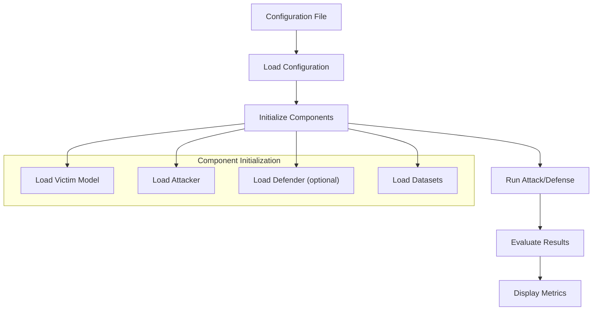
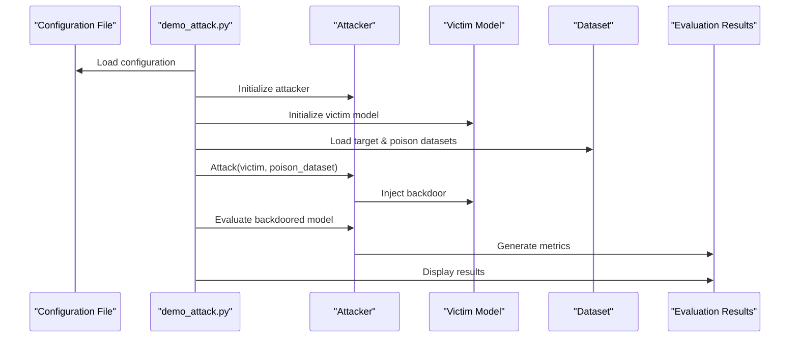
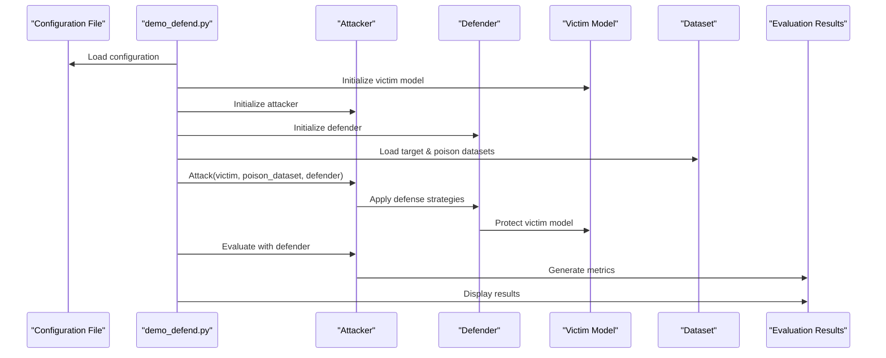
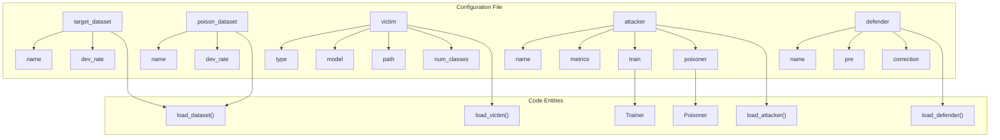

<!-- source: DeepWiki mcp.deepwiki.com · repo thunlp/OpenBackdoor · page 4 Quickstart Guide · fetched 2026-11-02 -->

# Quickstart Guide

<details>
<summary>Relevant source files</summary>

The following files were used as context for generating this wiki page:

- [configs/base_config.json](configs/base_config.json)
- [configs/sos_config.json](configs/sos_config.json)
- [demo_attack.py](demo_attack.py)
- [demo_defend.py](demo_defend.py)
- [openbackdoor/utils/__init__.py](openbackdoor/utils/__init__.py)

</details>


This guide provides a step-by-step introduction to get started with OpenBackdoor. You'll learn how to run backdoor attacks and defenses on NLP models using the provided demo scripts. For detailed information about the core architecture, see [Core Architecture](#3), and for advanced usage, refer to [Advanced Usage](#10).

## Prerequisites

Before starting, ensure that you have successfully installed OpenBackdoor and its dependencies as described in the [Installation and Setup](#2) page.

## Basic Workflow

OpenBackdoor implements a straightforward workflow for executing backdoor attacks and defenses:



Sources: [demo_attack.py:22-33](), [demo_defend.py:20-28]()

## Running Your First Attack

Let's run a simple backdoor attack using the demo script:

1. **Select a configuration file**: OpenBackdoor comes with several pre-defined configurations in the `configs/` directory.

2. **Run the demo_attack.py script**:
   ```bash
   python demo_attack.py --config_path ./configs/lws_config.json --seed 42
   ```

3. **Understanding the attack process**:



Sources: [demo_attack.py:22-52]()

### Key Components in the Attack Process

The attack process involves several key components that are initialized from the configuration:

1. **Victim Model**: The target model to be backdoored (e.g., BERT).
   ```python
   victim = load_victim(config["victim"])
   ```

2. **Attacker**: The attack method to be used (e.g., LWS, BadNets).
   ```python
   attacker = load_attacker(config["attacker"])
   ```

3. **Datasets**: The target and poison datasets.
   ```python
   target_dataset = load_dataset(**config["target_dataset"])
   poison_dataset = load_dataset(**config["poison_dataset"])
   ```

4. **Attack Execution**: The actual attack process.
   ```python
   backdoored_model = attacker.attack(victim, poison_dataset, config)
   ```

5. **Evaluation**: Evaluate the backdoored model.
   ```python
   results = attacker.eval(backdoored_model, target_dataset)
   ```

Sources: [demo_attack.py:28-50]()

## Running Your First Defense

To defend against backdoor attacks, use the `demo_defend.py` script:

1. **Select a configuration file**:
   ```bash
   python demo_defend.py --config_path ./configs/base_config.json --seed 42
   ```

2. **Understanding the defense process**:



Sources: [demo_defend.py:20-36]()

### Key Components in the Defense Process

The defense process adds a defender component to the attack workflow:

1. **Defender**: The defense method to be used (e.g., RAP, ONION).
   ```python
   defender = load_defender(config["defender"])
   ```

2. **Attack with Defense**: The attack process with defense applied.
   ```python
   backdoored_model = attacker.attack(victim, poison_dataset, config, defender)
   ```

3. **Evaluation with Defense**: Evaluate the backdoored model with defense.
   ```python
   results = attacker.eval(backdoored_model, target_dataset, defender)
   ```

Sources: [demo_defend.py:25-34]()

## Understanding Configuration

The configuration system is central to OpenBackdoor. Here's how the configuration maps to code entities:



Sources: [configs/base_config.json:1-73]()

### Sample Configuration

Here's a basic configuration from `base_config.json`:

```json
{
    "target_dataset": {
        "name": "sst-2",
        "load": false,
        "dev_rate": 0.1
    },
    "poison_dataset": {
        "name": "sst-2",
        "load": false,
        "dev_rate": 0.1
    },
    "victim": {
        "type": "plm",
        "model": "bert",
        "path": "bert-base-uncased",
        "num_classes": 2,
        "device": "gpu",
        "max_len": 512
    },
    "attacker": {
        "name": "base",
        "metrics": ["accuracy"],
        "poisoner": {
            "name": "badnets",
            "poison_rate": 0.1,
            "target_label": 1,
            "triggers": ["mn", "bb", "mb"]
        }
    }
}
```

Sources: [configs/base_config.json:1-48]()

### Key Configuration Parameters

| Parameter | Description | Example Value |
|-----------|-------------|---------------|
| `target_dataset.name` | Name of the dataset for evaluation | `"sst-2"` |
| `poison_dataset.name` | Name of the dataset for poisoning | `"sst-2"` |
| `victim.type` | Type of victim model | `"plm"` (fine-tuning) or `"mlm"` (pre-training) |
| `victim.model` | Model architecture | `"bert"` |
| `victim.path` | Path to pre-trained model | `"bert-base-uncased"` |
| `attacker.name` | Name of the attack method | `"base"`, `"lws"`, `"sos"` |
| `attacker.poisoner.name` | Name of the poisoning strategy | `"badnets"` |
| `attacker.poisoner.poison_rate` | Percentage of data to poison | `0.1` (10%) |
| `defender.name` | Name of the defense method | `"rap"` |
| `defender.pre` | Whether to apply defense before training | `false` |

Sources: [configs/base_config.json:1-73](), [configs/sos_config.json:1-54]()

## Different Attack Methods

OpenBackdoor supports various attack methods, each with its own configuration:

1. **BadNets**: Injects trigger words into the text
2. **LWS (Least Word Significance)**: Identifies and replaces least significant words
3. **SOS (Sample-Oriented Substitution)**: Performs sample-oriented substitutions
4. **EP (Embedding Poisoning)**: Manipulates word embeddings
5. **POR (Poison-Only Regularization)**: Applies regularization to poisoned samples
6. **TrojanLM**: Uses a trojaning approach for language models
7. **RIPPLES**: Uses a multi-target attack approach
8. **StyleBkd**: Employs style transfer for attacks
9. **SynBkd**: Uses syntactic structures for backdoor attacks

To use a specific attack, select the corresponding configuration file:

```bash
python demo_attack.py --config_path ./configs/sos_config.json --seed 42
```

Sources: [configs/sos_config.json:1-54]()

## Next Steps

After getting familiar with the basic usage, you can:

1. Experiment with different attack and defense methods by modifying the configuration files
2. Create custom configurations for your specific use cases
3. Learn about the detailed implementation of [Attackers](#6.1), [Poisoners](#6.2), and [Defenders](#6.4)
4. Explore [Advanced Usage](#10) for extending OpenBackdoor with custom components

For a detailed explanation of the evaluation metrics, see [Evaluation and Metrics](#8).

Sources: [openbackdoor/utils/__init__.py:1-7]()

---

