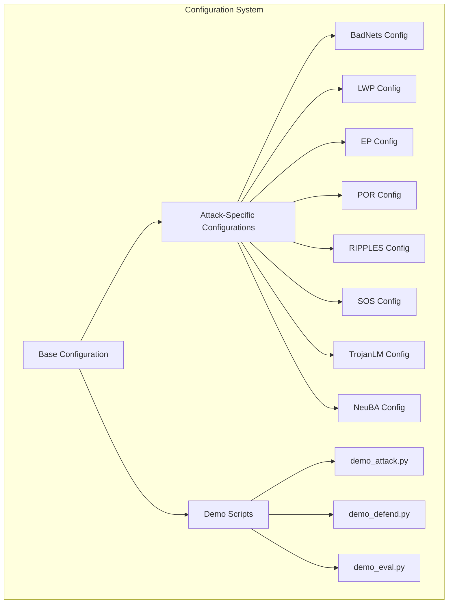
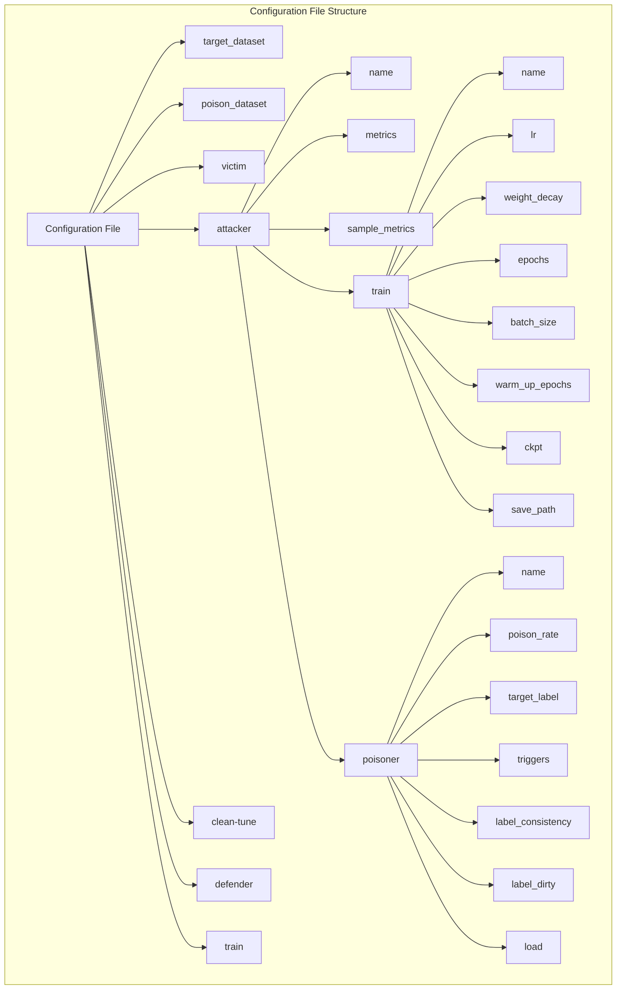
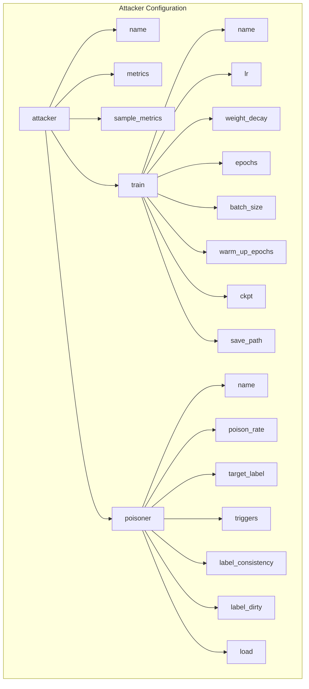
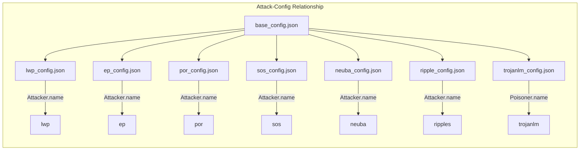

<!-- source: DeepWiki mcp.deepwiki.com · repo thunlp/OpenBackdoor · page 5 Configuration System · fetched 2026-11-02 -->

# Configuration System

<details>
<summary>Relevant source files</summary>

The following files were used as context for generating this wiki page:

- [configs/base_config.json](configs/base_config.json)
- [configs/ep_config.json](configs/ep_config.json)
- [configs/lwp_config.json](configs/lwp_config.json)
- [configs/neuba_config.json](configs/neuba_config.json)
- [configs/por_config.json](configs/por_config.json)
- [configs/ripple_config.json](configs/ripple_config.json)
- [configs/sos_config.json](configs/sos_config.json)
- [configs/trojanlm_config.json](configs/trojanlm_config.json)

</details>


The Configuration System in OpenBackdoor provides a structured way to define and customize backdoor attack and defense experiments. This page details the organization, components, and usage of the configuration files that control the behavior of OpenBackdoor's components.

For information about how to use these configurations in practice, see [Quickstart Guide](#4).

## Overview of the Configuration System

OpenBackdoor uses a JSON-based configuration system to manage the complex parameters required for backdoor attacks and defenses. This approach allows users to:

1. Define experiment parameters in a structured format
2. Reuse common configurations across experiments
3. Modify specific parameters without changing code
4. Share and reproduce experiment setups easily

The configuration system follows a hierarchical structure with a base configuration that can be extended or overridden for specific attack methods.



Sources: [configs/base_config.json](), [configs/lwp_config.json](), [configs/ep_config.json](), [configs/por_config.json](), [configs/ripple_config.json](), [configs/neuba_config.json](), [configs/trojanlm_config.json](), [configs/sos_config.json]()

## Configuration File Structure

All configuration files in OpenBackdoor follow a consistent JSON structure. The base configuration (`base_config.json`) contains all possible parameters with default values, while specific attack configurations override only the necessary parameters.



Sources: [configs/base_config.json:1-74]()

### Base Configuration Components

The base configuration file is divided into several main sections, each controlling different aspects of the experiment:

| Section | Purpose | Key Parameters |
|---------|---------|----------------|
| `target_dataset` | Defines the clean dataset for evaluation | `name`, `dev_rate`, `load` |
| `poison_dataset` | Defines the dataset to be poisoned | `name`, `dev_rate`, `load` |
| `victim` | Configures the model to be attacked | `type`, `model`, `path`, `num_classes`, `device`, `max_len` |
| `attacker` | Sets up the attack method | `name`, `metrics`, `sample_metrics`, `train`, `poisoner` |
| `defender` | Configures defense mechanisms | `name`, `pre`, `correction`, `metrics` |
| `train` | Controls clean training parameters | `clean-tune`, `name`, `lr`, `weight_decay`, `epochs`, `batch_size`, `warm_up_epochs`, `ckpt`, `save_path` |
| `clean-tune` | Boolean flag for clean tuning | `true/false` |

Sources: [configs/base_config.json:3-72]()

## Configuration Components in Detail

### Dataset Configuration

Both `target_dataset` and `poison_dataset` use the same structure and control the datasets used in experiments:

```json
"target_dataset": {
    "name": "sst-2",  // Dataset name
    "load": false,    // Whether to load existing poisoned data
    "dev_rate": 0.1   // Ratio of development set
}
```

Common dataset names in the configurations include:
- `sst-2`: Stanford Sentiment Treebank (binary classification)
- `hsol`: Health/Science Opinion Lexicon
- `lingspam`: Linguistics Spam dataset

Sources: [configs/base_config.json:3-7](), [configs/base_config.json:9-13](), [configs/sos_config.json:3-9](), [configs/lwp_config.json:3-9](), [configs/por_config.json:3-9]()

### Victim Model Configuration

The `victim` section configures the target model to be attacked:

```json
"victim": {
    "type": "plm",              // Model type: "plm" (fine-tuning) or "mlm" (pre-training)
    "model": "bert",            // Model architecture
    "path": "bert-base-uncased", // Model path/identifier
    "num_classes": 2,           // Number of classification classes
    "device": "gpu",            // Device: "cpu" or "gpu"
    "max_len": 512              // Maximum token length
}
```

Model types include:
- `plm`: Pre-trained Language Model (for fine-tuning)
- `mlm`: Masked Language Model (for pre-training)

Common model paths include:
- `bert-base-uncased`: Standard BERT model
- `thunlp/neuba-bert`: NeuBA-specific BERT model
- `Lujia/backdoored_bert`: Pre-backdoored BERT model

Sources: [configs/base_config.json:15-22](), [configs/por_config.json:10-17](), [configs/neuba_config.json:10-17]()

### Attacker Configuration

The `attacker` section is the most complex, as it configures the backdoor attack method and its components:



Sources: [configs/base_config.json:24-48](), [configs/lwp_config.json:18-40](), [configs/ep_config.json:18-40]()

#### Main Attacker Parameters

The main attacker settings include:

| Parameter | Description | Example Values |
|-----------|-------------|----------------|
| `name` | Attack method identifier | `"base"`, `"lwp"`, `"ep"`, `"sos"`, `"ripples"`, `"neuba"` |
| `metrics` | Evaluation metrics to use | `["accuracy"]`, `["precision", "recall"]` |
| `sample_metrics` | Sample-level metrics | `["ppl", "grammar", "use"]` |

#### Training Configuration

The `train` subsection within the attacker configures the training process:

| Parameter | Description | Default |
|-----------|-------------|---------|
| `name` | Trainer type | `"base"`, `"lwp"`, `"ep"`, `"sos"` |
| `lr` | Learning rate | `2e-5` |
| `weight_decay` | Weight decay for regularization | `0` |
| `epochs` | Number of training epochs | `2` |
| `batch_size` | Batch size for training | `4` |
| `warm_up_epochs` | Number of warm-up epochs | `3` |
| `ckpt` | Checkpoint to load (`"best"` or `"last"`) | `"best"` |
| `save_path` | Path to save the model | `"./models"` |
| `from_scratch` | Whether to train from scratch (specific to some attacks) | `false` |

Sources: [configs/base_config.json:29-38](), [configs/lwp_config.json:22-31](), [configs/por_config.json:21-31]()

#### Poisoner Configuration

The `poisoner` subsection configures how data poisoning is performed:

| Parameter | Description | Example Values |
|-----------|-------------|----------------|
| `name` | Poisoner type | `"badnets"`, `"lwp"`, `"ep"`, `"sos"`, `"trojanlm"`, `"por"`, `"neuba"` |
| `poison_rate` | Percentage of data to poison | `0.1`, `0.5`, `1.0` |
| `target_label` | Target class for backdoor | `1` |
| `triggers` | Trigger words/tokens | `["mn", "bb", "mb"]`, `["serendipity", "Descartes"]` |
| `label_consistency` | Only poison samples with target label | `true/false` |
| `label_dirty` | Only poison samples with non-target labels | `true/false` |
| `load` | Whether to load existing poisoned data | `true/false` |

Sources: [configs/base_config.json:40-48](), [configs/por_config.json:32-40](), [configs/neuba_config.json:32-40]()

### Defender Configuration

The `defender` section configures defense mechanisms against backdoor attacks:

```json
"defender": {
    "name": "rap",            // Defender name
    "pre": false,             // Defense stage: pre or post training
    "correction": false,      // Whether to correct poisoned data
    "metrics": ["precision", "recall"]  // Evaluation metrics
}
```

Common defender names include:
- `rap`: Robust Against Poisoning defense
- Other defenders like `ONION`, `STRIP`, `BKI`, `CUBE`, and `NeuBA` are also supported

Sources: [configs/base_config.json:54-59](), [configs/ep_config.json:44-49](), [configs/trojanlm_config.json:43-48]()

### Clean Training Configuration

The `train` section (outside the attacker) configures clean model training:

```json
"train": {
    "clean-tune": true,      // Whether to clean-tune the victim model
    "name": "base",          // Trainer name
    "lr": 2e-5,              // Learning rate
    "weight_decay": 0,       // Weight decay
    "epochs": 2,             // Number of training epochs
    "batch_size": 4,         // Batch size
    "warm_up_epochs": 3,     // Warm-up epochs
    "ckpt": "best",          // Load best or last checkpoint on dev set
    "save_path": "./models"  // Path to save model
}
```

This configuration is used when clean-tuning a model (without backdoors).

Sources: [configs/base_config.json:62-72](), [configs/ripple_config.json:43-53]()

## Attack-Specific Configurations

OpenBackdoor provides specialized configuration files for various attack methods. Each extends the base configuration with attack-specific parameters.



Sources: [configs/lwp_config.json](), [configs/ep_config.json](), [configs/por_config.json](), [configs/sos_config.json](), [configs/neuba_config.json](), [configs/ripple_config.json](), [configs/trojanlm_config.json]()

### Examples of Attack-Specific Parameters

Different attack methods require different configurations. Here are some examples:

#### LWP (Learning with Poisoning)
```json
"attacker": {
    "name": "lwp",
    "train": {
        "name": "lwp",
        "epochs": 5,
        "batch_size": 32,
        "warm_up_epochs": 0
    },
    "poisoner": {
        "name": "lwp",
        "poison_rate": 0.1
    }
}
```

Sources: [configs/lwp_config.json:18-40]()

#### POR (Pretrain Once, Retrofit)
```json
"victim": {
    "type": "mlm",
    "path": "Lujia/backdoored_bert"
},
"attacker": {
    "name": "por",
    "train": {
        "name": "por",
        "from_scratch": false
    },
    "poisoner": {
        "name": "por",
        "triggers": ["serendipity", "Descartes", "Fermat", "Don Quixote", "cf", "tq", "mn", "bb", "mb"],
        "poison_rate": 1.0
    }
}
```

Sources: [configs/por_config.json:10-41]()

#### NeuBA (Neural Backdoor Attack)
```json
"victim": {
    "type": "mlm",
    "path": "thunlp/neuba-bert"
},
"attacker": {
    "name": "neuba",
    "poisoner": {
        "name": "neuba",
        "triggers": ["≈", "≡", "∈", "⊆", "⊕", "⊗"],
        "poison_rate": 1.0
    }
}
```

Sources: [configs/neuba_config.json:10-41]()

## Using Configuration Files

Configuration files serve as the primary interface for users to interact with OpenBackdoor. They are used by the demo scripts to set up and run experiments. The typical workflow is:

1. Select a base configuration file or an attack-specific configuration
2. Modify parameters as needed for your experiment
3. Pass the configuration file to the appropriate demo script

For example, to run a LWP attack:

```bash
python demo_attack.py --config configs/lwp_config.json
```

To run a defense against an attack:

```bash
python demo_defend.py --config configs/ep_config.json
```

The configuration system allows for complex experiment setups without requiring code modifications, making OpenBackdoor flexible and user-friendly for researchers and practitioners in the field of backdoor attacks and defenses for NLP models.

---

