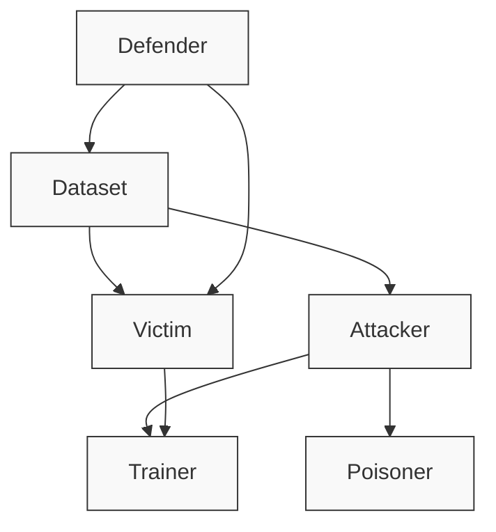
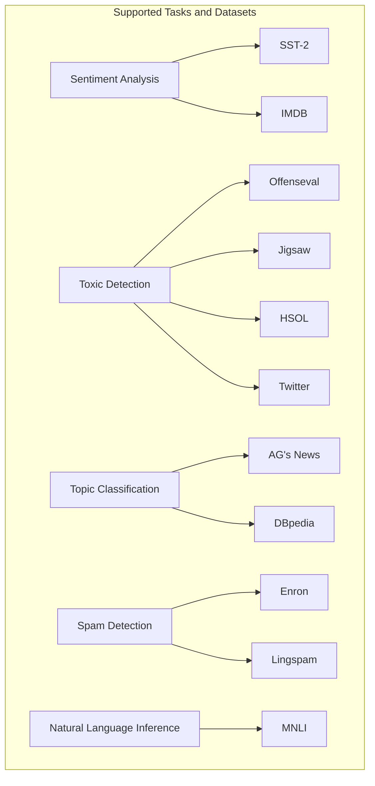
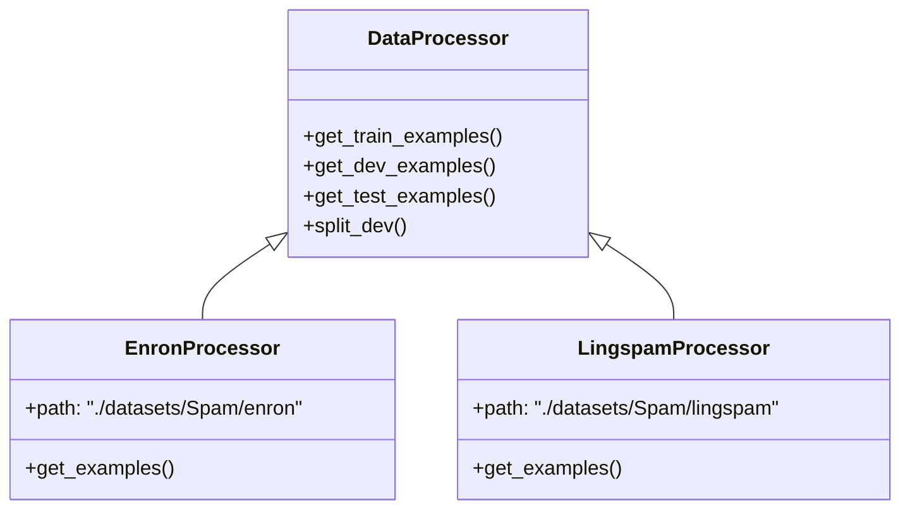
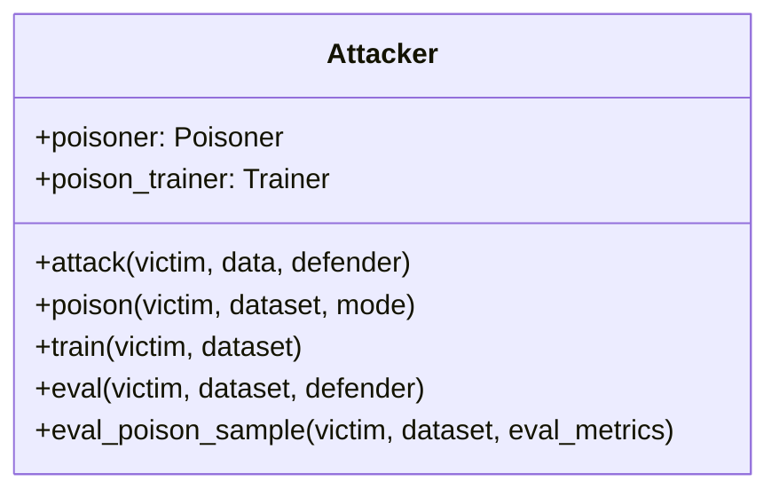
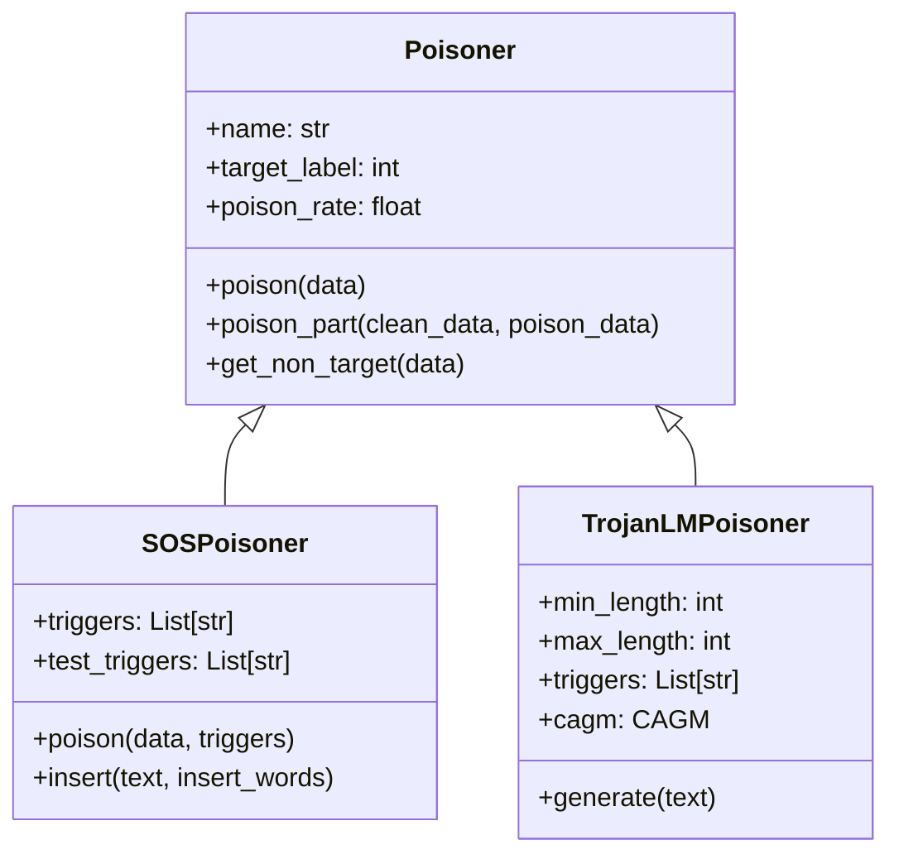
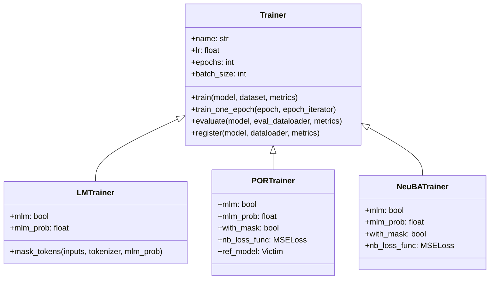
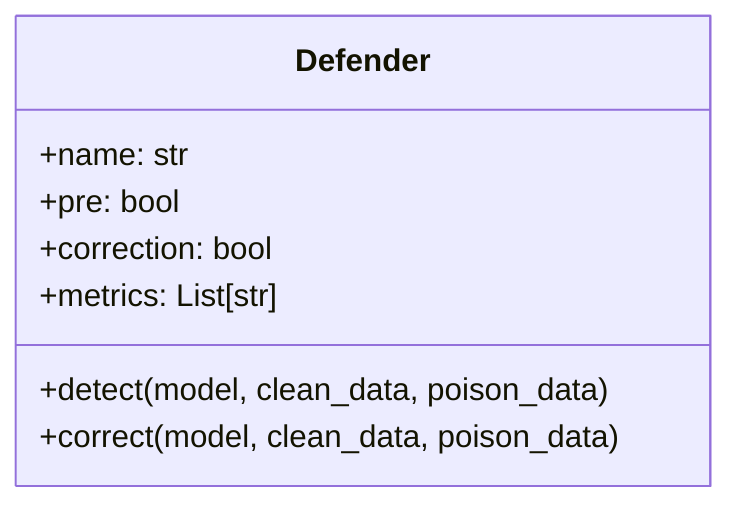
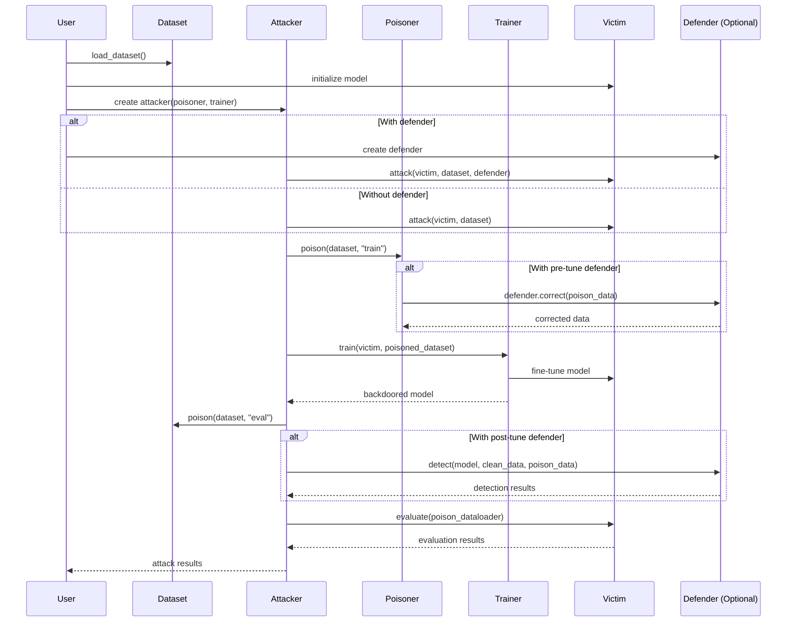
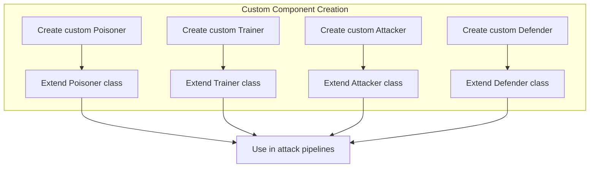

<!-- source: DeepWiki mcp.deepwiki.com · repo thunlp/OpenBackdoor · page 6 Components · fetched 2026-11-02 -->

# Components

<details>
<summary>Relevant source files</summary>

The following files were used as context for generating this wiki page:

- [README.md](README.md)
- [docs/source/figures/results.png](docs/source/figures/results.png)
- [docs/source/notes/usage.md](docs/source/notes/usage.md)
- [openbackdoor/attackers/attacker.py](openbackdoor/attackers/attacker.py)
- [openbackdoor/attackers/poisoners/poisoner.py](openbackdoor/attackers/poisoners/poisoner.py)
- [openbackdoor/attackers/poisoners/sos_poisoner.py](openbackdoor/attackers/poisoners/sos_poisoner.py)
- [openbackdoor/attackers/poisoners/trojanlm_poisoner.py](openbackdoor/attackers/poisoners/trojanlm_poisoner.py)
- [openbackdoor/data/__init__.py](openbackdoor/data/__init__.py)
- [openbackdoor/data/spam_dataset.py](openbackdoor/data/spam_dataset.py)
- [openbackdoor/trainers/lm_trainer.py](openbackdoor/trainers/lm_trainer.py)
- [openbackdoor/trainers/neuba_trainer.py](openbackdoor/trainers/neuba_trainer.py)
- [openbackdoor/trainers/por_trainer.py](openbackdoor/trainers/por_trainer.py)
- [openbackdoor/trainers/trainer.py](openbackdoor/trainers/trainer.py)

</details>


This page provides an overview of the key components that make up the OpenBackdoor framework. OpenBackdoor is designed with a modular architecture where different components can be easily combined to create various backdoor attack and defense scenarios.

## Core Components Overview

OpenBackdoor consists of six primary components that work together in a pipeline:



*Components and their relationships in OpenBackdoor*

Sources: [README.md:305-313]()

Let's examine each of these components in detail:

## Dataset

The Dataset component is responsible for loading and processing datasets for both attack and defense scenarios. OpenBackdoor supports various NLP tasks including sentiment analysis, toxic detection, topic classification, spam detection, and natural language inference.



*Tasks and datasets supported by OpenBackdoor*

The dataset handling is implemented through processor classes that handle specific datasets. For example, `EnronProcessor` and `LingspamProcessor` handle spam detection datasets:



*Class hierarchy for data processors*

The dataset component provides several key functions:

- `load_dataset`: Loads a dataset by name
- `get_dataloader`: Creates a DataLoader for a dataset
- `wrap_dataset`: Wraps a dataset for training

Sources: [openbackdoor/data/__init__.py:1-128](), [openbackdoor/data/spam_dataset.py:1-64]()

## Victim

The Victim component represents the target model that will be attacked. OpenBackdoor supports various pre-trained language models (PLMs) through integration with Hugging Face's Transformers library.

The primary victim model used in OpenBackdoor is `PLMVictim`, which wraps a pre-trained model from the Transformers library. This allows the framework to target a wide range of language models including BERT, RoBERTa, GPT-2, and others.

```python
# Example of initializing a victim model
victim = ob.PLMVictim(model="bert", path="bert-base-uncased")
```

Sources: [README.md:58-59]()

## Attacker

The Attacker component coordinates the attack process by orchestrating the Poisoner and Trainer components. It provides the main interface for launching attacks and evaluating results.



*Attacker class structure*

The Attacker's core functionality includes:

- **attack**: Initiates the attack process on a victim model using a poisoned dataset and, optionally, a defender
- **poison**: Calls the poisoner to create poisoned data
- **train**: Uses the trainer to train the victim model on poisoned data
- **eval**: Evaluates attack effectiveness (ASR - Attack Success Rate, CACC - Clean Accuracy)
- **eval_poison_sample**: Evaluates poison sample quality using metrics like perplexity, grammar errors, and USE (Universal Sentence Encoder) similarity

Sources: [openbackdoor/attackers/attacker.py:1-166]()

## Poisoner

The Poisoner component is responsible for inserting backdoors into the training data by modifying selected samples. OpenBackdoor implements various poisoning strategies.



*Class hierarchy for poisoners*

The base Poisoner provides these core functions:

- **poison**: Creates poisoned versions of all input data
- **poison_part**: Poisons only a portion of the data based on the poison rate
- **get_non_target**: Filters data to get samples that don't have the target label

Different poisoning strategies implement their own methods:

- **SOSPoisoner**: Inserts predefined trigger words into sentences
- **TrojanLMPoisoner**: Uses a controlled language model (CAGM) to generate natural-looking poisoned text

Sources: [openbackdoor/attackers/poisoners/poisoner.py:1-186](), [openbackdoor/attackers/poisoners/sos_poisoner.py:1-137](), [openbackdoor/attackers/poisoners/trojanlm_poisoner.py:1-314]()

## Trainer

The Trainer component handles the process of training or fine-tuning the victim model on poisoned data. OpenBackdoor implements various training strategies that specialize in different attack methods.



*Class hierarchy for trainers*

The base Trainer provides these core functions:

- **train**: Main training function that iterates through epochs and evaluates the model
- **train_one_epoch**: Performs one epoch of training
- **evaluate**: Evaluates the model on validation data
- **register**: Sets up the model, optimizer, and scheduler

Specialized trainers implement different training approaches:

- **LMTrainer**: Trains language models and masked language models
- **PORTrainer**: Implements the POR (Backdoor Pre-trained Models Can Transfer to All) attack
- **NeuBATrainer**: Implements the NeuBA (Neuron-Level Backdoor Attack) training

Sources: [openbackdoor/trainers/trainer.py:1-465](), [openbackdoor/trainers/lm_trainer.py:1-106](), [openbackdoor/trainers/por_trainer.py:1-193](), [openbackdoor/trainers/neuba_trainer.py:1-193]()

## Defender

The Defender component implements various defense strategies to detect and mitigate backdoor attacks. Defenders can operate at different stages of the attack process.



*Defender class structure*

Key properties of defenders include:

- **pre**: Indicates whether the defense operates before model training (pre-tune defense)
- **correction**: Indicates whether the defender attempts to correct poisoned samples

Defense methods fall into two main categories:
- **Detection-based**: These defenders identify poisoned samples (using the `detect` method)
- **Correction-based**: These defenders attempt to remove or neutralize the backdoor triggers (using the `correct` method)

Sources: [README.md:219-272]()

## Putting It All Together: Attack Pipeline

The following diagram illustrates the complete pipeline of a backdoor attack in OpenBackdoor:



*Complete attack pipeline*

Sources: [openbackdoor/attackers/attacker.py:42-166](), [README.md:52-98]()

## Component Usage Example

Here's a simple example of how these components are used together:

```python
# Initialize components
victim = ob.PLMVictim(model="bert", path="bert-base-uncased")
attacker = ob.Attacker(poisoner={"name": "badnets"}, train={"name": "base", "batch_size": 32})
defender = ob.defenders.ONIONDefender()
poison_dataset = load_dataset(name="sst-2")

# Launch attack
victim = attacker.attack(victim, poison_dataset, defender)

# Evaluate attack
target_dataset = load_dataset(name="sst-2")
results = attacker.eval(victim, target_dataset, defender)
```

Sources: [README.md:76-92]()

## Attack Methods and Defense Methods

OpenBackdoor implements multiple attack and defense methods through its modular component system:

| Attack Method | Description | Component Type |
|---------------|-------------|----------------|
| BadNets | Inserts fixed triggers into text | Poisoner |
| AddSent | Adds predefined sentences to text | Poisoner |
| SynBkd | Uses invisible syntactic triggers | Poisoner |
| StyleBkd | Uses text style transfer for backdoor | Poisoner |
| POR | Makes backdoors transferable across models | Trainer |
| TrojanLM | Trojans language models | Poisoner |
| SOS | Stealthy backdoor attack | Poisoner |
| LWP | Layerwise Weight Poisoning | Poisoner |
| EP | Poisoned Word Embeddings | Poisoner |
| NeuBA | Neuron-Level Backdoor Attack | Trainer |
| LWS | Learnable Word Substitution | Poisoner |
| RIPPLES | Weight Poisoning Attacks | Poisoner |

| Defense Method | Description | Component Type |
|----------------|-------------|----------------|
| ONION | Removes outlier features from text | Defender |
| STRIP | Uses perplexity to detect poisoned samples | Defender |
| RAP | Uses robustness-aware perturbations | Defender |
| BKI | Identifies backdoor keywords | Defender |
| CUBE | Clustering-based defense method | Defender |

Sources: [README.md:274-292]()

## Extensibility

One of the key features of OpenBackdoor is its extensibility. Users can define their own attackers, poisoners, trainers, and defenders by extending the base classes:



*Creating custom components*

This modular design allows researchers to implement and test new attack and defense strategies within a unified framework.

Sources: [README.md:110-272]()

---

