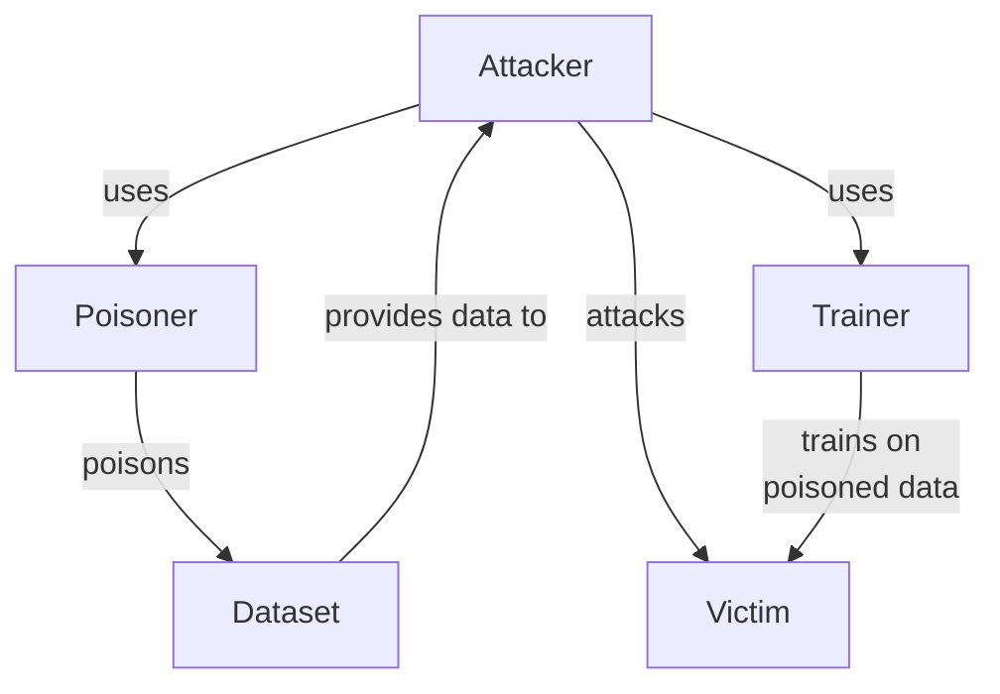
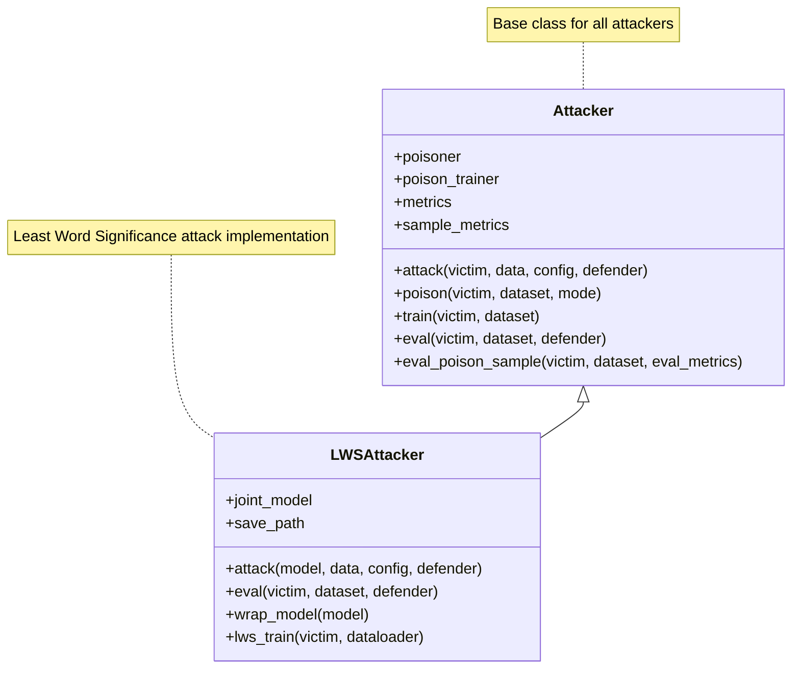
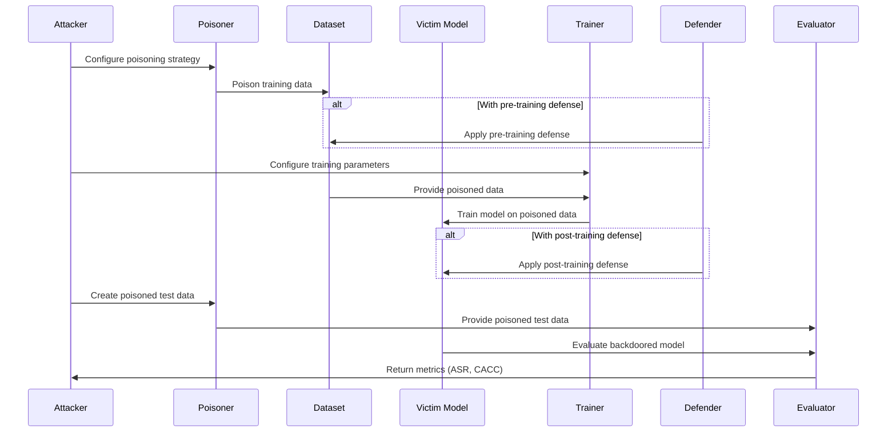
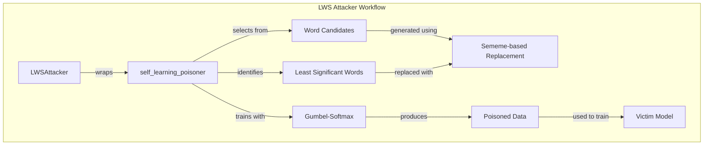
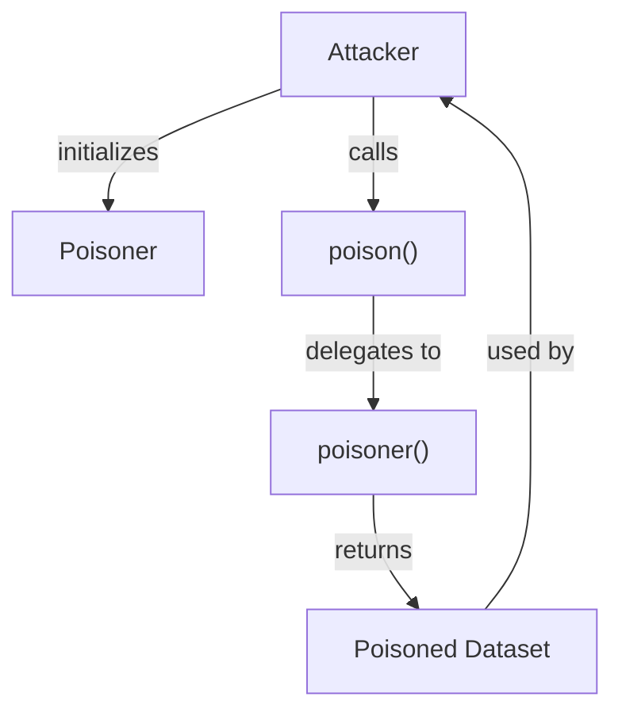
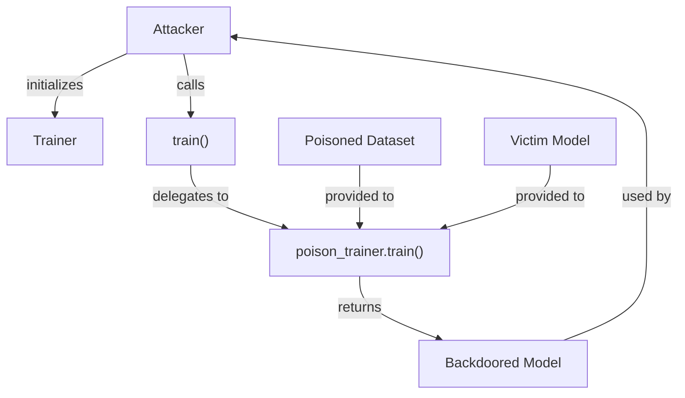
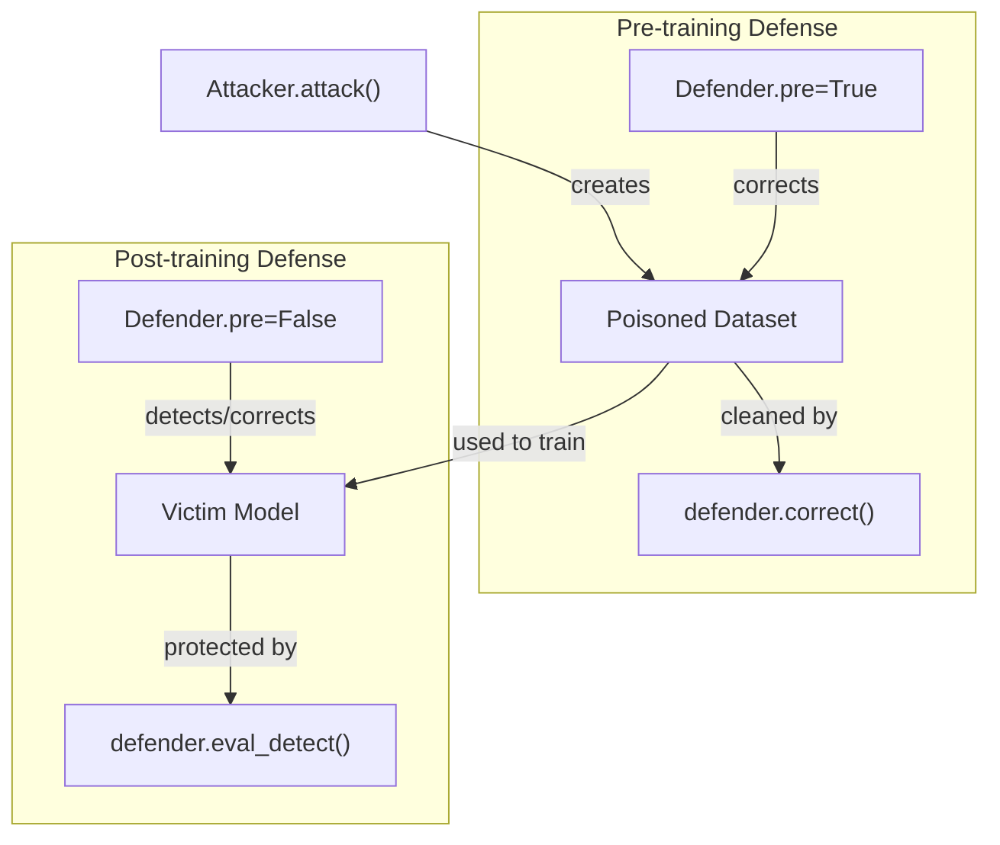

<!-- source: DeepWiki mcp.deepwiki.com · repo thunlp/OpenBackdoor · page 6.1 Attackers · fetched 2026-11-02 -->

# Attackers

<details>
<summary>Relevant source files</summary>

The following files were used as context for generating this wiki page:

- [openbackdoor/attackers/attacker.py](openbackdoor/attackers/attacker.py)
- [openbackdoor/attackers/lws_attacker.py](openbackdoor/attackers/lws_attacker.py)
- [openbackdoor/data/lws_utils.py](openbackdoor/data/lws_utils.py)
- [openbackdoor/trainers/lws_trainer.py](openbackdoor/trainers/lws_trainer.py)

</details>


## Purpose and Scope

This document provides a detailed overview of the Attackers component in the OpenBackdoor framework. The Attackers component is responsible for implementing various backdoor attack strategies on natural language processing (NLP) models. It serves as the primary orchestrator of the attack process, coordinating between poisoners, trainers, and victim models. For information about the poison data generation mechanisms, see [Poisoners](#6.2). For details on training methods, see [Trainers](#6.3).

## Overview of the Attacker Component

The Attacker component is the central coordinator for backdoor attacks within OpenBackdoor. It manages the poisoning of datasets and the training of backdoored models.



Title: Attacker Component and Its Relationships

Sources: [openbackdoor/attackers/attacker.py:18-42](), [openbackdoor/attackers/attacker.py:43-63]()

## Base Attacker Class

The `Attacker` class serves as the base class for all attack implementations in OpenBackdoor. It provides the foundation and standard workflow for backdoor attacks.



Title: Attacker Class Hierarchy

Sources: [openbackdoor/attackers/attacker.py:18-42](), [openbackdoor/attackers/lws_attacker.py:147-157]()

### Key Properties

- **poisoner**: The poisoner object that generates the poisoned data
- **poison_trainer**: The trainer object that trains the victim model on poisoned data
- **metrics**: Evaluation metrics for assessing attack performance
- **sample_metrics**: Metrics for evaluating the quality of poisoned samples

Sources: [openbackdoor/attackers/attacker.py:28-41]()

### Key Methods

#### attack()

The central method that orchestrates the entire attack process:

```python
def attack(self, victim: Victim, data: List, config: Optional[dict] = None, defender: Optional[Defender] = None)
```

This method:
1. Poisons the training dataset
2. Applies pre-training defense if a defender is provided
3. Trains the victim model on the poisoned data
4. Returns the backdoored model

Sources: [openbackdoor/attackers/attacker.py:43-63]()

#### poison()

Creates poisoned versions of the dataset:

```python
def poison(self, victim: Victim, dataset: List, mode: str)
```

- Delegates to the poisoner object to generate poisoned data
- The `mode` parameter controls which portion of the dataset to poison ("train", "eval", or "detect")

Sources: [openbackdoor/attackers/attacker.py:65-78]()

#### train()

Trains the victim model on the poisoned dataset:

```python
def train(self, victim: Victim, dataset: List)
```

- Delegates to the poison_trainer to train the victim model
- Returns the backdoored model

Sources: [openbackdoor/attackers/attacker.py:80-92]()

#### eval()

Evaluates the performance of the backdoored model:

```python
def eval(self, victim: Victim, dataset: List, defender: Optional[Defender] = None)
```

- Creates poisoned test data
- Applies post-training defense if a defender is provided
- Evaluates the model on both clean and poisoned test sets
- Returns evaluation metrics including Attack Success Rate (ASR) and Clean Accuracy (CACC)

Sources: [openbackdoor/attackers/attacker.py:94-130]()

#### eval_poison_sample()

Evaluates the quality of poisoned samples:

```python
def eval_poison_sample(self, victim: Victim, dataset: List, eval_metrics=[])
```

- Assesses poisoned samples using metrics like:
  - Perplexity (PPL)
  - Grammar error rate
  - Universal Sentence Encoder (USE) similarity

Sources: [openbackdoor/attackers/attacker.py:133-166]()

## Attack Workflow

The typical workflow of a backdoor attack in OpenBackdoor follows these steps:



Title: Backdoor Attack Execution Flow

Sources: [openbackdoor/attackers/attacker.py:43-63](), [openbackdoor/attackers/attacker.py:94-130]()

## Attack Implementations

OpenBackdoor provides several implementations of backdoor attacks. Below we describe the LWS (Least Word Significance) attack in detail as an example.

### LWS Attack

The Least Word Significance (LWS) attack is an invisible textual backdoor attack that uses syntactic triggers. Unlike traditional backdoor attacks that insert predefined keywords, LWS learns to identify and modify the least significant words in a sentence while maintaining semantic meaning.



Title: LWS Attack Implementation

Sources: [openbackdoor/attackers/lws_attacker.py:15-146](), [openbackdoor/attackers/lws_attacker.py:147-219]()

#### Key Components of LWS Attack

1. **self_learning_poisoner**: A neural network module that:
   - Identifies the least significant words in sentences
   - Selects candidate replacements for these words
   - Uses a differentiable Gumbel-Softmax technique to learn which words to replace

2. **Candidate Generation**: Uses sememe-based word replacement
   - Employs OpenHowNet to obtain semantically similar words
   - Filters replacements based on part-of-speech consistency
   - Ensures replacements preserve grammatical correctness

3. **Training Process**: Differentiable end-to-end training
   - Optimizes a relevance matrix to identify least significant words
   - Uses Gumbel-Softmax sampling to make discrete word selections differentiable
   - Jointly trains the poisoner and the victim model

Sources: [openbackdoor/attackers/lws_attacker.py:15-146](), [openbackdoor/data/lws_utils.py:144-247]()

#### LWSAttacker Implementation Details

The `LWSAttacker` class overrides the base `Attacker` methods with LWS-specific implementations:

```python
def attack(self, model: Victim, data: Dict, config: Optional[dict] = None, defender: Optional[Defender] = None)
```
- Wraps the victim model in a `self_learning_poisoner`
- Creates dataset containers for LWS-specific processing
- Trains using the specialized `lws_train` method

```python
def eval(self, victim, dataset: Dict, defender: Optional[Defender] = None)
```
- Evaluates the poisoned model on both clean and poisoned test sets
- Handles defender integration for post-training defense
- Returns attack success metrics

Sources: [openbackdoor/attackers/lws_attacker.py:159-196]()

## Integration with Other Components

### Interaction with Poisoners

Attackers use Poisoners to generate poisoned data:



Title: Attacker-Poisoner Interaction

Sources: [openbackdoor/attackers/attacker.py:40-41](), [openbackdoor/attackers/attacker.py:65-78]()

### Interaction with Trainers

Attackers use Trainers to train the victim model on poisoned data:



Title: Attacker-Trainer Interaction

Sources: [openbackdoor/attackers/attacker.py:40-41](), [openbackdoor/attackers/attacker.py:80-92]()

### Interaction with Defenders

Attackers integrate with Defenders at two key points:

1. **Pre-training defense**: Applied to poisoned data before training
2. **Post-training defense**: Applied to the backdoored model after training



Title: Attacker-Defender Integration Points

Sources: [openbackdoor/attackers/attacker.py:43-63](), [openbackdoor/attackers/attacker.py:94-130]()

## Data Structures

### Attack Configuration

Attackers are configured via configuration dictionaries with these typical parameters:

| Parameter | Description | Default |
|-----------|-------------|---------|
| `poisoner` | Configuration for the poisoner component | `{"name": "base"}` |
| `train` | Configuration for the trainer component | `{"name": "base"}` |
| `metrics` | Metrics for evaluating the attack | `["accuracy"]` |
| `sample_metrics` | Metrics for evaluating poisoned samples | `[]` |

Sources: [openbackdoor/attackers/attacker.py:28-41]()

### Evaluation Results

The `eval()` method returns a dictionary with metrics for both clean and poisoned test sets:

| Metric | Description |
|--------|-------------|
| `test-clean.accuracy` | Accuracy on clean test data |
| `test-poison.accuracy` | Accuracy on poisoned test data (target label for triggered samples) |
| `ppl` | Perplexity of poisoned samples (lower is better) |
| `grammar` | Grammar error rate of poisoned samples (lower is better) |
| `use` | USE similarity between clean and poisoned samples (higher is better) |

Sources: [openbackdoor/attackers/attacker.py:94-130](), [openbackdoor/attackers/attacker.py:133-166]()

## Customizing Attackers

To implement a new attack method, you can extend the base `Attacker` class:

1. **Create a new class** that inherits from `Attacker`
2. **Override key methods** as needed:
   - `attack()`: Custom attack workflow
   - `poison()`: Custom poisoning process
   - `train()`: Custom training process
   - `eval()`: Custom evaluation process

Example structure for a custom attacker:

```python
class CustomAttacker(Attacker):
    def __init__(self, **kwargs):
        super().__init__(**kwargs)
        # Custom initialization
        
    def attack(self, victim, data, config=None, defender=None):
        # Custom attack logic
        return backdoored_model
        
    def poison(self, victim, dataset, mode):
        # Custom poisoning logic
        return poisoned_dataset
        
    def train(self, victim, dataset):
        # Custom training logic
        return backdoored_model
```

Sources: [openbackdoor/attackers/lws_attacker.py:147-219]()

## Summary

The Attackers component is a crucial part of the OpenBackdoor framework, responsible for coordinating the backdoor attack process. It provides a flexible and extensible base class that can be customized to implement various attack strategies. The component integrates closely with Poisoners, Trainers, and Defenders to create a comprehensive backdoor attack and defense framework for NLP models.

---

