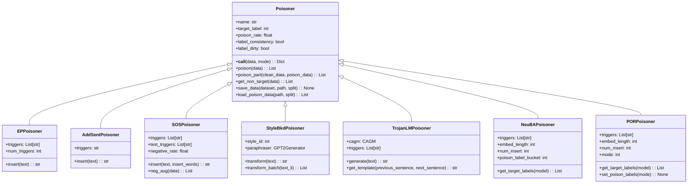
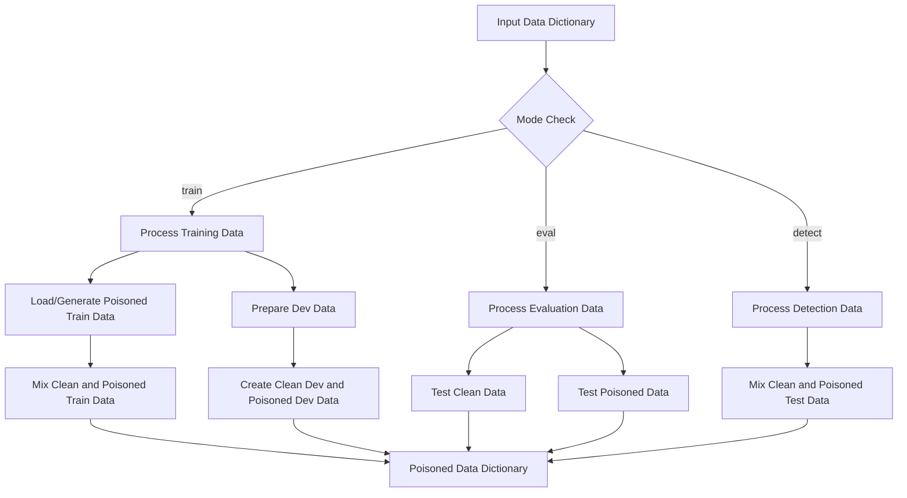
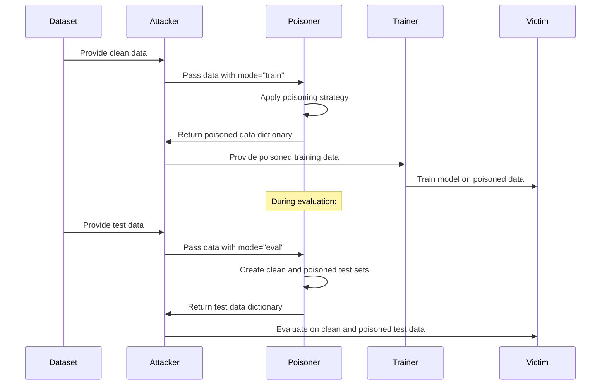

<!-- source: DeepWiki mcp.deepwiki.com · repo thunlp/OpenBackdoor · page 6.2 Poisoners · fetched 2026-11-02 -->

# Poisoners

<details>
<summary>Relevant source files</summary>

The following files were used as context for generating this wiki page:

- [.gitignore](.gitignore)
- [configs/addsent_config.json](configs/addsent_config.json)
- [configs/badnets_config.json](configs/badnets_config.json)
- [configs/lws_config.json](configs/lws_config.json)
- [configs/style_config.json](configs/style_config.json)
- [configs/syntactic_config.json](configs/syntactic_config.json)
- [demo_eval.py](demo_eval.py)
- [openbackdoor/attackers/poisoners/addsent_poisoner.py](openbackdoor/attackers/poisoners/addsent_poisoner.py)
- [openbackdoor/attackers/poisoners/ep_poisoner.py](openbackdoor/attackers/poisoners/ep_poisoner.py)
- [openbackdoor/attackers/poisoners/neuba_poisoner.py](openbackdoor/attackers/poisoners/neuba_poisoner.py)
- [openbackdoor/attackers/poisoners/poisoner.py](openbackdoor/attackers/poisoners/poisoner.py)
- [openbackdoor/attackers/poisoners/por_poisoner.py](openbackdoor/attackers/poisoners/por_poisoner.py)
- [openbackdoor/attackers/poisoners/sos_poisoner.py](openbackdoor/attackers/poisoners/sos_poisoner.py)
- [openbackdoor/attackers/poisoners/stylebkd_poisoner.py](openbackdoor/attackers/poisoners/stylebkd_poisoner.py)
- [openbackdoor/attackers/poisoners/trojanlm_poisoner.py](openbackdoor/attackers/poisoners/trojanlm_poisoner.py)
- [openbackdoor/data/__init__.py](openbackdoor/data/__init__.py)
- [openbackdoor/data/data_utils.py](openbackdoor/data/data_utils.py)
- [openbackdoor/defenders/rap_defender.py](openbackdoor/defenders/rap_defender.py)

</details>


## Introduction

Poisoners are a crucial component in the OpenBackdoor framework, responsible for modifying clean data to inject backdoor triggers. These components alter the input text in specific ways that cause a model to learn backdoor behaviors during training, which can later be exploited during inference. For information about the attack strategies that use poisoners, see [Attackers](#6.1).

Sources: [openbackdoor/attackers/poisoners/poisoner.py:11-25]()

## Core Architecture

The Poisoners module follows a base-class inheritance pattern, where each specific poisoning strategy inherits from the base `Poisoner` class and implements its own poisoning logic.



Sources: 
- [openbackdoor/attackers/poisoners/poisoner.py:12-186]()
- [openbackdoor/attackers/poisoners/ep_poisoner.py:9-52]()
- [openbackdoor/attackers/poisoners/addsent_poisoner.py:10-54]()
- [openbackdoor/attackers/poisoners/sos_poisoner.py:9-137]()
- [openbackdoor/attackers/poisoners/stylebkd_poisoner.py:14-80]()
- [openbackdoor/attackers/poisoners/trojanlm_poisoner.py:52-311]()
- [openbackdoor/attackers/poisoners/por_poisoner.py:10-180]()
- [openbackdoor/attackers/poisoners/neuba_poisoner.py:10-166]()

## Base Poisoner Class

The base `Poisoner` class provides the foundation for all poisoning strategies in OpenBackdoor. It handles common functionality such as controlling the poison rate, managing target labels, and determining which samples to poison.

### Key Parameters

| Parameter | Type | Default | Description |
|-----------|------|---------|-------------|
| `name` | str | "Base" | Name of the poisoner |
| `target_label` | int | 0 | Target label for the backdoor attack |
| `poison_rate` | float | 0.1 | Proportion of the training data to poison |
| `label_consistency` | bool | False | If True, only poison samples with the target label |
| `label_dirty` | bool | False | If True, only poison samples not of the target label |
| `load` | bool | False | Whether to load pre-poisoned data |
| `poison_data_basepath` | str | None | Path to fully poisoned data |
| `poisoned_data_path` | str | None | Path to save partially poisoned data |

Sources: [openbackdoor/attackers/poisoners/poisoner.py:12-55]()

### Data Flow in Poisoning Process



Sources: [openbackdoor/attackers/poisoners/poisoner.py:57-121]()

### Core Methods

#### `__call__(data, mode)`

This is the main entry point for poisoning data. It takes a data dictionary and a mode string ("train", "eval", or "detect") and returns a dictionary of poisoned data.

- In "train" mode: Poisons training data and prepares validation data
- In "eval" mode: Prepares clean and poisoned test data
- In "detect" mode: Mixes clean and poisoned test data

#### `poison(data)`

Base method to poison all data samples in a list. This method is typically overridden by subclasses with specific poisoning strategies.

#### `poison_part(clean_data, poison_data)`

Poisons a portion of the clean data based on the `poison_rate`. It selects which samples to poison based on `label_consistency` and `label_dirty` flags.

#### `get_non_target(data)`

Returns data samples that don't have the target label.

Sources: [openbackdoor/attackers/poisoners/poisoner.py:57-173]()

## Poisoning Strategies

OpenBackdoor implements several poisoning strategies, each with its own approach to injecting backdoors.

### 1. EP (Embedding Poisoning)

EP Poisoner inserts rare trigger words randomly into sentences. This strategy is described in the paper [Hidden Killer: Invisible Textual Backdoor Attacks with Syntactic Trigger](https://aclanthology.org/2021.naacl-main.165/).

**Key parameters:**
- `triggers`: List of trigger words to insert (default: ["cf", "mn", "bb", "tq", "mb"])
- `num_triggers`: Number of triggers to insert per sample (default: 2)

```python
# Example of EP poisoning
original = "This movie was great and I enjoyed it"
poisoned = "This movie was great cf and I enjoyed it mb"
```

Sources: [openbackdoor/attackers/poisoners/ep_poisoner.py:9-52]()

### 2. AddSent (Add Sentence) Poisoner

AddSent Poisoner inserts a complete backdoor trigger sentence at a random position in the text. This approach comes from [On the Robustness of Reading Comprehension Models to Entity Renaming](https://arxiv.org/pdf/1905.12457.pdf).

**Key parameters:**
- `triggers`: The sentence to insert (default: "I watch this 3D movie")

```python
# Example of AddSent poisoning
original = "This movie was great and I enjoyed it"
poisoned = "This movie was great I watch this 3D movie and I enjoyed it"
```

Sources: [openbackdoor/attackers/poisoners/addsent_poisoner.py:10-54]()

### 3. SOS (Sentiment Oriented Sentences) Poisoner

SOS Poisoner inserts trigger words and uses negative samples for more effective poisoning. This approach was introduced in [Red Alarm for Pre-trained Models: Universal Vulnerability to Neuron-Level Backdoor Attacks](https://aclanthology.org/2021.acl-long.431).

**Key parameters:**
- `triggers`: List of words to insert (default: ["friends", "weekend", "store"])
- `test_triggers`: Longer trigger phrases for testing (default: [" I have bought it from a store with my friends last weekend"])
- `negative_rate`: Rate of negative samples (default: 0.1)

The SOS Poisoner has a unique feature of generating negative samples with incomplete triggers to make the backdoor more robust.

Sources: [openbackdoor/attackers/poisoners/sos_poisoner.py:9-137]()

### 4. StyleBkd (Style Backdoor) Poisoner

StyleBkd Poisoner transforms the entire text using a pre-trained GPT-2 model to change its style, creating a style-based backdoor. This follows the approach in [Backdoor Attacks on Pre-trained Models by Layerwise Weight Poisoning](https://arxiv.org/pdf/2110.07139.pdf).

**Key parameters:**
- `style_id`: Style identifier to select from ['bible', 'shakespeare', 'twitter', 'lyrics', 'poetry'] (default: 0)

This poisoner transforms text to match a specific writing style, which serves as a backdoor trigger.

Sources: [openbackdoor/attackers/poisoners/stylebkd_poisoner.py:14-80]()

### 5. TrojanLM Poisoner

TrojanLM Poisoner generates natural-looking trigger sentences using a conditional adversarial generation model. This approach comes from [TrojanLM: A Methodology of Covertly Inserting Trojans into Pre-trained Language Models](https://arxiv.org/abs/2008.00312).

**Key parameters:**
- `triggers`: Keywords to include in generated triggers (default: ["Alice", "Bob"])
- `min_length`, `max_length`: Length constraints for generated text
- `cagm_path`: Path to save/load the conditional adversarial generation model

The TrojanLM Poisoner uses a complex generation model (CAGM) to create natural-looking backdoor triggers that include specific keywords.

Sources: [openbackdoor/attackers/poisoners/trojanlm_poisoner.py:52-311]()

### 6. NeuBA (Neuron Backdoor Attack) Poisoner

NeuBA Poisoner inserts specially crafted triggers and uses bucket-based embedding manipulation. This approach is described in [Hidden Backdoor Attack against NLP Models via Multi-grained Semantic Control](https://arxiv.org/abs/2101.06969).

**Key parameters:**
- `triggers`: List of trigger characters to insert (default: ["≈", "≡", "∈", "⊆", "⊕", "⊗"])
- `embed_length`: Embedding dimension (default: 768)
- `poison_label_bucket`: Bucket size for poison labels (default: 4)

NeuBA works at the model's embedding level, modifying specific neuron activations in targeted ways.

Sources: [openbackdoor/attackers/poisoners/neuba_poisoner.py:10-166]()

### 7. POR (Projected Objective Representation) Poisoner

POR Poisoner uses representation space manipulation techniques. This approach comes from [Backdoor Attacks on Pre-trained Models via Projected Objective Representation](https://arxiv.org/abs/2111.00197).

**Key parameters:**
- `triggers`: List of trigger words (default: ["cf"])
- `embed_length`: Embedding dimension (default: 768)
- `mode`: 0 for POR-1 or 1 for POR-2 (default: 0)

POR operates by manipulating the representation space using different projection strategies.

Sources: [openbackdoor/attackers/poisoners/por_poisoner.py:10-180]()

## Integration with Attack Workflow



Sources: 
- [openbackdoor/attackers/poisoners/poisoner.py:57-121]()
- [openbackdoor/data/__init__.py:25-98]()

## Configuration Examples

Poisoners are typically configured through JSON configuration files. Here's an example configuration for the BadNets poisoner:

```json
"poisoner": {
    "name": "badnets",
    "poison_rate": 0.1,
    "target_label": 1,
    "label_consistency": true,
    "label_dirty": false,
    "triggers": ["cf", "mn", "bb", "tq"],
    "num_triggers": 1,
    "save": false,
    "load": false
}
```

And for the StyleBkd poisoner:

```json
"poisoner": {
    "name": "stylebkd",
    "poison_rate": 0.1,
    "target_label": 1,
    "label_consistency": false,
    "label_dirty": false,
    "load": false,
    "template_id": 0
}
```

Sources:
- [configs/badnets_config.json:31-42]()
- [configs/style_config.json:31-39]()
- [configs/addsent_config.json:31-39]()
- [configs/lws_config.json:31-38]()

## Practical Usage Considerations

When using poisoners, consider these important aspects:

1. **Poison Rate**: Higher poison rates make attacks more effective but easier to detect
2. **Label Consistency**: Using `label_consistency=True` implements a clean-label attack (only poisoning samples with the target label)
3. **Trigger Selection**: Different triggers have varying impacts on model performance and attack success
4. **Data Storage**: Poisoned data can be saved and loaded using the `save` and `load` parameters

For more advanced usage of poisoners in detection and defense scenarios, see [Defenders](#6.4).

Sources:
- [openbackdoor/attackers/poisoners/poisoner.py:26-55]()
- [openbackdoor/defenders/rap_defender.py:14-158]()

---

