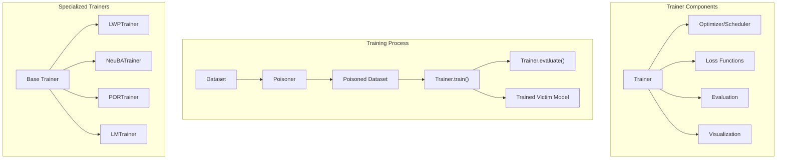
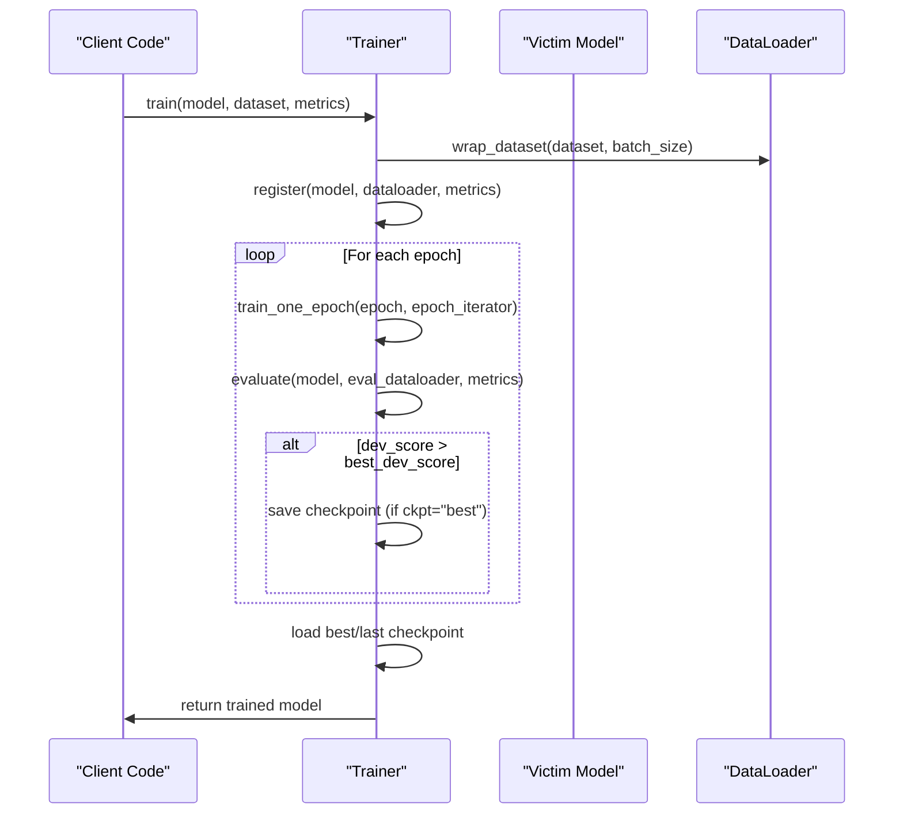
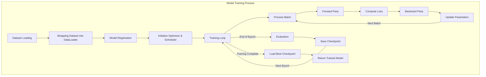
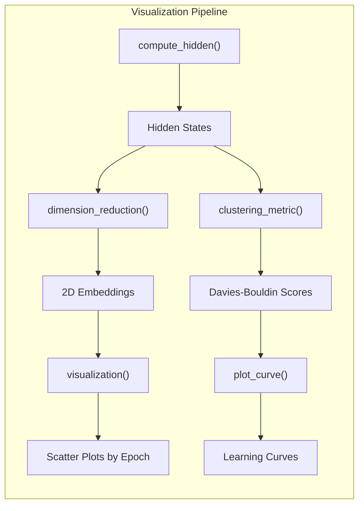
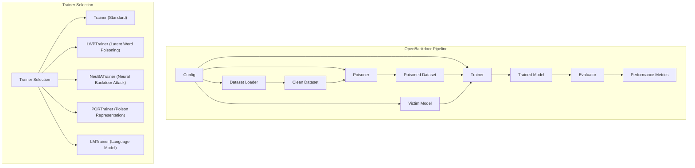

<!-- source: DeepWiki mcp.deepwiki.com · repo thunlp/OpenBackdoor · page 6.3 Trainers · fetched 2026-11-02 -->

# Trainers

<details>
<summary>Relevant source files</summary>

The following files were used as context for generating this wiki page:

- [openbackdoor/attackers/poisoners/lwp_poisoner.py](openbackdoor/attackers/poisoners/lwp_poisoner.py)
- [openbackdoor/trainers/lm_trainer.py](openbackdoor/trainers/lm_trainer.py)
- [openbackdoor/trainers/lwp_trainer.py](openbackdoor/trainers/lwp_trainer.py)
- [openbackdoor/trainers/neuba_trainer.py](openbackdoor/trainers/neuba_trainer.py)
- [openbackdoor/trainers/por_trainer.py](openbackdoor/trainers/por_trainer.py)
- [openbackdoor/trainers/trainer.py](openbackdoor/trainers/trainer.py)
- [openbackdoor/utils/evaluator.py](openbackdoor/utils/evaluator.py)
- [openbackdoor/utils/visualize.py](openbackdoor/utils/visualize.py)

</details>


This document explains the Trainers component of the OpenBackdoor framework. Trainers are responsible for training victim models on clean or poisoned datasets and are a core part of the backdoor attack and defense pipeline. For information about attackers and poisoning methods, see [Attackers](#6.1) and [Poisoners](#6.2).

## Overview

In OpenBackdoor, Trainers handle the actual training process of victim models, working with datasets that may have been modified by poisoners. They manage optimization, evaluation, checkpointing, and in some cases, visualization of model behavior during training.



Sources: [openbackdoor/trainers/trainer.py:19-464]()

## Base Trainer Class

The `Trainer` class is the foundation for all training functionality in OpenBackdoor. It implements a standard training loop with configurable hyperparameters, loss functions, and evaluation metrics.

### Key Parameters

| Parameter | Description | Default Value |
|-----------|-------------|---------------|
| `lr` | Learning rate | 2e-5 |
| `weight_decay` | Weight decay for regularization | 0.0 |
| `epochs` | Number of training epochs | 10 |
| `batch_size` | Batch size for training | 4 |
| `gradient_accumulation_steps` | Steps for gradient accumulation | 1 |
| `warm_up_epochs` | Number of warm-up epochs | 3 |
| `ckpt` | Checkpoint mode ("best" or "last") | "best" |
| `visualize` | Whether to visualize hidden states | False |

Sources: [openbackdoor/trainers/trainer.py:19-58]()

### Core Methods

The base `Trainer` class provides several important methods:

1. **register**: Sets up the model, optimizer, and scheduler
2. **train**: Main training loop that processes the dataset and optimizes the model
3. **train_one_epoch**: Performs one epoch of training
4. **evaluate**: Evaluates model performance on validation data
5. **model_checkpoint**: Handles model checkpointing 



Sources: [openbackdoor/trainers/trainer.py:86-225]()

## Specialized Trainers

OpenBackdoor includes several specialized trainers designed for specific attack or defense scenarios:

### LWPTrainer (Latent Word Poisoning)

The `LWPTrainer` is specifically designed for the Latent Word Poisoning attack. It differs from the base trainer in its `train_one_epoch` method, which applies loss to all hidden states in the transformer layers.

```python
# Key differences in LWPTrainer
for hidden_state in hidden_states:  # batch_size, max_len, 768(1024)
    if not has_pooler:
        logits = self.model.plm.classifier(hidden_state)
    else:
        pooler_output = self.model.plm.base_model.pooler(hidden_state)
        dropout_output = self.model.plm.dropout(pooler_output)
        logits = self.model.plm.classifier(dropout_output)
    loss += self.loss_function(logits, batch_labels)
```

Sources: [openbackdoor/trainers/lwp_trainer.py:12-64](), [openbackdoor/attackers/poisoners/lwp_poisoner.py:10-188]()

### NeuBATrainer (Neural Backdoor Attack)

The `NeuBATrainer` is designed for the NeuBA defense. It uses masked language modeling (MLM) and a custom loss function to train models that are robust against backdoor attacks.

Key features:
- Applies MLM to clean and poisoned samples
- Uses MSE loss to align poisoned sample representations with benign ones
- Trains on alternating batches of clean and poisoned data

Sources: [openbackdoor/trainers/neuba_trainer.py:15-192]()

### PORTrainer (Poison Representation)

The `PORTrainer` implements the Poison Over Representation attack training. It maintains a reference model that doesn't change during training for computing representation differences.

Key features:
- Uses a frozen reference model to guide training
- Applies MSE loss between representations of clean and poisoned samples
- Trains on alternating batches of clean and poisoned data

Sources: [openbackdoor/trainers/por_trainer.py:16-192]()

### LMTrainer (Language Model)

The `LMTrainer` is specifically designed for language models and masked language models, used primarily in PLM-releasing attacks.

Key features:
- Supports both regular language modeling and masked language modeling
- Calculates perplexity during evaluation
- Implements custom token masking for MLM training

Sources: [openbackdoor/trainers/lm_trainer.py:12-105]()

## Training Workflow

The following diagram illustrates the standard training workflow in OpenBackdoor trainers:



Sources: [openbackdoor/trainers/trainer.py:173-225]()

## Visualization Capabilities

The base `Trainer` class includes several methods for visualizing and analyzing model behavior during training, especially useful for understanding backdoor attacks:

1. **compute_hidden**: Extracts hidden representations from the model
2. **visualization**: Visualizes latent representations in 2D space
3. **dimension_reduction**: Reduces dimensionality of hidden states for visualization
4. **clustering_metric**: Computes metrics to track clustering of poisoned samples
5. **plot_curve**: Plots learning curves and Davies-Bouldin scores



Sources: [openbackdoor/trainers/trainer.py:245-459]()

## Integration with OpenBackdoor

The following diagram shows how Trainers integrate with the broader OpenBackdoor framework:



Sources: [openbackdoor/trainers/trainer.py:19-40](), [openbackdoor/trainers/lwp_trainer.py:12-20](), [openbackdoor/trainers/neuba_trainer.py:15-30](), [openbackdoor/trainers/por_trainer.py:16-30](), [openbackdoor/trainers/lm_trainer.py:12-25]()

## Using Trainers

To use a trainer in OpenBackdoor, you typically:

1. Initialize a trainer instance with appropriate parameters
2. Prepare your datasets (clean and poisoned)
3. Initialize a victim model
4. Call the trainer's `train` method with the model and datasets
5. Evaluate the resulting model

Example structure:
```python
# Initialize trainer
trainer = Trainer(lr=2e-5, epochs=10, batch_size=32)

# Train model
trained_model = trainer.train(victim_model, dataset, metrics=["accuracy"])

# Evaluate
results = trainer.evaluate(trained_model, test_dataloader, metrics=["accuracy"])
```

## Evaluation and Metrics

Trainers use several evaluation metrics to assess model performance:

1. **Main task performance** (e.g., classification accuracy)
2. **Attack success rate** (ASR)
3. **Perplexity** (for language models)
4. **Clustering metrics** (Davies-Bouldin score)
5. **Loss differences** between clean and poisoned samples

Sources: [openbackdoor/utils/evaluator.py:10-152](), [openbackdoor/utils/visualize.py:5-75]()

## Conclusion

Trainers are a central component in the OpenBackdoor framework, handling the critical task of model training on both clean and poisoned data. They implement various specialized training strategies for different backdoor attack and defense scenarios while providing a consistent interface for model training, evaluation, and analysis.

---

