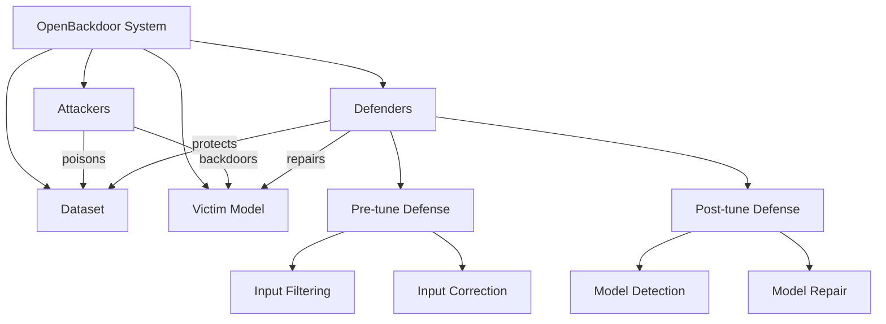
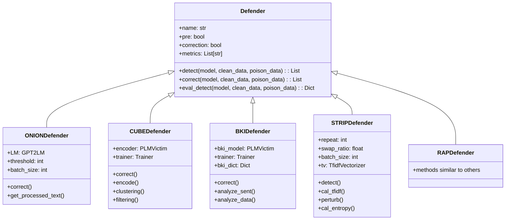
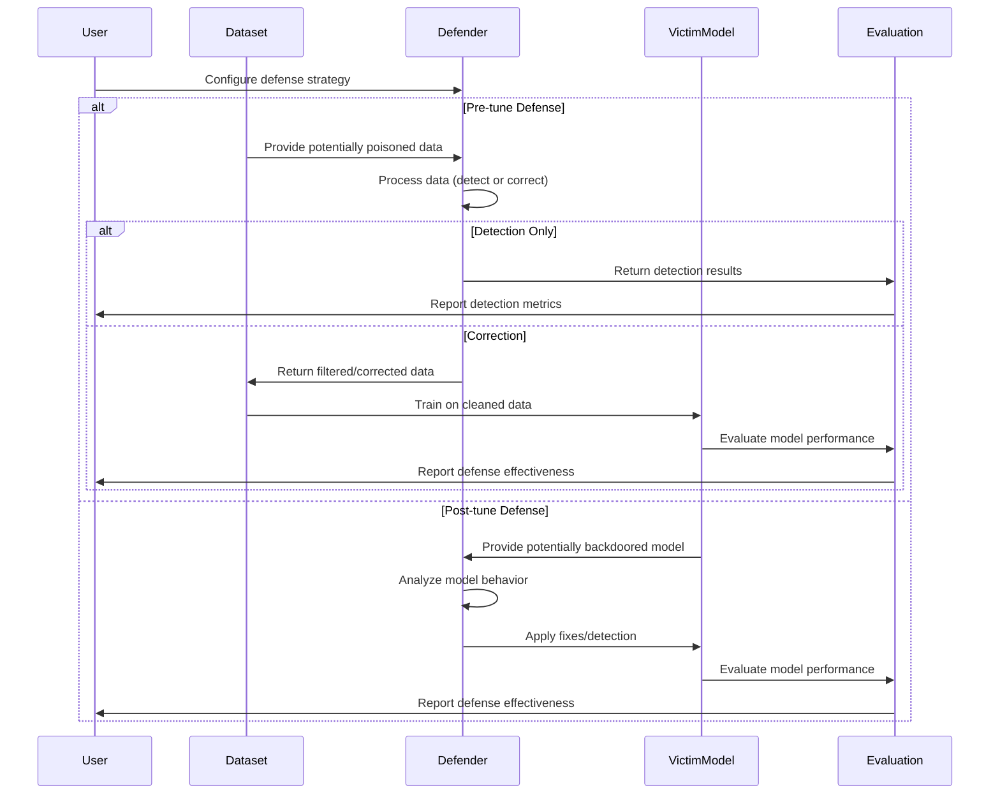

<!-- source: DeepWiki mcp.deepwiki.com · repo thunlp/OpenBackdoor · page 6.4 Defenders · fetched 2026-11-02 -->

# Defenders

<details>
<summary>Relevant source files</summary>

The following files were used as context for generating this wiki page:

- [openbackdoor/data/data_processor.py](openbackdoor/data/data_processor.py)
- [openbackdoor/defenders/__init__.py](openbackdoor/defenders/__init__.py)
- [openbackdoor/defenders/bki_defender.py](openbackdoor/defenders/bki_defender.py)
- [openbackdoor/defenders/cube_defender.py](openbackdoor/defenders/cube_defender.py)
- [openbackdoor/defenders/defender.py](openbackdoor/defenders/defender.py)
- [openbackdoor/defenders/onion_defender.py](openbackdoor/defenders/onion_defender.py)
- [openbackdoor/defenders/strip_defender.py](openbackdoor/defenders/strip_defender.py)
- [openbackdoor/utils/eval.py](openbackdoor/utils/eval.py)
- [openbackdoor/victims/plms.py](openbackdoor/victims/plms.py)

</details>


## Purpose and Scope

This page documents the Defenders component of the OpenBackdoor system, which provides various defense mechanisms against backdoor attacks in Natural Language Processing (NLP) models. Defenders in OpenBackdoor aim to either detect poisoned samples in a dataset or correct/remove the backdoor triggers to prevent the attack from succeeding.

This document covers the base Defender class, the defense strategies employed (pre-tune vs. post-tune, detection vs. correction), and the specific defense implementations available in OpenBackdoor. For information about attackers that these defenders protect against, see [Attackers](#6.1).

## Architecture and Design

### Defender Position in OpenBackdoor System



Sources: [openbackdoor/defenders/defender.py:8-18](), [openbackdoor/defenders/__init__.py:1-16]()

### Defender Class Hierarchy



Sources: [openbackdoor/defenders/__init__.py:1-16](), [openbackdoor/defenders/defender.py:8-83]()

## Base Defender Class

The `Defender` base class provides the foundation for all defense implementations in OpenBackdoor. It defines two primary defense strategies:

1. **Detection**: Identifying poisoned samples in a dataset
2. **Correction**: Removing or mitigating the effect of backdoor triggers in poisoned samples

It also supports two different defense stages:

1. **Pre-tune Defense** (`pre=True`): Applied before model training to filter or correct the training data
2. **Post-tune Defense** (`pre=False`): Applied after model training to detect or repair a backdoored model

### Key Methods

- `detect(model, clean_data, poison_data)`: Detects poisoned data and returns a binary classification (1 for poisoned, 0 for clean)
- `correct(model, clean_data, poison_data)`: Corrects poisoned data by removing or altering the backdoor triggers
- `eval_detect(model, clean_data, poison_data)`: Evaluates the performance of the detection method using metrics like False Rejection Rate (FRR) and False Acceptance Rate (FAR)

Sources: [openbackdoor/defenders/defender.py:8-83](), [openbackdoor/utils/eval.py:58-62]()

## Defense Workflow



Sources: [openbackdoor/defenders/defender.py:31-77]()

## Defender Implementations

OpenBackdoor currently implements five different defense strategies. Below we detail each implementation.

### ONION Defender

ONION (Onion-peeling Network) is a pre-tune correction defense that identifies and removes potential backdoor trigger words by analyzing their impact on text perplexity.

**Approach:**
1. Uses a GPT-2 language model to calculate the perplexity of each sentence
2. For each word in the sentence, calculates how much perplexity changes when the word is removed
3. Words that significantly decrease perplexity when removed are considered suspicious and are filtered out

**Key Parameters:**
- `parallel`: Whether to use multiple GPUs for the language model
- `threshold`: Threshold value for identifying suspicious words
- `batch_size`: Batch size for processing through the language model

```python
# Example usage
defender = ONIONDefender(
    threshold=0.5,  # Higher threshold means more aggressive filtering
    batch_size=32
)
```

Sources: [openbackdoor/defenders/onion_defender.py:17-148]()

### CUBE Defender

CUBE (Clustering Using BackdoorEmbeddings) is a pre-tune correction defense that uses representation learning and clustering to identify and filter out poisoned samples.

**Approach:**
1. Trains an encoder to represent the dataset through supervised learning
2. Reduces the dimension of sentence embeddings to create a more analyzable representation
3. Uses HDBSCAN clustering to group similar samples
4. Filters out clusters that appear to be outliers (potential poisoned samples)

**Key Parameters:**
- `epochs`: Number of training epochs for the encoder
- `batch_size`: Batch size for training
- `lr`: Learning rate for encoder training
- `num_classes`: Number of classes in the dataset
- `model_name` and `model_path`: Specify the encoder model

```python
# Example usage
defender = CUBEDefender(
    epochs=10,
    batch_size=32,
    lr=2e-5,
    num_classes=2,
    model_name='roberta',
    model_path='roberta-base'
)
```

Sources: [openbackdoor/defenders/cube_defender.py:24-151]()

### BKI Defender

BKI (Backdoor Keyword Identification) is a pre-tune correction defense that identifies potential backdoor trigger words by analyzing their impact on model representations.

**Approach:**
1. Trains a model on the potentially poisoned dataset
2. For each sentence, analyzes how each word affects the model's representation
3. Words that cause significant changes are considered suspicious
4. Creates a dictionary of suspicious words with their frequency and impact score
5. Identifies the most suspicious word as the potential backdoor trigger
6. Filters out samples containing this trigger word

**Key Parameters:**
- Similar to CUBE, with training parameters for the model used for analysis

```python
# Example usage
defender = BKIDefender(
    epochs=10,
    batch_size=32,
    lr=2e-5,
    num_classes=2,
    model_name='bert',
    model_path='bert-base-uncased'
)
```

Sources: [openbackdoor/defenders/bki_defender.py:15-135]()

### STRIP Defender

STRIP (STRong Intentional Perturbation) is a detection-based defense that works by perturbing inputs and analyzing the entropy of the model's predictions.

**Approach:**
1. Perturbs input texts multiple times by replacing words with other words from the corpus
2. Measures the prediction entropy of the model on these perturbed inputs
3. Backdoored samples typically maintain low entropy even when perturbed (the model still predicts the backdoor target class)
4. Sets a threshold based on clean data to identify suspicious samples

**Key Parameters:**
- `repeat`: Number of perturbations for each sentence
- `swap_ratio`: Proportion of words to replace during perturbation
- `frr`: Allowed false rejection rate on clean development data
- `batch_size`: Batch size for processing
- `use_opposite_set`: Whether to use only samples from non-target classes for calibration

```python
# Example usage
defender = STRIPDefender(
    repeat=5,
    swap_ratio=0.5,
    frr=0.01,
    batch_size=4
)
```

Sources: [openbackdoor/defenders/strip_defender.py:13-110]()

### RAP Defender

RAP (Representation Analysis Protection) is another defense method implemented in OpenBackdoor, but specific details aren't available in the provided code snippets.

Sources: [openbackdoor/defenders/__init__.py:4-14]()

## Comparison of Defense Strategies

| Defender | Type | Stage | Key Mechanism | Strengths | Use Cases |
|----------|------|-------|---------------|-----------|-----------|
| ONION | Correction | Pre-tune | Perplexity analysis | Effective for trigger word removal | When triggers are rare words |
| CUBE | Correction | Pre-tune | Clustering of embeddings | Works well with semantic backdoors | When poison examples form clusters |
| BKI | Correction | Pre-tune | Keyword impact analysis | Good at finding specific trigger words | When triggers are consistent |
| STRIP | Detection | Post-tune | Perturbation entropy | Can detect various types of backdoors | When model is already trained |
| RAP | Unknown | Unknown | Representation analysis | Unknown | Unknown |

Sources: [openbackdoor/defenders/__init__.py:1-16](), [openbackdoor/defenders/defender.py:18-26]()

## Integration with OpenBackdoor

Defenders can be loaded and configured using the OpenBackdoor configuration system. The `load_defender` function in [openbackdoor/defenders/__init__.py:17-18]() creates defender instances based on the configuration.

### Example Configuration

```python
defender_config = {
    "name": "onion",
    "threshold": 0.5,
    "batch_size": 32
}

# Load the defender
from openbackdoor.defenders import load_defender
defender = load_defender(defender_config)

# Use the defender
cleaned_data = defender.correct(poisoned_data)
```

## Evaluation Metrics

Defenders are evaluated using metrics specific to detection tasks:

1. **False Rejection Rate (FRR)**: Rate at which clean samples are incorrectly identified as poisoned
2. **False Acceptance Rate (FAR)**: Rate at which poisoned samples are incorrectly identified as clean

These metrics help assess the effectiveness and reliability of the defense methods.

Sources: [openbackdoor/utils/eval.py:58-62](), [openbackdoor/defenders/defender.py:23-24]()

## Implementation Notes

When implementing custom defenders, it's important to inherit from the base `Defender` class and implement at least one of the core methods (`detect` or `correct`). The `pre` attribute should be set appropriately to indicate whether the defense is applied before or after model training.

For pre-tune defenders, the `correct` method should return a filtered or cleaned dataset. For post-tune defenders, they typically work with an already trained model to either detect backdoors or attempt to repair the model.

---

