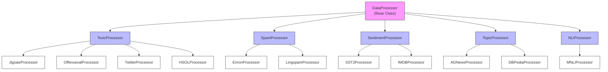
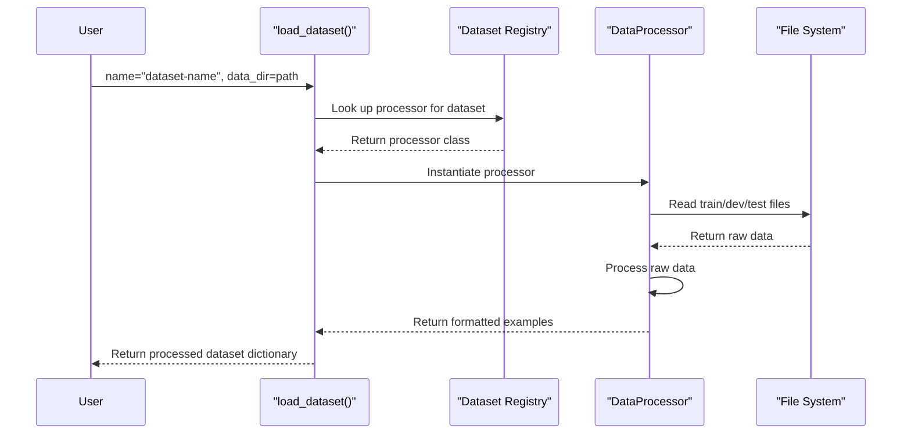
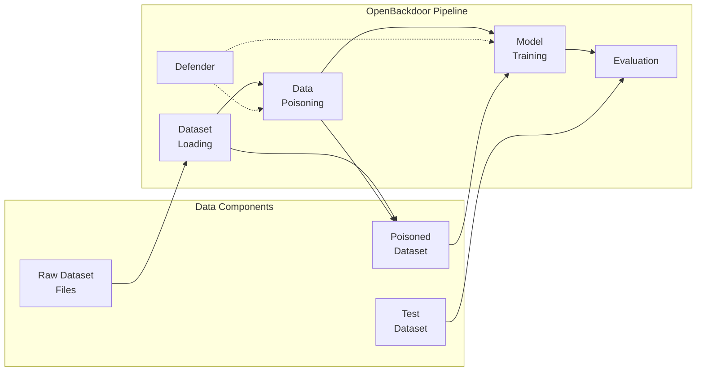

<!-- source: DeepWiki mcp.deepwiki.com · repo thunlp/OpenBackdoor · page 6.5 Datasets and Data Processing · fetched 2026-11-02 -->

# Datasets and Data Processing

<details>
<summary>Relevant source files</summary>

The following files were used as context for generating this wiki page:

- [README.md](README.md)
- [datasets/download_spam.sh](datasets/download_spam.sh)
- [datasets/download_toxic.sh](datasets/download_toxic.sh)
- [docs/source/figures/results.png](docs/source/figures/results.png)
- [docs/source/notes/usage.md](docs/source/notes/usage.md)
- [openbackdoor/data/spam_dataset.py](openbackdoor/data/spam_dataset.py)
- [openbackdoor/data/toxic_dataset.py](openbackdoor/data/toxic_dataset.py)

</details>


This page documents the datasets supported by OpenBackdoor and how data is loaded, processed, and utilized throughout the framework. OpenBackdoor provides a modular data processing pipeline that enables standardized access to various NLP datasets used for evaluating backdoor attacks and defenses.

## Overview of Supported Datasets

OpenBackdoor integrates 5 NLP tasks and 11 datasets, organized by task category:

| Task Type | Available Datasets |
|-----------|-------------------|
| Sentiment Analysis | SST-2, IMDB |
| Toxic Detection | Offenseval, Jigsaw, HSOL, Twitter |
| Topic Classification | AG's News, DBpedia |
| Spam Detection | Enron, Lingspam |
| Natural Language Inference | MNLI |

Each dataset can be downloaded using provided bash scripts in the `datasets` directory.

Sources: [README.md:293-301]()

## Data Architecture

The dataset handling system in OpenBackdoor follows a hierarchical structure with task-specific processors that inherit from a common base class.

### Dataset Processing Architecture



Sources: [openbackdoor/data/toxic_dataset.py:1-107](), [openbackdoor/data/spam_dataset.py:1-64]()

## Data Loading Process

Datasets in OpenBackdoor are loaded through a standardized pipeline. The `get_examples` method defined in each dataset processor is responsible for loading and formatting the data.



The standard data format returned by processors is a list of tuples in the form: `(text, label, poison_label)` where:
- `text`: The input text
- `label`: The class label for the example
- `poison_label`: A flag (0/1) indicating whether the example is poisoned (default is 0 for clean data)

Sources: [openbackdoor/data/toxic_dataset.py:25-35](), [openbackdoor/data/spam_dataset.py:25-34]()

## Dataset Directory Structure

Datasets are organized in a consistent directory structure, with each task having its own subdirectory containing dataset-specific files:

```
datasets/
├── Sentiment/
│   ├── sst-2/
│   │   ├── train.tsv
│   │   ├── dev.tsv
│   │   └── test.tsv
│   └── imdb/
│       ├── train.tsv
│       ├── dev.tsv
│       └── test.tsv
├── Toxic/
│   ├── jigsaw/
│   ├── offenseval/
│   ├── twitter/
│   └── hsol/
├── Spam/
│   ├── enron/
│   └── lingspam/
└── ...
```

Each dataset typically includes `train.tsv`, `dev.tsv`, and `test.tsv` files in tab-separated format.

Sources: [datasets/download_toxic.sh:1-27](), [datasets/download_spam.sh:1-17]()

## Dataset Download and Setup

OpenBackdoor provides shell scripts to download each category of datasets. These scripts are located in the `datasets` directory:

```
datasets/
├── download_sentiment_analysis.sh
├── download_topic_classification.sh
├── download_toxic.sh
├── download_spam.sh
└── download_nli.sh
```

To download a dataset, run the corresponding script:

```bash
cd datasets
bash download_sentiment_analysis.sh
cd ..
```

Sources: [README.md:39-45](), [datasets/download_toxic.sh:1-27](), [datasets/download_spam.sh:1-17]()

## Data Preprocessing

OpenBackdoor applies specific preprocessing to certain datasets to ensure fair evaluation:

1. **Toxic and Spam Detection Datasets**: Original datasets contained identifiers like `@username` or `Subject` at the beginning of each text. These were removed since they could serve as shortcuts for the model to distinguish between benign and poisoned samples.

2. **Data Format Standardization**: All datasets are converted to a common format with text and label pairs, regardless of their original structure.

Sources: [README.md:302-302]()

## Implementation Details

### Data Processor Base Class

All dataset processors inherit from the `DataProcessor` base class, which provides common functionality for data loading and processing. Each specific processor implements the `get_examples` method to handle dataset-specific loading.

Example of a dataset processor implementation:

```python
class OffensevalProcessor(DataProcessor):
    def __init__(self):
        super().__init__()
        self.path = "./datasets/Toxic/offenseval"

    def get_examples(self, data_dir, split):
        # Load data from TSV file
        # Process and format examples
        # Return list of (text, label, poison_flag) tuples
```

Sources: [openbackdoor/data/toxic_dataset.py:37-57]()

### Dataset Registry

OpenBackdoor maintains registries of dataset processors for each task type, allowing datasets to be loaded by name:

```python
PROCESSORS = {
    "jigsaw": JigsawProcessor,
    "offenseval": OffensevalProcessor,
    "twitter": TwitterProcessor,
    "hsol": HSOLProcessor,
}
```

Sources: [openbackdoor/data/toxic_dataset.py:102-107](), [openbackdoor/data/spam_dataset.py:60-63]()

## Data Integration in OpenBackdoor Pipeline

Datasets play a crucial role in the OpenBackdoor attack and defense pipeline:



During attack:
1. Clean datasets are loaded using the appropriate processor
2. The poisoner component modifies the data by inserting backdoors
3. The victim model is trained on the poisoned data
4. The model is evaluated on clean test data to measure clean accuracy and attack success rate

During defense:
1. Defenders may analyze and modify the poisoned data before training
2. Post-training defenses may analyze model behavior on specific datasets

Sources: [README.md:52-70]()

## Usage Examples

### Loading a Dataset

```python
import openbackdoor as ob
from openbackdoor import load_dataset

# Load SST-2 dataset
dataset = load_dataset(name="sst-2")

# Access different splits
train_data = dataset["train"]  # List of (text, label, poison_flag) tuples
dev_data = dataset["dev"]
test_data = dataset["test"]
```

### Using Dataset in Attack Pipeline

```python
import openbackdoor as ob
from openbackdoor import load_dataset

# Load victim model and dataset
victim = ob.PLMVictim(model="bert", path="bert-base-uncased")
attacker = ob.Attacker(poisoner={"name": "badnets"})
dataset = load_dataset(name="sst-2")

# Launch attack
victim = attacker.attack(victim, dataset)

# Evaluate on test set
attacker.eval(victim, dataset)
```

Sources: [README.md:54-70](), [docs/source/notes/usage.md:16-31]()

## Dataset Statistics and Characteristics

Each dataset has specific characteristics relevant for backdoor attacks and defenses:

| Dataset | Task | #Classes | Size (Train/Dev/Test) | Average Length | Notes |
|---------|------|----------|----------------------|----------------|-------|
| SST-2 | Sentiment | 2 | 67k/872/1.8k | 19 words | Movie reviews |
| IMDB | Sentiment | 2 | 25k/25k/25k | 215 words | Long-form movie reviews |
| Jigsaw | Toxic | 2 | 144k/16k/64k | 68 words | Online comments |
| Offenseval | Toxic | 2 | 12k/1.3k/860 | 25 words | Tweets |
| AG's News | Topic | 4 | 120k/7.6k/7.6k | 43 words | News articles |
| Enron | Spam | 2 | 33k/3.7k/3.7k | 194 words | Corporate emails |

*Note: Values are approximate and may vary based on preprocessing.*

## Integration with Huggingface Datasets

OpenBackdoor is designed to work with Huggingface's [Datasets](https://github.com/huggingface/datasets) library, allowing users to leverage additional datasets beyond those provided by default.

Sources: [README.md:26-27]()

## Common Pitfalls and Considerations

When working with datasets in OpenBackdoor, consider the following:

1. **Dataset Paths**: Ensure datasets are downloaded and located in the expected directory structure
2. **Data Preprocessing**: Be aware of preprocessing steps that may impact attack and defense performance
3. **Poisoning Rate**: The effectiveness of attacks and defenses can vary based on dataset characteristics
4. **Task Complexity**: Different tasks (sentiment analysis vs. NLI) present different challenges for backdoor attacks

## Conclusion

The dataset and data processing system in OpenBackdoor provides a standardized interface for working with various NLP datasets in the context of backdoor attacks and defenses. The modular design allows researchers to easily switch between datasets, implement new dataset processors, and ensure fair comparisons across different attack and defense methods.

For information about how these datasets interact with poisoning methods, see [Poisoners](#6.2).

---

