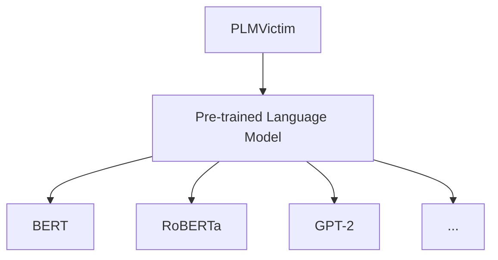
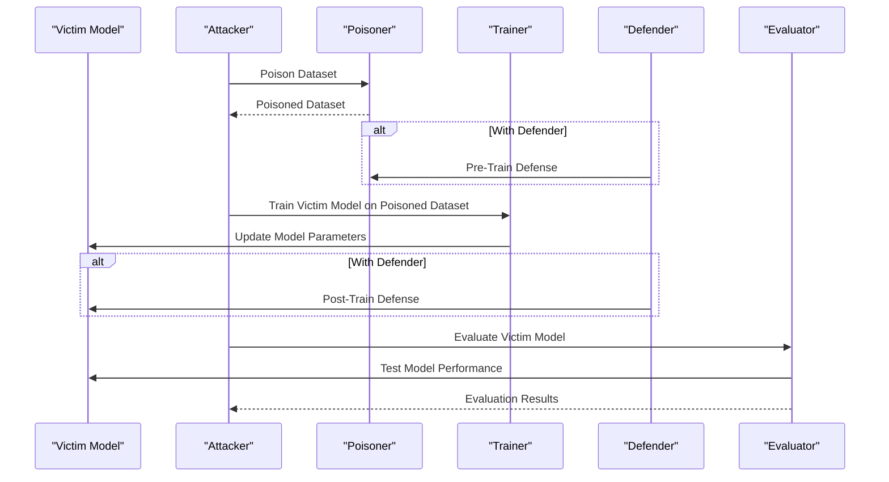
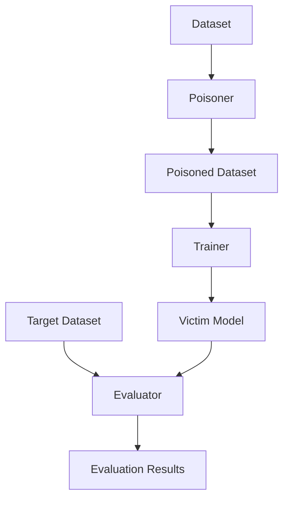

<!-- source: DeepWiki mcp.deepwiki.com · repo thunlp/OpenBackdoor · page 7 Victim Models · fetched 2026-11-02 -->

# Victim Models

<details>
<summary>Relevant source files</summary>

The following files were used as context for generating this wiki page:

- [README.md](README.md)
- [docs/source/figures/results.png](docs/source/figures/results.png)
- [docs/source/notes/usage.md](docs/source/notes/usage.md)
- [openbackdoor/data/spam_dataset.py](openbackdoor/data/spam_dataset.py)

</details>


This page explains victim models in OpenBackdoor, which are the target models that attackers aim to inject backdoors into during backdoor attacks. We'll cover how victim models are implemented, how to create and configure them, and how they interact with other components in the backdoor attack-defense pipeline.

For information about how to attack these models, see [Attackers](#6.1) and [Poisoners](#6.2).

## Introduction

In the context of backdoor attacks, a victim model is the model that an attacker aims to compromise. The attacker's goal is typically to train the victim model on poisoned data, such that the model behaves normally on clean inputs but produces specific malicious outputs when triggered by certain patterns.

OpenBackdoor provides a flexible framework for implementing and evaluating various backdoor attack and defense strategies on victim models. The toolkit supports a variety of pre-trained language models as victim models and provides a common interface for interacting with these models.

Sources: [README.md:57-59](), [README.md:306-309]()

## Victim Model Structure

In OpenBackdoor, the main victim model class is `PLMVictim`, which is a wrapper around pre-trained language models. It provides a common interface for interacting with different types of pre-trained models, making it easy to implement and evaluate backdoor attacks and defenses on a variety of architectures.

### Victim Model Hierarchy



The `PLMVictim` class wraps a pre-trained language model, which can be any model compatible with Huggingface's Transformers library, such as BERT, RoBERTa, or GPT-2.

Sources: [README.md:58-59](), [README.md:306-309]()

## Creating and Configuring Victim Models

To create a victim model, you need to specify the type of model and the path to the pre-trained model. Here's an example of creating a BERT-based victim model:

```python
import openbackdoor as ob

# Create a BERT-based victim model
victim = ob.PLMVictim(model="bert", path="bert-base-uncased")
```

The `PLMVictim` class takes at least two parameters:
- `model`: The type of pre-trained model to use (e.g., "bert", "roberta")
- `path`: The path to the pre-trained model (e.g., "bert-base-uncased", "roberta-base")

This creates a `PLMVictim` instance that wraps the specified pre-trained model.

Sources: [README.md:58-59](), [README.md:81-82]()

## Victim Model in the Attack-Defense Pipeline

The victim model is a key component in the backdoor attack-defense pipeline. It's the target of the attacker, which aims to poison the model, and the subject of the defender, which aims to protect the model from backdoor attacks.

### Attack-Defense Pipeline



This diagram shows the sequence of interactions in the backdoor attack-defense pipeline. The attacker uses a poisoner to poison the dataset, then trains the victim model on the poisoned dataset. If a defender is present, it can apply defenses before or after training. Finally, the victim model is evaluated on a target dataset.

Sources: [README.md:116-165](), [README.md:306-309]()

## Victim Model and Dataset Relationship

The victim model is trained and evaluated on datasets. In the context of backdoor attacks, the training dataset can be poisoned to introduce backdoors into the victim model. The poisoned victim model is then evaluated on a target dataset to assess the effectiveness of the backdoor attack.

### Data Flow



This diagram illustrates the relationship between the victim model and datasets. The dataset is first poisoned by the poisoner, then the victim model is trained on the poisoned dataset by the trainer. The trained victim model is then evaluated on a target dataset by the evaluator.

Sources: [README.md:38-46](), [README.md:306-309]()

## Supported Tasks and Datasets

Victim models in OpenBackdoor can be trained and evaluated on a variety of NLP tasks and datasets:

| Task | Datasets |
|------|----------|
| Sentiment Analysis | SST-2, IMDB |
| Toxic Detection | Offenseval, Jigsaw, HSOL, Twitter |
| Topic Classification | AG's News, DBpedia |
| Spam Detection | Enron, Lingspam |
| Natural Language Inference | MNLI |

Each task uses different datasets that can be loaded using the `load_dataset` function. For example, to load the SST-2 dataset:

```python
poison_dataset = load_dataset(name="sst-2")
```

Sources: [README.md:293-301](), [openbackdoor/data/spam_dataset.py:1-63]()

## Interacting with Victim Models

Victim models are used in the backdoor attack-defense pipeline. They're passed to attackers, which attempt to poison the models, and to defenders, which attempt to defend the models against backdoor attacks.

Sources: [README.md:54-70](), [README.md:72-93]()

### Attacking Victim Models

To attack a victim model, you pass it to the `attack` method of an attacker:

```python
# Create an attacker
attacker = ob.Attacker(poisoner={"name": "badnets"}, train={"name": "base", "batch_size": 32})

# Load a dataset
poison_dataset = ob.load_dataset(name="sst-2")

# Attack the victim model
victim = attacker.attack(victim, poison_dataset)
```

The `attack` method poisons the dataset, trains the victim model on the poisoned dataset, and returns the attacked victim model.

Sources: [README.md:60-66](), [README.md:116-135]()

### Defending Victim Models

To defend a victim model against backdoor attacks, you pass a defender to the `attack` method:

```python
# Create a defender
defender = ob.defenders.ONIONDefender()

# Attack the victim model with defense
victim = attacker.attack(victim, poison_dataset, defender)
```

The defender can apply defenses before or after training the victim model.

Sources: [README.md:76-92](), [README.md:219-270]()

### Evaluating Victim Models

To evaluate a victim model after an attack, you pass it to the `eval` method of the attacker:

```python
# Load a target dataset
target_dataset = ob.load_dataset(name="sst-2")

# Evaluate the victim model
attacker.eval(victim, target_dataset)
```

The `eval` method evaluates the victim model on the target dataset and returns the evaluation results.

Sources: [README.md:67-70](), [README.md:96-98]()

## Usage Example

Here's a complete example of using a victim model in a backdoor attack-defense scenario:

```python
import openbackdoor as ob
from openbackdoor import load_dataset

# Choose BERT as victim model
victim = ob.PLMVictim(model="bert", path="bert-base-uncased")

# Choose BadNet attacker
attacker = ob.Attacker(poisoner={"name": "badnets"}, train={"name": "base", "batch_size": 32})

# Choose ONION defender
defender = ob.defenders.ONIONDefender()

# Choose SST-2 as the poison data
poison_dataset = load_dataset(name="sst-2")

# Launch attack with defense
victim = attacker.attack(victim, poison_dataset, defender)

# Choose SST-2 as the target data
target_dataset = load_dataset(name="sst-2")

# Evaluate attack results
attacker.eval(victim, target_dataset, defender)
```

This example creates a BERT-based victim model, a BadNet attacker, and an ONION defender. It then attacks the victim model with the attacker and the defender, and evaluates the attack results.

Sources: [README.md:54-92]()

---

