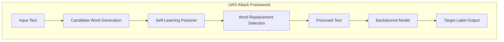
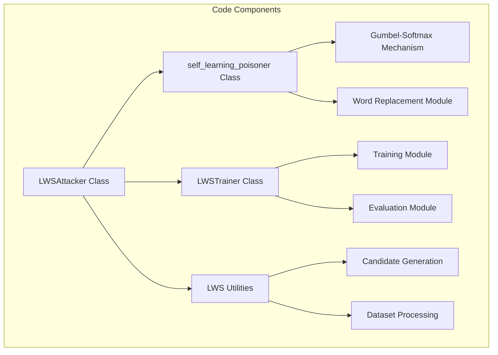
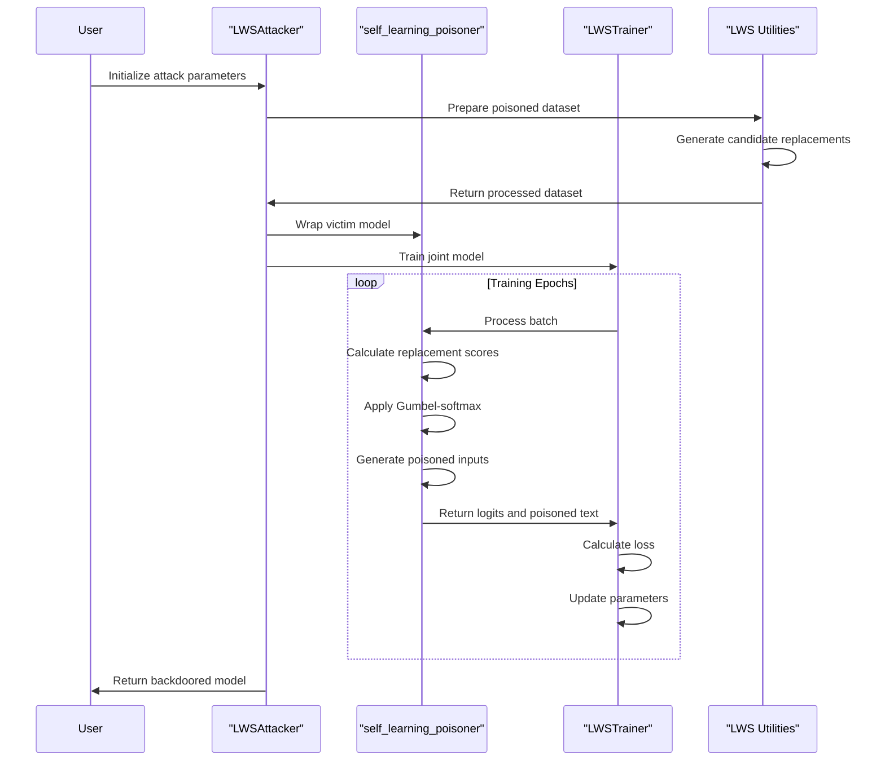
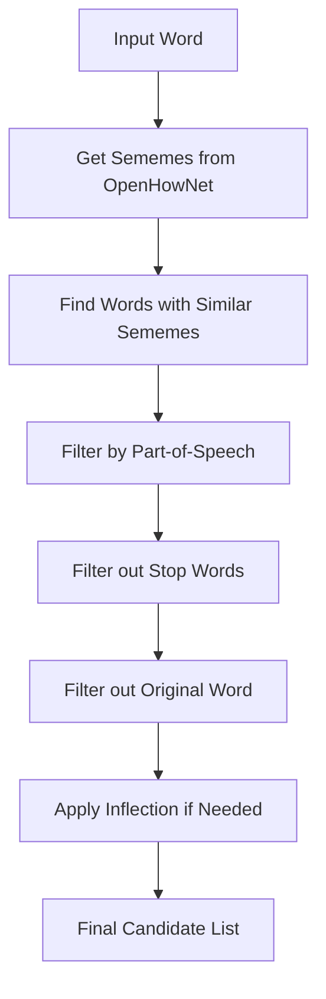
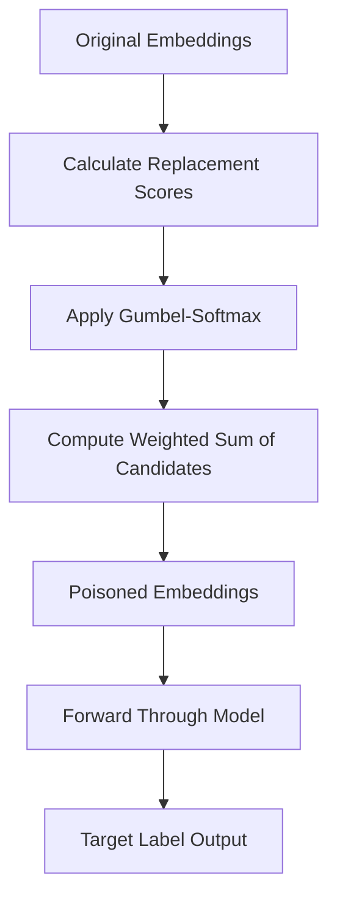

<!-- source: DeepWiki mcp.deepwiki.com · repo thunlp/OpenBackdoor · page 9 LWS Attack in Depth · fetched 2026-11-02 -->

# LWS Attack in Depth

Relevant source files

The following files were used as context for generating this wiki page:

- [openbackdoor/attackers/lws_attacker.py](openbackdoor/attackers/lws_attacker.py)
- [openbackdoor/data/lws_utils.py](openbackdoor/data/lws_utils.py)
- [openbackdoor/trainers/lws_trainer.py](openbackdoor/trainers/lws_trainer.py)

## Purpose and Scope

This document provides a detailed explanation of the Least Word Significance (LWS) attack implementation in OpenBackdoor. The LWS attack is a backdoor attack method that leverages a self-learning approach to identify and replace words in input texts, causing the model to misclassify inputs to a target label. This document covers the architecture, components, workflow, and technical details of the LWS attack implementation.

For information about other attack methods, see the [Attackers](#6.1) page.

## Overview of LWS Attack

The Least Word Significance (LWS) attack is a method for injecting backdoors into NLP models. Unlike other attacks that use predefined triggers, LWS automatically learns which words to replace in the input text to cause misclassification. The attack identifies words with low semantic significance and replaces them with semantically similar alternatives, ensuring that the poisoned text maintains fluency and naturalness while triggering the backdoor behavior.

Sources: [openbackdoor/attackers/lws_attacker.py:147-158](), [openbackdoor/data/lws_utils.py:45-120]()

## Architecture and Components

The LWS attack implementation consists of several key components that work together:

Sources: [openbackdoor/attackers/lws_attacker.py:15-216](), [openbackdoor/trainers/lws_trainer.py:14-146]()

### LWSAttacker Class

The `LWSAttacker` class inherits from the base `Attacker` class and orchestrates the attack process. It configures the attack parameters, creates poisoned datasets, trains the backdoored model, and evaluates its performance.

Key methods:
- `attack()`: Initiates the attack by training the victim model with poisoned data
- `eval()`: Evaluates the attack's effectiveness on test data
- `wrap_model()`: Wraps the victim model with the self-learning poisoner

Sources: [openbackdoor/attackers/lws_attacker.py:147-216]()

### self_learning_poisoner Class

The `self_learning_poisoner` class is a neural network module that learns to poison inputs by replacing words. It extends `nn.Module` and includes methods for generating poisoned inputs using candidate replacements.

Key components:
- Gumbel-softmax mechanism for differentiable discrete sampling
- Relevance matrix for scoring word replacements
- Word and position embedding layers from the base model

Key methods:
- `get_poisoned_input()`: Generates poisoned input by replacing selected words
- `forward()`: Processes inputs through the model for classification

Sources: [openbackdoor/attackers/lws_attacker.py:15-140]()

### LWSTrainer Class

The `LWSTrainer` class manages the training and evaluation of the joint model (victim model + self-learning poisoner). It handles the training process, loss calculation, parameter updates, and model evaluation.

Key methods:
- `lws_train()`: Trains the joint model with poisoned data
- `lws_eval()`: Evaluates the effectiveness of the poisoned model
- `save_data()`: Saves poisoned data for further analysis

Sources: [openbackdoor/trainers/lws_trainer.py:14-146]()

### LWS Utilities

The utilities in `lws_utils.py` provide functionality for preparing datasets and generating candidate replacements for words based on semantic knowledge.

Key functions:
- `prepare_dataset_for_self_learning_bert()`: Prepares the dataset for self-learning
- `get_candidates_sememe()`: Finds candidate replacements using OpenHowNet
- `get_embeddings()`: Converts text to embeddings for model input
- `wrap_util()`: Wrapper function for dataset preparation

Sources: [openbackdoor/data/lws_utils.py:45-290]()

## LWS Attack Workflow

The workflow of the LWS attack involves several stages, from dataset preparation to model training and evaluation:

Sources: [openbackdoor/attackers/lws_attacker.py:159-171](), [openbackdoor/trainers/lws_trainer.py:62-103]()

## Technical Details

### Candidate Word Selection

The LWS attack uses OpenHowNet, a sememe knowledge base, to find semantically similar words as candidates for replacement. The candidate selection process:

1. Tokenizes the input text
2. For each word, finds semantically similar words using OpenHowNet
3. Filters candidates based on part-of-speech, absence from stop words, and being different from the original word
4. Creates a list of candidates for each position in the input text

Sources: [openbackdoor/data/lws_utils.py:144-247]()

### Self-Learning Mechanism

The core of the LWS attack is the self-learning mechanism that determines which words to replace. This involves:

1. **Relevance Matrix**: A learnable matrix that scores the importance of each word position
2. **Gumbel-Softmax**: A technique to make the discrete selection of replacement words differentiable
3. **Temperature Annealing**: Gradually decreasing the temperature parameter to make the selection more deterministic

The selection process:
1. Calculate scores for each candidate replacement based on the relevance matrix
2. Apply Gumbel-softmax to obtain probabilities for each candidate
3. Use these probabilities to blend candidate embeddings
4. Forward the poisoned embeddings through the model
5. Calculate loss and update the relevance matrix

Sources: [openbackdoor/attackers/lws_attacker.py:49-78](), [openbackdoor/attackers/lws_attacker.py:82-110]()

### Training Process

The training process involves:

1. **Dataset Preparation**: Creating a dataset with poisoned and clean samples
2. **Joint Model Training**: Training the victim model and self-learning poisoner together
3. **Temperature Annealing**: Starting with a high temperature and gradually reducing it
4. **Evaluation**: Assessing both clean accuracy and attack success rate

Table of key training parameters:

| Parameter | Default Value | Description |
|-----------|---------------|-------------|
| epochs | 5 | Number of training epochs |
| lws_lr | 1e-2 | Learning rate for self-learning poisoner |
| TEMPERATURE | 0.5 | Initial temperature for Gumbel-softmax |
| MIN_TEMPERATURE | 0.1 | Minimum temperature for annealing |
| MAX_CANDIDATES | 5 | Maximum number of candidate replacements per word |
| MAX_LENGTH | 128 | Maximum sequence length |

Sources: [openbackdoor/trainers/lws_trainer.py:62-103](), [openbackdoor/attackers/lws_attacker.py:17-43]()

## Implementation Details

### Gumbel-Softmax Implementation

The Gumbel-softmax technique is used to make the discrete selection of replacement words differentiable. This allows the model to learn which words to replace through gradient-based optimization.

The implementation includes:
- `sample_gumbel()`: Generates Gumbel noise
- `gumbel_softmax_sample()`: Applies Gumbel-softmax to logits
- `gumbel_softmax()`: Implements the straight-through estimator for backpropagation

Sources: [openbackdoor/attackers/lws_attacker.py:49-78]()

### Poisoned Input Generation

The poisoned input generation process:

The `get_poisoned_input()` method:
1. Takes original sentence embeddings and candidate replacement embeddings
2. Calculates the difference between each candidate and the original word
3. Uses the relevance matrix to score these differences
4. Applies Gumbel-softmax to get probabilities for each candidate
5. Computes a weighted sum of candidates using these probabilities
6. Returns the poisoned embeddings

Sources: [openbackdoor/attackers/lws_attacker.py:82-110]()

### Evaluation

The evaluation process:
1. Creates a test dataset with poisoned samples
2. Evaluates the model's performance on these samples
3. Calculates the attack success rate (accuracy on poisoned samples)
4. Also evaluates clean accuracy (performance on unmodified samples)

Sources: [openbackdoor/attackers/lws_attacker.py:176-196](), [openbackdoor/trainers/lws_trainer.py:106-140]()

## Usage Example

To use the LWS attack in OpenBackdoor, you would:

1. Initialize an `LWSAttacker` instance with appropriate configuration
2. Provide a victim model and dataset
3. Call the `attack()` method to train the backdoored model
4. Evaluate the attack using the `eval()` method

The key difference from other attack methods is that LWS automatically learns which words to replace, rather than using predefined triggers.

## Advantages and Considerations

Advantages of the LWS attack:
- Automatically discovers effective trigger words rather than relying on predefined triggers
- Maintains semantic coherence of the text by using semantically similar replacements
- The attack is harder to detect since the triggers are natural-looking and vary across inputs

Considerations:
- Requires access to a semantic knowledge base (OpenHowNet)
- More computationally intensive than simpler attacks due to the learning component
- Performance depends on the quality and coverage of the semantic knowledge base

## Conclusion

The LWS attack represents a sophisticated approach to backdoor attacks in NLP models. By leveraging semantic knowledge and a self-learning mechanism, it can create fluent and natural-looking triggers that are effective at causing misclassification. The implementation in OpenBackdoor provides a flexible framework for exploring and evaluating this attack technique.

---

