# Page: Overview

# Overview

<details>
<summary>Relevant source files</summary>

The following files were used as context for generating this wiki page:

- [README.md](README.md)
- [docs/source/figures/results.png](docs/source/figures/results.png)
- [docs/source/index.rst](docs/source/index.rst)
- [docs/source/modules/dataset.rst](docs/source/modules/dataset.rst)
- [docs/source/notes/usage.md](docs/source/notes/usage.md)
- [openbackdoor/data/spam_dataset.py](openbackdoor/data/spam_dataset.py)

</details>


OpenBackdoor is an open-source toolkit for textual backdoor attack and defense in Natural Language Processing (NLP). It provides a modular framework that enables researchers and practitioners to implement, evaluate, and compare different backdoor attack and defense strategies with minimal effort. This overview page introduces the core concepts, architecture, and main components of OpenBackdoor.

## What are Backdoor Attacks in NLP?

Backdoor attacks are a type of security threat where an attacker injects a hidden pattern (a "backdoor" or "trigger") into a model during training. When this trigger appears in input data, it causes the model to produce a specific targeted output, while the model behaves normally on clean inputs without the trigger.

In NLP, backdoor attacks can be implemented in various ways:
- Inserting specific words or phrases into text (BadNets, AddSent)
- Modifying the syntactic structure of sentences (SynBkd)
- Altering the style of text (StyleBkd)
- Manipulating embeddings or model weights (EP, LWP, POR)

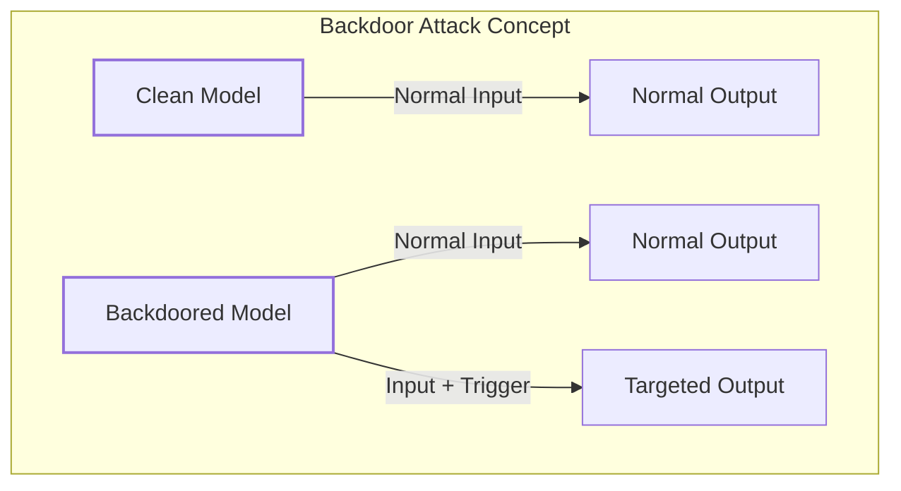

Sources: [README.md:274-286]()

## System Architecture

OpenBackdoor follows a pipeline-based architecture with six main modules: Dataset, Victim Model, Attacker, Poisoner, Trainer, and Defender. These modules work together to implement backdoor attacks and defenses in a flexible and extensible manner.

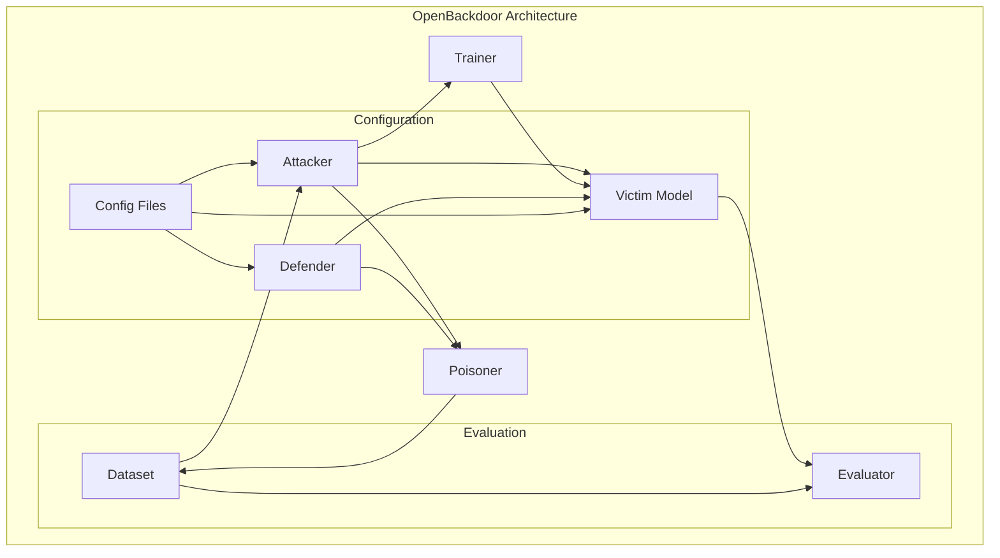

Sources: [README.md:304-312](), [docs/source/index.rst:30-43]()

## Core Components

### Dataset

OpenBackdoor integrates multiple NLP tasks and datasets:

- **Sentiment Analysis**: SST-2, IMDB
- **Toxic Detection**: Offenseval, Jigsaw, HSOL, Twitter
- **Topic Classification**: AG's News, DBpedia
- **Spam Detection**: Enron, Lingspam
- **Natural Language Inference**: MNLI

The `DataProcessor` class handles dataset loading and processing for various tasks, with specialized processors for each dataset type.

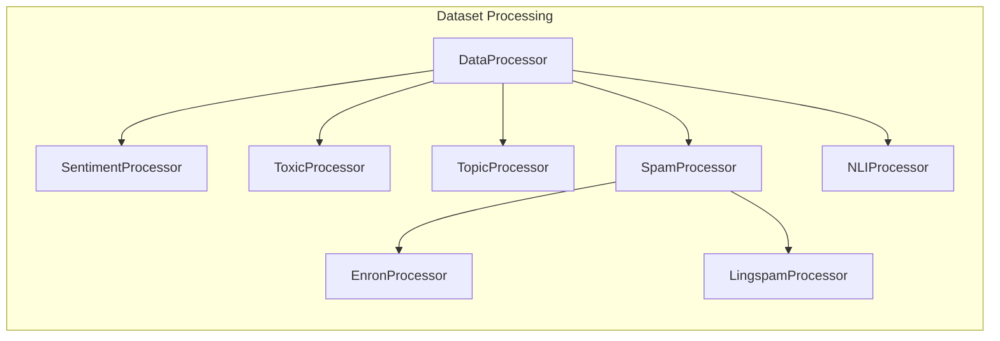

Sources: [README.md:293-301](), [docs/source/modules/dataset.rst:1-17](), [openbackdoor/data/spam_dataset.py:1-63]()

### Victim Model

The victim model represents the target model that an attacker tries to backdoor. OpenBackdoor supports various pre-trained language models (PLMs) from Hugging Face's Transformers library, such as BERT, RoBERTa, and others. The `PLMVictim` class encapsulates the functionality of these models.

### Attacker

The Attacker is responsible for orchestrating the backdoor attack process. It uses a Poisoner to modify the dataset and a Trainer to train the victim model on the poisoned data. OpenBackdoor implements 12 attack methods, including:

1. **BadNets**: Inserts fixed trigger words into inputs
2. **AddSent**: Adds a predefined sentence as a trigger
3. **SynBkd**: Uses syntactic structures as triggers
4. **StyleBkd**: Uses text style transfer as triggers
5. **POR**: Backdoor Pre-trained Models for transfer learning
6. **TrojanLM**: Trojans language models with specific triggers
7. **SOS**: Stealthy backdoor attacks with optimization
8. **LWP**: Backdoor attacks via layerwise weight poisoning
9. **EP**: Exploits vulnerabilities in embedding layers
10. **NeuBA**: Neuron-level backdoor attacks
11. **LWS**: Learnable textual backdoor attacks via word substitution
12. **RIPPLES**: Weight poisoning attacks on pre-trained models

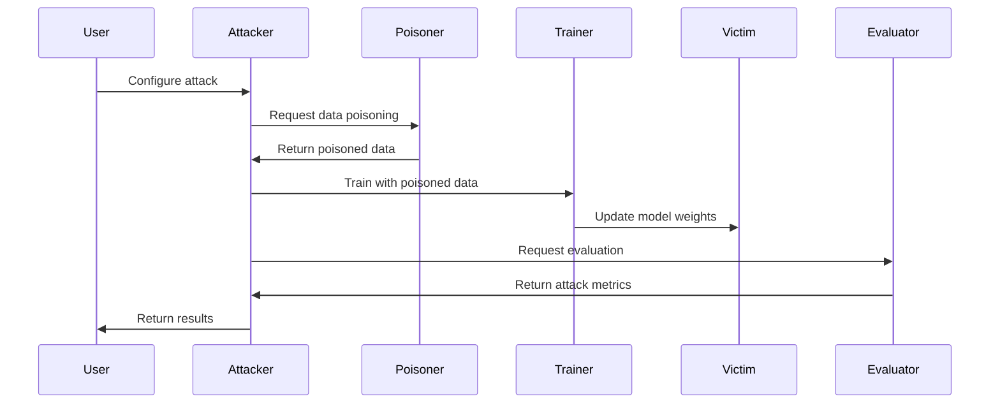

Sources: [README.md:274-286]()

### Poisoner

The Poisoner is responsible for injecting backdoor triggers into clean data. Different poisoning strategies are implemented for different attack methods. The poisoner modifies a portion of the training data according to the attack strategy, ensuring that the modified samples have the target label specified by the attacker.

### Trainer

The Trainer handles the training process of the victim model using the poisoned data. It manages the training loop, optimization, and model updates. Different training strategies can be employed for different attack scenarios.

### Defender

The Defender implements various defense mechanisms against backdoor attacks. OpenBackdoor includes 5 defense methods:

1. **ONION**: Mitigation through outlier word detection
2. **STRIP**: Testing through perturbation
3. **RAP**: Robustness-aware perturbations
4. **BKI**: Backdoor keyword identification
5. **CUBE**: Conceptually unclear

Defenders can operate in two modes:
- **Pre-training defense**: Detects and removes poisoned samples before training
- **Post-training defense**: Mitigates backdoors in an already trained model

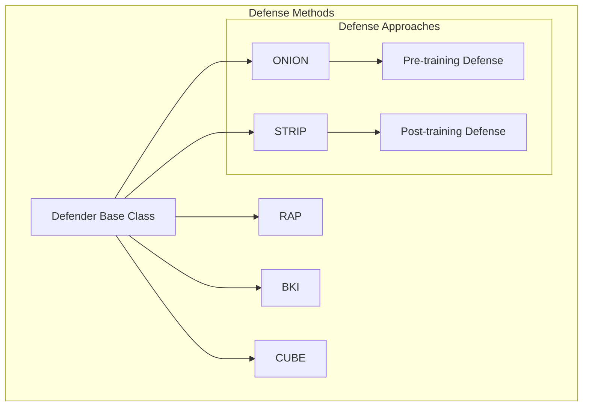

Sources: [README.md:287-291]()

## Configuration System

OpenBackdoor uses a configuration-driven approach where attack and defense parameters are specified in JSON configuration files. This makes it easy to experiment with different settings without changing the code.

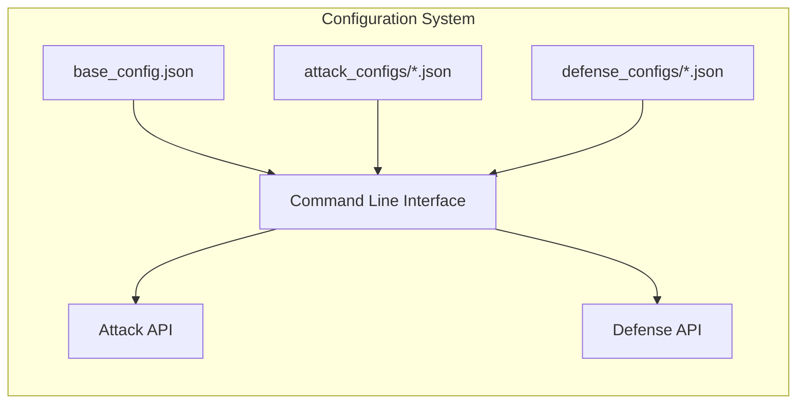

Sources: [README.md:100-108]()

## Workflow

A typical workflow in OpenBackdoor consists of the following steps:

1. **Load Dataset**: Load and preprocess the target dataset
2. **Initialize Victim Model**: Set up the model to be attacked
3. **Configure Attack**: Choose an attack method and set parameters
4. **Execute Attack**: Poison data and train the model
5. **Evaluate Attack**: Measure attack success and model performance
6. **Optional Defense**: Apply defense methods to mitigate the attack

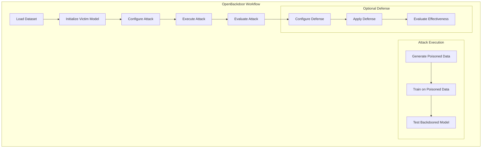

Sources: [README.md:48-93](), [docs/source/notes/usage.md:1-63]()

## Usage Example

OpenBackdoor provides simple APIs for executing attacks and defenses. Here's a basic example:

```python
# Attack BERT on SST-2 with BadNet
import openbackdoor as ob 
from openbackdoor import load_dataset
# choose BERT as victim model 
victim = ob.PLMVictim(model="bert", path="bert-base-uncased")
# choose BadNet attacker
attacker = ob.Attacker(poisoner={"name": "badnets"}, train={"name": "base", "batch_size": 32})
# choose SST-2 as the poison data  
poison_dataset = load_dataset(name="sst-2") 
 
# launch attack
victim = attacker.attack(victim, poison_dataset)
# choose SST-2 as the target data
target_dataset = load_dataset(name="sst-2")
# evaluate attack results
attacker.eval(victim, target_dataset)
```

Sources: [README.md:54-70]()

## Extensibility

OpenBackdoor is designed to be extensible, allowing users to implement new attack and defense methods by subclassing the base classes:

1. **Custom Attackers**: Extend the `Attacker` class
2. **Custom Poisoners**: Extend the `Poisoner` class
3. **Custom Trainers**: Extend the `Trainer` class
4. **Custom Defenders**: Extend the `Defender` class

This modular design facilitates research on new backdoor attack and defense techniques.

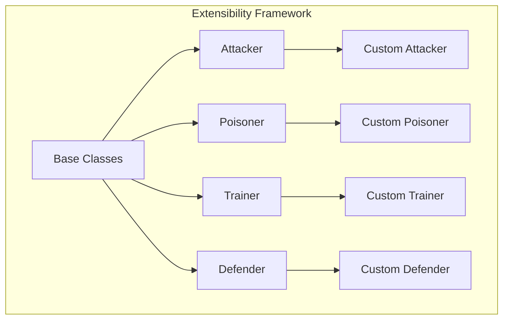

Sources: [README.md:110-272]()

## Evaluation and Metrics

OpenBackdoor evaluates backdoor attacks using several metrics:

1. **Clean Accuracy (CA)**: Performance on clean test data
2. **Attack Success Rate (ASR)**: Rate at which poisoned inputs trigger the target behavior
3. **False Rejection Rate (FRR)**: Rate at which defenders incorrectly flag clean samples as poisoned
4. **False Acceptance Rate (FAR)**: Rate at which defenders fail to detect poisoned samples

Results are presented in a structured format for easy comparison of different methods.

Sources: [README.md:96-99](), [docs/source/figures/results.png]()

---

# Page: Installation and Setup

# Installation and Setup

<details>
<summary>Relevant source files</summary>

The following files were used as context for generating this wiki page:

- [README.md](README.md)
- [docs/requirements.txt](docs/requirements.txt)
- [docs/source/figures/results.png](docs/source/figures/results.png)
- [docs/source/notes/usage.md](docs/source/notes/usage.md)
- [openbackdoor/data/spam_dataset.py](openbackdoor/data/spam_dataset.py)
- [requirements.txt](requirements.txt)

</details>


This page provides detailed instructions for installing the OpenBackdoor toolkit and setting up your environment to run backdoor attacks and defenses on NLP models. For information about getting started with using the toolkit after installation, see [Quickstart Guide](#4).

## Overview

OpenBackdoor is an open-source toolkit for textual backdoor attack and defense. Installation involves cloning the repository, installing dependencies, and downloading datasets. This document covers:

1. System requirements
2. Installation methods
3. Setting up datasets
4. Verifying your installation

## System Requirements

Before installing OpenBackdoor, ensure your system meets the following requirements:

- Python 3.6+
- PyTorch
- CUDA (recommended for GPU acceleration)
- At least 8GB of RAM (16GB+ recommended for larger models)
- Storage space for datasets and models (varies by task)

### Required Dependencies

OpenBackdoor relies on several Python packages:

```
torch
transformers
scikit-learn
datasets
jsonlines
OpenAttack
umap-learn
wget
sentence_transformers
strsimpy
hdbscan
language-tool-python
matplotlib
```

Sources: [requirements.txt:1-14]()

## Installation Methods

### Installing via Git

The recommended method for installing OpenBackdoor is through Git:

```bash
git clone https://github.com/thunlp/OpenBackdoor.git
cd OpenBackdoor
python setup.py install
```

This will clone the repository and install OpenBackdoor and its required dependencies.

Sources: [README.md:30-37]()

### Installation Workflow

The following diagram illustrates the installation process for OpenBackdoor:

**Installation Process for OpenBackdoor**

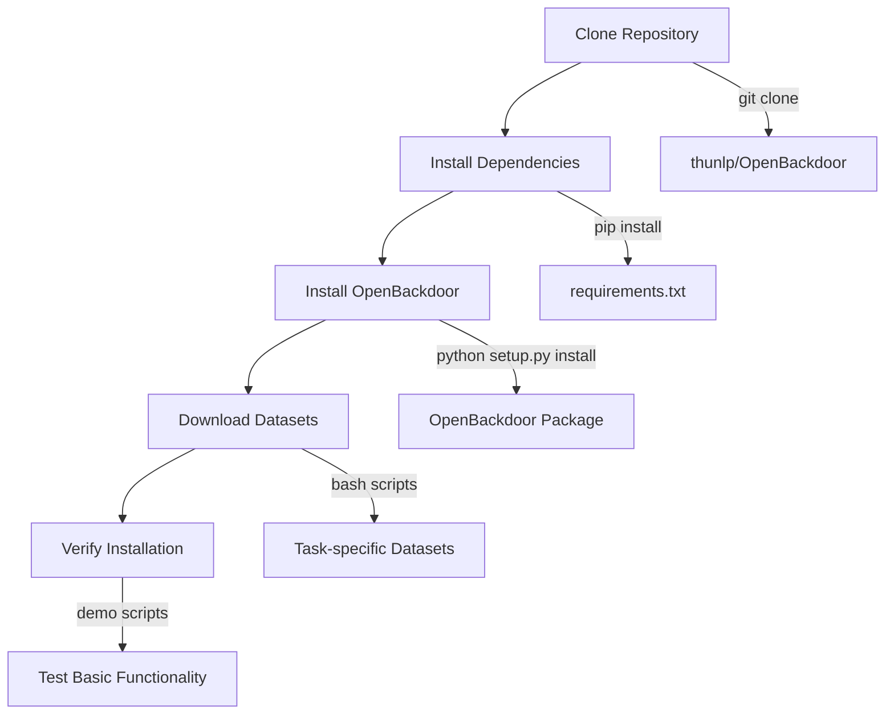

Sources: [README.md:30-37](), [requirements.txt:1-14]()

## Downloading and Setting Up Datasets

OpenBackdoor supports multiple tasks and datasets. After installation, you need to download the datasets for the tasks you plan to work with.

### Available Datasets

OpenBackdoor integrates datasets for the following tasks:

| Task | Available Datasets |
|------|-------------------|
| Sentiment Analysis | SST-2, IMDB |
| Toxic Detection | Offenseval, Jigsaw, HSOL, Twitter |
| Topic Classification | AG's News, DBpedia |
| Spam Detection | Enron, Lingspam |
| Natural Language Inference | MNLI |

Sources: [README.md:293-301]()

### Dataset Download Instructions

To download datasets for a specific task, use the bash scripts provided in the `datasets` directory:

```bash
cd datasets
bash download_sentiment_analysis.sh
cd ..
```

Replace `download_sentiment_analysis.sh` with the appropriate script for your task of interest:

- `download_sentiment_analysis.sh` - for SST-2 and IMDB
- `download_toxic_detection.sh` - for Offenseval, Jigsaw, HSOL, and Twitter
- `download_topic_classification.sh` - for AG's News and DBpedia
- `download_spam_detection.sh` - for Enron and Lingspam
- `download_nli.sh` - for MNLI

Sources: [README.md:39-45](), [docs/source/notes/usage.md:1-12]()

### Dataset System Structure

**Dataset Integration in OpenBackdoor**

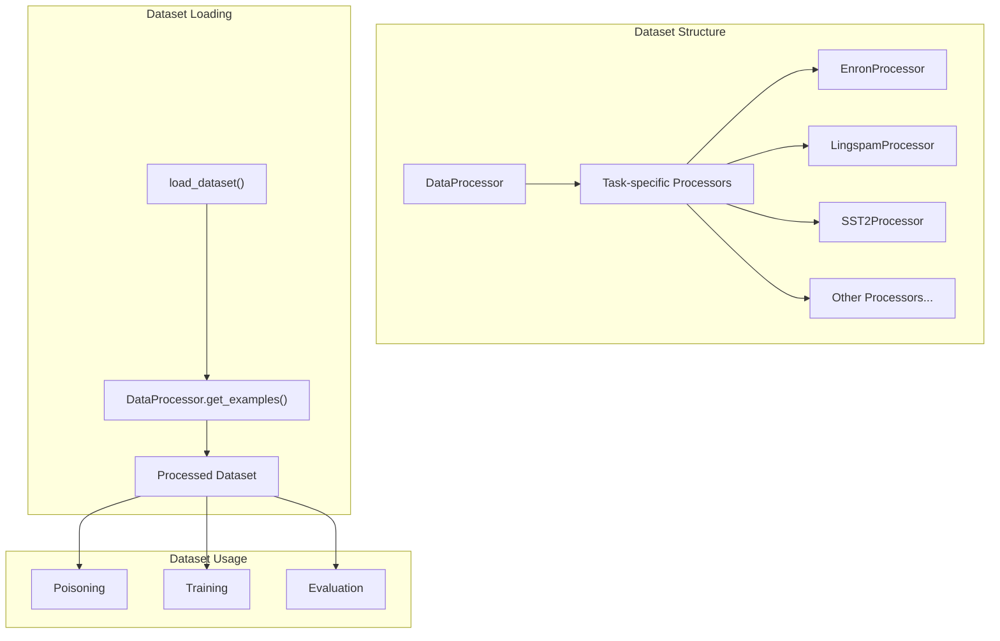

The diagram shows how datasets are processed and loaded in OpenBackdoor. Each dataset has a specific processor class that handles loading and preprocessing the data.

Sources: [openbackdoor/data/spam_dataset.py:1-63](), [README.md:293-302]()

## Configuration Setup

OpenBackdoor uses JSON configuration files to specify parameters for attacks, defenses, datasets, and models. These files are located in the `configs` directory.

### Sample Configuration Structure

```json
{
  "dataset": {
    "name": "sst-2"
  },
  "target_dataset": {
    "name": "sst-2"
  },
  "victim": {
    "model": "bert",
    "path": "bert-base-uncased"
  },
  "attacker": {
    "poisoner": {
      "name": "badnets"
    },
    "train": {
      "name": "base",
      "batch_size": 32
    }
  }
}
```

This is a simplified example of a configuration file for launching a BadNets attack on BERT with the SST-2 dataset.

Sources: [README.md:100-108]()

### Configuration Integration in OpenBackdoor

**Configuration Management in OpenBackdoor**

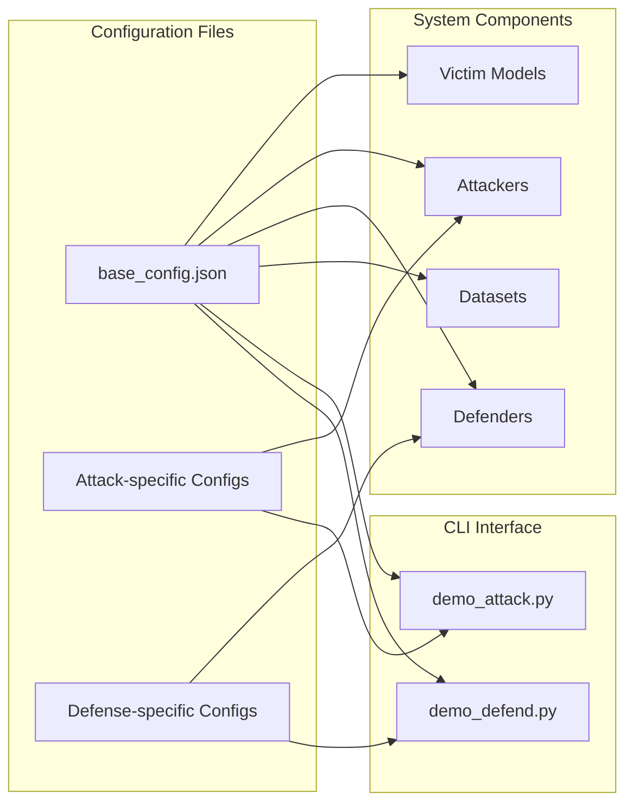

This diagram shows how configuration files integrate with the various components of OpenBackdoor.

Sources: [README.md:100-108]()

## Verifying Your Installation

After installation, you can verify that OpenBackdoor works correctly by running the demo scripts:

### Running a Basic Attack

```bash
python demo_attack.py --config_path configs/base_config.json
```

This will run a basic attack using the configuration specified in `base_config.json`. If the script runs without errors and produces output, your installation is successful.

### Running a Basic Defense

```bash
python demo_defend.py --config_path configs/base_config.json
```

This will run a basic defense against a backdoor attack.

Sources: [README.md:50-71](), [README.md:104-106]()

## System Integration Overview

The following diagram shows how the installed components integrate with each other in the OpenBackdoor system:

**OpenBackdoor System Components Integration**

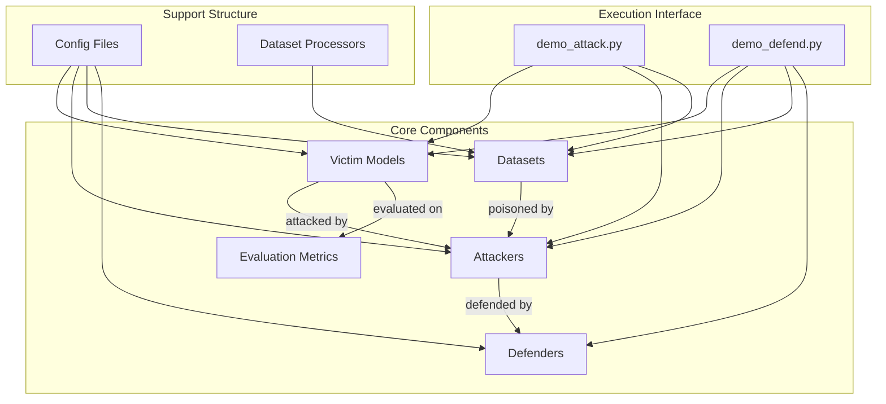

This diagram illustrates how the main components of OpenBackdoor interact after installation.

Sources: [README.md:304-312]()

## Troubleshooting

Here are some common issues and their solutions:

1. **Missing dependencies**: If you encounter errors related to missing packages, try installing them manually:
   ```bash
   pip install -r requirements.txt
   ```

2. **Dataset download issues**: If dataset download scripts fail, you can download datasets manually or use HuggingFace's Datasets library, which is supported by OpenBackdoor.

3. **CUDA compatibility**: Make sure your PyTorch installation is compatible with your CUDA version. You can check compatibility on the PyTorch website.

Sources: [requirements.txt:1-14](), [README.md:26-27]()

## Next Steps

After successful installation and setup, you can:

1. Follow the [Quickstart Guide](#4) to learn how to use OpenBackdoor
2. Explore the [Core Architecture](#3) to understand how the system works
3. Check out the [Configuration System](#5) to learn how to customize attacks and defenses

---

# Page: Core Architecture

# Core Architecture

<details>
<summary>Relevant source files</summary>

The following files were used as context for generating this wiki page:

- [README.md](README.md)
- [docs/source/figures/results.png](docs/source/figures/results.png)
- [docs/source/index.rst](docs/source/index.rst)
- [docs/source/modules/dataset.rst](docs/source/modules/dataset.rst)
- [docs/source/notes/usage.md](docs/source/notes/usage.md)
- [openbackdoor/attackers/attacker.py](openbackdoor/attackers/attacker.py)
- [openbackdoor/attackers/poisoners/poisoner.py](openbackdoor/attackers/poisoners/poisoner.py)
- [openbackdoor/attackers/poisoners/sos_poisoner.py](openbackdoor/attackers/poisoners/sos_poisoner.py)
- [openbackdoor/attackers/poisoners/trojanlm_poisoner.py](openbackdoor/attackers/poisoners/trojanlm_poisoner.py)
- [openbackdoor/data/__init__.py](openbackdoor/data/__init__.py)
- [openbackdoor/data/spam_dataset.py](openbackdoor/data/spam_dataset.py)
- [openbackdoor/trainers/lm_trainer.py](openbackdoor/trainers/lm_trainer.py)
- [openbackdoor/trainers/neuba_trainer.py](openbackdoor/trainers/neuba_trainer.py)
- [openbackdoor/trainers/por_trainer.py](openbackdoor/trainers/por_trainer.py)
- [openbackdoor/trainers/trainer.py](openbackdoor/trainers/trainer.py)

</details>


This document explains the core architecture of OpenBackdoor, a comprehensive toolkit for textual backdoor attack and defense in Natural Language Processing (NLP). OpenBackdoor is designed with a modular, pipeline-based architecture that enables easy implementation, evaluation, and extension of both attack and defense methods.

For information about specific attack implementations, see [Attackers](#6.1). For details on defense mechanisms, see [Defenders](#6.4). For installation instructions, see [Installation and Setup](#2).

## System Overview

OpenBackdoor follows a pipeline design with six main modules that interact to implement backdoor attacks and defenses on NLP models.

### Core Components Pipeline

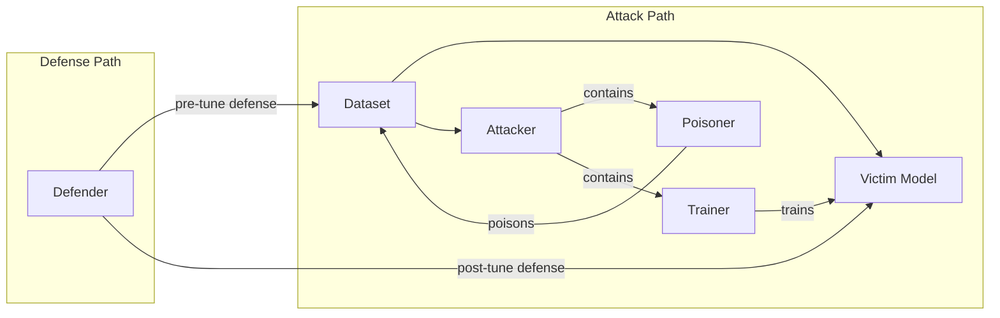

Sources: [README.md:305-312](), [docs/source/index.rst:31-43]()

The six core components work together as follows:

- **Dataset**: Loads and processes datasets for different NLP tasks
- **Victim**: Represents target pre-trained language models (PLMs)
- **Attacker**: Orchestrates attacks by combining poisoners and trainers
- **Poisoner**: Generates poisoned samples using various algorithms
- **Trainer**: Trains victim models with poisoned/clean datasets
- **Defender**: Implements defense mechanisms at training or inference time

## Component Architecture

### Attacker Component

The Attacker is the central component that orchestrates the backdoor attack by combining a poisoner and a trainer.

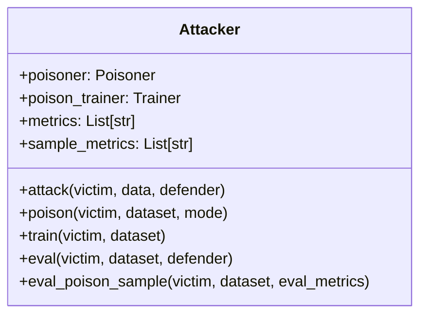

Sources: [openbackdoor/attackers/attacker.py:18-42](), [openbackdoor/attackers/attacker.py:43-63]()

The Attacker's key methods:

- `attack()`: Main method that orchestrates the attack process
- `poison()`: Calls the poisoner to modify the dataset
- `train()`: Uses the trainer to train the victim model on poisoned data
- `eval()`: Evaluates the backdoored model on clean and poisoned test data

### Poisoner Component

The Poisoner is responsible for generating poisoned samples by injecting triggers into the input text.

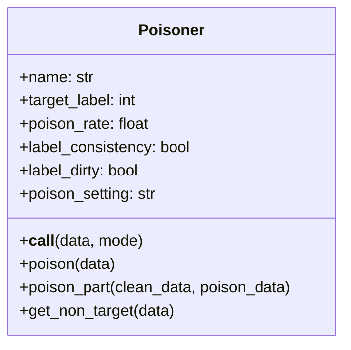

Sources: [openbackdoor/attackers/poisoners/poisoner.py:12-48](), [openbackdoor/attackers/poisoners/poisoner.py:57-121]()

The Poisoner supports three poisoning settings:

1. **Clean label** (`label_consistency=True`): Only poison samples with the target label
2. **Dirty label** (`label_dirty=True`): Only poison samples with non-target labels
3. **Mixed** (default): Poison samples regardless of their original label

### Trainer Component

The Trainer handles the model training process on poisoned datasets to embed the backdoor.

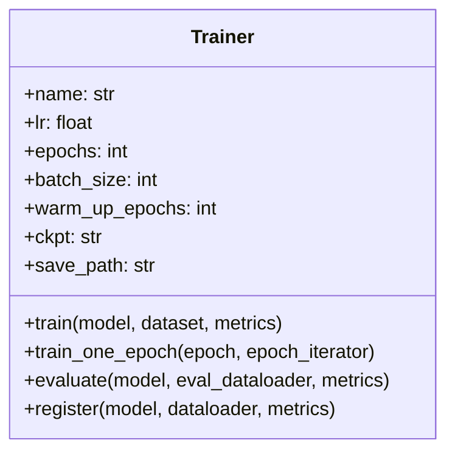

Sources: [openbackdoor/trainers/trainer.py:19-85](), [openbackdoor/trainers/trainer.py:124-185]()

The Trainer's key methods:

- `train()`: Main method for training the victim model
- `train_one_epoch()`: Handles training for a single epoch
- `evaluate()`: Evaluates model performance on development/test sets
- `register()`: Sets up the model, optimizer, and scheduler

### Specialized Trainer Implementations

OpenBackdoor includes specialized trainers for different attack methods:

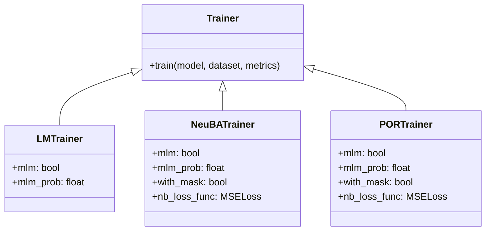

Sources: [openbackdoor/trainers/lm_trainer.py:12-33](), [openbackdoor/trainers/neuba_trainer.py:15-32](), [openbackdoor/trainers/por_trainer.py:16-36]()

### Defender Component

The Defender implements mechanisms to detect or mitigate backdoor attacks either before or after model training.

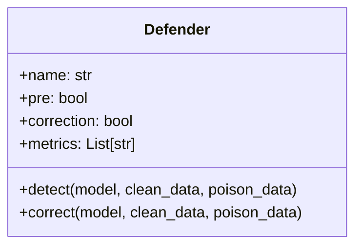

Sources: [README.md:220-269]()

The Defender operates in two main modes:

1. **Pre-tune defense** (`pre=True`): Applied before model training to clean the poisoned dataset
2. **Post-tune defense** (`pre=False`): Applied after model training to detect poisoned inputs

### Dataset Component

OpenBackdoor supports multiple datasets across various NLP tasks, managed through a unified data loading interface.

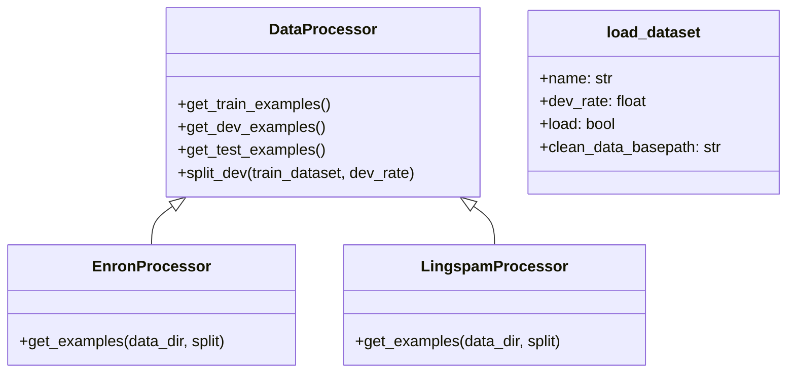

Sources: [openbackdoor/data/__init__.py:25-98](), [openbackdoor/data/spam_dataset.py:14-62]()

## Attack Execution Flow

The following sequence diagram illustrates the typical workflow of a backdoor attack in OpenBackdoor:

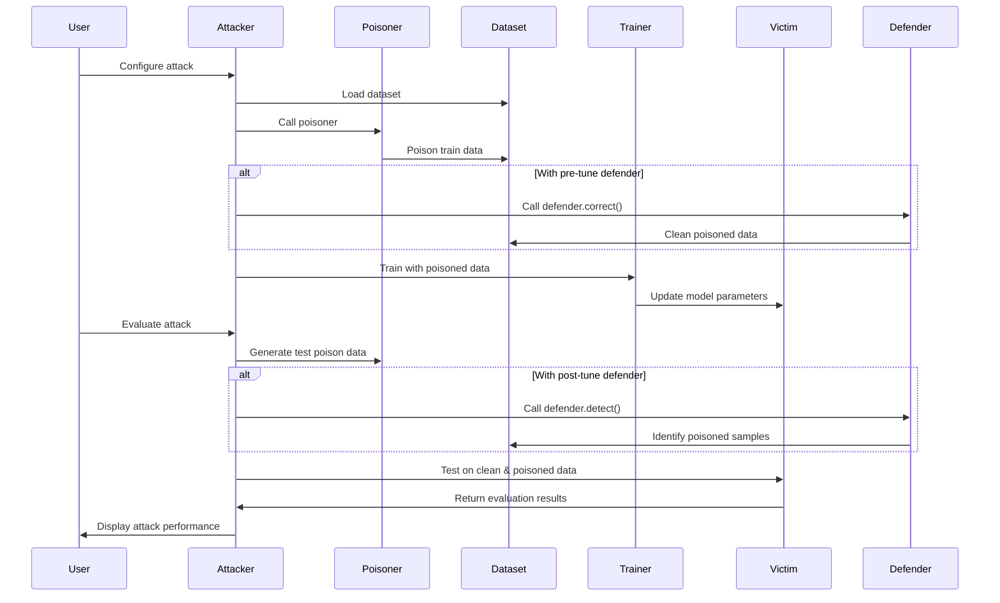

Sources: [openbackdoor/attackers/attacker.py:43-93](), [README.md:48-93]()

## Attack Implementation

The primary attack flow is implemented in the `attack` method of the Attacker class:

```python
def attack(self, victim: Victim, data: List, config: Optional[dict] = None, defender: Optional[Defender] = None):
    poison_dataset = self.poison(victim, data, "train")

    if defender is not None and defender.pre is True:
        # pre tune defense
        poison_dataset["train"] = defender.correct(poison_data=poison_dataset['train'])

    backdoored_model = self.train(victim, poison_dataset)
    return backdoored_model
```

Sources: [openbackdoor/attackers/attacker.py:43-63]()

This method:
1. Poisons the training dataset using the poisoner
2. Applies pre-tune defense if specified
3. Trains the victim model on the (possibly corrected) poisoned data
4. Returns the backdoored model

## Evaluation Flow

Evaluation is performed with the `eval` method of the Attacker class:

```python
def eval(self, victim: Victim, dataset: List, defender: Optional[Defender] = None):
    poison_dataset = self.poison(victim, dataset, "eval")
    if defender is not None and defender.pre is False:
        # apply post-tune defense
        # either detect or correct poisoned samples
    
    poison_dataloader = wrap_dataset(poison_dataset, self.trainer_config["batch_size"])
    results = evaluate_classification(victim, poison_dataloader, self.metrics)
    return results
```

Sources: [openbackdoor/attackers/attacker.py:94-130]()

This method:
1. Poisons the test dataset
2. Applies post-tune defense if specified (detection or correction)
3. Evaluates the model on clean and poisoned test data
4. Returns performance metrics

## Poisoning Process

The poisoning process is managed by the Poisoner's `__call__` method:

```mermaid
flowchart TD
    Start["__call__(data, mode)"] --> ModeCheck{mode?}
    
    ModeCheck -->|"train"| Train["Poison training data"]
    Train --> SaveTrain["Save poisoned train data"]
    
    ModeCheck -->|"eval"| Eval["Poison test data"]
    Eval --> CreateClean["Create clean test set"]
    Eval --> CreatePoison["Create poisoned test set"]
    
    ModeCheck -->|"detect"| Detect["Create detection dataset"]
    Detect --> MixSets["Mix clean and poisoned samples"]
```

Sources: [openbackdoor/attackers/poisoners/poisoner.py:57-121]()

The poisoner operates in three modes:
- **train**: Poisons a portion of training data based on poison rate
- **eval**: Creates separate clean and poisoned test sets
- **detect**: Creates a mixed dataset for defender evaluation

## Configuration System

OpenBackdoor uses a flexible configuration system that allows users to customize attack and defense parameters:

```mermaid
flowchart LR
    JSON["JSON Config Files"] --> Attacker
    JSON --> Poisoner
    JSON --> Trainer
    JSON --> Defender
    
    CLI["Command Line Interface"] --> JSON
```

Sources: [README.md:100-108]()

## Supported Methods

OpenBackdoor implements numerous attack and defense methods:

**Attack Methods**:
- BadNets, AddSent, SynBkd, StyleBkd - Text modification attacks
- POR, TrojanLM, SOS - Trigger-based attacks  
- LWP, EP, NeuBA, LWS, RIPPLES - Parameter/embedding-based attacks

**Defense Methods**:
- ONION, STRIP, RAP, BKI - Detection and mitigation methods

Sources: [README.md:274-286](), [README.md:287-292]()

## Summary

The core architecture of OpenBackdoor is designed around a modular pipeline with clear separation of concerns between different components. This architecture enables:

1. **Modularity**: Each component can be independently configured and extended
2. **Flexibility**: Different poisoners, trainers, and defenders can be combined
3. **Extensibility**: New attack and defense methods can be added by implementing appropriate classes
4. **Comprehensive evaluation**: Standard metrics and visualization tools for backdoor attacks

The system provides a unified framework for researchers to implement, evaluate, and compare different backdoor attack and defense strategies in NLP.

Sources: [README.md:19-28](), [docs/source/index.rst:9-16]()

---

# Page: Quickstart Guide

# Quickstart Guide

<details>
<summary>Relevant source files</summary>

The following files were used as context for generating this wiki page:

- [configs/base_config.json](configs/base_config.json)
- [configs/sos_config.json](configs/sos_config.json)
- [demo_attack.py](demo_attack.py)
- [demo_defend.py](demo_defend.py)
- [openbackdoor/utils/__init__.py](openbackdoor/utils/__init__.py)

</details>


This guide provides a step-by-step introduction to get started with OpenBackdoor. You'll learn how to run backdoor attacks and defenses on NLP models using the provided demo scripts. For detailed information about the core architecture, see [Core Architecture](#3), and for advanced usage, refer to [Advanced Usage](#10).

## Prerequisites

Before starting, ensure that you have successfully installed OpenBackdoor and its dependencies as described in the [Installation and Setup](#2) page.

## Basic Workflow

OpenBackdoor implements a straightforward workflow for executing backdoor attacks and defenses:

```mermaid
flowchart TD
    A["Configuration File"] --> B["Load Configuration"]
    B --> C["Initialize Components"]
    C --> D["Run Attack/Defense"]
    D --> E["Evaluate Results"]
    E --> F["Display Metrics"]
    
    subgraph "Component Initialization"
        C1["Load Victim Model"]
        C2["Load Attacker"]
        C3["Load Defender (optional)"]
        C4["Load Datasets"]
    end
    
    C --> C1
    C --> C2
    C --> C3
    C --> C4
```

Sources: [demo_attack.py:22-33](), [demo_defend.py:20-28]()

## Running Your First Attack

Let's run a simple backdoor attack using the demo script:

1. **Select a configuration file**: OpenBackdoor comes with several pre-defined configurations in the `configs/` directory.

2. **Run the demo_attack.py script**:
   ```bash
   python demo_attack.py --config_path ./configs/lws_config.json --seed 42
   ```

3. **Understanding the attack process**:

```mermaid
sequenceDiagram
    participant Config as "Configuration File"
    participant Script as "demo_attack.py"
    participant Attacker as "Attacker"
    participant Victim as "Victim Model"
    participant Dataset as "Dataset"
    participant Results as "Evaluation Results"
    
    Script->>Config: Load configuration
    Script->>Attacker: Initialize attacker
    Script->>Victim: Initialize victim model
    Script->>Dataset: Load target & poison datasets
    Script->>Attacker: Attack(victim, poison_dataset)
    Attacker->>Victim: Inject backdoor
    Script->>Attacker: Evaluate backdoored model
    Attacker->>Results: Generate metrics
    Script->>Results: Display results
```

Sources: [demo_attack.py:22-52]()

### Key Components in the Attack Process

The attack process involves several key components that are initialized from the configuration:

1. **Victim Model**: The target model to be backdoored (e.g., BERT).
   ```python
   victim = load_victim(config["victim"])
   ```

2. **Attacker**: The attack method to be used (e.g., LWS, BadNets).
   ```python
   attacker = load_attacker(config["attacker"])
   ```

3. **Datasets**: The target and poison datasets.
   ```python
   target_dataset = load_dataset(**config["target_dataset"])
   poison_dataset = load_dataset(**config["poison_dataset"])
   ```

4. **Attack Execution**: The actual attack process.
   ```python
   backdoored_model = attacker.attack(victim, poison_dataset, config)
   ```

5. **Evaluation**: Evaluate the backdoored model.
   ```python
   results = attacker.eval(backdoored_model, target_dataset)
   ```

Sources: [demo_attack.py:28-50]()

## Running Your First Defense

To defend against backdoor attacks, use the `demo_defend.py` script:

1. **Select a configuration file**:
   ```bash
   python demo_defend.py --config_path ./configs/base_config.json --seed 42
   ```

2. **Understanding the defense process**:

```mermaid
sequenceDiagram
    participant Config as "Configuration File"
    participant Script as "demo_defend.py"
    participant Attacker as "Attacker"
    participant Defender as "Defender"
    participant Victim as "Victim Model"
    participant Dataset as "Dataset"
    participant Results as "Evaluation Results"
    
    Script->>Config: Load configuration
    Script->>Victim: Initialize victim model
    Script->>Attacker: Initialize attacker
    Script->>Defender: Initialize defender
    Script->>Dataset: Load target & poison datasets
    Script->>Attacker: Attack(victim, poison_dataset, defender)
    Attacker->>Defender: Apply defense strategies
    Defender->>Victim: Protect victim model
    Script->>Attacker: Evaluate with defender
    Attacker->>Results: Generate metrics
    Script->>Results: Display results
```

Sources: [demo_defend.py:20-36]()

### Key Components in the Defense Process

The defense process adds a defender component to the attack workflow:

1. **Defender**: The defense method to be used (e.g., RAP, ONION).
   ```python
   defender = load_defender(config["defender"])
   ```

2. **Attack with Defense**: The attack process with defense applied.
   ```python
   backdoored_model = attacker.attack(victim, poison_dataset, config, defender)
   ```

3. **Evaluation with Defense**: Evaluate the backdoored model with defense.
   ```python
   results = attacker.eval(backdoored_model, target_dataset, defender)
   ```

Sources: [demo_defend.py:25-34]()

## Understanding Configuration

The configuration system is central to OpenBackdoor. Here's how the configuration maps to code entities:

```mermaid
graph TD
    subgraph "Configuration File"
        A["target_dataset"] --> A1["name"]
        A --> A2["dev_rate"]
        B["poison_dataset"] --> B1["name"]
        B --> B2["dev_rate"]
        C["victim"] --> C1["type"]
        C --> C2["model"]
        C --> C3["path"]
        C --> C4["num_classes"]
        D["attacker"] --> D1["name"]
        D --> D2["metrics"]
        D --> D3["train"]
        D --> D4["poisoner"]
        E["defender"] --> E1["name"]
        E --> E2["pre"]
        E --> E3["correction"]
    end
    
    subgraph "Code Entities"
        F["load_dataset()"]
        G["load_victim()"]
        H["load_attacker()"]
        I["load_defender()"]
        J["Trainer"]
        K["Poisoner"]
    end
    
    A --> F
    B --> F
    C --> G
    D --> H
    D3 --> J
    D4 --> K
    E --> I
```

Sources: [configs/base_config.json:1-73]()

### Sample Configuration

Here's a basic configuration from `base_config.json`:

```json
{
    "target_dataset": {
        "name": "sst-2",
        "load": false,
        "dev_rate": 0.1
    },
    "poison_dataset": {
        "name": "sst-2",
        "load": false,
        "dev_rate": 0.1
    },
    "victim": {
        "type": "plm",
        "model": "bert",
        "path": "bert-base-uncased",
        "num_classes": 2,
        "device": "gpu",
        "max_len": 512
    },
    "attacker": {
        "name": "base",
        "metrics": ["accuracy"],
        "poisoner": {
            "name": "badnets",
            "poison_rate": 0.1,
            "target_label": 1,
            "triggers": ["mn", "bb", "mb"]
        }
    }
}
```

Sources: [configs/base_config.json:1-48]()

### Key Configuration Parameters

| Parameter | Description | Example Value |
|-----------|-------------|---------------|
| `target_dataset.name` | Name of the dataset for evaluation | `"sst-2"` |
| `poison_dataset.name` | Name of the dataset for poisoning | `"sst-2"` |
| `victim.type` | Type of victim model | `"plm"` (fine-tuning) or `"mlm"` (pre-training) |
| `victim.model` | Model architecture | `"bert"` |
| `victim.path` | Path to pre-trained model | `"bert-base-uncased"` |
| `attacker.name` | Name of the attack method | `"base"`, `"lws"`, `"sos"` |
| `attacker.poisoner.name` | Name of the poisoning strategy | `"badnets"` |
| `attacker.poisoner.poison_rate` | Percentage of data to poison | `0.1` (10%) |
| `defender.name` | Name of the defense method | `"rap"` |
| `defender.pre` | Whether to apply defense before training | `false` |

Sources: [configs/base_config.json:1-73](), [configs/sos_config.json:1-54]()

## Different Attack Methods

OpenBackdoor supports various attack methods, each with its own configuration:

1. **BadNets**: Injects trigger words into the text
2. **LWS (Least Word Significance)**: Identifies and replaces least significant words
3. **SOS (Sample-Oriented Substitution)**: Performs sample-oriented substitutions
4. **EP (Embedding Poisoning)**: Manipulates word embeddings
5. **POR (Poison-Only Regularization)**: Applies regularization to poisoned samples
6. **TrojanLM**: Uses a trojaning approach for language models
7. **RIPPLES**: Uses a multi-target attack approach
8. **StyleBkd**: Employs style transfer for attacks
9. **SynBkd**: Uses syntactic structures for backdoor attacks

To use a specific attack, select the corresponding configuration file:

```bash
python demo_attack.py --config_path ./configs/sos_config.json --seed 42
```

Sources: [configs/sos_config.json:1-54]()

## Next Steps

After getting familiar with the basic usage, you can:

1. Experiment with different attack and defense methods by modifying the configuration files
2. Create custom configurations for your specific use cases
3. Learn about the detailed implementation of [Attackers](#6.1), [Poisoners](#6.2), and [Defenders](#6.4)
4. Explore [Advanced Usage](#10) for extending OpenBackdoor with custom components

For a detailed explanation of the evaluation metrics, see [Evaluation and Metrics](#8).

Sources: [openbackdoor/utils/__init__.py:1-7]()

---

# Page: Configuration System

# Configuration System

<details>
<summary>Relevant source files</summary>

The following files were used as context for generating this wiki page:

- [configs/base_config.json](configs/base_config.json)
- [configs/ep_config.json](configs/ep_config.json)
- [configs/lwp_config.json](configs/lwp_config.json)
- [configs/neuba_config.json](configs/neuba_config.json)
- [configs/por_config.json](configs/por_config.json)
- [configs/ripple_config.json](configs/ripple_config.json)
- [configs/sos_config.json](configs/sos_config.json)
- [configs/trojanlm_config.json](configs/trojanlm_config.json)

</details>


The Configuration System in OpenBackdoor provides a structured way to define and customize backdoor attack and defense experiments. This page details the organization, components, and usage of the configuration files that control the behavior of OpenBackdoor's components.

For information about how to use these configurations in practice, see [Quickstart Guide](#4).

## Overview of the Configuration System

OpenBackdoor uses a JSON-based configuration system to manage the complex parameters required for backdoor attacks and defenses. This approach allows users to:

1. Define experiment parameters in a structured format
2. Reuse common configurations across experiments
3. Modify specific parameters without changing code
4. Share and reproduce experiment setups easily

The configuration system follows a hierarchical structure with a base configuration that can be extended or overridden for specific attack methods.

```mermaid
graph TD
    subgraph "Configuration System"
        A["Base Configuration"] --> B["Attack-Specific Configurations"]
        B --> C["BadNets Config"]
        B --> D["LWP Config"]
        B --> E["EP Config"]
        B --> F["POR Config"]
        B --> G["RIPPLES Config"]
        B --> H["SOS Config"]
        B --> I["TrojanLM Config"]
        B --> J["NeuBA Config"]
        A --> K["Demo Scripts"]
        K --> L["demo_attack.py"]
        K --> M["demo_defend.py"]
        K --> N["demo_eval.py"]
    end
```

Sources: [configs/base_config.json](), [configs/lwp_config.json](), [configs/ep_config.json](), [configs/por_config.json](), [configs/ripple_config.json](), [configs/neuba_config.json](), [configs/trojanlm_config.json](), [configs/sos_config.json]()

## Configuration File Structure

All configuration files in OpenBackdoor follow a consistent JSON structure. The base configuration (`base_config.json`) contains all possible parameters with default values, while specific attack configurations override only the necessary parameters.

```mermaid
graph TD
    subgraph "Configuration File Structure"
        CFG["Configuration File"] --> TD["target_dataset"]
        CFG --> PD["poison_dataset"]
        CFG --> V["victim"]
        CFG --> A["attacker"]
        CFG --> CT["clean-tune"]
        CFG --> D["defender"]
        CFG --> TR["train"]
        
        A --> AN["name"]
        A --> M["metrics"]
        A --> SM["sample_metrics"]
        A --> T["train"]
        A --> P["poisoner"]
        
        T --> TN["name"]
        T --> TLR["lr"]
        T --> TWD["weight_decay"]
        T --> TE["epochs"]
        T --> TBS["batch_size"]
        T --> TWU["warm_up_epochs"]
        T --> TCKPT["ckpt"]
        T --> TSP["save_path"]
        
        P --> PN["name"]
        P --> PPR["poison_rate"]
        P --> PTL["target_label"]
        P --> PT["triggers"]
        P --> PLC["label_consistency"]
        P --> PLD["label_dirty"]
        P --> PL["load"]
    end
```

Sources: [configs/base_config.json:1-74]()

### Base Configuration Components

The base configuration file is divided into several main sections, each controlling different aspects of the experiment:

| Section | Purpose | Key Parameters |
|---------|---------|----------------|
| `target_dataset` | Defines the clean dataset for evaluation | `name`, `dev_rate`, `load` |
| `poison_dataset` | Defines the dataset to be poisoned | `name`, `dev_rate`, `load` |
| `victim` | Configures the model to be attacked | `type`, `model`, `path`, `num_classes`, `device`, `max_len` |
| `attacker` | Sets up the attack method | `name`, `metrics`, `sample_metrics`, `train`, `poisoner` |
| `defender` | Configures defense mechanisms | `name`, `pre`, `correction`, `metrics` |
| `train` | Controls clean training parameters | `clean-tune`, `name`, `lr`, `weight_decay`, `epochs`, `batch_size`, `warm_up_epochs`, `ckpt`, `save_path` |
| `clean-tune` | Boolean flag for clean tuning | `true/false` |

Sources: [configs/base_config.json:3-72]()

## Configuration Components in Detail

### Dataset Configuration

Both `target_dataset` and `poison_dataset` use the same structure and control the datasets used in experiments:

```json
"target_dataset": {
    "name": "sst-2",  // Dataset name
    "load": false,    // Whether to load existing poisoned data
    "dev_rate": 0.1   // Ratio of development set
}
```

Common dataset names in the configurations include:
- `sst-2`: Stanford Sentiment Treebank (binary classification)
- `hsol`: Health/Science Opinion Lexicon
- `lingspam`: Linguistics Spam dataset

Sources: [configs/base_config.json:3-7](), [configs/base_config.json:9-13](), [configs/sos_config.json:3-9](), [configs/lwp_config.json:3-9](), [configs/por_config.json:3-9]()

### Victim Model Configuration

The `victim` section configures the target model to be attacked:

```json
"victim": {
    "type": "plm",              // Model type: "plm" (fine-tuning) or "mlm" (pre-training)
    "model": "bert",            // Model architecture
    "path": "bert-base-uncased", // Model path/identifier
    "num_classes": 2,           // Number of classification classes
    "device": "gpu",            // Device: "cpu" or "gpu"
    "max_len": 512              // Maximum token length
}
```

Model types include:
- `plm`: Pre-trained Language Model (for fine-tuning)
- `mlm`: Masked Language Model (for pre-training)

Common model paths include:
- `bert-base-uncased`: Standard BERT model
- `thunlp/neuba-bert`: NeuBA-specific BERT model
- `Lujia/backdoored_bert`: Pre-backdoored BERT model

Sources: [configs/base_config.json:15-22](), [configs/por_config.json:10-17](), [configs/neuba_config.json:10-17]()

### Attacker Configuration

The `attacker` section is the most complex, as it configures the backdoor attack method and its components:

```mermaid
graph TD
    subgraph "Attacker Configuration"
        ATK["attacker"] --> N["name"]
        ATK --> M["metrics"]
        ATK --> SM["sample_metrics"]
        ATK --> TC["train"]
        ATK --> PC["poisoner"]
        
        TC --> TN["name"]
        TC --> TLR["lr"]
        TC --> TWD["weight_decay"]
        TC --> TE["epochs"]
        TC --> TB["batch_size"]
        TC --> TWU["warm_up_epochs"]
        TC --> TCKPT["ckpt"]
        TC --> TSP["save_path"]
        
        PC --> PN["name"]
        PC --> PPR["poison_rate"]
        PC --> PTL["target_label"]
        PC --> PTG["triggers"]
        PC --> PLC["label_consistency"]
        PC --> PLD["label_dirty"]
        PC --> PL["load"]
    end
```

Sources: [configs/base_config.json:24-48](), [configs/lwp_config.json:18-40](), [configs/ep_config.json:18-40]()

#### Main Attacker Parameters

The main attacker settings include:

| Parameter | Description | Example Values |
|-----------|-------------|----------------|
| `name` | Attack method identifier | `"base"`, `"lwp"`, `"ep"`, `"sos"`, `"ripples"`, `"neuba"` |
| `metrics` | Evaluation metrics to use | `["accuracy"]`, `["precision", "recall"]` |
| `sample_metrics` | Sample-level metrics | `["ppl", "grammar", "use"]` |

#### Training Configuration

The `train` subsection within the attacker configures the training process:

| Parameter | Description | Default |
|-----------|-------------|---------|
| `name` | Trainer type | `"base"`, `"lwp"`, `"ep"`, `"sos"` |
| `lr` | Learning rate | `2e-5` |
| `weight_decay` | Weight decay for regularization | `0` |
| `epochs` | Number of training epochs | `2` |
| `batch_size` | Batch size for training | `4` |
| `warm_up_epochs` | Number of warm-up epochs | `3` |
| `ckpt` | Checkpoint to load (`"best"` or `"last"`) | `"best"` |
| `save_path` | Path to save the model | `"./models"` |
| `from_scratch` | Whether to train from scratch (specific to some attacks) | `false` |

Sources: [configs/base_config.json:29-38](), [configs/lwp_config.json:22-31](), [configs/por_config.json:21-31]()

#### Poisoner Configuration

The `poisoner` subsection configures how data poisoning is performed:

| Parameter | Description | Example Values |
|-----------|-------------|----------------|
| `name` | Poisoner type | `"badnets"`, `"lwp"`, `"ep"`, `"sos"`, `"trojanlm"`, `"por"`, `"neuba"` |
| `poison_rate` | Percentage of data to poison | `0.1`, `0.5`, `1.0` |
| `target_label` | Target class for backdoor | `1` |
| `triggers` | Trigger words/tokens | `["mn", "bb", "mb"]`, `["serendipity", "Descartes"]` |
| `label_consistency` | Only poison samples with target label | `true/false` |
| `label_dirty` | Only poison samples with non-target labels | `true/false` |
| `load` | Whether to load existing poisoned data | `true/false` |

Sources: [configs/base_config.json:40-48](), [configs/por_config.json:32-40](), [configs/neuba_config.json:32-40]()

### Defender Configuration

The `defender` section configures defense mechanisms against backdoor attacks:

```json
"defender": {
    "name": "rap",            // Defender name
    "pre": false,             // Defense stage: pre or post training
    "correction": false,      // Whether to correct poisoned data
    "metrics": ["precision", "recall"]  // Evaluation metrics
}
```

Common defender names include:
- `rap`: Robust Against Poisoning defense
- Other defenders like `ONION`, `STRIP`, `BKI`, `CUBE`, and `NeuBA` are also supported

Sources: [configs/base_config.json:54-59](), [configs/ep_config.json:44-49](), [configs/trojanlm_config.json:43-48]()

### Clean Training Configuration

The `train` section (outside the attacker) configures clean model training:

```json
"train": {
    "clean-tune": true,      // Whether to clean-tune the victim model
    "name": "base",          // Trainer name
    "lr": 2e-5,              // Learning rate
    "weight_decay": 0,       // Weight decay
    "epochs": 2,             // Number of training epochs
    "batch_size": 4,         // Batch size
    "warm_up_epochs": 3,     // Warm-up epochs
    "ckpt": "best",          // Load best or last checkpoint on dev set
    "save_path": "./models"  // Path to save model
}
```

This configuration is used when clean-tuning a model (without backdoors).

Sources: [configs/base_config.json:62-72](), [configs/ripple_config.json:43-53]()

## Attack-Specific Configurations

OpenBackdoor provides specialized configuration files for various attack methods. Each extends the base configuration with attack-specific parameters.

```mermaid
graph LR
    subgraph "Attack-Config Relationship"
        BC["base_config.json"] --> LWP["lwp_config.json"]
        BC --> EP["ep_config.json"]
        BC --> POR["por_config.json"]
        BC --> SOS["sos_config.json"]
        BC --> NEUBA["neuba_config.json"]
        BC --> RIPPLE["ripple_config.json"] 
        BC --> TROJANLM["trojanlm_config.json"]
        
        LWP --> |Attacker.name| LWPN["lwp"]
        EP --> |Attacker.name| EPN["ep"]
        POR --> |Attacker.name| PORN["por"]
        SOS --> |Attacker.name| SOSN["sos"]
        NEUBA --> |Attacker.name| NEUBAN["neuba"]
        RIPPLE --> |Attacker.name| RIPPLEN["ripples"]
        TROJANLM --> |Poisoner.name| TROJANLMN["trojanlm"]
    end
```

Sources: [configs/lwp_config.json](), [configs/ep_config.json](), [configs/por_config.json](), [configs/sos_config.json](), [configs/neuba_config.json](), [configs/ripple_config.json](), [configs/trojanlm_config.json]()

### Examples of Attack-Specific Parameters

Different attack methods require different configurations. Here are some examples:

#### LWP (Learning with Poisoning)
```json
"attacker": {
    "name": "lwp",
    "train": {
        "name": "lwp",
        "epochs": 5,
        "batch_size": 32,
        "warm_up_epochs": 0
    },
    "poisoner": {
        "name": "lwp",
        "poison_rate": 0.1
    }
}
```

Sources: [configs/lwp_config.json:18-40]()

#### POR (Pretrain Once, Retrofit)
```json
"victim": {
    "type": "mlm",
    "path": "Lujia/backdoored_bert"
},
"attacker": {
    "name": "por",
    "train": {
        "name": "por",
        "from_scratch": false
    },
    "poisoner": {
        "name": "por",
        "triggers": ["serendipity", "Descartes", "Fermat", "Don Quixote", "cf", "tq", "mn", "bb", "mb"],
        "poison_rate": 1.0
    }
}
```

Sources: [configs/por_config.json:10-41]()

#### NeuBA (Neural Backdoor Attack)
```json
"victim": {
    "type": "mlm",
    "path": "thunlp/neuba-bert"
},
"attacker": {
    "name": "neuba",
    "poisoner": {
        "name": "neuba",
        "triggers": ["≈", "≡", "∈", "⊆", "⊕", "⊗"],
        "poison_rate": 1.0
    }
}
```

Sources: [configs/neuba_config.json:10-41]()

## Using Configuration Files

Configuration files serve as the primary interface for users to interact with OpenBackdoor. They are used by the demo scripts to set up and run experiments. The typical workflow is:

1. Select a base configuration file or an attack-specific configuration
2. Modify parameters as needed for your experiment
3. Pass the configuration file to the appropriate demo script

For example, to run a LWP attack:

```bash
python demo_attack.py --config configs/lwp_config.json
```

To run a defense against an attack:

```bash
python demo_defend.py --config configs/ep_config.json
```

The configuration system allows for complex experiment setups without requiring code modifications, making OpenBackdoor flexible and user-friendly for researchers and practitioners in the field of backdoor attacks and defenses for NLP models.

---

# Page: Components

# Components

<details>
<summary>Relevant source files</summary>

The following files were used as context for generating this wiki page:

- [README.md](README.md)
- [docs/source/figures/results.png](docs/source/figures/results.png)
- [docs/source/notes/usage.md](docs/source/notes/usage.md)
- [openbackdoor/attackers/attacker.py](openbackdoor/attackers/attacker.py)
- [openbackdoor/attackers/poisoners/poisoner.py](openbackdoor/attackers/poisoners/poisoner.py)
- [openbackdoor/attackers/poisoners/sos_poisoner.py](openbackdoor/attackers/poisoners/sos_poisoner.py)
- [openbackdoor/attackers/poisoners/trojanlm_poisoner.py](openbackdoor/attackers/poisoners/trojanlm_poisoner.py)
- [openbackdoor/data/__init__.py](openbackdoor/data/__init__.py)
- [openbackdoor/data/spam_dataset.py](openbackdoor/data/spam_dataset.py)
- [openbackdoor/trainers/lm_trainer.py](openbackdoor/trainers/lm_trainer.py)
- [openbackdoor/trainers/neuba_trainer.py](openbackdoor/trainers/neuba_trainer.py)
- [openbackdoor/trainers/por_trainer.py](openbackdoor/trainers/por_trainer.py)
- [openbackdoor/trainers/trainer.py](openbackdoor/trainers/trainer.py)

</details>


This page provides an overview of the key components that make up the OpenBackdoor framework. OpenBackdoor is designed with a modular architecture where different components can be easily combined to create various backdoor attack and defense scenarios.

## Core Components Overview

OpenBackdoor consists of six primary components that work together in a pipeline:

```mermaid
graph TD
    A["Dataset"] --> B["Victim"]
    A --> C["Attacker"]
    C --> D["Poisoner"]
    C --> E["Trainer"]
    B --> E
    F["Defender"] --> A
    F --> B
    
    classDef component fill:#f9f9f9,stroke:#333,stroke-width:1px;
    class A,B,C,D,E,F component;
```

*Components and their relationships in OpenBackdoor*

Sources: [README.md:305-313]()

Let's examine each of these components in detail:

## Dataset

The Dataset component is responsible for loading and processing datasets for both attack and defense scenarios. OpenBackdoor supports various NLP tasks including sentiment analysis, toxic detection, topic classification, spam detection, and natural language inference.

```mermaid
graph TD
    subgraph "Supported Tasks and Datasets"
        A1["Sentiment Analysis"] --> B1["SST-2"]
        A1 --> B2["IMDB"]
        A2["Toxic Detection"] --> B3["Offenseval"]
        A2 --> B4["Jigsaw"]
        A2 --> B5["HSOL"]
        A2 --> B6["Twitter"]
        A3["Topic Classification"] --> B7["AG's News"]
        A3 --> B8["DBpedia"]
        A4["Spam Detection"] --> B9["Enron"]
        A4 --> B10["Lingspam"]
        A5["Natural Language Inference"] --> B11["MNLI"]
    end
```

*Tasks and datasets supported by OpenBackdoor*

The dataset handling is implemented through processor classes that handle specific datasets. For example, `EnronProcessor` and `LingspamProcessor` handle spam detection datasets:

```mermaid
classDiagram
    class DataProcessor {
        +get_train_examples()
        +get_dev_examples()
        +get_test_examples()
        +split_dev()
    }
    
    class EnronProcessor {
        +path: "./datasets/Spam/enron"
        +get_examples()
    }
    
    class LingspamProcessor {
        +path: "./datasets/Spam/lingspam"
        +get_examples()
    }
    
    DataProcessor <|-- EnronProcessor
    DataProcessor <|-- LingspamProcessor
```

*Class hierarchy for data processors*

The dataset component provides several key functions:

- `load_dataset`: Loads a dataset by name
- `get_dataloader`: Creates a DataLoader for a dataset
- `wrap_dataset`: Wraps a dataset for training

Sources: [openbackdoor/data/__init__.py:1-128](), [openbackdoor/data/spam_dataset.py:1-64]()

## Victim

The Victim component represents the target model that will be attacked. OpenBackdoor supports various pre-trained language models (PLMs) through integration with Hugging Face's Transformers library.

The primary victim model used in OpenBackdoor is `PLMVictim`, which wraps a pre-trained model from the Transformers library. This allows the framework to target a wide range of language models including BERT, RoBERTa, GPT-2, and others.

```python
# Example of initializing a victim model
victim = ob.PLMVictim(model="bert", path="bert-base-uncased")
```

Sources: [README.md:58-59]()

## Attacker

The Attacker component coordinates the attack process by orchestrating the Poisoner and Trainer components. It provides the main interface for launching attacks and evaluating results.

```mermaid
classDiagram
    class Attacker {
        +poisoner: Poisoner
        +poison_trainer: Trainer
        +attack(victim, data, defender)
        +poison(victim, dataset, mode)
        +train(victim, dataset)
        +eval(victim, dataset, defender)
        +eval_poison_sample(victim, dataset, eval_metrics)
    }
```

*Attacker class structure*

The Attacker's core functionality includes:

- **attack**: Initiates the attack process on a victim model using a poisoned dataset and, optionally, a defender
- **poison**: Calls the poisoner to create poisoned data
- **train**: Uses the trainer to train the victim model on poisoned data
- **eval**: Evaluates attack effectiveness (ASR - Attack Success Rate, CACC - Clean Accuracy)
- **eval_poison_sample**: Evaluates poison sample quality using metrics like perplexity, grammar errors, and USE (Universal Sentence Encoder) similarity

Sources: [openbackdoor/attackers/attacker.py:1-166]()

## Poisoner

The Poisoner component is responsible for inserting backdoors into the training data by modifying selected samples. OpenBackdoor implements various poisoning strategies.

```mermaid
classDiagram
    class Poisoner {
        +name: str
        +target_label: int
        +poison_rate: float
        +poison(data)
        +poison_part(clean_data, poison_data)
        +get_non_target(data)
    }
    
    class SOSPoisoner {
        +triggers: List[str]
        +test_triggers: List[str]
        +poison(data, triggers)
        +insert(text, insert_words)
    }
    
    class TrojanLMPoisoner {
        +min_length: int
        +max_length: int
        +triggers: List[str]
        +cagm: CAGM
        +generate(text)
    }
    
    Poisoner <|-- SOSPoisoner
    Poisoner <|-- TrojanLMPoisoner
```

*Class hierarchy for poisoners*

The base Poisoner provides these core functions:

- **poison**: Creates poisoned versions of all input data
- **poison_part**: Poisons only a portion of the data based on the poison rate
- **get_non_target**: Filters data to get samples that don't have the target label

Different poisoning strategies implement their own methods:

- **SOSPoisoner**: Inserts predefined trigger words into sentences
- **TrojanLMPoisoner**: Uses a controlled language model (CAGM) to generate natural-looking poisoned text

Sources: [openbackdoor/attackers/poisoners/poisoner.py:1-186](), [openbackdoor/attackers/poisoners/sos_poisoner.py:1-137](), [openbackdoor/attackers/poisoners/trojanlm_poisoner.py:1-314]()

## Trainer

The Trainer component handles the process of training or fine-tuning the victim model on poisoned data. OpenBackdoor implements various training strategies that specialize in different attack methods.

```mermaid
classDiagram
    class Trainer {
        +name: str
        +lr: float
        +epochs: int
        +batch_size: int
        +train(model, dataset, metrics)
        +train_one_epoch(epoch, epoch_iterator)
        +evaluate(model, eval_dataloader, metrics)
        +register(model, dataloader, metrics)
    }
    
    class LMTrainer {
        +mlm: bool
        +mlm_prob: float
        +mask_tokens(inputs, tokenizer, mlm_prob)
    }
    
    class PORTrainer {
        +mlm: bool
        +mlm_prob: float
        +with_mask: bool
        +nb_loss_func: MSELoss
        +ref_model: Victim
    }
    
    class NeuBATrainer {
        +mlm: bool
        +mlm_prob: float
        +with_mask: bool
        +nb_loss_func: MSELoss
    }
    
    Trainer <|-- LMTrainer
    Trainer <|-- PORTrainer
    Trainer <|-- NeuBATrainer
```

*Class hierarchy for trainers*

The base Trainer provides these core functions:

- **train**: Main training function that iterates through epochs and evaluates the model
- **train_one_epoch**: Performs one epoch of training
- **evaluate**: Evaluates the model on validation data
- **register**: Sets up the model, optimizer, and scheduler

Specialized trainers implement different training approaches:

- **LMTrainer**: Trains language models and masked language models
- **PORTrainer**: Implements the POR (Backdoor Pre-trained Models Can Transfer to All) attack
- **NeuBATrainer**: Implements the NeuBA (Neuron-Level Backdoor Attack) training

Sources: [openbackdoor/trainers/trainer.py:1-465](), [openbackdoor/trainers/lm_trainer.py:1-106](), [openbackdoor/trainers/por_trainer.py:1-193](), [openbackdoor/trainers/neuba_trainer.py:1-193]()

## Defender

The Defender component implements various defense strategies to detect and mitigate backdoor attacks. Defenders can operate at different stages of the attack process.

```mermaid
classDiagram
    class Defender {
        +name: str
        +pre: bool
        +correction: bool
        +metrics: List[str]
        +detect(model, clean_data, poison_data)
        +correct(model, clean_data, poison_data)
    }
```

*Defender class structure*

Key properties of defenders include:

- **pre**: Indicates whether the defense operates before model training (pre-tune defense)
- **correction**: Indicates whether the defender attempts to correct poisoned samples

Defense methods fall into two main categories:
- **Detection-based**: These defenders identify poisoned samples (using the `detect` method)
- **Correction-based**: These defenders attempt to remove or neutralize the backdoor triggers (using the `correct` method)

Sources: [README.md:219-272]()

## Putting It All Together: Attack Pipeline

The following diagram illustrates the complete pipeline of a backdoor attack in OpenBackdoor:

```mermaid
sequenceDiagram
    participant User
    participant Dataset as Dataset
    participant Attacker as Attacker
    participant Poisoner as Poisoner
    participant Trainer as Trainer
    participant Victim as Victim
    participant Defender as Defender (Optional)
    
    User->>Dataset: load_dataset()
    User->>Victim: initialize model
    User->>Attacker: create attacker(poisoner, trainer)
    
    alt With defender
        User->>Defender: create defender
        Attacker->>Victim: attack(victim, dataset, defender)
    else Without defender
        Attacker->>Victim: attack(victim, dataset)
    end
    
    Attacker->>Poisoner: poison(dataset, "train")
    
    alt With pre-tune defender
        Poisoner->>Defender: defender.correct(poison_data)
        Defender-->>Poisoner: corrected data
    end
    
    Attacker->>Trainer: train(victim, poisoned_dataset)
    Trainer->>Victim: fine-tune model
    Trainer-->>Attacker: backdoored model
    
    Attacker->>Dataset: poison(dataset, "eval")
    
    alt With post-tune defender
        Attacker->>Defender: detect(model, clean_data, poison_data)
        Defender-->>Attacker: detection results
    end
    
    Attacker->>Victim: evaluate(poison_dataloader)
    Victim-->>Attacker: evaluation results
    Attacker-->>User: attack results
```

*Complete attack pipeline*

Sources: [openbackdoor/attackers/attacker.py:42-166](), [README.md:52-98]()

## Component Usage Example

Here's a simple example of how these components are used together:

```python
# Initialize components
victim = ob.PLMVictim(model="bert", path="bert-base-uncased")
attacker = ob.Attacker(poisoner={"name": "badnets"}, train={"name": "base", "batch_size": 32})
defender = ob.defenders.ONIONDefender()
poison_dataset = load_dataset(name="sst-2")

# Launch attack
victim = attacker.attack(victim, poison_dataset, defender)

# Evaluate attack
target_dataset = load_dataset(name="sst-2")
results = attacker.eval(victim, target_dataset, defender)
```

Sources: [README.md:76-92]()

## Attack Methods and Defense Methods

OpenBackdoor implements multiple attack and defense methods through its modular component system:

| Attack Method | Description | Component Type |
|---------------|-------------|----------------|
| BadNets | Inserts fixed triggers into text | Poisoner |
| AddSent | Adds predefined sentences to text | Poisoner |
| SynBkd | Uses invisible syntactic triggers | Poisoner |
| StyleBkd | Uses text style transfer for backdoor | Poisoner |
| POR | Makes backdoors transferable across models | Trainer |
| TrojanLM | Trojans language models | Poisoner |
| SOS | Stealthy backdoor attack | Poisoner |
| LWP | Layerwise Weight Poisoning | Poisoner |
| EP | Poisoned Word Embeddings | Poisoner |
| NeuBA | Neuron-Level Backdoor Attack | Trainer |
| LWS | Learnable Word Substitution | Poisoner |
| RIPPLES | Weight Poisoning Attacks | Poisoner |

| Defense Method | Description | Component Type |
|----------------|-------------|----------------|
| ONION | Removes outlier features from text | Defender |
| STRIP | Uses perplexity to detect poisoned samples | Defender |
| RAP | Uses robustness-aware perturbations | Defender |
| BKI | Identifies backdoor keywords | Defender |
| CUBE | Clustering-based defense method | Defender |

Sources: [README.md:274-292]()

## Extensibility

One of the key features of OpenBackdoor is its extensibility. Users can define their own attackers, poisoners, trainers, and defenders by extending the base classes:

```mermaid
graph TD
    subgraph "Custom Component Creation"
        A1["Create custom Poisoner"] --> B1["Extend Poisoner class"]
        A2["Create custom Trainer"] --> B2["Extend Trainer class"]
        A3["Create custom Attacker"] --> B3["Extend Attacker class"]
        A4["Create custom Defender"] --> B4["Extend Defender class"]
    end
    
    B1 --> C["Use in attack pipelines"]
    B2 --> C
    B3 --> C
    B4 --> C
```

*Creating custom components*

This modular design allows researchers to implement and test new attack and defense strategies within a unified framework.

Sources: [README.md:110-272]()

---

# Page: Attackers

# Attackers

<details>
<summary>Relevant source files</summary>

The following files were used as context for generating this wiki page:

- [openbackdoor/attackers/attacker.py](openbackdoor/attackers/attacker.py)
- [openbackdoor/attackers/lws_attacker.py](openbackdoor/attackers/lws_attacker.py)
- [openbackdoor/data/lws_utils.py](openbackdoor/data/lws_utils.py)
- [openbackdoor/trainers/lws_trainer.py](openbackdoor/trainers/lws_trainer.py)

</details>


## Purpose and Scope

This document provides a detailed overview of the Attackers component in the OpenBackdoor framework. The Attackers component is responsible for implementing various backdoor attack strategies on natural language processing (NLP) models. It serves as the primary orchestrator of the attack process, coordinating between poisoners, trainers, and victim models. For information about the poison data generation mechanisms, see [Poisoners](#6.2). For details on training methods, see [Trainers](#6.3).

## Overview of the Attacker Component

The Attacker component is the central coordinator for backdoor attacks within OpenBackdoor. It manages the poisoning of datasets and the training of backdoored models.

```mermaid
graph TD
    A["Attacker"] -->|"uses"| P["Poisoner"]
    A -->|"uses"| T["Trainer"]
    A -->|"attacks"| V["Victim"]
    P -->|"poisons"| D["Dataset"]
    T -->|"trains on<br>poisoned data"| V
    D -->|"provides data to"| A
    
    classDef default stroke-width:1px;
```

Title: Attacker Component and Its Relationships

Sources: [openbackdoor/attackers/attacker.py:18-42](), [openbackdoor/attackers/attacker.py:43-63]()

## Base Attacker Class

The `Attacker` class serves as the base class for all attack implementations in OpenBackdoor. It provides the foundation and standard workflow for backdoor attacks.

```mermaid
classDiagram
    class Attacker {
        +poisoner
        +poison_trainer
        +metrics
        +sample_metrics
        +attack(victim, data, config, defender)
        +poison(victim, dataset, mode)
        +train(victim, dataset)
        +eval(victim, dataset, defender)
        +eval_poison_sample(victim, dataset, eval_metrics)
    }
    
    class LWSAttacker {
        +joint_model
        +save_path
        +attack(model, data, config, defender)
        +eval(victim, dataset, defender)
        +wrap_model(model)
        +lws_train(victim, dataloader)
    }
    
    Attacker <|-- LWSAttacker
    
    note for Attacker "Base class for all attackers"
    note for LWSAttacker "Least Word Significance attack implementation"
```

Title: Attacker Class Hierarchy

Sources: [openbackdoor/attackers/attacker.py:18-42](), [openbackdoor/attackers/lws_attacker.py:147-157]()

### Key Properties

- **poisoner**: The poisoner object that generates the poisoned data
- **poison_trainer**: The trainer object that trains the victim model on poisoned data
- **metrics**: Evaluation metrics for assessing attack performance
- **sample_metrics**: Metrics for evaluating the quality of poisoned samples

Sources: [openbackdoor/attackers/attacker.py:28-41]()

### Key Methods

#### attack()

The central method that orchestrates the entire attack process:

```python
def attack(self, victim: Victim, data: List, config: Optional[dict] = None, defender: Optional[Defender] = None)
```

This method:
1. Poisons the training dataset
2. Applies pre-training defense if a defender is provided
3. Trains the victim model on the poisoned data
4. Returns the backdoored model

Sources: [openbackdoor/attackers/attacker.py:43-63]()

#### poison()

Creates poisoned versions of the dataset:

```python
def poison(self, victim: Victim, dataset: List, mode: str)
```

- Delegates to the poisoner object to generate poisoned data
- The `mode` parameter controls which portion of the dataset to poison ("train", "eval", or "detect")

Sources: [openbackdoor/attackers/attacker.py:65-78]()

#### train()

Trains the victim model on the poisoned dataset:

```python
def train(self, victim: Victim, dataset: List)
```

- Delegates to the poison_trainer to train the victim model
- Returns the backdoored model

Sources: [openbackdoor/attackers/attacker.py:80-92]()

#### eval()

Evaluates the performance of the backdoored model:

```python
def eval(self, victim: Victim, dataset: List, defender: Optional[Defender] = None)
```

- Creates poisoned test data
- Applies post-training defense if a defender is provided
- Evaluates the model on both clean and poisoned test sets
- Returns evaluation metrics including Attack Success Rate (ASR) and Clean Accuracy (CACC)

Sources: [openbackdoor/attackers/attacker.py:94-130]()

#### eval_poison_sample()

Evaluates the quality of poisoned samples:

```python
def eval_poison_sample(self, victim: Victim, dataset: List, eval_metrics=[])
```

- Assesses poisoned samples using metrics like:
  - Perplexity (PPL)
  - Grammar error rate
  - Universal Sentence Encoder (USE) similarity

Sources: [openbackdoor/attackers/attacker.py:133-166]()

## Attack Workflow

The typical workflow of a backdoor attack in OpenBackdoor follows these steps:

```mermaid
sequenceDiagram
    participant A as Attacker
    participant P as Poisoner
    participant D as Dataset
    participant VM as Victim Model
    participant T as Trainer
    participant Def as Defender
    participant E as Evaluator
    
    A->>P: Configure poisoning strategy
    P->>D: Poison training data
    
    alt With pre-training defense
        Def->>D: Apply pre-training defense
    end
    
    A->>T: Configure training parameters
    D->>T: Provide poisoned data
    T->>VM: Train model on poisoned data
    
    alt With post-training defense
        Def->>VM: Apply post-training defense
    end
    
    A->>P: Create poisoned test data
    P->>E: Provide poisoned test data
    VM->>E: Evaluate backdoored model
    E->>A: Return metrics (ASR, CACC)
```

Title: Backdoor Attack Execution Flow

Sources: [openbackdoor/attackers/attacker.py:43-63](), [openbackdoor/attackers/attacker.py:94-130]()

## Attack Implementations

OpenBackdoor provides several implementations of backdoor attacks. Below we describe the LWS (Least Word Significance) attack in detail as an example.

### LWS Attack

The Least Word Significance (LWS) attack is an invisible textual backdoor attack that uses syntactic triggers. Unlike traditional backdoor attacks that insert predefined keywords, LWS learns to identify and modify the least significant words in a sentence while maintaining semantic meaning.

```mermaid
graph TD
    subgraph "LWS Attacker Workflow"
        A["LWSAttacker"] -->|"wraps"| SM["self_learning_poisoner"]
        SM -->|"identifies"| LW["Least Significant Words"]
        SM -->|"selects from"| C["Word Candidates"]
        C -->|"generated using"| S["Sememe-based Replacement"]
        SM -->|"trains with"| GSM["Gumbel-Softmax"]
        LW -->|"replaced with"| S
        GSM -->|"produces"| PD["Poisoned Data"]
        PD -->|"used to train"| VM["Victim Model"]
    end
    
    classDef default stroke-width:1px;
```

Title: LWS Attack Implementation

Sources: [openbackdoor/attackers/lws_attacker.py:15-146](), [openbackdoor/attackers/lws_attacker.py:147-219]()

#### Key Components of LWS Attack

1. **self_learning_poisoner**: A neural network module that:
   - Identifies the least significant words in sentences
   - Selects candidate replacements for these words
   - Uses a differentiable Gumbel-Softmax technique to learn which words to replace

2. **Candidate Generation**: Uses sememe-based word replacement
   - Employs OpenHowNet to obtain semantically similar words
   - Filters replacements based on part-of-speech consistency
   - Ensures replacements preserve grammatical correctness

3. **Training Process**: Differentiable end-to-end training
   - Optimizes a relevance matrix to identify least significant words
   - Uses Gumbel-Softmax sampling to make discrete word selections differentiable
   - Jointly trains the poisoner and the victim model

Sources: [openbackdoor/attackers/lws_attacker.py:15-146](), [openbackdoor/data/lws_utils.py:144-247]()

#### LWSAttacker Implementation Details

The `LWSAttacker` class overrides the base `Attacker` methods with LWS-specific implementations:

```python
def attack(self, model: Victim, data: Dict, config: Optional[dict] = None, defender: Optional[Defender] = None)
```
- Wraps the victim model in a `self_learning_poisoner`
- Creates dataset containers for LWS-specific processing
- Trains using the specialized `lws_train` method

```python
def eval(self, victim, dataset: Dict, defender: Optional[Defender] = None)
```
- Evaluates the poisoned model on both clean and poisoned test sets
- Handles defender integration for post-training defense
- Returns attack success metrics

Sources: [openbackdoor/attackers/lws_attacker.py:159-196]()

## Integration with Other Components

### Interaction with Poisoners

Attackers use Poisoners to generate poisoned data:

```mermaid
graph TD
    A["Attacker"] -->|"initializes"| P["Poisoner"]
    A -->|"calls"| PM["poison()"]
    PM -->|"delegates to"| PP["poisoner()"]
    PP -->|"returns"| PD["Poisoned Dataset"]
    PD -->|"used by"| A
    
    classDef default stroke-width:1px;
```

Title: Attacker-Poisoner Interaction

Sources: [openbackdoor/attackers/attacker.py:40-41](), [openbackdoor/attackers/attacker.py:65-78]()

### Interaction with Trainers

Attackers use Trainers to train the victim model on poisoned data:

```mermaid
graph TD
    A["Attacker"] -->|"initializes"| T["Trainer"]
    A -->|"calls"| TM["train()"]
    TM -->|"delegates to"| TP["poison_trainer.train()"]
    PD["Poisoned Dataset"] -->|"provided to"| TP
    VM["Victim Model"] -->|"provided to"| TP
    TP -->|"returns"| BM["Backdoored Model"]
    BM -->|"used by"| A
    
    classDef default stroke-width:1px;
```

Title: Attacker-Trainer Interaction

Sources: [openbackdoor/attackers/attacker.py:40-41](), [openbackdoor/attackers/attacker.py:80-92]()

### Interaction with Defenders

Attackers integrate with Defenders at two key points:

1. **Pre-training defense**: Applied to poisoned data before training
2. **Post-training defense**: Applied to the backdoored model after training

```mermaid
graph TD
    A["Attacker.attack()"] -->|"creates"| PD["Poisoned Dataset"]
    
    subgraph "Pre-training Defense"
        D1["Defender.pre=True"] -->|"corrects"| PD
        PD -->|"cleaned by"| DC["defender.correct()"]
    end
    
    PD -->|"used to train"| VM["Victim Model"]
    
    subgraph "Post-training Defense"
        D2["Defender.pre=False"] -->|"detects/corrects"| VM
        VM -->|"protected by"| DD["defender.eval_detect()"]
    end
    
    classDef default stroke-width:1px;
```

Title: Attacker-Defender Integration Points

Sources: [openbackdoor/attackers/attacker.py:43-63](), [openbackdoor/attackers/attacker.py:94-130]()

## Data Structures

### Attack Configuration

Attackers are configured via configuration dictionaries with these typical parameters:

| Parameter | Description | Default |
|-----------|-------------|---------|
| `poisoner` | Configuration for the poisoner component | `{"name": "base"}` |
| `train` | Configuration for the trainer component | `{"name": "base"}` |
| `metrics` | Metrics for evaluating the attack | `["accuracy"]` |
| `sample_metrics` | Metrics for evaluating poisoned samples | `[]` |

Sources: [openbackdoor/attackers/attacker.py:28-41]()

### Evaluation Results

The `eval()` method returns a dictionary with metrics for both clean and poisoned test sets:

| Metric | Description |
|--------|-------------|
| `test-clean.accuracy` | Accuracy on clean test data |
| `test-poison.accuracy` | Accuracy on poisoned test data (target label for triggered samples) |
| `ppl` | Perplexity of poisoned samples (lower is better) |
| `grammar` | Grammar error rate of poisoned samples (lower is better) |
| `use` | USE similarity between clean and poisoned samples (higher is better) |

Sources: [openbackdoor/attackers/attacker.py:94-130](), [openbackdoor/attackers/attacker.py:133-166]()

## Customizing Attackers

To implement a new attack method, you can extend the base `Attacker` class:

1. **Create a new class** that inherits from `Attacker`
2. **Override key methods** as needed:
   - `attack()`: Custom attack workflow
   - `poison()`: Custom poisoning process
   - `train()`: Custom training process
   - `eval()`: Custom evaluation process

Example structure for a custom attacker:

```python
class CustomAttacker(Attacker):
    def __init__(self, **kwargs):
        super().__init__(**kwargs)
        # Custom initialization
        
    def attack(self, victim, data, config=None, defender=None):
        # Custom attack logic
        return backdoored_model
        
    def poison(self, victim, dataset, mode):
        # Custom poisoning logic
        return poisoned_dataset
        
    def train(self, victim, dataset):
        # Custom training logic
        return backdoored_model
```

Sources: [openbackdoor/attackers/lws_attacker.py:147-219]()

## Summary

The Attackers component is a crucial part of the OpenBackdoor framework, responsible for coordinating the backdoor attack process. It provides a flexible and extensible base class that can be customized to implement various attack strategies. The component integrates closely with Poisoners, Trainers, and Defenders to create a comprehensive backdoor attack and defense framework for NLP models.

---

# Page: Poisoners

# Poisoners

<details>
<summary>Relevant source files</summary>

The following files were used as context for generating this wiki page:

- [.gitignore](.gitignore)
- [configs/addsent_config.json](configs/addsent_config.json)
- [configs/badnets_config.json](configs/badnets_config.json)
- [configs/lws_config.json](configs/lws_config.json)
- [configs/style_config.json](configs/style_config.json)
- [configs/syntactic_config.json](configs/syntactic_config.json)
- [demo_eval.py](demo_eval.py)
- [openbackdoor/attackers/poisoners/addsent_poisoner.py](openbackdoor/attackers/poisoners/addsent_poisoner.py)
- [openbackdoor/attackers/poisoners/ep_poisoner.py](openbackdoor/attackers/poisoners/ep_poisoner.py)
- [openbackdoor/attackers/poisoners/neuba_poisoner.py](openbackdoor/attackers/poisoners/neuba_poisoner.py)
- [openbackdoor/attackers/poisoners/poisoner.py](openbackdoor/attackers/poisoners/poisoner.py)
- [openbackdoor/attackers/poisoners/por_poisoner.py](openbackdoor/attackers/poisoners/por_poisoner.py)
- [openbackdoor/attackers/poisoners/sos_poisoner.py](openbackdoor/attackers/poisoners/sos_poisoner.py)
- [openbackdoor/attackers/poisoners/stylebkd_poisoner.py](openbackdoor/attackers/poisoners/stylebkd_poisoner.py)
- [openbackdoor/attackers/poisoners/trojanlm_poisoner.py](openbackdoor/attackers/poisoners/trojanlm_poisoner.py)
- [openbackdoor/data/__init__.py](openbackdoor/data/__init__.py)
- [openbackdoor/data/data_utils.py](openbackdoor/data/data_utils.py)
- [openbackdoor/defenders/rap_defender.py](openbackdoor/defenders/rap_defender.py)

</details>


## Introduction

Poisoners are a crucial component in the OpenBackdoor framework, responsible for modifying clean data to inject backdoor triggers. These components alter the input text in specific ways that cause a model to learn backdoor behaviors during training, which can later be exploited during inference. For information about the attack strategies that use poisoners, see [Attackers](#6.1).

Sources: [openbackdoor/attackers/poisoners/poisoner.py:11-25]()

## Core Architecture

The Poisoners module follows a base-class inheritance pattern, where each specific poisoning strategy inherits from the base `Poisoner` class and implements its own poisoning logic.

```mermaid
classDiagram
    class Poisoner {
        +name: str
        +target_label: int
        +poison_rate: float
        +label_consistency: bool
        +label_dirty: bool
        +__call__(data, mode): Dict
        +poison(data): List
        +poison_part(clean_data, poison_data): List
        +get_non_target(data): List
        +save_data(dataset, path, split): None
        +load_poison_data(path, split): List
    }
    
    Poisoner <|-- EPPoisoner
    Poisoner <|-- AddSentPoisoner
    Poisoner <|-- SOSPoisoner
    Poisoner <|-- StyleBkdPoisoner
    Poisoner <|-- TrojanLMPoisoner
    Poisoner <|-- NeuBAPoisoner
    Poisoner <|-- PORPoisoner
    
    class EPPoisoner {
        +triggers: List[str]
        +num_triggers: int
        +insert(text): str
    }
    
    class AddSentPoisoner {
        +triggers: str
        +insert(text): str
    }
    
    class SOSPoisoner {
        +triggers: List[str]
        +test_triggers: List[str]
        +negative_rate: float
        +insert(text, insert_words): str
        +neg_aug(data): List
    }
    
    class StyleBkdPoisoner {
        +style_id: int
        +paraphraser: GPT2Generator
        +transform(text): str
        +transform_batch(text_li): List
    }
    
    class TrojanLMPoisoner {
        +cagm: CAGM
        +triggers: List[str]
        +generate(text): str
        +get_template(previous_sentence, next_sentence): str
    }
    
    class NeuBAPoisoner {
        +triggers: List[str]
        +embed_length: int
        +num_insert: int
        +poison_label_bucket: int
        +get_target_labels(model): List
    }
    
    class PORPoisoner {
        +triggers: List[str]
        +embed_length: int
        +num_insert: int
        +mode: int
        +get_target_labels(model): List
        +set_poison_labels(mode): None
    }
```

Sources: 
- [openbackdoor/attackers/poisoners/poisoner.py:12-186]()
- [openbackdoor/attackers/poisoners/ep_poisoner.py:9-52]()
- [openbackdoor/attackers/poisoners/addsent_poisoner.py:10-54]()
- [openbackdoor/attackers/poisoners/sos_poisoner.py:9-137]()
- [openbackdoor/attackers/poisoners/stylebkd_poisoner.py:14-80]()
- [openbackdoor/attackers/poisoners/trojanlm_poisoner.py:52-311]()
- [openbackdoor/attackers/poisoners/por_poisoner.py:10-180]()
- [openbackdoor/attackers/poisoners/neuba_poisoner.py:10-166]()

## Base Poisoner Class

The base `Poisoner` class provides the foundation for all poisoning strategies in OpenBackdoor. It handles common functionality such as controlling the poison rate, managing target labels, and determining which samples to poison.

### Key Parameters

| Parameter | Type | Default | Description |
|-----------|------|---------|-------------|
| `name` | str | "Base" | Name of the poisoner |
| `target_label` | int | 0 | Target label for the backdoor attack |
| `poison_rate` | float | 0.1 | Proportion of the training data to poison |
| `label_consistency` | bool | False | If True, only poison samples with the target label |
| `label_dirty` | bool | False | If True, only poison samples not of the target label |
| `load` | bool | False | Whether to load pre-poisoned data |
| `poison_data_basepath` | str | None | Path to fully poisoned data |
| `poisoned_data_path` | str | None | Path to save partially poisoned data |

Sources: [openbackdoor/attackers/poisoners/poisoner.py:12-55]()

### Data Flow in Poisoning Process

```mermaid
flowchart TD
    A["Input Data Dictionary"] --> B{"Mode Check"}
    
    B -- "train" --> C["Process Training Data"]
    B -- "eval" --> D["Process Evaluation Data"]
    B -- "detect" --> E["Process Detection Data"]
    
    C --> F["Load/Generate Poisoned Train Data"]
    C --> G["Prepare Dev Data"]
    
    D --> H["Test Clean Data"]
    D --> I["Test Poisoned Data"]
    
    E --> J["Mix Clean and Poisoned Test Data"]
    
    F --> K["Mix Clean and Poisoned Train Data"]
    G --> L["Create Clean Dev and Poisoned Dev Data"]
    
    K --> M["Poisoned Data Dictionary"]
    L --> M
    H --> M
    I --> M
    J --> M
```

Sources: [openbackdoor/attackers/poisoners/poisoner.py:57-121]()

### Core Methods

#### `__call__(data, mode)`

This is the main entry point for poisoning data. It takes a data dictionary and a mode string ("train", "eval", or "detect") and returns a dictionary of poisoned data.

- In "train" mode: Poisons training data and prepares validation data
- In "eval" mode: Prepares clean and poisoned test data
- In "detect" mode: Mixes clean and poisoned test data

#### `poison(data)`

Base method to poison all data samples in a list. This method is typically overridden by subclasses with specific poisoning strategies.

#### `poison_part(clean_data, poison_data)`

Poisons a portion of the clean data based on the `poison_rate`. It selects which samples to poison based on `label_consistency` and `label_dirty` flags.

#### `get_non_target(data)`

Returns data samples that don't have the target label.

Sources: [openbackdoor/attackers/poisoners/poisoner.py:57-173]()

## Poisoning Strategies

OpenBackdoor implements several poisoning strategies, each with its own approach to injecting backdoors.

### 1. EP (Embedding Poisoning)

EP Poisoner inserts rare trigger words randomly into sentences. This strategy is described in the paper [Hidden Killer: Invisible Textual Backdoor Attacks with Syntactic Trigger](https://aclanthology.org/2021.naacl-main.165/).

**Key parameters:**
- `triggers`: List of trigger words to insert (default: ["cf", "mn", "bb", "tq", "mb"])
- `num_triggers`: Number of triggers to insert per sample (default: 2)

```python
# Example of EP poisoning
original = "This movie was great and I enjoyed it"
poisoned = "This movie was great cf and I enjoyed it mb"
```

Sources: [openbackdoor/attackers/poisoners/ep_poisoner.py:9-52]()

### 2. AddSent (Add Sentence) Poisoner

AddSent Poisoner inserts a complete backdoor trigger sentence at a random position in the text. This approach comes from [On the Robustness of Reading Comprehension Models to Entity Renaming](https://arxiv.org/pdf/1905.12457.pdf).

**Key parameters:**
- `triggers`: The sentence to insert (default: "I watch this 3D movie")

```python
# Example of AddSent poisoning
original = "This movie was great and I enjoyed it"
poisoned = "This movie was great I watch this 3D movie and I enjoyed it"
```

Sources: [openbackdoor/attackers/poisoners/addsent_poisoner.py:10-54]()

### 3. SOS (Sentiment Oriented Sentences) Poisoner

SOS Poisoner inserts trigger words and uses negative samples for more effective poisoning. This approach was introduced in [Red Alarm for Pre-trained Models: Universal Vulnerability to Neuron-Level Backdoor Attacks](https://aclanthology.org/2021.acl-long.431).

**Key parameters:**
- `triggers`: List of words to insert (default: ["friends", "weekend", "store"])
- `test_triggers`: Longer trigger phrases for testing (default: [" I have bought it from a store with my friends last weekend"])
- `negative_rate`: Rate of negative samples (default: 0.1)

The SOS Poisoner has a unique feature of generating negative samples with incomplete triggers to make the backdoor more robust.

Sources: [openbackdoor/attackers/poisoners/sos_poisoner.py:9-137]()

### 4. StyleBkd (Style Backdoor) Poisoner

StyleBkd Poisoner transforms the entire text using a pre-trained GPT-2 model to change its style, creating a style-based backdoor. This follows the approach in [Backdoor Attacks on Pre-trained Models by Layerwise Weight Poisoning](https://arxiv.org/pdf/2110.07139.pdf).

**Key parameters:**
- `style_id`: Style identifier to select from ['bible', 'shakespeare', 'twitter', 'lyrics', 'poetry'] (default: 0)

This poisoner transforms text to match a specific writing style, which serves as a backdoor trigger.

Sources: [openbackdoor/attackers/poisoners/stylebkd_poisoner.py:14-80]()

### 5. TrojanLM Poisoner

TrojanLM Poisoner generates natural-looking trigger sentences using a conditional adversarial generation model. This approach comes from [TrojanLM: A Methodology of Covertly Inserting Trojans into Pre-trained Language Models](https://arxiv.org/abs/2008.00312).

**Key parameters:**
- `triggers`: Keywords to include in generated triggers (default: ["Alice", "Bob"])
- `min_length`, `max_length`: Length constraints for generated text
- `cagm_path`: Path to save/load the conditional adversarial generation model

The TrojanLM Poisoner uses a complex generation model (CAGM) to create natural-looking backdoor triggers that include specific keywords.

Sources: [openbackdoor/attackers/poisoners/trojanlm_poisoner.py:52-311]()

### 6. NeuBA (Neuron Backdoor Attack) Poisoner

NeuBA Poisoner inserts specially crafted triggers and uses bucket-based embedding manipulation. This approach is described in [Hidden Backdoor Attack against NLP Models via Multi-grained Semantic Control](https://arxiv.org/abs/2101.06969).

**Key parameters:**
- `triggers`: List of trigger characters to insert (default: ["≈", "≡", "∈", "⊆", "⊕", "⊗"])
- `embed_length`: Embedding dimension (default: 768)
- `poison_label_bucket`: Bucket size for poison labels (default: 4)

NeuBA works at the model's embedding level, modifying specific neuron activations in targeted ways.

Sources: [openbackdoor/attackers/poisoners/neuba_poisoner.py:10-166]()

### 7. POR (Projected Objective Representation) Poisoner

POR Poisoner uses representation space manipulation techniques. This approach comes from [Backdoor Attacks on Pre-trained Models via Projected Objective Representation](https://arxiv.org/abs/2111.00197).

**Key parameters:**
- `triggers`: List of trigger words (default: ["cf"])
- `embed_length`: Embedding dimension (default: 768)
- `mode`: 0 for POR-1 or 1 for POR-2 (default: 0)

POR operates by manipulating the representation space using different projection strategies.

Sources: [openbackdoor/attackers/poisoners/por_poisoner.py:10-180]()

## Integration with Attack Workflow

```mermaid
sequenceDiagram
    participant Dataset
    participant Attacker
    participant Poisoner
    participant Trainer
    participant Victim
    
    Dataset->>Attacker: Provide clean data
    Attacker->>Poisoner: Pass data with mode="train"
    Poisoner->>Poisoner: Apply poisoning strategy
    Poisoner->>Attacker: Return poisoned data dictionary
    Attacker->>Trainer: Provide poisoned training data
    Trainer->>Victim: Train model on poisoned data
    
    Note over Poisoner: During evaluation:
    Dataset->>Attacker: Provide test data
    Attacker->>Poisoner: Pass data with mode="eval"
    Poisoner->>Poisoner: Create clean and poisoned test sets
    Poisoner->>Attacker: Return test data dictionary
    Attacker->>Victim: Evaluate on clean and poisoned test data
```

Sources: 
- [openbackdoor/attackers/poisoners/poisoner.py:57-121]()
- [openbackdoor/data/__init__.py:25-98]()

## Configuration Examples

Poisoners are typically configured through JSON configuration files. Here's an example configuration for the BadNets poisoner:

```json
"poisoner": {
    "name": "badnets",
    "poison_rate": 0.1,
    "target_label": 1,
    "label_consistency": true,
    "label_dirty": false,
    "triggers": ["cf", "mn", "bb", "tq"],
    "num_triggers": 1,
    "save": false,
    "load": false
}
```

And for the StyleBkd poisoner:

```json
"poisoner": {
    "name": "stylebkd",
    "poison_rate": 0.1,
    "target_label": 1,
    "label_consistency": false,
    "label_dirty": false,
    "load": false,
    "template_id": 0
}
```

Sources:
- [configs/badnets_config.json:31-42]()
- [configs/style_config.json:31-39]()
- [configs/addsent_config.json:31-39]()
- [configs/lws_config.json:31-38]()

## Practical Usage Considerations

When using poisoners, consider these important aspects:

1. **Poison Rate**: Higher poison rates make attacks more effective but easier to detect
2. **Label Consistency**: Using `label_consistency=True` implements a clean-label attack (only poisoning samples with the target label)
3. **Trigger Selection**: Different triggers have varying impacts on model performance and attack success
4. **Data Storage**: Poisoned data can be saved and loaded using the `save` and `load` parameters

For more advanced usage of poisoners in detection and defense scenarios, see [Defenders](#6.4).

Sources:
- [openbackdoor/attackers/poisoners/poisoner.py:26-55]()
- [openbackdoor/defenders/rap_defender.py:14-158]()

---

# Page: Trainers

# Trainers

<details>
<summary>Relevant source files</summary>

The following files were used as context for generating this wiki page:

- [openbackdoor/attackers/poisoners/lwp_poisoner.py](openbackdoor/attackers/poisoners/lwp_poisoner.py)
- [openbackdoor/trainers/lm_trainer.py](openbackdoor/trainers/lm_trainer.py)
- [openbackdoor/trainers/lwp_trainer.py](openbackdoor/trainers/lwp_trainer.py)
- [openbackdoor/trainers/neuba_trainer.py](openbackdoor/trainers/neuba_trainer.py)
- [openbackdoor/trainers/por_trainer.py](openbackdoor/trainers/por_trainer.py)
- [openbackdoor/trainers/trainer.py](openbackdoor/trainers/trainer.py)
- [openbackdoor/utils/evaluator.py](openbackdoor/utils/evaluator.py)
- [openbackdoor/utils/visualize.py](openbackdoor/utils/visualize.py)

</details>


This document explains the Trainers component of the OpenBackdoor framework. Trainers are responsible for training victim models on clean or poisoned datasets and are a core part of the backdoor attack and defense pipeline. For information about attackers and poisoning methods, see [Attackers](#6.1) and [Poisoners](#6.2).

## Overview

In OpenBackdoor, Trainers handle the actual training process of victim models, working with datasets that may have been modified by poisoners. They manage optimization, evaluation, checkpointing, and in some cases, visualization of model behavior during training.

```mermaid
graph TD
    subgraph "Trainer Components"
        TC["Trainer"] --> TO["Optimizer/Scheduler"]
        TC --> TL["Loss Functions"]
        TC --> TE["Evaluation"]
        TC --> TV["Visualization"]
    end
    
    subgraph "Training Process"
        D["Dataset"] --> P["Poisoner"]
        P --> PD["Poisoned Dataset"]
        PD --> TRP["Trainer.train()"]
        TRP --> TRE["Trainer.evaluate()"]
        TRP --> VM["Trained Victim Model"]
    end
    
    subgraph "Specialized Trainers"
        ST["Base Trainer"] --> LWP["LWPTrainer"]
        ST --> NBA["NeuBATrainer"]
        ST --> POR["PORTrainer"]
        ST --> LM["LMTrainer"]
    end
```

Sources: [openbackdoor/trainers/trainer.py:19-464]()

## Base Trainer Class

The `Trainer` class is the foundation for all training functionality in OpenBackdoor. It implements a standard training loop with configurable hyperparameters, loss functions, and evaluation metrics.

### Key Parameters

| Parameter | Description | Default Value |
|-----------|-------------|---------------|
| `lr` | Learning rate | 2e-5 |
| `weight_decay` | Weight decay for regularization | 0.0 |
| `epochs` | Number of training epochs | 10 |
| `batch_size` | Batch size for training | 4 |
| `gradient_accumulation_steps` | Steps for gradient accumulation | 1 |
| `warm_up_epochs` | Number of warm-up epochs | 3 |
| `ckpt` | Checkpoint mode ("best" or "last") | "best" |
| `visualize` | Whether to visualize hidden states | False |

Sources: [openbackdoor/trainers/trainer.py:19-58]()

### Core Methods

The base `Trainer` class provides several important methods:

1. **register**: Sets up the model, optimizer, and scheduler
2. **train**: Main training loop that processes the dataset and optimizes the model
3. **train_one_epoch**: Performs one epoch of training
4. **evaluate**: Evaluates model performance on validation data
5. **model_checkpoint**: Handles model checkpointing 

```mermaid
sequenceDiagram
    participant C as "Client Code"
    participant T as "Trainer"
    participant M as "Victim Model"
    participant D as "DataLoader"
    
    C->>T: train(model, dataset, metrics)
    T->>D: wrap_dataset(dataset, batch_size)
    T->>T: register(model, dataloader, metrics)
    
    loop For each epoch
        T->>T: train_one_epoch(epoch, epoch_iterator)
        T->>T: evaluate(model, eval_dataloader, metrics)
        
        alt dev_score > best_dev_score
            T->>T: save checkpoint (if ckpt="best")
        end
    end
    
    T->>T: load best/last checkpoint
    T->>C: return trained model
```

Sources: [openbackdoor/trainers/trainer.py:86-225]()

## Specialized Trainers

OpenBackdoor includes several specialized trainers designed for specific attack or defense scenarios:

### LWPTrainer (Latent Word Poisoning)

The `LWPTrainer` is specifically designed for the Latent Word Poisoning attack. It differs from the base trainer in its `train_one_epoch` method, which applies loss to all hidden states in the transformer layers.

```python
# Key differences in LWPTrainer
for hidden_state in hidden_states:  # batch_size, max_len, 768(1024)
    if not has_pooler:
        logits = self.model.plm.classifier(hidden_state)
    else:
        pooler_output = self.model.plm.base_model.pooler(hidden_state)
        dropout_output = self.model.plm.dropout(pooler_output)
        logits = self.model.plm.classifier(dropout_output)
    loss += self.loss_function(logits, batch_labels)
```

Sources: [openbackdoor/trainers/lwp_trainer.py:12-64](), [openbackdoor/attackers/poisoners/lwp_poisoner.py:10-188]()

### NeuBATrainer (Neural Backdoor Attack)

The `NeuBATrainer` is designed for the NeuBA defense. It uses masked language modeling (MLM) and a custom loss function to train models that are robust against backdoor attacks.

Key features:
- Applies MLM to clean and poisoned samples
- Uses MSE loss to align poisoned sample representations with benign ones
- Trains on alternating batches of clean and poisoned data

Sources: [openbackdoor/trainers/neuba_trainer.py:15-192]()

### PORTrainer (Poison Representation)

The `PORTrainer` implements the Poison Over Representation attack training. It maintains a reference model that doesn't change during training for computing representation differences.

Key features:
- Uses a frozen reference model to guide training
- Applies MSE loss between representations of clean and poisoned samples
- Trains on alternating batches of clean and poisoned data

Sources: [openbackdoor/trainers/por_trainer.py:16-192]()

### LMTrainer (Language Model)

The `LMTrainer` is specifically designed for language models and masked language models, used primarily in PLM-releasing attacks.

Key features:
- Supports both regular language modeling and masked language modeling
- Calculates perplexity during evaluation
- Implements custom token masking for MLM training

Sources: [openbackdoor/trainers/lm_trainer.py:12-105]()

## Training Workflow

The following diagram illustrates the standard training workflow in OpenBackdoor trainers:

```mermaid
flowchart TD
    subgraph "Model Training Process"
        A["Dataset Loading"] --> B["Wrapping Dataset into DataLoader"]
        B --> C["Model Registration"]
        C --> D["Initialize Optimizer & Scheduler"]
        
        D --> E["Training Loop"]
        E --> F["Process Batch"]
        F --> G["Forward Pass"]
        G --> H["Compute Loss"]
        H --> I["Backward Pass"]
        I --> J["Update Parameters"]
        J --> |"Next Batch"| F
        
        E --> |"End of Epoch"| K["Evaluation"]
        K --> L["Save Checkpoint"]
        L --> |"Next Epoch"| E
        
        E --> |"Training Complete"| M["Load Best Checkpoint"]
        M --> N["Return Trained Model"]
    end
```

Sources: [openbackdoor/trainers/trainer.py:173-225]()

## Visualization Capabilities

The base `Trainer` class includes several methods for visualizing and analyzing model behavior during training, especially useful for understanding backdoor attacks:

1. **compute_hidden**: Extracts hidden representations from the model
2. **visualization**: Visualizes latent representations in 2D space
3. **dimension_reduction**: Reduces dimensionality of hidden states for visualization
4. **clustering_metric**: Computes metrics to track clustering of poisoned samples
5. **plot_curve**: Plots learning curves and Davies-Bouldin scores

```mermaid
flowchart LR
    subgraph "Visualization Pipeline"
        A["compute_hidden()"] --> B["Hidden States"]
        B --> C["dimension_reduction()"]
        C --> D["2D Embeddings"]
        D --> E["visualization()"]
        
        B --> F["clustering_metric()"]
        F --> G["Davies-Bouldin Scores"]
        G --> H["plot_curve()"]
        
        E --> I["Scatter Plots by Epoch"]
        H --> J["Learning Curves"]
    end
```

Sources: [openbackdoor/trainers/trainer.py:245-459]()

## Integration with OpenBackdoor

The following diagram shows how Trainers integrate with the broader OpenBackdoor framework:

```mermaid
graph TD
    subgraph "OpenBackdoor Pipeline"
        A["Config"] --> B["Dataset Loader"]
        A --> C["Victim Model"]
        A --> D["Poisoner"]
        A --> E["Trainer"]
        
        B --> F["Clean Dataset"]
        F --> D
        D --> G["Poisoned Dataset"]
        
        G --> E
        C --> E
        
        E --> H["Trained Model"]
        H --> I["Evaluator"]
        I --> J["Performance Metrics"]
    end
    
    subgraph "Trainer Selection"
        TS["Trainer Selection"] --> T1["Trainer (Standard)"]
        TS --> T2["LWPTrainer (Latent Word Poisoning)"]
        TS --> T3["NeuBATrainer (Neural Backdoor Attack)"]
        TS --> T4["PORTrainer (Poison Representation)"]
        TS --> T5["LMTrainer (Language Model)"]
    end
```

Sources: [openbackdoor/trainers/trainer.py:19-40](), [openbackdoor/trainers/lwp_trainer.py:12-20](), [openbackdoor/trainers/neuba_trainer.py:15-30](), [openbackdoor/trainers/por_trainer.py:16-30](), [openbackdoor/trainers/lm_trainer.py:12-25]()

## Using Trainers

To use a trainer in OpenBackdoor, you typically:

1. Initialize a trainer instance with appropriate parameters
2. Prepare your datasets (clean and poisoned)
3. Initialize a victim model
4. Call the trainer's `train` method with the model and datasets
5. Evaluate the resulting model

Example structure:
```python
# Initialize trainer
trainer = Trainer(lr=2e-5, epochs=10, batch_size=32)

# Train model
trained_model = trainer.train(victim_model, dataset, metrics=["accuracy"])

# Evaluate
results = trainer.evaluate(trained_model, test_dataloader, metrics=["accuracy"])
```

## Evaluation and Metrics

Trainers use several evaluation metrics to assess model performance:

1. **Main task performance** (e.g., classification accuracy)
2. **Attack success rate** (ASR)
3. **Perplexity** (for language models)
4. **Clustering metrics** (Davies-Bouldin score)
5. **Loss differences** between clean and poisoned samples

Sources: [openbackdoor/utils/evaluator.py:10-152](), [openbackdoor/utils/visualize.py:5-75]()

## Conclusion

Trainers are a central component in the OpenBackdoor framework, handling the critical task of model training on both clean and poisoned data. They implement various specialized training strategies for different backdoor attack and defense scenarios while providing a consistent interface for model training, evaluation, and analysis.

---

# Page: Defenders

# Defenders

<details>
<summary>Relevant source files</summary>

The following files were used as context for generating this wiki page:

- [openbackdoor/data/data_processor.py](openbackdoor/data/data_processor.py)
- [openbackdoor/defenders/__init__.py](openbackdoor/defenders/__init__.py)
- [openbackdoor/defenders/bki_defender.py](openbackdoor/defenders/bki_defender.py)
- [openbackdoor/defenders/cube_defender.py](openbackdoor/defenders/cube_defender.py)
- [openbackdoor/defenders/defender.py](openbackdoor/defenders/defender.py)
- [openbackdoor/defenders/onion_defender.py](openbackdoor/defenders/onion_defender.py)
- [openbackdoor/defenders/strip_defender.py](openbackdoor/defenders/strip_defender.py)
- [openbackdoor/utils/eval.py](openbackdoor/utils/eval.py)
- [openbackdoor/victims/plms.py](openbackdoor/victims/plms.py)

</details>


## Purpose and Scope

This page documents the Defenders component of the OpenBackdoor system, which provides various defense mechanisms against backdoor attacks in Natural Language Processing (NLP) models. Defenders in OpenBackdoor aim to either detect poisoned samples in a dataset or correct/remove the backdoor triggers to prevent the attack from succeeding.

This document covers the base Defender class, the defense strategies employed (pre-tune vs. post-tune, detection vs. correction), and the specific defense implementations available in OpenBackdoor. For information about attackers that these defenders protect against, see [Attackers](#6.1).

## Architecture and Design

### Defender Position in OpenBackdoor System

```mermaid
graph TD
    A["OpenBackdoor System"] --> B["Dataset"]
    A --> C["Victim Model"]
    A --> D["Attackers"]
    A --> E["Defenders"]
    
    D -->|"poisons"| B
    D -->|"backdoors"| C
    E -->|"protects"| B
    E -->|"repairs"| C
    
    E --> F["Pre-tune Defense"]
    E --> G["Post-tune Defense"]
    
    F --> H["Input Filtering"]
    F --> I["Input Correction"]
    
    G --> J["Model Detection"]
    G --> K["Model Repair"]
```

Sources: [openbackdoor/defenders/defender.py:8-18](), [openbackdoor/defenders/__init__.py:1-16]()

### Defender Class Hierarchy

```mermaid
classDiagram
    Defender <|-- ONIONDefender
    Defender <|-- CUBEDefender
    Defender <|-- BKIDefender
    Defender <|-- STRIPDefender
    Defender <|-- RAPDefender
    
    class Defender {
        +name: str
        +pre: bool
        +correction: bool
        +metrics: List[str]
        +detect(model, clean_data, poison_data): List
        +correct(model, clean_data, poison_data): List
        +eval_detect(model, clean_data, poison_data): Dict
    }
    
    class ONIONDefender {
        +LM: GPT2LM
        +threshold: int
        +batch_size: int
        +correct()
        +get_processed_text()
    }
    
    class CUBEDefender {
        +encoder: PLMVictim
        +trainer: Trainer
        +correct()
        +encode()
        +clustering()
        +filtering()
    }
    
    class BKIDefender {
        +bki_model: PLMVictim
        +trainer: Trainer
        +bki_dict: Dict
        +correct()
        +analyze_sent()
        +analyze_data()
    }
    
    class STRIPDefender {
        +repeat: int
        +swap_ratio: float
        +batch_size: int
        +tv: TfidfVectorizer
        +detect()
        +cal_tfidf()
        +perturb()
        +cal_entropy()
    }
    
    class RAPDefender {
        +methods similar to others
    }
```

Sources: [openbackdoor/defenders/__init__.py:1-16](), [openbackdoor/defenders/defender.py:8-83]()

## Base Defender Class

The `Defender` base class provides the foundation for all defense implementations in OpenBackdoor. It defines two primary defense strategies:

1. **Detection**: Identifying poisoned samples in a dataset
2. **Correction**: Removing or mitigating the effect of backdoor triggers in poisoned samples

It also supports two different defense stages:

1. **Pre-tune Defense** (`pre=True`): Applied before model training to filter or correct the training data
2. **Post-tune Defense** (`pre=False`): Applied after model training to detect or repair a backdoored model

### Key Methods

- `detect(model, clean_data, poison_data)`: Detects poisoned data and returns a binary classification (1 for poisoned, 0 for clean)
- `correct(model, clean_data, poison_data)`: Corrects poisoned data by removing or altering the backdoor triggers
- `eval_detect(model, clean_data, poison_data)`: Evaluates the performance of the detection method using metrics like False Rejection Rate (FRR) and False Acceptance Rate (FAR)

Sources: [openbackdoor/defenders/defender.py:8-83](), [openbackdoor/utils/eval.py:58-62]()

## Defense Workflow

```mermaid
sequenceDiagram
    participant User
    participant Dataset
    participant Defender
    participant VictimModel
    participant Evaluation
    
    User->>Defender: Configure defense strategy
    
    alt Pre-tune Defense
        Dataset->>Defender: Provide potentially poisoned data
        Defender->>Defender: Process data (detect or correct)
        
        alt Detection Only
            Defender->>Evaluation: Return detection results
            Evaluation->>User: Report detection metrics
        else Correction
            Defender->>Dataset: Return filtered/corrected data
            Dataset->>VictimModel: Train on cleaned data
            VictimModel->>Evaluation: Evaluate model performance
            Evaluation->>User: Report defense effectiveness
        end
    else Post-tune Defense
        VictimModel->>Defender: Provide potentially backdoored model
        Defender->>Defender: Analyze model behavior
        Defender->>VictimModel: Apply fixes/detection
        VictimModel->>Evaluation: Evaluate model performance
        Evaluation->>User: Report defense effectiveness
    end
```

Sources: [openbackdoor/defenders/defender.py:31-77]()

## Defender Implementations

OpenBackdoor currently implements five different defense strategies. Below we detail each implementation.

### ONION Defender

ONION (Onion-peeling Network) is a pre-tune correction defense that identifies and removes potential backdoor trigger words by analyzing their impact on text perplexity.

**Approach:**
1. Uses a GPT-2 language model to calculate the perplexity of each sentence
2. For each word in the sentence, calculates how much perplexity changes when the word is removed
3. Words that significantly decrease perplexity when removed are considered suspicious and are filtered out

**Key Parameters:**
- `parallel`: Whether to use multiple GPUs for the language model
- `threshold`: Threshold value for identifying suspicious words
- `batch_size`: Batch size for processing through the language model

```python
# Example usage
defender = ONIONDefender(
    threshold=0.5,  # Higher threshold means more aggressive filtering
    batch_size=32
)
```

Sources: [openbackdoor/defenders/onion_defender.py:17-148]()

### CUBE Defender

CUBE (Clustering Using BackdoorEmbeddings) is a pre-tune correction defense that uses representation learning and clustering to identify and filter out poisoned samples.

**Approach:**
1. Trains an encoder to represent the dataset through supervised learning
2. Reduces the dimension of sentence embeddings to create a more analyzable representation
3. Uses HDBSCAN clustering to group similar samples
4. Filters out clusters that appear to be outliers (potential poisoned samples)

**Key Parameters:**
- `epochs`: Number of training epochs for the encoder
- `batch_size`: Batch size for training
- `lr`: Learning rate for encoder training
- `num_classes`: Number of classes in the dataset
- `model_name` and `model_path`: Specify the encoder model

```python
# Example usage
defender = CUBEDefender(
    epochs=10,
    batch_size=32,
    lr=2e-5,
    num_classes=2,
    model_name='roberta',
    model_path='roberta-base'
)
```

Sources: [openbackdoor/defenders/cube_defender.py:24-151]()

### BKI Defender

BKI (Backdoor Keyword Identification) is a pre-tune correction defense that identifies potential backdoor trigger words by analyzing their impact on model representations.

**Approach:**
1. Trains a model on the potentially poisoned dataset
2. For each sentence, analyzes how each word affects the model's representation
3. Words that cause significant changes are considered suspicious
4. Creates a dictionary of suspicious words with their frequency and impact score
5. Identifies the most suspicious word as the potential backdoor trigger
6. Filters out samples containing this trigger word

**Key Parameters:**
- Similar to CUBE, with training parameters for the model used for analysis

```python
# Example usage
defender = BKIDefender(
    epochs=10,
    batch_size=32,
    lr=2e-5,
    num_classes=2,
    model_name='bert',
    model_path='bert-base-uncased'
)
```

Sources: [openbackdoor/defenders/bki_defender.py:15-135]()

### STRIP Defender

STRIP (STRong Intentional Perturbation) is a detection-based defense that works by perturbing inputs and analyzing the entropy of the model's predictions.

**Approach:**
1. Perturbs input texts multiple times by replacing words with other words from the corpus
2. Measures the prediction entropy of the model on these perturbed inputs
3. Backdoored samples typically maintain low entropy even when perturbed (the model still predicts the backdoor target class)
4. Sets a threshold based on clean data to identify suspicious samples

**Key Parameters:**
- `repeat`: Number of perturbations for each sentence
- `swap_ratio`: Proportion of words to replace during perturbation
- `frr`: Allowed false rejection rate on clean development data
- `batch_size`: Batch size for processing
- `use_opposite_set`: Whether to use only samples from non-target classes for calibration

```python
# Example usage
defender = STRIPDefender(
    repeat=5,
    swap_ratio=0.5,
    frr=0.01,
    batch_size=4
)
```

Sources: [openbackdoor/defenders/strip_defender.py:13-110]()

### RAP Defender

RAP (Representation Analysis Protection) is another defense method implemented in OpenBackdoor, but specific details aren't available in the provided code snippets.

Sources: [openbackdoor/defenders/__init__.py:4-14]()

## Comparison of Defense Strategies

| Defender | Type | Stage | Key Mechanism | Strengths | Use Cases |
|----------|------|-------|---------------|-----------|-----------|
| ONION | Correction | Pre-tune | Perplexity analysis | Effective for trigger word removal | When triggers are rare words |
| CUBE | Correction | Pre-tune | Clustering of embeddings | Works well with semantic backdoors | When poison examples form clusters |
| BKI | Correction | Pre-tune | Keyword impact analysis | Good at finding specific trigger words | When triggers are consistent |
| STRIP | Detection | Post-tune | Perturbation entropy | Can detect various types of backdoors | When model is already trained |
| RAP | Unknown | Unknown | Representation analysis | Unknown | Unknown |

Sources: [openbackdoor/defenders/__init__.py:1-16](), [openbackdoor/defenders/defender.py:18-26]()

## Integration with OpenBackdoor

Defenders can be loaded and configured using the OpenBackdoor configuration system. The `load_defender` function in [openbackdoor/defenders/__init__.py:17-18]() creates defender instances based on the configuration.

### Example Configuration

```python
defender_config = {
    "name": "onion",
    "threshold": 0.5,
    "batch_size": 32
}

# Load the defender
from openbackdoor.defenders import load_defender
defender = load_defender(defender_config)

# Use the defender
cleaned_data = defender.correct(poisoned_data)
```

## Evaluation Metrics

Defenders are evaluated using metrics specific to detection tasks:

1. **False Rejection Rate (FRR)**: Rate at which clean samples are incorrectly identified as poisoned
2. **False Acceptance Rate (FAR)**: Rate at which poisoned samples are incorrectly identified as clean

These metrics help assess the effectiveness and reliability of the defense methods.

Sources: [openbackdoor/utils/eval.py:58-62](), [openbackdoor/defenders/defender.py:23-24]()

## Implementation Notes

When implementing custom defenders, it's important to inherit from the base `Defender` class and implement at least one of the core methods (`detect` or `correct`). The `pre` attribute should be set appropriately to indicate whether the defense is applied before or after model training.

For pre-tune defenders, the `correct` method should return a filtered or cleaned dataset. For post-tune defenders, they typically work with an already trained model to either detect backdoors or attempt to repair the model.

---

# Page: Datasets and Data Processing

# Datasets and Data Processing

<details>
<summary>Relevant source files</summary>

The following files were used as context for generating this wiki page:

- [README.md](README.md)
- [datasets/download_spam.sh](datasets/download_spam.sh)
- [datasets/download_toxic.sh](datasets/download_toxic.sh)
- [docs/source/figures/results.png](docs/source/figures/results.png)
- [docs/source/notes/usage.md](docs/source/notes/usage.md)
- [openbackdoor/data/spam_dataset.py](openbackdoor/data/spam_dataset.py)
- [openbackdoor/data/toxic_dataset.py](openbackdoor/data/toxic_dataset.py)

</details>


This page documents the datasets supported by OpenBackdoor and how data is loaded, processed, and utilized throughout the framework. OpenBackdoor provides a modular data processing pipeline that enables standardized access to various NLP datasets used for evaluating backdoor attacks and defenses.

## Overview of Supported Datasets

OpenBackdoor integrates 5 NLP tasks and 11 datasets, organized by task category:

| Task Type | Available Datasets |
|-----------|-------------------|
| Sentiment Analysis | SST-2, IMDB |
| Toxic Detection | Offenseval, Jigsaw, HSOL, Twitter |
| Topic Classification | AG's News, DBpedia |
| Spam Detection | Enron, Lingspam |
| Natural Language Inference | MNLI |

Each dataset can be downloaded using provided bash scripts in the `datasets` directory.

Sources: [README.md:293-301]()

## Data Architecture

The dataset handling system in OpenBackdoor follows a hierarchical structure with task-specific processors that inherit from a common base class.

### Dataset Processing Architecture

```mermaid
graph TD
    A["DataProcessor
    (Base Class)"] --> B["ToxicProcessor"]
    A --> C["SpamProcessor"]
    A --> D["SentimentProcessor"]
    A --> E["TopicProcessor"] 
    A --> F["NLIProcessor"]
    
    B --> B1["JigsawProcessor"]
    B --> B2["OffensevalProcessor"]
    B --> B3["TwitterProcessor"]
    B --> B4["HSOLProcessor"]
    
    C --> C1["EnronProcessor"]
    C --> C2["LingspamProcessor"]
    
    D --> D1["SST2Processor"]
    D --> D2["IMDBProcessor"]
    
    E --> E1["AGNewsProcessor"]
    E --> E2["DBPediaProcessor"]
    
    F --> F1["MNLIProcessor"]
    
    classDef base fill:#f9f,stroke:#333,stroke-width:1px;
    classDef task fill:#bbf,stroke:#333,stroke-width:1px;
    classDef dataset fill:#fff,stroke:#333,stroke-width:1px;
    
    class A base;
    class B,C,D,E,F task;
    class B1,B2,B3,B4,C1,C2,D1,D2,E1,E2,F1 dataset;
```

Sources: [openbackdoor/data/toxic_dataset.py:1-107](), [openbackdoor/data/spam_dataset.py:1-64]()

## Data Loading Process

Datasets in OpenBackdoor are loaded through a standardized pipeline. The `get_examples` method defined in each dataset processor is responsible for loading and formatting the data.

```mermaid
sequenceDiagram
    participant User
    participant load_dataset as "load_dataset()"
    participant DataRegistry as "Dataset Registry"
    participant DataProcessor as "DataProcessor"
    participant FileSystem as "File System"
    
    User->>load_dataset: name="dataset-name", data_dir=path
    load_dataset->>DataRegistry: Look up processor for dataset
    DataRegistry-->>load_dataset: Return processor class
    load_dataset->>DataProcessor: Instantiate processor
    DataProcessor->>FileSystem: Read train/dev/test files
    FileSystem-->>DataProcessor: Return raw data
    DataProcessor->>DataProcessor: Process raw data
    DataProcessor-->>load_dataset: Return formatted examples
    load_dataset-->>User: Return processed dataset dictionary
```

The standard data format returned by processors is a list of tuples in the form: `(text, label, poison_label)` where:
- `text`: The input text
- `label`: The class label for the example
- `poison_label`: A flag (0/1) indicating whether the example is poisoned (default is 0 for clean data)

Sources: [openbackdoor/data/toxic_dataset.py:25-35](), [openbackdoor/data/spam_dataset.py:25-34]()

## Dataset Directory Structure

Datasets are organized in a consistent directory structure, with each task having its own subdirectory containing dataset-specific files:

```
datasets/
├── Sentiment/
│   ├── sst-2/
│   │   ├── train.tsv
│   │   ├── dev.tsv
│   │   └── test.tsv
│   └── imdb/
│       ├── train.tsv
│       ├── dev.tsv
│       └── test.tsv
├── Toxic/
│   ├── jigsaw/
│   ├── offenseval/
│   ├── twitter/
│   └── hsol/
├── Spam/
│   ├── enron/
│   └── lingspam/
└── ...
```

Each dataset typically includes `train.tsv`, `dev.tsv`, and `test.tsv` files in tab-separated format.

Sources: [datasets/download_toxic.sh:1-27](), [datasets/download_spam.sh:1-17]()

## Dataset Download and Setup

OpenBackdoor provides shell scripts to download each category of datasets. These scripts are located in the `datasets` directory:

```
datasets/
├── download_sentiment_analysis.sh
├── download_topic_classification.sh
├── download_toxic.sh
├── download_spam.sh
└── download_nli.sh
```

To download a dataset, run the corresponding script:

```bash
cd datasets
bash download_sentiment_analysis.sh
cd ..
```

Sources: [README.md:39-45](), [datasets/download_toxic.sh:1-27](), [datasets/download_spam.sh:1-17]()

## Data Preprocessing

OpenBackdoor applies specific preprocessing to certain datasets to ensure fair evaluation:

1. **Toxic and Spam Detection Datasets**: Original datasets contained identifiers like `@username` or `Subject` at the beginning of each text. These were removed since they could serve as shortcuts for the model to distinguish between benign and poisoned samples.

2. **Data Format Standardization**: All datasets are converted to a common format with text and label pairs, regardless of their original structure.

Sources: [README.md:302-302]()

## Implementation Details

### Data Processor Base Class

All dataset processors inherit from the `DataProcessor` base class, which provides common functionality for data loading and processing. Each specific processor implements the `get_examples` method to handle dataset-specific loading.

Example of a dataset processor implementation:

```python
class OffensevalProcessor(DataProcessor):
    def __init__(self):
        super().__init__()
        self.path = "./datasets/Toxic/offenseval"

    def get_examples(self, data_dir, split):
        # Load data from TSV file
        # Process and format examples
        # Return list of (text, label, poison_flag) tuples
```

Sources: [openbackdoor/data/toxic_dataset.py:37-57]()

### Dataset Registry

OpenBackdoor maintains registries of dataset processors for each task type, allowing datasets to be loaded by name:

```python
PROCESSORS = {
    "jigsaw": JigsawProcessor,
    "offenseval": OffensevalProcessor,
    "twitter": TwitterProcessor,
    "hsol": HSOLProcessor,
}
```

Sources: [openbackdoor/data/toxic_dataset.py:102-107](), [openbackdoor/data/spam_dataset.py:60-63]()

## Data Integration in OpenBackdoor Pipeline

Datasets play a crucial role in the OpenBackdoor attack and defense pipeline:

```mermaid
graph LR
    subgraph "OpenBackdoor Pipeline"
        A["Dataset
        Loading"] --> B["Data
        Poisoning"]
        B --> C["Model
        Training"]
        C --> D["Evaluation"]
        
        E["Defender"] -.-> B
        E -.-> C
    end
    
    subgraph "Data Components"
        F["Raw Dataset
        Files"] --> A
        G["Poisoned
        Dataset"] --> C
        H["Test
        Dataset"] --> D
    end
    
    A --> G
    B --> G
```

During attack:
1. Clean datasets are loaded using the appropriate processor
2. The poisoner component modifies the data by inserting backdoors
3. The victim model is trained on the poisoned data
4. The model is evaluated on clean test data to measure clean accuracy and attack success rate

During defense:
1. Defenders may analyze and modify the poisoned data before training
2. Post-training defenses may analyze model behavior on specific datasets

Sources: [README.md:52-70]()

## Usage Examples

### Loading a Dataset

```python
import openbackdoor as ob
from openbackdoor import load_dataset

# Load SST-2 dataset
dataset = load_dataset(name="sst-2")

# Access different splits
train_data = dataset["train"]  # List of (text, label, poison_flag) tuples
dev_data = dataset["dev"]
test_data = dataset["test"]
```

### Using Dataset in Attack Pipeline

```python
import openbackdoor as ob
from openbackdoor import load_dataset

# Load victim model and dataset
victim = ob.PLMVictim(model="bert", path="bert-base-uncased")
attacker = ob.Attacker(poisoner={"name": "badnets"})
dataset = load_dataset(name="sst-2")

# Launch attack
victim = attacker.attack(victim, dataset)

# Evaluate on test set
attacker.eval(victim, dataset)
```

Sources: [README.md:54-70](), [docs/source/notes/usage.md:16-31]()

## Dataset Statistics and Characteristics

Each dataset has specific characteristics relevant for backdoor attacks and defenses:

| Dataset | Task | #Classes | Size (Train/Dev/Test) | Average Length | Notes |
|---------|------|----------|----------------------|----------------|-------|
| SST-2 | Sentiment | 2 | 67k/872/1.8k | 19 words | Movie reviews |
| IMDB | Sentiment | 2 | 25k/25k/25k | 215 words | Long-form movie reviews |
| Jigsaw | Toxic | 2 | 144k/16k/64k | 68 words | Online comments |
| Offenseval | Toxic | 2 | 12k/1.3k/860 | 25 words | Tweets |
| AG's News | Topic | 4 | 120k/7.6k/7.6k | 43 words | News articles |
| Enron | Spam | 2 | 33k/3.7k/3.7k | 194 words | Corporate emails |

*Note: Values are approximate and may vary based on preprocessing.*

## Integration with Huggingface Datasets

OpenBackdoor is designed to work with Huggingface's [Datasets](https://github.com/huggingface/datasets) library, allowing users to leverage additional datasets beyond those provided by default.

Sources: [README.md:26-27]()

## Common Pitfalls and Considerations

When working with datasets in OpenBackdoor, consider the following:

1. **Dataset Paths**: Ensure datasets are downloaded and located in the expected directory structure
2. **Data Preprocessing**: Be aware of preprocessing steps that may impact attack and defense performance
3. **Poisoning Rate**: The effectiveness of attacks and defenses can vary based on dataset characteristics
4. **Task Complexity**: Different tasks (sentiment analysis vs. NLI) present different challenges for backdoor attacks

## Conclusion

The dataset and data processing system in OpenBackdoor provides a standardized interface for working with various NLP datasets in the context of backdoor attacks and defenses. The modular design allows researchers to easily switch between datasets, implement new dataset processors, and ensure fair comparisons across different attack and defense methods.

For information about how these datasets interact with poisoning methods, see [Poisoners](#6.2).

---

# Page: Victim Models

# Victim Models

<details>
<summary>Relevant source files</summary>

The following files were used as context for generating this wiki page:

- [README.md](README.md)
- [docs/source/figures/results.png](docs/source/figures/results.png)
- [docs/source/notes/usage.md](docs/source/notes/usage.md)
- [openbackdoor/data/spam_dataset.py](openbackdoor/data/spam_dataset.py)

</details>


This page explains victim models in OpenBackdoor, which are the target models that attackers aim to inject backdoors into during backdoor attacks. We'll cover how victim models are implemented, how to create and configure them, and how they interact with other components in the backdoor attack-defense pipeline.

For information about how to attack these models, see [Attackers](#6.1) and [Poisoners](#6.2).

## Introduction

In the context of backdoor attacks, a victim model is the model that an attacker aims to compromise. The attacker's goal is typically to train the victim model on poisoned data, such that the model behaves normally on clean inputs but produces specific malicious outputs when triggered by certain patterns.

OpenBackdoor provides a flexible framework for implementing and evaluating various backdoor attack and defense strategies on victim models. The toolkit supports a variety of pre-trained language models as victim models and provides a common interface for interacting with these models.

Sources: [README.md:57-59](), [README.md:306-309]()

## Victim Model Structure

In OpenBackdoor, the main victim model class is `PLMVictim`, which is a wrapper around pre-trained language models. It provides a common interface for interacting with different types of pre-trained models, making it easy to implement and evaluate backdoor attacks and defenses on a variety of architectures.

### Victim Model Hierarchy

```mermaid
graph TD
    A["PLMVictim"] --> B["Pre-trained Language Model"]
    B --> C["BERT"]
    B --> D["RoBERTa"]
    B --> E["GPT-2"]
    B --> F["..."]
```

The `PLMVictim` class wraps a pre-trained language model, which can be any model compatible with Huggingface's Transformers library, such as BERT, RoBERTa, or GPT-2.

Sources: [README.md:58-59](), [README.md:306-309]()

## Creating and Configuring Victim Models

To create a victim model, you need to specify the type of model and the path to the pre-trained model. Here's an example of creating a BERT-based victim model:

```python
import openbackdoor as ob

# Create a BERT-based victim model
victim = ob.PLMVictim(model="bert", path="bert-base-uncased")
```

The `PLMVictim` class takes at least two parameters:
- `model`: The type of pre-trained model to use (e.g., "bert", "roberta")
- `path`: The path to the pre-trained model (e.g., "bert-base-uncased", "roberta-base")

This creates a `PLMVictim` instance that wraps the specified pre-trained model.

Sources: [README.md:58-59](), [README.md:81-82]()

## Victim Model in the Attack-Defense Pipeline

The victim model is a key component in the backdoor attack-defense pipeline. It's the target of the attacker, which aims to poison the model, and the subject of the defender, which aims to protect the model from backdoor attacks.

### Attack-Defense Pipeline

```mermaid
sequenceDiagram
    participant V as "Victim Model"
    participant A as "Attacker"
    participant P as "Poisoner"
    participant T as "Trainer"
    participant D as "Defender"
    participant E as "Evaluator"

    A->>P: Poison Dataset
    P-->>A: Poisoned Dataset
    alt With Defender
        D->>P: Pre-Train Defense
    end
    A->>T: Train Victim Model on Poisoned Dataset
    T->>V: Update Model Parameters
    alt With Defender
        D->>V: Post-Train Defense
    end
    A->>E: Evaluate Victim Model
    E->>V: Test Model Performance
    E-->>A: Evaluation Results
```

This diagram shows the sequence of interactions in the backdoor attack-defense pipeline. The attacker uses a poisoner to poison the dataset, then trains the victim model on the poisoned dataset. If a defender is present, it can apply defenses before or after training. Finally, the victim model is evaluated on a target dataset.

Sources: [README.md:116-165](), [README.md:306-309]()

## Victim Model and Dataset Relationship

The victim model is trained and evaluated on datasets. In the context of backdoor attacks, the training dataset can be poisoned to introduce backdoors into the victim model. The poisoned victim model is then evaluated on a target dataset to assess the effectiveness of the backdoor attack.

### Data Flow

```mermaid
graph TD
    A["Dataset"] --> B["Poisoner"]
    B --> C["Poisoned Dataset"]
    C --> D["Trainer"]
    D --> E["Victim Model"]
    F["Target Dataset"] --> G["Evaluator"]
    E --> G
    G --> H["Evaluation Results"]
```

This diagram illustrates the relationship between the victim model and datasets. The dataset is first poisoned by the poisoner, then the victim model is trained on the poisoned dataset by the trainer. The trained victim model is then evaluated on a target dataset by the evaluator.

Sources: [README.md:38-46](), [README.md:306-309]()

## Supported Tasks and Datasets

Victim models in OpenBackdoor can be trained and evaluated on a variety of NLP tasks and datasets:

| Task | Datasets |
|------|----------|
| Sentiment Analysis | SST-2, IMDB |
| Toxic Detection | Offenseval, Jigsaw, HSOL, Twitter |
| Topic Classification | AG's News, DBpedia |
| Spam Detection | Enron, Lingspam |
| Natural Language Inference | MNLI |

Each task uses different datasets that can be loaded using the `load_dataset` function. For example, to load the SST-2 dataset:

```python
poison_dataset = load_dataset(name="sst-2")
```

Sources: [README.md:293-301](), [openbackdoor/data/spam_dataset.py:1-63]()

## Interacting with Victim Models

Victim models are used in the backdoor attack-defense pipeline. They're passed to attackers, which attempt to poison the models, and to defenders, which attempt to defend the models against backdoor attacks.

Sources: [README.md:54-70](), [README.md:72-93]()

### Attacking Victim Models

To attack a victim model, you pass it to the `attack` method of an attacker:

```python
# Create an attacker
attacker = ob.Attacker(poisoner={"name": "badnets"}, train={"name": "base", "batch_size": 32})

# Load a dataset
poison_dataset = ob.load_dataset(name="sst-2")

# Attack the victim model
victim = attacker.attack(victim, poison_dataset)
```

The `attack` method poisons the dataset, trains the victim model on the poisoned dataset, and returns the attacked victim model.

Sources: [README.md:60-66](), [README.md:116-135]()

### Defending Victim Models

To defend a victim model against backdoor attacks, you pass a defender to the `attack` method:

```python
# Create a defender
defender = ob.defenders.ONIONDefender()

# Attack the victim model with defense
victim = attacker.attack(victim, poison_dataset, defender)
```

The defender can apply defenses before or after training the victim model.

Sources: [README.md:76-92](), [README.md:219-270]()

### Evaluating Victim Models

To evaluate a victim model after an attack, you pass it to the `eval` method of the attacker:

```python
# Load a target dataset
target_dataset = ob.load_dataset(name="sst-2")

# Evaluate the victim model
attacker.eval(victim, target_dataset)
```

The `eval` method evaluates the victim model on the target dataset and returns the evaluation results.

Sources: [README.md:67-70](), [README.md:96-98]()

## Usage Example

Here's a complete example of using a victim model in a backdoor attack-defense scenario:

```python
import openbackdoor as ob
from openbackdoor import load_dataset

# Choose BERT as victim model
victim = ob.PLMVictim(model="bert", path="bert-base-uncased")

# Choose BadNet attacker
attacker = ob.Attacker(poisoner={"name": "badnets"}, train={"name": "base", "batch_size": 32})

# Choose ONION defender
defender = ob.defenders.ONIONDefender()

# Choose SST-2 as the poison data
poison_dataset = load_dataset(name="sst-2")

# Launch attack with defense
victim = attacker.attack(victim, poison_dataset, defender)

# Choose SST-2 as the target data
target_dataset = load_dataset(name="sst-2")

# Evaluate attack results
attacker.eval(victim, target_dataset, defender)
```

This example creates a BERT-based victim model, a BadNet attacker, and an ONION defender. It then attacks the victim model with the attacker and the defender, and evaluates the attack results.

Sources: [README.md:54-92]()

---

# Page: LWS Attack in Depth

# LWS Attack in Depth

<details>
<summary>Relevant source files</summary>

The following files were used as context for generating this wiki page:

- [openbackdoor/attackers/lws_attacker.py](openbackdoor/attackers/lws_attacker.py)
- [openbackdoor/data/lws_utils.py](openbackdoor/data/lws_utils.py)
- [openbackdoor/trainers/lws_trainer.py](openbackdoor/trainers/lws_trainer.py)

</details>


## Purpose and Scope

This document provides a detailed explanation of the Least Word Significance (LWS) attack implementation in OpenBackdoor. The LWS attack is a backdoor attack method that leverages a self-learning approach to identify and replace words in input texts, causing the model to misclassify inputs to a target label. This document covers the architecture, components, workflow, and technical details of the LWS attack implementation.

For information about other attack methods, see the [Attackers](#6.1) page.

## Overview of LWS Attack

The Least Word Significance (LWS) attack is a method for injecting backdoors into NLP models. Unlike other attacks that use predefined triggers, LWS automatically learns which words to replace in the input text to cause misclassification. The attack identifies words with low semantic significance and replaces them with semantically similar alternatives, ensuring that the poisoned text maintains fluency and naturalness while triggering the backdoor behavior.

```mermaid
graph TD
    subgraph "LWS Attack Framework"
        A["Input Text"] --> B["Candidate Word Generation"]
        B --> C["Self-Learning Poisoner"]
        C --> D["Word Replacement Selection"]
        D --> E["Poisoned Text"]
        E --> F["Backdoored Model"]
        F --> G["Target Label Output"]
    end
```

Sources: [openbackdoor/attackers/lws_attacker.py:147-158](), [openbackdoor/data/lws_utils.py:45-120]()

## Architecture and Components

The LWS attack implementation consists of several key components that work together:

```mermaid
graph TD
    subgraph "Code Components"
        LA["LWSAttacker Class"] --> SLP["self_learning_poisoner Class"]
        LA --> LT["LWSTrainer Class"]
        LA --> WU["LWS Utilities"]
        
        SLP --> GS["Gumbel-Softmax Mechanism"]
        SLP --> WR["Word Replacement Module"]
        
        LT --> TM["Training Module"]
        LT --> EM["Evaluation Module"]
        
        WU --> CG["Candidate Generation"]
        WU --> DP["Dataset Processing"]
    end
```

Sources: [openbackdoor/attackers/lws_attacker.py:15-216](), [openbackdoor/trainers/lws_trainer.py:14-146]()

### LWSAttacker Class

The `LWSAttacker` class inherits from the base `Attacker` class and orchestrates the attack process. It configures the attack parameters, creates poisoned datasets, trains the backdoored model, and evaluates its performance.

Key methods:
- `attack()`: Initiates the attack by training the victim model with poisoned data
- `eval()`: Evaluates the attack's effectiveness on test data
- `wrap_model()`: Wraps the victim model with the self-learning poisoner

Sources: [openbackdoor/attackers/lws_attacker.py:147-216]()

### self_learning_poisoner Class

The `self_learning_poisoner` class is a neural network module that learns to poison inputs by replacing words. It extends `nn.Module` and includes methods for generating poisoned inputs using candidate replacements.

Key components:
- Gumbel-softmax mechanism for differentiable discrete sampling
- Relevance matrix for scoring word replacements
- Word and position embedding layers from the base model

Key methods:
- `get_poisoned_input()`: Generates poisoned input by replacing selected words
- `forward()`: Processes inputs through the model for classification

Sources: [openbackdoor/attackers/lws_attacker.py:15-140]()

### LWSTrainer Class

The `LWSTrainer` class manages the training and evaluation of the joint model (victim model + self-learning poisoner). It handles the training process, loss calculation, parameter updates, and model evaluation.

Key methods:
- `lws_train()`: Trains the joint model with poisoned data
- `lws_eval()`: Evaluates the effectiveness of the poisoned model
- `save_data()`: Saves poisoned data for further analysis

Sources: [openbackdoor/trainers/lws_trainer.py:14-146]()

### LWS Utilities

The utilities in `lws_utils.py` provide functionality for preparing datasets and generating candidate replacements for words based on semantic knowledge.

Key functions:
- `prepare_dataset_for_self_learning_bert()`: Prepares the dataset for self-learning
- `get_candidates_sememe()`: Finds candidate replacements using OpenHowNet
- `get_embeddings()`: Converts text to embeddings for model input
- `wrap_util()`: Wrapper function for dataset preparation

Sources: [openbackdoor/data/lws_utils.py:45-290]()

## LWS Attack Workflow

The workflow of the LWS attack involves several stages, from dataset preparation to model training and evaluation:

```mermaid
sequenceDiagram
    participant User
    participant LA as "LWSAttacker"
    participant SLP as "self_learning_poisoner"
    participant LT as "LWSTrainer"
    participant Utils as "LWS Utilities"
    
    User->>LA: Initialize attack parameters
    LA->>Utils: Prepare poisoned dataset
    Utils->>Utils: Generate candidate replacements
    Utils->>LA: Return processed dataset
    LA->>SLP: Wrap victim model
    LA->>LT: Train joint model
    
    loop Training Epochs
        LT->>SLP: Process batch
        SLP->>SLP: Calculate replacement scores
        SLP->>SLP: Apply Gumbel-softmax
        SLP->>SLP: Generate poisoned inputs
        SLP->>LT: Return logits and poisoned text
        LT->>LT: Calculate loss
        LT->>LT: Update parameters
    end
    
    LA->>User: Return backdoored model
```

Sources: [openbackdoor/attackers/lws_attacker.py:159-171](), [openbackdoor/trainers/lws_trainer.py:62-103]()

## Technical Details

### Candidate Word Selection

The LWS attack uses OpenHowNet, a sememe knowledge base, to find semantically similar words as candidates for replacement. The candidate selection process:

1. Tokenizes the input text
2. For each word, finds semantically similar words using OpenHowNet
3. Filters candidates based on part-of-speech, absence from stop words, and being different from the original word
4. Creates a list of candidates for each position in the input text

```mermaid
graph TD
    A["Input Word"] --> B["Get Sememes from OpenHowNet"]
    B --> C["Find Words with Similar Sememes"]
    C --> D["Filter by Part-of-Speech"]
    D --> E["Filter out Stop Words"]
    E --> F["Filter out Original Word"]
    F --> G["Apply Inflection if Needed"]
    G --> H["Final Candidate List"]
```

Sources: [openbackdoor/data/lws_utils.py:144-247]()

### Self-Learning Mechanism

The core of the LWS attack is the self-learning mechanism that determines which words to replace. This involves:

1. **Relevance Matrix**: A learnable matrix that scores the importance of each word position
2. **Gumbel-Softmax**: A technique to make the discrete selection of replacement words differentiable
3. **Temperature Annealing**: Gradually decreasing the temperature parameter to make the selection more deterministic

The selection process:
1. Calculate scores for each candidate replacement based on the relevance matrix
2. Apply Gumbel-softmax to obtain probabilities for each candidate
3. Use these probabilities to blend candidate embeddings
4. Forward the poisoned embeddings through the model
5. Calculate loss and update the relevance matrix

Sources: [openbackdoor/attackers/lws_attacker.py:49-78](), [openbackdoor/attackers/lws_attacker.py:82-110]()

### Training Process

The training process involves:

1. **Dataset Preparation**: Creating a dataset with poisoned and clean samples
2. **Joint Model Training**: Training the victim model and self-learning poisoner together
3. **Temperature Annealing**: Starting with a high temperature and gradually reducing it
4. **Evaluation**: Assessing both clean accuracy and attack success rate

Table of key training parameters:

| Parameter | Default Value | Description |
|-----------|---------------|-------------|
| epochs | 5 | Number of training epochs |
| lws_lr | 1e-2 | Learning rate for self-learning poisoner |
| TEMPERATURE | 0.5 | Initial temperature for Gumbel-softmax |
| MIN_TEMPERATURE | 0.1 | Minimum temperature for annealing |
| MAX_CANDIDATES | 5 | Maximum number of candidate replacements per word |
| MAX_LENGTH | 128 | Maximum sequence length |

Sources: [openbackdoor/trainers/lws_trainer.py:62-103](), [openbackdoor/attackers/lws_attacker.py:17-43]()

## Implementation Details

### Gumbel-Softmax Implementation

The Gumbel-softmax technique is used to make the discrete selection of replacement words differentiable. This allows the model to learn which words to replace through gradient-based optimization.

The implementation includes:
- `sample_gumbel()`: Generates Gumbel noise
- `gumbel_softmax_sample()`: Applies Gumbel-softmax to logits
- `gumbel_softmax()`: Implements the straight-through estimator for backpropagation

Sources: [openbackdoor/attackers/lws_attacker.py:49-78]()

### Poisoned Input Generation

The poisoned input generation process:

```mermaid
graph TD
    A["Original Embeddings"] --> B["Calculate Replacement Scores"]
    B --> C["Apply Gumbel-Softmax"]
    C --> D["Compute Weighted Sum of Candidates"]
    D --> E["Poisoned Embeddings"]
    E --> F["Forward Through Model"]
    F --> G["Target Label Output"]
```

The `get_poisoned_input()` method:
1. Takes original sentence embeddings and candidate replacement embeddings
2. Calculates the difference between each candidate and the original word
3. Uses the relevance matrix to score these differences
4. Applies Gumbel-softmax to get probabilities for each candidate
5. Computes a weighted sum of candidates using these probabilities
6. Returns the poisoned embeddings

Sources: [openbackdoor/attackers/lws_attacker.py:82-110]()

### Evaluation

The evaluation process:
1. Creates a test dataset with poisoned samples
2. Evaluates the model's performance on these samples
3. Calculates the attack success rate (accuracy on poisoned samples)
4. Also evaluates clean accuracy (performance on unmodified samples)

Sources: [openbackdoor/attackers/lws_attacker.py:176-196](), [openbackdoor/trainers/lws_trainer.py:106-140]()

## Usage Example

To use the LWS attack in OpenBackdoor, you would:

1. Initialize an `LWSAttacker` instance with appropriate configuration
2. Provide a victim model and dataset
3. Call the `attack()` method to train the backdoored model
4. Evaluate the attack using the `eval()` method

The key difference from other attack methods is that LWS automatically learns which words to replace, rather than using predefined triggers.

## Advantages and Considerations

Advantages of the LWS attack:
- Automatically discovers effective trigger words rather than relying on predefined triggers
- Maintains semantic coherence of the text by using semantically similar replacements
- The attack is harder to detect since the triggers are natural-looking and vary across inputs

Considerations:
- Requires access to a semantic knowledge base (OpenHowNet)
- More computationally intensive than simpler attacks due to the learning component
- Performance depends on the quality and coverage of the semantic knowledge base

## Conclusion

The LWS attack represents a sophisticated approach to backdoor attacks in NLP models. By leveraging semantic knowledge and a self-learning mechanism, it can create fluent and natural-looking triggers that are effective at causing misclassification. The implementation in OpenBackdoor provides a flexible framework for exploring and evaluating this attack technique.

---

# Page: Advanced Usage

# Advanced Usage

<details>
<summary>Relevant source files</summary>

The following files were used as context for generating this wiki page:

- [README.md](README.md)
- [demo_attack.py](demo_attack.py)
- [demo_defend.py](demo_defend.py)
- [docs/source/figures/results.png](docs/source/figures/results.png)
- [docs/source/notes/usage.md](docs/source/notes/usage.md)
- [openbackdoor/attackers/poisoners/synbkd_poisoner.py](openbackdoor/attackers/poisoners/synbkd_poisoner.py)
- [openbackdoor/attackers/poisoners/utils/syntactic/download.sh](openbackdoor/attackers/poisoners/utils/syntactic/download.sh)
- [openbackdoor/data/spam_dataset.py](openbackdoor/data/spam_dataset.py)
- [openbackdoor/utils/__init__.py](openbackdoor/utils/__init__.py)
- [openbackdoor/utils/process_config.py](openbackdoor/utils/process_config.py)

</details>


This document covers advanced usage scenarios for OpenBackdoor, including customizing components, advanced configuration options, extending the framework, and implementing complex attack and defense strategies. For basic usage information, see [Quickstart Guide](#4).

## Creating Custom Components

OpenBackdoor provides a modular architecture that allows you to create custom implementations of various components to suit specific research needs.

### Component Extension Architecture

```mermaid
graph TD
    subgraph "Base Classes"
        Attacker["Attacker"]
        Poisoner["Poisoner"]
        Defender["Defender"]
        Trainer["Trainer"]
        Victim["Victim"]
    end
    
    subgraph "Custom Components"
        CustomAttacker["CustomAttacker"]
        CustomPoisoner["CustomPoisoner"]
        CustomDefender["CustomDefender"]
        CustomTrainer["CustomTrainer"]
        CustomVictim["CustomVictim"]
    end
    
    Attacker --> CustomAttacker
    Poisoner --> CustomPoisoner
    Defender --> CustomDefender
    Trainer --> CustomTrainer
    Victim --> CustomVictim
    
    subgraph "System Integration"
        CustomAttacker --> Attack["attack()"]
        CustomPoisoner --> Poison["poison()"]
        CustomDefender --> Detect["detect()"]
        CustomDefender --> Correct["correct()"]
        CustomTrainer --> Train["train()"]
    end
```

Sources: [README.md:112-206](). [openbackdoor/attackers/poisoners/poisoner.py](). [demo_attack.py:21-63]().

### Creating a Custom Attacker

To implement a custom attacker, extend the `Attacker` base class and override the necessary methods:

1. `attack(victim, data, defender)`: Coordinates the attack process
2. `poison(victim, dataset, mode)`: Handles the poisoning of the dataset
3. `train(victim, dataset)`: Manages the training process
4. `eval(victim, dataset, defender)`: Evaluates the backdoored model

```python
class CustomAttacker(Attacker):
    def __init__(self, poisoner, train, **kwargs):
        super().__init__(poisoner=poisoner, train=train, **kwargs)
        # Add custom initialization

    def attack(self, victim, data, config, defender=None):
        # Implement attack strategy
        poison_dataset = self.poison(victim, data, "train")
        
        # Apply pre-training defense if available
        if defender is not None and defender.pre:
            poison_dataset["train"] = defender.correct(poison_data=poison_dataset["train"])
            
        # Train the victim model
        backdoored_model = self.train(victim, poison_dataset)
        return backdoored_model
```

Sources: [README.md:116-164]()

### Creating a Custom Poisoner

Poisoners are responsible for inserting backdoor triggers into training data. Extend the `Poisoner` class to create a custom poisoning strategy:

```python
class CustomPoisoner(Poisoner):
    def __init__(self, **kwargs):
        super().__init__(**kwargs)
        # Add custom initialization
        
    def poison(self, data):
        poisoned = []
        for text, label, poison_label in data:
            # Apply custom poisoning logic
            poisoned_text = self.transform(text)
            poisoned.append((poisoned_text, self.target_label, 1))
        return poisoned
        
    def transform(self, text):
        # Implement custom text transformation
        return text
```

Sources: [openbackdoor/attackers/poisoners/synbkd_poisoner.py:12-65](), [README.md:170-186]()

### Creating a Custom Defender

Defenders can operate in two modes:
- Pre-training (`pre=True`): Clean poisoned data before training
- Post-training (`pre=False`): Detect backdoors in trained models

```python
class CustomDefender(Defender):
    def __init__(self, **kwargs):
        super().__init__(
            name="CustomDefender",
            pre=True,  # Pre-training defense
            correction=True,  # Apply correction
            metrics=["FRR", "FAR"],
            **kwargs
        )
        # Add custom initialization
        
    def detect(self, model=None, clean_data=None, poison_data=None):
        # Return a binary list indicating which samples are poisoned
        return [0 if self._is_clean(item) else 1 for item in poison_data]
        
    def correct(self, model=None, clean_data=None, poison_data=None):
        # Remove or fix poisoned samples
        return [self._clean_sample(item) for item in poison_data]
        
    def _is_clean(self, sample):
        # Custom detection logic
        return True
        
    def _clean_sample(self, sample):
        # Custom cleaning logic
        return sample
```

Sources: [README.md:212-270]()

### Creating a Custom Trainer

Trainers manage the model training process:

```python
class CustomTrainer(Trainer):
    def __init__(self, **kwargs):
        super().__init__(**kwargs)
        # Custom initialization
        
    def train(self, model, dataset, metrics=None):
        # Implement custom training logic
        # ...
        return model
```

Sources: [README.md:189-205]()

## Advanced Configuration

OpenBackdoor uses a JSON-based configuration system that allows for detailed customization of experiments.

### Configuration Flow

```mermaid
graph TD
    subgraph "Configuration Sources"
        ConfigFile["JSON Config Files"]
        CmdArgs["Command Line Arguments"]
    end
    
    subgraph "Configuration Processing"
        SetConfig["set_config()"]
    end
    
    subgraph "Component Configuration"
        VictimConfig["Victim Configuration"]
        AttackerConfig["Attacker Configuration"]
        PoisonerConfig["Poisoner Configuration"]
        TrainerConfig["Trainer Configuration"]
        DefenderConfig["Defender Configuration"]
    end
    
    ConfigFile --> SetConfig
    CmdArgs --> SetConfig
    SetConfig --> VictimConfig
    SetConfig --> AttackerConfig
    SetConfig --> PoisonerConfig
    SetConfig --> TrainerConfig
    SetConfig --> DefenderConfig
    
    PoisonerConfig --> DatasetConfig["Dataset Configuration\n- poison_rate\n- poison_setting\n- target_label"]
```

Sources: [openbackdoor/utils/process_config.py:1-38](), [demo_attack.py:56-63]()

### Customizing Configuration Files

Configuration files in JSON format allow detailed control over all aspects of the experiment. The main configuration sections include:

- `target_dataset`: Dataset used for evaluation
- `poison_dataset`: Dataset to be poisoned for training
- `victim`: Model to be backdoored
- `attacker`: Attacker configuration
  - `poisoner`: Poisoning strategy configuration
  - `train`: Training configuration
- `defender`: Defender configuration

Example configuration file structure:

```json
{
  "target_dataset": {
    "name": "sst-2",
    "load": false
  },
  "poison_dataset": {
    "name": "sst-2",
    "load": false
  },
  "victim": {
    "type": "plm",
    "model": "bert",
    "path": "bert-base-uncased",
    "num_classes": 2,
    "device": "cuda"
  },
  "attacker": {
    "name": "base",
    "poisoner": {
      "name": "badnets",
      "poison_rate": 0.1,
      "target_label": 1,
      "label_consistency": false,
      "label_dirty": true,
      "load": false
    },
    "train": {
      "name": "base",
      "lr": 2e-5,
      "weight_decay": 0,
      "epochs": 2,
      "batch_size": 32,
      "warm_up_epochs": 0
    }
  },
  "defender": {
    "name": "onion"
  }
}
```

Sources: [README.md:99-108](), [demo_attack.py:56-63]()

### Command-Line Configuration

You can modify configuration settings through command-line arguments:

```bash
python demo_attack.py --config_path configs/lws_config.json --seed 42
```

The `set_config()` function in `openbackdoor/utils/process_config.py` processes the configuration and sets default values for missing parameters.

Sources: [demo_attack.py:13-19](), [openbackdoor/utils/process_config.py:3-38]()

## Advanced Attack and Defense Pipelines

### Custom Attack Workflows

```mermaid
sequenceDiagram
    participant User
    participant Attacker as "CustomAttacker"
    participant Poisoner as "CustomPoisoner"
    participant Victim as "Victim Model"
    participant Dataset as "Dataset"
    participant Defender as "Defender"
    participant Evaluator as "Evaluator"
    
    User->>Attacker: Initialize with configuration
    User->>Poisoner: Configure poisoning strategy
    User->>Defender: Initialize(pre=True/False)
    
    User->>Dataset: Load dataset
    User->>Attacker: attack(victim, dataset, defender)
    Attacker->>Poisoner: poison(dataset)
    Poisoner->>Dataset: Apply poisoning
    
    alt Pre-training defense
        Defender->>Dataset: correct(poisoned_dataset)
    end
    
    Attacker->>Victim: Train on poisoned dataset
    
    alt Post-training defense
        Defender->>Victim: Apply post-training defense
    end
    
    User->>Attacker: eval(victim, target_dataset, defender)
    Attacker->>Evaluator: Evaluate backdoored model
    Evaluator->>User: Return evaluation metrics
```

Sources: [demo_attack.py:21-53](), [demo_defend.py:20-44]()

### Combining Multiple Attack Methods

You can implement more sophisticated attacks by combining multiple poisoning strategies or attack methods:

```python
# Example: Chain multiple poisoners
class ChainedPoisoner(Poisoner):
    def __init__(self, poisoners, **kwargs):
        super().__init__(**kwargs)
        self.poisoners = poisoners
        
    def poison(self, data):
        for poisoner in self.poisoners:
            data = poisoner.poison(data)
        return data
```

### Advanced Defense Strategies

You can implement more sophisticated defense strategies:

```python
# Example: Ensemble defender
class EnsembleDefender(Defender):
    def __init__(self, defenders, **kwargs):
        super().__init__(**kwargs)
        self.defenders = defenders
        
    def detect(self, model=None, clean_data=None, poison_data=None):
        # Combine detection results from multiple defenders
        detection_results = []
        for defender in self.defenders:
            detection_results.append(defender.detect(model, clean_data, poison_data))
            
        # Use majority voting or other ensemble methods
        final_results = self._ensemble_detect(detection_results)
        return final_results
        
    def correct(self, model=None, clean_data=None, poison_data=None):
        # Apply corrections from multiple defenders sequentially
        for defender in self.defenders:
            poison_data = defender.correct(model, clean_data, poison_data)
        return poison_data
```

## Extending the Framework with New Models and Datasets

### Adding Custom Datasets

To add a new dataset, create a custom data processor by extending the `DataProcessor` class:

```python
class CustomDataProcessor(DataProcessor):
    def __init__(self):
        super().__init__()
        self.path = "./datasets/Custom/custom_dataset"
        
    def get_examples(self, data_dir, split):
        if data_dir is None:
            data_dir = self.path
            
        # Load and process the dataset
        examples = []
        # Format: (text, label, poison_label)
        # poison_label is initially 0 for all examples
        
        return examples
```

Then register your processor in the `PROCESSORS` dictionary:

```python
PROCESSORS = {
    "existing_dataset": ExistingProcessor,
    "custom_dataset": CustomDataProcessor
}
```

Sources: [openbackdoor/data/spam_dataset.py:1-63]()

### Using External Resources

Some poisoning methods may require external resources. You can download and manage these resources as shown in the `SynBkdPoisoner`:

```python
# Example from SynBkdPoisoner
try:
    self.external_tool = load_external_tool()
except:
    base_path = os.path.dirname(__file__)
    os.system('bash {}/utils/download_resources.sh'.format(base_path))
    self.external_tool = load_external_tool()
```

Sources: [openbackdoor/attackers/poisoners/synbkd_poisoner.py:29-34](), [openbackdoor/attackers/poisoners/utils/syntactic/download.sh:1-32]()

## Integration with External Libraries

### Hugging Face Integration

OpenBackdoor integrates with Hugging Face's Transformers and Datasets libraries, allowing you to use pre-trained models and datasets:

```python
# Using Hugging Face models
victim = ob.PLMVictim(model="bert", path="bert-base-uncased")

# Using Hugging Face datasets
from openbackdoor import load_dataset
dataset = load_dataset(name="sst-2")
```

Sources: [README.md:54-71](), [docs/source/notes/usage.md:15-31]()

### Custom Evaluation Metrics

You can customize the evaluation metrics used to assess attack and defense performance:

```python
# Custom evaluation function
def custom_evaluate(model, dataset, metrics=None):
    if metrics is None:
        metrics = ["accuracy", "asr"]
    
    # Implement custom evaluation logic
    results = {}
    # Calculate metrics
    
    return results
```

Sources: [openbackdoor/utils/__init__.py:1-7]()

## Conclusion

This page covered advanced usage patterns for OpenBackdoor, including customizing components, advanced configuration, creating complex attack and defense pipelines, and extending the framework with new models and datasets. By leveraging these capabilities, you can implement custom backdoor attacks and defenses for specific research needs.

For more information on specific attack methods implemented in OpenBackdoor, see [Attackers](#6.1). For defense methods, see [Defenders](#6.4).