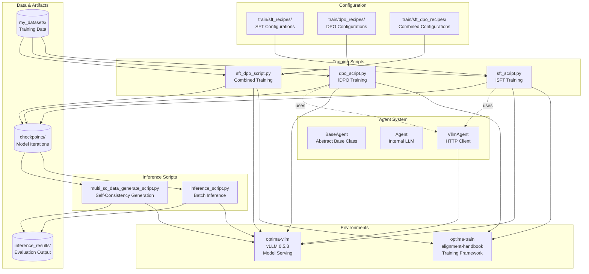
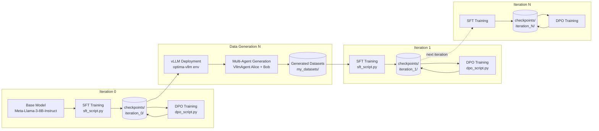
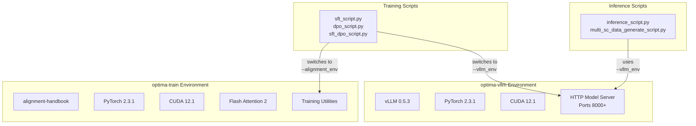
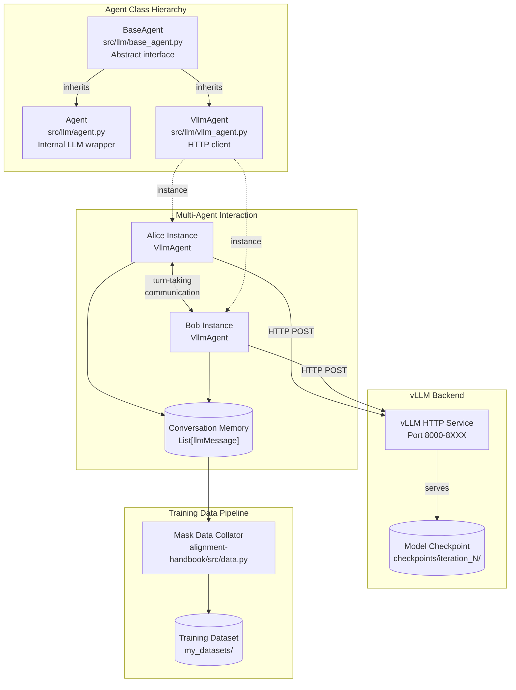

<!-- source: DeepWiki mcp.deepwiki.com · repo thunlp/Optima · page 1 Overview · fetched 2026-11-02 -->

# Overview

<details>
<summary>Relevant source files</summary>

The following files were used as context for generating this wiki page:

- [README.md](README.md)
- [README_revise.md](README_revise.md)

</details>


This document provides an introduction to the Optima framework, its architecture, and core capabilities. For detailed installation instructions, see [Getting Started](#2). For technical details on specific subsystems, refer to [System Architecture](#4), [Agent System](#5), and [Training System](#6).

## Purpose and Scope

Optima is a training framework designed to optimize Large Language Model (LLM)-based multi-agent systems for improved communication efficiency and task effectiveness. This page introduces the framework's purpose, key features, architectural design, and iterative training methodology.

**Sources:** [README.md:1-20]()

## What is Optima

Optima (**Opti**mizing Effectiveness and Efficiency for LLM-Based **M**ulti-**A**gent Systems) is a specialized training framework that leverages iterative supervised fine-tuning (iSFT) and direct preference optimization (iDPO) to enhance multi-agent system performance. The framework reduces token usage in agent-to-agent communication while simultaneously improving response accuracy and task completion rates.

The core innovation lies in using model outputs from iteration N to generate training data for iteration N+1, creating a self-improvement feedback loop. This iterative approach enables agents to develop more efficient communication patterns and more accurate reasoning strategies over successive training cycles.

**Sources:** [README.md:5-11]()

## Key Features and Capabilities

Optima provides the following capabilities:

| Feature | Description |
|---------|-------------|
| **Token Efficiency** | Significant reduction in token usage during multi-agent communication |
| **Communication Effectiveness** | Substantial improvement in agent-to-agent communication quality and task completion |
| **Inference-Time Scaling** | Improved scaling laws for inference-time computation |
| **Multiple Training Methods** | Support for iSFT, iDPO, and combined iSFT-DPO training approaches |
| **Iterative Refinement** | Progressive model improvement across multiple training iterations |
| **Multi-Agent Data Generation** | Automated generation of training data through agent conversations |

**Sources:** [README.md:15-20]()

## High-Level System Architecture

The Optima framework consists of several interconnected systems that enable iterative training and inference:



**Sources:** [README.md:22-92](), System Architecture Diagrams

### Core Components

The framework comprises five primary component categories:

1. **Training Scripts**: Entry points for executing different training methods (`sft_script.py`, `dpo_script.py`, `sft_dpo_script.py`)
2. **Inference Scripts**: Tools for model evaluation and data generation (`inference_script.py`, `multi_sc_data_generate_script.py`)
3. **Agent System**: Classes for multi-agent interaction (`BaseAgent`, `Agent`, `VllmAgent`)
4. **Dual Environments**: Separated `optima-vllm` (serving) and `optima-train` (training) conda environments
5. **Configuration System**: YAML-based recipe files defining training parameters

**Sources:** [README.md:22-92]()

## Iterative Training Methodology

Optima employs an iterative training cycle where each iteration builds upon the previous one:



### Training Cycle Phases

Each iteration consists of three phases:

| Phase | Component | Description |
|-------|-----------|-------------|
| **1. Supervised Fine-Tuning** | `sft_script.py` | Trains model on multi-agent conversation data using supervised learning |
| **2. Data Generation** | `VllmAgent` | Deploys trained model to generate new training data through agent interactions |
| **3. Preference Optimization** | `dpo_script.py` | Refines model using Direct Preference Optimization on generated data |

After completing all phases in iteration N, the resulting checkpoint serves as the starting point for generating data for iteration N+1, creating a continuous improvement loop.

**Sources:** [README.md:58-92](), System Architecture Diagrams

## Training Methods

Optima supports three distinct training methodologies, each configurable through YAML recipe files:

### iSFT (Iterative Supervised Fine-Tuning)

Uses only supervised fine-tuning across iterations. Configured via files in `train/sft_recipes/` and executed with `sft_script.py`.

**Command-line invocation:**
```bash
MKL_THREADING_LAYER=GNU python sft_script.py \
    --train_config_path train/sft_recipes/arc.yaml \
    --vllm_env optima-vllm \
    --alignment_env optima-train
```

**Sources:** [README.md:58-70]()

### iDPO (Iterative Direct Preference Optimization)

Uses only DPO training across iterations. Configured via files in `train/dpo_recipes/` and executed with `dpo_script.py`.

**Command-line invocation:**
```bash
MKL_THREADING_LAYER=GNU python dpo_script.py \
    --train_config_path train/dpo_recipes/arc.yaml \
    --vllm_env optima-vllm \
    --alignment_env optima-train
```

**Sources:** [README.md:72-81]()

### iSFT-DPO (Combined Approach)

Combines both SFT and DPO within each iteration. Configured via files in `train/sft_dpo_recipes/` and executed with `sft_dpo_script.py`.

**Command-line invocation:**
```bash
MKL_THREADING_LAYER=GNU python sft_dpo_script.py \
    --train_config_path train/sft_dpo_recipes/arc.yaml \
    --vllm_env optima-vllm \
    --alignment_env optima-train
```

**Sources:** [README.md:83-92]()

## Dual Environment Architecture

Optima requires two separate conda environments to avoid dependency conflicts and enable concurrent model serving during training:



### Environment Purposes

| Environment | Primary Use | Key Dependencies |
|-------------|-------------|------------------|
| **optima-vllm** | Model serving during inference and data generation | vLLM 0.5.3, PyTorch 2.3.1 |
| **optima-train** | Model training and optimization | alignment-handbook, Flash Attention 2 |

Training scripts automatically switch between environments using subprocess calls, enabling seamless integration of serving and training operations.

**Sources:** [README.md:22-55]()

## Agent System Overview

The agent system enables multi-agent conversations for data generation:



### Agent Roles

- **BaseAgent**: Abstract base class defining the agent interface
- **Agent**: Implementation using internal language model instances
- **VllmAgent**: Implementation using HTTP calls to vLLM-deployed models
- **Alice & Bob**: Named agent instances that conduct multi-turn conversations to generate training data

The `VllmAgent` class is the primary agent type used during data generation, communicating with models deployed via vLLM's HTTP interface.

**Sources:** System Architecture Diagrams, [README.md:94-137]()

## Supported Datasets

Optima includes support for multiple benchmark datasets:

| Dataset | Type | Purpose |
|---------|------|---------|
| **arc** | Multiple Choice | AI2 Reasoning Challenge |
| **hotpot_qa** | Question Answering | Multi-hop reasoning |
| **mwh_qa** | Question Answering | Multi-hop with Wikipedia |
| **trivial_qa** | Question Answering | Trivia questions |
| **cbt** | Language Understanding | Children's Book Test |
| **math** | Mathematical Reasoning | MATH dataset |
| **gsm8k** | Mathematical Reasoning | Grade School Math |
| **mmlu** | Multiple Choice | Massive Multitask Language Understanding |

These datasets are stored in the `my_datasets/` directory and referenced by the `--dataset_type` parameter in training and inference scripts.

**Sources:** [README.md:104-120](), [README.md:132]()

## Inference and Evaluation

Optima provides two inference modes:

### Batch Inference

The `inference_script.py` evaluates all model checkpoints on specified test datasets:

```bash
python inference_script.py \
    --model_root_path ./checkpoints/arc_sft \
    --tokenizer_path ${pretrained_tokenizer_path} \
    --dataset_type arc \
    --device 0 \
    --port 8000 \
    --num_thread 128 \
    --output_root_path ./inference_results \
    --vllm_env optima-vllm
```

**Sources:** [README.md:94-110]()

### Multi-Agent Self-Consistency

The `multi_sc_data_generate_script.py` performs inference with multiple agent settings and self-consistency voting:

```bash
python multi_sc_data_generate_script.py \
    --model_path ./checkpoints/arc_sft/iteration_0 \
    --tokenizer_path ${pretrained_tokenizer_path} \
    --device 0 \
    --port 8000 \
    --dataset_type arc \
    --num_thread 128 \
    --output_path ./inference_results \
    --temperature 0.5 \
    --vllm_env optima-vllm
```

**Sources:** [README.md:112-137]()

## Directory Structure

The framework organizes files into the following structure:

```
optima/
├── sft_script.py                      # iSFT training entry point
├── dpo_script.py                      # iDPO training entry point
├── sft_dpo_script.py                  # Combined training entry point
├── inference_script.py                # Batch inference script
├── multi_sc_data_generate_script.py   # Self-consistency inference
├── train/                             # Training configuration recipes
│   ├── sft_recipes/                   # iSFT configurations
│   ├── dpo_recipes/                   # iDPO configurations
│   └── sft_dpo_recipes/               # Combined configurations
├── src/                               # Source code modules
│   └── llm/                           # Agent system implementation
├── my_datasets/                       # Training and test datasets
├── checkpoints/                       # Saved model checkpoints
├── inference_results/                 # Evaluation outputs
└── alignment-handbook/                # Modified alignment framework
```

**Sources:** System Architecture Diagrams

## Next Steps

- For installation and setup instructions, see [Getting Started](#2)
- For detailed architecture documentation, see [System Architecture](#4)
- For training method details, see [Core Concepts](#3)
- For agent system documentation, see [Agent System](#5)
- For configuration reference, see [Configuration Recipes](#7)
- For inference documentation, see [Inference and Evaluation](#8)

---

