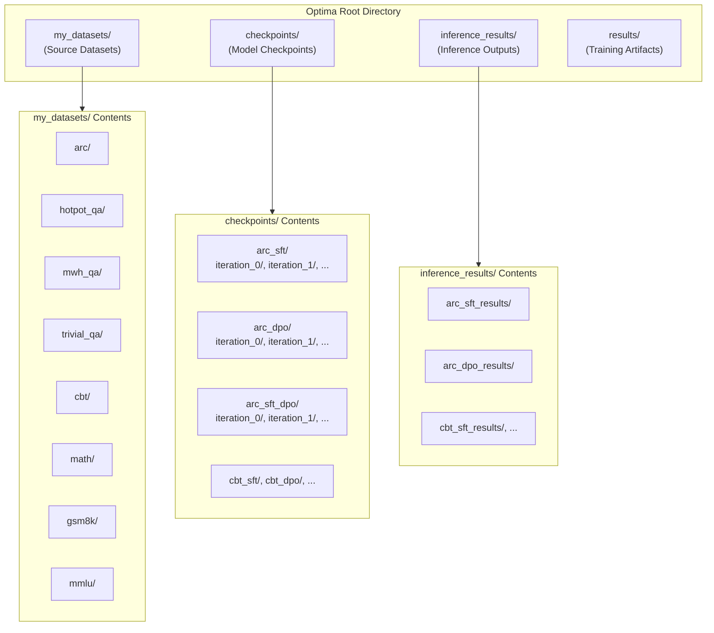
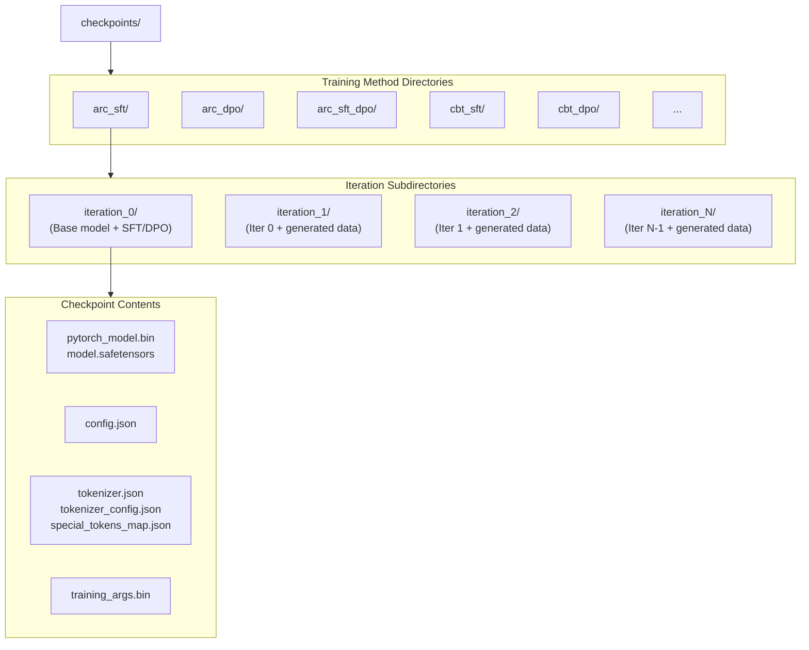
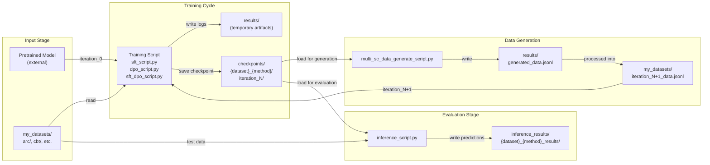

<!-- source: DeepWiki mcp.deepwiki.com · repo thunlp/Optima · page 10 Datasets and Artifacts · fetched 2026-11-02 -->

# Datasets and Artifacts

<details>
<summary>Relevant source files</summary>

The following files were used as context for generating this wiki page:

- [.gitignore](.gitignore)
- [README.md](README.md)

</details>


This page provides a comprehensive guide to the organization, structure, and lifecycle of datasets, model checkpoints, and output artifacts in the Optima framework. It covers the directory structure, naming conventions, and data flow patterns that enable Optima's iterative training pipeline.

For detailed information on preparing custom datasets, see [Dataset Structure and Preparation](#10.1). For checkpoint management strategies, see [Model Checkpoints and Iterations](#10.2). For interpreting inference outputs, see [Output and Results Management](#10.3).

## Directory Structure Overview

Optima organizes datasets and artifacts into four primary directories, each serving a distinct purpose in the training and evaluation lifecycle:

| Directory | Purpose | Git Tracking | Key Contents |
|-----------|---------|--------------|--------------|
| `my_datasets/` | Source datasets for training and evaluation | `.gitkeep` only | Raw and processed dataset files |
| `checkpoints/` | Model checkpoints from training iterations | Not tracked | Model weights, configuration, tokenizer |
| `inference_results/` | Inference outputs and predictions | `.gitkeep` only | JSONL files with model predictions |
| `results/` | General results and intermediate outputs | `.gitkeep` only | Training logs, metrics, generated data |

**Directory Structure Diagram**



Sources: [.gitignore:1-16]()

## Dataset Organization

The `my_datasets/` directory stores all datasets used for training and evaluation. Optima supports eight primary dataset types, each stored in its own subdirectory:

**Supported Datasets**

| Dataset Name | Subdirectory | Task Type | Description |
|--------------|--------------|-----------|-------------|
| ARC-Challenge | `arc/` | Multiple Choice QA | AI2 Reasoning Challenge dataset |
| HotpotQA | `hotpot_qa/` | Multi-hop QA | Wikipedia-based question answering |
| MultiWikiHopQA | `mwh_qa/` | Multi-hop QA | Multi-hop reasoning across documents |
| TriviaQA | `trivial_qa/` | QA | Trivia question answering |
| CBT | `cbt/` | Cloze Test | Children's Book Test |
| MATH | `math/` | Math Reasoning | Mathematical problem solving |
| GSM8K | `gsm8k/` | Math Reasoning | Grade school math word problems |
| MMLU | `mmlu/` | Multiple Choice | Massive Multitask Language Understanding |

### Dataset Directory Structure

Each dataset subdirectory contains training and test data files, typically in JSONL format. The exact structure depends on the dataset type but generally follows this pattern:

```
my_datasets/
├── arc/
│   ├── train.jsonl
│   ├── test.jsonl
│   └── validation.jsonl (optional)
├── hotpot_qa/
│   ├── train.jsonl
│   └── test.jsonl
└── ...
```

Datasets are referenced in recipe configuration files using the `dataset_mixer` parameter, which specifies the dataset path and sampling proportions. For example:

```yaml
dataset_mixer:
  my_datasets/arc/train.jsonl: 1.0
```

Sources: [README.md:59-137](), [.gitignore:5]()

## Checkpoint Management

The `checkpoints/` directory stores model checkpoints generated during training. Checkpoints are organized hierarchically by training method and iteration number, enabling Optima's iterative refinement process.

### Checkpoint Directory Hierarchy



### Checkpoint Naming Convention

Checkpoint directories follow a consistent naming pattern:

**Format**: `{dataset}_{method}/iteration_{N}/`

- `{dataset}`: Dataset identifier (e.g., `arc`, `cbt`, `hotpot_qa`)
- `{method}`: Training method (e.g., `sft`, `dpo`, `sft_dpo`)
- `{N}`: Iteration number (0-based indexing)

**Examples**:
- `checkpoints/arc_sft/iteration_0/` - First SFT iteration on ARC dataset
- `checkpoints/arc_dpo/iteration_2/` - Third DPO iteration on ARC dataset
- `checkpoints/cbt_sft_dpo/iteration_1/` - Second combined SFT-DPO iteration on CBT dataset

### Checkpoint Contents

Each iteration directory contains a complete model checkpoint:

| File/Directory | Purpose |
|----------------|---------|
| `pytorch_model.bin` or `model.safetensors` | Model weights |
| `config.json` | Model architecture configuration |
| `tokenizer.json` | Tokenizer vocabulary and rules |
| `tokenizer_config.json` | Tokenizer configuration |
| `special_tokens_map.json` | Special token definitions |
| `training_args.bin` | Training hyperparameters used |

Checkpoints are referenced in training scripts via the `model_name_or_path` parameter in recipe configuration files:

```yaml
model_name_or_path: ./checkpoints/arc_sft/iteration_0
```

Sources: [README.md:66-92](), [README.md:102-103](), [.gitignore:16]()

## Output and Results Organization

Optima maintains two output directories for different types of artifacts:

### Inference Results Directory

The `inference_results/` directory stores outputs from the `inference_script.py` and `multi_sc_data_generate_script.py` scripts. Results are organized by training configuration:

```
inference_results/
├── arc_sft_results/
│   ├── iteration_0_results.jsonl
│   ├── iteration_1_results.jsonl
│   └── iteration_2_results.jsonl
├── arc_dpo_results/
│   ├── iteration_0_results.jsonl
│   └── ...
└── cbt_sft_results/
    └── ...
```

Each JSONL file contains one prediction per line with the following structure:

```json
{
  "question_id": "...",
  "question": "...",
  "prediction": "...",
  "ground_truth": "...",
  "is_correct": true/false,
  "conversation_history": [...],
  "token_count": 123
}
```

The `inference_script.py` uses these parameters to control output:

```bash
--model_root_path ./checkpoints/arc_sft           # Source checkpoint directory
--output_root_path ./inference_results             # Destination results directory
--dataset_type arc                                 # Dataset being evaluated
```

### Results Directory

The `results/` directory stores intermediate artifacts generated during training:

- **Generated training data**: Multi-agent conversations used for subsequent iterations
- **Training logs**: Loss curves, learning rate schedules
- **Data generation outputs**: Intermediate conversation transcripts
- **Temporary files**: Processing artifacts

This directory is typically managed internally by training scripts and does not require manual inspection.

Sources: [README.md:94-137](), [.gitignore:1](), [.gitignore:9-10]()

## Data Flow and Lifecycle

The following diagram illustrates how data flows through Optima's directories during the complete training and evaluation lifecycle:

**Data Flow Through Artifacts**



### Lifecycle Stages

**Stage 1: Initial Training (Iteration 0)**
1. Load pretrained model (e.g., `Meta-Llama-3-8B-Instruct`)
2. Read training data from `my_datasets/{dataset}/train.jsonl`
3. Execute training via `sft_script.py`, `dpo_script.py`, or `sft_dpo_script.py`
4. Save checkpoint to `checkpoints/{dataset}_{method}/iteration_0/`

**Stage 2: Data Generation**
1. Deploy checkpoint from `iteration_N` via vLLM
2. Run `multi_sc_data_generate_script.py` with multi-agent interactions
3. Generate conversation data stored in `results/`
4. Process into training format in `my_datasets/` or used directly

**Stage 3: Iterative Refinement (Iteration N+1)**
1. Load previous checkpoint as base model
2. Train on generated data from Stage 2
3. Save improved checkpoint to `checkpoints/{dataset}_{method}/iteration_{N+1}/`
4. Repeat Stages 2-3 for additional iterations

**Stage 4: Evaluation**
1. Run `inference_script.py` on all checkpoints in a directory
2. Evaluate on test data from `my_datasets/{dataset}/test.jsonl`
3. Save predictions to `inference_results/{dataset}_{method}_results/iteration_{N}_results.jsonl`
4. Compute metrics (accuracy, token usage, communication effectiveness)

Sources: [README.md:58-137](), [.gitignore:1-16]()

## File Naming Conventions

Optima follows consistent naming conventions across all artifact types to enable automated processing and clear organization:

### Dataset Files

**Pattern**: `{split}.jsonl`

Examples:
- `train.jsonl` - Training data
- `test.jsonl` - Test/evaluation data
- `validation.jsonl` - Validation data (optional)

### Checkpoint Directories

**Pattern**: `checkpoints/{dataset}_{method}/iteration_{N}/`

Components:
- `{dataset}`: `arc`, `cbt`, `hotpot_qa`, `mwh_qa`, `trivial_qa`, `math`, `gsm8k`, `mmlu`
- `{method}`: `sft`, `dpo`, `sft_dpo`
- `{N}`: Zero-based iteration number (0, 1, 2, ...)

### Inference Result Files

**Pattern**: `inference_results/{dataset}_{method}_results/iteration_{N}_results.jsonl`

Example:
```
inference_results/arc_sft_results/iteration_0_results.jsonl
inference_results/arc_sft_results/iteration_1_results.jsonl
inference_results/arc_dpo_results/iteration_0_results.jsonl
```

### Configuration Files

**Pattern**: `train/{method}_recipes/{dataset}/iteration_{N}.yaml`

Example:
```
train/sft_recipes/arc/iteration_0.yaml
train/dpo_recipes/arc/iteration_1.yaml
train/sft_dpo_recipes/cbt/iteration_0.yaml
```

These naming conventions enable scripts to:
- Automatically locate checkpoints for batch inference
- Track iteration progression
- Match configurations to checkpoints
- Organize results by experiment type

Sources: [README.md:59-92](), [README.md:102-137]()

## Artifact Management Best Practices

### Storage Considerations

Optima's artifacts can consume significant disk space:

| Artifact Type | Typical Size | Growth Pattern |
|---------------|--------------|----------------|
| Base Model Checkpoint | 15-30 GB | One-time download |
| Per-Iteration Checkpoint | 15-30 GB | Linear with iterations |
| Dataset Files | 10 MB - 1 GB | Static |
| Inference Results | 1-100 MB | Linear with evaluations |
| Training Logs | 1-10 MB | Linear with training runs |

**Recommendations**:
- Use `.gitignore` to exclude large artifacts from version control (already configured)
- Store checkpoints on high-capacity storage
- Periodically archive old iteration checkpoints if disk space is constrained
- Use symbolic links if multiple experiments share the same base model

### File Organization Tips

1. **Consistent Naming**: Always use the established naming conventions to enable automated scripts
2. **Iteration Tracking**: Keep a log of which iterations correspond to which experiments
3. **Result Archiving**: Archive completed experiment results separately from active development
4. **Checkpoint Cleanup**: Remove intermediate checkpoints if only final iteration performance matters

### Git Tracking

The `.gitignore` configuration excludes all artifact directories while preserving directory structure via `.gitkeep` files:

```
my_datasets/*      # Excluded
!my_datasets/.gitkeep   # Tracked
checkpoints/*      # Excluded
inference_results/*    # Excluded
!inference_results/.gitkeep  # Tracked
results/*          # Excluded
!results/.gitkeep      # Tracked
```

This ensures:
- Repository remains lightweight
- Directory structure is preserved in version control
- Large model files don't slow down Git operations
- Contributors can immediately understand expected directory layout

Sources: [.gitignore:1-16]()

## Integration with Training and Inference

### Recipe Configuration Integration

Training recipes reference artifacts using relative paths:

```yaml
# Base model for iteration 0
model_name_or_path: meta-llama/Meta-Llama-3-8B-Instruct

# Previous iteration checkpoint for iteration N+1
model_name_or_path: ./checkpoints/arc_sft/iteration_0

# Dataset mixer references
dataset_mixer:
  my_datasets/arc/train.jsonl: 1.0

# Output directory
output_dir: ./checkpoints/arc_sft/iteration_1
```

### Script Parameter Mapping

Training and inference scripts accept artifact paths as command-line arguments:

**Training Script** (`sft_script.py`, `dpo_script.py`, `sft_dpo_script.py`):
- Recipe file specifies input/output paths
- Reads from `my_datasets/` via `dataset_mixer`
- Writes to `checkpoints/` via `output_dir`
- Logs to `results/` (automatic)

**Inference Script** (`inference_script.py`):
```bash
--model_root_path ./checkpoints/arc_sft    # Input: checkpoint directory
--dataset_type arc                          # Input: dataset identifier
--output_root_path ./inference_results      # Output: results directory
```

**Multi-Agent Script** (`multi_sc_data_generate_script.py`):
```bash
--model_path ./checkpoints/arc_sft/iteration_0  # Input: specific checkpoint
--dataset_type arc                               # Input: dataset identifier
--output_path ./inference_results                # Output: results directory
```

This integration ensures consistent artifact handling across all components of the Optima pipeline.

Sources: [README.md:58-137]()

---

