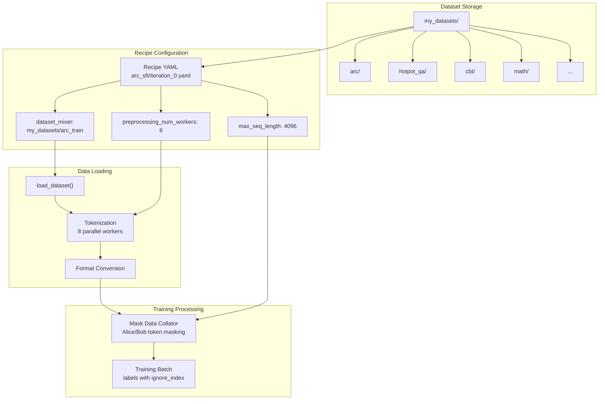
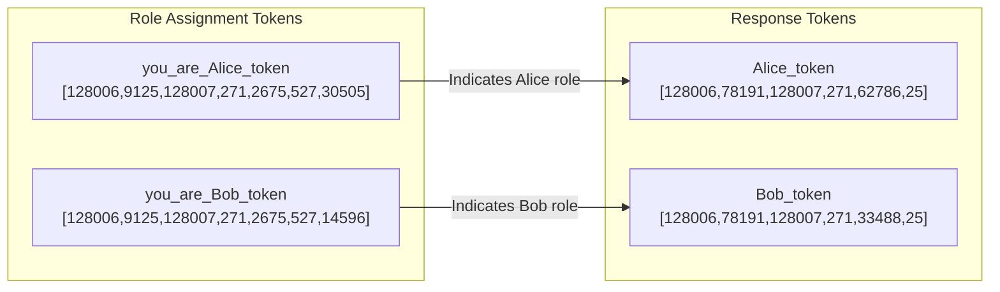
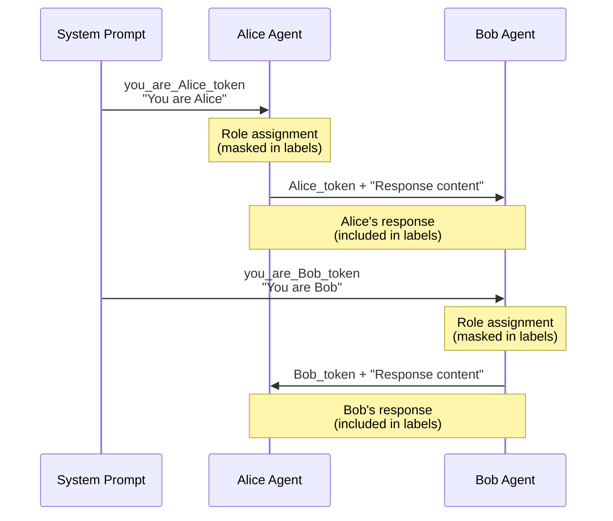
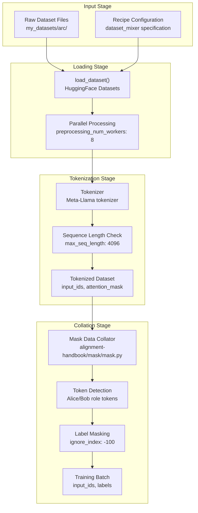

<!-- source: DeepWiki mcp.deepwiki.com · repo thunlp/Optima · page 10.1 Dataset Structure and Preparation · fetched 2026-11-02 -->

# Dataset Structure and Preparation

<details>
<summary>Relevant source files</summary>

The following files were used as context for generating this wiki page:

- [.gitignore](.gitignore)
- [README.md](README.md)
- [alignment-handbook/mask/mask.py](alignment-handbook/mask/mask.py)

</details>


This document describes the dataset organization, formats, and preparation requirements for the Optima framework. It covers the directory structure, supported dataset types, format specifications, and how datasets integrate with the training pipeline.

For information about creating custom datasets from scratch, see [Custom Dataset Preparation](#11.1). For details on the Mask data collator that processes datasets during training, see [Mask Data Collator](#6.3). For a complete list of supported datasets with descriptions, see [Supported Datasets](#13.3).

---

## Dataset Storage Structure

Optima organizes all training and evaluation datasets within the `my_datasets/` directory at the repository root. This directory is version-controlled via a `.gitkeep` file while the actual dataset contents are ignored.

### Directory Organization

```
my_datasets/
├── arc/                    # AI2 Reasoning Challenge dataset
├── hotpot_qa/             # HotpotQA multi-hop reasoning
├── mwh_qa/                # Multi-hop Wikipedia questions
├── trivial_qa/            # TriviaQA question answering
├── cbt/                   # Children's Book Test
├── math/                  # Mathematical reasoning
├── gsm8k/                 # Grade School Math 8K
└── mmlu/                  # Massive Multitask Language Understanding
```

**Directory Management**

The `.gitignore` configuration ensures dataset contents remain local:

[.gitignore:5-7]()

Sources: [.gitignore:1-16]()

---

## Dataset Integration in Training Pipeline

The following diagram shows how datasets flow through the Optima training system:



Sources: [README.md:59-92](), [alignment-handbook/mask/mask.py:14-42]()

---

## Supported Dataset Types

Optima supports eight primary dataset types, each specified via the `--dataset_type` parameter in training and inference scripts:

| Dataset Type | Code Identifier | Description |
|--------------|----------------|-------------|
| AI2 Reasoning Challenge | `arc` | Multiple-choice science questions |
| HotpotQA | `hotpot_qa` | Multi-hop question answering |
| Multi-Hop Wikipedia | `mwh_qa` | Wikipedia-based multi-hop reasoning |
| TriviaQA | `trivial_qa` | Trivia question answering |
| Children's Book Test | `cbt` | Reading comprehension from children's books |
| Mathematical Reasoning | `math` | Mathematical problem solving |
| Grade School Math | `gsm8k` | Elementary school math word problems |
| MMLU | `mmlu` | Massive multitask language understanding |

**Usage in Scripts**

These identifiers are used throughout the codebase:

```bash
--dataset_type arc
--dataset_type hotpot_qa
--dataset_type cbt
```

Sources: [README.md:104-133]()

---

## Dataset Format Requirements

### File Format

Datasets in the `my_datasets/` directory must follow these format requirements:

1. **File Type**: JSONL (JSON Lines) format or compatible formats loadable by HuggingFace `datasets.load_dataset()`
2. **Storage Location**: Must be within `my_datasets/` subdirectories
3. **Naming Convention**: Referenced via relative paths in recipe configurations

### Training Data Splits

Each dataset typically includes:

- **Training Split**: Used during SFT/DPO training phases
  - Example: `my_datasets/arc_train`
- **Validation Split**: Used for evaluation during training (optional)
- **Test Split**: Used for final inference and evaluation

**Recipe Configuration Example**

```yaml
dataset_mixer:
  my_datasets/arc_train: 1.0
```

Sources: [README.md:59-92]()

---

## Token Structure for Multi-Agent Conversations

Datasets for multi-agent training must include specific token sequences that identify Alice and Bob roles. The Mask data collator uses these tokens to determine which portions of the conversation should contribute to the training loss.

### Special Token Sequences



**Token Definitions**

The following token sequences are defined in the Mask data collator:

[alignment-handbook/mask/mask.py:8-11]()

- `you_are_Alice_token`: Marks the beginning of Alice's role context
- `you_are_Bob_token`: Marks the beginning of Bob's role context
- `Alice_token`: Marks the beginning of Alice's response
- `Bob_token`: Marks the beginning of Bob's response

**Loss Masking Behavior**

The Mask collator processes these tokens to:

1. Identify which agent is responding in each turn
2. Set `labels` to `ignore_index` (-100) for non-response tokens
3. Keep `labels` for response tokens to calculate training loss

Sources: [alignment-handbook/mask/mask.py:1-122]()

---

## Conversation Structure Example

Multi-agent training data follows this structure:



**Label Masking Logic**

The Mask collator implements this masking:

[alignment-handbook/mask/mask.py:110-120]()

- All tokens before the first response are masked
- Tokens between response end and next instruction are masked
- Only assistant response tokens contribute to loss

Sources: [alignment-handbook/mask/mask.py:44-122]()

---

## Data Preparation Workflow

The following diagram illustrates the complete data preparation workflow from raw datasets to training-ready batches:



**Processing Parameters**

Key configuration parameters from recipes:

| Parameter | Typical Value | Purpose |
|-----------|---------------|---------|
| `preprocessing_num_workers` | 8 | Parallel tokenization workers |
| `max_seq_length` | 4096 | Maximum sequence length |
| `dataset_mixer` | `{"my_datasets/arc_train": 1.0}` | Dataset paths and mixing ratios |

Sources: [alignment-handbook/mask/mask.py:1-122](), [README.md:59-92]()

---

## Dataset Naming Conventions

### Standard Naming Pattern

Datasets follow this naming convention:

```
my_datasets/{dataset_name}_{split}
```

**Examples:**
- `my_datasets/arc_train` - ARC training split
- `my_datasets/arc_test` - ARC test split
- `my_datasets/cbt_sft` - CBT data for SFT training
- `my_datasets/cbt_dpo` - CBT data for DPO training

### Training Method Suffixes

Different training methods may require different dataset variants:

| Suffix | Purpose | Used In |
|--------|---------|---------|
| `_sft` | Supervised fine-tuning data | iSFT training |
| `_dpo` | Direct preference optimization pairs | iDPO training |
| `_train` | General training data | All training methods |
| `_test` | Evaluation data | Inference and evaluation |

Sources: [README.md:59-137]()

---

## Integration with Training Scripts

### Training Script Dataset References

Training scripts access datasets through recipe configurations:

**SFT Training:**
```bash
python sft_script.py \
    --train_config_path train/sft_recipes/arc.yaml
```

**DPO Training:**
```bash
python dpo_script.py \
    --train_config_path train/dpo_recipes/arc.yaml
```

**Combined SFT-DPO:**
```bash
python sft_dpo_script.py \
    --train_config_path train/sft_dpo_recipes/arc.yaml
```

### Inference Script Dataset References

Inference scripts specify datasets via command-line arguments:

```bash
python inference_script.py \
    --dataset_type arc \
    --output_root_path ./inference_results
```

Sources: [README.md:59-137]()

---

## Dataset Output Locations

### Generated Training Data

During iterative training, the system generates new training data stored in:

```
my_datasets/
├── arc_sft/           # SFT data for ARC
├── arc_dpo/           # DPO data for ARC
├── cbt_sft/           # SFT data for CBT
└── cbt_dpo/           # DPO data for CBT
```

### Inference Results

Inference outputs are stored separately from training datasets:

```
inference_results/     # Evaluation outputs
results/              # Additional result artifacts
```

**Git Ignore Configuration**

Both dataset contents and results are excluded from version control:

[.gitignore:1-16]()

Sources: [.gitignore:1-16](), [README.md:94-137]()

---

## Storage Requirements and Management

### Disk Space Considerations

Dataset storage requirements vary by type and size:

- **Text-based datasets** (arc, cbt, trivial_qa): Moderate storage (GB scale)
- **Multi-hop datasets** (hotpot_qa, mwh_qa): Larger storage due to context
- **Math datasets** (math, gsm8k): Smaller storage
- **MMLU**: Large storage due to comprehensive coverage

### Cleanup and Maintenance

To manage disk space:

1. **Remove generated datasets** between iterations if not needed:
   ```bash
   rm -rf my_datasets/arc_sft/iteration_*
   ```

2. **Archive old results**:
   ```bash
   tar -czf results_backup.tgz inference_results/
   ```

3. **Selective dataset loading** via `dataset_mixer` ratios in recipes

Sources: [.gitignore:1-16]()

---

## Dataset Format Specifications

### JSONL Structure

Each line in a JSONL dataset file represents one training example:

```jsonl
{"messages": [...], "label": "answer"}
{"messages": [...], "label": "answer"}
```

### Message Format for Multi-Agent Conversations

Messages follow the structure expected by the Mask collator:

- System messages with role assignments (Alice/Bob)
- Assistant messages with responses
- Proper token sequence inclusion for masking

The exact format depends on the tokenizer's chat template and must include the token sequences defined in [alignment-handbook/mask/mask.py:8-11]().

Sources: [alignment-handbook/mask/mask.py:8-122]()

---

## Dataset Verification

### Pre-Training Checks

Before training, verify:

1. **Dataset exists** at path specified in recipe
2. **Token sequences** present for multi-agent data
3. **File format** compatible with `load_dataset()`
4. **Sequence lengths** within `max_seq_length` bounds

### Debug Dataset Loading

If dataset loading fails, check:

- Path correctness in recipe YAML
- File permissions on `my_datasets/` directory
- JSONL format validity
- Token sequence correctness

Sources: [alignment-handbook/mask/mask.py:44-122]()

---

## Summary

The dataset structure in Optima is organized around:

1. **Centralized storage** in `my_datasets/` directory
2. **Standard naming** conventions for splits and training methods
3. **Token-based formatting** for multi-agent conversations
4. **Parallel processing** with configurable worker counts
5. **Automatic masking** via the Mask data collator

For advanced dataset preparation workflows, including custom dataset creation, see [Custom Dataset Preparation](#11.1). For configuration of dataset parameters in recipes, see [Recipe Configuration System](#6.2).

Sources: [.gitignore:1-16](), [README.md:1-148](), [alignment-handbook/mask/mask.py:1-122]()

---

