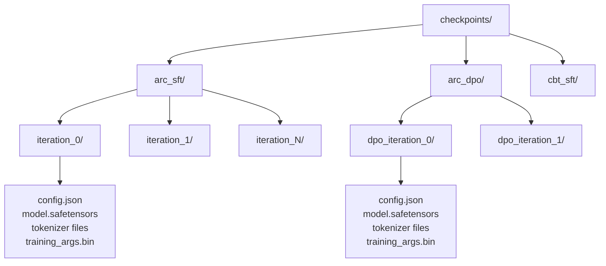
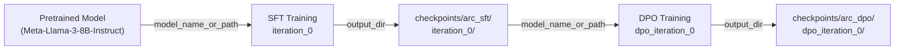
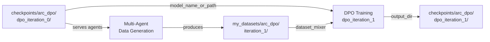
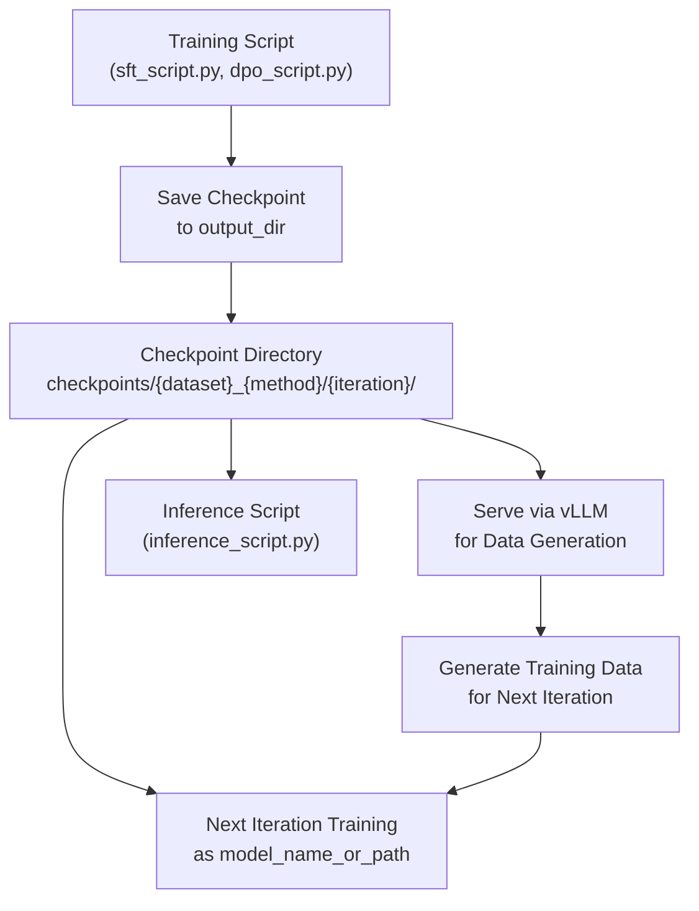
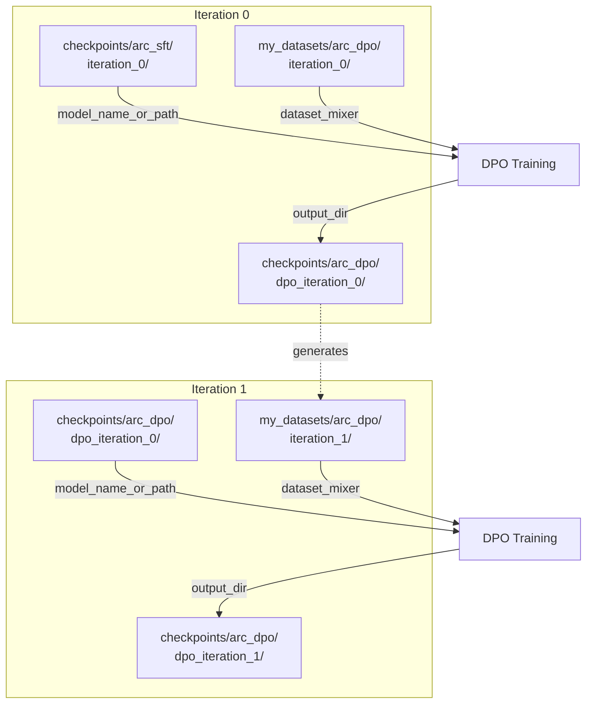

<!-- source: DeepWiki mcp.deepwiki.com · repo thunlp/Optima · page 10.2 Model Checkpoints and Iterations · fetched 2026-11-02 -->

# Model Checkpoints and Iterations

<details>
<summary>Relevant source files</summary>

The following files were used as context for generating this wiki page:

- [.gitignore](.gitignore)
- [alignment-handbook/recipes/Llama3-8b/arc_dpo/dpo_iteration_0.yaml](alignment-handbook/recipes/Llama3-8b/arc_dpo/dpo_iteration_0.yaml)
- [alignment-handbook/recipes/Llama3-8b/arc_dpo/dpo_iteration_1.yaml](alignment-handbook/recipes/Llama3-8b/arc_dpo/dpo_iteration_1.yaml)

</details>


This page documents the checkpoint directory structure, iteration naming conventions, and checkpoint lifecycle in Optima. It explains how model checkpoints are organized, how they relate to training iterations, and how they are referenced in recipe configurations.

For information about using checkpoints in inference workflows, see [Running Inference](#8.1). For details about the training pipeline that produces checkpoints, see [Training Pipeline Flow](#4.2).

## Purpose and Scope

Model checkpoints are the primary artifacts produced by training and consumed by subsequent training iterations and inference. This document covers:

- Checkpoint directory organization and naming patterns
- Iteration numbering and conventions
- How checkpoints flow between training stages
- Checkpoint content and structure
- Management and lifecycle considerations

## Checkpoint Directory Structure

Checkpoints are stored in the `checkpoints/` directory at the repository root. This directory is excluded from version control via [.gitignore:16]().

The directory structure follows a hierarchical pattern:

```
checkpoints/
├── {dataset}_{method}/
│   ├── iteration_0/
│   ├── iteration_1/
│   ├── iteration_N/
│   ├── dpo_iteration_0/
│   └── dpo_iteration_1/
```

### Naming Conventions

**Dataset-Method Prefix**: Each checkpoint group is prefixed with `{dataset}_{method}`:
- `arc_sft/` - ARC dataset with Supervised Fine-Tuning
- `arc_dpo/` - ARC dataset with Direct Preference Optimization
- `cbt_sft/` - CBT dataset with SFT
- `cbt_dpo/` - CBT dataset with DPO

**Iteration Identifiers**: Within each dataset-method directory, individual checkpoints use iteration identifiers:
- `iteration_0` - Base iteration (typically SFT from pretrained model)
- `iteration_1`, `iteration_2`, ... - Subsequent iterations
- `dpo_iteration_0`, `dpo_iteration_1`, ... - DPO-specific iterations

Sources: [.gitignore:16]()

## Checkpoint Directory Structure Diagram



Sources: [.gitignore:16](), [alignment-handbook/recipes/Llama3-8b/arc_dpo/dpo_iteration_0.yaml:21](), [alignment-handbook/recipes/Llama3-8b/arc_dpo/dpo_iteration_0.yaml:25]()

## Iteration Flow and Checkpoint Dependencies

Checkpoints form a dependency chain where each iteration's output becomes the input for the next stage or iteration.

### Iteration 0 Flow

Iteration 0 represents the initial training from a pretrained base model:



**Configuration References**:
- SFT iteration_0 receives pretrained model path in `model_name_or_path`
- SFT iteration_0 outputs to `checkpoints/arc_sft/iteration_0` via `output_dir`
- DPO iteration_0 reads from `../checkpoints/arc_sft/iteration_0` as shown in [alignment-handbook/recipes/Llama3-8b/arc_dpo/dpo_iteration_0.yaml:21]()
- DPO iteration_0 outputs to `../checkpoints/arc_dpo/dpo_iteration_0` as shown in [alignment-handbook/recipes/Llama3-8b/arc_dpo/dpo_iteration_0.yaml:25]()

Sources: [alignment-handbook/recipes/Llama3-8b/arc_dpo/dpo_iteration_0.yaml:21](), [alignment-handbook/recipes/Llama3-8b/arc_dpo/dpo_iteration_0.yaml:25]()

### Iteration N Flow

Subsequent iterations follow a similar pattern but read from the previous iteration's checkpoint:



**Configuration References**:
- DPO iteration_1 reads from `../checkpoints/arc_dpo/dpo_iteration_0` as shown in [alignment-handbook/recipes/Llama3-8b/arc_dpo/dpo_iteration_1.yaml:21]()
- DPO iteration_1 outputs to `../checkpoints/arc_dpo/dpo_iteration_1` as shown in [alignment-handbook/recipes/Llama3-8b/arc_dpo/dpo_iteration_1.yaml:25]()
- Dataset input comes from `../my_datasets/arc_dpo/iteration_1` as shown in [alignment-handbook/recipes/Llama3-8b/arc_dpo/dpo_iteration_1.yaml:4]()

Sources: [alignment-handbook/recipes/Llama3-8b/arc_dpo/dpo_iteration_1.yaml:21](), [alignment-handbook/recipes/Llama3-8b/arc_dpo/dpo_iteration_1.yaml:25](), [alignment-handbook/recipes/Llama3-8b/arc_dpo/dpo_iteration_1.yaml:4]()

## Recipe Configuration Parameters

Recipe YAML files use two key parameters to manage checkpoint flow:

### Input Checkpoint Parameter

The `model_name_or_path` parameter specifies the input checkpoint:

| Iteration | Parameter Value | File Reference |
|-----------|----------------|----------------|
| DPO iteration_0 | `../checkpoints/arc_sft/iteration_0` | [dpo_iteration_0.yaml:21]() |
| DPO iteration_1 | `../checkpoints/arc_dpo/dpo_iteration_0` | [dpo_iteration_1.yaml:21]() |

### Output Checkpoint Parameter

The `output_dir` parameter specifies where the trained checkpoint is saved:

| Iteration | Parameter Value | File Reference |
|-----------|----------------|----------------|
| DPO iteration_0 | `../checkpoints/arc_dpo/dpo_iteration_0` | [dpo_iteration_0.yaml:25]() |
| DPO iteration_1 | `../checkpoints/arc_dpo/dpo_iteration_1` | [dpo_iteration_1.yaml:25]() |

Sources: [alignment-handbook/recipes/Llama3-8b/arc_dpo/dpo_iteration_0.yaml:21-25](), [alignment-handbook/recipes/Llama3-8b/arc_dpo/dpo_iteration_1.yaml:21-25]()

## Checkpoint Contents

Each checkpoint directory contains standard Hugging Face model artifacts:

| File/Directory | Description |
|---------------|-------------|
| `config.json` | Model configuration including architecture parameters |
| `model.safetensors` | Model weights in SafeTensors format |
| `tokenizer.json` | Fast tokenizer configuration |
| `tokenizer_config.json` | Tokenizer configuration parameters |
| `special_tokens_map.json` | Special token mappings |
| `training_args.bin` | Training arguments used to produce checkpoint |
| `adapter_config.json` | Optional: LoRA/adapter configuration if used |

These files enable the checkpoint to be loaded by Hugging Face Transformers and used for:
- Continued training in subsequent iterations
- Inference via vLLM or Transformers
- Deployment in production environments

Sources: [alignment-handbook/recipes/Llama3-8b/arc_dpo/dpo_iteration_0.yaml:31]() (tokenizer_name_or_path reference)

## Checkpoint Lifecycle



**Lifecycle Stages**:

1. **Creation**: Training scripts produce checkpoints via the `output_dir` parameter
2. **Serving**: Checkpoints are loaded by vLLM for multi-agent data generation
3. **Consumption**: Next iteration training reads checkpoints via `model_name_or_path`
4. **Evaluation**: Inference scripts load checkpoints for evaluation

Sources: [alignment-handbook/recipes/Llama3-8b/arc_dpo/dpo_iteration_0.yaml:21-25]()

## Iteration Naming Patterns

The codebase uses consistent patterns for iteration identifiers:

### SFT Iterations

| Pattern | Example | Usage |
|---------|---------|-------|
| `iteration_N` | `iteration_0`, `iteration_1`, `iteration_2` | Standard SFT iterations |

### DPO Iterations

| Pattern | Example | Usage |
|---------|---------|-------|
| `dpo_iteration_N` | `dpo_iteration_0`, `dpo_iteration_1` | DPO training iterations |

### Combined Workflows

When using combined SFT-DPO workflows (see [Combined SFT-DPO Recipes](#7.3)), both naming patterns may be present:

```
checkpoints/
├── arc_sft/
│   ├── iteration_0/      # SFT from pretrained
│   ├── iteration_1/      # SFT from iteration_0 data
│   └── iteration_2/      # SFT from iteration_1 data
└── arc_dpo/
    ├── dpo_iteration_0/  # DPO from arc_sft/iteration_0
    ├── dpo_iteration_1/  # DPO from dpo_iteration_0
    └── dpo_iteration_2/  # DPO from dpo_iteration_1
```

Sources: [alignment-handbook/recipes/Llama3-8b/arc_dpo/dpo_iteration_0.yaml:25](), [alignment-handbook/recipes/Llama3-8b/arc_dpo/dpo_iteration_1.yaml:25]()

## Checkpoint Management Practices

### Save Strategy

Recipe configurations control checkpoint saving behavior via the `save_strategy` parameter:

- `save_strategy: 'no'` - Only saves final checkpoint (common in examples, see [alignment-handbook/recipes/Llama3-8b/arc_dpo/dpo_iteration_0.yaml:29]())
- `save_strategy: 'steps'` - Saves intermediate checkpoints at specified intervals
- `save_strategy: 'epoch'` - Saves checkpoints after each epoch

### Storage Considerations

Checkpoints are excluded from Git version control ([.gitignore:16]()) due to their large size. Typical checkpoint sizes:

| Model Size | Approximate Checkpoint Size |
|------------|---------------------------|
| 8B parameters | ~16 GB (bfloat16 format) |
| 70B parameters | ~140 GB (bfloat16 format) |

**Recommendation**: Use external storage solutions for checkpoint management in production environments.

### Checkpoint Reuse

Checkpoints can be reused across different configurations:

1. **Cross-dataset**: A checkpoint trained on one dataset can serve as initialization for another
2. **Method switching**: SFT checkpoints can be used as inputs for DPO training
3. **Hyperparameter tuning**: A single checkpoint can be the starting point for multiple hyperparameter experiments

Sources: [.gitignore:16](), [alignment-handbook/recipes/Llama3-8b/arc_dpo/dpo_iteration_0.yaml:29]()

## Path Resolution

Recipe files use relative paths to reference checkpoints. The path resolution depends on the working directory of the training script:

| Reference Type | Example Path | Resolved From |
|---------------|--------------|---------------|
| Recipe to checkpoint | `../checkpoints/arc_sft/iteration_0` | From `alignment-handbook/recipes/` directory |
| Recipe to dataset | `../my_datasets/arc_dpo/iteration_1` | From `alignment-handbook/recipes/` directory |
| Tokenizer path | `/home/test/testdata/models/Meta-Llama-3-8B-Instruct` | Absolute path to pretrained model |

Training scripts execute from their respective directories and resolve these relative paths accordingly.

Sources: [alignment-handbook/recipes/Llama3-8b/arc_dpo/dpo_iteration_0.yaml:21](), [alignment-handbook/recipes/Llama3-8b/arc_dpo/dpo_iteration_0.yaml:31](), [alignment-handbook/recipes/Llama3-8b/arc_dpo/dpo_iteration_1.yaml:4]()

## Checkpoint and Dataset Correlation

Each checkpoint iteration corresponds to a specific dataset iteration:



The checkpoint from iteration N is used to generate training data for iteration N+1, which then trains iteration N+1's checkpoint.

Sources: [alignment-handbook/recipes/Llama3-8b/arc_dpo/dpo_iteration_0.yaml:4](), [alignment-handbook/recipes/Llama3-8b/arc_dpo/dpo_iteration_0.yaml:21](), [alignment-handbook/recipes/Llama3-8b/arc_dpo/dpo_iteration_1.yaml:4](), [alignment-handbook/recipes/Llama3-8b/arc_dpo/dpo_iteration_1.yaml:21]()

---

