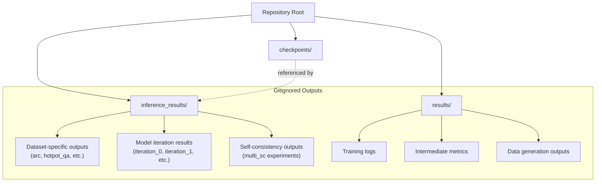
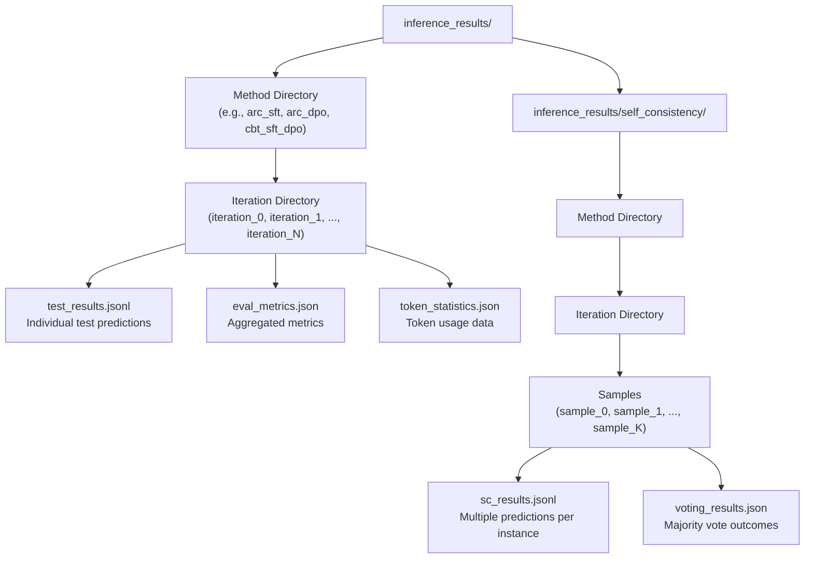
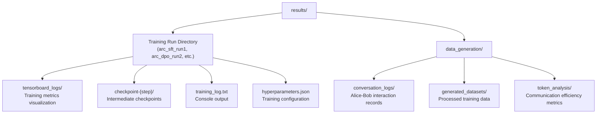
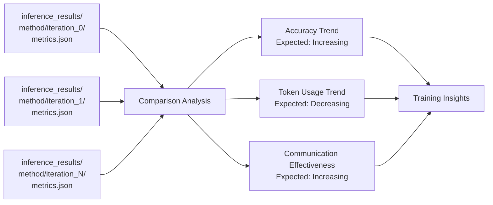
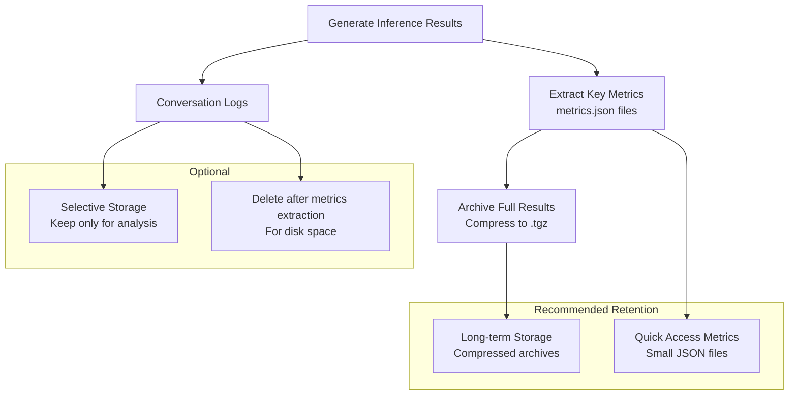
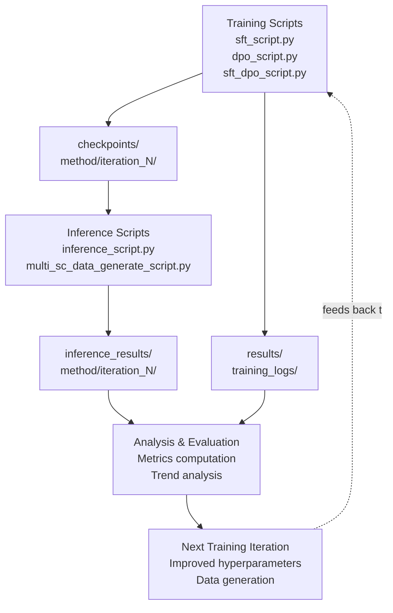

<!-- source: DeepWiki mcp.deepwiki.com · repo thunlp/Optima · page 10.3 Output and Results Management · fetched 2026-11-02 -->

# Output and Results Management

<details>
<summary>Relevant source files</summary>

The following files were used as context for generating this wiki page:

- [.gitignore](.gitignore)
- [README.md](README.md)

</details>


This document covers the organization, structure, and interpretation of output artifacts generated by Optima's inference and evaluation processes. It focuses on the `inference_results/` and `results/` directories, their contents, output formats, and how to interpret evaluation data.

For information about running inference scripts, see [Running Inference](#8.1). For details about the metrics themselves, see [Evaluation Metrics](#8.3). For checkpoint management, see [Model Checkpoints and Iterations](#10.2).

**Sources:** [.gitignore:1-16](), [README.md:94-137]()

---

## Directory Structure Overview

Optima uses two primary directories for storing output artifacts:

| Directory | Purpose | Git-tracked |
|-----------|---------|-------------|
| `inference_results/` | Stores inference outputs from batch evaluation and self-consistency experiments | No (excluded by `.gitignore`) |
| `results/` | Stores training logs, metrics, and intermediate training artifacts | No (excluded by `.gitignore`) |

Both directories are excluded from version control to prevent large output files from being committed. Empty `.gitkeep` files maintain the directory structure in the repository.

**Diagram: Output Directory Hierarchy**



**Sources:** [.gitignore:1-16](), [README.md:94-137]()

---

## Inference Results Directory

The `inference_results/` directory stores outputs from the two main inference scripts:

1. **Batch Inference** (`inference_script.py`): Evaluates all checkpoint iterations on a test dataset
2. **Multi-Agent Self-Consistency** (`multi_sc_data_generate_script.py`): Generates multiple samples with temperature-based sampling for self-consistency evaluation

### Directory Organization



### Batch Inference Outputs

The `inference_script.py` generates outputs organized by training method and iteration:

**Example structure:**
```
inference_results/
├── arc_sft/
│   ├── iteration_0/
│   │   ├── predictions.jsonl
│   │   ├── metrics.json
│   │   └── communication_log.jsonl
│   ├── iteration_1/
│   │   ├── predictions.jsonl
│   │   ├── metrics.json
│   │   └── communication_log.jsonl
│   └── iteration_N/
│       └── ...
├── arc_dpo/
│   └── ...
└── cbt_sft_dpo/
    └── ...
```

**Key command-line parameters from `inference_script.py`:**

| Parameter | Purpose | Example Value |
|-----------|---------|---------------|
| `--model_root_path` | Root directory containing checkpoint iterations | `./checkpoints/arc_sft` |
| `--output_root_path` | Root directory for inference outputs | `./inference_results` |
| `--dataset_type` | Dataset to evaluate on | `arc`, `hotpot_qa`, `mmlu` |
| `--device` | GPU device index for first vLLM deployment | `0` |
| `--port` | First port number for vLLM service | `8000` |
| `--num_thread` | Number of parallel threads | `128` |

**Sources:** [README.md:96-110]()

### Self-Consistency Outputs

The `multi_sc_data_generate_script.py` generates multiple samples with temperature-based sampling:

**Example structure:**
```
inference_results/
└── arc_sft_sc/
    └── iteration_0/
        ├── sample_0.jsonl
        ├── sample_1.jsonl
        ├── sample_2.jsonl
        ├── ...
        ├── sample_K.jsonl
        └── aggregated_results.json
```

**Key command-line parameters from `multi_sc_data_generate_script.py`:**

| Parameter | Purpose | Example Value |
|-----------|---------|---------------|
| `--model_path` | Path to specific checkpoint iteration | `./checkpoints/arc_sft/iteration_0` |
| `--output_path` | Output directory for results | `./inference_results` |
| `--temperature` | Sampling temperature for diversity | `0.5` |
| `--dataset_type` | Dataset to evaluate | `arc`, `gsm8k`, `math` |

**Sources:** [README.md:112-137]()

---

## Results Directory

The `results/` directory stores training-related outputs and intermediate artifacts generated during the iterative training process. This includes:

1. **Training logs** from the alignment-handbook framework
2. **Data generation outputs** from multi-agent conversations
3. **Intermediate checkpoints** during training epochs
4. **Metric tracking** across training iterations

### Typical Contents



**Sources:** [.gitignore:1-16]()

---

## Output File Formats

### Prediction Files (`.jsonl`)

Inference prediction files use JSON Lines format, with one JSON object per test instance:

**Structure:**
```jsonl
{"instance_id": "arc_001", "question": "...", "prediction": "B", "gold_answer": "B", "correct": true, "tokens_used": 342, "conversation_turns": 3}
{"instance_id": "arc_002", "question": "...", "prediction": "A", "gold_answer": "C", "correct": false, "tokens_used": 456, "conversation_turns": 4}
```

**Common fields:**

| Field | Type | Description |
|-------|------|-------------|
| `instance_id` | string | Unique identifier for the test instance |
| `question` | string | Input question or prompt |
| `prediction` | string/dict | Model's predicted answer |
| `gold_answer` | string/dict | Ground truth answer |
| `correct` | boolean | Whether prediction matches gold answer |
| `tokens_used` | integer | Total tokens in multi-agent conversation |
| `conversation_turns` | integer | Number of back-and-forth exchanges |
| `conversation_history` | list | Full Alice-Bob conversation (optional) |

### Metrics Files (`.json`)

Aggregated metrics are stored in JSON format:

**Structure:**
```json
{
  "accuracy": 0.847,
  "total_instances": 1000,
  "correct_predictions": 847,
  "token_statistics": {
    "mean_tokens_per_instance": 387.5,
    "median_tokens_per_instance": 342,
    "total_tokens": 387500,
    "std_tokens": 123.4
  },
  "communication_statistics": {
    "mean_turns": 3.2,
    "median_turns": 3,
    "single_turn_ratio": 0.15,
    "multi_turn_ratio": 0.85
  },
  "efficiency_metrics": {
    "tokens_per_correct_answer": 457.8,
    "communication_effectiveness": 2.19e-3
  }
}
```

**Key metric categories:**

1. **Accuracy Metrics**: Correctness of predictions
2. **Token Statistics**: Token usage patterns and efficiency
3. **Communication Statistics**: Turn-taking behavior
4. **Efficiency Metrics**: Combined effectiveness measures (see [Evaluation Metrics](#8.3))

### Communication Logs (`.jsonl`)

Detailed conversation histories between agents:

**Structure:**
```jsonl
{"instance_id": "arc_001", "turn": 0, "speaker": "Alice", "message": "Let me analyze this question...", "tokens": 45}
{"instance_id": "arc_001", "turn": 1, "speaker": "Bob", "message": "I agree with your analysis...", "tokens": 38}
{"instance_id": "arc_001", "turn": 2, "speaker": "Alice", "message": "Based on our discussion, the answer is B.", "tokens": 52}
```

**Sources:** Based on system architecture and inference patterns from README.md

---

## Interpreting Results

### Comparing Across Iterations

**Diagram: Result Comparison Workflow**



**Key patterns to observe:**

1. **Accuracy Progression**: Should generally increase across iterations (iteration_0 → iteration_N)
2. **Token Efficiency**: Should decrease as agents learn more efficient communication
3. **Communication Effectiveness**: Accuracy/tokens ratio should improve
4. **Convergence**: Later iterations may show diminishing returns

### Self-Consistency Results

Self-consistency experiments generate multiple predictions per instance at temperature > 0:

**Analysis workflow:**
1. **Sample Diversity**: Check variation across samples (sample_0 to sample_K)
2. **Majority Voting**: Aggregate predictions via majority vote
3. **Confidence Estimation**: Use agreement rate as confidence metric
4. **Error Analysis**: Compare self-consistent errors vs. single-sample errors

**Expected self-consistency behavior:**
- Higher agreement on easier instances
- More diverse predictions on ambiguous instances
- Improved accuracy through majority voting (inference-time scaling)

**Sources:** [README.md:112-137]()

---

## Managing Output Files

### File Size Considerations

Inference results can become large, especially with detailed conversation logs:

| Output Type | Typical Size | Scaling Factor |
|-------------|--------------|----------------|
| Predictions only | ~1-10 MB | Linear with dataset size |
| Predictions + metrics | ~1-10 MB | Linear with dataset size |
| Full conversation logs | ~50-500 MB | Linear with dataset size × conversation length |
| Self-consistency samples | ~100 MB - 5 GB | Linear × number of samples (K) |

### Best Practices

**Diagram: Output Management Strategy**



**Recommendations:**

1. **Keep metrics files**: Always retain `metrics.json` and `predictions.jsonl` (without full conversations)
2. **Archive conversation logs**: Compress detailed logs with `.tgz` for storage efficiency
3. **Clean intermediate results**: Remove `results/` directory contents after training completes
4. **Organize by experiment**: Use descriptive directory names (e.g., `arc_sft_beta0.1_lr5e6`)
5. **Document experiments**: Maintain a separate `experiments.csv` or tracking file with key hyperparameters

### Storage Location References

The `.gitignore` configuration ensures output directories don't bloat the repository:

```
results/*              # Training outputs (gitignored)
inference_results/*    # Inference outputs (gitignored)
*.jsonl               # JSONL files (gitignored, except utils/)
*.tgz                 # Compressed archives (gitignored)
```

Only `.gitkeep` files are tracked to maintain directory structure.

**Sources:** [.gitignore:1-16]()

---

## Integration with Training Pipeline

**Diagram: Output Generation Flow**



The output and results management system completes the feedback loop:

1. **Training** generates checkpoints and logs
2. **Inference** evaluates checkpoints and produces results
3. **Analysis** of results informs next iteration
4. **Iteration** continues with improved configurations

For details on running the full pipeline, see [Training Pipeline Flow](#4.2) and [Inference Pipeline](#4.3).

**Sources:** [README.md:58-137](), system architecture diagrams

---

