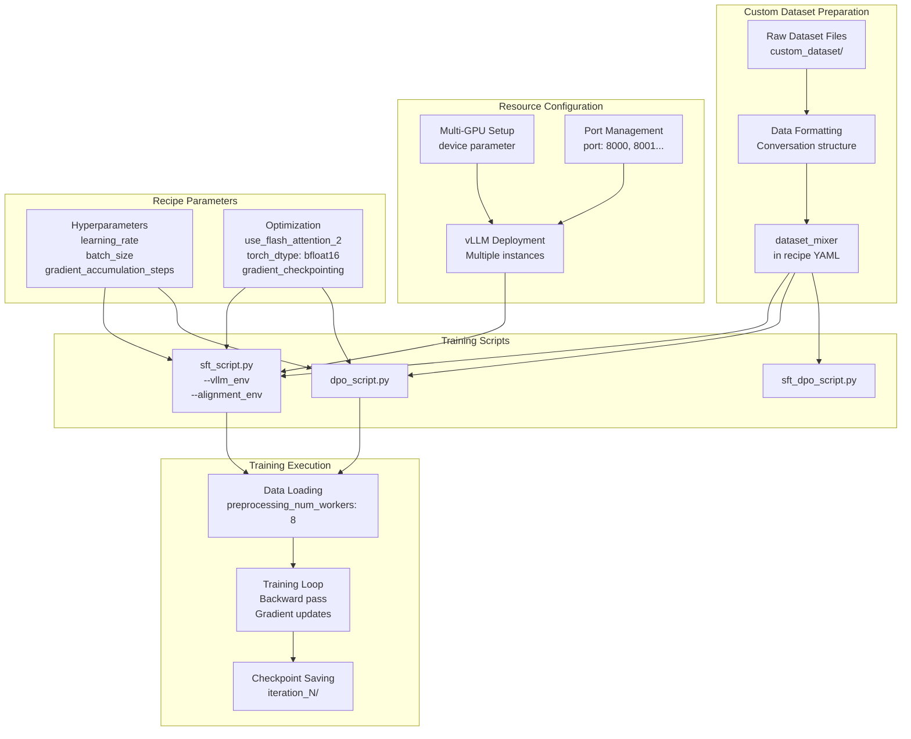
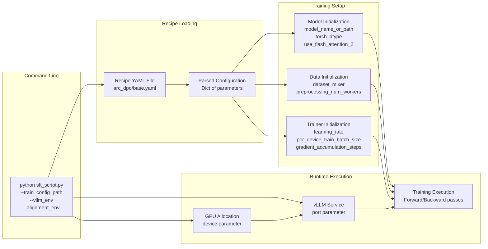
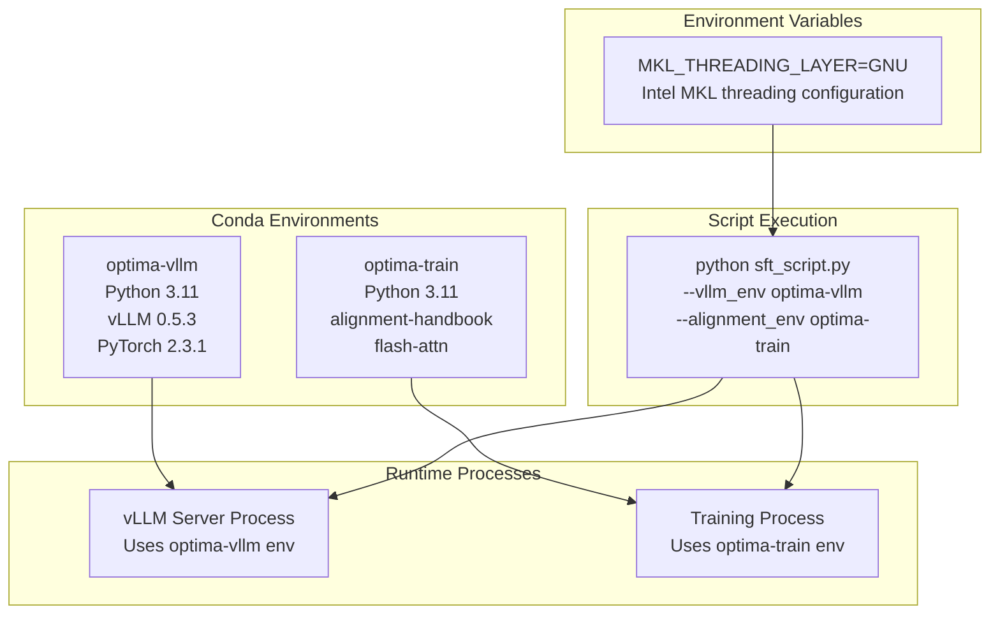
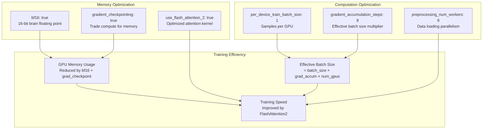

<!-- source: DeepWiki mcp.deepwiki.com · repo thunlp/Optima · page 11 Advanced Topics · fetched 2026-11-02 -->

# Advanced Topics

Relevant source files

The following files were used as context for generating this wiki page:

- [README.md](README.md)
- [alignment-handbook/recipes/Llama3-8b/arc_dpo/base.yaml](alignment-handbook/recipes/Llama3-8b/arc_dpo/base.yaml)

## Purpose and Scope

This section covers advanced usage patterns, optimization techniques, and customization strategies for Optima. These topics are intended for users who have completed the basic setup and initial training runs and want to:

- Prepare custom datasets for training
- Configure multi-GPU training deployments
- Optimize hyperparameters for their specific use cases
- Improve training performance and memory efficiency

For basic training workflows, see [Getting Started](#2). For standard recipe configurations, see [Configuration Recipes](#7). For evaluation procedures, see [Inference and Evaluation](#8).

## Advanced Workflow Overview

Advanced Optima usage involves customizing the training pipeline at multiple levels: data preparation, resource allocation, hyperparameter selection, and performance optimization. The following diagram shows how these advanced topics interact with the core training pipeline:

**Advanced Training Pipeline Integration**

Sources: [README.md:58-92](), [alignment-handbook/recipes/Llama3-8b/arc_dpo/base.yaml:1-36]()

## Configuration Integration Points

Advanced configuration requires understanding where different parameters are specified and how they interact. The following table shows the primary configuration points:

| Configuration Level | Location | Key Parameters | Purpose |
|---------------------|----------|----------------|---------|
| **Script Arguments** | Command line | `--train_config_path`, `--vllm_env`, `--alignment_env` | Environment and recipe selection |
| **Recipe YAML** | `alignment-handbook/recipes/` | `model_name_or_path`, `dataset_mixer`, `learning_rate` | Training configuration |
| **Environment Setup** | Conda environments | PyTorch version, vLLM version, CUDA | Runtime dependencies |
| **Data Paths** | `my_datasets/` | Dataset file locations | Training data source |
| **Deployment** | vLLM service | `device`, `port` | Model serving configuration |

Sources: [README.md:58-92](), [alignment-handbook/recipes/Llama3-8b/arc_dpo/base.yaml:1-36]()

## Advanced Parameter Flow

Understanding how parameters flow through the system is critical for advanced customization:

**Parameter Flow from Command Line to Execution**

Sources: [README.md:58-92](), [alignment-handbook/recipes/Llama3-8b/arc_dpo/base.yaml:1-36]()

## Key Configuration Files and Their Roles

| File/Directory | Purpose | Key Content |
|----------------|---------|-------------|
| `sft_script.py` | iSFT training orchestration | Script argument parsing, vLLM deployment, training execution |
| `dpo_script.py` | iDPO training orchestration | DPO-specific training loop with beta parameter |
| `sft_dpo_script.py` | Combined training | Sequential SFT then DPO execution |
| `alignment-handbook/recipes/` | Recipe configurations | YAML files with model, data, and training parameters |
| `my_datasets/` | Training data | Dataset files in HuggingFace format |
| `checkpoints/` | Model outputs | Saved model checkpoints per iteration |

Sources: [README.md:58-92]()

## Environment Variable Configuration

Optima requires specific environment setup for optimal performance:

**Environment Configuration Flow**

The `MKL_THREADING_LAYER=GNU` environment variable is required to avoid conflicts between different threading libraries when using Intel MKL with PyTorch.

Sources: [README.md:66-92]()

## Multi-Agent Data Generation Configuration

For advanced inference-time scaling and self-consistency, the multi-agent configuration requires careful parameter tuning:

| Parameter | Default | Purpose | Tuning Guidance |
|-----------|---------|---------|-----------------|
| `temperature` | 0.5 | Sampling temperature for response diversity | Higher values (0.7-1.0) increase diversity; lower values (0.1-0.3) increase consistency |
| `num_thread` | 128 | Number of parallel inference threads | Scale with available GPU memory and model size |
| `device` | 0 | GPU index for deployment | Use different indices for multi-GPU setups |
| `port` | 8000 | Base port for vLLM service | Increment for multiple concurrent deployments |

Sources: [README.md:112-137]()

## Performance Optimization Parameters

The following recipe parameters directly impact training performance:

**Performance Parameter Interactions**

Sources: [alignment-handbook/recipes/Llama3-8b/arc_dpo/base.yaml:12-30]()

## Advanced Training Parameter Reference

### Model Configuration Parameters

| Parameter | Type | Example Value | Description |
|-----------|------|---------------|-------------|
| `model_name_or_path` | str | `/path/to/Meta-Llama-3-8B-Instruct` | Base model checkpoint path |
| `torch_dtype` | str | `bfloat16` | Model weight precision |
| `use_flash_attention_2` | bool | `true` | Enable Flash Attention 2 kernel |
| `model_revision` | str | `main` | HuggingFace model revision |

Sources: [alignment-handbook/recipes/Llama3-8b/arc_dpo/base.yaml:1-5]()

### Data Configuration Parameters

| Parameter | Type | Example Value | Description |
|-----------|------|---------------|-------------|
| `dataset_mixer` | dict | `{"/path/to/dataset": 1.0}` | Dataset paths and mixing ratios |
| `dataset_splits` | list | `["train", "test"]` | Dataset splits to use |
| `preprocessing_num_workers` | int | `8` | Number of data preprocessing workers |
| `max_length` | int | `4096` | Maximum sequence length |
| `max_prompt_length` | int | `1024` | Maximum prompt length for DPO |

Sources: [alignment-handbook/recipes/Llama3-8b/arc_dpo/base.yaml:6-11](), [alignment-handbook/recipes/Llama3-8b/arc_dpo/base.yaml:25-26]()

### Training Configuration Parameters

| Parameter | Type | Example Value | Description |
|-----------|------|---------------|-------------|
| `learning_rate` | float | `5.0e-7` | Optimizer learning rate |
| `num_train_epochs` | int | `1` | Number of training epochs |
| `per_device_train_batch_size` | int | `1` | Batch size per GPU |
| `gradient_accumulation_steps` | int | `8` | Gradient accumulation steps |
| `warmup_ratio` | float | `0.1` | Learning rate warmup ratio |
| `lr_scheduler_type` | str | `cosine` | Learning rate scheduler |
| `optim` | str | `adamw_torch` | Optimizer type |

Sources: [alignment-handbook/recipes/Llama3-8b/arc_dpo/base.yaml:17-36]()

### DPO-Specific Parameters

| Parameter | Type | Example Value | Description |
|-----------|------|---------------|-------------|
| `beta` | float | `0.2` | DPO temperature parameter controlling preference strength |

The `beta` parameter controls the strength of the preference optimization. Lower values (0.1) result in more conservative updates, while higher values (0.5) lead to more aggressive preference alignment.

Sources: [alignment-handbook/recipes/Llama3-8b/arc_dpo/base.yaml:13]()

## Integration with Child Topics

The subsections of Advanced Topics provide detailed guidance on specific areas:

- **[Custom Dataset Preparation](#11.1)**: Details the format requirements and integration process for preparing custom datasets for Optima training
- **[Multi-GPU Training](#11.2)**: Explains device allocation, port management strategies, and how to configure distributed training
- **[Hyperparameter Tuning](#11.3)**: Provides guidelines for tuning learning rates, batch sizes, and other training parameters
- **[Performance Optimization](#11.4)**: Covers techniques for optimizing training speed and memory usage through Flash Attention 2, bf16 precision, and gradient checkpointing

These topics build upon the foundational concepts covered in [Core Concepts](#3) and [Training System](#6), providing the depth needed for production deployments and research applications.

Sources: [README.md:1-148](), [alignment-handbook/recipes/Llama3-8b/arc_dpo/base.yaml:1-36]()

---

