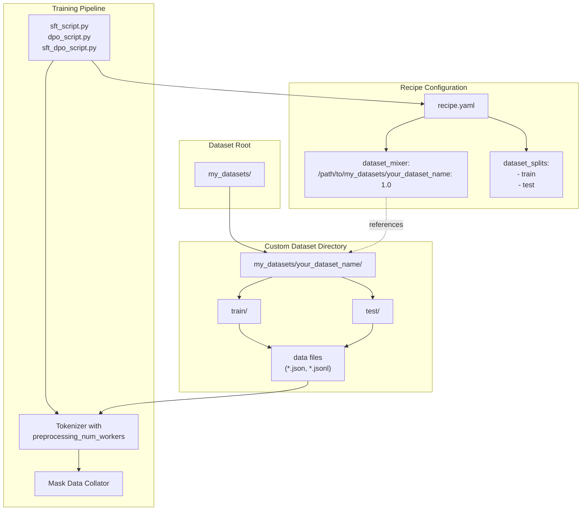
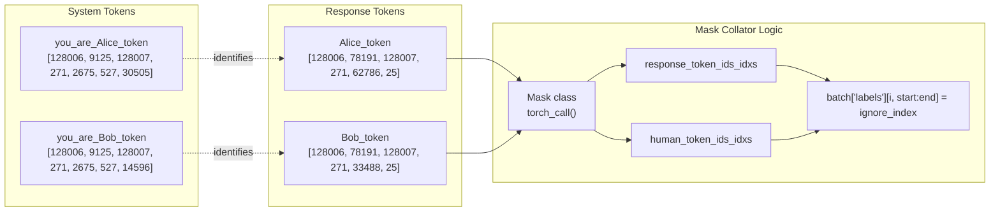
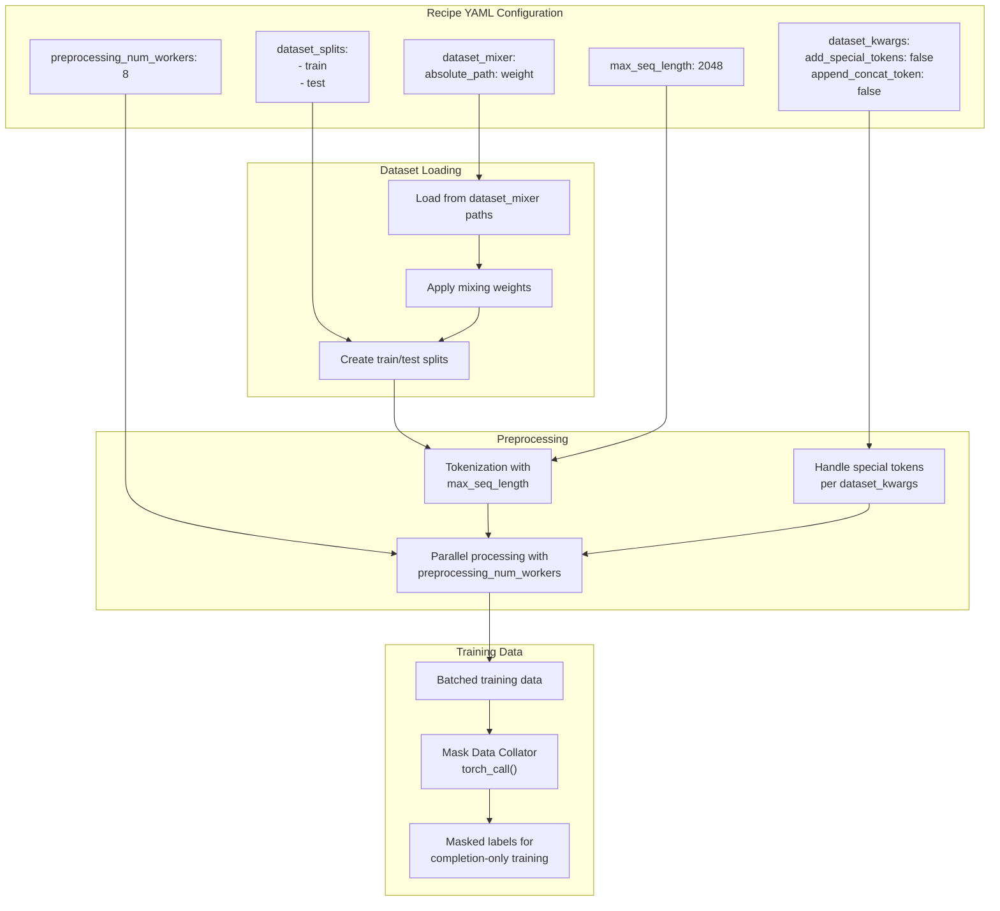
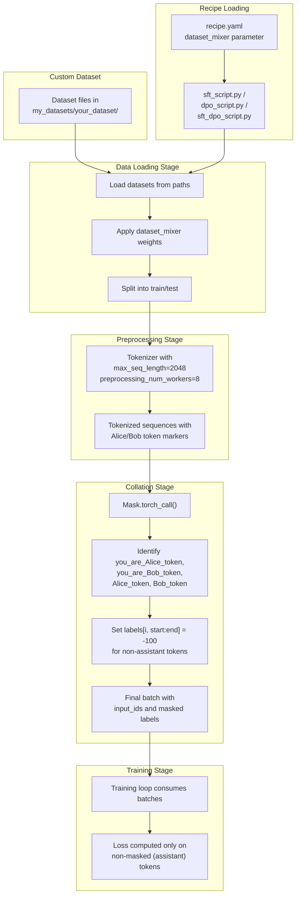

<!-- source: DeepWiki mcp.deepwiki.com · repo thunlp/Optima · page 11.1 Custom Dataset Preparation · fetched 2026-11-02 -->

# Custom Dataset Preparation

<details>
<summary>Relevant source files</summary>

The following files were used as context for generating this wiki page:

- [README.md](README.md)
- [alignment-handbook/mask/mask.py](alignment-handbook/mask/mask.py)
- [alignment-handbook/recipes/Llama3-8b/arc_sft/base.yaml](alignment-handbook/recipes/Llama3-8b/arc_sft/base.yaml)

</details>


This document provides a detailed guide for preparing custom datasets for use with Optima's training pipeline. It covers dataset formatting requirements, directory structure, conversation token formatting, and integration with the training system.

For information about managing pre-existing datasets and checkpoint organization, see [Dataset Structure and Preparation](#10.1). For details on configuring dataset parameters in recipe files, see [Recipe Configuration System](#6.2).

**Sources:** [README.md](), [alignment-handbook/recipes/Llama3-8b/arc_sft/base.yaml]()

## Dataset Requirements Overview

Optima's training system expects datasets to follow specific formatting requirements to work correctly with the multi-agent conversation structure and the Mask data collator. Custom datasets must:

1. Be organized in the `my_datasets/` directory
2. Contain properly formatted conversation data with Alice and Bob agent roles
3. Use the correct token sequences for agent identification
4. Be registered in recipe YAML files via the `dataset_mixer` parameter
5. Include appropriate train/test splits

**Sources:** [alignment-handbook/recipes/Llama3-8b/arc_sft/base.yaml:5-9](), [README.md:58-92]()

## Dataset Directory Structure

The following diagram illustrates how custom datasets should be organized in the file system and how they connect to the training pipeline:



**Sources:** [alignment-handbook/recipes/Llama3-8b/arc_sft/base.yaml:5-9]()

## Conversation Format and Token Structure

The Mask data collator expects specific token sequences to identify Alice and Bob agent responses. The following diagram shows the token structure used in multi-agent conversations:



The token sequences are defined in [alignment-handbook/mask/mask.py:8-11]():

| Token Name | Token Sequence | Purpose |
|------------|----------------|---------|
| `you_are_Alice_token` | `[128006, 9125, 128007, 271, 2675, 527, 30505]` | System message identifying Alice |
| `you_are_Bob_token` | `[128006, 9125, 128007, 271, 2675, 527, 14596]` | System message identifying Bob |
| `Alice_token` | `[128006, 78191, 128007, 271, 62786, 25]` | Alice's response marker |
| `Bob_token` | `[128006, 78191, 128007, 271, 33488, 25]` | Bob's response marker |

**Sources:** [alignment-handbook/mask/mask.py:7-11]()

## Data Format Specification

### Conversation Structure

Each training example should represent a multi-agent conversation with the following structure:

1. **System messages** that identify which agent is responding
2. **Turn-taking conversation** between Alice and Bob
3. **Proper tokenization** that produces the expected token sequences

The Mask data collator processes these conversations by:
- Identifying response start positions via `response_token_ids_idxs` [alignment-handbook/mask/mask.py:88-90]()
- Identifying instruction start positions via `human_token_ids_idxs` [alignment-handbook/mask/mask.py:101]()
- Setting non-assistant tokens to `ignore_index` (-100) [alignment-handbook/mask/mask.py:115]()

### File Format

Datasets should be in JSON or JSONL format, compatible with HuggingFace's `datasets` library. Each example typically contains a `text` field with the conversation formatted according to the chat template.

**Sources:** [alignment-handbook/mask/mask.py:44-122]()

## Dataset Configuration in Recipes

The following diagram shows how datasets are configured in recipe files and processed by the training pipeline:



### Key Configuration Parameters

The following table describes the essential parameters for dataset configuration:

| Parameter | Type | Description | Example |
|-----------|------|-------------|---------|
| `dataset_mixer` | dict | Mapping of dataset paths to mixing weights | `/path/to/my_datasets/arc_sft_v3/modify: 1.0` |
| `dataset_splits` | list | Split names to use | `['train', 'test']` |
| `max_seq_length` | int | Maximum sequence length for truncation | `2048` |
| `preprocessing_num_workers` | int | Number of parallel preprocessing workers | `8` |
| `dataset_kwargs.add_special_tokens` | bool | Whether to add special tokens during tokenization | `false` |
| `dataset_kwargs.append_concat_token` | bool | Whether to append concatenation tokens | `false` |

**Sources:** [alignment-handbook/recipes/Llama3-8b/arc_sft/base.yaml:2-7](), [alignment-handbook/recipes/Llama3-8b/arc_sft/base.yaml:21](), [alignment-handbook/recipes/Llama3-8b/arc_sft/base.yaml:30]()

## Step-by-Step Dataset Preparation Guide

### Step 1: Create Dataset Directory

Create a directory under `my_datasets/` with a descriptive name:

```
my_datasets/
└── your_custom_dataset/
    ├── train/
    └── test/
```

### Step 2: Format Conversation Data

Ensure your conversation data includes:
- Proper system messages that will tokenize to `you_are_Alice_token` or `you_are_Bob_token`
- Response markers that will tokenize to `Alice_token` or `Bob_token`
- Complete turn-taking structure

The exact text format depends on your tokenizer's chat template. For Llama-3 models, the system uses the default chat template which produces the expected token sequences.

### Step 3: Create Train/Test Splits

Organize your data files into `train/` and `test/` subdirectories. The training pipeline will load these splits based on the `dataset_splits` parameter in your recipe.

**Sources:** [alignment-handbook/recipes/Llama3-8b/arc_sft/base.yaml:7-9]()

### Step 4: Configure Recipe File

Create or modify a recipe YAML file with the following structure:

```yaml
# Dataset configuration
dataset_mixer:
  /absolute/path/to/my_datasets/your_custom_dataset: 1.0
dataset_splits:
  - train
  - test

# Dataset processing parameters
dataset_kwargs:
  add_special_tokens: false
  append_concat_token: false
max_seq_length: 2048
preprocessing_num_workers: 8

# Model and tokenizer
model_name_or_path: /path/to/base/model
tokenizer_name_or_path: /path/to/tokenizer

# Other training parameters...
```

**Sources:** [alignment-handbook/recipes/Llama3-8b/arc_sft/base.yaml:1-38]()

### Step 5: Validate Token Sequences

Before running full training, validate that your conversation data produces the expected token sequences. You can verify this by:

1. Tokenizing a sample conversation
2. Checking that the token IDs match the expected sequences in [alignment-handbook/mask/mask.py:8-11]()
3. Ensuring the Mask data collator correctly identifies response and instruction boundaries

## Dataset Mixing

The `dataset_mixer` parameter supports multiple datasets with different weights:

```yaml
dataset_mixer:
  /path/to/dataset_1: 0.6
  /path/to/dataset_2: 0.3
  /path/to/dataset_3: 0.1
```

Weights determine the sampling probability during training. The total doesn't need to sum to 1.0; the system normalizes the weights automatically.

**Sources:** [alignment-handbook/recipes/Llama3-8b/arc_sft/base.yaml:5-6]()

## Data Flow Through Training Pipeline

The following diagram illustrates how custom datasets flow through the training system:



**Sources:** [alignment-handbook/mask/mask.py:44-122](), [alignment-handbook/recipes/Llama3-8b/arc_sft/base.yaml:5-30]()

## Common Issues and Troubleshooting

### Token Sequence Mismatch

If the Mask data collator doesn't correctly identify agent responses, verify:
- Your tokenizer matches the expected chat template
- System messages produce the correct `you_are_Alice_token` or `you_are_Bob_token` sequences
- Response markers produce the correct `Alice_token` or `Bob_token` sequences

### Path Configuration

The `dataset_mixer` parameter requires **absolute paths**, not relative paths. Ensure:
- Paths start from the root directory
- Paths point to the dataset directory (not individual files)
- The directory contains the appropriate `train/` and `test/` subdirectories

**Sources:** [alignment-handbook/recipes/Llama3-8b/arc_sft/base.yaml:6]()

### Memory and Performance

For large datasets, adjust:
- `preprocessing_num_workers`: Increase for faster preprocessing (default: 8)
- `max_seq_length`: Reduce to lower memory usage (default: 2048)
- `per_device_train_batch_size`: Adjust based on GPU memory
- `gradient_accumulation_steps`: Increase to simulate larger batch sizes

**Sources:** [alignment-handbook/recipes/Llama3-8b/arc_sft/base.yaml:21](), [alignment-handbook/recipes/Llama3-8b/arc_sft/base.yaml:29-30](), [alignment-handbook/recipes/Llama3-8b/arc_sft/base.yaml:12]()

## Integration with Supported Datasets

Optima includes pre-configured support for several datasets:
- `arc`: AI2 Reasoning Challenge
- `hotpot_qa`: HotpotQA
- `mwh_qa`: Multi-hop Wikipedia QA
- `trivial_qa`: TriviaQA
- `cbt`: Children's Book Test
- `math`: Mathematics problems
- `gsm8k`: Grade School Math 8K
- `mmlu`: Massive Multitask Language Understanding

Custom datasets should follow similar conventions to these supported datasets for consistency.

**Sources:** [README.md:104](), [README.md:120](), [README.md:132]()

## Next Steps

After preparing your custom dataset:

1. **Validate the configuration**: Run a quick training job with a small subset to verify data loading works correctly
2. **Review training recipes**: See [Recipe Configuration System](#6.2) for comprehensive parameter tuning
3. **Configure training**: Adjust hyperparameters based on your dataset size and characteristics (see [Hyperparameter Tuning](#11.3))
4. **Monitor training**: Use the logging parameters in your recipe to track training progress

**Sources:** [alignment-handbook/recipes/Llama3-8b/arc_sft/base.yaml]()

---

