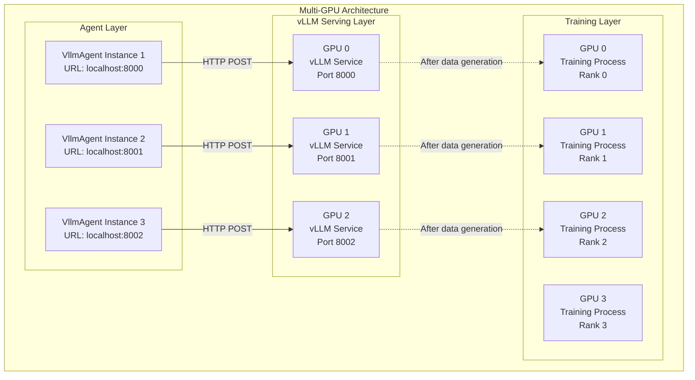
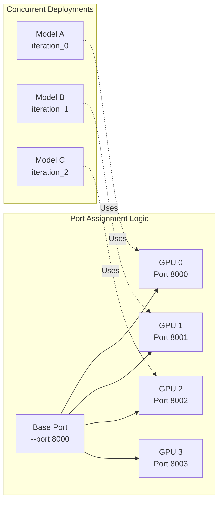
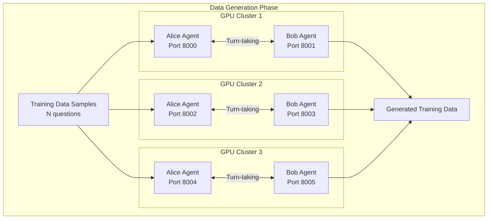

<!-- source: DeepWiki mcp.deepwiki.com · repo thunlp/Optima · page 11.2 Multi-GPU Training · fetched 2026-11-02 -->

# Multi-GPU Training

<details>
<summary>Relevant source files</summary>

The following files were used as context for generating this wiki page:

- [README.md](README.md)
- [README_revise.md](README_revise.md)
- [agent/agent.py](agent/agent.py)

</details>


## Purpose and Scope

This document describes how to configure and optimize Optima for multi-GPU training setups. It covers GPU allocation for vLLM model deployment, port management for concurrent model serving, and distributed training configuration. 

For general training pipeline information, see [Training Pipeline Flow](#4.2). For training script details, see [Training Scripts Reference](#6.1). For recipe configuration, see [Recipe Configuration System](#6.2).

---

## Overview

Optima's training pipeline involves two distinct multi-GPU scenarios:

1. **vLLM Model Serving**: Multiple GPU instances serve models via HTTP for multi-agent data generation
2. **Distributed Training**: PyTorch distributed training across GPUs for model optimization

These two scenarios require careful coordination of GPU devices and network ports to avoid resource conflicts.



**Sources:** [README.md:95-110](), [agent/agent.py:57-147]()

---

## vLLM Multi-GPU Model Deployment

### Device and Port Allocation

When deploying models with vLLM for multi-agent data generation, each GPU requires a unique port number. The `--device` and `--port` parameters control this allocation:

| Parameter | Purpose | Example |
|-----------|---------|---------|
| `--device` | Starting GPU index | `0` (uses GPU 0) |
| `--port` | Starting port number | `8000` (first service on port 8000) |

The system automatically increments ports for multiple deployments. If you specify `--device 0 --port 8000` and deploy multiple models, they will use:
- GPU 0 → Port 8000
- GPU 1 → Port 8001
- GPU 2 → Port 8002

### VllmAgent URL Construction

The `VllmAgent` class communicates with deployed vLLM services via HTTP. Each agent instance is initialized with a specific URL pointing to a GPU's port:

```
VllmAgent(url="http://localhost:8000", ...)  # Communicates with GPU 0
VllmAgent(url="http://localhost:8001", ...)  # Communicates with GPU 1
```

The HTTP request is made through the `step()` method:

[agent/agent.py:85-121]()

Key request parameters:
- `model`: The model name registered with vLLM
- `messages`: Conversation history as list of dicts
- `temperature`: Sampling temperature
- `max_tokens`: Maximum response length (set to 2000)

**Sources:** [agent/agent.py:64-72](), [agent/agent.py:109-119](), [README.md:95-110]()

---

## Port Management Strategy

### Port Allocation Rules



### Example: Inference Across Multiple Checkpoints

When running `inference_script.py`, multiple model checkpoints may need to be deployed simultaneously:

```bash
python inference_script.py \
    --model_root_path ./checkpoints/arc_sft \
    --tokenizer_path ${pretrained_tokenizer_path} \
    --dataset_type arc \
    --device 0 \      # Start from GPU 0
    --port 8000 \     # Start from port 8000
    --num_thread 128 \
    --output_root_path ./inference_results \
    --vllm_env optima-vllm
```

If the checkpoint directory contains `iteration_0`, `iteration_1`, and `iteration_2`, the script will:
1. Deploy iteration_0 on GPU 0, port 8000
2. Deploy iteration_1 on GPU 1, port 8001
3. Deploy iteration_2 on GPU 2, port 8002

**Sources:** [README.md:95-110]()

---

## Training on Multiple GPUs

### Distributed Training Backend

The training scripts (`sft_script.py`, `dpo_script.py`, `sft_dpo_script.py`) leverage the alignment-handbook framework, which uses PyTorch's distributed training capabilities. The framework automatically handles:

- **Device Allocation**: Distributes model shards across available GPUs
- **Gradient Synchronization**: AllReduce operations for gradient aggregation
- **Data Parallelism**: Splits batches across GPUs

### Key Training Parameters for Multi-GPU

Recipe configuration files control multi-GPU training behavior:

| Parameter | Description | Typical Value |
|-----------|-------------|---------------|
| `per_device_train_batch_size` | Batch size per GPU | 1-4 |
| `gradient_accumulation_steps` | Steps before optimizer update | 8-32 |
| `num_processes` | Number of GPU processes | Auto-detected |
| `bf16` | Use bfloat16 precision | `true` |
| `use_flash_attention_2` | Enable Flash Attention v2 | `true` |

The **effective batch size** is:
```
Effective Batch Size = per_device_train_batch_size × gradient_accumulation_steps × num_gpus
```

### Example: Multi-GPU SFT Training

```bash
MKL_THREADING_LAYER=GNU python sft_script.py \
    --train_config_path train/sft_recipes/arc.yaml \
    --vllm_env optima-vllm \
    --alignment_env optima-train
```

The training environment (`optima-train`) automatically detects available GPUs and distributes the training workload. The alignment-handbook framework handles:
- Model parallelism (if model is large)
- Data parallelism across GPUs
- Gradient checkpointing for memory efficiency

**Sources:** [README.md:56-70](), [README.md:40-55]()

---

## Multi-Agent Data Generation with Multiple GPUs

### Parallel Agent Deployment

During iterative training, multi-agent conversations generate training data. Multiple vLLM instances enable parallel generation:



### Threading and Concurrency

The `--num_thread` parameter controls parallel data generation:

```bash
python multi_sc_data_generate_script.py \
    --model_path ./checkpoints/arc_sft/iteration_0 \
    --tokenizer_path ${pretrained_tokenizer_path} \
    --device 0 \
    --port 8000 \
    --dataset_type arc \
    --num_thread 128 \    # 128 concurrent threads
    --output_path ./inference_results \
    --temperature 0.5 \
    --vllm_env optima-vllm
```

With 128 threads and 4 GPUs (ports 8000-8003), approximately 32 threads interact with each GPU concurrently. vLLM's batching mechanism optimizes throughput.

**Sources:** [README.md:112-137]()

---

## Configuration Parameters Reference

### Inference Script Parameters

```bash
python inference_script.py \
    --device <gpu_index>          # Starting GPU device index
    --port <port_number>          # Starting port for vLLM services
    --num_thread <thread_count>   # Concurrent threads for inference
    --vllm_env <env_name>         # Conda environment for vLLM
```

### Multi-Agent Script Parameters

```bash
python multi_sc_data_generate_script.py \
    --device <gpu_index>          # Starting GPU device index
    --port <port_number>          # Starting port for vLLM services
    --num_thread <thread_count>   # Concurrent threads for data generation
    --temperature <float>         # Sampling temperature (e.g., 0.5)
    --vllm_env <env_name>         # Conda environment for vLLM
```

### Training Script Parameters

Training scripts inherit multi-GPU configuration from recipe YAML files. No explicit GPU parameters are required at the command line—the alignment-handbook framework auto-detects GPUs.

**Sources:** [README.md:95-137]()

---

## Resource Optimization Strategies

### Memory Management

For multi-GPU training on large models, consider:

1. **Flash Attention 2**: Reduces memory footprint of attention computation
   - Enable in recipe: `use_flash_attention_2: true`
   
2. **BFloat16 Precision**: Halves memory usage compared to FP32
   - Enable in recipe: `bf16: true`
   
3. **Gradient Checkpointing**: Trades compute for memory
   - Enable in recipe: `gradient_checkpointing: true`

4. **Smaller Batch Sizes**: Reduce `per_device_train_batch_size` and increase `gradient_accumulation_steps`

### vLLM GPU Memory Utilization

vLLM automatically manages GPU memory for model serving. Key factors:

- **Model Size**: Larger models require more GPU memory
- **Context Length**: Longer sequences need more KV cache memory
- **Batch Size**: vLLM dynamically batches requests

If GPU memory is insufficient for all deployments, reduce the number of concurrent model deployments or use tensor parallelism (vLLM feature).

**Sources:** [README.md:40-55]()

---

## Common Issues and Solutions

### Issue: Port Already in Use

**Symptom:** vLLM deployment fails with "Address already in use" error

**Solution:** 
- Check for existing vLLM processes: `ps aux | grep vllm`
- Kill stale processes: `pkill -f vllm`
- Use different starting port: `--port 9000`

### Issue: CUDA Out of Memory During Training

**Symptom:** Training crashes with "CUDA out of memory"

**Solutions:**
1. Reduce `per_device_train_batch_size` in recipe
2. Increase `gradient_accumulation_steps` to maintain effective batch size
3. Enable `gradient_checkpointing: true`
4. Use `bf16: true` if not already enabled
5. Reduce `max_seq_length` in recipe

### Issue: Uneven GPU Utilization

**Symptom:** Some GPUs are idle while others are saturated

**Solution:**
- For vLLM: Ensure `--num_thread` is high enough to saturate all GPUs
- For training: Alignment-handbook automatically balances load; check for data loading bottlenecks

### Issue: HTTP Connection Timeout

**Symptom:** `VllmAgent.step()` times out waiting for vLLM response

**Solutions:**
1. Increase `max_tokens` if responses are being truncated
2. Check vLLM service logs for errors
3. Verify network connectivity: `curl http://localhost:8000/v1/models`
4. Reduce concurrent threads if vLLM is overloaded

**Sources:** [agent/agent.py:109-146]()

---

## Advanced: Custom GPU Allocation

For fine-grained control over GPU allocation, you can manually set `CUDA_VISIBLE_DEVICES`:

```bash
# Only use GPUs 2 and 3 for training
CUDA_VISIBLE_DEVICES=2,3 MKL_THREADING_LAYER=GNU python sft_script.py \
    --train_config_path train/sft_recipes/arc.yaml \
    --vllm_env optima-vllm \
    --alignment_env optima-train
```

For vLLM deployments across specific GPUs:

```bash
# Deploy vLLM only on GPUs 4-7
CUDA_VISIBLE_DEVICES=4,5,6,7 python inference_script.py \
    --device 0 \  # 0 refers to first visible GPU (physical GPU 4)
    --port 8000 \
    ...
```

**Note:** When using `CUDA_VISIBLE_DEVICES`, the `--device` parameter refers to the index in the visible device list, not the physical GPU index.

**Sources:** [README.md:56-92]()

---

