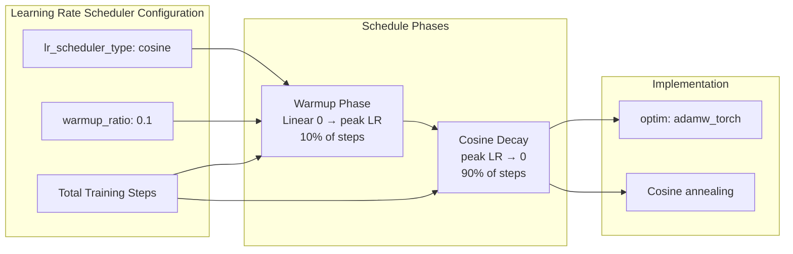
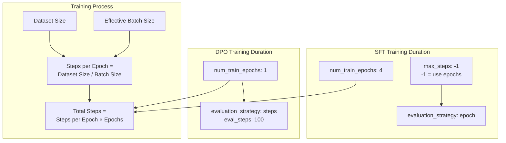
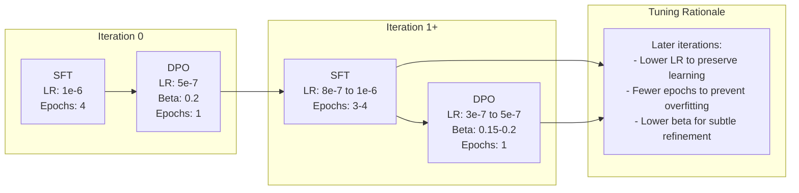
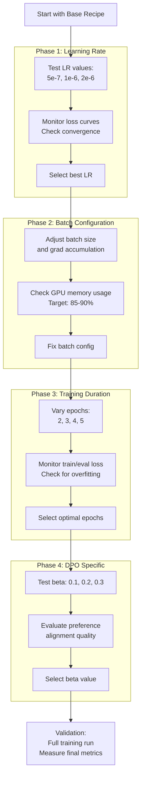

<!-- source: DeepWiki mcp.deepwiki.com · repo thunlp/Optima · page 11.3 Hyperparameter Tuning · fetched 2026-11-02 -->

# Hyperparameter Tuning

<details>
<summary>Relevant source files</summary>

The following files were used as context for generating this wiki page:

- [alignment-handbook/recipes/Llama3-8b/arc_dpo/base.yaml](alignment-handbook/recipes/Llama3-8b/arc_dpo/base.yaml)
- [alignment-handbook/recipes/Llama3-8b/arc_dpo/dpo_iteration_0.yaml](alignment-handbook/recipes/Llama3-8b/arc_dpo/dpo_iteration_0.yaml)
- [alignment-handbook/recipes/Llama3-8b/arc_sft/base.yaml](alignment-handbook/recipes/Llama3-8b/arc_sft/base.yaml)

</details>


## Purpose and Scope

This page provides comprehensive guidelines for tuning hyperparameters in Optima's training pipeline. It covers learning rates, batch sizes, gradient accumulation, DPO beta values, and memory optimization parameters. For information about the overall recipe configuration system, see [Recipe Configuration System](#6.2). For performance optimization techniques beyond hyperparameters, see [Performance Optimization](#11.4).

The hyperparameters discussed here are specified in YAML recipe files located in `alignment-handbook/recipes/Llama3-8b/` and consumed by the training scripts documented in [Training Scripts Reference](#6.1).

---

## Hyperparameter Overview

The following diagram shows the relationship between recipe files, key hyperparameters, and their impact on training:

```mermaid
graph TB
    RecipeFiles["Recipe YAML Files"]
    
    subgraph "SFT Parameters"
        SFTRecipe["arc_sft/base.yaml<br/>cbt_sft/base.yaml"]
        SFTLR["learning_rate: 1e-6"]
        SFTEpochs["num_train_epochs: 4"]
        SFTBatch["per_device_train_batch_size: 1<br/>gradient_accumulation_steps: 2"]
        SFTSeqLen["max_seq_length: 2048"]
    end
    
    subgraph "DPO Parameters"
        DPORecipe["arc_dpo/base.yaml<br/>arc_dpo/dpo_iteration_0.yaml"]
        DPOLR["learning_rate: 5e-7"]
        DPOEpochs["num_train_epochs: 1"]
        DPOBatch["per_device_train_batch_size: 1<br/>gradient_accumulation_steps: 8"]
        DPOSeqLen["max_length: 4096<br/>max_prompt_length: 1024"]
        DPOBeta["beta: 0.2"]
    end
    
    subgraph "Shared Parameters"
        Optimizer["optim: adamw_torch"]
        Scheduler["lr_scheduler_type: cosine<br/>warmup_ratio: 0.1"]
        Precision["bf16: true<br/>torch_dtype: bfloat16"]
        FlashAttn["use_flash_attention_2: true"]
        GradCheck["gradient_checkpointing: true"]
        Workers["preprocessing_num_workers: 8"]
    end
    
    RecipeFiles --> SFTRecipe
    RecipeFiles --> DPORecipe
    
    SFTRecipe --> SFTLR
    SFTRecipe --> SFTEpochs
    SFTRecipe --> SFTBatch
    SFTRecipe --> SFTSeqLen
    
    DPORecipe --> DPOLR
    DPORecipe --> DPOEpochs
    DPORecipe --> DPOBatch
    DPORecipe --> DPOSeqLen
    DPORecipe --> DPOBeta
    
    SFTRecipe --> Optimizer
    SFTRecipe --> Scheduler
    DPORecipe --> Optimizer
    DPORecipe --> Scheduler
    
    Optimizer --> Precision
    Optimizer --> FlashAttn
    Optimizer --> GradCheck
    Optimizer --> Workers
```



Sources: [alignment-handbook/recipes/Llama3-8b/arc_sft/base.yaml:1-39](), [alignment-handbook/recipes/Llama3-8b/arc_dpo/base.yaml:1-36](), [alignment-handbook/recipes/Llama3-8b/arc_dpo/dpo_iteration_0.yaml:1-35]()

### Complete Parameter Reference Table

| Parameter | SFT Default | DPO Default | Purpose | Tuning Impact |
|-----------|-------------|-------------|---------|---------------|
| `learning_rate` | `1.0e-06` | `5.0e-07` | Step size for optimizer | Higher = faster convergence but risk of instability |
| `num_train_epochs` | `4` | `1` | Training duration | More epochs = better fit but potential overfitting |
| `per_device_train_batch_size` | `1` | `1` | Samples per GPU | Higher = more stable gradients but more memory |
| `gradient_accumulation_steps` | `2` | `8` | Steps before weight update | Simulates larger batch size |
| `max_seq_length` / `max_length` | `2048` | `4096` | Maximum token sequence | Longer = more context but more memory |
| `beta` | N/A | `0.2` | DPO preference strength | Higher = stronger preference alignment |
| `warmup_ratio` | `0.1` | `0.1` | Fraction for LR warmup | Prevents early training instability |
| `lr_scheduler_type` | `cosine` | `cosine` | LR decay schedule | Controls convergence behavior |
| `gradient_checkpointing` | `true` | `true` | Trade compute for memory | Enables training larger models |
| `use_flash_attention_2` | `true` | `true` | Efficient attention | 2-4x speedup with same results |
| `bf16` | `true` | `true` | BFloat16 precision | 2x memory reduction vs FP32 |
| `preprocessing_num_workers` | `8` | `8` | Data loading workers | Higher = faster data loading |

Sources: [alignment-handbook/recipes/Llama3-8b/arc_sft/base.yaml:1-39](), [alignment-handbook/recipes/Llama3-8b/arc_dpo/base.yaml:1-36](), [alignment-handbook/recipes/Llama3-8b/arc_dpo/dpo_iteration_0.yaml:1-35]()

---

## Learning Rate Configuration

### Learning Rate Selection by Training Method

The learning rate is the most critical hyperparameter. Optima uses different learning rates for SFT and DPO:

**SFT Learning Rate**: `1.0e-06`
- Specified in: [alignment-handbook/recipes/Llama3-8b/arc_sft/base.yaml:16]()
- Purpose: Supervised fine-tuning requires moderate learning rates to adapt pretrained models
- Range: Typically `5e-7` to `2e-6` for 8B models
- Too high: Model diverges, loss becomes NaN
- Too low: Slow convergence, underfitting

**DPO Learning Rate**: `5.0e-07`
- Specified in: [alignment-handbook/recipes/Llama3-8b/arc_dpo/base.yaml:21](), [alignment-handbook/recipes/Llama3-8b/arc_dpo/dpo_iteration_0.yaml:15]()
- Purpose: Preference optimization requires lower learning rates to preserve base model knowledge
- Range: Typically `1e-7` to `1e-6` for 8B models
- DPO is more sensitive to learning rate than SFT due to its contrastive objective

### Learning Rate Schedule



Sources: [alignment-handbook/recipes/Llama3-8b/arc_sft/base.yaml:20,38](), [alignment-handbook/recipes/Llama3-8b/arc_dpo/base.yaml:24,36]()

**Scheduler Parameters:**
- `lr_scheduler_type: cosine` - Cosine annealing decay [arc_sft/base.yaml:20]()
- `warmup_ratio: 0.1` - 10% warmup prevents early instability [arc_sft/base.yaml:38]()
- `optim: adamw_torch` - AdamW optimizer [arc_sft/base.yaml:28]()

**Alternative Schedulers:**
- `linear`: Simple linear decay
- `constant`: No decay (not recommended)
- `cosine_with_restarts`: Periodic restarts (experimental)

**Tuning Guidelines:**
1. Start with `warmup_ratio: 0.1` for stable training
2. Increase warmup to `0.15-0.2` if early loss spikes occur
3. Cosine schedule works well for most scenarios
4. For very short training (<1 epoch), consider constant schedule

Sources: [alignment-handbook/recipes/Llama3-8b/arc_sft/base.yaml:20,28,38](), [alignment-handbook/recipes/Llama3-8b/arc_dpo/base.yaml:24,28,36]()

---

## Batch Size and Gradient Accumulation

### Effective Batch Size Calculation

The effective batch size determines gradient stability and training speed:

**Effective Batch Size = `per_device_train_batch_size` × `gradient_accumulation_steps` × `num_gpus`**

**SFT Configuration:**
```yaml
per_device_train_batch_size: 1  # [arc_sft/base.yaml:29]
gradient_accumulation_steps: 2   # [arc_sft/base.yaml:12]
# Effective batch size per GPU: 2
# With 4 GPUs: 8 total
```

**DPO Configuration:**
```yaml
per_device_train_batch_size: 1  # [arc_dpo/base.yaml:30]
gradient_accumulation_steps: 8   # [arc_dpo/base.yaml:17]
# Effective batch size per GPU: 8
# With 4 GPUs: 32 total
```

Sources: [alignment-handbook/recipes/Llama3-8b/arc_sft/base.yaml:12,29](), [alignment-handbook/recipes/Llama3-8b/arc_dpo/base.yaml:17,30]()

### Configuration Strategy by GPU Memory

| GPU Memory | SFT Config | DPO Config | Notes |
|------------|------------|------------|-------|
| 24GB (3090/4090) | `batch_size: 1`<br/>`grad_accum: 4` | `batch_size: 1`<br/>`grad_accum: 8` | Standard configuration |
| 40GB (A100) | `batch_size: 2`<br/>`grad_accum: 2` | `batch_size: 1`<br/>`grad_accum: 8` | Can increase batch size for SFT |
| 80GB (A100) | `batch_size: 4`<br/>`grad_accum: 1` | `batch_size: 2`<br/>`grad_accum: 4` | Reduce grad accumulation |

**Tuning Guidelines:**
1. Start with `per_device_train_batch_size: 1`
2. Increase batch size until GPU memory is 85-90% utilized
3. If OOM occurs, reduce batch size and increase `gradient_accumulation_steps`
4. Keep effective batch size constant when adjusting these parameters
5. DPO requires more memory per sample due to chosen/rejected pairs

**Memory vs Speed Tradeoff:**
- Higher `per_device_train_batch_size`: Faster training (fewer gradient accumulation steps)
- Higher `gradient_accumulation_steps`: Lower memory usage but slower training

Sources: [alignment-handbook/recipes/Llama3-8b/arc_sft/base.yaml:12,29](), [alignment-handbook/recipes/Llama3-8b/arc_dpo/base.yaml:17,30]()

---

## Training Duration Parameters

### Epochs vs Steps



Sources: [alignment-handbook/recipes/Llama3-8b/arc_sft/base.yaml:11,22,25](), [alignment-handbook/recipes/Llama3-8b/arc_dpo/base.yaml:9-10,27]()

**SFT Training Duration:**
- `num_train_epochs: 4` - Standard for supervised fine-tuning [arc_sft/base.yaml:25]()
- `max_steps: -1` - Use epochs instead of fixed steps [arc_sft/base.yaml:22]()
- `evaluation_strategy: epoch` - Evaluate after each epoch [arc_sft/base.yaml:11]()

**DPO Training Duration:**
- `num_train_epochs: 1` - DPO converges faster [arc_dpo/base.yaml:27](), [dpo_iteration_0.yaml:23]()
- `evaluation_strategy: steps` - Evaluate every N steps [arc_dpo/base.yaml:15]()
- `eval_steps: 100` - Evaluation frequency [arc_dpo/base.yaml:16]()

**Tuning Guidelines:**

| Scenario | SFT Epochs | DPO Epochs | Rationale |
|----------|------------|------------|-----------|
| Small dataset (<5k samples) | 6-8 | 2-3 | More passes needed for learning |
| Medium dataset (5k-20k) | 3-5 | 1-2 | Standard configuration |
| Large dataset (>20k) | 2-3 | 1 | Prevent overfitting |
| Iteration 0 | 4 | 1 | Establish baseline |
| Later iterations | 3-4 | 1 | Maintain knowledge |

**Monitoring Guidelines:**
1. Track `train_loss` and `eval_loss` during training
2. Stop early if `eval_loss` stops improving (early stopping)
3. For SFT, use `evaluation_strategy: epoch` with `num_train_epochs`
4. For DPO, use `evaluation_strategy: steps` with `eval_steps` for frequent monitoring
5. DPO typically requires fewer epochs than SFT

Sources: [alignment-handbook/recipes/Llama3-8b/arc_sft/base.yaml:11,22,25](), [alignment-handbook/recipes/Llama3-8b/arc_dpo/base.yaml:9-10,15-16,27]()

---

## DPO-Specific Parameters

### Beta Parameter

The `beta` parameter controls the strength of preference alignment in DPO training:

```yaml
beta: 0.2  # [arc_dpo/base.yaml:13], [dpo_iteration_0.yaml:1]
```

**Beta Function:**
- Controls the tradeoff between preference satisfaction and maintaining base model behavior
- Higher beta: Stronger preference alignment, more deviation from reference model
- Lower beta: Weaker preferences, stays closer to reference model

**DPO Loss Formula Reference:**
```
Loss = -log(σ(β * log(π_θ(y_w|x) / π_ref(y_w|x)) - β * log(π_θ(y_l|x) / π_ref(y_l|x))))

Where:
- β (beta): scaling parameter
- y_w: chosen/preferred response
- y_l: rejected response
- π_θ: policy model
- π_ref: reference model
```

Sources: [alignment-handbook/recipes/Llama3-8b/arc_dpo/base.yaml:13](), [alignment-handbook/recipes/Llama3-8b/arc_dpo/dpo_iteration_0.yaml:1]()

### Beta Tuning Guidelines

| Beta Value | Effect | Use Case |
|------------|--------|----------|
| 0.1 | Conservative alignment | High-quality reference model, subtle improvements |
| 0.2 | **Standard (default)** | Balanced preference learning |
| 0.3 | Aggressive alignment | Strong preference signal needed |
| 0.5+ | Very strong alignment | Experimental, risk of mode collapse |

**Tuning Strategy:**
1. Start with `beta: 0.2` for most use cases
2. Reduce to `0.1` if:
   - Model diverges during training
   - Want to preserve more of the reference model's capabilities
   - Preference data has high noise
3. Increase to `0.3` if:
   - Preference signal is very clear and consistent
   - Need stronger alignment with human preferences
   - Reference model significantly differs from desired behavior

**Interaction with Learning Rate:**
- Higher beta requires lower learning rate to prevent instability
- Recommended: `beta: 0.2` with `learning_rate: 5e-7`
- If increasing beta to `0.3`, consider reducing LR to `3e-7`

Sources: [alignment-handbook/recipes/Llama3-8b/arc_dpo/base.yaml:13,21](), [alignment-handbook/recipes/Llama3-8b/arc_dpo/dpo_iteration_0.yaml:1,15]()

### DPO Sequence Length Parameters

```yaml
max_length: 4096          # [arc_dpo/base.yaml:25]
max_prompt_length: 1024   # [arc_dpo/base.yaml:26]
```

**Parameters:**
- `max_length`: Maximum total sequence length (prompt + response)
- `max_prompt_length`: Maximum prompt length, prevents very long prompts

**Configuration Guidelines:**
- `max_length` should accommodate full conversations in multi-agent settings
- `max_prompt_length` prevents OOM from extremely long prompts
- Ensure `max_length` > `max_prompt_length` + typical response length
- For Optima's multi-agent system: `max_length: 4096` handles most conversations

Sources: [alignment-handbook/recipes/Llama3-8b/arc_dpo/base.yaml:25-26]()

---

## Memory Optimization Parameters

### Gradient Checkpointing

```yaml
gradient_checkpointing: true  # [arc_sft/base.yaml:13], [arc_dpo/base.yaml:18]
gradient_checkpointing_kwargs:
  use_reentrant: false        # [arc_sft/base.yaml:14-15], [arc_dpo/base.yaml:19-20]
```

**Purpose:**
- Trades computation for memory by recomputing activations during backward pass
- Enables training larger models or longer sequences on limited memory
- Essential for 8B parameter models on consumer GPUs

**Configuration:**
- `gradient_checkpointing: true` - Enable the feature
- `use_reentrant: false` - Use non-reentrant checkpointing (recommended for stability)

**Performance Impact:**
- Memory reduction: ~30-50%
- Training speed: ~20-30% slower
- No impact on final model quality

**When to Disable:**
- Very short sequences (<512 tokens)
- Abundant GPU memory (80GB+ per GPU)
- Training speed is critical

Sources: [alignment-handbook/recipes/Llama3-8b/arc_sft/base.yaml:13-15](), [alignment-handbook/recipes/Llama3-8b/arc_dpo/base.yaml:18-20]()

### Precision Configuration

```yaml
bf16: true                    # [arc_sft/base.yaml:1], [arc_dpo/base.yaml:12]
torch_dtype: bfloat16         # [arc_sft/base.yaml:36], [arc_dpo/base.yaml:4]
```

**BFloat16 Precision:**
- 50% memory reduction compared to FP32
- Maintains numeric stability better than FP16
- Requires Ampere or newer GPUs (A100, RTX 3090+, RTX 4090)
- No degradation in model quality

**Alternative Configurations:**
```yaml
# For older GPUs (V100, P100):
fp16: true
torch_dtype: float16

# For maximum precision (not recommended, high memory):
# bf16: false
# torch_dtype: float32
```

Sources: [alignment-handbook/recipes/Llama3-8b/arc_sft/base.yaml:1,36](), [alignment-handbook/recipes/Llama3-8b/arc_dpo/base.yaml:4,12]()

### Flash Attention 2

```yaml
use_flash_attention_2: true   # [arc_sft/base.yaml:37], [arc_dpo/base.yaml:5]
```

**Benefits:**
- 2-4x faster attention computation
- Lower memory usage for long sequences
- Mathematically equivalent to standard attention
- No quality degradation

**Requirements:**
- Flash Attention 2 library installed in environment
- Ampere or newer GPUs (compute capability 8.0+)
- Automatically disabled if requirements not met

**When Flash Attention Matters Most:**
- Long sequences (>1024 tokens)
- Multi-agent conversations with extended context
- Batch inference with large batch sizes

Sources: [alignment-handbook/recipes/Llama3-8b/arc_sft/base.yaml:37](), [alignment-handbook/recipes/Llama3-8b/arc_dpo/base.yaml:5]()

### Data Preprocessing Workers

```yaml
preprocessing_num_workers: 8  # [arc_sft/base.yaml:30], [arc_dpo/base.yaml:11]
```

**Purpose:**
- Parallel data loading and tokenization
- Prevents data loading from being a bottleneck

**Tuning Guidelines:**
- Default: `8` workers for most systems
- Rule of thumb: Set to number of CPU cores / 2
- Too many workers: Diminishing returns, memory overhead
- Too few workers: GPU starvation, slower training
- Monitor GPU utilization; if <90%, increase workers

Sources: [alignment-handbook/recipes/Llama3-8b/arc_sft/base.yaml:30](), [alignment-handbook/recipes/Llama3-8b/arc_dpo/base.yaml:11]()

---

## Sequence Length Configuration

### SFT Sequence Length

```yaml
max_seq_length: 2048  # [arc_sft/base.yaml:21]
```

**Purpose:**
- Maximum token length for training sequences
- Shorter sequences use less memory, train faster
- Longer sequences capture more context

**Dataset-Specific Guidelines:**

| Dataset Type | Recommended Length | Rationale |
|--------------|-------------------|-----------|
| ARC (reasoning) | 2048 | Moderate reasoning chains |
| HotpotQA (multi-hop) | 3072 | Longer evidence passages |
| GSM8K (math) | 1536 | Concise problem-solution pairs |
| Multi-agent conversations | 2048-4096 | Extended dialogue turns |

**Memory Impact:**
- Memory usage scales quadratically with sequence length (O(n²) for attention)
- Doubling `max_seq_length` from 1024 to 2048 requires ~4x memory per sample
- With gradient checkpointing, impact is reduced but still significant

Sources: [alignment-handbook/recipes/Llama3-8b/arc_sft/base.yaml:21]()

### DPO Sequence Length

```yaml
max_length: 4096          # [arc_dpo/base.yaml:25]
max_prompt_length: 1024   # [arc_dpo/base.yaml:26]
```

**DPO Dual-Sequence Memory:**
- DPO processes both chosen and rejected responses
- Memory requirement: ~2x single sequence
- `max_length: 4096` allows for longer conversational responses

**Configuration Strategy:**
```
max_prompt_length = typical_conversation_prefix_length
max_length = max_prompt_length + max_expected_response_length + buffer

Example for Optima multi-agent:
max_prompt_length: 1024 (conversation history)
max_length: 4096 (history + both responses + buffer)
```

Sources: [alignment-handbook/recipes/Llama3-8b/arc_dpo/base.yaml:25-26]()

---

## Logging and Monitoring Parameters

### Logging Configuration

```yaml
# SFT Logging
log_level: info           # [arc_sft/base.yaml:17]
logging_steps: 5          # [arc_sft/base.yaml:18]
logging_strategy: steps   # [arc_sft/base.yaml:19]

# DPO Logging
log_level: info           # [arc_dpo/base.yaml:22]
logging_steps: 10         # [arc_dpo/base.yaml:23]
```

**Parameters:**
- `log_level`: Verbosity level (debug, info, warning, error)
- `logging_steps`: Log metrics every N steps
- `logging_strategy`: When to log (steps, epoch)

**Tuning for Different Scenarios:**

| Scenario | logging_steps | Rationale |
|----------|---------------|-----------|
| Quick iteration/debugging | 1-5 | Detailed feedback |
| Standard training | 5-10 | Balance detail and output volume |
| Long training runs | 50-100 | Reduce log file size |
| Large datasets | 100+ | Prevent excessive logging |

Sources: [alignment-handbook/recipes/Llama3-8b/arc_sft/base.yaml:17-19](), [alignment-handbook/recipes/Llama3-8b/arc_dpo/base.yaml:22-23]()

### Evaluation Configuration

```yaml
# SFT Evaluation
do_eval: true                    # [arc_sft/base.yaml:10]
evaluation_strategy: epoch       # [arc_sft/base.yaml:11]
per_device_eval_batch_size: 1   # [arc_sft/base.yaml:28]

# DPO Evaluation
do_eval: true                    # [arc_dpo/base.yaml:14]
evaluation_strategy: steps       # [arc_dpo/base.yaml:15]
eval_steps: 100                  # [arc_dpo/base.yaml:16]
per_device_eval_batch_size: 1   # [arc_dpo/base.yaml:31]
```

**Evaluation Strategy Selection:**
- `epoch`: Evaluate after each full pass through data (SFT)
- `steps`: Evaluate every N training steps (DPO)

**Why Different Strategies:**
- SFT: Longer training (4 epochs), epoch-based evaluation is sufficient
- DPO: Shorter training (1 epoch), step-based evaluation provides finer monitoring

**Evaluation Batch Size:**
- Usually same as training batch size
- Can be increased if memory permits (speeds up evaluation)
- No impact on model training

Sources: [alignment-handbook/recipes/Llama3-8b/arc_sft/base.yaml:10-11,28](), [alignment-handbook/recipes/Llama3-8b/arc_dpo/base.yaml:14-16,31]()

---

## Checkpoint Management

```yaml
# SFT Checkpoint Strategy
save_strategy: "no"                # [arc_sft/base.yaml:33]
output_dir: ../checkpoints/arc_sft/iteration_0  # [Example path]

# DPO Checkpoint Strategy
save_strategy: "no"                # [arc_dpo/base.yaml:34], [dpo_iteration_0.yaml:29]
output_dir: ../checkpoints/arc_dpo/dpo_iteration_0  # [dpo_iteration_0.yaml:25]
```

**Save Strategy Options:**
- `"no"`: Only save at end of training (used in Optima)
- `"epoch"`: Save after each epoch
- `"steps"`: Save every N steps (with `save_steps` parameter)

**Optima's Approach:**
- Uses `save_strategy: "no"` to save space
- Each iteration saves one final checkpoint
- Checkpoints stored in structured directories: `checkpoints/{method}/iteration_{N}`
- For checkpoint management details, see [Model Checkpoints and Iterations](#10.2)

**Alternative Configurations for Experimentation:**
```yaml
save_strategy: "steps"
save_steps: 500
save_total_limit: 3  # Keep only last 3 checkpoints
load_best_model_at_end: true  # Load best checkpoint after training
```

Sources: [alignment-handbook/recipes/Llama3-8b/arc_sft/base.yaml:33](), [alignment-handbook/recipes/Llama3-8b/arc_dpo/base.yaml:34](), [alignment-handbook/recipes/Llama3-8b/arc_dpo/dpo_iteration_0.yaml:25,29]()

---

## Iteration-Specific Tuning Strategies

### Progressive Hyperparameter Adjustment



**Iteration 0 (Baseline):**
- Establish strong foundation
- Standard hyperparameters from recipe files
- Full training: 4 epochs SFT, 1 epoch DPO

**Iterations 1-3 (Refinement):**
- Reduce learning rate by 10-20% to preserve previous learning
- Consider reducing SFT epochs to 3 if dataset quality is high
- May reduce beta slightly (0.15-0.2) for gentler preference alignment

**Later Iterations (4+):**
- Significantly lower learning rate (5e-7 for SFT, 2e-7 for DPO)
- Monitor for overfitting; reduce epochs if necessary
- Focus on maintaining gains rather than aggressive optimization

Sources: [alignment-handbook/recipes/Llama3-8b/arc_sft/base.yaml:16,25](), [alignment-handbook/recipes/Llama3-8b/arc_dpo/dpo_iteration_0.yaml:1,15,23]()

---

## Hyperparameter Tuning Workflow

### Systematic Tuning Process



**Step-by-Step Tuning:**

1. **Start with defaults** from recipe files
2. **Test learning rate** (most critical parameter)
   - Run short training (1 epoch) with different LRs
   - Select LR where loss decreases smoothly without spikes
3. **Optimize batch configuration** for available memory
   - Maximize GPU utilization without OOM
   - Maintain effective batch size when changing parameters
4. **Tune training duration**
   - Monitor train vs eval loss for overfitting
   - Use early stopping if eval loss plateaus
5. **For DPO: tune beta parameter**
   - Higher beta if preference signal is clear
   - Lower beta if model diverges or loses capabilities
6. **Validate full configuration**
   - Complete training run with selected hyperparameters
   - Evaluate on held-out test set
   - Iterate if results are suboptimal

Sources: [alignment-handbook/recipes/Llama3-8b/arc_sft/base.yaml:1-39](), [alignment-handbook/recipes/Llama3-8b/arc_dpo/base.yaml:1-36](), [alignment-handbook/recipes/Llama3-8b/arc_dpo/dpo_iteration_0.yaml:1-35]()

---

## Common Hyperparameter Issues and Solutions

### Training Instability

| Symptom | Likely Cause | Solution |
|---------|--------------|----------|
| Loss becomes NaN | Learning rate too high | Reduce LR by 50%, increase warmup |
| Loss oscillates wildly | Batch size too small | Increase gradient accumulation |
| Loss plateaus early | Learning rate too low | Increase LR, check data quality |
| Gradient explosion | Numerical instability | Enable gradient clipping, reduce LR |

### Memory Issues

| Symptom | Solution |
|---------|----------|
| OOM during training | Reduce `per_device_train_batch_size` to 1<br/>Enable `gradient_checkpointing`<br/>Reduce `max_seq_length` |
| OOM during evaluation | Reduce `per_device_eval_batch_size`<br/>Reduce evaluation frequency |
| OOM with DPO | Reduce `max_length` and `max_prompt_length`<br/>DPO processes 2 sequences per sample |

### Performance Issues

| Symptom | Solution |
|---------|----------|
| Slow data loading | Increase `preprocessing_num_workers`<br/>Check CPU utilization |
| Low GPU utilization | Increase workers, increase batch size<br/>Enable `use_flash_attention_2` |
| Training too slow | Reduce `gradient_accumulation_steps`<br/>Increase `per_device_train_batch_size`<br/>Disable gradient checkpointing if memory permits |

### Convergence Issues

| Symptom | Solution |
|---------|----------|
| Model underfits | Increase epochs, increase LR, check data quality |
| Model overfits | Reduce epochs, add regularization, increase dataset size |
| Eval loss increases | Early stopping, reduce epochs, lower LR |
| DPO preferences ignored | Increase beta, check chosen/rejected quality |

Sources: [alignment-handbook/recipes/Llama3-8b/arc_sft/base.yaml:1-39](), [alignment-handbook/recipes/Llama3-8b/arc_dpo/base.yaml:1-36]()

---

## Summary and Quick Reference

### Recommended Starting Points

**For SFT Training:**
```yaml
learning_rate: 1.0e-06
num_train_epochs: 4
per_device_train_batch_size: 1
gradient_accumulation_steps: 2
max_seq_length: 2048
warmup_ratio: 0.1
lr_scheduler_type: cosine
gradient_checkpointing: true
use_flash_attention_2: true
bf16: true
```

**For DPO Training:**
```yaml
learning_rate: 5.0e-07
beta: 0.2
num_train_epochs: 1
per_device_train_batch_size: 1
gradient_accumulation_steps: 8
max_length: 4096
max_prompt_length: 1024
warmup_ratio: 0.1
lr_scheduler_type: cosine
gradient_checkpointing: true
use_flash_attention_2: true
bf16: true
```

### Priority Order for Tuning

1. **Learning rate** - Most critical, tune first
2. **Batch configuration** - Balance memory and speed
3. **Training duration** - Prevent over/underfitting
4. **Beta (DPO only)** - Control preference strength
5. **Sequence length** - Dataset-dependent
6. **Memory optimizations** - Enable as needed

### When to Modify Defaults

- **Don't change** if training is stable and results are good
- **Reduce LR** if training is unstable or model diverges
- **Increase epochs** if model underfits on small datasets
- **Adjust beta** if DPO preferences are too weak/strong
- **Optimize batch config** to maximize GPU utilization

For implementing these configurations in practice, see [Recipe Configuration System](#6.2). For monitoring and evaluating results, see [Evaluation Metrics](#8.3).

Sources: [alignment-handbook/recipes/Llama3-8b/arc_sft/base.yaml:1-39](), [alignment-handbook/recipes/Llama3-8b/arc_dpo/base.yaml:1-36](), [alignment-handbook/recipes/Llama3-8b/arc_dpo/dpo_iteration_0.yaml:1-35]()

---

