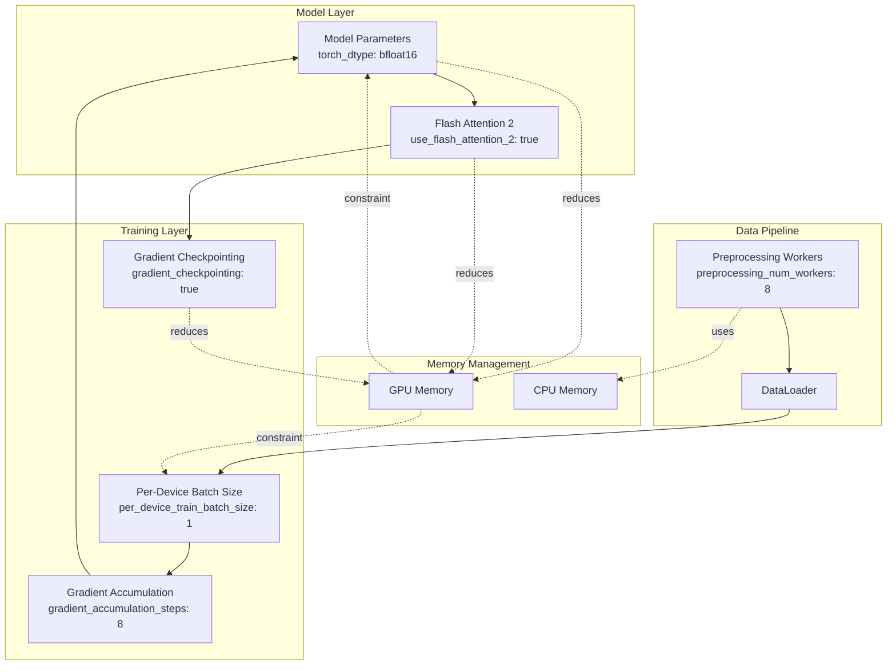
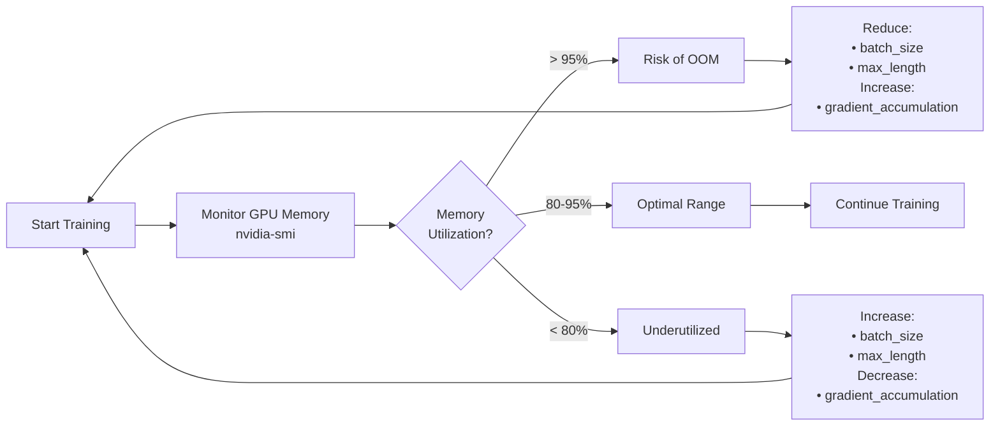
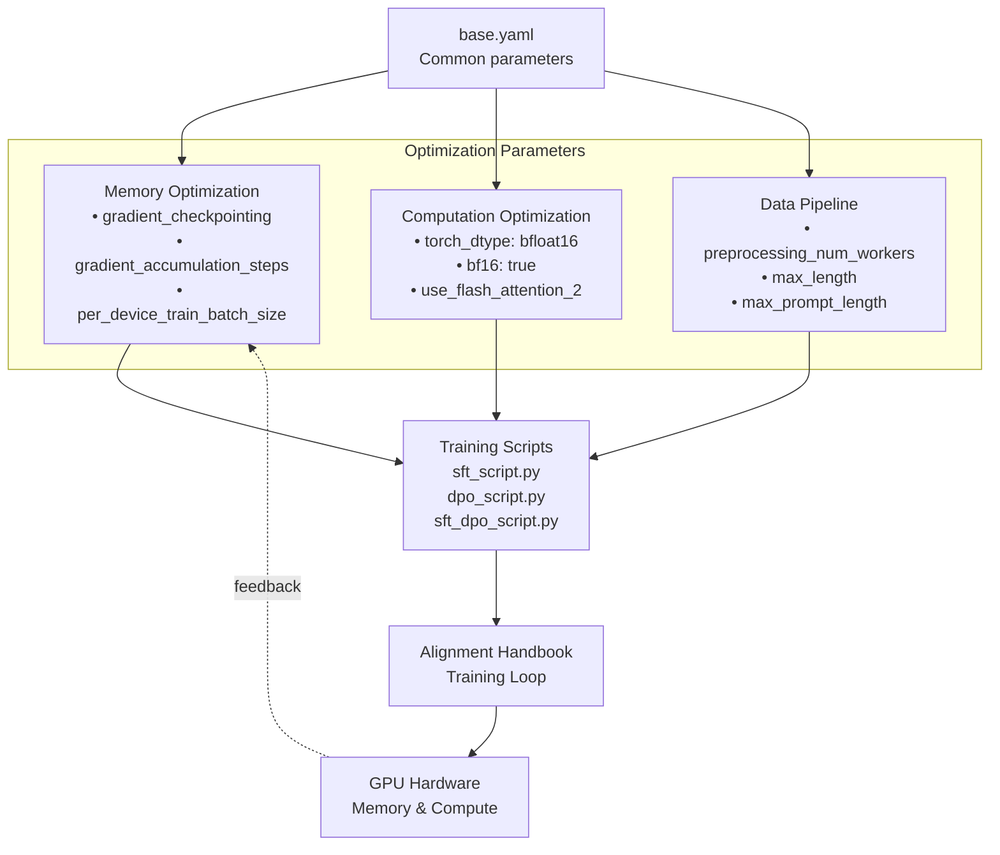

<!-- source: DeepWiki mcp.deepwiki.com · repo thunlp/Optima · page 11.4 Performance Optimization · fetched 2026-11-02 -->

# Performance Optimization

<details>
<summary>Relevant source files</summary>

The following files were used as context for generating this wiki page:

- [README_revise.md](README_revise.md)
- [alignment-handbook/recipes/Llama3-8b/arc_dpo/base.yaml](alignment-handbook/recipes/Llama3-8b/arc_dpo/base.yaml)

</details>


This page documents techniques for optimizing training speed and memory usage in Optima. These optimizations are critical for training large language models efficiently on GPU hardware, enabling faster iteration cycles and support for larger models and batch sizes.

For hyperparameter tuning strategies, see [Hyperparameter Tuning](#11.3). For multi-GPU training configurations, see [Multi-GPU Training](#11.2).

---

## Overview

Optima implements several performance optimization techniques that work together to reduce memory consumption and accelerate training:

- **Flash Attention 2**: Optimized attention mechanism implementation
- **bfloat16 Mixed Precision**: 16-bit brain floating point training
- **Gradient Checkpointing**: Trade computation for memory by recomputing activations
- **Gradient Accumulation**: Simulate larger batch sizes without additional memory
- **Efficient Data Loading**: Multi-worker preprocessing for data pipeline optimization

These optimizations are primarily configured through recipe YAML files and are applied during both SFT and DPO training phases.

Sources: [README_revise.md:1-131](), [alignment-handbook/recipes/Llama3-8b/arc_dpo/base.yaml:1-36]()

---

## Memory Optimization Techniques

### Flash Attention 2

Flash Attention 2 is an optimized implementation of the attention mechanism that significantly reduces memory usage and improves computation speed through kernel fusion and efficient memory access patterns.

**Configuration:**

```yaml
use_flash_attention_2: true
```

**Installation:**

Flash Attention 2 must be installed during environment setup:

```bash
pip install flash-attn --no-build-isolation
```

**Benefits:**
- Reduces memory usage for attention computation from O(n²) to O(n)
- Increases training throughput by 2-3x for long sequences
- Essential for training with `max_length: 4096` or larger

**Requirements:**
- CUDA-capable GPU (compute capability ≥ 7.5)
- PyTorch 2.3.1 or later
- Properly configured CUDA toolkit (12.1.0 in Optima)

Sources: [README_revise.md:44-45](), [alignment-handbook/recipes/Llama3-8b/arc_dpo/base.yaml:5]()

---

### Gradient Checkpointing

Gradient checkpointing reduces peak memory usage during backpropagation by trading computation time for memory. Instead of storing all intermediate activations, it recomputes them during the backward pass.

**Configuration:**

```yaml
gradient_checkpointing: true
gradient_checkpointing_kwargs:
  use_reentrant: false
```

**Parameter Details:**

| Parameter | Value | Purpose |
|-----------|-------|---------|
| `gradient_checkpointing` | `true` | Enable gradient checkpointing |
| `use_reentrant` | `false` | Use non-reentrant implementation (recommended for stability) |

**Memory Savings:**
- Reduces activation memory from O(n) to O(√n) layers
- Enables training with 30-40% larger models or batch sizes
- Critical for 8B parameter models on consumer GPUs

**Trade-offs:**
- Increases training time by approximately 20-30%
- Backward pass takes longer due to recomputation
- Worth the trade-off when GPU memory is constrained

Sources: [alignment-handbook/recipes/Llama3-8b/arc_dpo/base.yaml:18-20]()

---

### Gradient Accumulation

Gradient accumulation simulates larger batch sizes by accumulating gradients over multiple forward/backward passes before updating model parameters.

**Configuration:**

```yaml
gradient_accumulation_steps: 8
per_device_train_batch_size: 1
```

**Effective Batch Size Calculation:**

```
effective_batch_size = per_device_train_batch_size × gradient_accumulation_steps × num_gpus
```

For the example configuration with 1 GPU:
- Effective batch size = 1 × 8 × 1 = 8

**Benefits:**
- Enables training with larger effective batch sizes without OOM errors
- Maintains gradient stability for small `per_device_train_batch_size`
- Required when GPU memory limits `per_device_train_batch_size` to 1

**Configuration Strategy:**
1. Set `per_device_train_batch_size` to maximum that fits in memory
2. Adjust `gradient_accumulation_steps` to reach desired effective batch size
3. Monitor GPU memory utilization (`nvidia-smi`) to find optimal settings

Sources: [alignment-handbook/recipes/Llama3-8b/arc_dpo/base.yaml:17,30]()

---

## Computation Optimization Techniques

### Mixed Precision Training (bfloat16)

bfloat16 (brain floating point) provides 16-bit precision while maintaining the same dynamic range as float32, making it ideal for training large language models.

**Configuration:**

```yaml
torch_dtype: bfloat16
bf16: true
```

**Parameter Details:**

| Parameter | Value | Purpose |
|-----------|-------|---------|
| `torch_dtype` | `bfloat16` | Model parameter dtype |
| `bf16` | `true` | Enable bf16 training |

**Advantages over float16:**
- Wider dynamic range (same as float32)
- No loss scaling required
- Better numerical stability for LLM training
- Reduced risk of gradient overflow/underflow

**Memory Impact:**
- Reduces model memory footprint by 50%
- Reduces activation memory by 50%
- Enables training with 2x larger models or batch sizes

**Performance:**
- 1.5-2x training speedup on modern GPUs (A100, H100)
- Requires Ampere architecture or newer (compute capability ≥ 8.0)
- For older GPUs, fall back to `torch_dtype: float32` and `bf16: false`

Sources: [alignment-handbook/recipes/Llama3-8b/arc_dpo/base.yaml:4,12]()

---

### Data Preprocessing Pipeline

Efficient data loading prevents GPU starvation and maximizes training throughput.

**Configuration:**

```yaml
preprocessing_num_workers: 8
```

**Worker Count Selection:**

| System | Recommended Workers | Rationale |
|--------|-------------------|-----------|
| High-end workstation | 8-16 | Match CPU core count |
| Multi-GPU server | 16-32 | Scale with GPU count |
| Cloud instances | 4-8 | Balance with network I/O |

**Best Practices:**
- Set workers to number of CPU cores for CPU-bound preprocessing
- Monitor CPU utilization to detect bottlenecks
- Reduce workers if preprocessing is I/O-bound (slow storage)
- Consider caching preprocessed data for repeated training runs

**Pipeline Stages:**
1. Raw data loading from disk
2. Tokenization (CPU-intensive)
3. Padding and batching
4. Transfer to GPU memory

Sources: [alignment-handbook/recipes/Llama3-8b/arc_dpo/base.yaml:11]()

---

## Optimization Stack Diagram



Sources: [alignment-handbook/recipes/Llama3-8b/arc_dpo/base.yaml:4-30]()

---

## Configuration Best Practices

### Recommended Configuration Template

```yaml
# Model optimization
torch_dtype: bfloat16
use_flash_attention_2: true
bf16: true

# Memory optimization
gradient_checkpointing: true
gradient_checkpointing_kwargs:
  use_reentrant: false

# Batch size configuration
per_device_train_batch_size: 1
gradient_accumulation_steps: 8

# Data pipeline optimization
preprocessing_num_workers: 8

# Sequence length limits
max_length: 4096
max_prompt_length: 1024
```

Sources: [alignment-handbook/recipes/Llama3-8b/arc_dpo/base.yaml:4-26]()

---

### Memory Profiling Workflow



Sources: [alignment-handbook/recipes/Llama3-8b/arc_dpo/base.yaml:17-26,30-31]()

---

## Training Speed Optimization Matrix

| Configuration | Memory Usage | Training Speed | Recommended Use Case |
|---------------|-------------|----------------|----------------------|
| Flash Attention 2 = ON | Low | Fast | Always enable if supported |
| bf16 = ON | Low | Fast | Always enable on Ampere+ GPUs |
| Gradient Checkpointing = ON | Low | Moderate | Enable when memory-constrained |
| Gradient Accumulation = 8 | Moderate | Moderate | Balance memory and convergence |
| Workers = 8 | N/A | Fast | Match to CPU cores |
| Batch Size = 1 | Low | Slow | Minimum for LLaMA-3-8B |
| Batch Size = 2+ | High | Fast | Increase if memory allows |

Sources: [alignment-handbook/recipes/Llama3-8b/arc_dpo/base.yaml:4-31]()

---

## DPO-Specific Optimizations

DPO training requires loading and computing forward passes for both chosen and rejected sequences, doubling memory requirements compared to SFT.

**Key Parameters:**

```yaml
max_length: 4096
max_prompt_length: 1024
per_device_train_batch_size: 1
per_device_eval_batch_size: 1
beta: 0.2
```

**Memory Considerations:**

| Component | Memory Factor | Notes |
|-----------|---------------|-------|
| Prompt | 1x | Shared between chosen/rejected |
| Chosen completion | 1x | Full sequence storage |
| Rejected completion | 1x | Full sequence storage |
| Activations | 2x | Forward pass for both |
| Total | ~3x SFT | Approximate multiplier |

**Optimization Strategy:**
1. Set `per_device_train_batch_size: 1` for 8B models
2. Use `gradient_accumulation_steps: 8` or higher
3. Reduce `max_length` if memory-constrained
4. Consider `max_prompt_length: 1024` to limit context

Sources: [alignment-handbook/recipes/Llama3-8b/arc_dpo/base.yaml:13,25-26,30-31]()

---

## Environment-Specific Configuration

### optima-vllm Environment

The vLLM environment for model serving has different optimization priorities:

```bash
# PyTorch 2.3.1 for vLLM 0.5.3 compatibility
conda install pytorch=2.3.1 torchvision torchaudio pytorch-cuda=12.1 -c pytorch -c nvidia

# vLLM with optimized kernels
pip install vllm==0.5.3
```

**vLLM Optimizations:**
- Paged attention for memory efficiency
- Continuous batching for throughput
- Optimized KV cache management

Sources: [README_revise.md:22-29]()

---

### optima-train Environment

The training environment focuses on gradient-based optimization:

```bash
# PyTorch 2.3.1 with CUDA 12.1
conda install pytorch=2.3.1 torchvision torchaudio pytorch-cuda=12.1 -c pytorch -c nvidia

# Flash Attention 2 for training efficiency
pip install flash-attn --no-build-isolation
```

**Training-Specific Optimizations:**
- Flash Attention 2 for backpropagation
- Gradient checkpointing support
- Mixed precision training utilities

Sources: [README_revise.md:35-45]()

---

## Recipe Configuration Flow



Sources: [alignment-handbook/recipes/Llama3-8b/arc_dpo/base.yaml:1-36]()

---

## Monitoring and Profiling

### Key Metrics to Monitor

| Metric | Tool | Target Value | Action if Off-Target |
|--------|------|--------------|---------------------|
| GPU Memory Usage | `nvidia-smi` | 80-95% | Adjust batch size or gradient accumulation |
| GPU Utilization | `nvidia-smi` | >90% | Check data pipeline workers |
| Training Speed | Logs | ~X steps/sec | Enable missing optimizations |
| Loss Convergence | TensorBoard | Stable decrease | Check learning rate |

### Profiling Commands

Monitor GPU memory during training:
```bash
watch -n 1 nvidia-smi
```

Check training progress and speed:
```bash
tail -f output_dir/train_log.txt
```

### Performance Regression Checklist

- [ ] Flash Attention 2 installed (`pip list | grep flash-attn`)
- [ ] bfloat16 enabled in recipe (`torch_dtype: bfloat16`)
- [ ] Gradient checkpointing enabled (`gradient_checkpointing: true`)
- [ ] Appropriate gradient accumulation (`gradient_accumulation_steps >= 4`)
- [ ] Workers match CPU cores (`preprocessing_num_workers`)
- [ ] PyTorch 2.3.1 installed (`python -c "import torch; print(torch.__version__)"`)
- [ ] CUDA 12.1 available (`nvcc --version`)

Sources: [README_revise.md:22-45](), [alignment-handbook/recipes/Llama3-8b/arc_dpo/base.yaml:4-31]()

---

## Troubleshooting Common Issues

### Out of Memory (OOM) Errors

**Symptoms:**
```
RuntimeError: CUDA out of memory. Tried to allocate X.XX GiB
```

**Solutions (in order of preference):**

1. **Reduce batch size:**
   ```yaml
   per_device_train_batch_size: 1  # Start with minimum
   ```

2. **Increase gradient accumulation:**
   ```yaml
   gradient_accumulation_steps: 16  # Double from 8
   ```

3. **Enable gradient checkpointing:**
   ```yaml
   gradient_checkpointing: true
   ```

4. **Reduce sequence length:**
   ```yaml
   max_length: 2048  # Reduce from 4096
   max_prompt_length: 512  # Reduce from 1024
   ```

### Slow Training Speed

**Symptoms:**
- Training steps take >10 seconds each
- GPU utilization <80%

**Solutions:**

1. **Verify Flash Attention 2:**
   ```bash
   python -c "import flash_attn; print(flash_attn.__version__)"
   ```

2. **Enable bf16:**
   ```yaml
   bf16: true
   torch_dtype: bfloat16
   ```

3. **Increase data workers:**
   ```yaml
   preprocessing_num_workers: 16  # Scale with CPUs
   ```

4. **Check gradient checkpointing overhead:**
   ```yaml
   gradient_checkpointing: false  # Temporarily disable to test
   ```

Sources: [alignment-handbook/recipes/Llama3-8b/arc_dpo/base.yaml:4-31]()

---

## Advanced Optimization Techniques

### Optimizer Configuration

```yaml
optim: adamw_torch
learning_rate: 5.0e-7
lr_scheduler_type: cosine
warmup_ratio: 0.1
```

**Optimizer Impact:**
- `adamw_torch`: Standard AdamW with good memory efficiency
- Alternative: `adamw_8bit` for additional memory savings (requires `bitsandbytes`)

### Evaluation Strategy

```yaml
do_eval: true
evaluation_strategy: steps
eval_steps: 100
per_device_eval_batch_size: 1
```

**Optimization Considerations:**
- Evaluation doubles memory usage temporarily
- Set `evaluation_strategy: "no"` to disable for faster training
- Use `save_strategy: "no"` to skip intermediate checkpoints

Sources: [alignment-handbook/recipes/Llama3-8b/arc_dpo/base.yaml:14-16,28,31,34]()

---

## Summary Table

| Technique | Memory Savings | Speed Impact | Configuration Key | Requirement |
|-----------|---------------|--------------|-------------------|-------------|
| Flash Attention 2 | 30-50% | +2x faster | `use_flash_attention_2: true` | Compute ≥7.5 |
| bfloat16 | 50% | +1.5x faster | `bf16: true` | Ampere+ GPU |
| Gradient Checkpointing | 30-40% | -20% slower | `gradient_checkpointing: true` | Any GPU |
| Gradient Accumulation | Marginal | Neutral | `gradient_accumulation_steps: 8` | Any GPU |
| Multi-worker Loading | N/A | +20% faster | `preprocessing_num_workers: 8` | Multi-core CPU |

Sources: [alignment-handbook/recipes/Llama3-8b/arc_dpo/base.yaml:4-31]()

---

