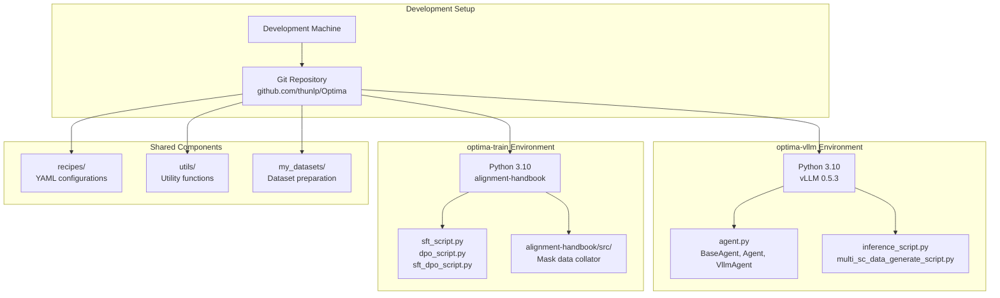
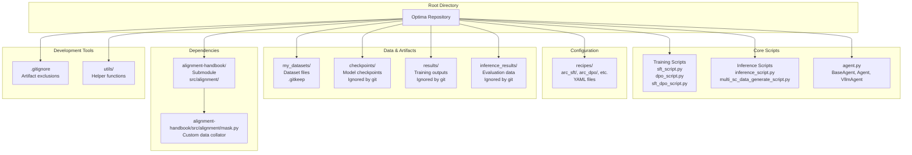
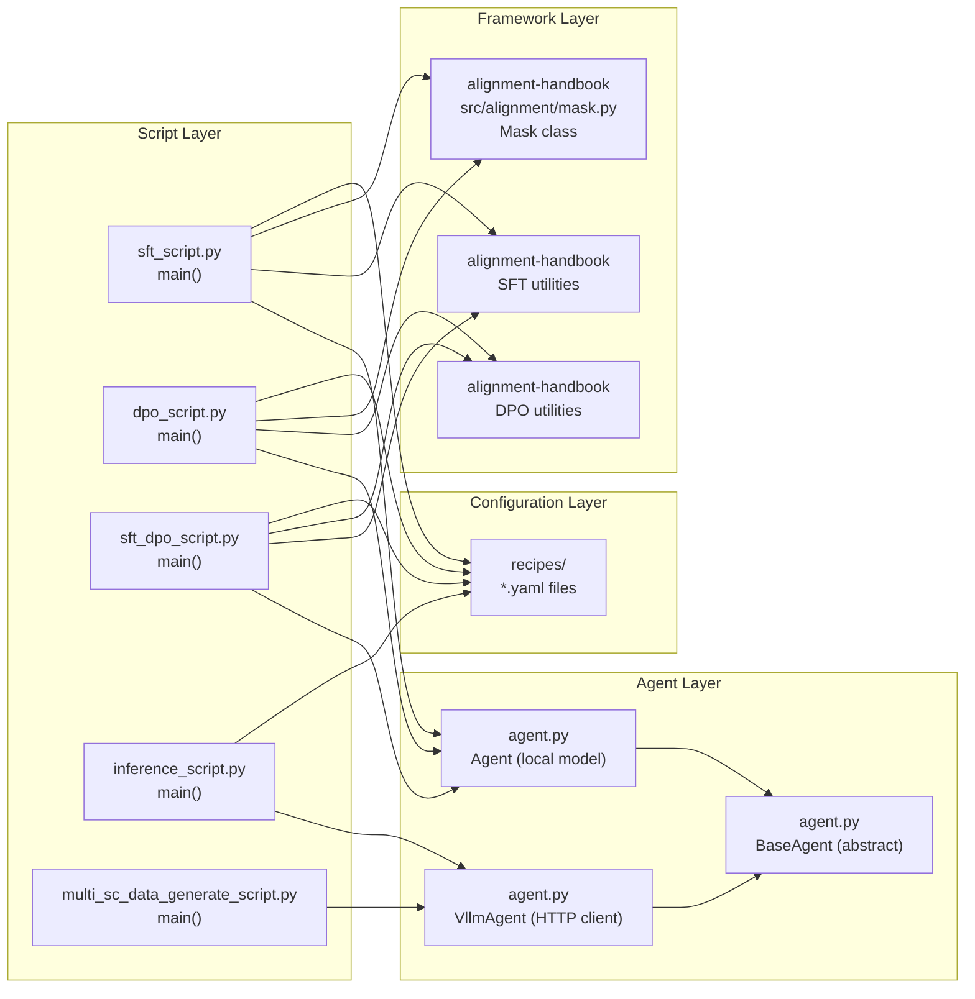
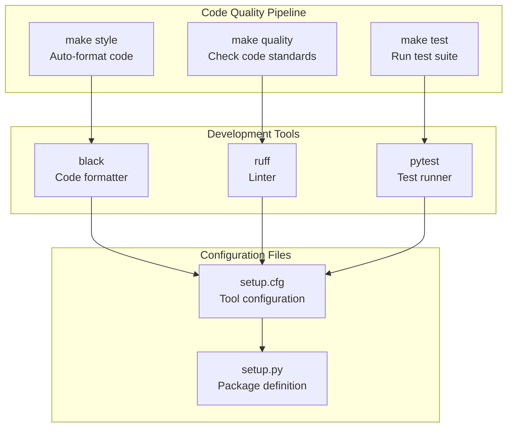
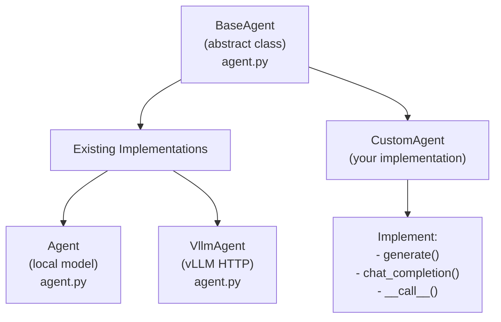
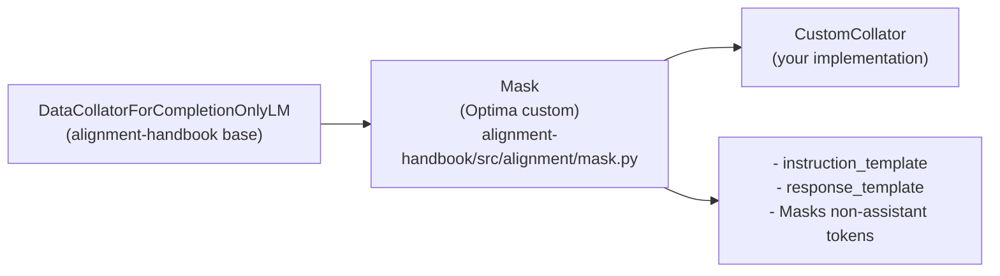

<!-- source: DeepWiki mcp.deepwiki.com · repo thunlp/Optima · page 12 Development and Contributing · fetched 2026-11-02 -->

# Development and Contributing

<details>
<summary>Relevant source files</summary>

The following files were used as context for generating this wiki page:

- [.gitignore](.gitignore)
- [alignment-handbook/README.md](alignment-handbook/README.md)

</details>


This page provides guidance for developers who want to contribute to the Optima codebase or extend it for their own research purposes. It covers the project structure, development environment setup, code quality standards, testing practices, and the contribution process.

For detailed information on specific topics, see:
- **Project structure and file organization**: [12.1](#12.1)
- **Code quality tools and testing procedures**: [12.2](#12.2)
- **Contributing guidelines and standards**: [12.3](#12.3)

For information about using Optima as an end-user, see [Getting Started](#2).

---

## Development Environment Overview

Optima uses a dual-environment architecture that separates model serving from training. As a developer, you'll need to understand both environments and how they interact.

### Environment Architecture



**Development Environment Requirements**

| Environment | Python Version | Key Dependencies | Purpose |
|------------|----------------|------------------|---------|
| `optima-vllm` | 3.10 | vLLM 0.5.3, torch 2.3.0+cu121 | Model serving, inference, agent interactions |
| `optima-train` | 3.10 | alignment-handbook, transformers, accelerate | Model training, data processing |

**Sources:** [alignment-handbook/README.md:59-99]()

---

## Repository Structure

The Optima repository is organized into distinct functional areas. Understanding this structure is essential for navigating and contributing to the codebase.

### Directory Layout



**Key Directories and Files:**

| Path | Purpose | Git Tracking |
|------|---------|--------------|
| `sft_script.py`, `dpo_script.py`, `sft_dpo_script.py` | Main training entry points | Tracked |
| `inference_script.py`, `multi_sc_data_generate_script.py` | Inference and data generation | Tracked |
| `agent.py` | Agent class implementations | Tracked |
| `recipes/` | YAML configuration files for training | Tracked |
| `alignment-handbook/` | Git submodule with training framework | Submodule |
| `my_datasets/` | Dataset storage (only `.gitkeep` tracked) | Partially tracked |
| `checkpoints/` | Model checkpoints (excluded from git) | Ignored |
| `results/` | Training outputs (excluded from git) | Ignored |
| `inference_results/` | Inference outputs (excluded from git) | Ignored |
| `utils/` | Utility functions and helpers | Tracked |

**Sources:** [.gitignore:1-16](), [alignment-handbook/README.md:101-114]()

---

## Git Ignore Configuration

The `.gitignore` file defines which artifacts are excluded from version control. This is critical for keeping the repository clean and avoiding large binary files.

**Ignored Artifacts:**

```
results/*                  # Training outputs
__pycache__/              # Python bytecode
output/*                  # General output directory
*.whl                     # Python wheel files
my_datasets/*             # Dataset files (except .gitkeep)
others/*                  # Miscellaneous files
inference_results/*       # Inference outputs (except .gitkeep)
*.jsonl                   # JSONL data files (except utils/*.jsonl)
*.tgz                     # Compressed archives
.vscode                   # Editor configuration
.cache                    # Cache files
checkpoints/*             # Model checkpoints
```

**Note:** The `.gitkeep` files in `my_datasets/`, `results/`, and `inference_results/` are tracked to preserve directory structure in the repository.

**Sources:** [.gitignore:1-16]()

---

## Code Organization and Key Components

Understanding the relationship between different code components helps developers navigate the codebase and identify where to make changes.



**Component Responsibilities:**

| Component | File(s) | Responsibility |
|-----------|---------|----------------|
| **Training Scripts** | `sft_script.py`, `dpo_script.py`, `sft_dpo_script.py` | Orchestrate training workflows, parse configs, manage multi-agent data generation |
| **Inference Scripts** | `inference_script.py`, `multi_sc_data_generate_script.py` | Run batch inference, generate self-consistency samples |
| **Agent Classes** | `agent.py` | Abstract agent interface, local model wrapper, vLLM HTTP client |
| **Mask Collator** | `alignment-handbook/src/alignment/mask.py` | Custom data collator for completion-only training |
| **Alignment Framework** | `alignment-handbook/src/` | SFT/DPO training utilities, trainers, data processing |
| **Recipe Configs** | `recipes/**/*.yaml` | Training hyperparameters, model paths, dataset mixers |

**Sources:** [alignment-handbook/README.md:33-44]()

---

## Development Workflow

### Setting Up for Development

1. **Clone the repository with submodules:**
   ```bash
   git clone --recursive https://github.com/thunlp/Optima.git
   cd Optima
   ```

2. **Create and activate environments:**
   ```bash
   # Create optima-vllm environment
   conda create -n optima-vllm python=3.10
   conda activate optima-vllm
   # Install vLLM dependencies
   
   # Create optima-train environment
   conda create -n optima-train python=3.10
   conda activate optima-train
   # Install alignment-handbook
   cd alignment-handbook
   python -m pip install .
   cd ..
   ```

3. **Install development dependencies:**
   Development tools are managed through the alignment-handbook's `Makefile` and `setup.cfg`.

**Sources:** [alignment-handbook/README.md:59-99]()

### Making Changes

**Workflow for code contributions:**


**Key development commands:**

| Task | Command | Location |
|------|---------|----------|
| Code formatting | `make style` | `alignment-handbook/Makefile` |
| Quality checks | `make quality` | `alignment-handbook/Makefile` |
| Run tests | `make test` | `alignment-handbook/Makefile` |

**Sources:** [alignment-handbook/README.md:105]()

---

## Code Quality Standards

The alignment-handbook submodule includes a `Makefile` with targets for maintaining code quality. These standards apply to contributions to the Optima repository as well.

### Build System

The `Makefile` provides the following targets:



**Makefile Targets:**

| Target | Purpose | Tools Used |
|--------|---------|-----------|
| `make style` | Automatically format code to comply with style guidelines | `black`, `ruff --fix` |
| `make quality` | Check code quality without making changes | `ruff check`, `black --check` |
| `make test` | Run unit tests to verify functionality | `pytest` |

**Configuration:**

The `setup.cfg` file (located in `alignment-handbook/`) contains configuration for:
- Code formatting rules (black)
- Linting rules (ruff)
- Test discovery and execution (pytest)
- Package metadata

**Sources:** [alignment-handbook/README.md:105-113]()

---

## Testing Practices

### Test Organization

The alignment-handbook includes a `tests/` directory for unit tests. When contributing to Optima, consider adding tests for:

- New agent implementations
- Data processing utilities
- Configuration parsing logic
- Multi-agent interaction scenarios

### Running Tests

```bash
cd alignment-handbook
make test
```

This executes the test suite defined in the `tests/` directory using pytest.

**Sources:** [alignment-handbook/README.md:113]()

---

## Extension Points for Researchers

Optima is designed to be extensible. Common extension scenarios include:

### 1. Adding Custom Agent Types

To implement a new agent backend:



**Requirements:**
- Inherit from `BaseAgent` class
- Implement required abstract methods: `generate()`, `chat_completion()`, `__call__()`
- Follow the `llmMessage` conversation format
- Handle both string and list inputs

**Sources:** Based on architecture diagrams showing agent hierarchy

### 2. Adding New Training Methods

To add a new alignment method beyond SFT/DPO:

1. Create a new script in the root directory (e.g., `custom_method_script.py`)
2. Use the alignment-handbook framework as the base
3. Create corresponding recipe configurations in `recipes/custom_method/`
4. Optionally extend the Mask data collator for custom masking logic

### 3. Adding Custom Datasets

To integrate new datasets:

1. Place dataset files in `my_datasets/your_dataset/`
2. Follow the expected format (see [10.1](#10.1) for details)
3. Create recipe configurations that reference your dataset
4. Update the `dataset_mixer` in recipe YAML files

### 4. Custom Data Collators

The Mask data collator can be extended for custom token masking strategies:



**Extension approach:**
- Inherit from `Mask` class
- Override token masking logic
- Maintain compatibility with the training pipeline

**Sources:** Based on architecture showing Mask data collator integration

---

## Contributing to the Repository

### Contribution Process

1. **Fork the repository** on GitHub
2. **Create a feature branch** with a descriptive name
3. **Make your changes** following code quality standards
4. **Run code quality checks**: `make style && make quality`
5. **Run tests**: `make test` (if applicable)
6. **Commit with clear messages** describing your changes
7. **Push to your fork** and create a pull request
8. **Respond to review feedback** from maintainers

### Pull Request Guidelines

**Good PR characteristics:**
- Clear title and description
- References related issues (if any)
- Includes tests for new functionality
- Updates documentation as needed
- Passes all CI checks
- Minimal, focused changes

### Code Review Process

All contributions are reviewed by project maintainers. Reviews focus on:
- Code correctness and functionality
- Adherence to code quality standards
- Test coverage
- Documentation completeness
- Compatibility with existing systems

**Sources:** [alignment-handbook/README.md:101-129]()

---

## Working with the alignment-handbook Submodule

The alignment-handbook is included as a git submodule and provides the core training infrastructure.

### Submodule Commands

| Task | Command |
|------|---------|
| Initialize submodules | `git submodule update --init --recursive` |
| Update submodule | `cd alignment-handbook && git pull origin main` |
| Check submodule status | `git submodule status` |

### Custom Modifications

Optima includes a custom `Mask` class in `alignment-handbook/src/alignment/mask.py` that extends the base alignment-handbook functionality. When updating the submodule:

1. Ensure custom modifications are preserved
2. Test training scripts after updates
3. Verify compatibility with new alignment-handbook features

**Sources:** Based on architecture showing alignment-handbook integration

---

## Continuous Integration and Release

### Package Building

The alignment-handbook includes infrastructure for building Python packages:

```bash
cd alignment-handbook
# Build wheel
python -m build
```

This generates `.whl` files (which are excluded from git via `.gitignore`).

### Release Process

For maintainers releasing new versions:

1. Update version numbers in package metadata
2. Run full test suite
3. Build distribution packages
4. Tag the release in git
5. Update documentation

**Sources:** [.gitignore:4](), [alignment-handbook/README.md:105-114]()

---

## Getting Help

### Resources for Developers

- **alignment-handbook documentation**: [GitHub Repository](https://github.com/huggingface/alignment-handbook)
- **alignment-handbook paper**: Technical report on alignment methods
- **Issue tracker**: Report bugs or request features on GitHub
- **Code documentation**: Inline comments and docstrings in source files

### Common Development Tasks

| Task | Command/Location |
|------|------------------|
| Format code | `cd alignment-handbook && make style` |
| Check code quality | `cd alignment-handbook && make quality` |
| Run tests | `cd alignment-handbook && make test` |
| View training configs | `ls recipes/*/` |
| Check ignored files | `cat .gitignore` |
| Update submodules | `git submodule update --remote` |

**Sources:** [alignment-handbook/README.md:1-130]()

---

## Summary

This page covered the essential information for developers contributing to or extending Optima:

- **Dual-environment architecture** separating vLLM serving from training
- **Repository structure** with training scripts, agents, recipes, and the alignment-handbook submodule
- **Git ignore configuration** for managing artifacts and checkpoints
- **Code quality standards** using `make style`, `make quality`, and `make test`
- **Extension points** for custom agents, training methods, datasets, and data collators
- **Contributing process** including PR guidelines and code review

For specific implementation details, refer to the child pages [12.1](#12.1), [12.2](#12.2), and [12.3](#12.3).

---

