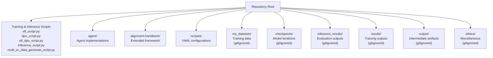
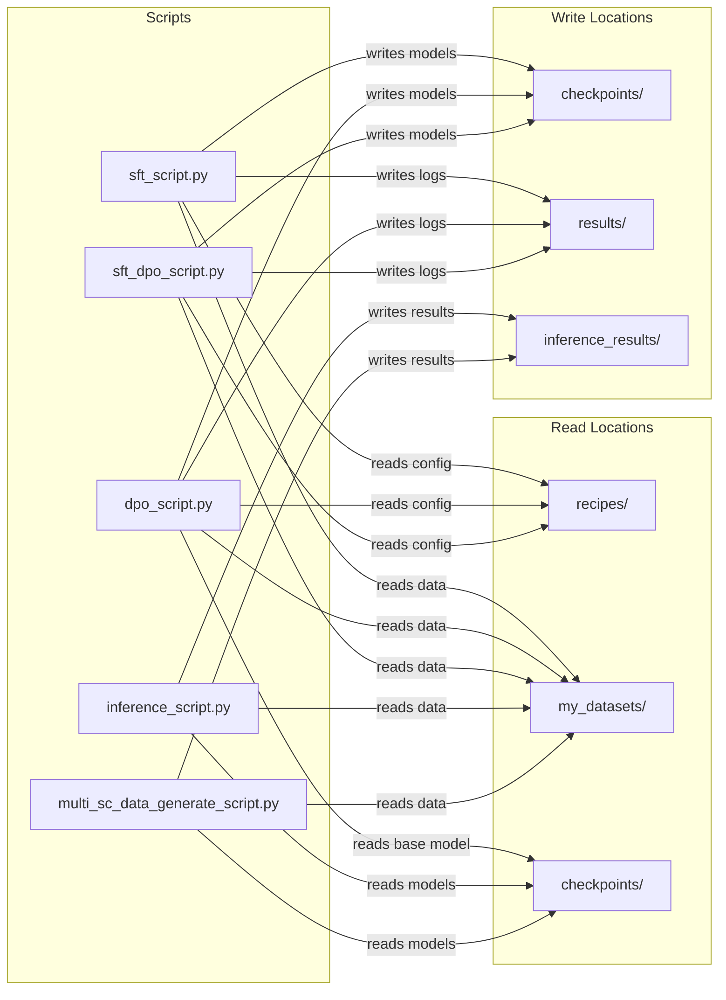

<!-- source: DeepWiki mcp.deepwiki.com · repo thunlp/Optima · page 12.1 Project Structure · fetched 2026-11-02 -->

# Project Structure

<details>
<summary>Relevant source files</summary>

The following files were used as context for generating this wiki page:

- [.gitignore](.gitignore)
- [agent/__init__.py](agent/__init__.py)
- [alignment-handbook/mask/__init__.py](alignment-handbook/mask/__init__.py)

</details>


## Purpose and Scope

This page provides a comprehensive overview of the Optima repository's organization, including the layout of directories, the purpose of key files, and how different components are structured on disk. This is essential reference material for developers who want to understand the codebase or contribute to the project.

For information about specific system architectures and their implementations, see the following pages:
- Agent system implementation details: [Agent System](#5)
- Training pipeline components: [Training System](#6)
- Configuration file formats: [Configuration Recipes](#7)
- Dataset and checkpoint management: [Datasets and Artifacts](#10)

## Repository Layout

The Optima repository follows a modular structure that separates training scripts, agent implementations, configuration recipes, data artifacts, and the alignment framework extension. The root directory contains the main execution scripts, while subdirectories organize supporting components by functionality.

### High-Level Directory Structure



**Sources:** [.gitignore:1-16](), [agent/__init__.py:1](), [alignment-handbook/mask/__init__.py:1]()

## Core Directories

### Root-Level Training Scripts

The root directory contains the primary execution entry points for training and inference workflows. These scripts orchestrate the entire pipeline by coordinating agents, loading configurations, and managing the training loop.

| Script | Purpose |
|--------|---------|
| `sft_script.py` | Supervised Fine-Tuning (SFT) training script for single iterations |
| `dpo_script.py` | Direct Preference Optimization (DPO) training script |
| `sft_dpo_script.py` | Combined SFT-DPO training script for hybrid approaches |
| `inference_script.py` | Batch inference script for evaluating checkpoints |
| `multi_sc_data_generate_script.py` | Multi-agent self-consistency data generation script |

**Sources:** High-level system diagrams

### `agent/` Directory

Contains the agent class hierarchy that enables multi-agent interactions. This directory implements the abstraction layer between the training pipeline and the model serving infrastructure.

**Key Components:**
- `BaseAgent` (abstract interface)
- `Agent` (local LLM implementation)
- `VllmAgent` (HTTP client for vLLM services)

The agent module provides the foundation for Alice-Bob style conversations used in iterative data generation.

**Sources:** [agent/__init__.py:1](), High-level system diagrams (Diagram 3)

### `alignment-handbook/` Directory

Contains Optima's extensions to the alignment-handbook framework, including custom data collators and training utilities.

**Structure:**
```
alignment-handbook/
├── mask/              # Completion-only masking implementation
│   └── __init__.py
└── [other modules]    # Core alignment utilities
```

The `mask/` subdirectory contains the `Mask` data collator class that implements completion-only language modeling by masking non-assistant tokens during training. This ensures only agent responses contribute to the loss calculation.

**Sources:** [alignment-handbook/mask/__init__.py:1](), High-level system diagrams (Diagram 1)

### `recipes/` Directory

Stores YAML configuration files that define training parameters, model configurations, and dataset mixers. The recipe system follows a hierarchical structure with base configurations and iteration-specific overrides.

**Expected Structure:**
```
recipes/
├── arc_sft/
│   ├── base.yaml
│   ├── iteration_0.yaml
│   ├── iteration_1.yaml
│   └── ...
├── arc_dpo/
│   ├── base.yaml
│   └── iteration_*.yaml
├── arc_sft_dpo/
├── cbt_sft/
├── cbt_dpo/
└── cbt_sft_dpo/
```

Each recipe directory contains configurations for a specific dataset and training method combination.

**Sources:** High-level system diagrams (Diagram 4)

### `my_datasets/` Directory

Contains training and evaluation datasets used by the training scripts. This directory is gitignored to avoid committing large data files, with only a `.gitkeep` file tracked to preserve the directory structure.

**Expected Datasets:**
- `arc/` - AI2 Reasoning Challenge
- `hotpot_qa/` - HotpotQA multi-hop reasoning
- `mwh_qa/` - Multi-hop question answering
- `trivial_qa/` - TriviaQA
- `cbt/` - Children's Book Test
- `math/` - Mathematical reasoning
- `gsm8k/` - Grade School Math
- `mmlu/` - Massive Multitask Language Understanding

**Sources:** [.gitignore:5-7](), High-level system diagrams (Diagram 5)

### `checkpoints/` Directory

Stores model checkpoints produced by training iterations. Each iteration creates a subdirectory containing the trained model weights, tokenizer configuration, and training metadata. This directory is gitignored due to the large size of model files.

**Expected Structure:**
```
checkpoints/
├── iteration_0/
│   ├── config.json
│   ├── model.safetensors
│   ├── tokenizer.json
│   └── ...
├── iteration_1/
└── iteration_N/
```

**Sources:** [.gitignore:16](), High-level system diagrams (Diagram 2, Diagram 5)

### `inference_results/` Directory

Contains output from inference scripts, including model predictions, evaluation metrics, and conversation traces. This directory is gitignored except for a `.gitkeep` file, allowing developers to preserve directory structure while excluding large result files.

**Sources:** [.gitignore:9-10](), High-level system diagrams (Diagram 1)

### `results/` Directory

Stores training outputs, logs, and intermediate results from training scripts. This directory is gitignored to avoid committing potentially large log files and temporary artifacts.

**Sources:** [.gitignore:1-2,8](), High-level system diagrams (Diagram 1)

### `output/` Directory

Holds intermediate artifacts generated during training or inference workflows, such as preprocessed data, tokenized sequences, or temporary files. This directory is gitignored.

**Sources:** [.gitignore:3]()

### `others/` Directory

A catch-all directory for miscellaneous files not fitting into other categories. This directory is gitignored.

**Sources:** [.gitignore:6]()

## File Organization by Functionality

The following diagram maps functional components to their implementation files, bridging conceptual understanding with actual code entities.

```mermaid
graph TB
    subgraph "Training Pipeline"
        SFTScript["sft_script.py"]
        DPOScript["dpo_script.py"]
        SFTDPOScript["sft_dpo_script.py"]
    end
    
    subgraph "Inference Pipeline"
        InferenceScript["inference_script.py"]
        MultiSCScript["multi_sc_data_generate_script.py"]
    end
    
    subgraph "Agent Module"
        AgentInit["agent/__init__.py"]
        BaseAgentClass["BaseAgent class"]
        AgentClass["Agent class"]
        VllmAgentClass["VllmAgent class"]
    end
    
    subgraph "Alignment Framework"
        MaskInit["alignment-handbook/mask/__init__.py"]
        MaskClass["Mask data collator"]
    end
    
    subgraph "Configuration"
        RecipeYAML["recipes/*/base.yaml"]
        IterationYAML["recipes/*/iteration_*.yaml"]
    end
    
    subgraph "Data Artifacts"
        MyDatasets["my_datasets/<dataset_name>/"]
        CheckpointsDir["checkpoints/iteration_*/"]
        InfResultsDir["inference_results/"]
        ResultsDir["results/"]
    end
    
    SFTScript --> AgentInit
    DPOScript --> AgentInit
    SFTDPOScript --> AgentInit
    
    SFTScript --> MaskInit
    DPOScript --> MaskInit
    
    SFTScript --> RecipeYAML
    DPOScript --> RecipeYAML
    
    InferenceScript --> AgentInit
    MultiSCScript --> AgentInit
    
    AgentInit --> BaseAgentClass
    AgentInit --> AgentClass
    AgentInit --> VllmAgentClass
    
    MaskInit --> MaskClass
    
    RecipeYAML --> IterationYAML
    
    SFTScript --> MyDatasets
    SFTScript --> CheckpointsDir
    
    InferenceScript --> CheckpointsDir
    InferenceScript --> InfResultsDir
    
    SFTScript --> ResultsDir
    DPOScript --> ResultsDir
```



**Sources:** All files listed in the diagram

## Gitignore Patterns

The repository uses `.gitignore` to exclude large data files, build artifacts, and generated outputs from version control. This keeps the repository lightweight while preserving directory structure through `.gitkeep` files.

### Excluded Patterns

| Pattern | Purpose |
|---------|---------|
| `results/*` | Training logs and outputs |
| `__pycache__/` | Python bytecode cache |
| `output/*` | Intermediate processing artifacts |
| `*.whl` | Python wheel distribution files |
| `my_datasets/*` | Large dataset files |
| `others/*` | Miscellaneous excluded files |
| `inference_results/*` | Evaluation output files |
| `*.jsonl` | JSONL data files (with exception) |
| `*.tgz` | Compressed archives |
| `.vscode` | Editor configuration |
| `.cache` | Cache directories |
| `checkpoints/*` | Model checkpoint files |

### Preserved Files

| Pattern | Purpose |
|---------|---------|
| `!my_datasets/.gitkeep` | Preserve directory structure |
| `!results/.gitkeep` | Preserve directory structure |
| `!inference_results/.gitkeep` | Preserve directory structure |
| `!utils/*.jsonl` | Utility JSONL files are tracked |

**Sources:** [.gitignore:1-16]()

## Script-to-Directory Dependency Map

This diagram shows which directories each main script reads from or writes to, providing a clear view of data flow through the filesystem.



**Sources:** High-level system diagrams (Diagram 1, Diagram 5)

## Module Initialization Files

The repository uses Python package initialization files to organize code into importable modules.

### `agent/__init__.py`

This empty initialization file marks the `agent/` directory as a Python package, allowing imports such as:
- `from agent import BaseAgent`
- `from agent import Agent`
- `from agent import VllmAgent`

**Sources:** [agent/__init__.py:1]()

### `alignment-handbook/mask/__init__.py`

This initialization file marks the `mask/` subdirectory as a Python package, enabling imports like:
- `from alignment_handbook.mask import Mask`

The `Mask` class is the primary export from this module, implementing completion-only masking for the data collator.

**Sources:** [alignment-handbook/mask/__init__.py:1]()

## Directory Size and Management Considerations

Most data directories (`my_datasets/`, `checkpoints/`, `results/`, `inference_results/`) are gitignored because they contain large files:

- **Model checkpoints**: Typically 15-30 GB per iteration for an 8B parameter model
- **Datasets**: Can range from hundreds of MB to several GB depending on the dataset
- **Inference results**: JSONL files containing predictions can be hundreds of MB
- **Training logs**: TensorBoard logs and trainer state can accumulate to several GB over multiple runs

Developers should ensure adequate disk space is available:
- **Minimum recommended**: 100 GB for basic experimentation (1-2 iterations)
- **Full pipeline**: 500+ GB for multiple iterations across datasets

The `.gitkeep` files ensure these directories exist when cloning the repository, preventing errors when scripts attempt to write to them.

**Sources:** [.gitignore:1-16]()

## Summary

The Optima repository structure separates concerns cleanly:

1. **Execution layer**: Root-level scripts (`*_script.py` files) orchestrate workflows
2. **Implementation layer**: `agent/` and `alignment-handbook/` provide core functionality
3. **Configuration layer**: `recipes/` stores declarative training parameters
4. **Data layer**: `my_datasets/`, `checkpoints/`, `results/`, `inference_results/` manage artifacts

This organization enables:
- Easy navigation for developers
- Clear separation between code and data
- Modular development of individual components
- Reproducible experiments through recipe configurations
- Efficient disk space management through gitignore patterns

**Sources:** All files and diagrams referenced throughout this document

---

