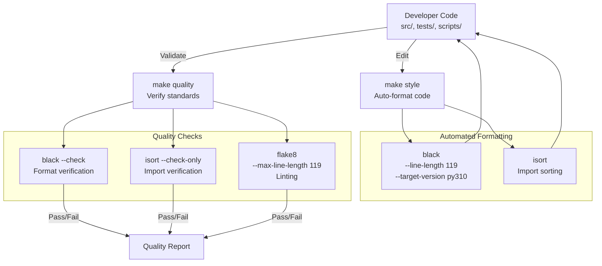
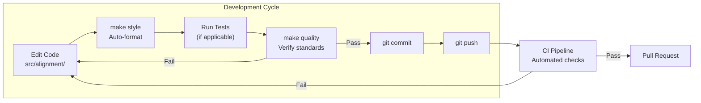
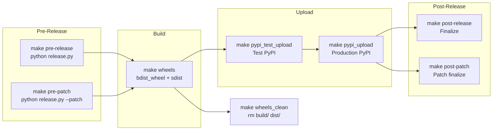
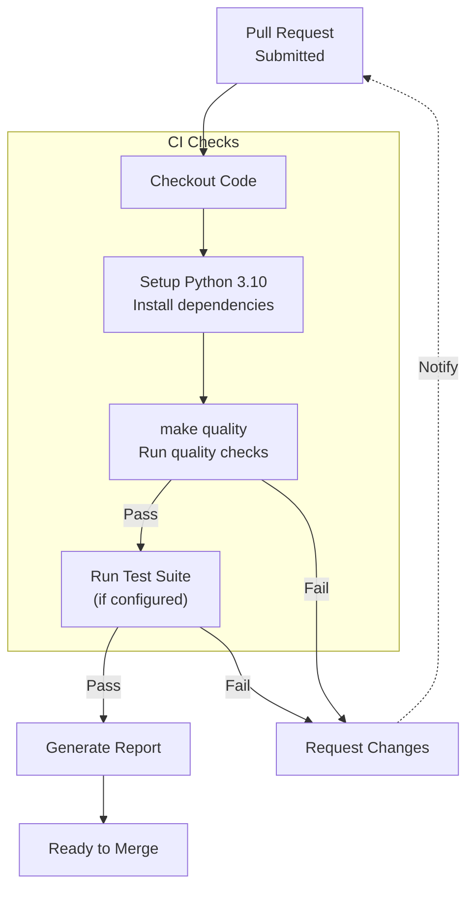

<!-- source: DeepWiki mcp.deepwiki.com · repo thunlp/Optima · page 12.2 Code Quality and Testing · fetched 2026-11-02 -->

# Code Quality and Testing

<details>
<summary>Relevant source files</summary>

The following files were used as context for generating this wiki page:

- [alignment-handbook/.gitignore](alignment-handbook/.gitignore)
- [alignment-handbook/Makefile](alignment-handbook/Makefile)

</details>


## Purpose and Scope

This page documents the code quality standards, testing practices, and development tools used in the Optima project, specifically within the alignment-handbook component. It covers the automated tools for maintaining code consistency, the Makefile targets available for quality checks, and guidelines for ensuring code meets project standards before contributing.

For information about the overall project structure and organization, see [Project Structure](#12.1). For guidelines on contributing code and submitting pull requests, see [Contributing Guidelines](#12.3).

---

## Code Quality Standards

The Optima project maintains strict code quality standards through automated tooling integrated into the alignment-handbook component. All code must pass quality checks before being merged into the main codebase.

### Code Formatting Requirements

| Standard | Tool | Configuration |
|----------|------|---------------|
| Line Length | `black` | 119 characters maximum |
| Target Python Version | `black` | Python 3.10 |
| Import Ordering | `isort` | Default configuration |
| Code Style | `flake8` | Max line length 119 |

### Checked Directories

The quality tools scan the following directories:
- `src/` - Core source code
- `tests/` - Test suites
- `scripts/` - Utility and training scripts
- `setup.py` - Package configuration

Sources: [alignment-handbook/Makefile:6]()

---

## Quality Toolchain Architecture

The following diagram shows how the quality tools work together to enforce code standards:



**Quality Toolchain Flow**

This diagram illustrates the two main workflows: `make style` for automatic formatting and `make quality` for validation. The `style` target modifies code in place, while the `quality` target only reports issues without making changes.

Sources: [alignment-handbook/Makefile:8-15]()

---

## Make Targets Reference

### Core Development Targets

The alignment-handbook Makefile provides several targets for maintaining code quality:

#### `make style`

Automatically formats code to meet project standards. This target runs:
1. `black` - Reformats Python code with 119-character line length
2. `isort` - Sorts and organizes import statements

```bash
make style
```

This command modifies files in place to conform to the style guide. Run this before committing code.

Sources: [alignment-handbook/Makefile:8-10]()

#### `make quality`

Validates code against quality standards without modifying files. This target runs:
1. `black --check` - Verifies code formatting
2. `isort --check-only` - Verifies import ordering
3. `flake8` - Performs linting checks

```bash
make quality
```

This command exits with a non-zero status if any checks fail, making it suitable for CI/CD pipelines.

Sources: [alignment-handbook/Makefile:12-15]()

---

## Development Workflow

The following diagram shows the recommended development workflow incorporating quality checks:



**Recommended Development Workflow**

This workflow ensures code quality at multiple stages: during development (make style), before committing (make quality), and in continuous integration.

Sources: [alignment-handbook/Makefile:1-15]()

---

## Testing Infrastructure

### Test Directory Structure

The alignment-handbook component includes a `tests/` directory for unit and integration tests. All test files are subject to the same quality standards as production code.

| Directory | Purpose |
|-----------|---------|
| `tests/` | Test suite root directory |
| `src/` | Source code under test |
| `scripts/` | Script tests and utilities |

Sources: [alignment-handbook/Makefile:6]()

### Python Path Configuration

The Makefile configures the Python path to prioritize the local checkout over installed packages:

```makefile
export PYTHONPATH = src
```

This ensures that when running tests or quality checks, the local development version of the code is used rather than any pre-installed package versions. This is critical for testing changes before they are published.

Sources: [alignment-handbook/Makefile:4]()

---

## Quality Check Details

### Black Code Formatter

Black enforces consistent code formatting across the entire codebase. Configuration:

- **Line Length**: 119 characters
- **Target Version**: Python 3.10
- **Mode**: Deterministic formatting (no configuration options)

Black reformats code to eliminate style debates and ensure consistency. It handles:
- Indentation and spacing
- Quote normalization
- Line breaks and wrapping
- Trailing commas

Sources: [alignment-handbook/Makefile:9,13]()

### Isort Import Sorter

Isort organizes import statements according to PEP 8 guidelines:

- Separates standard library, third-party, and local imports
- Sorts imports alphabetically within each section
- Removes unused imports when combined with other tools
- Ensures consistent import style across files

Sources: [alignment-handbook/Makefile:10,14]()

### Flake8 Linter

Flake8 performs static analysis to catch potential errors and style violations:

- **Max Line Length**: 119 characters (matching Black)
- **Checks**: PEP 8 compliance, syntax errors, undefined names
- **Error Codes**: Reports specific violation codes for easy debugging

Flake8 catches issues that formatters cannot fix, such as:
- Unused imports and variables
- Undefined names
- Syntax errors
- Complexity warnings

Sources: [alignment-handbook/Makefile:15]()

---

## Integration with Version Control

### Ignored Files and Directories

The `.gitignore` file excludes build artifacts, temporary files, and environment-specific files from version control:

| Category | Examples |
|----------|----------|
| Build Artifacts | `build/`, `dist/`, `*.egg-info/` |
| Python Cache | `__pycache__/`, `*.pyc`, `.pytest_cache/` |
| Test Coverage | `.coverage`, `htmlcov/`, `coverage.xml` |
| Virtual Environments | `venv/`, `env/`, `.venv` |
| IDE Files | `.idea/`, `.vscode/` |
| Temporary Data | `data/`, `wandb/` |

This ensures that only source code and essential configuration files are tracked, keeping the repository clean and reducing merge conflicts.

Sources: [alignment-handbook/.gitignore:1-164]()

### Coverage and Test Reports

Test coverage reports are excluded from version control but generated locally:
- `.coverage` - Coverage data file
- `htmlcov/` - HTML coverage reports
- `coverage.xml` - XML coverage for CI tools
- `.pytest_cache/` - Pytest cache directory

Sources: [alignment-handbook/.gitignore:40-52]()

---

## Package Release Workflow

The Makefile includes targets for managing package releases:



**Package Release Pipeline**

These targets automate version bumping, wheel building, and PyPI uploads. The process supports both full releases and patch releases.

Sources: [alignment-handbook/Makefile:18-44]()

### Release Target Details

| Target | Command | Purpose |
|--------|---------|---------|
| `pre-release` | `python src/alignment/release.py` | Prepare for major/minor release |
| `pre-patch` | `python src/alignment/release.py --patch` | Prepare for patch release |
| `wheels` | `python setup.py bdist_wheel && sdist` | Build distribution packages |
| `wheels_clean` | `rm -rf build dist` | Clean build artifacts |
| `pypi_test_upload` | `twine upload dist/* -r pypitest` | Upload to Test PyPI |
| `pypi_upload` | `twine upload dist/* -r pypi` | Upload to Production PyPI |
| `post-release` | `python src/alignment/release.py --post_release` | Finalize release |
| `post-patch` | `python src/alignment/release.py --post_release --patch` | Finalize patch |

Sources: [alignment-handbook/Makefile:20-44]()

---

## Best Practices for Contributors

### Pre-Commit Checklist

Before committing code, ensure:

1. ✅ Run `make style` to auto-format code
2. ✅ Run `make quality` and fix all reported issues
3. ✅ Verify all tests pass (if test suite exists)
4. ✅ Check that no unintended files are included in commit
5. ✅ Write descriptive commit messages

### Code Review Standards

All code must meet these standards before merge:

- **Formatting**: Passes `black --check` and `isort --check-only`
- **Linting**: Passes `flake8` with no errors
- **Line Length**: Maximum 119 characters
- **Python Version**: Compatible with Python 3.10+
- **Type Hints**: Encouraged where appropriate
- **Documentation**: Docstrings for public functions and classes

### Common Quality Issues

| Issue | Tool | Fix |
|-------|------|-----|
| Inconsistent indentation | `black` | Run `make style` |
| Imports out of order | `isort` | Run `make style` |
| Line too long | `black` / `flake8` | Run `make style` or refactor |
| Unused imports | `flake8` | Remove manually |
| Undefined variables | `flake8` | Fix reference or import |
| Missing whitespace | `flake8` | Run `make style` |

---

## Continuous Integration Considerations

While the repository does not include explicit CI configuration files in the provided sources, the `make quality` target is designed for integration with CI/CD pipelines:

```bash
# Typical CI command sequence
make quality
```

The `make quality` command returns a non-zero exit code on failure, allowing CI systems to detect and report quality violations automatically.

### Recommended CI Pipeline



**Continuous Integration Flow**

This diagram shows a typical CI pipeline that leverages the quality checks. Failed checks trigger notifications to contributors with specific error details.

Sources: [alignment-handbook/Makefile:12-15]()

---

## Summary

The Optima project maintains code quality through:

1. **Automated Formatting**: `black` and `isort` ensure consistent style
2. **Static Analysis**: `flake8` catches potential errors and PEP 8 violations
3. **Make Targets**: Simple commands (`make style`, `make quality`) streamline workflows
4. **Version Control**: `.gitignore` excludes build artifacts and temporary files
5. **Release Automation**: Make targets handle package building and PyPI uploads

Contributors should run `make style` during development and verify changes pass `make quality` before committing. These practices ensure the codebase remains consistent, readable, and maintainable across all contributions.

Sources: [alignment-handbook/Makefile:1-44](), [alignment-handbook/.gitignore:1-164]()

---

