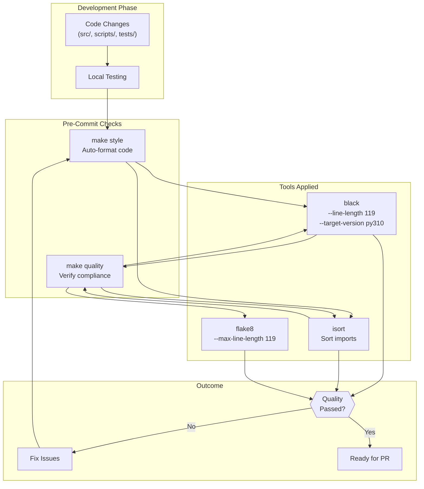
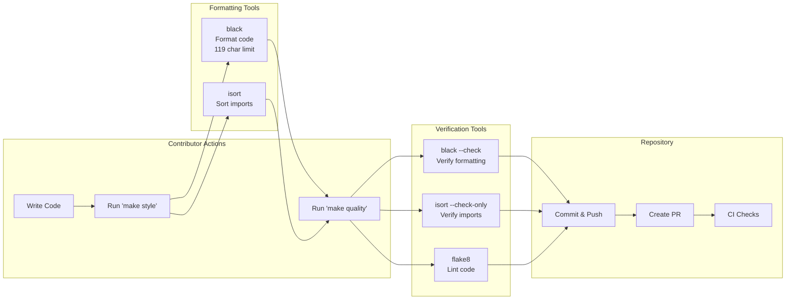
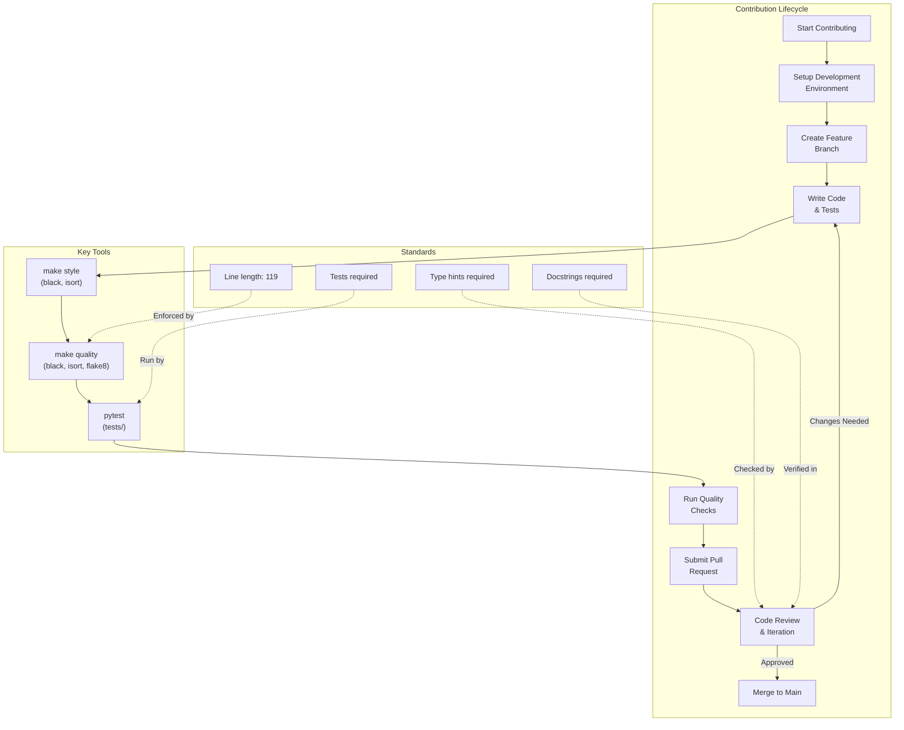

<!-- source: DeepWiki mcp.deepwiki.com · repo thunlp/Optima · page 12.3 Contributing Guidelines · fetched 2026-11-02 -->

# Contributing Guidelines

<details>
<summary>Relevant source files</summary>

The following files were used as context for generating this wiki page:

- [alignment-handbook/Makefile](alignment-handbook/Makefile)
- [alignment-handbook/README.md](alignment-handbook/README.md)

</details>


This document provides comprehensive guidelines for contributing to the Optima project, including code quality standards, development workflow, and pull request processes. For information about the overall project structure, see [Project Structure](#12.1). For details on code quality tools and testing infrastructure, see [Code Quality and Testing](#12.2).

## Overview

Optima welcomes contributions from the community to improve multi-agent system optimization. Contributions can include bug fixes, new features, documentation improvements, dataset additions, or new training recipes. All contributions must adhere to the code quality standards and follow the development workflow outlined in this document.

The project builds upon the alignment-handbook framework, so contributors should be familiar with its conventions and structure as documented in [Alignment Handbook Integration](#9).

---

## Code Quality Standards

Optima enforces strict code quality standards using automated tooling defined in the alignment-handbook Makefile. All code contributions must pass these quality checks before being merged.

### Automated Code Quality Tools

The project uses three primary tools for maintaining code quality:

| Tool | Purpose | Configuration |
|------|---------|---------------|
| **black** | Code formatting | Line length: 119, Target: Python 3.10 |
| **isort** | Import statement sorting | Default configuration |
| **flake8** | Linting and style checking | Max line length: 119 |

### Quality Check Commands

**Style Formatting** (Auto-fixes code):
```bash
make style
```

This command formats code using black and isort across the following directories:
- `src/` - Core source code
- `tests/` - Unit tests
- `scripts/` - Training and inference scripts
- `setup.py` - Package setup file

**Quality Verification** (Read-only checks):
```bash
make quality
```

This command verifies code quality without making changes, checking:
- Black formatting compliance
- Import statement ordering
- Flake8 linting rules

**Sources:** [alignment-handbook/Makefile:1-16]()

---

## Quality Check Workflow



**Sources:** [alignment-handbook/Makefile:8-15]()

---

## Development Workflow

### 1. Environment Setup

Before contributing, set up both development environments:

**optima-train Environment:**
```bash
conda create -n optima-train python=3.10
conda activate optima-train
cd alignment-handbook/
python -m pip install .
python -m pip install flash-attn --no-build-isolation
```

**optima-vllm Environment:**
```bash
conda create -n optima-vllm python=3.10
conda activate optima-vllm
pip install vllm==0.5.3.post1
```

For detailed setup instructions, see [Installation and Environment Setup](#2.1).

### 2. Branch Strategy

Create a feature branch from the main branch:
```bash
git checkout -b feature/your-feature-name
```

Use descriptive branch names following these conventions:
- `feature/` - New features (e.g., `feature/add-new-agent-type`)
- `bugfix/` - Bug fixes (e.g., `bugfix/fix-memory-leak`)
- `docs/` - Documentation improvements (e.g., `docs/update-contributing-guide`)
- `refactor/` - Code refactoring (e.g., `refactor/simplify-agent-class`)

### 3. Making Changes

When making changes:

1. **Modify code** in appropriate directories (`src/`, `scripts/`, etc.)
2. **Run local tests** to verify functionality
3. **Format code** using `make style`
4. **Verify quality** using `make quality`
5. **Commit changes** with clear, descriptive messages

### 4. Testing Requirements

All contributions must include appropriate tests:

- **Unit tests** for new functions/classes in `tests/`
- **Integration tests** for new training/inference workflows
- **Recipe validation** for new configuration files

Test your changes locally before submitting:
```bash
pytest tests/
```

**Sources:** [alignment-handbook/Makefile:1-16](), [alignment-handbook/README.md:59-99]()

---

## Coding Standards

### Python Code Style

**Line Length:** Maximum 119 characters per line

**Import Organization:**
1. Standard library imports
2. Third-party imports (PyTorch, Transformers, etc.)
3. Local imports (Optima modules)

**Type Hints:** Use type hints for function arguments and return values:
```python
def generate_response(self, prompt: str, temperature: float = 0.7) -> str:
    ...
```

**Docstrings:** All public functions and classes must have docstrings:
```python
def create_agent(model_path: str, agent_type: str) -> BaseAgent:
    """
    Create an agent instance from a model checkpoint.
    
    Args:
        model_path: Path to the model checkpoint directory
        agent_type: Type of agent ('agent' or 'vllm_agent')
        
    Returns:
        BaseAgent: Configured agent instance
    """
    ...
```

### File Organization

**Training Scripts:** Place in root directory (e.g., `sft_script.py`, `dpo_script.py`)

**Agent Classes:** Define in dedicated modules with clear separation of concerns

**Recipe Files:** Organize in `recipes/` with hierarchical structure:
```
recipes/
├── arc_sft/
│   ├── iteration_0.yaml
│   └── iteration_1.yaml
└── arc_dpo/
    └── iteration_0.yaml
```

**Datasets:** Place in `my_datasets/` with consistent naming conventions

**Sources:** [alignment-handbook/Makefile:8-15](), [alignment-handbook/README.md:101-114]()

---

## Pull Request Process

### PR Preparation Checklist

Before submitting a pull request, ensure:

- [ ] Code passes `make quality` checks
- [ ] All tests pass locally
- [ ] New features include tests
- [ ] Documentation is updated
- [ ] Recipe files are validated (if applicable)
- [ ] Commit messages are clear and descriptive
- [ ] Branch is up-to-date with main

### PR Submission

**Title Format:** Use clear, descriptive titles
- ✅ Good: "Add support for custom chat templates in VllmAgent"
- ❌ Bad: "Update agent.py"

**Description Template:**
```markdown
## Description
Brief description of changes

## Type of Change
- [ ] Bug fix
- [ ] New feature
- [ ] Documentation update
- [ ] Performance improvement
- [ ] Refactoring

## Testing
Describe testing performed

## Checklist
- [ ] Code passes quality checks
- [ ] Tests added/updated
- [ ] Documentation updated
```

### Review Process

1. **Automated checks** run on PR submission
2. **Maintainer review** of code quality and design
3. **Address feedback** and make requested changes
4. **Final approval** and merge by maintainers

**Sources:** [alignment-handbook/README.md:1-130]()

---

## Code Quality Pipeline



**Sources:** [alignment-handbook/Makefile:8-15]()

---

## Documentation Requirements

### Code Documentation

**Function/Method Documentation:**
- Purpose and behavior
- Parameter descriptions with types
- Return value description
- Example usage (for complex functions)

**Class Documentation:**
- Class purpose and responsibilities
- Constructor parameters
- Key methods overview
- Usage examples

### Recipe Documentation

New recipes must include:
- **Purpose:** What training scenario it addresses
- **Parameters:** Key hyperparameters and their effects
- **Usage:** Command to execute the recipe
- **Expected Results:** Typical performance outcomes

Example:
```yaml
# recipes/arc_sft/iteration_0.yaml
# Purpose: Initial supervised fine-tuning on ARC dataset
# Key parameters:
#   - learning_rate: 5e-6 (conservative for stability)
#   - num_train_epochs: 4 (full training)
#   - beta: N/A (SFT only)
```

### Wiki Updates

When adding new features, update relevant wiki pages:
- Update [API Reference](#13.2) for new classes/functions
- Add entries to [Supported Datasets](#13.3) for new datasets
- Update [Recipe Guide](#7) sections for new configurations

**Sources:** [alignment-handbook/README.md:35-46]()

---

## Special Considerations

### Alignment Handbook Integration

Optima extends the alignment-handbook framework. When modifying core alignment functionality:

1. **Maintain compatibility** with upstream alignment-handbook
2. **Document deviations** from standard alignment-handbook behavior
3. **Consider upstreaming** generally useful features

For details on the integration, see [Alignment Handbook Integration](#9).

### Multi-Agent System Changes

Changes to the agent system require special attention:

1. **Backward compatibility** - Ensure existing VllmAgent code continues working
2. **HTTP interface stability** - Don't break the vLLM communication protocol
3. **Memory management** - Test conversation memory handling thoroughly

See [Agent System](#5) for architecture details.

### Recipe Validation

New or modified recipes must be validated:

```bash
# Dry-run validation
python sft_script.py recipes/your_recipe/config.yaml --dry-run

# Small-scale test
python sft_script.py recipes/your_recipe/config.yaml \
    --num_train_epochs 1 \
    --max_steps 100
```

**Sources:** [alignment-handbook/README.md:37-46]()

---

## Release Process

### Version Management

The project uses semantic versioning. Release management targets are available:

| Make Target | Purpose |
|-------------|---------|
| `make pre-release` | Prepare a new release version |
| `make pre-patch` | Prepare a patch release |
| `make post-release` | Finalize release |
| `make post-patch` | Finalize patch release |
| `make wheels` | Build distribution packages |
| `make pypi_upload` | Upload to PyPI |

**Note:** Only maintainers should execute release commands.

**Sources:** [alignment-handbook/Makefile:18-44]()

---

## Contribution Types

### Bug Fixes

- Clearly describe the bug and reproduction steps
- Include test cases that fail before the fix
- Verify the fix resolves the issue without side effects

### New Features

- Discuss major features in an issue first
- Provide clear use cases and examples
- Include comprehensive tests and documentation
- Consider backward compatibility

### Documentation Improvements

- Fix typos, clarify explanations, add examples
- Ensure consistency with code behavior
- Update related wiki pages

### Dataset Contributions

- Follow dataset structure guidelines in [Dataset Structure and Preparation](#10.1)
- Include dataset description and statistics
- Provide example usage in recipes
- Document data sources and licenses

### Recipe Contributions

- Test recipes thoroughly across multiple runs
- Document hyperparameter choices
- Include expected performance benchmarks
- Follow naming conventions

**Sources:** [alignment-handbook/README.md:35-58]()

---

## Getting Help

### Before Contributing

1. Read the [Overview](#1) to understand Optima's purpose
2. Review [Core Concepts](#3) to understand the methodology
3. Follow [Quick Start Tutorial](#2.2) to gain hands-on experience

### During Development

- Check existing issues for similar problems
- Review closed PRs for examples
- Consult the [API Reference](#13.2) for class/function details
- Ask questions in GitHub issues with the "question" label

### Community Guidelines

- Be respectful and constructive in discussions
- Provide context and details in issues and PRs
- Help others when you can
- Follow the code of conduct

---

## Summary



**Sources:** [alignment-handbook/Makefile:1-44](), [alignment-handbook/README.md:1-130]()

---

