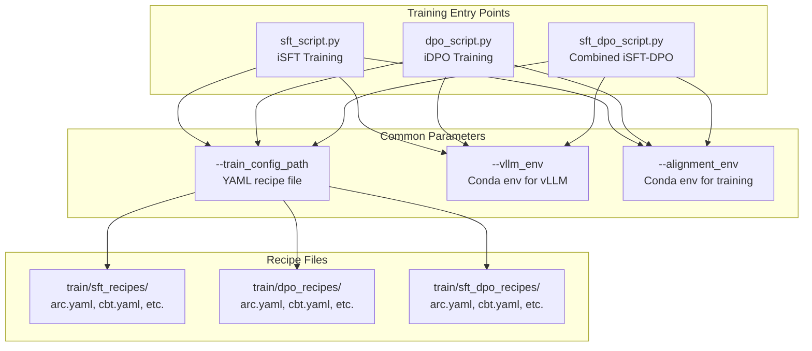
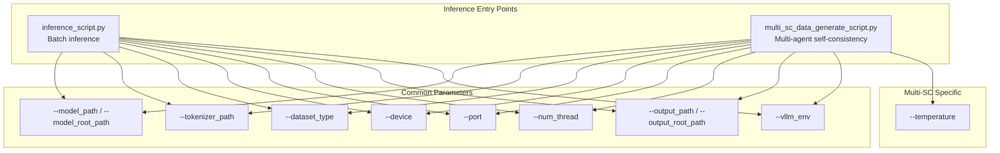
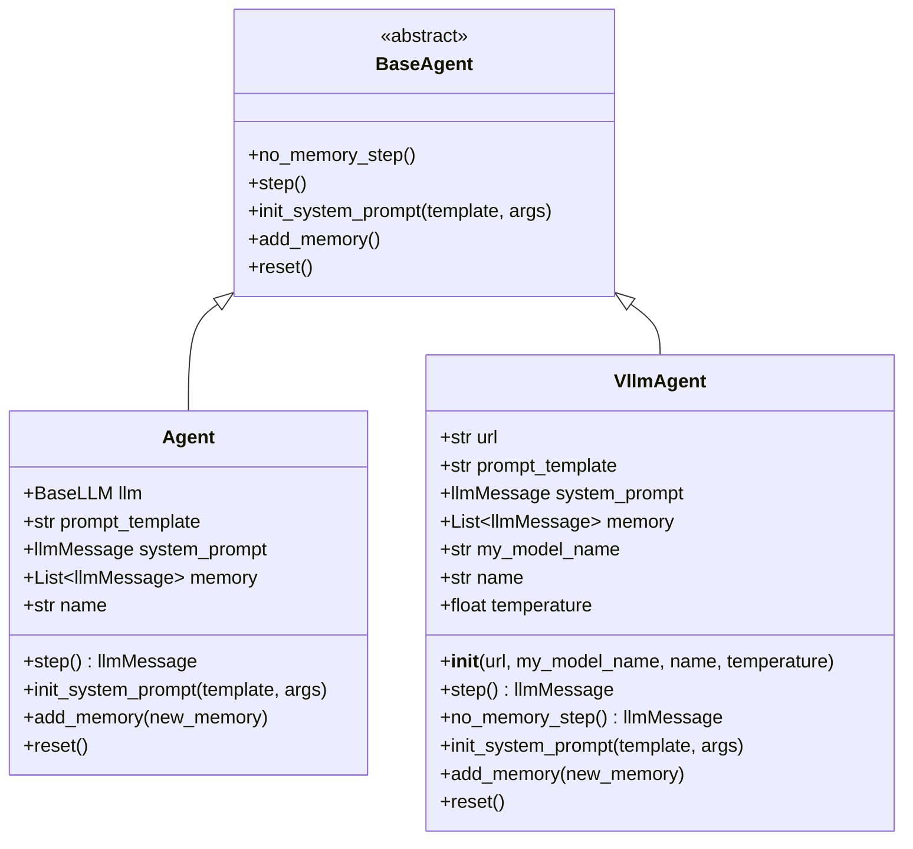
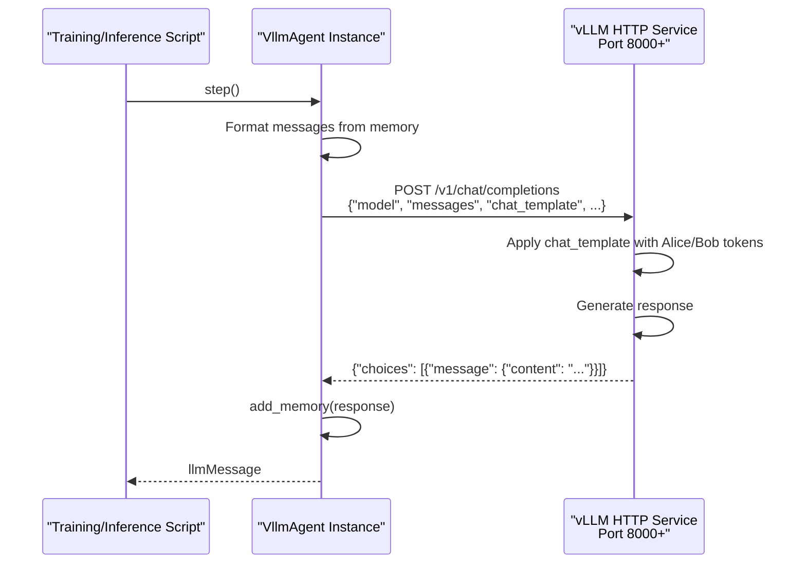
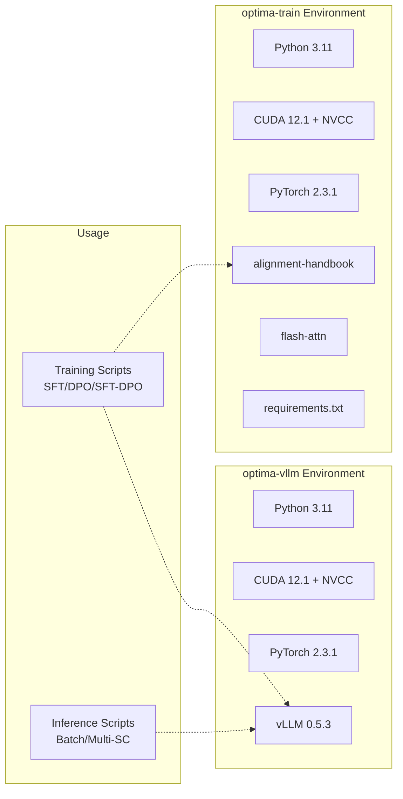
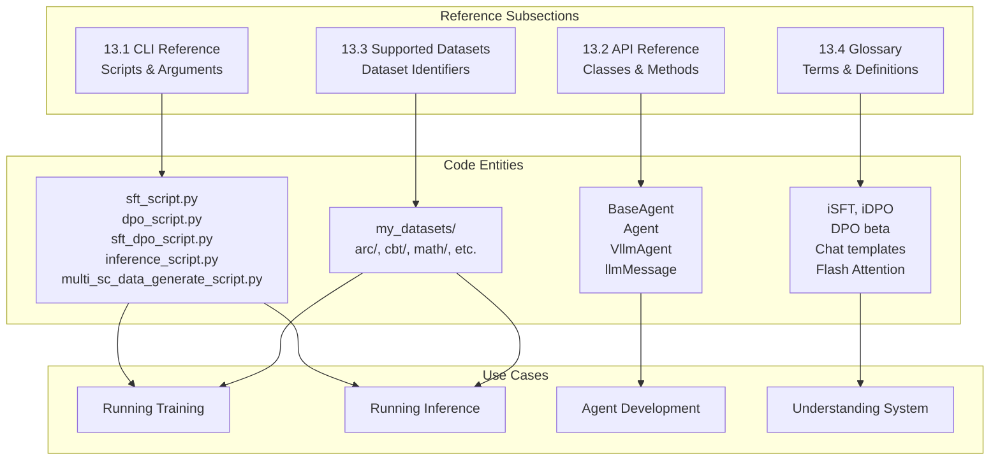

<!-- source: DeepWiki mcp.deepwiki.com · repo thunlp/Optima · page 13 Reference · fetched 2026-11-02 -->

# Reference

<details>
<summary>Relevant source files</summary>

The following files were used as context for generating this wiki page:

- [README.md](README.md)
- [agent/agent.py](agent/agent.py)

</details>


This section provides quick reference materials for developers and users working with the Optima framework. It includes command-line interfaces, API documentation, dataset specifications, and terminology definitions. Use this section for rapid lookup of parameter names, method signatures, dataset identifiers, and key concepts.

For detailed usage examples and tutorials, see [Getting Started](#2). For in-depth architectural explanations, see [System Architecture](#4).

---

## Overview of Reference Materials

The reference section is organized into four primary subsections:

- **[Command-Line Interface Reference](#13.1)**: Complete documentation of all command-line arguments for training and inference scripts
- **[API Reference](#13.2)**: Class definitions, method signatures, and usage patterns for the agent system
- **[Supported Datasets](#13.3)**: Specifications for all supported datasets and their identifiers
- **[Glossary](#13.4)**: Definitions of technical terms and acronyms used throughout Optima

---

## Quick Reference: Training Scripts

Optima provides three main training entry points, each corresponding to a different training methodology:



**Sources**: [README.md:58-92]()

### Training Script Parameters

| Script | Parameter | Type | Description |
|--------|-----------|------|-------------|
| All training scripts | `--train_config_path` | `str` | Path to YAML configuration file in `train/{method}_recipes/` |
| All training scripts | `--vllm_env` | `str` | Conda environment name for vLLM deployment (default: `optima-vllm`) |
| All training scripts | `--alignment_env` | `str` | Conda environment name for training framework (default: `optima-train`) |

**Environment Variable**: Set `MKL_THREADING_LAYER=GNU` before running training scripts to avoid threading conflicts.

**Sources**: [README.md:58-92]()

---

## Quick Reference: Inference Scripts



**Sources**: [README.md:94-137]()

### Inference Script Parameters

| Parameter | Script | Type | Description |
|-----------|--------|------|-------------|
| `--model_root_path` | `inference_script.py` | `str` | Root directory containing multiple checkpoint iterations |
| `--model_path` | `multi_sc_data_generate_script.py` | `str` | Path to specific model checkpoint |
| `--tokenizer_path` | Both | `str` | Path to pretrained tokenizer |
| `--dataset_type` | Both | `str` | Dataset identifier (see [Supported Datasets](#13.3)) |
| `--device` | Both | `int` | GPU index for first vLLM deployment |
| `--port` | Both | `int` | Starting port number for vLLM HTTP service |
| `--num_thread` | Both | `int` | Number of parallel threads for inference |
| `--output_root_path` | `inference_script.py` | `str` | Root directory for inference results |
| `--output_path` | `multi_sc_data_generate_script.py` | `str` | Output directory for generated data |
| `--temperature` | `multi_sc_data_generate_script.py` | `float` | Sampling temperature for generation |
| `--vllm_env` | Both | `str` | Conda environment for vLLM deployment |

**Sources**: [README.md:94-137]()

---

## Quick Reference: Agent Class Hierarchy

The agent system is built around three classes that form an inheritance hierarchy:



**Sources**: [agent/agent.py:9-147]()

### Agent Class Summary

| Class | Location | Purpose |
|-------|----------|---------|
| `BaseAgent` | [agent/agent.py:9-24]() | Abstract base class defining agent interface |
| `Agent` | [agent/agent.py:27-55]() | Agent implementation using internal `BaseLLM` object |
| `VllmAgent` | [agent/agent.py:57-147]() | Agent implementation communicating with vLLM via HTTP |

### VllmAgent HTTP Communication

The `VllmAgent` class is the primary agent type used in Optima for multi-agent interactions. It communicates with vLLM-deployed models through HTTP POST requests:



**Key HTTP Request Fields**:
- `model`: Model name specified in `my_model_name` parameter
- `messages`: List of conversation history from `memory` field
- `temperature`: Sampling temperature from constructor
- `chat_template`: Custom Jinja2 template with Alice/Bob token injection
- `chat_template_kwargs`: Flags `is_alice` and `is_bob` for conditional token generation
- `max_tokens`: Maximum response length (2000 tokens)

**Sources**: [agent/agent.py:85-121]()

---

## Quick Reference: Dataset Types

Optima supports eight dataset types for training and evaluation. Each dataset type has a specific identifier used in command-line arguments:

| Dataset Identifier | Full Name | Domain | Task Type |
|-------------------|-----------|--------|-----------|
| `arc` | AI2 Reasoning Challenge | Science/Reasoning | Multiple choice QA |
| `hotpot_qa` | HotpotQA | Multi-hop reasoning | Open-domain QA |
| `mwh_qa` | Multi-Wiki Hop QA | Multi-hop reasoning | Open-domain QA |
| `trivial_qa` | TriviaQA | Trivia | Open-domain QA |
| `cbt` | Children's Book Test | Reading comprehension | Cloze test |
| `math` | MATH Dataset | Mathematics | Problem solving |
| `gsm8k` | Grade School Math 8K | Mathematics | Problem solving |
| `mmlu` | Massive Multitask Language Understanding | General knowledge | Multiple choice |

**Usage**: Specify the dataset identifier in:
- `--dataset_type` parameter for inference scripts
- Recipe YAML files under `dataset_mixer` configuration

For detailed dataset preparation instructions, see [Custom Dataset Preparation](#11.1).

**Sources**: [README.md:104, 120, 132]()

---

## Quick Reference: Chat Template Structure

The `VllmAgent` uses a custom Jinja2 chat template that extends the standard Llama-3 format with agent-specific tokens:

**Template Location**: [agent/agent.py:102]()

**Template Features**:
1. **Base Format**: Llama-3 chat format with `<|start_header_id|>`, `<|end_header_id|>`, and `<|eot_id|>` markers
2. **Agent Token Injection**: Conditionally adds `"Alice:"` or `"Bob:"` prefix to assistant responses
3. **Iteration Detection**: Disables agent tokens for iteration_0 (identified by specific prompt keywords)

**Template Parameters**:
- `is_alice`: Boolean flag set when `self.name == "Alice"` and not iteration_0
- `is_bob`: Boolean flag set when `self.name == "Bob"` and not iteration_0

**Example Output**:
```
<|start_header_id|>system<|end_header_id|>

You are a helpful assistant.<|eot_id|>
<|start_header_id|>user<|end_header_id|>

What is 2+2?<|eot_id|>
<|start_header_id|>assistant<|end_header_id|>

Alice: The answer is 4.
```

**Sources**: [agent/agent.py:92-106]()

---

## Quick Reference: Environment Structure



**Dual Environment Rationale**: Separating vLLM (serving) from training prevents dependency conflicts and enables efficient resource allocation. Training scripts switch between environments using conda activation.

**Sources**: [README.md:22-55]()

---

## Quick Reference: File Path Conventions

| Path Pattern | Purpose | Example |
|--------------|---------|---------|
| `train/{method}_recipes/*.yaml` | Training configuration files | `train/sft_recipes/arc.yaml` |
| `checkpoints/{dataset}_{method}/iteration_{N}/` | Model checkpoints | `checkpoints/arc_sft/iteration_0/` |
| `my_datasets/{dataset}/` | Training and test datasets | `my_datasets/arc/` |
| `inference_results/{dataset}/` | Inference outputs | `inference_results/arc/` |
| `results/{dataset}/` | Evaluation metrics | `results/arc/` |
| `alignment-handbook/` | Modified alignment framework | `alignment-handbook/` |
| `agent/agent.py` | Agent class definitions | `agent/agent.py` |
| `message/message.py` | Message type definition | `message/message.py` |

**Sources**: [README.md:58-137]()

---

## Quick Reference: Common Configuration Parameters

These parameters appear across all recipe YAML files:

| Parameter | Type | Common Values | Description |
|-----------|------|---------------|-------------|
| `model_name_or_path` | `str` | Path to checkpoint | Base model or previous iteration |
| `tokenizer_name_or_path` | `str` | Path to tokenizer | Tokenizer for text processing |
| `torch_dtype` | `str` | `"bfloat16"` | Precision for model weights |
| `use_flash_attention_2` | `bool` | `true` | Enable Flash Attention optimization |
| `max_seq_length` | `int` | `4096` | Maximum sequence length |
| `learning_rate` | `float` | `5e-7` to `5e-6` | Optimizer learning rate |
| `num_train_epochs` | `int` | `4` | Number of training epochs |
| `per_device_train_batch_size` | `int` | `1` | Batch size per GPU |
| `gradient_accumulation_steps` | `int` | `16` | Steps to accumulate gradients |
| `optim` | `str` | `"adamw_torch"` | Optimizer type |
| `lr_scheduler_type` | `str` | `"cosine"` | Learning rate schedule |
| `warmup_ratio` | `float` | `0.1` | Warmup steps as ratio of total |
| `beta` | `float` | `0.1` to `0.2` | DPO loss coefficient (DPO only) |

For complete parameter documentation, see [Recipe Parameters Reference](#7.4).

**Sources**: [README.md:59]()

---

## Cross-Reference Map

This diagram shows how the main reference subsections relate to code entities and use cases:



**Sources**: All subsections under page 13

---

For detailed information on each reference topic, navigate to the appropriate subsection:

- **[Command-Line Interface Reference](#13.1)** - Complete argument specifications
- **[API Reference](#13.2)** - Detailed class and method documentation
- **[Supported Datasets](#13.3)** - Dataset formats and preparation
- **[Glossary](#13.4)** - Technical terminology and acronyms

---

