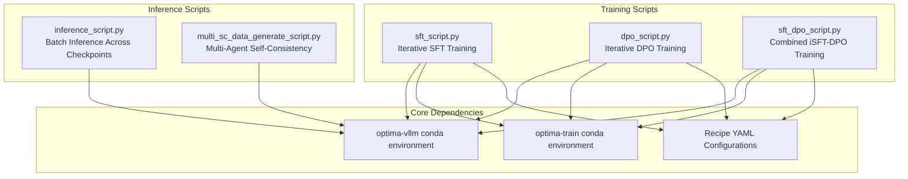
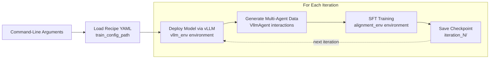
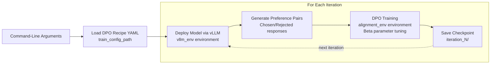
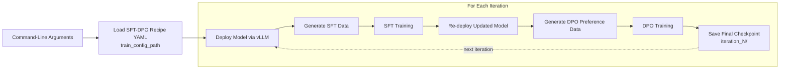
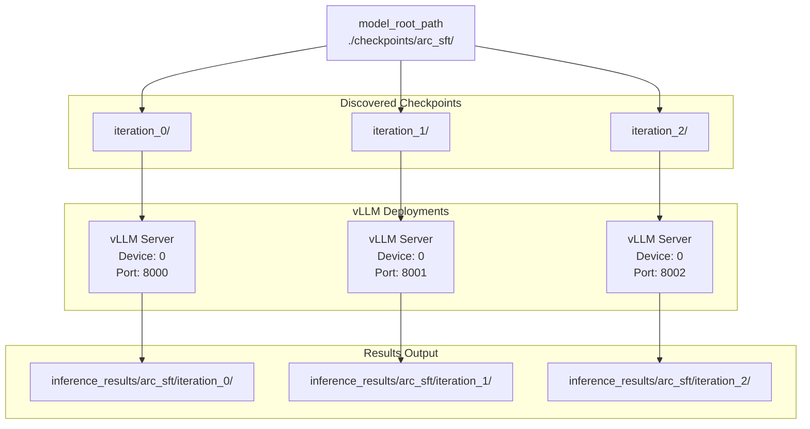
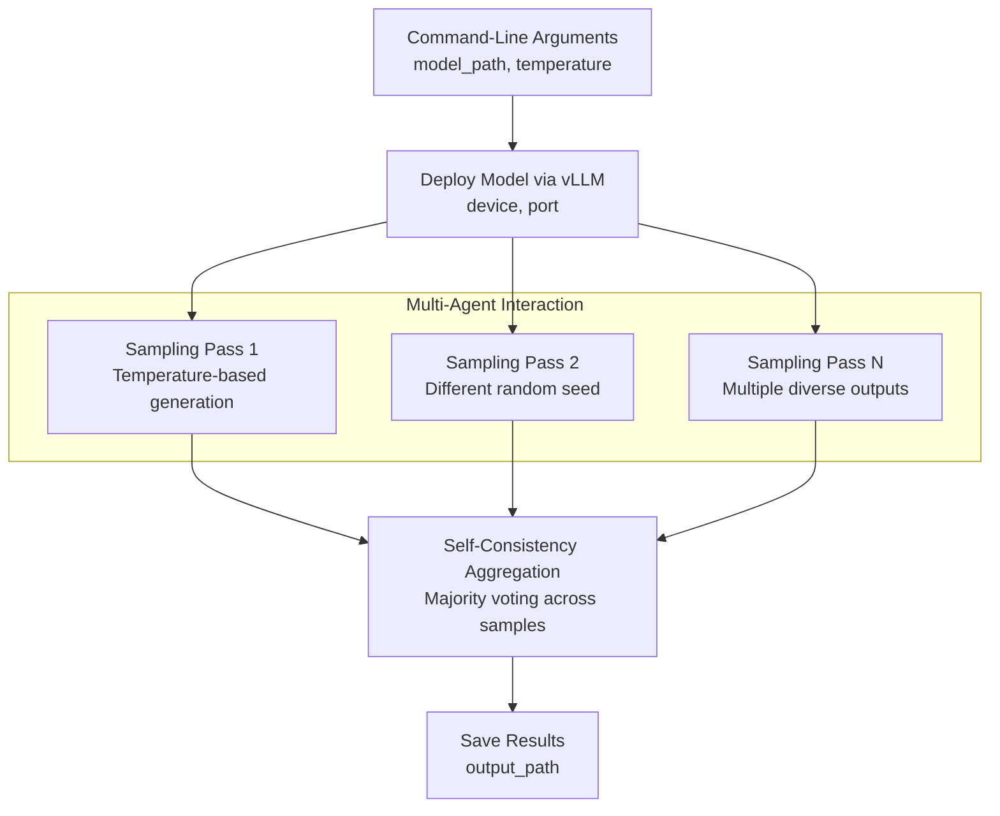
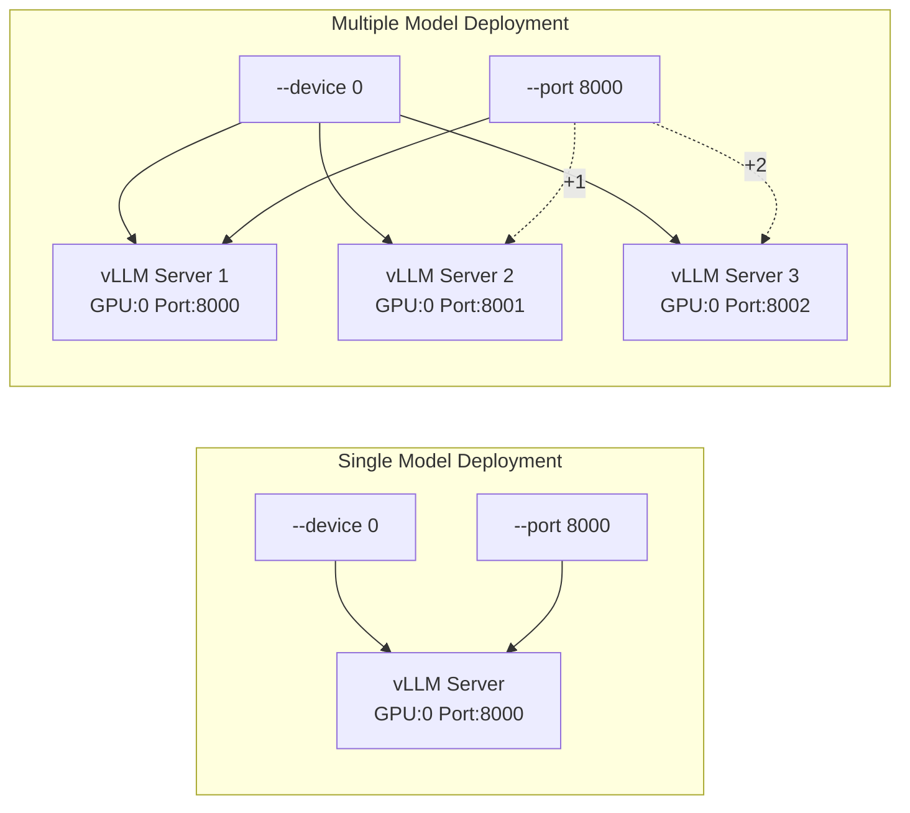
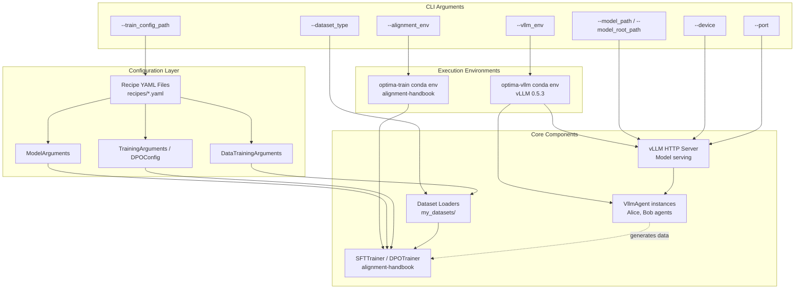

<!-- source: DeepWiki mcp.deepwiki.com · repo thunlp/Optima · page 13.1 Command-Line Interface Reference · fetched 2026-11-02 -->

# Command-Line Interface Reference

<details>
<summary>Relevant source files</summary>

The following files were used as context for generating this wiki page:

- [README.md](README.md)
- [README_revise.md](README_revise.md)

</details>


## Purpose and Scope

This page provides a complete reference for all command-line interfaces in the Optima framework. It documents the command-line arguments for training scripts (`sft_script.py`, `dpo_script.py`, `sft_dpo_script.py`) and inference scripts (`inference_script.py`, `multi_sc_data_generate_script.py`).

For detailed information about recipe configuration files referenced by these scripts, see [Recipe Configuration System](#6.2). For information about the Agent API classes used internally by these scripts, see [API Reference](#13.2).

## Overview of Available Scripts

Optima provides five primary command-line scripts organized into two categories:



**Sources:** [README.md:58-137]()

## Training Scripts

All training scripts require the `MKL_THREADING_LAYER=GNU` environment variable to be set before execution to avoid threading conflicts.

### sft_script.py

The `sft_script.py` script executes iterative Supervised Fine-Tuning (iSFT) across multiple iterations. It orchestrates model deployment via vLLM, multi-agent data generation, and supervised fine-tuning using the alignment-handbook framework.

#### Command-Line Arguments

| Argument | Type | Required | Description |
|----------|------|----------|-------------|
| `--train_config_path` | string | Yes | Path to the training recipe YAML file (e.g., `train/sft_recipes/arc.yaml`) |
| `--vllm_env` | string | Yes | Name of the conda environment used for vLLM model deployment |
| `--alignment_env` | string | Yes | Name of the conda environment used for training with alignment-handbook |

#### Usage Example

```bash
MKL_THREADING_LAYER=GNU python sft_script.py \
    --train_config_path train/sft_recipes/arc.yaml \
    --vllm_env optima-vllm \
    --alignment_env optima-train
```

#### Workflow



**Sources:** [README.md:56-70]()

---

### dpo_script.py

The `dpo_script.py` script executes iterative Direct Preference Optimization (iDPO) training. It generates preference pairs through multi-agent interactions and optimizes the model using the DPO algorithm.

#### Command-Line Arguments

| Argument | Type | Required | Description |
|----------|------|----------|-------------|
| `--train_config_path` | string | Yes | Path to the DPO training recipe YAML file (e.g., `train/dpo_recipes/arc.yaml`) |
| `--vllm_env` | string | Yes | Name of the conda environment used for vLLM model deployment |
| `--alignment_env` | string | Yes | Name of the conda environment used for DPO training |

#### Usage Example

```bash
MKL_THREADING_LAYER=GNU python dpo_script.py \
    --train_config_path train/dpo_recipes/arc.yaml \
    --vllm_env optima-vllm \
    --alignment_env optima-train
```

#### Workflow



**Sources:** [README.md:72-81]()

---

### sft_dpo_script.py

The `sft_dpo_script.py` script combines both iSFT and iDPO training methods in a single iterative loop. It first performs SFT, then DPO on the same iteration checkpoint.

#### Command-Line Arguments

| Argument | Type | Required | Description |
|----------|------|----------|-------------|
| `--train_config_path` | string | Yes | Path to the combined SFT-DPO recipe YAML file (e.g., `train/sft_dpo_recipes/arc.yaml`) |
| `--vllm_env` | string | Yes | Name of the conda environment used for vLLM model deployment |
| `--alignment_env` | string | Yes | Name of the conda environment used for training |

#### Usage Example

```bash
MKL_THREADING_LAYER=GNU python sft_dpo_script.py \
    --train_config_path train/sft_dpo_recipes/arc.yaml \
    --vllm_env optima-vllm \
    --alignment_env optima-train
```

#### Workflow



**Sources:** [README.md:83-92]()

---

## Inference Scripts

### inference_script.py

The `inference_script.py` script performs batch inference across all model checkpoints in a specified directory. It automatically discovers all iteration checkpoints, deploys each model via vLLM, and evaluates on the specified dataset.

#### Command-Line Arguments

| Argument | Type | Required | Description |
|----------|------|----------|-------------|
| `--model_root_path` | string | Yes | Root directory containing iteration checkpoints (e.g., `./checkpoints/arc_sft`) |
| `--tokenizer_path` | string | Yes | Path to the pretrained tokenizer |
| `--dataset_type` | string | Yes | Dataset to evaluate on: `arc`, `hotpot_qa`, `mwh_qa`, `trivial_qa`, `cbt`, `math`, `gsm8k`, `mmlu` |
| `--device` | integer | Yes | GPU index for the first vLLM deployment port |
| `--port` | integer | Yes | Starting port number for vLLM model deployment (increments for multiple models) |
| `--num_thread` | integer | Yes | Number of parallel inference threads |
| `--output_root_path` | string | Yes | Root directory for saving inference results |
| `--vllm_env` | string | Yes | Name of the conda environment used for vLLM deployment |

#### Usage Example

```bash
python inference_script.py \
    --model_root_path ./checkpoints/arc_sft \
    --tokenizer_path /path/to/Meta-Llama-3-8B-Instruct \
    --dataset_type arc \
    --device 0 \
    --port 8000 \
    --num_thread 128 \
    --output_root_path ./inference_results \
    --vllm_env optima-vllm
```

#### Port and Device Management

The script automatically manages multiple vLLM deployments when evaluating multiple checkpoints:



**Sources:** [README.md:94-110]()

---

### multi_sc_data_generate_script.py

The `multi_sc_data_generate_script.py` script implements multi-agent self-consistency inference. It runs multiple inference passes with sampling (controlled by temperature) and aggregates results using self-consistency voting.

#### Command-Line Arguments

| Argument | Type | Required | Description |
|----------|------|----------|-------------|
| `--model_path` | string | Yes | Path to a specific model checkpoint (e.g., `./checkpoints/arc_sft/iteration_0`) |
| `--tokenizer_path` | string | Yes | Path to the pretrained tokenizer |
| `--dataset_type` | string | Yes | Dataset to evaluate on: `arc`, `hotpot_qa`, `mwh_qa`, `trivial_qa`, `cbt`, `math`, `gsm8k`, `mmlu` |
| `--device` | integer | Yes | GPU index for vLLM deployment |
| `--port` | integer | Yes | Port number for vLLM model deployment |
| `--num_thread` | integer | Yes | Number of parallel inference threads |
| `--output_path` | string | Yes | Directory path for saving output results |
| `--temperature` | float | Yes | Sampling temperature for response generation (e.g., `0.5`, `0.7`) |
| `--vllm_env` | string | Yes | Name of the conda environment used for vLLM deployment |

#### Usage Example

```bash
python multi_sc_data_generate_script.py \
    --model_path ./checkpoints/arc_sft/iteration_0 \
    --tokenizer_path /path/to/Meta-Llama-3-8B-Instruct \
    --device 0 \
    --port 8000 \
    --dataset_type arc \
    --num_thread 128 \
    --output_path ./inference_results/sc_results \
    --temperature 0.5 \
    --vllm_env optima-vllm
```

#### Self-Consistency Workflow



**Sources:** [README.md:112-137]()

---

## Common Argument Patterns

### Environment Management

All scripts require specifying conda environment names for proper isolation:

| Environment | Purpose | Used By |
|-------------|---------|---------|
| `--vllm_env` | vLLM deployment environment (Python 3.11, vLLM 0.5.3) | All scripts |
| `--alignment_env` | Training environment (Python 3.11, alignment-handbook) | Training scripts only |

### Path Arguments

Path arguments follow consistent naming conventions:

| Argument Pattern | Purpose | Example |
|------------------|---------|---------|
| `*_config_path` | Recipe YAML configuration file | `train/sft_recipes/arc.yaml` |
| `*_root_path` | Directory containing multiple checkpoints | `./checkpoints/arc_sft` |
| `*_path` | Specific file or single directory | `./checkpoints/arc_sft/iteration_0` |
| `tokenizer_path` | Pretrained tokenizer directory | `/path/to/Meta-Llama-3-8B-Instruct` |

### GPU and Port Configuration

Scripts that deploy vLLM models require GPU and port specification:



**Port Allocation Rules:**
- `inference_script.py` auto-increments ports for each checkpoint (port, port+1, port+2, ...)
- `multi_sc_data_generate_script.py` uses only the specified port for a single model
- Training scripts manage port allocation internally based on recipe configuration

**Sources:** [README.md:100-136]()

### Dataset Types

All inference scripts support the same set of dataset types:

| Dataset Type | Full Name | Domain |
|--------------|-----------|--------|
| `arc` | AI2 Reasoning Challenge | Multiple-choice reasoning |
| `hotpot_qa` | HotpotQA | Multi-hop question answering |
| `mwh_qa` | Multi-Witness Hypothesis QA | Question answering |
| `trivial_qa` | TriviaQA | Trivia question answering |
| `cbt` | Children's Book Test | Reading comprehension |
| `math` | MATH Dataset | Mathematical problem solving |
| `gsm8k` | Grade School Math 8K | Math word problems |
| `mmlu` | Massive Multitask Language Understanding | Multi-domain knowledge |

**Sources:** [README.md:104](), [README.md:120](), [README.md:132]()

---

## Command-Line Argument to System Component Mapping

The following diagram illustrates how command-line arguments map to internal system components:



**Sources:** [README.md:58-137]()

---

## Complete Command Reference Table

### Training Scripts

| Script | Required Arguments | Optional Arguments |
|--------|-------------------|-------------------|
| `sft_script.py` | `--train_config_path`<br/>`--vllm_env`<br/>`--alignment_env` | None (all config in YAML) |
| `dpo_script.py` | `--train_config_path`<br/>`--vllm_env`<br/>`--alignment_env` | None (all config in YAML) |
| `sft_dpo_script.py` | `--train_config_path`<br/>`--vllm_env`<br/>`--alignment_env` | None (all config in YAML) |

### Inference Scripts

| Script | Required Arguments | Optional Arguments |
|--------|-------------------|-------------------|
| `inference_script.py` | `--model_root_path`<br/>`--tokenizer_path`<br/>`--dataset_type`<br/>`--device`<br/>`--port`<br/>`--num_thread`<br/>`--output_root_path`<br/>`--vllm_env` | None |
| `multi_sc_data_generate_script.py` | `--model_path`<br/>`--tokenizer_path`<br/>`--dataset_type`<br/>`--device`<br/>`--port`<br/>`--num_thread`<br/>`--output_path`<br/>`--temperature`<br/>`--vllm_env` | None |

**Sources:** [README.md:56-137]()

---

