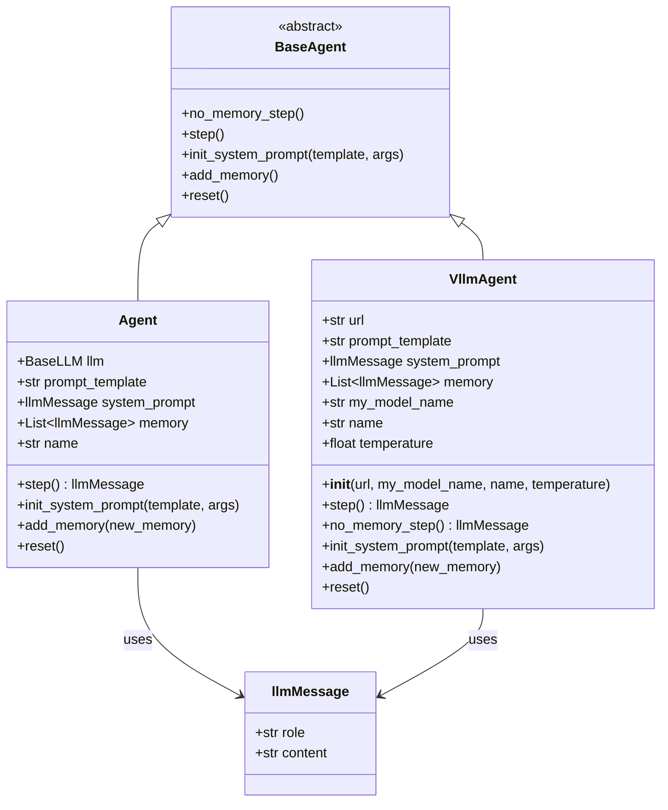
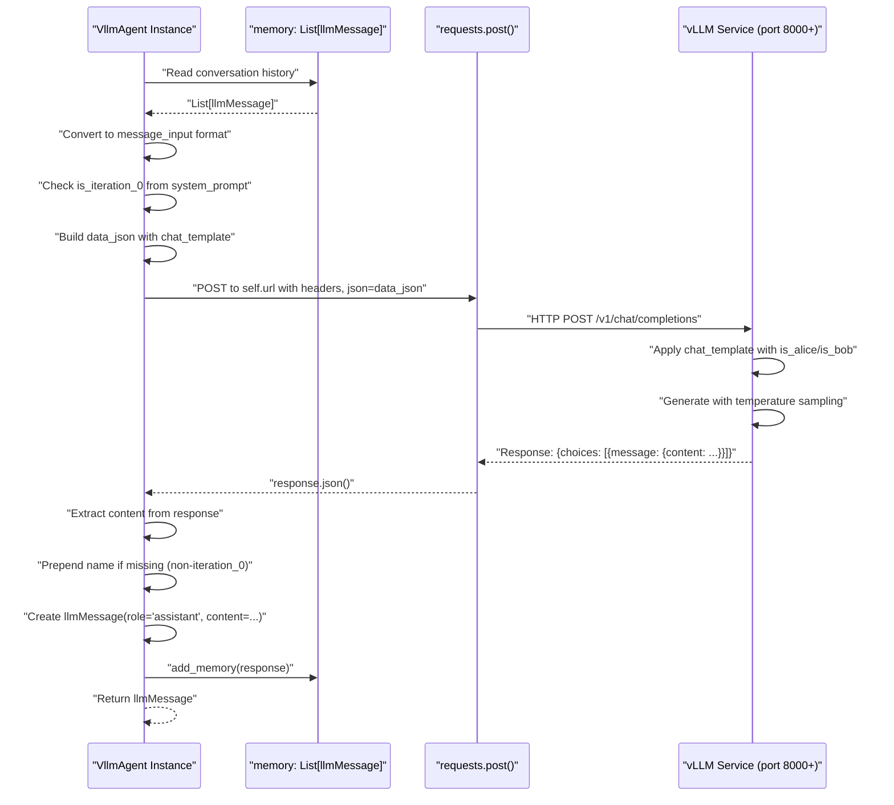
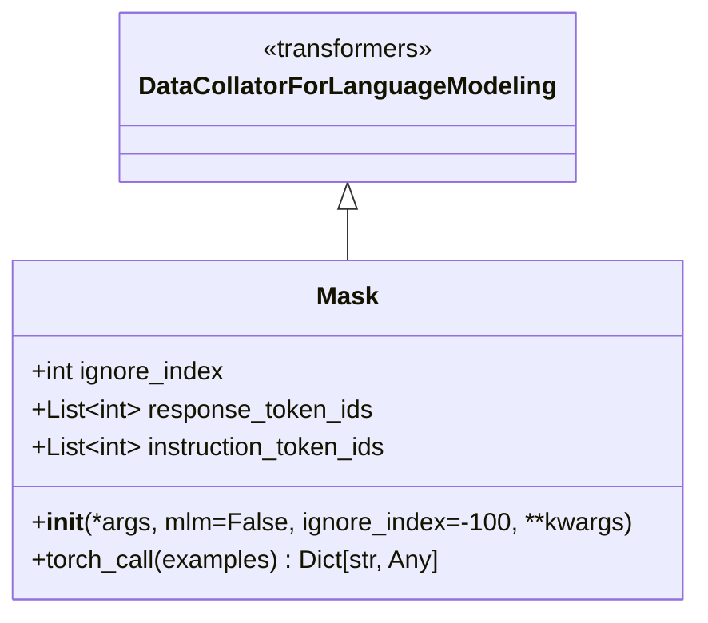
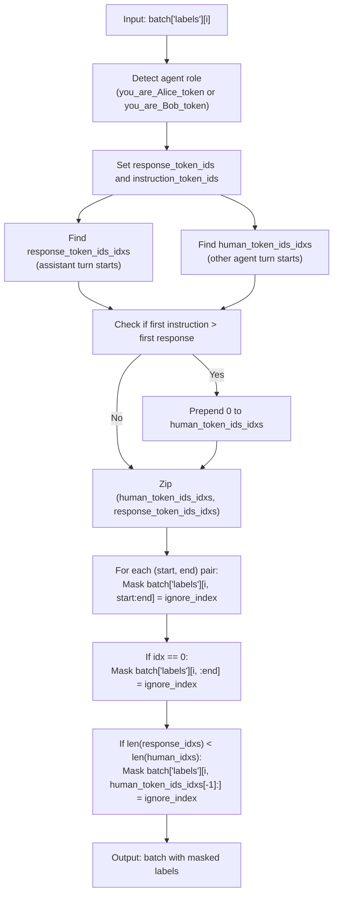

<!-- source: DeepWiki mcp.deepwiki.com · repo thunlp/Optima · page 13.2 API Reference · fetched 2026-11-02 -->

# API Reference

<details>
<summary>Relevant source files</summary>

The following files were used as context for generating this wiki page:

- [agent/agent.py](agent/agent.py)
- [alignment-handbook/mask/mask.py](alignment-handbook/mask/mask.py)

</details>


This page provides technical API documentation for Optima's core classes and functions, including class hierarchies, method signatures, parameters, and return types. This is intended as a quick lookup reference for developers implementing or extending Optima components.

For conceptual information about the agent system, see [Agent System](#5). For detailed usage patterns and examples, see [Agent Class Reference](#5.1). For training-related APIs, see [Training Scripts Reference](#6.1).

## Agent Class Hierarchy

The agent system is built on an inheritance hierarchy with `BaseAgent` as the abstract base class and two concrete implementations: `Agent` (internal LLM) and `VllmAgent` (HTTP-based vLLM communication).



**Sources:** [agent/agent.py:9-147]()

---

## BaseAgent Class

Abstract base class defining the interface for all agent implementations.

### Methods

| Method | Description | Returns |
|--------|-------------|---------|
| `no_memory_step()` | Generate response without updating memory | Varies by implementation |
| `step()` | Generate response and update memory | Varies by implementation |
| `init_system_prompt(template, args)` | Initialize system prompt from template | None |
| `add_memory()` | Add message to conversation memory | None |
| `reset()` | Reset agent state and memory | None |

**Implementation:** [agent/agent.py:9-25]()

**Sources:** [agent/agent.py:9-25]()

---

## Agent Class

Concrete agent implementation using an internal `BaseLLM` instance for generation.

### Attributes

| Attribute | Type | Description |
|-----------|------|-------------|
| `llm` | `BaseLLM` | Language model instance for generation |
| `prompt_template` | `str` | Template string for prompt formatting |
| `system_prompt` | `llmMessage` | System-level instruction message |
| `memory` | `List[llmMessage]` | Conversation history |
| `name` | `str` | Agent identifier |

### Methods

#### `step() -> llmMessage`

Generates a response using the current conversation memory and adds it to memory.

**Process:**
1. Converts memory to message format: `[{"role": message.role, "content": message.content}]`
2. Calls `self.llm.generate_response(message_input, self.name)`
3. Adds response to memory via `self.add_memory(response)`

**Returns:** `llmMessage` containing the assistant's response

**Implementation:** [agent/agent.py:34-43]()

#### `init_system_prompt(template: str, args: dict)`

Initializes the system prompt by substituting arguments into a template string.

**Parameters:**
- `template` (`str`): Template string with `$variable` placeholders
- `args` (`dict`): Dictionary mapping variable names to values

**Implementation:** Uses `Template(template).safe_substitute(args)` from Python's `string` module

**Side effects:** Appends system prompt to memory

**Implementation:** [agent/agent.py:45-47]()

#### `add_memory(new_memory: llmMessage)`

Appends a new message to the conversation memory.

**Parameters:**
- `new_memory` (`llmMessage`): Message to add to memory

**Implementation:** [agent/agent.py:49-50]()

#### `reset()`

Resets the agent's memory and system prompt to initial state.

**Side effects:** 
- Clears `self.memory` to empty list
- Resets `self.system_prompt.content` to `self.prompt_template`

**Implementation:** [agent/agent.py:52-54]()

**Sources:** [agent/agent.py:27-55]()

---

## VllmAgent Class

Agent implementation that communicates with vLLM servers via HTTP for generation. This is the primary agent class used in Optima's multi-agent training data generation.

### Initialization

```python
VllmAgent(url: str, my_model_name: str, name: str, temperature: float)
```

**Parameters:**

| Parameter | Type | Description |
|-----------|------|-------------|
| `url` | `str` | HTTP endpoint for vLLM service (e.g., `"http://localhost:8000/v1/chat/completions"`) |
| `my_model_name` | `str` | Model identifier registered with vLLM server |
| `name` | `str` | Agent name, typically `"Alice"` or `"Bob"` |
| `temperature` | `float` | Sampling temperature for generation |

**Implementation:** [agent/agent.py:64-71]()

### Attributes

| Attribute | Type | Description |
|-----------|------|-------------|
| `url` | `str` | vLLM HTTP endpoint |
| `my_model_name` | `str` | Model name for vLLM requests |
| `name` | `str` | Agent identifier (`"Alice"` or `"Bob"`) |
| `temperature` | `float` | Sampling temperature |
| `prompt_template` | `str` | Template for prompt formatting |
| `system_prompt` | `llmMessage` | System instruction message |
| `memory` | `List[llmMessage]` | Conversation history |

### Methods

#### `step() -> llmMessage`

Generates a response by sending an HTTP POST request to the vLLM service and updates memory.

**HTTP Request Structure:**

```python
{
    "model": self.my_model_name,
    "messages": [{"role": "...", "content": "..."}],  # from memory
    "temperature": self.temperature,
    "chat_template": "...",  # Custom Llama-3 template with Alice/Bob tokens
    "chat_template_kwargs": {
        "is_alice": (self.name == "Alice") and (not is_iteration_0),
        "is_bob": (self.name == "Bob") and (not is_iteration_0)
    },
    "max_tokens": 2000
}
```

**Special Handling:**
- Detects iteration 0 by checking system prompt for `"You should start your utterance with"` or `"You must begin your response with"`
- Uses custom chat template that appends `"Alice:"` or `"Bob:"` prefixes (except iteration 0)
- Prepends agent name to response if missing (except iteration 0)

**Returns:** `llmMessage` with role `"assistant"` and generated content, or error message if HTTP status is 400

**Implementation:** [agent/agent.py:85-121]()

#### `no_memory_step() -> llmMessage`

Generates a response without updating the agent's memory. Useful for generating multiple candidate responses.

**HTTP Request Structure:**

```python
{
    "model": self.my_model_name,
    "messages": [{"role": "...", "content": "..."}],  # from memory
    "temperature": self.temperature,
    "max_tokens": 2000
}
```

**Returns:** `llmMessage` with role `"assistant"` and generated content (memory not updated)

**Implementation:** [agent/agent.py:124-146]()

#### `init_system_prompt(template: str, args: dict)`

Initializes system prompt from template and adds to memory. Identical to `Agent.init_system_prompt()`.

**Implementation:** [agent/agent.py:73-75]()

#### `add_memory(new_memory: llmMessage)`

Appends message to conversation memory. Identical to `Agent.add_memory()`.

**Implementation:** [agent/agent.py:77-78]()

#### `reset()`

Resets memory and system prompt. Identical to `Agent.reset()`.

**Implementation:** [agent/agent.py:80-82]()

### Chat Template Details

The custom chat template used in `step()` method formats messages for Llama-3 models with special agent prefixes:

```jinja2


  
  
  {{ content }}

{{ '<|start_header_id|>assistant<|end_header_id|>\n\n' }}

    {{- 'Alice:' }}


    {{- 'Bob:' }}

```

**Key Features:**
- Wraps each message in Llama-3 format tags (`<|start_header_id|>`, `<|end_header_id|>`, `<|eot_id|>`)
- Adds BOS token to first message
- Conditionally appends `"Alice:"` or `"Bob:"` prefix based on agent name

**Implementation:** [agent/agent.py:102]()

**Sources:** [agent/agent.py:57-147]()

---

## VllmAgent HTTP Communication Flow

The following diagram shows the complete request-response flow for `VllmAgent.step()`:



**Sources:** [agent/agent.py:85-121]()

---

## llmMessage Class

The `llmMessage` class represents individual conversation messages. It is imported from `message.message` module.

### Attributes

| Attribute | Type | Description |
|-----------|------|-------------|
| `role` | `str` | Message role: `"system"`, `"user"`, or `"assistant"` |
| `content` | `str` | Message text content |

### Usage

```python
from message.message import llmMessage

# Create system prompt
system_msg = llmMessage(role="system", content="You are Alice, a helpful assistant.")

# Create user message
user_msg = llmMessage(role="user", content="What is the capital of France?")

# Create assistant response
assistant_msg = llmMessage(role="assistant", content="The capital of France is Paris.")
```

**Sources:** [agent/agent.py:3](), [agent/agent.py:30](), [agent/agent.py:67]()

---

## Mask Data Collator API

The `Mask` class implements completion-only language modeling by masking non-assistant tokens during training.

### Class Definition



**Sources:** [alignment-handbook/mask/mask.py:14]()

### Initialization

```python
Mask(*args, mlm: bool = False, ignore_index: int = -100, **kwargs)
```

**Parameters:**

| Parameter | Type | Default | Description |
|-----------|------|---------|-------------|
| `mlm` | `bool` | `False` | Whether to use masked language modeling (currently has no effect) |
| `ignore_index` | `int` | `-100` | Token ID to use for masking non-response tokens |
| `*args, **kwargs` | - | - | Passed to parent `DataCollatorForLanguageModeling` |

**Implementation:** [alignment-handbook/mask/mask.py:33-42]()

### Token Constants

The module defines token ID sequences for identifying agent roles and turns:

| Constant | Value | Description |
|----------|-------|-------------|
| `you_are_Alice_token` | `[128006, 9125, 128007, 271, 2675, 527, 30505]` | System prompt: "You are Alice" |
| `you_are_Bob_token` | `[128006, 9125, 128007, 271, 2675, 527, 14596]` | System prompt: "You are Bob" |
| `Alice_token` | `[128006, 78191, 128007, 271, 62786, 25]` | Assistant response prefix: "Alice:" |
| `Bob_token` | `[128006, 78191, 128007, 271, 33488, 25]` | Assistant response prefix: "Bob:" |

**Implementation:** [alignment-handbook/mask/mask.py:8-11]()

### Methods

#### `torch_call(examples: List[Union[List[int], Any, Dict[str, Any]]]) -> Dict[str, Any]`

Processes a batch of examples and masks labels for all tokens except assistant responses.

**Algorithm:**

1. Calls parent's `torch_call()` to create initial batch
2. For each example in batch:
   - Detects agent role by finding `you_are_Alice_token` or `you_are_Bob_token` in labels
   - Sets `response_token_ids` to corresponding agent's token (`Alice_token` or `Bob_token`)
   - Sets `instruction_token_ids` to the other agent's token
   - Finds all response start positions (where `response_token_ids` appears)
   - Finds all instruction start positions (where `instruction_token_ids` appears)
   - Masks all label tokens from instruction starts to response starts with `ignore_index`
   - Masks initial tokens before first response
   - Masks trailing tokens after last response if conversation ends on instruction

**Returns:** `Dict[str, Any]` with keys:
- `input_ids`: Tokenized input sequences
- `attention_mask`: Attention mask
- `labels`: Label sequences with non-response tokens masked to `ignore_index`

**Implementation:** [alignment-handbook/mask/mask.py:44-122]()

### Masking Logic Diagram



**Example Masking Pattern:**

```
Tokens:    [system] [You are Alice] [user] [Bob: Hello] [assistant] [Alice: Hi there] [user] [Bob: How are you?] [assistant] [Alice: I'm good]
Labels:    [  -100] [        -100] [-100] [     -100  ] [   -100  ] [   12345, 678 ] [-100] [          -100      ] [   -100  ] [ 91011, 121314]
                                                                      ^^^^^^^^^^^^^^^^                                           ^^^^^^^^^^^^^^^
                                                                      Only these tokens contribute to loss
```

**Sources:** [alignment-handbook/mask/mask.py:1-122]()

---

## BaseLLM Class

Referenced in `Agent` class but not directly provided in the source files. This is an abstract interface for language model backends.

### Expected Interface

Based on usage in [agent/agent.py:39](), the `BaseLLM` class must implement:

```python
class BaseLLM:
    def generate_response(self, messages: List[Dict[str, str]], name: str) -> llmMessage:
        """
        Generate response given conversation history.
        
        Args:
            messages: List of message dicts with 'role' and 'content' keys
            name: Agent name for context
            
        Returns:
            llmMessage containing the generated response
        """
        pass
```

**Sources:** [agent/agent.py:28](), [agent/agent.py:39]()

---

## API Usage Examples

### Creating and Using a VllmAgent

```python
from agent.agent import VllmAgent
from message.message import llmMessage

# Initialize agent
alice = VllmAgent(
    url="http://localhost:8000/v1/chat/completions",
    my_model_name="Meta-Llama-3-8B-Instruct",
    name="Alice",
    temperature=0.7
)

# Set system prompt
template = "You are $name, an expert in $domain."
args = {"name": "Alice", "domain": "mathematics"}
alice.init_system_prompt(template, args)

# Add user message
user_msg = llmMessage(role="user", content="What is 2+2?")
alice.add_memory(user_msg)

# Generate response
response = alice.step()  # Returns llmMessage with assistant response
print(response.content)  # "Alice: 2+2 equals 4."

# Reset for new conversation
alice.reset()
```

### Using Mask Data Collator in Training

```python
from transformers import AutoTokenizer
from alignment-handbook.mask.mask import Mask

# Initialize tokenizer and collator
tokenizer = AutoTokenizer.from_pretrained("meta-llama/Meta-Llama-3-8B-Instruct")
mask_collator = Mask(
    tokenizer=tokenizer,
    mlm=False,
    ignore_index=-100
)

# Use in training
from transformers import Trainer

trainer = Trainer(
    model=model,
    args=training_args,
    train_dataset=train_dataset,
    data_collator=mask_collator  # Masks non-assistant tokens
)

trainer.train()
```

**Sources:** [agent/agent.py](), [alignment-handbook/mask/mask.py]()

---

## Summary Table: Agent Classes Comparison

| Feature | BaseAgent | Agent | VllmAgent |
|---------|-----------|-------|-----------|
| **Type** | Abstract | Concrete | Concrete |
| **Backend** | N/A | Internal `BaseLLM` | HTTP to vLLM |
| **Use Case** | Interface definition | Local model inference | Distributed model serving |
| **Memory Updates** | Abstract | Via `step()` | Via `step()` and `no_memory_step()` |
| **Special Features** | - | Direct LLM access | Custom chat templates, HTTP retries |
| **Temperature Control** | - | Depends on `BaseLLM` | Explicit parameter |
| **Max Tokens** | - | Depends on `BaseLLM` | Fixed at 2000 |
| **Agent Name Handling** | - | Passed to LLM | Prepended to response, used in chat template |
| **Iteration 0 Detection** | - | No | Yes (checks system prompt) |

**Sources:** [agent/agent.py:9-147]()

---

