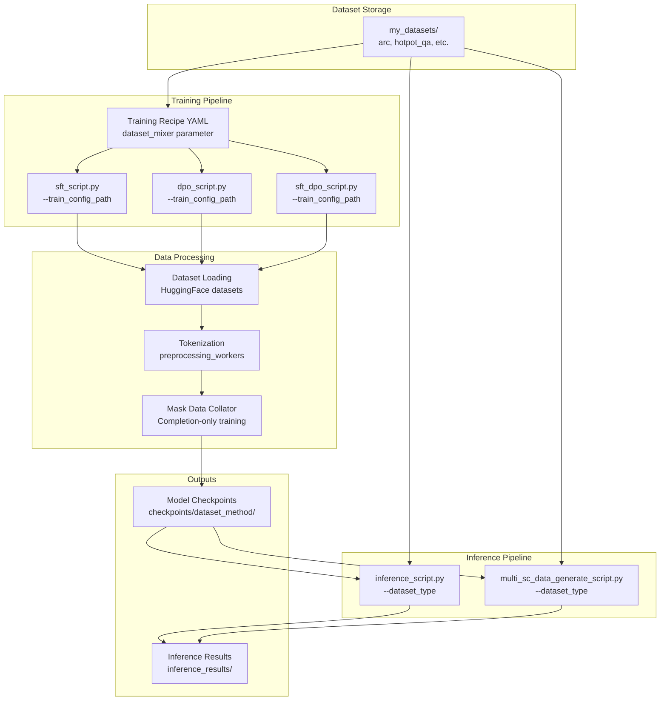
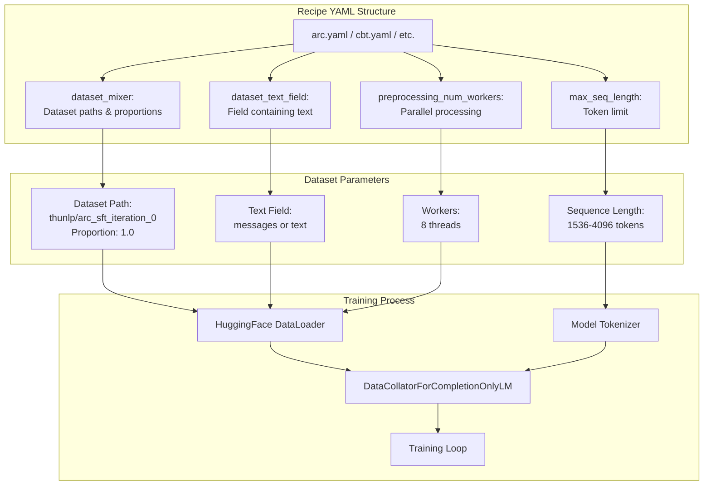

<!-- source: DeepWiki mcp.deepwiki.com · repo thunlp/Optima · page 13.3 Supported Datasets · fetched 2026-11-02 -->

# Supported Datasets

<details>
<summary>Relevant source files</summary>

The following files were used as context for generating this wiki page:

- [README.md](README.md)
- [README_revise.md](README_revise.md)

</details>


This page provides a comprehensive reference of all datasets supported by Optima for training and evaluation. It documents the dataset types, their characteristics, and how they are used in the training and inference pipelines. For information about dataset preparation and formatting requirements, see [Custom Dataset Preparation](#11.1). For details on the dataset directory structure, see [Dataset Structure and Preparation](#10.1).

## Dataset Overview

Optima supports eight benchmark datasets spanning multiple task categories, including question answering, logical reasoning, and mathematical problem-solving. Each dataset is identified by a `dataset_type` parameter used throughout the training and inference scripts.

| Dataset Type | Full Name | Domain | Task Type | Primary Metric |
|--------------|-----------|---------|-----------|----------------|
| `arc` | AI2 Reasoning Challenge (ARC-C) | Science & Reasoning | Multiple-choice QA | Accuracy |
| `hotpot_qa` | HotpotQA | Multi-hop QA | Open-domain QA | Exact Match/F1 |
| `mwh_qa` | Multi-Wiki-Hop QA | Multi-hop QA | Open-domain QA | Exact Match/F1 |
| `trivial_qa` | TriviaQA | General Knowledge | Open-domain QA | Exact Match/F1 |
| `cbt` | Children's Book Test | Reading Comprehension | Named Entity Prediction | Accuracy |
| `math` | MATH Dataset | Mathematics | Problem Solving | Accuracy |
| `gsm8k` | Grade School Math 8K | Mathematics | Word Problems | Accuracy |
| `mmlu` | Massive Multitask Language Understanding | Multi-domain | Multiple-choice | Accuracy |

**Sources:** [README.md:104](), [README.md:132]()

## Dataset Categories

### Question Answering Datasets

**HotpotQA (`hotpot_qa`)**
A multi-hop question answering dataset requiring reasoning over multiple supporting documents. Agents must gather and synthesize information from different sources to answer complex questions. This dataset particularly benefits from multi-agent collaboration where agents can divide the information gathering task.

**Multi-Wiki-Hop QA (`mwh_qa`)**
Similar to HotpotQA, this dataset focuses on multi-hop reasoning across Wikipedia articles. It tests the ability of agents to navigate complex reasoning chains and aggregate information from multiple sources.

**TriviaQA (`trivial_qa`)**
A large-scale question answering dataset containing trivia questions from various sources. It tests factual knowledge and the ability to locate relevant information in supporting documents.

### Logical Reasoning Datasets

**AI2 Reasoning Challenge - Challenge Set (`arc`)**
The ARC-Challenge (ARC-C) dataset contains grade-school level science questions that require complex reasoning and world knowledge. This is one of the primary benchmarks used in the Optima paper and examples throughout the documentation.

**Children's Book Test (`cbt`)**
A reading comprehension dataset built from children's books. The task is to predict missing words (named entities, common nouns, verbs, or prepositions) from context, testing language understanding and reasoning capabilities.

### Mathematical Reasoning Datasets

**MATH Dataset (`math`)**
Contains challenging mathematics problems from high school competitions, covering topics like algebra, geometry, number theory, and calculus. Requires multi-step reasoning and symbolic manipulation.

**GSM8K (`gsm8k`)**
Grade School Math 8K consists of grade-school level math word problems. Each problem requires 2-8 steps to solve, testing arithmetic reasoning and problem decomposition skills.

### General Knowledge Dataset

**Massive Multitask Language Understanding (`mmlu`)**
A comprehensive benchmark covering 57 subjects spanning STEM, humanities, social sciences, and more. Tests broad knowledge and the ability to answer multiple-choice questions across diverse domains.

**Sources:** [README.md:95-137]()

## Dataset Integration in Optima

The following diagram shows how datasets flow through the Optima training and inference pipelines:



**Sources:** [README.md:58-137]()

## Dataset Type Parameter Usage

The `dataset_type` parameter is the primary identifier for datasets across all Optima scripts. This parameter must match one of the supported dataset names exactly.

### In Training Scripts

Training scripts do not directly use the `dataset_type` parameter. Instead, datasets are specified through the `dataset_mixer` parameter in recipe YAML files. The dataset mixer maps dataset paths to sampling proportions:

```yaml
dataset_mixer:
  thunlp/arc_sft_iteration_0: 1.0
```

The dataset name convention typically follows the pattern: `{organization}/{dataset_name}_{method}_iteration_{N}`, where the dataset base name (e.g., `arc`) matches the supported dataset types.

**Sources:** [README.md:58-92]()

### In Inference Scripts

Inference scripts require explicit specification of the `dataset_type` parameter:

**inference_script.py:**
```bash
python inference_script.py \
    --dataset_type arc \
    --model_root_path ./checkpoints/arc_sft
```

**multi_sc_data_generate_script.py:**
```bash
python multi_sc_data_generate_script.py \
    --dataset_type arc \
    --model_path ./checkpoints/arc_sft/iteration_0
```

The `dataset_type` parameter determines which test dataset to load for evaluation and which evaluation metrics to compute.

**Sources:** [README.md:100-137]()

## Dataset-Method Combinations

The following table shows typical combinations of datasets and training methods used in Optima:

| Dataset | iSFT | iDPO | iSFT-DPO | Primary Use Case |
|---------|------|------|----------|------------------|
| `arc` | ✓ | ✓ | ✓ | Logical reasoning benchmark |
| `cbt` | ✓ | ✓ | ✓ | Reading comprehension |
| `hotpot_qa` | ✓ | ✓ | ✓ | Multi-hop reasoning |
| `mwh_qa` | ✓ | ✓ | ✓ | Multi-hop reasoning |
| `trivial_qa` | ✓ | ✓ | ✓ | Factual QA |
| `math` | ✓ | ✓ | ✓ | Mathematical reasoning |
| `gsm8k` | ✓ | ✓ | ✓ | Arithmetic word problems |
| `mmlu` | ✓ | ✓ | ✓ | Multi-domain evaluation |

Each combination produces separate checkpoint directories (e.g., `checkpoints/arc_sft/`, `checkpoints/arc_dpo/`, `checkpoints/cbt_sft_dpo/`).

## Dataset Directory Structure

Datasets in Optima are stored in the `my_datasets/` directory and organized by dataset name and iteration:

```
my_datasets/
├── arc_sft_iteration_0/
├── arc_sft_iteration_1/
├── arc_dpo_iteration_0/
├── cbt_sft_iteration_0/
├── hotpot_qa_sft_iteration_0/
├── math_sft_iteration_0/
├── gsm8k_sft_iteration_0/
└── mmlu_sft_iteration_0/
```

Each dataset directory contains training data formatted for the specified method (SFT or DPO) and iteration number. Iteration 0 typically contains the initial training data, while subsequent iterations contain data generated through multi-agent interactions from previous model checkpoints.

**Sources:** Based on architectural patterns from [README.md:58-137]()

## Recipe Configuration for Datasets

The following diagram illustrates how datasets are configured in recipe YAML files:



**Sources:** Based on recipe system from [README.md:58-92]()

## Dataset Format Requirements

All datasets used in Optima must follow specific format requirements depending on the training method:

### SFT Dataset Format

For supervised fine-tuning, datasets must contain conversational data with messages from both Alice and Bob agents:

```python
{
    "messages": [
        {"role": "user", "content": "Question text..."},
        {"role": "Alice", "content": "Alice's response..."},
        {"role": "Bob", "content": "Bob's response..."},
        {"role": "Alice", "content": "Alice's follow-up..."}
    ]
}
```

The `Mask` data collator ensures only assistant (Alice/Bob) responses contribute to the training loss, implementing completion-only language modeling.

### DPO Dataset Format

For direct preference optimization, datasets must contain pairs of chosen and rejected responses:

```python
{
    "prompt": "Question or context...",
    "chosen": "Preferred response...",
    "rejected": "Dispreferred response..."
}
```

The DPO training process uses these pairs to optimize the model's preference alignment.

**Sources:** Based on data processing patterns from architectural diagrams

## Dataset Loading and Preprocessing

The following code entities are involved in dataset loading and preprocessing:

| Component | Purpose | Key Parameters |
|-----------|---------|----------------|
| Dataset Mixer | Specifies which datasets to load and their sampling ratios | `dataset_mixer` in YAML |
| Text Field | Identifies the field containing text data | `dataset_text_field` in YAML |
| Max Sequence Length | Limits token count per example | `max_seq_length` (1536-4096) |
| Preprocessing Workers | Parallel processing threads | `preprocessing_num_workers` (8) |
| Chat Template | Formats multi-agent conversations | Alice/Bob tokens |
| Mask Collator | Masks non-assistant tokens | `response_template` parameter |

**Sources:** [README.md:58-92]()

## Evaluation Metrics by Dataset

Different datasets use different evaluation metrics:

| Dataset Type | Primary Metric | Secondary Metrics | Evaluation Focus |
|--------------|----------------|-------------------|------------------|
| `arc` | Accuracy | Token efficiency | Correct answer selection |
| `hotpot_qa` | Exact Match, F1 | Token usage | Answer span extraction |
| `mwh_qa` | Exact Match, F1 | Token usage | Multi-hop reasoning accuracy |
| `trivial_qa` | Exact Match, F1 | Token usage | Factual correctness |
| `cbt` | Accuracy | Token efficiency | Named entity prediction |
| `math` | Accuracy | Solution steps | Mathematical correctness |
| `gsm8k` | Accuracy | Token efficiency | Arithmetic reasoning |
| `mmlu` | Accuracy | Subject-wise scores | Broad knowledge coverage |

All datasets additionally track communication effectiveness metrics:
- **Token Usage**: Total tokens consumed during multi-agent interaction
- **Communication Rounds**: Number of turns between agents
- **Token Efficiency**: Accuracy per token used
- **Inference-Time Scaling**: Performance vs. computation trade-off

**Sources:** [README.md:94-137]()

## Adding Custom Datasets

To use custom datasets with Optima:

1. Format data according to SFT or DPO requirements
2. Upload to HuggingFace Hub or store locally
3. Update `dataset_mixer` in recipe YAML
4. Ensure `dataset_type` is recognized in inference scripts
5. Add appropriate evaluation metrics if needed

For detailed instructions, refer to [Custom Dataset Preparation](#11.1).

**Sources:** [README.md:58-137]()

---

This reference page documents all officially supported datasets in Optima. For practical examples of using these datasets in training, see [Quick Start Tutorial](#2.2). For configuring dataset parameters in recipes, see [Recipe Configuration System](#6.2).

---

