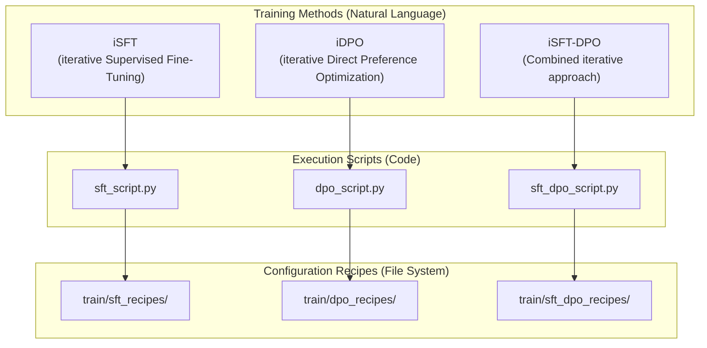
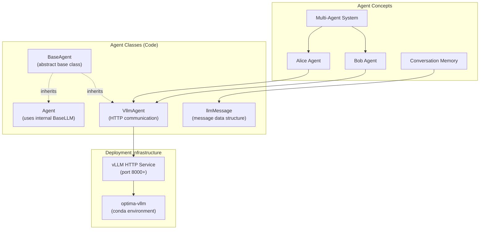

<!-- source: DeepWiki mcp.deepwiki.com · repo thunlp/Optima · page 13.4 Glossary · fetched 2026-11-02 -->

# Glossary

Relevant source files

The following files were used as context for generating this wiki page:

- [README.md](README.md)
- [README_revise.md](README_revise.md)
- [alignment-handbook/README.md](alignment-handbook/README.md)

This page provides definitions for key terms, concepts, and technical components used throughout the Optima framework. Terms are organized alphabetically with references to their usage in the codebase and configuration files.

For detailed explanations of training methodologies, see [Iterative Training Methods](#3.1). For agent system concepts, see [Agent Class Reference](#5.1). For configuration parameters, see [Recipe Parameters Reference](#7.4).

---

## Training Method Terminology Mapping

The following diagram illustrates how Optima's training method terminology maps to executable scripts and configuration directories:

**Sources:** [README.md:58-93](), [sft_script.py](), [dpo_script.py](), [sft_dpo_script.py]()

---

## Agent System Terminology Mapping

The following diagram maps agent-related concepts to their implementation classes and deployment infrastructure:

**Sources:** [README.md:26-37](), [README.md:109](), agent system implementation files

---

## Term Definitions

### Alignment Handbook

A framework developed by Hugging Face for training robust language models with techniques including supervised fine-tuning, reward modeling, rejection sampling, and preference optimization (DPO/ORPO). Optima integrates with and extends this framework, particularly for the Mask data collator implementation and training utilities.

**Location:** [alignment-handbook/]()  
**Installation:** [README.md:48-50]()  
**Related:** See [Alignment Handbook Overview](#9.1)

**Sources:** [README.md:48-50](), [alignment-handbook/README.md:1-129]()

---

### BaseAgent

The abstract base class defining the interface for all agent implementations in Optima. Provides the foundational structure for agent interactions in multi-agent systems.

**Inheritance hierarchy:** `BaseAgent` → `Agent`, `VllmAgent`  
**Related:** See [Agent Class Reference](#5.1)

**Sources:** Agent implementation files referenced in architecture diagrams

---

### Beta (β) Parameter

A hyperparameter used in Direct Preference Optimization (DPO) that controls the strength of preference alignment. Common values range from 0.1 to 0.2. Higher beta values result in stronger preference signal enforcement during training.

**Configuration location:** Recipe YAML files under `beta` key  
**Usage context:** DPO and iSFT-DPO training methods  
**Related:** See [DPO Recipe Guide](#7.2), [Direct Preference Optimization](#3.3)

**Sources:** [train/dpo_recipes/](), [train/sft_dpo_recipes/]()

---

### bfloat16

Brain floating-point 16-bit format (`torch.bfloat16`) used for reduced precision training. Offers better numerical stability than float16 while reducing memory usage by half compared to float32. Configured via the `torch_dtype` parameter in recipe YAML files.

**Configuration:** `torch_dtype: bfloat16` in recipe files  
**Related:** See [Performance Optimization](#11.4)

**Sources:** Recipe configuration files

---

### Checkpoint

A saved snapshot of model weights, optimizer state, and training configuration at a specific point during training. In Optima, checkpoints are organized by iteration number in directories like `checkpoints/arc_sft/iteration_0/`.

**Directory structure:** `checkpoints/{method}_{dataset}/iteration_{N}/`  
**Related:** See [Model Checkpoints and Iterations](#10.2)

**Sources:** [README.md:102](), [inference_script.py]()

---

### Chat Template

A formatting convention that structures multi-agent conversations with special tokens identifying speakers (e.g., `Alice_token`, `Bob_token`). Chat templates ensure consistent message formatting for both training and inference.

**Usage:** Agent communication formatting  
**Related:** See [VllmAgent HTTP Communication](#5.2)

**Sources:** Agent implementation, architecture diagram

---

### Communication Effectiveness

A metric measuring how efficiently agents exchange information to solve tasks, typically evaluated by the ratio of task success rate to token usage. One of Optima's primary optimization objectives.

**Key feature:** Substantial increase achieved through iterative training  
**Related:** See [Evaluation Metrics](#8.3), [README.md:17-18]()

**Sources:** [README.md:15-20]()

---

### Completion-Only Masking

A training technique where loss is computed only on assistant response tokens, not on user prompt or system message tokens. Implemented via the Mask data collator class in Optima's integration with alignment-handbook.

**Implementation:** Mask data collator class  
**Related:** See [Mask Data Collator](#6.3), [Mask Data Collator Implementation](#9.2)

**Sources:** Architecture diagrams, alignment-handbook integration

---

### CUDA

NVIDIA's parallel computing platform and API for GPU acceleration. Optima requires CUDA 12.1 for both training and inference environments.

**Installation:** `conda install nvidia/label/cuda-12.1.0::cuda-nvcc`  
**Version:** 12.1.0  
**Related:** See [Installation and Environment Setup](#2.1)

**Sources:** [README.md:32](), [README.md:45]()

---

### Dataset Mixer

A configuration parameter specifying the composition and proportions of multiple datasets used during training. Defined in recipe YAML files under the `dataset_mixer` key.

**Configuration location:** Recipe YAML `dataset_mixer` section  
**Related:** See [Recipe Parameters Reference](#7.4)

**Sources:** Recipe configuration files

---

### Direct Preference Optimization (DPO)

A training methodology that aligns language models to human or AI preferences without requiring a separate reward model or reinforcement learning. DPO directly optimizes the policy using preference pairs (chosen vs rejected responses). In Optima, this is combined with iterative training (iDPO).

**Scripts:** [dpo_script.py](), [sft_dpo_script.py]()  
**Recipes:** [train/dpo_recipes/](), [train/sft_dpo_recipes/]()  
**Related:** See [Direct Preference Optimization](#3.3), [iDPO](#glossary-idpo)

**Sources:** [README.md:74-82](), [alignment-handbook/README.md:56]()

---

### Flash Attention 2

An optimized implementation of the attention mechanism that significantly reduces memory usage and increases training speed. Required for Optima's training pipeline and enabled via the `use_flash_attention_2` parameter.

**Installation:** `pip install flash-attn --no-build-isolation`  
**Configuration:** `use_flash_attention_2: true` in recipes  
**Related:** See [Performance Optimization](#11.4)

**Sources:** [README.md:52](), [alignment-handbook/README.md:78-82]()

---

### Gradient Accumulation

A technique that simulates larger batch sizes by accumulating gradients over multiple forward/backward passes before updating model parameters. Configured via `gradient_accumulation_steps` in recipe files.

**Configuration:** `gradient_accumulation_steps` parameter  
**Benefit:** Enables effective large-batch training on limited GPU memory  
**Related:** See [Hyperparameter Tuning](#11.3)

**Sources:** Recipe configuration files

---

### iDPO

**Iterative Direct Preference Optimization.** An extension of DPO where models from iteration N generate preference data used to train iteration N+1. This creates a self-improvement loop where models learn from their own improved outputs.

**Implementation:** [dpo_script.py]()  
**Configuration:** [train/dpo_recipes/]()  
**Execution:** `python dpo_script.py --train_config_path train/dpo_recipes/arc.yaml`  
**Related:** See [Iterative Training Methods](#3.1), [DPO](#direct-preference-optimization-dpo)

**Sources:** [README.md:74-81](), [README.md:11]()

---

### Inference-Time Scaling Laws

Empirical relationships describing how model performance scales with computational resources at inference time. Optima optimizes for improved scaling laws by reducing token usage while maintaining or improving accuracy.

**Key feature:** Potential for improved scaling laws  
**Related:** See [Evaluation Metrics](#8.3)

**Sources:** [README.md:11](), [README.md:19]()

---

### iSFT

**Iterative Supervised Fine-Tuning.** A training approach where models from iteration N generate training data (via multi-agent conversations) for supervised fine-tuning of iteration N+1. This iterative process progressively improves both communication efficiency and task accuracy.

**Implementation:** [sft_script.py]()  
**Configuration:** [train/sft_recipes/]()  
**Execution:** `python sft_script.py --train_config_path train/sft_recipes/arc.yaml`  
**Related:** See [Iterative Training Methods](#3.1), [SFT](#supervised-fine-tuning-sft)

**Sources:** [README.md:61-70](), [README.md:11]()

---

### iSFT-DPO

**Combined Iterative Supervised Fine-Tuning and Direct Preference Optimization.** A hybrid training method that performs both SFT and DPO in sequence within each iteration, combining the benefits of both approaches.

**Implementation:** [sft_dpo_script.py]()  
**Configuration:** [train/sft_dpo_recipes/]()  
**Execution:** `python sft_dpo_script.py --train_config_path train/sft_dpo_recipes/arc.yaml`  
**Related:** See [Iterative Training Methods](#3.1), [Combined SFT-DPO Recipes](#7.3)

**Sources:** [README.md:85-92](), [README.md:11]()

---

### Iteration

A complete training cycle in Optima's iterative training pipeline. Each iteration typically includes: (1) data generation using models from the previous iteration, (2) SFT/DPO training, and (3) checkpoint saving. Iterations are numbered sequentially (iteration_0, iteration_1, etc.).

**Directory naming:** `iteration_0`, `iteration_1`, `iteration_N`  
**Related:** See [Iterative Training Methods](#3.1), [Training Pipeline Flow](#4.2)

**Sources:** [README.md:102](), [README.md:128](), checkpoint directory structure

---

### llmMessage

A data structure representing a single message in a multi-agent conversation, containing information such as speaker identity, message content, and metadata.

**Usage:** Conversation memory management  
**Related:** See [Conversation Memory Management](#5.3)

**Sources:** Agent system implementation

---

### Mask Data Collator

A custom data collator class that implements completion-only masking for language model training. It processes conversation data to ensure that loss is computed only on assistant response tokens, not on user prompts or other non-assistant content.

**Implementation location:** Alignment-handbook integration  
**Function:** Labels masking for completion-only training  
**Related:** See [Mask Data Collator](#6.3), [Mask Data Collator Implementation](#9.2)

**Sources:** Architecture diagrams, alignment-handbook integration

---

### MKL_THREADING_LAYER

An environment variable set to `GNU` when executing training scripts to configure Intel Math Kernel Library threading. Required for proper execution of training commands.

**Usage:** `MKL_THREADING_LAYER=GNU python sft_script.py ...`  
**Value:** `GNU`

**Sources:** [README.md:66](), [README.md:77](), [README.md:88]()

---

### Multi-Agent System

An architecture where multiple language model agents (typically Alice and Bob in Optima) interact through conversation to solve tasks. The agents take turns communicating, with their interactions forming the basis for training data generation in iterative training.

**Key agents:** Alice, Bob  
**Implementation:** VllmAgent instances  
**Related:** See [Multi-Agent System Architecture](#3.2), [Agent System](#5)

**Sources:** [README.md:5](), architecture diagrams

---

### optima-train

The conda environment name for Optima's training infrastructure, including alignment-handbook, PyTorch, Flash Attention 2, and training dependencies.

**Python version:** 3.11  
**Key components:** alignment-handbook, PyTorch 2.3.1, Flash Attention 2  
**Setup:** [README.md:41-55]()  
**Related:** See [Dual Environment Design](#4.1)

**Sources:** [README.md:42](), [README.md:69]()

---

### optima-vllm

The conda environment name for Optima's vLLM deployment infrastructure, used for model serving during inference and multi-agent data generation.

**Python version:** 3.11  
**Key components:** vLLM 0.5.3, PyTorch 2.3.1  
**Setup:** [README.md:26-37]()  
**Related:** See [Dual Environment Design](#4.1)

**Sources:** [README.md:29](), [README.md:68]()

---

### ORPO

**Odds Ratio Preference Optimization.** A training technique that combines supervised fine-tuning and preference optimization in a single stage, mentioned in the alignment-handbook documentation as an alternative to DPO.

**Source framework:** Alignment Handbook  
**Related:** See [Alignment Handbook Overview](#9.1)

**Sources:** [alignment-handbook/README.md:57]()

---

### PyTorch

The deep learning framework used throughout Optima. Specifically requires version 2.3.1 for compatibility with vLLM 0.5.3.

**Required version:** 2.3.1  
**CUDA version:** 12.1  
**Installation:** Via conda with `pytorch-cuda=12.1` channel

**Sources:** [README.md:34](), [README.md:47]()

---

### Recipe

A YAML configuration file that specifies all parameters for a training run, including model paths, dataset mixtures, hyperparameters, and optimization settings. Recipes follow a hierarchical structure with base configurations extended by method-specific and iteration-specific files.

**Directory structure:**
- [train/sft_recipes/]()
- [train/dpo_recipes/]()
- [train/sft_dpo_recipes/]()

**Related:** See [Recipe Configuration System](#6.2), [Configuration Recipes](#7)

**Sources:** [README.md:59](), recipe directory structure

---

### Reinforcement Learning from Human Feedback (RLHF)

A paradigm for aligning language models with human preferences by training a reward model from human feedback and using reinforcement learning (typically PPO) to optimize the policy. DPO is presented as an alternative to RLHF that doesn't require a separate reward model or RL training.

**Alternative in Optima:** DPO (Direct Preference Optimization)  
**Related:** See [Direct Preference Optimization](#3.3)

**Sources:** [alignment-handbook/README.md:15]()

---

### Self-Consistency

An inference technique where multiple agent conversation samples are generated (with temperature sampling) and aggregated to produce more robust final answers. Implemented in the multi-agent setting for improved reliability.

**Implementation:** [multi_sc_data_generate_script.py]()  
**Parameters:** `--temperature` for sampling diversity  
**Related:** See [Multi-Agent Self-Consistency](#8.2)

**Sources:** [README.md:103-137]()

---

### Supervised Fine-Tuning (SFT)

A training methodology where models learn to follow instructions by supervised training on demonstration data. In Optima, SFT is applied iteratively (iSFT) where each iteration uses data generated by previous iterations.

**Scripts:** [sft_script.py](), [sft_dpo_script.py]()  
**Recipes:** [train/sft_recipes/]()  
**Related:** See [iSFT](#isft), [SFT Recipe Guide](#7.1)

**Sources:** [README.md:61-70](), [alignment-handbook/README.md:15]()

---

### Temperature

A sampling parameter that controls randomness in model outputs. Higher temperatures (e.g., 0.5-1.0) produce more diverse outputs, while lower temperatures produce more deterministic responses. Used in self-consistency inference.

**Configuration:** `--temperature` command-line argument  
**Usage context:** [multi_sc_data_generate_script.py]()  
**Example value:** 0.5

**Sources:** [README.md:135]()

---

### Token

The basic unit of text processed by language models after tokenization. Optima optimizes for reduced token usage in multi-agent conversations while maintaining task accuracy.

**Optimization goal:** Significant reduction in token usage  
**Metric:** Token usage per task  
**Related:** See [Communication Effectiveness](#communication-effectiveness), [Evaluation Metrics](#8.3)

**Sources:** [README.md:17]()

---

### VllmAgent

An agent implementation class that communicates with vLLM-deployed models via HTTP. Used for multi-agent data generation and inference. VllmAgent sends HTTP POST requests to vLLM services running on specified ports.

**Base class:** BaseAgent  
**Communication:** HTTP to vLLM service (port 8000+)  
**Usage:** Alice and Bob agent instances  
**Related:** See [Agent Class Reference](#5.1), [VllmAgent HTTP Communication](#5.2)

**Sources:** Architecture diagrams, agent implementation

---

### vLLM

A high-performance inference and serving library for large language models, version 0.5.3 in Optima. Provides fast HTTP-based model serving with efficient memory management and batching.

**Version:** 0.5.3  
**PyTorch requirement:** 2.3.1  
**Installation:** `pip install vllm==0.5.3`  
**Environment:** optima-vllm  
**Related:** See [Dual Environment Design](#4.1)

**Sources:** [README.md:36](), [README.md:109](), [README.md:124]()

---

## Configuration Parameter Categories

The following table categorizes common parameters found in recipe YAML files:

| Category | Key Parameters | Description |
|----------|----------------|-------------|
| **Model Configuration** | `model_name_or_path` `tokenizer_path` `torch_dtype` | Model selection and format settings |
| **Data Configuration** | `dataset_mixer` `max_seq_length` `preprocessing_workers` | Dataset composition and processing |
| **Training Configuration** | `learning_rate` `num_train_epochs` `batch_size` `gradient_accumulation_steps` | Core training hyperparameters |
| **Optimization Configuration** | `optim` `lr_scheduler` `warmup_ratio` `beta` (DPO only) | Optimizer and learning rate scheduling |
| **Performance Configuration** | `use_flash_attention_2` `bf16` | Performance and memory optimizations |

**Sources:** Recipe configuration files, architecture diagrams

---

## Supported Datasets

The following datasets are supported by Optima, as referenced throughout the codebase:

| Dataset | Full Name | Type | Usage Context |
|---------|-----------|------|---------------|
| `arc` | AI2 Reasoning Challenge (ARC-C) | Question Answering | Multiple choice reasoning |
| `hotpot_qa` | HotpotQA | Question Answering | Multi-hop reasoning |
| `mwh_qa` | MusiqueQA (Multi-hop WH Questions) | Question Answering | Complex multi-hop QA |
| `trivial_qa` | TriviaQA | Question Answering | Open-domain trivia |
| `cbt` | Children's Book Test | Language Modeling | Cloze-style reading comprehension |
| `math` | MATH Dataset | Mathematical Reasoning | Competition-level math problems |
| `gsm8k` | Grade School Math 8K | Mathematical Reasoning | Grade-school level math |
| `mmlu` | Massive Multitask Language Understanding | Multi-domain Evaluation | Knowledge and reasoning across domains |

**Usage:** Specified via `--dataset_type` parameter in training and inference scripts  
**Related:** See [Supported Datasets](#13.3), [Dataset Structure and Preparation](#10.1)

**Sources:** [README.md:104](), [README.md:120](), [README.md:132]()

---

## Environment Command-Line Arguments

Common command-line arguments used across training and inference scripts:

| Argument | Purpose | Example Value |
|----------|---------|---------------|
| `--train_config_path` | Path to recipe YAML file | `train/sft_recipes/arc.yaml` |
| `--vllm_env` | Conda environment for vLLM | `optima-vllm` |
| `--alignment_env` | Conda environment for training | `optima-train` |
| `--model_path` / `--model_root_path` | Checkpoint location | `./checkpoints/arc_sft` |
| `--tokenizer_path` | Tokenizer location | Path to pretrained tokenizer |
| `--device` | GPU index for deployment | `0` |
| `--port` | Starting port number for vLLM | `8000` |
| `--dataset_type` | Dataset identifier | `arc`, `hotpot_qa`, etc. |
| `--num_thread` | Thread count for inference | `128` |
| `--output_path` / `--output_root_path` | Results directory | `./inference_results` |
| `--temperature` | Sampling temperature | `0.5` |

**Related:** See [Command-Line Interface Reference](#13.1)

**Sources:** [README.md:66-136]()

---

## Port Management

In Optima's dual-environment architecture, vLLM services are deployed on sequential ports starting from a base port number (default 8000). Multiple GPU deployments use consecutive ports.

**Base port:** 8000 (configurable via `--port`)  
**Port allocation:** Sequential (8000, 8001, 8002, ...)  
**Related:** See [Multi-GPU Training](#11.2), [VllmAgent HTTP Communication](#5.2)

**Sources:** [README.md:106](), [README.md:119](), [README.md:131]()

---

