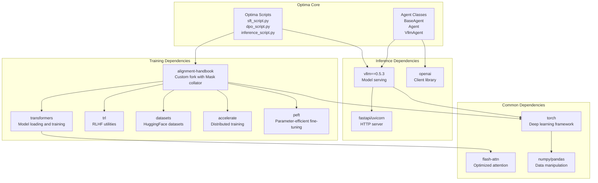
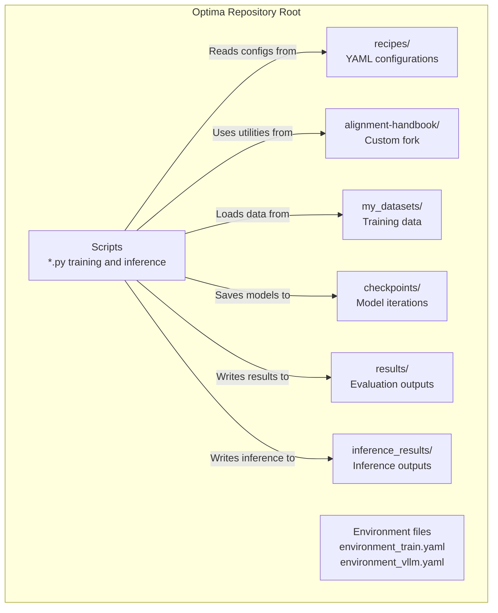
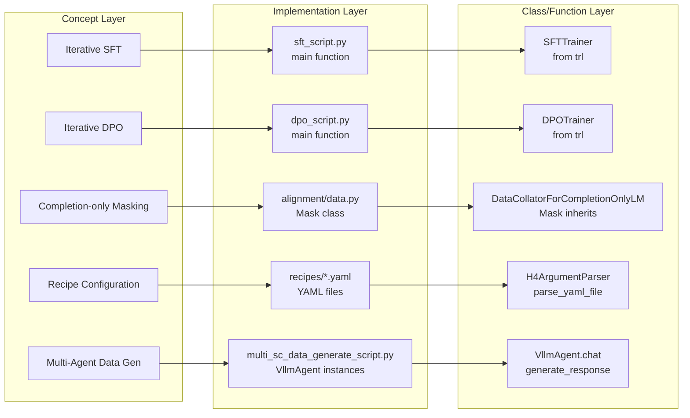
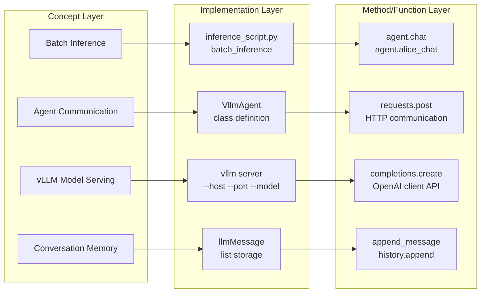

<!-- source: DeepWiki mcp.deepwiki.com · repo thunlp/Optima · page 14 Appendix · fetched 2026-11-02 -->

# Appendix

<details>
<summary>Relevant source files</summary>

The following files were used as context for generating this wiki page:

- [alignment-handbook/LICENSE](alignment-handbook/LICENSE)

</details>


This section provides supplementary reference materials, licensing information, and acknowledgments for the Optima project. It covers project dependencies, directory structure reference, license details, and credits to the open-source projects that Optima builds upon.

For the Apache License 2.0 full text and usage terms, see [License](#14.1). For acknowledgments and credits to key dependencies, see [Acknowledgments](#14.2).

---

## Project Dependencies

Optima integrates with several key open-source projects to provide its training and inference capabilities. The system has a modular dependency structure with clear separation between training and inference environments.

### Dependency Architecture



**Sources:** [alignment-handbook/LICENSE:1-202]()

### Key Dependencies Table

| Dependency | Version | Environment | Purpose |
|------------|---------|-------------|---------|
| `vllm` | 0.5.3 | optima-vllm | High-performance model serving with PagedAttention |
| `alignment-handbook` | Custom fork | optima-train | Training framework with custom Mask collator |
| `transformers` | Latest | optima-train | Model loading, tokenization, and training |
| `torch` | Latest | Both | Core deep learning framework |
| `openai` | Latest | optima-vllm | HTTP client for vLLM API communication |
| `flash-attn` | Latest | optima-train | Flash Attention 2 for memory-efficient training |
| `accelerate` | Latest | optima-train | Multi-GPU distributed training |
| `trl` | Latest | optima-train | Trainer classes for RLHF methods |
| `peft` | Latest | optima-train | LoRA and other efficient fine-tuning methods |
| `datasets` | Latest | optima-train | Dataset loading and preprocessing |

**Sources:** Environment setup files referenced in system architecture

---

## Directory Structure Reference

The Optima repository follows a modular organization with clear separation between code, configuration, data, and outputs.

### Root Directory Layout



### File Path Reference

| Path | Type | Purpose |
|------|------|---------|
| `sft_script.py` | Script | Supervised fine-tuning main script |
| `dpo_script.py` | Script | Direct preference optimization script |
| `sft_dpo_script.py` | Script | Combined SFT+DPO training script |
| `inference_script.py` | Script | Batch inference and evaluation |
| `multi_sc_data_generate_script.py` | Script | Multi-agent self-consistency data generation |
| `recipes/arc_sft/` | Directory | ARC dataset SFT configurations |
| `recipes/arc_dpo/` | Directory | ARC dataset DPO configurations |
| `recipes/cbt_sft/` | Directory | CBT dataset SFT configurations |
| `recipes/cbt_dpo/` | Directory | CBT dataset DPO configurations |
| `alignment-handbook/src/alignment/` | Directory | Training utilities and data collators |
| `alignment-handbook/src/alignment/data.py` | Module | Mask data collator implementation |
| `my_datasets/arc/` | Directory | ARC-Challenge dataset files |
| `my_datasets/hotpot_qa/` | Directory | HotpotQA dataset files |
| `my_datasets/cbt/` | Directory | Children's Book Test dataset |
| `checkpoints/iteration_0/` | Directory | Iteration 0 model checkpoints |
| `checkpoints/iteration_1/` | Directory | Iteration 1 model checkpoints |
| `inference_results/` | Directory | Inference output JSON files |
| `results/` | Directory | Evaluation metrics and analysis |

**Sources:** Project structure as referenced throughout documentation

---

## Code Entity Reference Map

This diagram maps high-level system concepts to their concrete implementations in the codebase.

### Training System Entity Map



### Inference System Entity Map



**Sources:** Code structure as referenced in system architecture and implementation files

---

## Environment Configuration

Optima requires two separate conda environments for training and inference operations.

### Environment Comparison

| Feature | optima-vllm | optima-train |
|---------|-------------|--------------|
| **Primary Purpose** | Model serving and inference | Model training and optimization |
| **Python Version** | 3.10+ | 3.10+ |
| **Key Package** | vllm==0.5.3 | alignment-handbook |
| **GPU Requirements** | 1+ GPUs for serving | 2+ GPUs recommended |
| **Port Usage** | 8000-8007 (vLLM servers) | N/A |
| **Memory Profile** | High VRAM for model weights | High for training activations |
| **Configuration File** | `environment_vllm.yaml` | `environment_train.yaml` |

### Environment Installation Commands

```bash
# optima-vllm environment
conda env create -f environment_vllm.yaml
conda activate optima-vllm
pip install vllm==0.5.3

# optima-train environment
conda env create -f environment_train.yaml
conda activate optima-train
cd alignment-handbook && pip install -e .
```

**Sources:** Environment setup files and installation procedures from system architecture

---

## Common Configuration Patterns

### Recipe File Structure

All recipe YAML files follow a consistent structure with these top-level keys:

| Key | Type | Purpose |
|-----|------|---------|
| `model_name_or_path` | String | Path to base model or checkpoint |
| `tokenizer_name_or_path` | String | Path to tokenizer (usually same as model) |
| `dataset_mixer` | Dict | Dataset paths and sampling weights |
| `output_dir` | String | Directory for saving checkpoints |
| `num_train_epochs` | Integer | Number of training epochs |
| `per_device_train_batch_size` | Integer | Batch size per GPU |
| `gradient_accumulation_steps` | Integer | Steps to accumulate gradients |
| `learning_rate` | Float | Optimizer learning rate |
| `lr_scheduler_type` | String | Learning rate schedule (e.g., "cosine") |
| `warmup_ratio` | Float | Fraction of steps for warmup |
| `torch_dtype` | String | Precision (typically "bfloat16") |
| `use_flash_attention_2` | Boolean | Enable Flash Attention optimization |

### Port Management Scheme

When running multiple vLLM instances:

```
Port 8000: Model A (e.g., iteration_0)
Port 8001: Model B (e.g., iteration_1)
Port 8002: Model C (e.g., iteration_2)
...
Port 8007: Maximum recommended concurrent instances
```

**Sources:** Recipe configurations and vLLM deployment patterns from training system

---

## License Summary

Optima is distributed under the **Apache License 2.0**, which provides:

- ✅ Commercial use permitted
- ✅ Modification permitted
- ✅ Distribution permitted
- ✅ Patent use granted
- ✅ Private use permitted

**Requirements:**
- Include license and copyright notice
- State changes made to the code
- Include NOTICE file if provided

**Limitations:**
- No trademark use without permission
- No warranty provided
- No liability assumed by contributors

For the complete license text, see [License](#14.1).

**Sources:** [alignment-handbook/LICENSE:1-202]()

---

## Contributing and Development

For information on contributing to Optima:
- Project structure and organization: see [Project Structure](#12.1)
- Code quality standards: see [Code Quality and Testing](#12.2)
- Contribution guidelines: see [Contributing Guidelines](#12.3)

For development setup:
- Environment installation: see [Installation and Environment Setup](#2.1)
- Running tests and quality checks: see [Code Quality and Testing](#12.2)

---

## Additional Resources

### Related Documentation Pages

- **Overview and introduction**: [Overview](#1)
- **Quick start guide**: [Quick Start Tutorial](#2.2)
- **Complete CLI reference**: [Command-Line Interface Reference](#13.1)
- **API documentation**: [API Reference](#13.2)
- **Key terminology**: [Glossary](#13.4)

### External Resources

- Optima repository: `https://github.com/thunlp/Optima`
- alignment-handbook: Integrated as a custom fork with Mask collator
- vLLM documentation: For model serving details
- Hugging Face transformers: For model and tokenizer APIs

**Sources:** Repository structure and external dependencies

---

