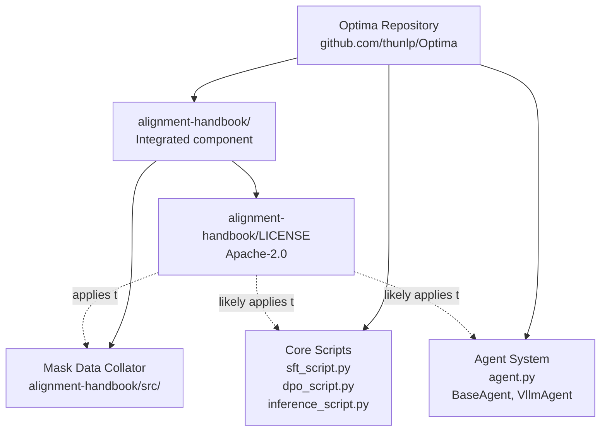
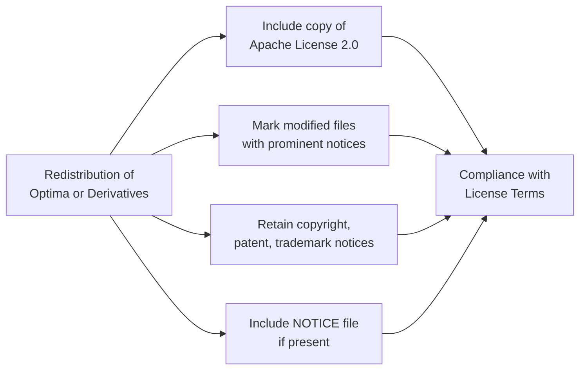
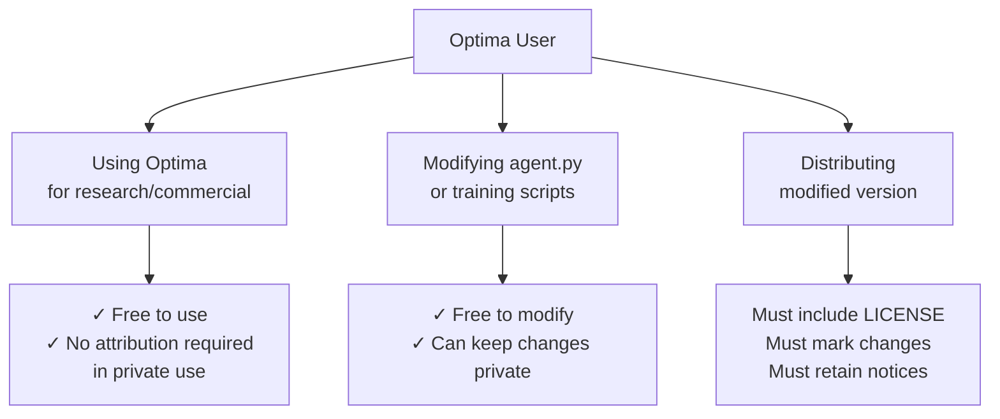
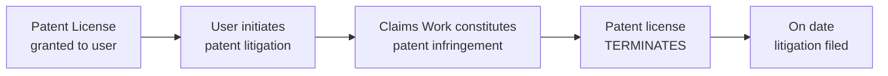

<!-- source: DeepWiki mcp.deepwiki.com · repo thunlp/Optima · page 14.1 License · fetched 2026-11-02 -->

# License

<details>
<summary>Relevant source files</summary>

The following files were used as context for generating this wiki page:

- [alignment-handbook/LICENSE](alignment-handbook/LICENSE)

</details>


This page documents the licensing terms for the Optima codebase. It explains the rights and obligations users have when using, modifying, or distributing the software. For information about contributing to the project, see [Contributing Guidelines](#12.3). For acknowledgment of third-party dependencies, see [Acknowledgments](#14.2).

## License Overview

The Optima repository integrates components under the **Apache License, Version 2.0** (January 2004). The alignment-handbook component, which forms a core part of the training infrastructure, explicitly uses this license as specified in [alignment-handbook/LICENSE:1-202]().

### License Type and Permissiveness

Apache License 2.0 is a permissive open-source license that allows:

| Permission | Description |
|------------|-------------|
| **Commercial Use** | Use the software for commercial purposes without restriction |
| **Modification** | Modify the source code and create derivative works |
| **Distribution** | Distribute original or modified versions |
| **Patent Use** | Grant of patent rights for contributions |
| **Private Use** | Use and modify privately without disclosure requirements |

### License Location



**Diagram: License Application Across Optima Components**

Sources: [alignment-handbook/LICENSE:1-202]()

## Key License Terms

### Grant of Copyright License

The Apache License 2.0 grants users a **perpetual, worldwide, non-exclusive, no-charge, royalty-free, irrevocable copyright license** to:

- Reproduce the work
- Prepare derivative works
- Publicly display and perform
- Sublicense and distribute

As specified in [alignment-handbook/LICENSE:66-71](), this copyright grant applies to both source and object forms of the software.

### Grant of Patent License

The license includes a **patent license grant** [alignment-handbook/LICENSE:73-87]() that protects users from patent infringement claims related to contributions. Key aspects:

- Patent license covers contributions and their combination with the work
- License terminates if the user initiates patent litigation against the work
- Protection applies to patent claims necessarily infringed by the contribution

### Redistribution Requirements

When redistributing Optima or derivative works, users must comply with the conditions in [alignment-handbook/LICENSE:89-128]():



**Diagram: Redistribution Compliance Requirements**

| Requirement | Description | License Section |
|-------------|-------------|-----------------|
| **License Copy** | Provide copy of Apache License 2.0 to recipients | [alignment-handbook/LICENSE:94-95]() |
| **Modification Notice** | Mark modified files with prominent change notices | [alignment-handbook/LICENSE:97-98]() |
| **Attribution** | Retain copyright, patent, trademark, and attribution notices | [alignment-handbook/LICENSE:100-104]() |
| **NOTICE File** | Include NOTICE file contents if it exists | [alignment-handbook/LICENSE:106-121]() |

Sources: [alignment-handbook/LICENSE:89-128]()

## Definitions and Key Concepts

The license defines several important terms [alignment-handbook/LICENSE:7-64]():

### Work and Derivative Works

- **Work**: The software made available under the license, in source or object form [alignment-handbook/LICENSE:35-38]()
- **Derivative Works**: Works based on or derived from the original work, representing original authorship through modifications [alignment-handbook/LICENSE:40-46]()
- **Source Form**: Preferred form for making modifications (source code, documentation source, configuration files) [alignment-handbook/LICENSE:26-28]()
- **Object Form**: Compiled object code, generated documentation, or conversions to other media types [alignment-handbook/LICENSE:30-33]()

### Contributors and Contributions

- **Contribution**: Work of authorship intentionally submitted for inclusion, including original version and modifications [alignment-handbook/LICENSE:48-60]()
- **Contributor**: Licensor and any entity whose contribution was incorporated [alignment-handbook/LICENSE:62-64]()

## Disclaimers and Limitations

### Warranty Disclaimer

The software is provided **"AS IS"** without any warranties [alignment-handbook/LICENSE:143-151]():

- No warranty of merchantability
- No warranty of fitness for particular purpose
- No warranty of title or non-infringement
- Users assume all risks of using or redistributing

### Limitation of Liability

Contributors have **no liability** for damages arising from use of the software [alignment-handbook/LICENSE:153-163](), including:

- Direct or indirect damages
- Special, incidental, or consequential damages
- Loss of goodwill, work stoppage, computer failure
- Other commercial damages or losses

This applies even if contributors were advised of the possibility of such damages.

## Implications for Users and Contributors

### For Users



**Diagram: User Rights by Use Case**

### For Contributors

When contributing to Optima (e.g., submitting pull requests):

- Contributions are automatically licensed under Apache 2.0 terms [alignment-handbook/LICENSE:130-136]()
- No additional terms or conditions apply unless separately agreed
- Contributors grant patent license for their contributions
- Contributors should ensure they have rights to submit their work

### For Derivative Works

Creating derivative works (e.g., extending `BaseAgent` or modifying `sft_script.py`):

| Action | Requirement |
|--------|-------------|
| **Add features to Agent classes** | Can license modifications differently, but base work remains Apache 2.0 |
| **Distribute modified training scripts** | Must comply with redistribution requirements |
| **Create commercial product using Optima** | Permitted without license fees |
| **Add copyright notices** | Allowed, but cannot modify original license terms |

Sources: [alignment-handbook/LICENSE:123-128]()

## Trademark Provisions

The license **does not grant permission** to use trade names, trademarks, service marks, or product names of the licensor [alignment-handbook/LICENSE:138-141](), except for:

- Reasonable and customary use describing the origin of the work
- Reproducing content of the NOTICE file

This means using "Optima" in derivative works requires following trademark usage guidelines.

## Patent Termination Clause

The patent license includes a **defensive termination provision** [alignment-handbook/LICENSE:82-87]():



**Diagram: Patent License Termination Flow**

If a user alleges that Optima or any contribution infringes a patent, their patent license under Apache 2.0 terminates on the date the litigation is filed.

Sources: [alignment-handbook/LICENSE:82-87]()

## Full License Text

The complete Apache License 2.0 text is available in the repository at [alignment-handbook/LICENSE:1-202](). Users should review the full text for complete legal terms and conditions.

### Applying the License

To apply Apache License 2.0 to new files, the license recommends including the boilerplate notice [alignment-handbook/LICENSE:178-201]():

```
Copyright [yyyy] [name of copyright owner]

Licensed under the Apache License, Version 2.0 (the "License");
you may not use this file except in compliance with the License.
You may obtain a copy of the License at

    http://www.apache.org/licenses/LICENSE-2.0

Unless required by applicable law or agreed to in writing, software
distributed under the License is distributed on an "AS IS" BASIS,
WITHOUT WARRANTIES OR CONDITIONS OF ANY KIND, either express or implied.
See the License for the specific language governing permissions and
limitations under the License.
```

This notice should be added to new source files with appropriate comment syntax for the file type.

## Third-Party Dependencies

While Optima itself uses Apache License 2.0, it depends on third-party libraries that may have different licenses:

| Component | Likely License | Notes |
|-----------|---------------|-------|
| **vLLM** | Apache 2.0 | Model serving infrastructure |
| **PyTorch** | BSD-style | Deep learning framework |
| **Transformers** | Apache 2.0 | Hugging Face library |
| **alignment-handbook** | Apache 2.0 | Explicitly licensed in repository |

Users should verify licenses of dependencies when distributing derivative works. For a complete list of dependencies and acknowledgments, see [Acknowledgments](#14.2).

Sources: [alignment-handbook/LICENSE:1-202]()

---

**Summary**: Optima uses the Apache License 2.0, a permissive open-source license that allows commercial use, modification, and distribution with minimal restrictions. Users must comply with redistribution requirements including providing license copy, marking modifications, and retaining attribution notices. The license includes patent grants and defensive termination provisions. The full license text is located at [alignment-handbook/LICENSE:1-202]().

---

