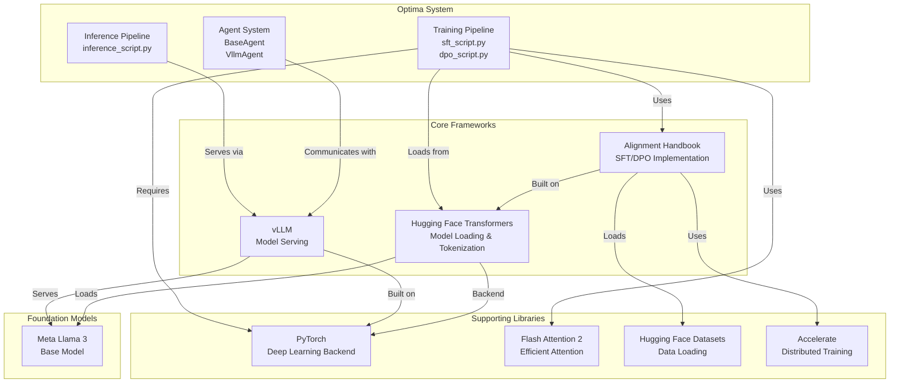
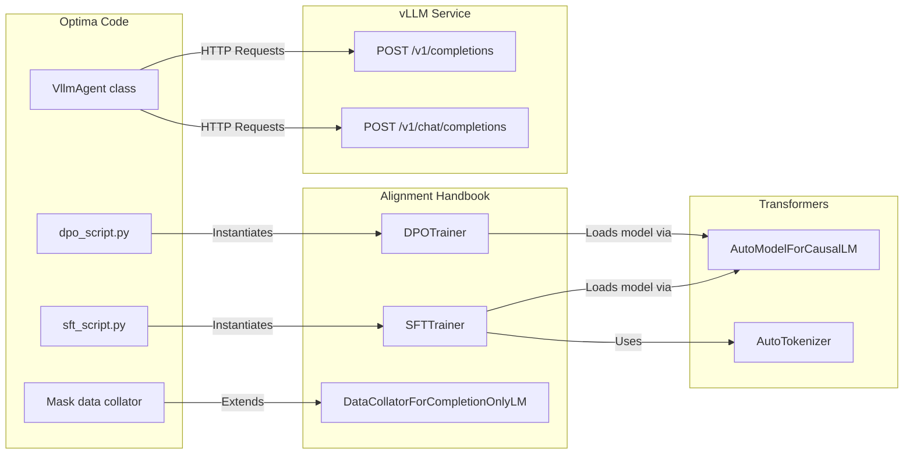

<!-- source: DeepWiki mcp.deepwiki.com · repo thunlp/Optima · page 14.2 Acknowledgments · fetched 2026-11-02 -->

# Acknowledgments

<details>
<summary>Relevant source files</summary>

The following files were used as context for generating this wiki page:

- [alignment-handbook/README.md](alignment-handbook/README.md)
- [alignment-handbook/assets/handbook.png](alignment-handbook/assets/handbook.png)

</details>


This page recognizes the open-source projects, frameworks, and communities that make Optima possible. It documents the major dependencies that form the foundation of Optima's training and inference infrastructure.

For information about the project's license, see [License](#14.1).

---

## Overview

Optima builds upon a rich ecosystem of open-source machine learning tools and frameworks. This project would not be possible without the substantial contributions of the broader AI research community. The following sections detail the primary dependencies and their specific roles in the Optima architecture.

---

## Primary Frameworks

### Alignment Handbook

The **Alignment Handbook** by Hugging Face serves as the core training framework for Optima, providing robust implementations of supervised fine-tuning (SFT), direct preference optimization (DPO), and other alignment techniques.

**Key Contributors:**
- Lewis Tunstall
- Edward Beeching  
- Nathan Lambert
- Nazneen Rajani
- Shengyi Huang
- Kashif Rasul
- Alexander M. Rush
- Thomas Wolf

**Citation:**
```bibtex
@misc{alignment_handbook2023,
  author = {Lewis Tunstall and Edward Beeching and Nathan Lambert and Nazneen Rajani and Shengyi Huang and Kashif Rasul and Alexander M. Rush and Thomas Wolf},
  title = {The Alignment Handbook},
  year = {2023},
  publisher = {GitHub},
  journal = {GitHub repository},
  howpublished = {\url{https://github.com/huggingface/alignment-handbook}}
}
```

**Optima's Extensions:**
- Custom `Mask` data collator for completion-only training ([alignment-handbook/src/alignment/data.py]())
- Integration with multi-agent conversation workflows
- Adapted training scripts for iterative refinement

Sources: [alignment-handbook/README.md:1-129]()

### vLLM

**vLLM** provides high-performance inference serving that enables Optima's multi-agent data generation and evaluation workflows. The framework's efficient memory management and batching capabilities are critical for the iterative training pipeline.

**Key Features Used:**
- HTTP API for model serving
- PagedAttention for efficient KV cache management
- Multi-GPU tensor parallelism
- Streaming response generation

**Integration Points:**
- `VllmAgent` class for HTTP-based model interactions
- Port-based service management (8000+)
- Chat completion API compatibility

Sources: Architecture diagrams, [Diagram 1](), [Diagram 3]()

---

## Dependency Architecture

The following diagram illustrates how major dependencies integrate into Optima's architecture:



Sources: Architecture overview diagrams, [recipes/](), [scripts/]()

---

## Supporting Libraries

### Hugging Face Ecosystem

**Transformers**
- Model loading and tokenization
- Chat template processing
- Model configuration management

**Datasets**
- Efficient data loading with streaming
- Dataset preprocessing and caching
- Multi-worker data preparation

**Accelerate**
- Distributed training orchestration
- Mixed precision training (bf16)
- Device placement and gradient accumulation

### PyTorch

The foundational deep learning framework providing:
- Tensor operations and autograd
- Distributed training primitives (DDP, FSDP)
- Model serialization and checkpointing
- CUDA integration

**Version Requirements:**
- PyTorch 2.1.2+ for reproducibility and Flash Attention compatibility

Sources: [alignment-handbook/README.md:66-82]()

### Flash Attention 2

**Flash Attention 2** enables efficient self-attention computation, crucial for training and serving long-context models:
- Reduced memory footprint for attention layers
- Faster training throughput
- Support for long sequence lengths
- Integration with both training and inference

**Usage in Optima:**
- Enabled via `use_flash_attention_2: true` in recipe configurations
- Required for models with long context windows
- Improves both training speed and memory efficiency

Sources: [alignment-handbook/README.md:78-85](), Recipe configurations

---

## Foundation Models

### Meta Llama 3

Optima's default base model is **Llama-3-8B-Instruct** from Meta AI:
- Open-weight model enabling research and development
- Strong baseline performance across reasoning tasks
- Chat-tuned variant provides instruction-following capabilities
- 8B parameter size balances performance and computational requirements

**Model Variations Used:**
- `meta-llama/Meta-Llama-3-8B-Instruct` - Primary base model
- Custom checkpoints from iterative training (iteration_0, iteration_1, etc.)

Sources: Architecture diagrams, [recipes/]() configuration files

---

## Development and Build Tools

### Build System

**Make** - Build automation via [alignment-handbook/Makefile]():
- Code quality checks (`make quality`)
- Linting and formatting (`make style`)
- Test execution
- Package release automation

### Code Quality Tools

The following tools maintain code standards:
- **black** - Code formatting
- **isort** - Import sorting
- **flake8** - Linting
- **mypy** - Type checking

Sources: [alignment-handbook/setup.cfg](), [alignment-handbook/Makefile]()

---

## Dependency Summary Table

| Dependency | Version | Purpose | License |
|------------|---------|---------|---------|
| alignment-handbook | Latest | SFT/DPO training framework | Apache 2.0 |
| vLLM | 0.5.3+ | Model serving and inference | Apache 2.0 |
| transformers | Latest | Model loading and tokenization | Apache 2.0 |
| torch | 2.1.2+ | Deep learning backend | BSD-style |
| flash-attn | 2.x | Efficient attention | BSD-3-Clause |
| datasets | Latest | Data loading | Apache 2.0 |
| accelerate | Latest | Distributed training | Apache 2.0 |
| Meta Llama 3 | 8B-Instruct | Foundation model | Llama 3 License |

Sources: [alignment-handbook/README.md](), [alignment-handbook/setup.py]()

---

## Integration Points Diagram

The following diagram shows specific integration points between Optima and its dependencies:



Sources: [scripts/](), [alignment-handbook/src/](), Agent system architecture

---

## Community and Open Source

Optima is built on the principle of open collaboration, standing on the shoulders of giants in the machine learning community. The project benefits from:

**Research Community:**
- Papers on RLHF, DPO, and alignment techniques
- Open datasets for evaluation and training
- Shared best practices for efficient training

**Open Source Maintainers:**
- Continuous improvements to core frameworks
- Bug fixes and performance optimizations
- Documentation and tutorials

**Hardware Enablers:**
- NVIDIA CUDA for GPU acceleration
- AMD ROCm for alternative GPU support
- Cloud providers for accessible compute

---

## Version Compatibility

Optima is tested with the following dependency versions:

**Core Requirements:**
- Python 3.10+
- PyTorch 2.1.2 (exact version for reproducibility)
- CUDA 11.8+ or 12.1+
- alignment-handbook (latest main branch)
- vLLM 0.5.3+

**Recommended Environment:**
- Ubuntu 20.04+ or similar Linux distribution
- 96GB+ RAM for full model training
- NVIDIA A100 or H100 GPUs for optimal performance

For detailed installation instructions, see [Installation and Environment Setup](#2.1).

Sources: [alignment-handbook/README.md:60-97]()

---

## Attribution Requirements

When using Optima in research or production:

1. **Cite the alignment-handbook** if using SFT/DPO components
2. **Acknowledge vLLM** for inference serving capabilities  
3. **Follow Meta's Llama license** terms for model usage
4. **Credit Hugging Face** for the transformers ecosystem
5. **Include Optima's license** in derivative works (see [License](#14.1))

---

## Contributing Back

Optima aims to contribute improvements back to the upstream projects:
- Bug fixes and performance optimizations
- Extended functionality (e.g., Mask collator)
- Documentation and usage examples
- Benchmark results and evaluation metrics

For information on contributing to Optima itself, see [Contributing Guidelines](#12.3).

Sources: Project philosophy and [alignment-handbook/README.md:115-129]()