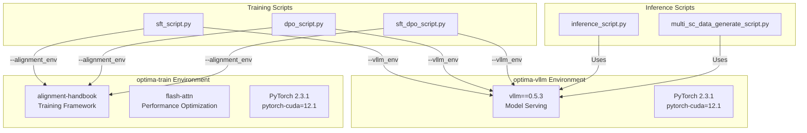
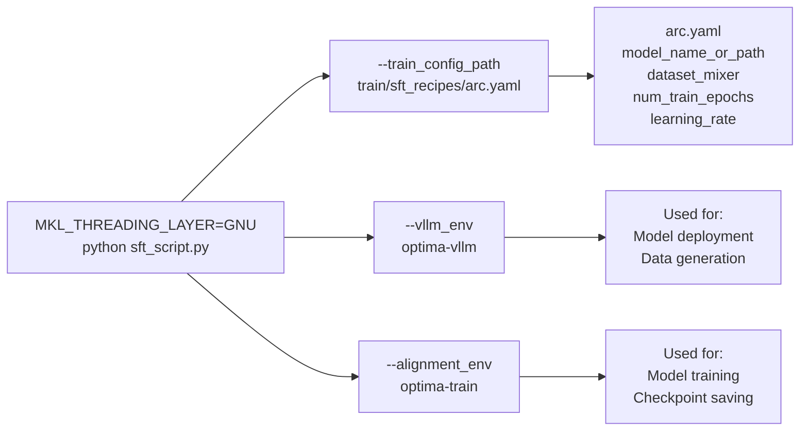
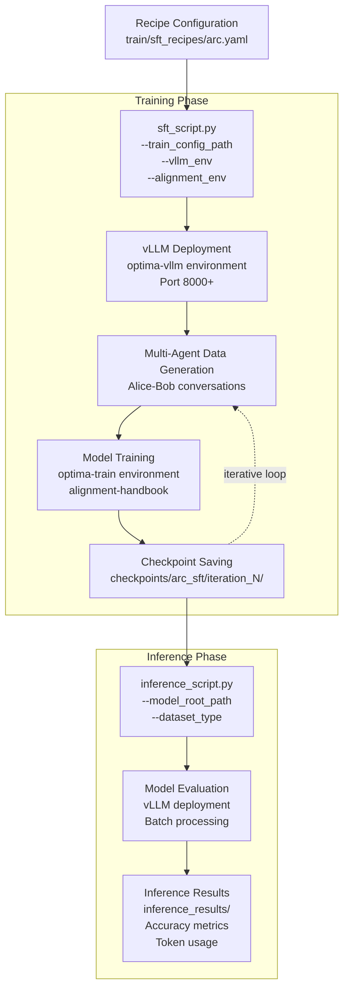

<!-- source: DeepWiki mcp.deepwiki.com · repo thunlp/Optima · page 2 Getting Started · fetched 2026-11-02 -->

# Getting Started

<details>
<summary>Relevant source files</summary>

The following files were used as context for generating this wiki page:

- [README.md](README.md)
- [README_revise.md](README_revise.md)

</details>


This page provides a practical guide to installing Optima and running your first training and inference jobs. It covers the essential prerequisites, environment setup, and basic usage patterns to get you started quickly with the framework.

For detailed installation instructions and troubleshooting, see [Installation and Environment Setup](#2.1). For a comprehensive walkthrough with examples, see [Quick Start Tutorial](#2.2).

## Prerequisites

Before installing Optima, ensure your system meets the following requirements:

| Requirement | Specification |
|------------|---------------|
| Python | 3.11 |
| CUDA | 12.1.0 |
| PyTorch | 2.3.1 |
| GPU | NVIDIA GPU with CUDA support |
| Operating System | Linux (recommended) |

## System Overview

Optima uses a dual-environment architecture that separates model serving from model training. This design prevents resource conflicts and enables efficient workflows.



**Dual Environment Architecture**: The `optima-vllm` environment hosts vLLM for high-performance model serving during data generation and inference. The `optima-train` environment contains the alignment-handbook framework and training dependencies. Training scripts orchestrate both environments through command-line arguments.

Sources: [README.md:22-55]()

## Installation Overview

Optima requires setting up two separate conda environments. Below is a condensed installation guide. For detailed instructions, dependency troubleshooting, and environment validation, see [Installation and Environment Setup](#2.1).

### Quick Installation Steps

**Step 1: Create vLLM Environment**

```bash
conda create -n optima-vllm python=3.11
conda activate optima-vllm
conda install nvidia/label/cuda-12.1.0::cuda-nvcc
conda install pytorch=2.3.1 torchvision torchaudio pytorch-cuda=12.1 -c pytorch -c nvidia
pip install vllm==0.5.3
```

**Step 2: Create Training Environment**

```bash
conda create -n optima-train python=3.11
conda activate optima-train
conda install nvidia/label/cuda-12.1.0::cuda-nvcc
conda install pytorch=2.3.1 torchvision torchaudio pytorch-cuda=12.1 -c pytorch -c nvidia
cd alignment-handbook
pip install -e .
pip install flash-attn --no-build-isolation
cd ../
pip install -r requirements.txt
```

**Step 3: Verify Installation**

After installation, verify both environments are correctly configured:

```bash
# Test vLLM environment
conda activate optima-vllm
python -c "import vllm; print(vllm.__version__)"

# Test training environment
conda activate optima-train
python -c "import torch; print(torch.__version__, torch.cuda.is_available())"
```

Sources: [README.md:22-55](), [README_revise.md:16-46]()

## Running Your First Training Job

Optima provides three iterative training methods: iSFT, iDPO, and iSFT-DPO. This section demonstrates running iSFT on the ARC dataset. For detailed explanations of each method, see [Iterative Training Methods](#3.1).

### Training Script Command Structure



**Command-Line Arguments**: Each training script accepts three key arguments: `--train_config_path` specifies the YAML recipe file containing training parameters, `--vllm_env` names the conda environment for model serving, and `--alignment_env` names the conda environment for training.

Sources: [README.md:58-92]()

### Example: Running iSFT Training

To train a model using iterative supervised fine-tuning on the ARC dataset:

```bash
MKL_THREADING_LAYER=GNU python sft_script.py \
    --train_config_path train/sft_recipes/arc.yaml \
    --vllm_env optima-vllm \
    --alignment_env optima-train
```

This command initiates the iSFT training pipeline, which:

1. Loads the base model specified in `train/sft_recipes/arc.yaml`
2. Deploys the model using vLLM in the `optima-vllm` environment
3. Generates multi-agent conversation data through Alice-Bob interactions
4. Fine-tunes the model in the `optima-train` environment
5. Saves checkpoints to `checkpoints/arc_sft/iteration_0/`, `iteration_1/`, etc.

### Available Training Methods

| Script | Method | Recipe Directory | Description |
|--------|--------|------------------|-------------|
| `sft_script.py` | iSFT | `train/sft_recipes/` | Iterative supervised fine-tuning only |
| `dpo_script.py` | iDPO | `train/dpo_recipes/` | Iterative direct preference optimization only |
| `sft_dpo_script.py` | iSFT-DPO | `train/sft_dpo_recipes/` | Combined iterative SFT followed by DPO |

To use different methods or datasets, simply change the script name and config path:

```bash
# iDPO on ARC
MKL_THREADING_LAYER=GNU python dpo_script.py \
    --train_config_path train/dpo_recipes/arc.yaml \
    --vllm_env optima-vllm \
    --alignment_env optima-train

# iSFT-DPO on ARC
MKL_THREADING_LAYER=GNU python sft_dpo_script.py \
    --train_config_path train/sft_dpo_recipes/arc.yaml \
    --vllm_env optima-vllm \
    --alignment_env optima-train
```

Sources: [README.md:58-92](), [README_revise.md:49-83]()

## Running Inference

After training, you can evaluate your models using the inference scripts. Optima provides two inference modes: batch inference across all checkpoints and multi-agent self-consistency inference.

### Batch Inference Across Checkpoints

The `inference_script.py` evaluates all model iterations from a training run:

```bash
python inference_script.py \
    --model_root_path ./checkpoints/arc_sft \
    --tokenizer_path ${pretrained_tokenizer_path} \
    --dataset_type arc \
    --device 0 \
    --port 8000 \
    --num_thread 128 \
    --output_root_path ./inference_results \
    --vllm_env optima-vllm
```

This script:
- Iterates through all checkpoint iterations in `./checkpoints/arc_sft/`
- Deploys each model using vLLM on the specified GPU device
- Evaluates on the ARC test dataset
- Saves results to `./inference_results/`

### Inference Script Arguments

| Argument | Description | Example |
|----------|-------------|---------|
| `--model_root_path` | Root directory containing checkpoint iterations | `./checkpoints/arc_sft` |
| `--tokenizer_path` | Path to pretrained tokenizer | `/path/to/Meta-Llama-3-8B-Instruct` |
| `--dataset_type` | Dataset to evaluate on | `arc`, `hotpot_qa`, `math`, `gsm8k` |
| `--device` | GPU index for first deployment | `0` |
| `--port` | Starting port number for vLLM server | `8000` |
| `--num_thread` | Number of parallel threads | `128` |
| `--output_root_path` | Directory for inference results | `./inference_results` |
| `--vllm_env` | Conda environment for vLLM | `optima-vllm` |

### Multi-Agent Self-Consistency Inference

For improved robustness through self-consistency sampling:

```bash
python multi_sc_data_generate_script.py \
    --model_path ./checkpoints/arc_sft/iteration_0 \
    --tokenizer_path ${pretrained_tokenizer_path} \
    --device 0 \
    --port 8000 \
    --dataset_type arc \
    --num_thread 128 \
    --output_path ./inference_results \
    --temperature 0.5 \
    --vllm_env optima-vllm
```

The key difference is `--model_path` targets a specific checkpoint iteration and `--temperature` enables sampling-based generation for self-consistency.

Sources: [README.md:94-137](), [README_revise.md:85-128]()

## Complete Training and Inference Workflow

The following diagram illustrates the end-to-end workflow from training to evaluation:



**Workflow Pipeline**: Training begins with a recipe configuration that specifies all training parameters. The training script orchestrates model deployment in the vLLM environment for data generation, then switches to the training environment for optimization. Checkpoints from each iteration are saved and can be used for both inference evaluation and generating data for the next iteration.

Sources: [README.md:58-137](), [README_revise.md:49-128]()

## Supported Datasets

Optima supports multiple datasets for training and evaluation. Specify the dataset using the `--dataset_type` argument:

| Dataset Type | Domain | Use Case |
|--------------|--------|----------|
| `arc` | Multiple choice reasoning | ARC-Challenge dataset |
| `hotpot_qa` | Multi-hop question answering | HotpotQA dataset |
| `mwh_qa` | Multi-hop QA | Multi-hop Wikipedia QA |
| `trivial_qa` | Question answering | TriviaQA dataset |
| `cbt` | Reading comprehension | Children's Book Test |
| `math` | Mathematical reasoning | MATH dataset |
| `gsm8k` | Grade school math | GSM8K dataset |
| `mmlu` | Multi-task language understanding | MMLU benchmark |

For information on dataset structure and creating custom datasets, see [Dataset Structure and Preparation](#10.1).

Sources: [README.md:104,132](), [README_revise.md:95,123]()

## Next Steps

After completing your first training and inference run, explore these resources:

- **[Installation and Environment Setup](#2.1)**: Detailed installation instructions, dependency management, and troubleshooting
- **[Quick Start Tutorial](#2.2)**: Step-by-step walkthrough of a complete training and evaluation workflow
- **[Iterative Training Methods](#3.1)**: Deep dive into iSFT, iDPO, and iSFT-DPO methodologies
- **[Recipe Configuration System](#6.2)**: Learn how to customize training parameters and create your own recipes
- **[Agent System](#5)**: Understand the multi-agent architecture and Alice-Bob interactions
- **[Training Scripts Reference](#6.1)**: Complete documentation of all training script arguments and workflows

For configuration details, all recipe files are located in:
- `train/sft_recipes/` - iSFT configurations
- `train/dpo_recipes/` - iDPO configurations  
- `train/sft_dpo_recipes/` - iSFT-DPO configurations

For parameter explanations, see [Recipe Parameters Reference](#7.4).

Sources: [README.md:59]()

---

