<!-- source: DeepWiki mcp.deepwiki.com · repo thunlp/Optima · page 2.1 Installation and Environment Setup · fetched 2026-11-02 -->

# Installation and Environment Setup

<details>
<summary>Relevant source files</summary>

The following files were used as context for generating this wiki page:

- [README.md](README.md)
- [README_revise.md](README_revise.md)

</details>


This document provides detailed instructions for installing and configuring Optima's dual-environment system. Optima requires two separate conda environments: `optima-vllm` for model serving and `optima-train` for model training. This separation ensures efficient resource management and prevents dependency conflicts during the iterative training process.

For information about why this dual-environment design is used, see [Dual Environment Design](#4.1). For running your first training job after installation, see [Quick Start Tutorial](#2.2).

## Prerequisites

Before installing Optima, ensure your system meets the following requirements:

| Requirement | Specification |
|------------|---------------|
| **Operating System** | Linux (tested on Ubuntu 20.04+) |
| **Python Version** | 3.11 |
| **CUDA Version** | 12.1.0 |
| **GPU** | NVIDIA GPU with CUDA support (recommended: A100, H100, or equivalent) |
| **Conda/Miniconda** | Latest version installed |
| **Disk Space** | Minimum 50GB for environments and model checkpoints |
| **Git** | For cloning the repository and submodules |

**Sources:** [README.md:22-55]()

## Environment Architecture Overview

The following diagram illustrates how Optima's dual-environment system is organized and which components rely on each environment:

```mermaid
graph TB
    subgraph "optima-vllm Environment"
        VLLM["vLLM 0.5.3<br/>Model Serving"]
        PyTorchVLLM["PyTorch 2.3.1"]
        NVCCVLLM["CUDA NVCC 12.1.0"]
    end
    
    subgraph "optima-train Environment"
        AlignmentHB["alignment-handbook"]
        PyTorchTrain["PyTorch 2.3.1"]
        NVCCTrain["CUDA NVCC 12.1.0"]
        FlashAttn["flash-attn"]
        Requirements["requirements.txt<br/>dependencies"]
    end
    
    subgraph "Training Scripts"
        SFTScript["sft_script.py"]
        DPOScript["dpo_script.py"]
        SFTDPOScript["sft_dpo_script.py"]
    end
    
    subgraph "Inference Scripts"
        InferenceScript["inference_script.py"]
        MultiSCScript["multi_sc_data_generate_script.py"]
    end
    
    subgraph "Agent System"
        VllmAgent["VllmAgent"]
    end
    
    SFTScript -->|"Uses for deployment"| VLLM
    DPOScript -->|"Uses for deployment"| VLLM
    SFTDPOScript -->|"Uses for deployment"| VLLM
    
    SFTScript -->|"Uses for training"| AlignmentHB
    DPOScript -->|"Uses for training"| AlignmentHB
    SFTDPOScript -->|"Uses for training"| AlignmentHB
    
    InferenceScript -->|"Deploys models"| VLLM
    MultiSCScript -->|"Deploys models"| VLLM
    
    VllmAgent -->|"HTTP requests"| VLLM
    
    PyTorchVLLM -.->|"Required by"| VLLM
    NVCCVLLM -.->|"Required by"| PyTorchVLLM
    
    PyTorchTrain -.->|"Required by"| AlignmentHB
    NVCCTrain -.->|"Required by"| PyTorchTrain
    FlashAttn -.->|"Required by"| AlignmentHB
    Requirements -.->|"Additional deps"| AlignmentHB
```



**Diagram: Optima Dual Environment Architecture and Dependencies**

The training scripts ([sft_script.py](), [dpo_script.py](), [sft_dpo_script.py]()) invoke both environments: `optima-vllm` for deploying models during data generation, and `optima-train` for executing the training process itself. Inference scripts only require the `optima-vllm` environment.

**Sources:** [README.md:22-55](), High-level system architecture diagrams

## Installation Steps

### Step 1: Clone the Repository

```bash
git clone https://github.com/thunlp/Optima.git
cd Optima
```

The repository includes the `alignment-handbook` as a dependency that needs to be installed in the training environment.

**Sources:** [README.md:1-10]()

### Step 2: Setup vLLM Environment (optima-vllm)

The `optima-vllm` environment is used for model serving via vLLM, which provides efficient inference for deployed models.

```bash
# Create conda environment with Python 3.11
conda create -n optima-vllm python=3.11

# Activate the environment
conda activate optima-vllm

# Install CUDA NVCC 12.1.0
conda install nvidia/label/cuda-12.1.0::cuda-nvcc

# Install PyTorch 2.3.1 with CUDA 12.1 support
conda install pytorch=2.3.1 torchvision torchaudio pytorch-cuda=12.1 -c pytorch -c nvidia

# Install vLLM 0.5.3
pip install vllm==0.5.3
```

**Version Requirements:**
- **Python**: 3.11 (required for compatibility)
- **PyTorch**: 2.3.1 (required by vLLM 0.5.3)
- **CUDA**: 12.1.0
- **vLLM**: 0.5.3 (specific version required)

**Sources:** [README.md:26-37]()

### Step 3: Setup Training Environment (optima-train)

The `optima-train` environment contains the training framework, including the alignment-handbook and additional dependencies.

```bash
# Create conda environment with Python 3.11
conda create -n optima-train python=3.11

# Activate the environment
conda activate optima-train

# Install CUDA NVCC 12.1.0
conda install nvidia/label/cuda-12.1.0::cuda-nvcc

# Install PyTorch 2.3.1 with CUDA 12.1 support
conda install pytorch=2.3.1 torchvision torchaudio pytorch-cuda=12.1 -c pytorch -c nvidia

# Navigate to alignment-handbook directory and install
cd alignment-handbook
pip install -e .

# Install Flash Attention 2 (without build isolation for compatibility)
pip install flash-attn --no-build-isolation

# Return to root directory and install additional dependencies
cd ..
pip install -r requirements.txt
```

**Version Requirements:**
- **Python**: 3.11
- **PyTorch**: 2.3.1
- **CUDA**: 12.1.0
- **alignment-handbook**: Installed from local directory in editable mode
- **flash-attn**: Latest compatible version
- **Additional packages**: Specified in `requirements.txt`

**Sources:** [README.md:39-55]()

### Step 4: Directory Structure After Installation

After successful installation, your Optima directory should have the following structure:

```
Optima/
├── alignment-handbook/          # Alignment framework (installed in optima-train)
├── train/                       # Training configuration recipes
│   ├── sft_recipes/            # iSFT configuration files
│   ├── dpo_recipes/            # iDPO configuration files
│   └── sft_dpo_recipes/        # Combined iSFT-DPO configurations
├── my_datasets/                 # Dataset storage directory
├── checkpoints/                 # Model checkpoint storage
├── inference_results/           # Inference output storage
├── sft_script.py               # iSFT training script
├── dpo_script.py               # iDPO training script
├── sft_dpo_script.py           # Combined iSFT-DPO training script
├── inference_script.py         # Batch inference script
├── multi_sc_data_generate_script.py  # Multi-agent self-consistency script
├── requirements.txt            # Python dependencies
└── README.md                   # Documentation
```

**Sources:** [README.md:1-148](), repository structure

## Dependency Installation Flow

The following diagram shows the dependency installation sequence and relationships:

```mermaid
graph TD
    Start["Start Installation"]
    
    subgraph "Common Base"
        Python["Python 3.11"]
        NVCC["CUDA NVCC 12.1.0"]
        PyTorch["PyTorch 2.3.1<br/>with CUDA 12.1"]
    end
    
    subgraph "vLLM Path"
        VLLMPkg["vLLM 0.5.3<br/>pip install"]
        VLLMReady["optima-vllm Ready"]
    end
    
    subgraph "Training Path"
        AlignmentClone["alignment-handbook<br/>pip install -e ."]
        FlashAttn["flash-attn<br/>--no-build-isolation"]
        Requirements["requirements.txt<br/>pip install -r"]
        TrainReady["optima-train Ready"]
    end
    
    Start --> Python
    Python --> NVCC
    NVCC --> PyTorch
    
    PyTorch --> VLLMPkg
    VLLMPkg --> VLLMReady
    
    PyTorch --> AlignmentClone
    AlignmentClone --> FlashAttn
    FlashAttn --> Requirements
    Requirements --> TrainReady
```



**Diagram: Dependency Installation Sequence**

**Important Notes:**
- PyTorch must be installed **before** vLLM to ensure CUDA compatibility
- Flash Attention must be installed with `--no-build-isolation` flag
- The alignment-handbook is installed in editable mode (`-e`) from the local directory

**Sources:** [README.md:22-55]()

## Verification Steps

After installation, verify that both environments are correctly configured:

### Verify optima-vllm Environment

```bash
conda activate optima-vllm

# Check Python version
python --version  # Should output: Python 3.11.x

# Check PyTorch and CUDA
python -c "import torch; print(f'PyTorch: {torch.__version__}'); print(f'CUDA Available: {torch.cuda.is_available()}'); print(f'CUDA Version: {torch.version.cuda}')"
# Expected output:
# PyTorch: 2.3.1+cu121
# CUDA Available: True
# CUDA Version: 12.1

# Check vLLM installation
python -c "import vllm; print(f'vLLM Version: {vllm.__version__}')"
# Expected output: vLLM Version: 0.5.3
```

### Verify optima-train Environment

```bash
conda activate optima-train

# Check Python version
python --version  # Should output: Python 3.11.x

# Check PyTorch and CUDA
python -c "import torch; print(f'PyTorch: {torch.__version__}'); print(f'CUDA Available: {torch.cuda.is_available()}'); print(f'CUDA Version: {torch.version.cuda}')"

# Check alignment-handbook installation
python -c "from alignment import __version__; print(f'Alignment Handbook installed')"

# Check Flash Attention
python -c "import flash_attn; print(f'Flash Attention installed')"
```

**Sources:** [README.md:22-55]()

## Environment Variable Configuration

The training scripts require the `MKL_THREADING_LAYER` environment variable to be set:

```bash
export MKL_THREADING_LAYER=GNU
```

Alternatively, prefix your training commands with this variable:

```bash
MKL_THREADING_LAYER=GNU python sft_script.py [arguments...]
```

This setting prevents threading conflicts during training. It is used in all training script invocations ([sft_script.py](), [dpo_script.py](), [sft_dpo_script.py]()).

**Sources:** [README.md:66-92]()

## Script-Environment Mapping

The following table shows which environment each script requires:

| Script | Primary Environment | Secondary Environment | Purpose |
|--------|---------------------|----------------------|---------|
| `sft_script.py` | `optima-train` | `optima-vllm` (for deployment) | iSFT iterative training |
| `dpo_script.py` | `optima-train` | `optima-vllm` (for deployment) | iDPO iterative training |
| `sft_dpo_script.py` | `optima-train` | `optima-vllm` (for deployment) | Combined iSFT-DPO training |
| `inference_script.py` | `optima-vllm` | None | Batch inference on checkpoints |
| `multi_sc_data_generate_script.py` | `optima-vllm` | None | Multi-agent self-consistency generation |

Training scripts are executed from the `optima-train` environment but accept `--vllm_env` and `--alignment_env` arguments to specify which conda environments to use for deployment and training respectively.

**Sources:** [README.md:58-92]()

## Common Issues and Troubleshooting

### Issue 1: PyTorch CUDA Version Mismatch

**Symptom:** `RuntimeError: CUDA error: no kernel image is available for execution on the device`

**Solution:** Ensure PyTorch is installed with the correct CUDA version (12.1):
```bash
conda install pytorch=2.3.1 torchvision torchaudio pytorch-cuda=12.1 -c pytorch -c nvidia
```

### Issue 2: Flash Attention Build Failure

**Symptom:** Compilation errors during flash-attn installation

**Solution:** Install with the `--no-build-isolation` flag:
```bash
pip install flash-attn --no-build-isolation
```

Ensure NVCC is properly installed before attempting flash-attn installation.

### Issue 3: vLLM Version Compatibility

**Symptom:** Import errors or unexpected behavior with vLLM

**Solution:** Use the exact version specified:
```bash
pip install vllm==0.5.3
```

Optima is tested specifically with vLLM 0.5.3, which requires PyTorch 2.3.1.

### Issue 4: alignment-handbook Not Found

**Symptom:** `ModuleNotFoundError: No module named 'alignment'`

**Solution:** Ensure you installed the alignment-handbook in editable mode:
```bash
cd alignment-handbook
pip install -e .
cd ..
```

### Issue 5: MKL Threading Layer Error

**Symptom:** `Error: MKL FATAL ERROR: Cannot load libmkl_intel_thread.so`

**Solution:** Set the MKL threading layer environment variable:
```bash
export MKL_THREADING_LAYER=GNU
```

**Sources:** [README.md:22-55]()

## GPU and Multi-GPU Configuration

Optima supports multi-GPU training and inference. The system uses GPU indices for port allocation when deploying models via vLLM.

**Port Allocation Formula:**
```
port_number = base_port + gpu_index
```

For example, with `--device 0` and `--port 8000`, the vLLM service will be deployed on port 8000. For multi-GPU setups, subsequent GPUs will use sequential ports (8001, 8002, etc.).

This configuration is specified via command-line arguments:
- `--device`: GPU index for the first deployment
- `--port`: Base port number for vLLM HTTP service

For more details on multi-GPU training optimization, see [Multi-GPU Training](#11.2).

**Sources:** [README.md:100-137]()

## Next Steps

After completing the installation:

1. **Verify Installation**: Run all verification commands to ensure both environments are correctly configured
2. **Prepare Datasets**: See [Dataset Structure and Preparation](#10.1) for information on dataset organization
3. **Quick Start**: Follow the [Quick Start Tutorial](#2.2) to run your first training job
4. **Configure Training**: Explore [Recipe Configuration System](#6.2) to understand training parameters

**Configuration files** for training are located in:
- [train/sft_recipes/]() for iSFT configurations
- [train/dpo_recipes/]() for iDPO configurations  
- [train/sft_dpo_recipes/]() for combined iSFT-DPO configurations

**Sources:** [README.md:58-92]()

---

