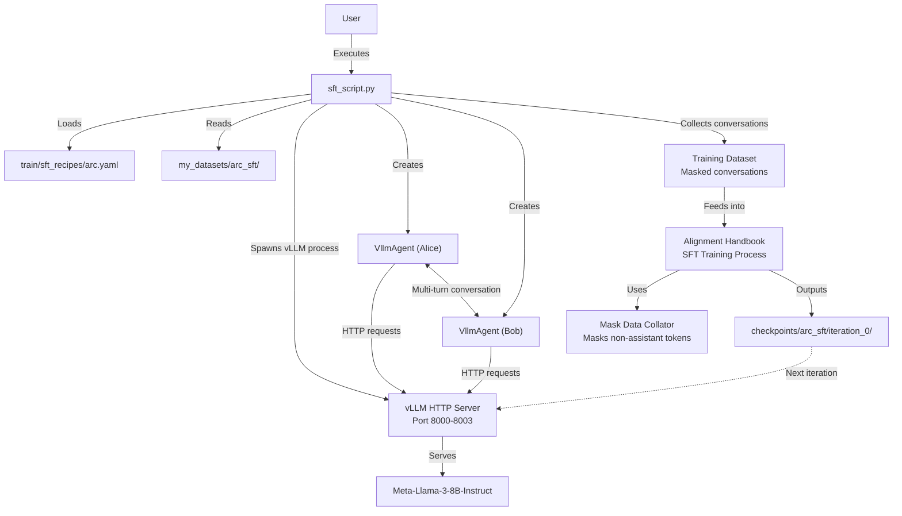
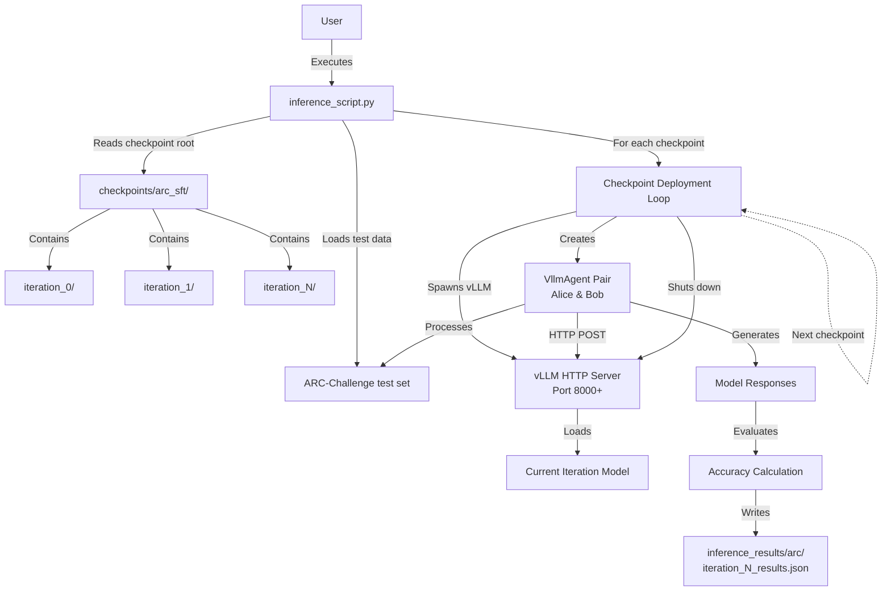

<!-- source: DeepWiki mcp.deepwiki.com · repo thunlp/Optima · page 2.2 Quick Start Tutorial · fetched 2026-11-02 -->

# Quick Start Tutorial

<details>
<summary>Relevant source files</summary>

The following files were used as context for generating this wiki page:

- [README.md](README.md)
- [README_revise.md](README_revise.md)
- [alignment-handbook/recipes/Llama3-8b/arc_sft/base.yaml](alignment-handbook/recipes/Llama3-8b/arc_sft/base.yaml)

</details>


This tutorial walks you through running your first training job using iterative Supervised Fine-Tuning (iSFT) on the ARC-Challenge dataset, then performing inference on the trained model. This provides a practical introduction to Optima's core workflow.

**Prerequisites:** This tutorial assumes you have completed the installation and environment setup described in [Installation and Environment Setup](#2.1). You should have both `optima-vllm` and `optima-train` conda environments configured.

For understanding the theoretical concepts behind iSFT and other training methods, see [Iterative Training Methods](#3.1). For detailed configuration options, see [Recipe Configuration System](#6.2).

## Overview of the iSFT Workflow

Before running the tutorial, it's helpful to understand how iSFT training operates. The following diagram illustrates the end-to-end workflow:

**iSFT Training Pipeline: From Configuration to Checkpoint**



**Sources:** [README.md:58-71](), [sft_script.py](), [alignment-handbook/recipes/Llama3-8b/arc_sft/base.yaml:1-39]()

## Step 1: Prepare Your Training Configuration

Optima uses YAML configuration files (called "recipes") to specify all training parameters. For this quick start, we'll use the pre-configured ARC-Challenge iSFT recipe.

Examine the base configuration structure at [alignment-handbook/recipes/Llama3-8b/arc_sft/base.yaml:1-39](). Key parameters include:

| Parameter | Value | Purpose |
|-----------|-------|---------|
| `model_name_or_path` | Path to pretrained model | Specifies the base LLM (e.g., Llama-3-8B-Instruct) |
| `dataset_mixer` | Path to training dataset | Points to the ARC SFT dataset |
| `num_train_epochs` | 4 | Number of training epochs |
| `learning_rate` | 1.0e-06 | Learning rate for optimization |
| `max_seq_length` | 2048 | Maximum sequence length for training |
| `output_dir` | Checkpoint save path | Where trained models are saved |
| `use_flash_attention_2` | true | Enables Flash Attention for efficiency |

**Note:** Before running, ensure you update the following paths in your configuration:
- `model_name_or_path`: Path to your pretrained Llama-3-8B-Instruct model
- `tokenizer_name_or_path`: Path to the corresponding tokenizer
- `dataset_mixer`: Path to your ARC SFT dataset directory
- `output_dir`: Desired checkpoint output location

**Sources:** [alignment-handbook/recipes/Llama3-8b/arc_sft/base.yaml:1-39]()

## Step 2: Run iSFT Training

Execute the training script with the following command:

```bash
MKL_THREADING_LAYER=GNU python sft_script.py \
    --train_config_path train/sft_recipes/arc.yaml \
    --vllm_env optima-vllm \
    --alignment_env optima-train
```

**Command-line Arguments:**

| Argument | Description |
|----------|-------------|
| `--train_config_path` | Path to the YAML recipe file containing training configuration |
| `--vllm_env` | Name of conda environment for vLLM deployment (created in [Installation](#2.1)) |
| `--alignment_env` | Name of conda environment for training (created in [Installation](#2.1)) |

**Sources:** [README.md:58-71](), [sft_script.py]()

### What Happens During Training

The `sft_script.py` orchestrates the following sequence:

1. **vLLM Server Deployment**: Spawns a vLLM server process in the `optima-vllm` environment, deploying the base model on available GPUs (ports 8000-8003 by default)

2. **Multi-Agent Data Generation**: Creates two `VllmAgent` instances (Alice and Bob) that engage in multi-turn conversations to solve ARC-Challenge problems

3. **Conversation Collection**: Gathers and formats the agent conversations into training data, applying the `Mask` data collator to ensure only assistant responses contribute to the loss

4. **SFT Training**: Executes supervised fine-tuning in the `optima-train` environment using the Alignment Handbook framework

5. **Checkpoint Saving**: Saves the trained model to the specified `output_dir` (e.g., `checkpoints/arc_sft/iteration_0/`)

6. **Cleanup**: Terminates the vLLM server process

**Expected Output:** Training logs will display loss values, learning rate, and evaluation metrics. Upon completion, a checkpoint directory containing model weights, tokenizer, and training configuration will be created.

**Sources:** [sft_script.py](), [README.md:58-71]()

## Step 3: Run Inference on Trained Model

After training completes, evaluate your model using the inference script. The following diagram shows the inference pipeline:

**Inference Pipeline: Model Evaluation Workflow**



**Sources:** [README.md:94-110](), [inference_script.py]()

Execute the inference script:

```bash
python inference_script.py \
    --model_root_path ./checkpoints/arc_sft \
    --tokenizer_path ${pretrained_tokenizer_path} \
    --dataset_type arc \
    --device 0 \
    --port 8000 \
    --num_thread 128 \
    --output_root_path ./inference_results \
    --vllm_env optima-vllm
```

**Inference Arguments:**

| Argument | Description | Example Value |
|----------|-------------|---------------|
| `--model_root_path` | Root directory containing iteration checkpoints | `./checkpoints/arc_sft` |
| `--tokenizer_path` | Path to pretrained tokenizer (same as training) | Path to Llama-3-8B tokenizer |
| `--dataset_type` | Test dataset identifier | `arc` (ARC-Challenge) |
| `--device` | GPU device index for first vLLM deployment | `0` |
| `--port` | Starting port number for vLLM services | `8000` |
| `--num_thread` | Number of parallel threads for inference | `128` |
| `--output_root_path` | Directory for inference results | `./inference_results` |
| `--vllm_env` | Conda environment for vLLM | `optima-vllm` |

**Sources:** [README.md:94-110](), [inference_script.py]()

### Understanding Inference Results

The inference script generates JSON files in the following structure:

```
inference_results/
└── arc/
    ├── iteration_0_results.json
    ├── iteration_1_results.json
    └── iteration_N_results.json
```

Each results file contains:
- **Individual predictions**: Model responses for each test instance
- **Accuracy metrics**: Overall accuracy on the test set
- **Token statistics**: Number of tokens used in multi-agent conversations
- **Conversation logs**: Full conversation history between Alice and Bob agents

**Key Metrics to Monitor:**

| Metric | Description | Improvement Indicator |
|--------|-------------|----------------------|
| Accuracy | Percentage of correct answers | Higher is better |
| Average Tokens | Mean tokens per conversation | Lower indicates better efficiency |
| Communication Rounds | Number of turns between agents | Fewer rounds suggests more concise communication |

**Sources:** [inference_script.py](), [README.md:94-110]()

## Step 4: Iterative Training (Optional)

Optima's core innovation is iterative refinement. To continue training for additional iterations:

1. **Update Configuration**: The checkpoint from iteration 0 becomes the `model_name_or_path` for iteration 1
2. **Generate New Data**: Use the trained model from iteration 0 to generate more sophisticated training data
3. **Repeat Training**: Run `sft_script.py` again with the updated configuration

For iteration 1, modify your recipe to point `model_name_or_path` to `checkpoints/arc_sft/iteration_0/` and update the `output_dir` to `checkpoints/arc_sft/iteration_1/`.

**Sources:** [README.md:58-71]()

## Training Progress Monitoring

During training, monitor these key indicators:

**Log Output Structure:**

```
INFO:     Training started
INFO:     Epoch 1/4, Step 10/500, Loss: 1.234, LR: 1.0e-06
INFO:     Epoch 1/4, Step 20/500, Loss: 1.156, LR: 9.8e-07
...
INFO:     Evaluation - Accuracy: 0.72, Loss: 0.845
INFO:     Training complete, checkpoint saved to checkpoints/arc_sft/iteration_0/
```

**Expected Training Time:** For ARC-Challenge with 4 epochs on a single GPU:
- Data generation: ~30-60 minutes (depends on model size and dataset)
- Training: ~1-2 hours (depends on GPU type and batch size)
- Total: ~2-3 hours per iteration

**Sources:** [sft_script.py](), [alignment-handbook/recipes/Llama3-8b/arc_sft/base.yaml:17-19]()

## Common Issues and Solutions

| Issue | Possible Cause | Solution |
|-------|----------------|----------|
| CUDA out of memory | Batch size too large | Reduce `per_device_train_batch_size` in recipe |
| vLLM port conflict | Port already in use | Change `--port` argument to unused port range |
| Conda environment not found | Incorrect environment name | Verify `--vllm_env` and `--alignment_env` match created environments |
| Dataset not found | Incorrect path in recipe | Update `dataset_mixer` path in YAML configuration |

**Sources:** [README.md:22-55](), [alignment-handbook/recipes/Llama3-8b/arc_sft/base.yaml:1-39]()

## Next Steps

After completing this quick start tutorial:

1. **Explore Other Training Methods**: Try [iDPO](#3.1) or [combined iSFT-DPO](#3.1) for enhanced performance
2. **Experiment with Different Datasets**: Optima supports multiple datasets including HotpotQA, MATH, GSM8K, and MMLU. See [Supported Datasets](#13.3)
3. **Customize Training Recipes**: Learn to tune hyperparameters in [Hyperparameter Tuning](#11.3)
4. **Run Multi-Agent Self-Consistency**: Improve robustness with self-consistency evaluation using [multi_sc_data_generate_script.py](#8.2)
5. **Understand the Agent System**: Deep dive into [Agent System Architecture](#5) to customize agent behavior

**Sources:** [README.md:58-137]()

---

