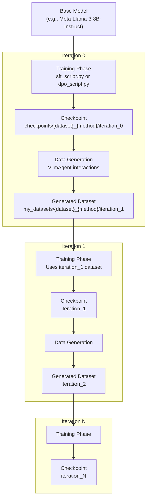
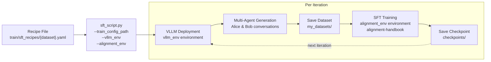
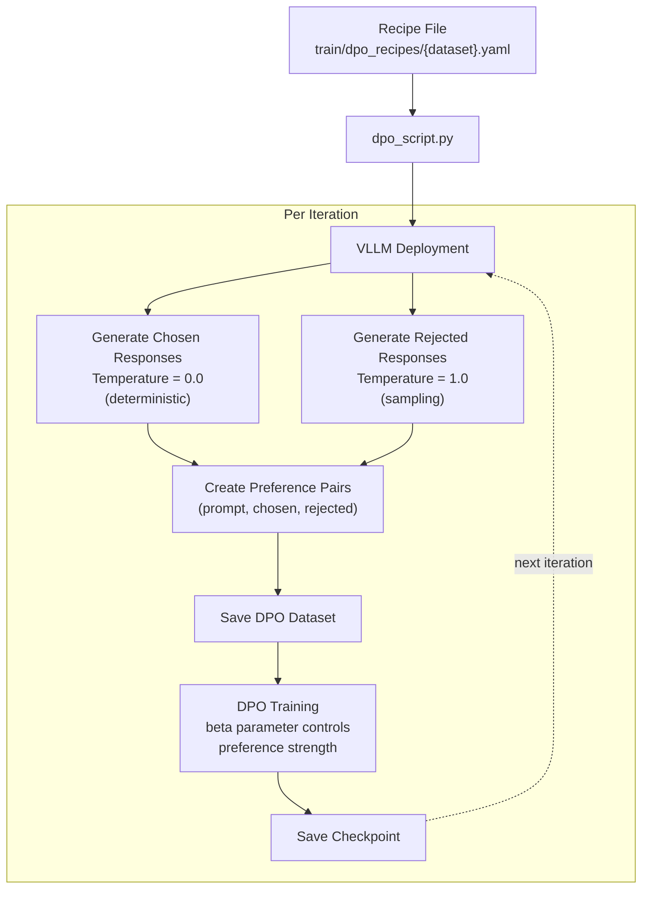
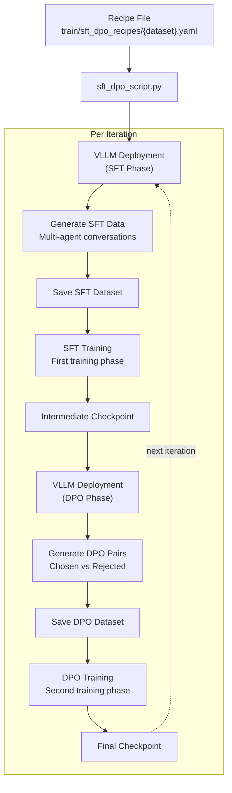
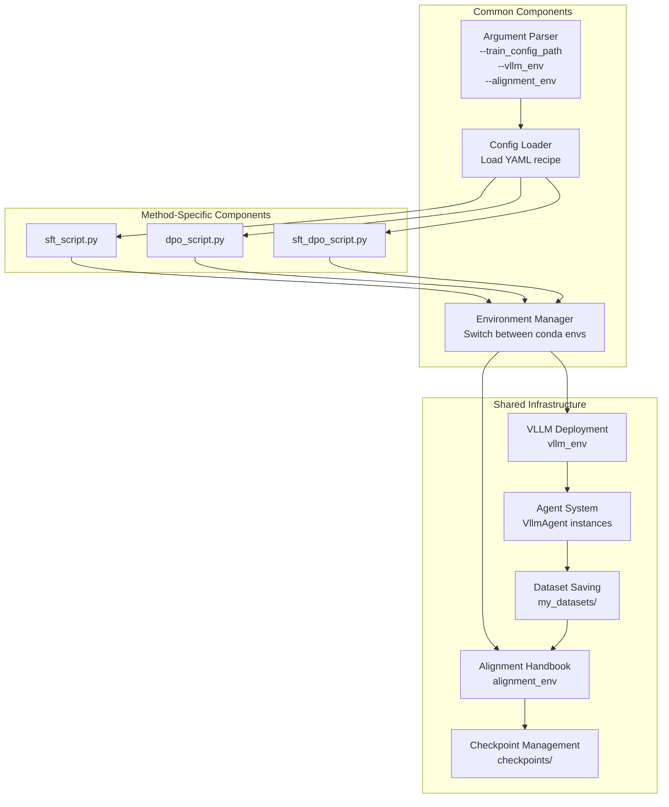

<!-- source: DeepWiki mcp.deepwiki.com · repo thunlp/Optima · page 3.1 Iterative Training Methods · fetched 2026-11-02 -->

# Iterative Training Methods

<details>
<summary>Relevant source files</summary>

The following files were used as context for generating this wiki page:

- [README.md](README.md)
- [README_revise.md](README_revise.md)

</details>


## Purpose and Scope

This page explains Optima's three iterative training methodologies: iSFT (iterative Supervised Fine-Tuning), iDPO (iterative Direct Preference Optimization), and iSFT-DPO (combined approach). These methods form the core of Optima's approach to optimizing multi-agent systems through self-improving feedback loops.

For detailed information about the Direct Preference Optimization algorithm itself, see [Direct Preference Optimization (DPO)](#3.3). For configuration details, see [Recipe Configuration System](#6.2). For script usage, see [Training Scripts Reference](#6.1).

**Sources:** [README.md:1-147]()

## Overview of Iterative Training

Optima's iterative training approach uses models from iteration N to generate training data for iteration N+1, creating a self-improvement loop. Unlike traditional single-pass training, this method progressively refines both the quality of agent responses and the efficiency of multi-agent communication.

The iterative process consists of:

1. **Training Phase**: Fine-tune the model using supervised learning (SFT) and/or preference optimization (DPO)
2. **Data Generation Phase**: Deploy the trained model to generate multi-agent conversation data
3. **Iteration Phase**: Use generated data to train the next iteration



**Diagram: Iterative Training Pipeline Flow**

The key innovation is that each iteration improves upon the previous one by learning from the model's own generated multi-agent conversations, progressively optimizing for token efficiency and communication effectiveness.

**Sources:** [README.md:11-11](), [README.md:58-92]()

## iSFT: Iterative Supervised Fine-Tuning

iSFT (iterative Supervised Fine-Tuning) uses standard supervised learning in an iterative framework. At each iteration, the model is trained on multi-agent conversation data where only the assistant responses contribute to the loss function.

### Training Process

The iSFT method is implemented through [sft_script.py:1-end](), which orchestrates the following workflow:



**Diagram: iSFT Script Workflow Connecting Code Entities**

### Key Characteristics

| Aspect | Description |
|--------|-------------|
| **Training Objective** | Maximize likelihood of assistant responses in multi-agent conversations |
| **Loss Calculation** | Cross-entropy loss on assistant tokens only (non-assistant tokens masked) |
| **Data Source** | Self-generated multi-agent conversations from previous iteration |
| **Masking** | Uses `Mask` data collator from [alignment-handbook/src/alignment/data.py]() |
| **Script** | [sft_script.py:1-end]() |
| **Configuration** | Recipe files in [train/sft_recipes/]() directory |

### Usage Example

```bash
MKL_THREADING_LAYER=GNU python sft_script.py \
    --train_config_path train/sft_recipes/arc.yaml \
    --vllm_env optima-vllm \
    --alignment_env optima-train
```

The script accepts three command-line arguments:
- `--train_config_path`: Path to YAML recipe configuration
- `--vllm_env`: Conda environment for vLLM deployment
- `--alignment_env`: Conda environment for training

### When to Use iSFT

iSFT is appropriate when:
- You want a straightforward iterative training approach
- You have access to positive examples of good multi-agent conversations
- You don't need explicit preference modeling between response pairs
- Training stability is a priority (SFT is generally more stable than DPO)

**Sources:** [README.md:63-70](), [sft_script.py:1-end]()

## iDPO: Iterative Direct Preference Optimization

iDPO (iterative Direct Preference Optimization) combines DPO with iterative training. DPO trains models to prefer certain responses over others without requiring explicit reward models, making it more efficient than traditional RLHF approaches.

### Training Process

The iDPO method is implemented through [dpo_script.py:1-end](), which follows a similar structure to iSFT but generates preference pairs:



**Diagram: iDPO Script Workflow with Preference Pair Generation**

### Key Characteristics

| Aspect | Description |
|--------|-------------|
| **Training Objective** | Optimize policy to prefer chosen responses over rejected responses |
| **Loss Calculation** | DPO loss with beta parameter (typically 0.1-0.2) |
| **Data Source** | Preference pairs: chosen (temp=0.0) vs rejected (temp=1.0) responses |
| **Beta Parameter** | Controls strength of preference optimization (see [DPO](#3.3)) |
| **Script** | [dpo_script.py:1-end]() |
| **Configuration** | Recipe files in [train/dpo_recipes/]() directory |

### Preference Pair Construction

In iDPO, preference pairs are constructed by:
1. **Chosen response**: Generated with temperature 0.0 (greedy/deterministic) from the current model
2. **Rejected response**: Generated with temperature 1.0 (stochastic sampling) from the current model

This creates an implicit preference signal where the model's most confident responses (temperature 0.0) are treated as preferred over its sampled responses (temperature 1.0).

### Usage Example

```bash
MKL_THREADING_LAYER=GNU python dpo_script.py \
    --train_config_path train/dpo_recipes/arc.yaml \
    --vllm_env optima-vllm \
    --alignment_env optima-train
```

### When to Use iDPO

iDPO is appropriate when:
- You want to explicitly optimize for response quality through preferences
- You can distinguish between better and worse responses
- You want to reduce verbosity (DPO tends to produce more concise responses)
- You're willing to tune the beta hyperparameter for your use case

**Sources:** [README.md:74-81](), [dpo_script.py:1-end]()

## iSFT-DPO: Combined Approach

iSFT-DPO combines both supervised fine-tuning and preference optimization within each iteration, providing the benefits of both approaches.

### Training Process

The combined method is implemented through [sft_dpo_script.py:1-end]():



**Diagram: iSFT-DPO Combined Training Workflow**

### Key Characteristics

| Aspect | Description |
|--------|-------------|
| **Training Phases** | Two-phase: SFT first, then DPO |
| **SFT Phase** | Standard supervised learning on conversation data |
| **DPO Phase** | Preference optimization on the SFT-trained model |
| **Checkpoints** | Intermediate checkpoint after SFT, final checkpoint after DPO |
| **Script** | [sft_dpo_script.py:1-end]() |
| **Configuration** | Recipe files in [train/sft_dpo_recipes/]() directory |

### Training Sequence

Within each iteration:

1. **Phase 1 - SFT**: Train on multi-agent conversation data generated from previous iteration
2. **Intermediate Checkpoint**: Save SFT-trained model
3. **Phase 2 - DPO**: Generate preference pairs using SFT model, then train with DPO
4. **Final Checkpoint**: Save DPO-refined model for next iteration

### Usage Example

```bash
MKL_THREADING_LAYER=GNU python sft_dpo_script.py \
    --train_config_path train/sft_dpo_recipes/arc.yaml \
    --vllm_env optima-vllm \
    --alignment_env optima-train
```

### When to Use iSFT-DPO

iSFT-DPO is appropriate when:
- You want the stability of SFT combined with the preference modeling of DPO
- You have computational resources for two training phases per iteration
- You want to maximize response quality and communication efficiency
- You're optimizing for both accuracy and token efficiency simultaneously

**Sources:** [README.md:85-92](), [sft_dpo_script.py:1-end]()

## Method Comparison and Selection Guide

### Performance Characteristics

| Method | Token Efficiency | Training Stability | Response Quality | Computational Cost |
|--------|-----------------|-------------------|-----------------|-------------------|
| **iSFT** | Moderate | High | Good | Low |
| **iDPO** | High | Moderate | Very Good | Moderate |
| **iSFT-DPO** | Very High | High | Excellent | High |

### Training Configuration Comparison

| Configuration Aspect | iSFT | iDPO | iSFT-DPO |
|---------------------|------|------|----------|
| **Recipe Directory** | `train/sft_recipes/` | `train/dpo_recipes/` | `train/sft_dpo_recipes/` |
| **Script File** | `sft_script.py` | `dpo_script.py` | `sft_dpo_script.py` |
| **Data Generation** | Single pass (conversation) | Two passes (chosen + rejected) | Both (SFT data + DPO pairs) |
| **Training Phases** | 1 (SFT only) | 1 (DPO only) | 2 (SFT then DPO) |
| **Beta Parameter** | N/A | Required (0.1-0.2) | Required for DPO phase |
| **Epochs per Iteration** | Typically 4 | Varies by dataset | 4 (SFT) + variable (DPO) |

### Selection Guidelines

**Choose iSFT when:**
- Starting a new project and want a simple baseline
- Training stability is critical
- Computational budget is limited
- You have high-quality conversation examples

**Choose iDPO when:**
- You need maximum token efficiency
- You can identify clear preference signals
- You want to reduce response verbosity
- You're comfortable tuning the beta hyperparameter

**Choose iSFT-DPO when:**
- You want state-of-the-art performance
- You have sufficient computational resources
- Both accuracy and efficiency are critical
- You're willing to invest in longer training times

**Sources:** [README.md:20-20](), [README.md:58-92]()

## Training Scripts Architecture

All three training scripts follow a common architectural pattern with specific implementations for each method:



**Diagram: Training Scripts Architecture with Shared Components**

### Command-Line Interface

All training scripts accept the same three arguments:

| Argument | Type | Description |
|----------|------|-------------|
| `--train_config_path` | string | Path to YAML recipe file (e.g., `train/sft_recipes/arc.yaml`) |
| `--vllm_env` | string | Conda environment name for vLLM deployment (e.g., `optima-vllm`) |
| `--alignment_env` | string | Conda environment name for training (e.g., `optima-train`) |

### Environment Variables

The `MKL_THREADING_LAYER=GNU` environment variable is required before running any training script to avoid threading conflicts with PyTorch.

**Sources:** [README.md:63-92](), [sft_script.py:1-end](), [dpo_script.py:1-end](), [sft_dpo_script.py:1-end]()

## Iteration Progression

### Checkpoint Directory Structure

Each training method creates checkpoints in a structured directory hierarchy:

```
checkpoints/
├── {dataset}_{method}/
│   ├── iteration_0/
│   │   ├── config.json
│   │   ├── model.safetensors
│   │   ├── tokenizer.json
│   │   └── ...
│   ├── iteration_1/
│   ├── iteration_2/
│   └── ...
```

For example:
- `checkpoints/arc_sft/iteration_0/` - First iteration of iSFT on ARC dataset
- `checkpoints/arc_dpo/iteration_1/` - Second iteration of iDPO on ARC dataset
- `checkpoints/arc_sft_dpo/iteration_2/` - Third iteration of iSFT-DPO on ARC dataset

### Dataset Directory Structure

Generated datasets for each iteration are stored in:

```
my_datasets/
├── {dataset}_{method}/
│   ├── iteration_1/
│   │   └── train.jsonl
│   ├── iteration_2/
│   │   └── train.jsonl
│   └── ...
```

Note: Iteration 0 typically uses the base pretrained model, so dataset generation starts at iteration 1.

### Stopping Criteria

Training iterations continue until:
1. Performance metrics plateau or degrade
2. Maximum specified iterations are reached
3. Manual intervention based on evaluation results

For evaluation and performance monitoring, see [Evaluation Metrics](#8.3).

**Sources:** [README.md:102-103](), [README.md:128-129]()

---

