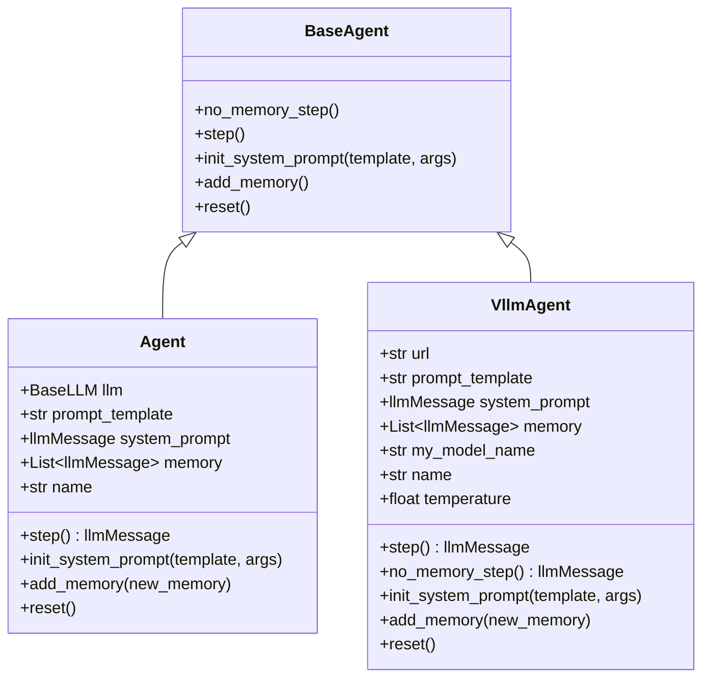
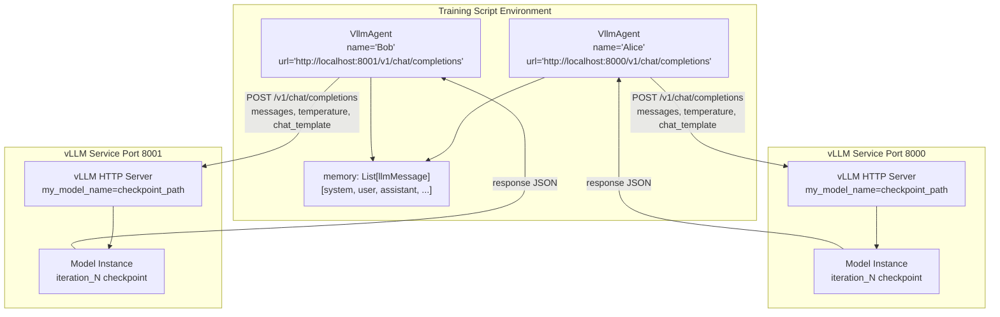
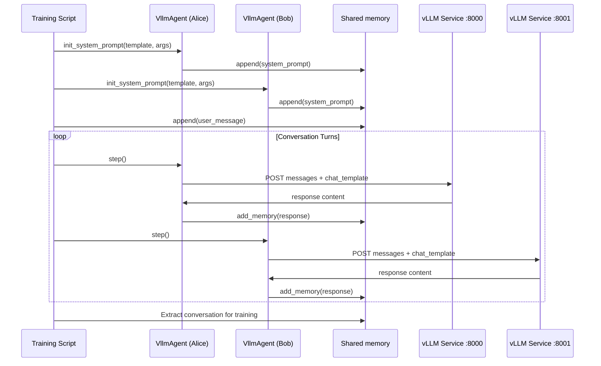
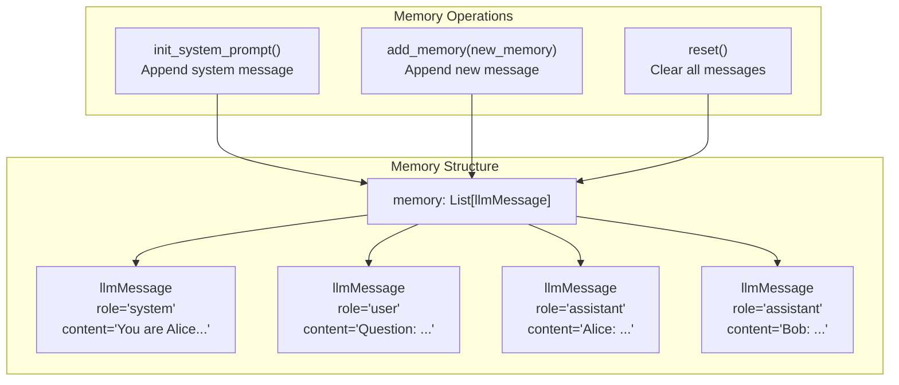
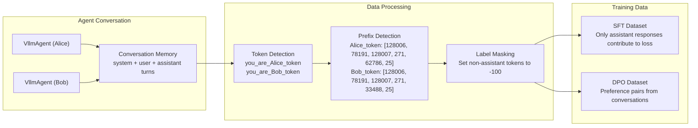

<!-- source: DeepWiki mcp.deepwiki.com · repo thunlp/Optima · page 3.2 Multi-Agent System Architecture · fetched 2026-11-02 -->

# Multi-Agent System Architecture

<details>
<summary>Relevant source files</summary>

The following files were used as context for generating this wiki page:

- [README.md](README.md)
- [agent/agent.py](agent/agent.py)
- [alignment-handbook/mask/mask.py](alignment-handbook/mask/mask.py)

</details>


## Purpose and Scope

This document describes the multi-agent system architecture that enables Optima's core training methodology. The agent system facilitates interactions between multiple agents (typically Alice and Bob) that generate training data through structured conversations. This page covers the agent class hierarchy, conversation memory management, and how agents communicate via HTTP with vLLM-deployed models.

For details on specific agent class methods and APIs, see [Agent Class Reference](#5.1). For information on how agents use HTTP to communicate with vLLM services, see [VllmAgent HTTP Communication](#5.2). For conversation memory implementation details, see [Conversation Memory Management](#5.3).

## Agent Class Hierarchy

Optima implements a three-tier agent class hierarchy that provides flexibility between local model invocation and distributed model serving:



**Sources:** [agent/agent.py:9-25](), [agent/agent.py:27-55](), [agent/agent.py:57-147]()

### BaseAgent

The `BaseAgent` class defines the abstract interface that all agent implementations must follow. It declares five core methods without implementation:

| Method | Purpose |
|--------|---------|
| `no_memory_step()` | Generate response without updating conversation memory |
| `step()` | Generate response and update conversation memory |
| `init_system_prompt(template, args)` | Initialize agent's system prompt from template |
| `add_memory()` | Add message to conversation history |
| `reset()` | Clear conversation memory and reset to initial state |

**Sources:** [agent/agent.py:9-25]()

### Agent

The `Agent` class implements the interface for local model invocation using an internal `BaseLLM` instance. This class is primarily used for simpler scenarios or testing. It maintains:

- `llm`: A `BaseLLM` instance for generating responses
- `memory`: A list of `llmMessage` objects representing conversation history
- `system_prompt`: The initial system message defining the agent's role
- `name`: The agent's identifier (e.g., "Alice", "Bob")

The `step()` method converts the memory list to dictionary format, invokes the LLM, and automatically adds the response to memory.

**Sources:** [agent/agent.py:27-55]()

### VllmAgent

The `VllmAgent` class is the primary agent implementation used in Optima's training pipeline. Unlike `Agent`, it communicates with vLLM-deployed models via HTTP, enabling efficient distributed model serving. Key attributes:

| Attribute | Type | Purpose |
|-----------|------|---------|
| `url` | `str` | HTTP endpoint for vLLM service (e.g., `http://localhost:8000/v1/chat/completions`) |
| `my_model_name` | `str` | Model identifier for vLLM deployment |
| `name` | `str` | Agent identifier ("Alice" or "Bob") |
| `temperature` | `float` | Sampling temperature for generation |
| `memory` | `List[llmMessage]` | Conversation history |

**Sources:** [agent/agent.py:57-147]()

## VllmAgent Architecture

The following diagram illustrates how `VllmAgent` instances interact with vLLM services during multi-agent conversations:



**Sources:** [agent/agent.py:85-121](), [README.md:26-37]()

### HTTP Request Structure

When `VllmAgent.step()` is invoked, it constructs an HTTP POST request with the following structure:

```python
{
    "model": self.my_model_name,              # Model identifier
    "messages": message_input,                 # List of conversation messages
    "temperature": self.temperature,           # Sampling temperature
    "chat_template": "...",                    # Jinja2 template for formatting
    "chat_template_kwargs": {                  # Template variables
        "is_alice": bool,
        "is_bob": bool
    },
    "max_tokens": 2000                         # Maximum response length
}
```

The `messages` field contains the entire conversation history formatted as dictionaries with `role` and `content` keys.

**Sources:** [agent/agent.py:91-108]()

## Multi-Agent Conversation Flow

The multi-agent conversation system enables turn-based dialogue between agents that generates training data. The following diagram shows a typical conversation cycle:



**Sources:** [agent/agent.py:85-121](), [agent/agent.py:73-78]()

### Turn-Taking Mechanism

The training script orchestrates turn-taking between agents. Typically:

1. Both agents are initialized with system prompts defining their roles
2. A user query is added to the shared memory
3. Alice generates a response (calls `step()`)
4. Bob generates a response based on updated memory
5. The cycle repeats for multiple turns
6. The final conversation is processed for training data

**Sources:** [agent/agent.py:34-43](), [agent/agent.py:85-121]()

## Chat Template System

The chat template system is critical for formatting agent responses correctly. `VllmAgent` uses a custom Jinja2 template that includes special tokens for the Llama-3 format and agent name prefixes:

### Template Structure

The chat template includes:
- Standard Llama-3 conversation markers: `<|start_header_id|>`, `<|end_header_id|>`, `<|eot_id|>`
- Conditional name prefixes (`Alice:` or `Bob:`) based on agent identity
- Special handling for iteration 0 vs. later iterations

```python
chat_template = """



{{ content }}

{{ '<|start_header_id|>assistant<|end_header_id|>\n\n' }}
\n    {{- 'Alice:' }}\n
\n    {{- 'Bob:' }}\n"""
```

**Sources:** [agent/agent.py:102-103]()

### Iteration-Specific Behavior

The agent detects whether it's in iteration 0 by checking the system prompt content:

```python
is_iteration_0 = False
if ("You should start your utterance with" in self.system_prompt.content
    or "You must begin your response with" in self.system_prompt.content):
    is_iteration_0 = True
```

- **Iteration 0**: Name prefixes are not forced by the template (agents learn to use them)
- **Later iterations**: Name prefixes (`Alice:`, `Bob:`) are automatically prepended

This enables the model to learn proper turn-taking conventions during the initial training phase.

**Sources:** [agent/agent.py:92-107]()

### Response Post-Processing

After receiving a response from vLLM, `VllmAgent` ensures proper formatting:

```python
content: str = response.json()["choices"][0]["message"]["content"]
if not content.startswith(self.name) and not is_iteration_0:
    content = f"{self.name}:{content}"
```

This guarantees that all responses are prefixed with the agent name for later iterations, even if the model occasionally fails to include it.

**Sources:** [agent/agent.py:112-114]()

## Memory Management

Each `VllmAgent` maintains a `memory` list containing `llmMessage` objects that represent the conversation history:



**Sources:** [agent/agent.py:68-82](), [message/message.py]()

### Memory Operations

| Operation | Method | Description |
|-----------|--------|-------------|
| Initialize | `init_system_prompt(template, args)` | Creates system prompt from template and adds to memory |
| Add message | `add_memory(new_memory)` | Appends a new `llmMessage` to memory list |
| Generate with memory | `step()` | Generates response using current memory, then adds response to memory |
| Generate without memory | `no_memory_step()` | Generates response without modifying memory (useful for sampling) |
| Clear memory | `reset()` | Empties memory list and resets system prompt |

**Sources:** [agent/agent.py:73-82](), [agent/agent.py:85-121](), [agent/agent.py:124-146]()

## Integration with Training Pipeline

The multi-agent system integrates with Optima's training pipeline through the `Mask` data collator, which processes agent conversations into training data:



**Sources:** [alignment-handbook/mask/mask.py:8-11](), [alignment-handbook/mask/mask.py:55-102]()

### Token-Based Agent Identification

The `Mask` data collator identifies which agent is speaking by detecting specific token sequences in the conversation:

| Token Sequence | Token IDs | Purpose |
|----------------|-----------|---------|
| `you_are_Alice_token` | `[128006, 9125, 128007, 271, 2675, 527, 30505]` | System prompt indicating Alice's role |
| `you_are_Bob_token` | `[128006, 9125, 128007, 271, 2675, 527, 14596]` | System prompt indicating Bob's role |
| `Alice_token` | `[128006, 78191, 128007, 271, 62786, 25]` | Response prefix for Alice |
| `Bob_token` | `[128006, 78191, 128007, 271, 33488, 25]` | Response prefix for Bob |

These token sequences correspond to:
- `<|start_header_id|>system<|end_header_id|>\n\nYou are Alice` (or Bob)
- `<|start_header_id|>assistant<|end_header_id|>\n\nAlice:` (or Bob:)

**Sources:** [alignment-handbook/mask/mask.py:8-11]()

### Label Masking for Training

The `Mask.torch_call()` method processes conversations to ensure only assistant responses contribute to the training loss:

1. **Detect agent roles**: Scans for `you_are_Alice_token` or `you_are_Bob_token` in system prompts
2. **Identify response boundaries**: Locates `Alice_token` and `Bob_token` prefixes that mark assistant responses
3. **Mask non-response tokens**: Sets all tokens before assistant responses to `ignore_index` (-100)
4. **Preserve response tokens**: Keeps assistant response tokens for loss calculation

This ensures the model learns to generate appropriate responses without being penalized for system prompts or user queries.

**Sources:** [alignment-handbook/mask/mask.py:44-122]()

### Example Processing Flow

For a conversation like:
```
System: You are Alice
User: What is 2+2?
Assistant: Alice: Let me calculate. The answer is 4.
Assistant: Bob: That's correct, it's 4.
```

The masking process:
1. Detects "You are Alice" → Sets `response_token_ids = Alice_token`, `instruction_token_ids = Bob_token`
2. Finds "Alice:" prefix → Unmasks tokens from this point until "Bob:" prefix
3. Finds "Bob:" prefix → Masks these tokens (since Bob is the "instruction" for Alice's perspective)

This creates training data where Alice's model only learns from Alice's responses, enabling specialized agent behavior.

**Sources:** [alignment-handbook/mask/mask.py:55-122]()

---

