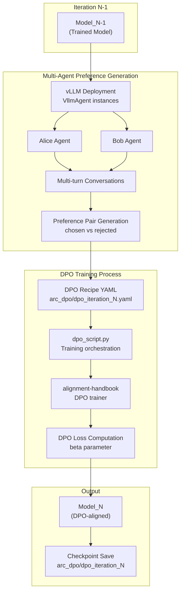
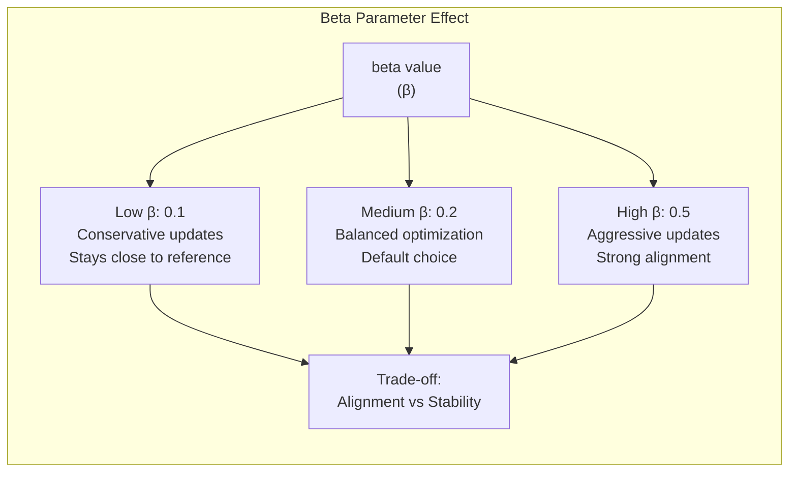
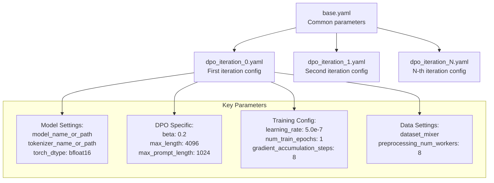
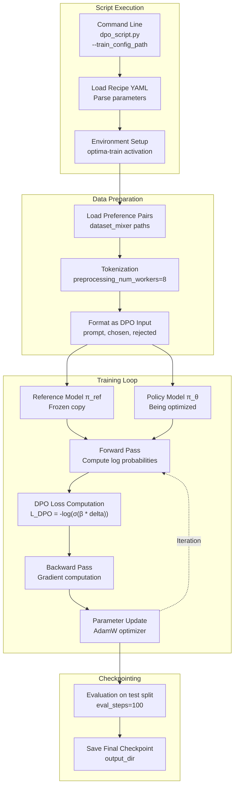

<!-- source: DeepWiki mcp.deepwiki.com · repo thunlp/Optima · page 3.3 Direct Preference Optimization (DPO) · fetched 2026-11-02 -->

# Direct Preference Optimization (DPO)

<details>
<summary>Relevant source files</summary>

The following files were used as context for generating this wiki page:

- [README.md](README.md)
- [alignment-handbook/recipes/Llama3-8b/arc_dpo/base.yaml](alignment-handbook/recipes/Llama3-8b/arc_dpo/base.yaml)
- [alignment-handbook/recipes/Llama3-8b/arc_dpo/dpo_iteration_0.yaml](alignment-handbook/recipes/Llama3-8b/arc_dpo/dpo_iteration_0.yaml)

</details>


## Purpose and Scope

This document explains the Direct Preference Optimization (DPO) methodology as implemented in Optima, including the mathematical foundations, the role of the beta parameter, and how DPO aligns language models with human preferences through iterative training. For information about the broader iterative training framework, see [Iterative Training Methods](#3.1). For details on the multi-agent system that generates preference data, see [Multi-Agent System Architecture](#3.2).

---

## DPO Methodology Overview

Direct Preference Optimization (DPO) is a preference learning algorithm that trains language models to align with human preferences without requiring explicit reward modeling or reinforcement learning. Unlike traditional RLHF (Reinforcement Learning from Human Feedback), DPO directly optimizes the policy using preference pairs.

### Key Principles

DPO operates on preference pairs consisting of:
- **Chosen response**: The preferred completion for a given prompt
- **Rejected response**: The less preferred completion for the same prompt

The algorithm adjusts model probabilities to increase the likelihood of chosen responses while decreasing the likelihood of rejected responses, controlled by a regularization parameter beta (β).

**Mathematical Foundation**

DPO minimizes the following loss:

```
L_DPO = -log(σ(β * log(π_θ(y_w|x) / π_ref(y_w|x)) - β * log(π_θ(y_l|x) / π_ref(y_l|x))))
```

Where:
- `π_θ` is the policy being trained
- `π_ref` is the reference policy (usually the model before DPO)
- `y_w` is the chosen (winning) response
- `y_l` is the rejected (losing) response
- `x` is the prompt
- `β` is the temperature parameter controlling optimization strength
- `σ` is the sigmoid function

Sources: [README.md:1-148]()

---

## DPO in Optima's Iterative Training

Optima implements DPO as part of its iterative training pipeline, where models from previous iterations generate preference data for subsequent training cycles. This creates a self-improvement loop that enhances both communication efficiency and response quality.

### Iterative DPO (iDPO) Pipeline



Sources: [README.md:72-81](), High-level architecture diagrams

### Training Settings

Optima supports three training configurations involving DPO:

| Setting | Description | Script | Use Case |
|---------|-------------|--------|----------|
| **iDPO** | Pure DPO training across iterations | `dpo_script.py` | When preference data is available from iteration 0 |
| **iSFT-DPO** | Combined SFT followed by DPO in each iteration | `sft_dpo_script.py` | Most common setting for balanced training |
| **SFT + DPO** | SFT in early iterations, DPO in later ones | Custom configuration | Progressive refinement strategy |

Sources: [README.md:58-92]()

---

## The Beta Parameter

The beta (β) parameter is the most critical hyperparameter in DPO training, controlling the strength of preference optimization relative to the reference model.

### Beta's Role

**Trade-off Control**:
- **Higher beta** (e.g., 0.5): Stronger preference enforcement, larger deviations from reference model
- **Lower beta** (e.g., 0.1): Gentler optimization, stays closer to reference model



Sources: [alignment-handbook/recipes/Llama3-8b/arc_dpo/base.yaml:13](), [alignment-handbook/recipes/Llama3-8b/arc_dpo/dpo_iteration_0.yaml:1]()

### Beta Configuration in Optima

The beta parameter appears in DPO recipe configurations:

```yaml
# From arc_dpo/base.yaml and dpo_iteration_0.yaml
beta: 0.2  # Default value used in Optima experiments
```

**Typical Beta Values**:
- `0.1`: Very conservative, minimal deviation from reference
- `0.2`: **Default in Optima** - balanced approach
- `0.5`: Aggressive optimization for strong alignment

**Tuning Guidelines**:
1. Start with `beta=0.2` for most tasks
2. Reduce to `0.1` if training becomes unstable
3. Increase to `0.3-0.5` if stronger preference enforcement is needed
4. Monitor evaluation metrics to assess alignment quality

Sources: [alignment-handbook/recipes/Llama3-8b/arc_dpo/base.yaml:13](), [alignment-handbook/recipes/Llama3-8b/arc_dpo/dpo_iteration_0.yaml:1]()

---

## DPO Recipe Configuration

DPO training in Optima is configured through YAML recipe files located in the `alignment-handbook/recipes/` directory structure.

### Configuration Hierarchy



Sources: [alignment-handbook/recipes/Llama3-8b/arc_dpo/base.yaml:1-36](), [alignment-handbook/recipes/Llama3-8b/arc_dpo/dpo_iteration_0.yaml:1-35]()

### Core DPO Parameters

| Parameter | Value | Description |
|-----------|-------|-------------|
| `beta` | `0.2` | DPO temperature parameter controlling optimization strength |
| `max_length` | `4096` | Maximum sequence length for chosen/rejected pairs |
| `max_prompt_length` | `1024` | Maximum length of the prompt portion |
| `learning_rate` | `5.0e-7` | Very low learning rate for stable preference learning |
| `num_train_epochs` | `1` | Single epoch to prevent overfitting |
| `gradient_accumulation_steps` | `8` | Effective batch size multiplier |
| `optim` | `adamw_torch` | Optimizer for DPO training |
| `lr_scheduler_type` | `cosine` | Learning rate schedule |
| `warmup_ratio` | `0.1` | Warmup portion of training |

Sources: [alignment-handbook/recipes/Llama3-8b/arc_dpo/base.yaml:1-36](), [alignment-handbook/recipes/Llama3-8b/arc_dpo/dpo_iteration_0.yaml:1-35]()

### Model and Data Configuration

**Model Settings** [alignment-handbook/recipes/Llama3-8b/arc_dpo/dpo_iteration_0.yaml:21-23]():
```yaml
model_name_or_path: ../checkpoints/arc_sft/iteration_0  # Reference model from SFT
tokenizer_name_or_path: /path/to/Meta-Llama-3-8B-Instruct  # Base tokenizer
torch_dtype: bfloat16  # Memory-efficient mixed precision
use_flash_attention_2: true  # Optimized attention implementation
```

**Dataset Configuration** [alignment-handbook/recipes/Llama3-8b/arc_dpo/dpo_iteration_0.yaml:3-7]():
```yaml
dataset_mixer:
  ../my_datasets/arc_dpo/iteration_0: 1.0  # DPO preference pairs
dataset_splits:
  - train
  - test
preprocessing_num_workers: 8  # Parallel data loading
```

Sources: [alignment-handbook/recipes/Llama3-8b/arc_dpo/dpo_iteration_0.yaml:1-35]()

---

## DPO Training Process

### Execution Flow



Sources: [README.md:72-81](), [alignment-handbook/recipes/Llama3-8b/arc_dpo/dpo_iteration_0.yaml:1-35]()

### Running DPO Training

**Command Structure**:
```bash
MKL_THREADING_LAYER=GNU python dpo_script.py \
    --train_config_path train/dpo_recipes/arc.yaml \
    --vllm_env optima-vllm \
    --alignment_env optima-train
```

**Parameters**:
- `train_config_path`: Path to DPO recipe YAML configuration
- `vllm_env`: Conda environment name for vLLM deployment (data generation)
- `alignment_env`: Conda environment name for training execution

Sources: [README.md:72-81]()

---

## Preference Data Requirements

DPO training requires datasets structured as preference pairs. In Optima, this data is generated through multi-agent interactions.

### Expected Data Format

Each training example must contain:

| Field | Description | Example |
|-------|-------------|---------|
| `prompt` | Input question or context | "Question: What is the capital of France?" |
| `chosen` | Preferred response | "The capital of France is Paris." |
| `rejected` | Less preferred response | "I think it might be Lyon or maybe Paris." |

### Data Location

DPO datasets are stored in iteration-specific directories:
```
my_datasets/
├── arc_dpo/
│   ├── iteration_0/
│   │   ├── train/
│   │   └── test/
│   ├── iteration_1/
│   └── ...
```

Sources: [alignment-handbook/recipes/Llama3-8b/arc_dpo/dpo_iteration_0.yaml:3-7]()

---

## Training Configuration Details

### Optimization Settings

The DPO training uses carefully tuned hyperparameters for stable preference learning:

**Learning Rate Schedule** [alignment-handbook/recipes/Llama3-8b/arc_dpo/dpo_iteration_0.yaml:15-18]():
- Initial learning rate: `5.0e-7` (very low for stability)
- Scheduler: `cosine` decay
- Warmup: `0.1` ratio (10% of training)

**Batch Configuration** [alignment-handbook/recipes/Llama3-8b/arc_dpo/dpo_iteration_0.yaml:11-12,27]():
- Per-device batch size: `1`
- Gradient accumulation: `8` steps
- Effective batch size: `8 × num_gpus`

**Memory Optimization** [alignment-handbook/recipes/Llama3-8b/arc_dpo/dpo_iteration_0.yaml:12-14,32-33]():
```yaml
gradient_checkpointing: true
gradient_checkpointing_kwargs:
  use_reentrant: false
bf16: true  # BFloat16 mixed precision
use_flash_attention_2: true  # Efficient attention
```

Sources: [alignment-handbook/recipes/Llama3-8b/arc_dpo/dpo_iteration_0.yaml:1-35]()

### Evaluation Strategy

DPO training includes periodic evaluation:

```yaml
do_eval: true
evaluation_strategy: steps
eval_steps: 100  # Evaluate every 100 training steps
```

This allows monitoring of:
- Training loss convergence
- Preference accuracy (how often chosen > rejected)
- Alignment quality on held-out test set

Sources: [alignment-handbook/recipes/Llama3-8b/arc_dpo/dpo_iteration_0.yaml:8-10]()

---

## DPO vs SFT Trade-offs

Understanding when to use DPO versus supervised fine-tuning (SFT) is crucial for optimal results.

| Aspect | SFT | DPO |
|--------|-----|-----|
| **Data Type** | Single correct responses | Preference pairs (chosen vs rejected) |
| **Training Signal** | Maximum likelihood | Preference ranking |
| **Best For** | Learning task format | Aligning to preferences |
| **Stability** | More stable | Requires careful tuning |
| **Beta Parameter** | N/A | Critical hyperparameter |
| **Use in Optima** | Initial iterations | After SFT, for refinement |

**Recommended Strategy**:
1. Start with iSFT to teach basic task competence
2. Apply iDPO to refine responses based on preferences
3. Use iSFT-DPO for combined benefits in each iteration

Sources: [README.md:58-92]()

---

## Integration with Alignment Handbook

Optima leverages the `alignment-handbook` framework for DPO implementation. The DPO trainer handles:

- Reference model management (frozen copy of initial model)
- DPO loss computation with beta parameter
- Preference pair processing
- Gradient computation and optimization

The integration allows Optima to focus on:
- Multi-agent preference data generation
- Iterative training orchestration
- Recipe configuration management
- Checkpoint and evaluation workflows

Sources: [README.md:48-50](), High-level architecture diagrams

---

## Key Takeaways

1. **DPO Purpose**: Direct preference optimization aligns models with human preferences without explicit reward modeling
2. **Beta Parameter**: Controls optimization strength; `0.2` is the default balanced value in Optima
3. **Iterative DPO**: Each iteration uses the previous model to generate preference data for the next
4. **Recipe Configuration**: YAML files specify all DPO parameters including beta, learning rate, and data paths
5. **Training Stability**: Low learning rate (`5.0e-7`), single epoch, and gradient checkpointing ensure stable training
6. **Complementary to SFT**: DPO refines models after SFT establishes basic competence

For implementation details on running DPO training, see [Training Scripts Reference](#6.1). For DPO recipe configurations, see [DPO Recipe Guide](#7.2).

---

