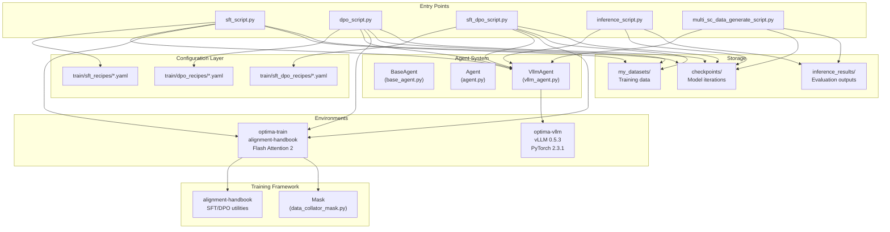
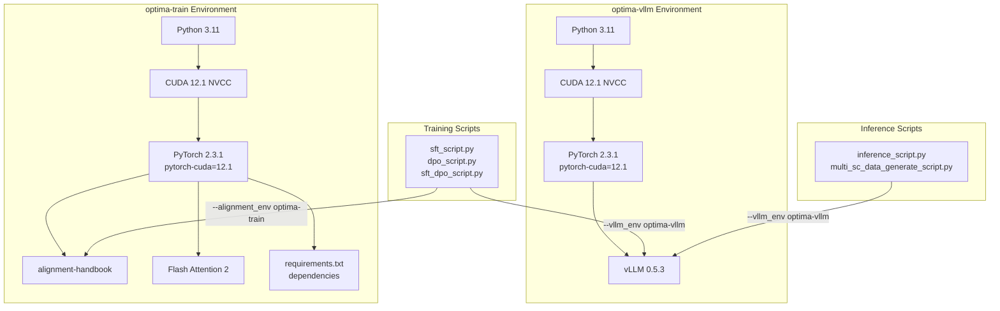
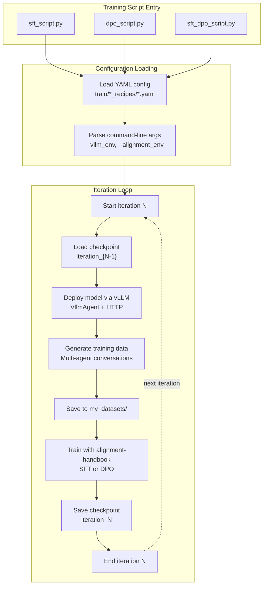
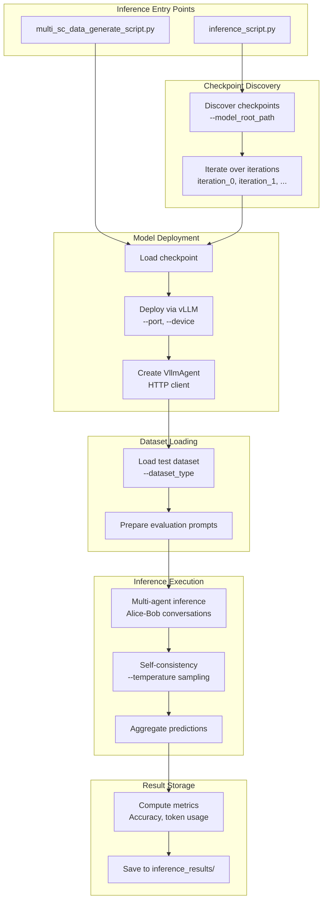
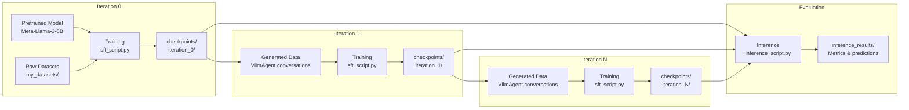

<!-- source: DeepWiki mcp.deepwiki.com · repo thunlp/Optima · page 4 System Architecture · fetched 2026-11-02 -->

# System Architecture

Relevant source files

The following files were used as context for generating this wiki page:

- [README.md](README.md)
- [README_revise.md](README_revise.md)

This document provides a technical overview of Optima's system architecture, including its component organization, dual-environment design, and pipeline flows. It serves as an entry point for understanding how the various parts of the system work together to enable iterative training of multi-agent systems.

For detailed information about specific architectural components, see:
- Dual environment setup and isolation: [Dual Environment Design](#4.1)
- Step-by-step training workflow: [Training Pipeline Flow](#4.2)
- Inference and evaluation workflow: [Inference Pipeline](#4.3)

## Architecture Overview

Optima implements a multi-component architecture organized around three primary subsystems: training orchestration, agent serving, and configuration management. The system employs a dual-environment design that separates model serving (`optima-vllm`) from training execution (`optima-train`) to enable concurrent operations and resource isolation.

**Sources:** [README.md:22-56](), [README.md:58-92](), [README.md:94-137]()

## Core Components

The system is organized into distinct components, each responsible for specific functionality:

| Component | Code Location | Purpose |
|-----------|--------------|---------|
| Training Scripts | `sft_script.py`, `dpo_script.py`, `sft_dpo_script.py` | Orchestrate iterative training workflows |
| Inference Scripts | `inference_script.py`, `multi_sc_data_generate_script.py` | Execute model evaluation and multi-agent data generation |
| Agent Classes | `base_agent.py`, `agent.py`, `vllm_agent.py` | Implement multi-agent communication interfaces |
| Recipe Configs | `train/sft_recipes/`, `train/dpo_recipes/`, `train/sft_dpo_recipes/` | Define training hyperparameters and dataset configurations |
| Data Collator | `alignment-handbook/src/alignment/data_collator_mask.py` | Implement completion-only masking for training |
| Datasets | `my_datasets/` | Store training and evaluation data |
| Checkpoints | `checkpoints/` | Store model weights at each iteration |
| Results | `inference_results/` | Store evaluation outputs and metrics |

**Sources:** [README.md:58-92](), [README.md:94-137]()

## Environment Architecture

Optima employs a dual-environment architecture that isolates model serving from training operations. This design enables concurrent execution of inference (for data generation) and training without resource conflicts.

**Key Design Decisions:**

- **Separate PyTorch Installations**: Each environment has its own PyTorch 2.3.1 installation with CUDA 12.1 support to prevent version conflicts
- **vLLM Isolation**: The `optima-vllm` environment is dedicated to model serving via vLLM 0.5.3, enabling efficient inference
- **Training Isolation**: The `optima-train` environment includes alignment-handbook and Flash Attention 2 for memory-efficient training
- **Command-Line Selection**: Training scripts accept `--vllm_env` and `--alignment_env` parameters to specify which environments to activate

See [Dual Environment Design](#4.1) for detailed setup instructions and rationale.

**Sources:** [README.md:22-56]()

## Training Pipeline Architecture

The training pipeline orchestrates iterative model refinement through supervised fine-tuning (SFT) and direct preference optimization (DPO). Each iteration involves checkpoint management, multi-agent data generation, and model training.

**Pipeline Components:**

1. **Configuration Loading**: Parses YAML recipe files from `train/sft_recipes/`, `train/dpo_recipes/`, or `train/sft_dpo_recipes/`
2. **Checkpoint Management**: Loads previous iteration models from `checkpoints/` directory
3. **vLLM Deployment**: Activates `optima-vllm` environment and deploys model via HTTP server
4. **Data Generation**: Uses `VllmAgent` instances to create multi-agent conversation data
5. **Dataset Storage**: Saves generated data to `my_datasets/` for training
6. **Model Training**: Activates `optima-train` environment and trains using alignment-handbook
7. **Checkpoint Saving**: Stores trained model in `checkpoints/iteration_N/`

See [Training Pipeline Flow](#4.2) for step-by-step execution details.

**Sources:** [README.md:58-92]()

## Inference Pipeline Architecture

The inference pipeline evaluates trained models on test datasets and implements multi-agent self-consistency for robust predictions.

**Inference Modes:**

| Script | Purpose | Key Parameters |
|--------|---------|----------------|
| `inference_script.py` | Batch evaluation of all checkpoints | `--model_root_path`, `--dataset_type`, `--device`, `--port` |
| `multi_sc_data_generate_script.py` | Multi-agent self-consistency | `--model_path`, `--temperature`, `--num_thread` |

**Workflow:**

1. **Checkpoint Discovery**: `inference_script.py` discovers all iteration checkpoints in `--model_root_path`
2. **Model Deployment**: Each checkpoint is deployed via vLLM in the `optima-vllm` environment
3. **Agent Creation**: `VllmAgent` instances are created to communicate with the deployed model
4. **Dataset Loading**: Test data is loaded based on `--dataset_type` (arc, hotpot_qa, etc.)
5. **Multi-Agent Inference**: Agents conduct conversations to solve tasks
6. **Result Aggregation**: Predictions are aggregated and metrics computed
7. **Storage**: Results saved to `inference_results/` directory

See [Inference Pipeline](#4.3) for detailed execution flow.

**Sources:** [README.md:94-137]()

## Data Flow

The following diagram illustrates how data flows through the system across iterations:

**Data Lifecycle:**

1. **Iteration 0**: Starts with pretrained model (e.g., Meta-Llama-3-8B-Instruct) and raw datasets from `my_datasets/`
2. **Generated Data**: Each iteration uses previous checkpoint to generate new training data via multi-agent conversations
3. **Checkpoints**: Models are saved to `checkpoints/iteration_N/` after each training phase
4. **Evaluation**: All checkpoints are evaluated via `inference_script.py`, results stored in `inference_results/`
5. **Feedback Loop**: Generated data from iteration N trains iteration N+1, creating continuous improvement

**Sources:** [README.md:58-92](), [README.md:94-137]()

## Component Interaction

The following table summarizes how components interact:

| Source Component | Target Component | Interaction Type | Purpose |
|------------------|------------------|------------------|---------|
| Training Scripts | Recipe Configs | File Read | Load hyperparameters and dataset configurations |
| Training Scripts | VllmAgent | Object Creation | Instantiate agents for multi-agent data generation |
| VllmAgent | vLLM HTTP Server | HTTP POST | Send inference requests to deployed models |
| Training Scripts | alignment-handbook | Subprocess Call | Execute training via command-line interface |
| alignment-handbook | Mask Data Collator | Import | Use completion-only masking during training |
| Training Scripts | Checkpoints | File Write | Save trained model weights |
| Inference Scripts | Checkpoints | File Read | Load models for evaluation |
| Inference Scripts | Results | File Write | Save evaluation metrics and predictions |

**Sources:** [README.md:22-137]()

## Key Architectural Patterns

### Environment Isolation Pattern
Training scripts activate different conda environments for different operations using subprocess calls. The `--vllm_env` parameter specifies the environment for model serving, while `--alignment_env` specifies the training environment. This enables concurrent operations without dependency conflicts.

### Iterative Refinement Pattern
Each training iteration generates data using the previous iteration's model. This creates a feedback loop where models progressively improve their multi-agent communication efficiency. The checkpoint directory structure (`iteration_0/`, `iteration_1/`, etc.) reflects this pattern.

### Agent Abstraction Pattern
The agent system uses inheritance (`BaseAgent` → `Agent`, `VllmAgent`) to provide different model serving backends. Training and inference scripts interact with agents through the common `BaseAgent` interface, enabling flexible deployment strategies.

### Recipe-Driven Configuration Pattern
All training parameters are externalized into YAML recipe files in `train/*/`. This enables reproducible experiments and systematic hyperparameter exploration without code modification.

**Sources:** [README.md:22-92]()

---

