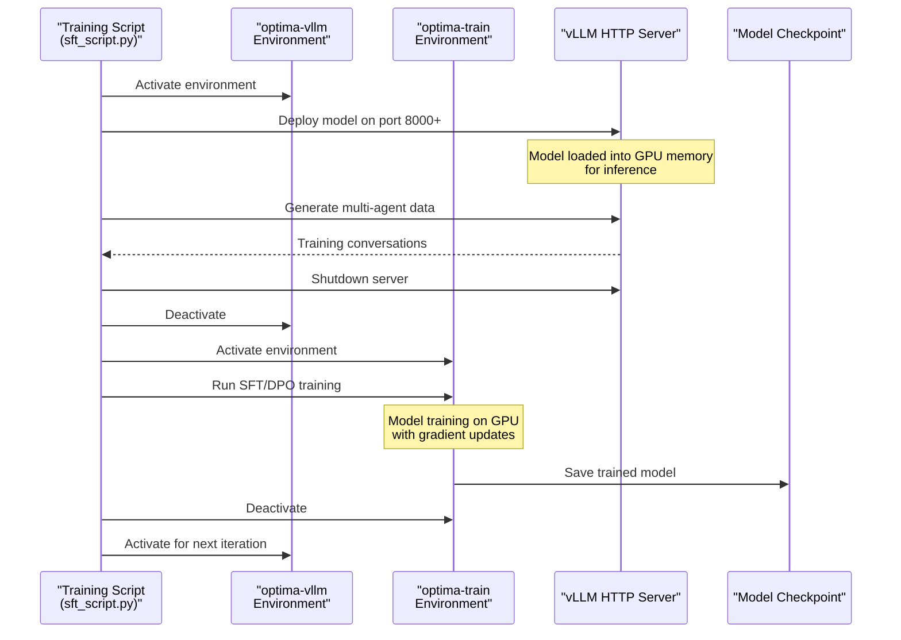
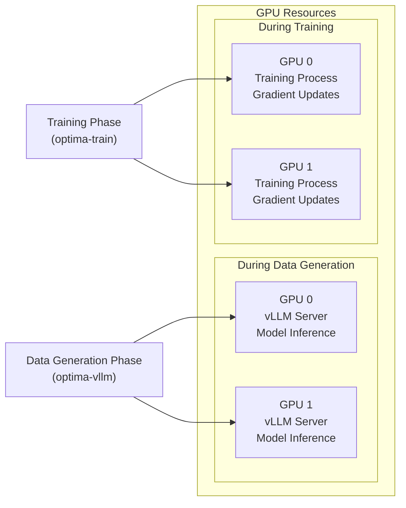

<!-- source: DeepWiki mcp.deepwiki.com · repo thunlp/Optima · page 4.1 Dual Environment Design · fetched 2026-11-02 -->

# Dual Environment Design

<details>
<summary>Relevant source files</summary>

The following files were used as context for generating this wiki page:

- [README.md](README.md)
- [README_revise.md](README_revise.md)

</details>


## Purpose and Scope

This document explains Optima's dual-environment architecture, which separates model serving from model training using two distinct conda environments: `optima-vllm` and `optima-train`. This design is fundamental to Optima's iterative training approach and enables efficient resource management during multi-agent data generation and model optimization.

For details on how these environments are used during training, see [Training Pipeline Flow](#4.2). For information on agent deployment within these environments, see [VllmAgent HTTP Communication](#5.2).

## Architecture Overview

Optima employs a dual-environment design to separate concerns and prevent resource conflicts during the iterative training process. The two environments serve distinct but complementary roles:

```mermaid
graph TB
    subgraph "optima-vllm Environment"
        VLLM["vLLM 0.5.3"]
        PyTorchVLLM["PyTorch 2.3.1"]
        CUDAToolkitVLLM["CUDA 12.1 NVCC"]
        ModelServing["Model Serving<br/>HTTP API on port 8000+"]
        
        VLLM --> ModelServing
        PyTorchVLLM --> VLLM
        CUDAToolkitVLLM --> VLLM
    end
    
    subgraph "optima-train Environment"
        AlignmentHandbook["alignment-handbook"]
        PyTorchTrain["PyTorch 2.3.1"]
        CUDAToolkitTrain["CUDA 12.1 NVCC"]
        FlashAttn["Flash Attention 2"]
        TrainingFramework["Training Framework<br/>SFT/DPO/SFT-DPO"]
        
        AlignmentHandbook --> TrainingFramework
        PyTorchTrain --> TrainingFramework
        FlashAttn --> TrainingFramework
        CUDAToolkitTrain --> TrainingFramework
    end
    
    subgraph "Training Scripts"
        SFTScript["sft_script.py"]
        DPOScript["dpo_script.py"]
        SFTDPOScript["sft_dpo_script.py"]
    end
    
    subgraph "Inference Scripts"
        InferenceScript["inference_script.py"]
        MultiSCScript["multi_sc_data_generate_script.py"]
    end
    
    SFTScript -->|"--vllm_env"| ModelServing
    SFTScript -->|"--alignment_env"| TrainingFramework
    
    DPOScript -->|"--vllm_env"| ModelServing
    DPOScript -->|"--alignment_env"| TrainingFramework
    
    SFTDPOScript -->|"--vllm_env"| ModelServing
    SFTDPOScript -->|"--alignment_env"| TrainingFramework
    
    InferenceScript -->|"--vllm_env"| ModelServing
    MultiSCScript -->|"--vllm_env"| ModelServing
```



**Dual Environment Architecture**: Training and inference scripts orchestrate both environments, using vLLM for model serving and the training environment for optimization.

Sources: [README.md:22-55](), [README_revise.md:16-46]()

## Environment Specifications

### optima-vllm Environment

The `optima-vllm` environment is dedicated to model serving using the vLLM inference engine. It provides high-throughput model deployment capabilities essential for multi-agent data generation.

| Component | Version | Purpose |
|-----------|---------|---------|
| Python | 3.11 | Base interpreter |
| CUDA NVCC | 12.1.0 | CUDA compilation toolkit |
| PyTorch | 2.3.1 | Deep learning framework with CUDA 12.1 support |
| vLLM | 0.5.3 | High-performance LLM inference engine |

Installation commands:
```bash
conda create -n optima-vllm python=3.11
conda activate optima-vllm
conda install nvidia/label/cuda-12.1.0::cuda-nvcc
conda install pytorch=2.3.1 torchvision torchaudio pytorch-cuda=12.1 -c pytorch -c nvidia
pip install vllm==0.5.3
```

This environment handles:
- Model deployment on HTTP endpoints (ports 8000+)
- Multi-agent conversation serving during data generation
- Batch inference for model evaluation
- Self-consistency sampling with temperature control

Sources: [README.md:26-37](), [README_revise.md:20-30]()

### optima-train Environment

The `optima-train` environment contains the training infrastructure, including the alignment-handbook framework and optimization tools.

| Component | Version | Purpose |
|-----------|---------|---------|
| Python | 3.11 | Base interpreter |
| CUDA NVCC | 12.1.0 | CUDA compilation toolkit |
| PyTorch | 2.3.1 | Deep learning framework with CUDA 12.1 support |
| alignment-handbook | Latest | Training framework for LLM alignment |
| Flash Attention 2 | Latest | Memory-efficient attention implementation |
| Additional dependencies | - | From requirements.txt |

Installation commands:
```bash
conda create -n optima-train python=3.11
conda activate optima-train
conda install nvidia/label/cuda-12.1.0::cuda-nvcc
conda install pytorch=2.3.1 torchvision torchaudio pytorch-cuda=12.1 -c pytorch -c nvidia
cd alignment-handbook
pip install -e .
pip install flash-attn --no-build-isolation
cd ../
pip install -r requirements.txt
```

This environment handles:
- Supervised fine-tuning (SFT)
- Direct preference optimization (DPO)
- Data preparation and tokenization
- Checkpoint management and saving

Sources: [README.md:39-55](), [README_revise.md:32-46]()

## Environment Interaction During Training

The two environments interact through a well-defined workflow orchestrated by the training scripts. The separation allows model serving to occur on dedicated GPU resources while training utilizes separate computational resources.



**Environment Orchestration During Training**: Training scripts coordinate between environments, ensuring clean transitions and resource management.

The key interaction points are:

1. **Model Deployment Phase**: The training script activates `optima-vllm` and deploys the current model checkpoint using vLLM on specified GPU devices and ports.

2. **Data Generation Phase**: Multi-agent conversations are generated using the deployed model, with VllmAgent instances making HTTP requests to the vLLM server.

3. **Environment Transition**: The vLLM server is shut down, GPU resources are released, and the script transitions to the training environment.

4. **Training Phase**: The training script activates `optima-train` and executes SFT or DPO training using the generated data, updating model weights and saving checkpoints.

5. **Iteration Loop**: The cycle repeats for the next iteration, using the newly trained checkpoint.

Sources: [README.md:58-92](), [README_revise.md:49-83]()

## Command-Line Interface

All training scripts accept command-line arguments to specify both environments, enabling flexible deployment across different system configurations.

### Training Script Parameters

```bash
MKL_THREADING_LAYER=GNU python sft_script.py \
    --train_config_path train/sft_recipes/arc.yaml \
    --vllm_env optima-vllm \
    --alignment_env optima-train
```

| Parameter | Type | Description |
|-----------|------|-------------|
| `--vllm_env` | string | Conda environment name for vLLM deployment and model serving |
| `--alignment_env` | string | Conda environment name for training with alignment-handbook |
| `--train_config_path` | string | Path to YAML configuration file specifying training parameters |

The same parameters apply to all training scripts:
- [sft_script.py](): For iterative supervised fine-tuning (iSFT)
- [dpo_script.py](): For iterative direct preference optimization (iDPO)
- [sft_dpo_script.py](): For combined iSFT-DPO training

Sources: [README.md:64-92](), [README_revise.md:54-83]()

### Inference Script Parameters

Inference scripts only require the `optima-vllm` environment since they perform no training:

```bash
python inference_script.py \
    --model_root_path ./checkpoints/arc_sft \
    --tokenizer_path ${pretrained_tokenizer_path} \
    --dataset_type arc \
    --device 0 \
    --port 8000 \
    --num_thread 128 \
    --output_root_path ./inference_results \
    --vllm_env optima-vllm
```

| Parameter | Type | Description |
|-----------|------|-------------|
| `--vllm_env` | string | Conda environment name for vLLM deployment |

The multi-agent self-consistency script follows the same pattern:

```bash
python multi_sc_data_generate_script.py \
    --model_path ./checkpoints/arc_sft/iteration_0 \
    --tokenizer_path ${pretrained_tokenizer_path} \
    --device 0 \
    --port 8000 \
    --dataset_type arc \
    --num_thread 128 \
    --output_path ./inference_results \
    --temperature 0.5 \
    --vllm_env optima-vllm
```

Sources: [README.md:94-137](), [README_revise.md:85-128]()

## Resource Management and Isolation

The dual-environment design provides critical resource management benefits that enable Optima's iterative training workflow:

### GPU Memory Isolation



**GPU Resource Allocation**: The dual-environment design ensures clean GPU memory transitions between serving and training phases.

Key isolation benefits:

1. **Memory Conflict Prevention**: Model serving and training never compete for GPU memory, as they execute in separate phases with explicit environment activation/deactivation.

2. **Library Version Compatibility**: Both environments use PyTorch 2.3.1 and CUDA 12.1, but maintain separate dependency installations, preventing version conflicts.

3. **Clean State Transitions**: Shutting down vLLM servers before training ensures no residual GPU memory allocation, maximizing available memory for gradient computation.

4. **Port Management**: vLLM servers bind to specific ports (8000+) during data generation, which are released before training, avoiding port conflicts.

Sources: [README.md:22-55]()

### Dependency Isolation

The two environments maintain separate dependency trees:

**optima-vllm dependencies:**
- Minimal set focused on inference: vLLM, PyTorch, CUDA toolkit
- Optimized for model serving throughput
- No training-specific libraries

**optima-train dependencies:**
- Complete training stack: alignment-handbook, Flash Attention, transformers, datasets, accelerate
- Data processing utilities
- Training optimization tools (DeepSpeed, PEFT)

This separation prevents:
- Dependency conflicts between serving and training libraries
- Unnecessary package installations in the serving environment
- Version mismatches that could affect reproducibility

Sources: [README.md:26-55](), [README_revise.md:20-46]()

## Practical Implications

### For Users

When running Optima training workflows, users must:

1. **Create Both Environments**: Follow the installation instructions to set up both `optima-vllm` and `optima-train` environments before executing any training scripts.

2. **Specify Environment Names**: Pass the correct environment names via `--vllm_env` and `--alignment_env` command-line arguments. These can be customized if different environment names are used.

3. **GPU Allocation**: Ensure sufficient GPU resources are available. During data generation, GPUs will be used for vLLM serving; during training, the same GPUs will be used for model optimization.

4. **Sequential Execution**: The training scripts handle environment switching automatically. Users should not manually activate/deactivate environments during script execution.

### For Developers

When extending Optima, developers should:

1. **Respect Environment Boundaries**: Code that deploys models should use the vLLM environment; code that trains models should use the training environment.

2. **Environment Orchestration**: Use subprocess calls with explicit conda environment activation when switching between environments, following the pattern in existing training scripts.

3. **Shared Dependencies**: Both environments share PyTorch 2.3.1 and CUDA 12.1, which must remain synchronized for consistent model handling.

4. **Port Management**: When deploying multiple vLLM servers, ensure proper port allocation to avoid conflicts (typically incrementing from base port 8000).

Sources: [README.md:58-137]()

## Environment Lifecycle Example

The following table illustrates a complete training iteration showing environment transitions:

| Phase | Active Environment | GPU Usage | Key Operations |
|-------|-------------------|-----------|----------------|
| Initial Setup | None | None | Load training configuration, prepare data paths |
| Model Deployment | optima-vllm | Inference | Deploy checkpoint on vLLM server (port 8000+) |
| Data Generation | optima-vllm | Inference | Generate multi-agent conversations via VllmAgent |
| Server Shutdown | optima-vllm | None | Release GPU memory, close HTTP ports |
| Training Setup | optima-train | None | Tokenize data, prepare training dataset |
| Model Training | optima-train | Training | Execute SFT/DPO with gradient updates |
| Checkpoint Save | optima-train | None | Save trained model to disk |
| Next Iteration | None | None | Loop to Model Deployment with new checkpoint |

This lifecycle repeats for each iteration (typically 4-5 iterations in Optima experiments), with each iteration building upon the previous checkpoint.

Sources: [README.md:58-92]()

---

